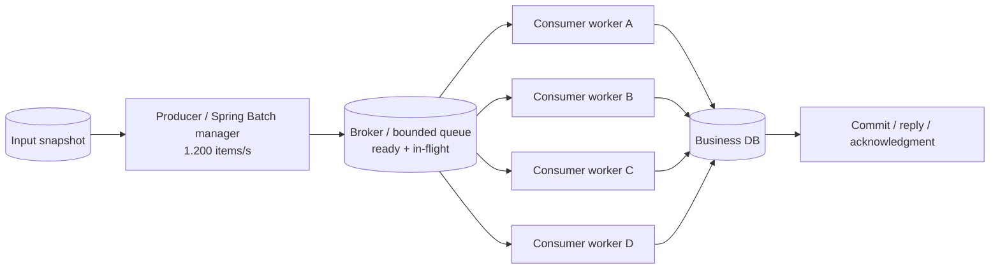
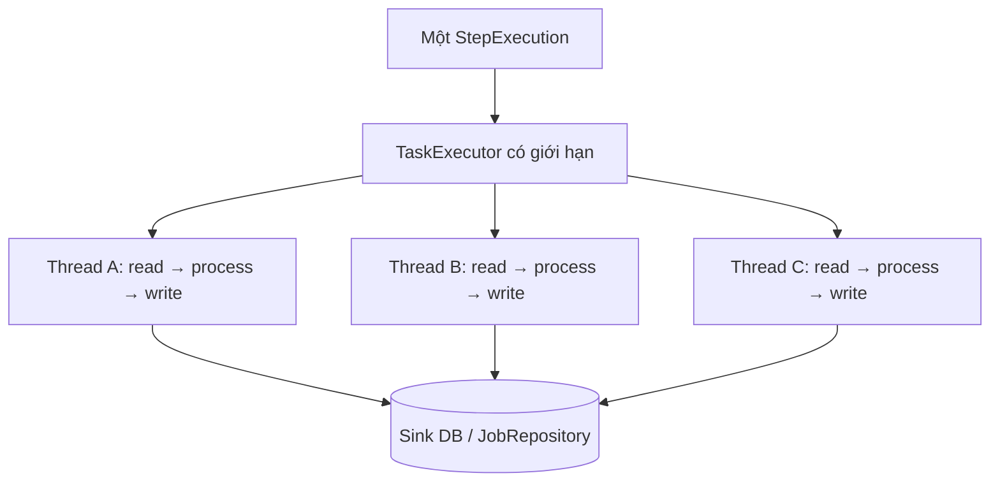
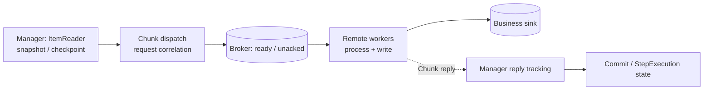

# Consumer chậm và backlog: thiết kế backpressure an toàn cho Spring Batch

## Mục tiêu bài học

Trong chương **Backpressure** của module **SPRING_BATCH_SCALING_OPERATIONS**, câu hỏi quan trọng không chỉ là *làm sao tăng số worker*, mà còn là: **Điều gì xảy ra khi nguồn tạo công việc nhanh hơn consumer có thể xử lý và commit?**

Với Spring Batch, câu hỏi này thường xuất hiện khi mở rộng một pipeline chunk-oriented sang **remote chunking**, **remote partitioning**, hoặc khi job chuyển dữ liệu qua message broker, staging queue, database polling và các thành phần bất đồng bộ. Consumer chậm có thể làm backlog tích tụ, tăng độ trễ, giữ nhiều item trong bộ nhớ, gây quá tải connection pool và sinh retry storm.

Sau bài này, bạn có thể:

- Định nghĩa chính xác **producer rate**, **consumer completion rate**, **backlog**, **in-flight**, **unacked**, **consumer lag** và **backpressure**.
- Phân biệt **backlog có thể xử lý** với backlog bị kẹt do poison message, retry, downstream transaction và reply đến trễ.
- Tính tốc độ tăng backlog, thời gian chạm ngưỡng, thời gian xả tồn và giới hạn capacity theo cùng đơn vị đo.
- Hiểu vì sao **read rate ≈ process rate** ở chunk step tuần tự không tự chứng minh không có bottleneck.
- Thiết kế bounded queue, giới hạn in-flight, broker prefetch/consumer concurrency và overload policy rõ ràng.
- Tách biệt cơ chế của **remote chunking** với **remote partitioning** và multi-threaded step.
- Giữ checkpoint, transaction, idempotency và restartability khi flow control hoặc broker redelivery làm item bị xử lý lại.
- Viết ví dụ Java mô phỏng producer–consumer có giới hạn, cùng chiến lược kiểm thử nghẽn tải và crash.
- Quan sát các chỉ số đủ để quyết định **scale consumer**, **giảm tốc producer**, **tối ưu writer**, hay **tạm dừng nhận thêm workload**.

> **Phạm vi:** Nội dung tham chiếu Spring Batch **5.2.x**, Java 17+, Spring Framework 6.x và mô hình middleware thông dụng. Backpressure trong bài là **nguyên tắc điều khiển áp lực giữa các thành phần**, không phải một API tự động có mặt ở mọi `ItemReader`/`ItemProcessor`. Các thuộc tính broker như prefetch, acknowledgment và consumer lag có semantics khác nhau giữa RabbitMQ, Kafka, JMS hoặc adapter của Spring Integration.

## 1. Tình huống: producer gửi nhanh hơn worker commit

Giả sử manager đọc payment từ snapshot và gửi work item/chunk vào broker. Hệ thống có bốn consumer workers ghi dữ liệu qua JDBC. Trong giờ cao điểm:

- Producer tạo tương đương **1.200 item/giây**.
- Tổng consumer chỉ xử lý và commit được **800 item/giây**.
- Broker tiếp tục nhận request thay vì buộc producer giảm tốc.
- Backlog tăng dần, dù các worker không báo lỗi nghiêm trọng.



Nếu backlog không bị giới hạn, chỉ trong vài phút hệ thống có thể giữ thêm hàng trăm nghìn item hoặc hàng nghìn chunk messages. Nhưng **giới hạn queue** không làm biến mất sự thiếu hụt capacity: khi đầy, cần **backpressure**, **admission control** hoặc chính sách tạm dừng/phân luồng rõ ràng để tránh mất dữ liệu.

**Mục tiêu cốt lõi:** Trong tải bền vững, hệ thống phải có **tốc độ hoàn tất công việc hữu ích** theo kịp tốc độ nhận mới; trong tải burst, buffer chỉ hấp thụ chênh lệch trong một khoảng thời gian hữu hạn.

### Consumer “chậm” có nghĩa gì?

Consumer có thể chậm do:

1. `ItemProcessor` tính toán CPU lâu.
2. Processor gọi API đồng bộ có p95/p99 latency cao.
3. Writer bị DB lock, deadlock, constraint contention hoặc connection pool thiếu.
4. Chunk quá lớn, commit lâu, listener/broker coi consumer không phản hồi.
5. Số worker thực tế thấp hơn cấu hình do thread pool queue, quota, CPU throttling hoặc worker bị crash.
6. Một số item là **poison messages**, retry mãi không hoàn tất.
7. Partition xử lý dữ liệu lệch (skew): phần lớn workload dồn vào một partition.
8. Worker đã commit nhưng acknowledgment/reply chậm hoặc mất; metric “chưa ack” chưa chắc là “chưa xử lý”.

Không nên lập tức tăng số consumer khi chỉ nhìn một queue depth cao. Phải xác định điểm nghẽn thật và **số item đã commit**, không chỉ số item được nhận.

## 2. Bảy khái niệm đo lường cần phân biệt

| Khái niệm | Định nghĩa | Điều không nên suy ra |
| --- | --- | --- |
| **Arrival rate (`λ`)** | Work items đến hàng đợi trong một giây | Không nhất thiết bằng số business items duy nhất |
| **Completion rate (`μ`)** | Work items đã được xử lý/commit thành công trong một giây | Không phải số poll/receive hoặc attempts |
| **Ready backlog** | Số messages sẵn sàng được giao mà chưa có consumer nhận | Chưa gồm work đang giữ bởi consumer |
| **In-flight / unacked** | Messages đã giao/chờ xác nhận, tùy broker semantics | Không đồng nghĩa worker chưa commit DB |
| **Consumer lag** | Độ trễ về vị trí/offset ở mô hình log như Kafka | Không tương đương hàng đợi ready trong RabbitMQ |
| **Backpressure** | Tín hiệu hoặc hành vi khiến upstream giảm/ngừng phát khi downstream không theo kịp | Không phải chỉ tăng kích thước queue |
| **Load shedding / admission control** | Từ chối/hoãn nhận mới theo chính sách khi quá tải | Không được âm thầm bỏ batch data cần xử lý |

### Ready, unacked và retry có thể nằm ở nhiều nơi

Với một hệ thống message-oriented, tổng lượng việc chưa kết thúc có thể bị chia ra:

```text
Work đang chờ / chưa xác nhận có thể ở:
  1) broker ready queue
  2) broker delivered nhưng chưa acknowledged
  3) client prefetch buffer
  4) local executor waiting queue
  5) worker thread đang xử lý
  6) delayed-retry queue / scheduled messages
  7) DLQ / quarantine cần xử lý thủ công
```

**Không cộng bừa** tất cả các số đếm như những tập rời nhau: “unacked” của broker có thể **bao gồm** cả client prefetch buffer lẫn messages đang thực sự chạy. Cần lập sơ đồ nơi message nằm và định nghĩa tập nào bao tập nào trước khi tổng hợp.

### “Received” khác “Committed”

Một worker có thể nhận message thành công, đưa vào local queue rồi ack ngay. Nếu JVM chết trước khi ghi business DB, broker sẽ không redeliver được phần việc đó theo acknowledgment policy đã chọn. Ngược lại, worker có thể **commit DB thành công rồi crash trước broker ack**, dẫn tới redelivery và xử lý lại.

Do đó, **receive rate** và **ack rate** chỉ là chỉ báo giao thức; KPI cuối cùng thường là **business-committed throughput**, đối soát theo khóa nghiệp vụ.

## 3. Công thức cơ bản: backlog tăng nhanh ra sao?

Với một khoảng thời gian mà các đơn vị được định nghĩa nhất quán:

```text
lambda = work items mới đi vào backlog mỗi giây
mu     = work items hoàn tất và rời backlog mỗi giây
Q(t)   = backlog tại thời điểm t

dQ/dt  ≈ lambda - mu

Nếu lambda > mu: backlog tăng.
Nếu lambda = mu: backlog gần ổn định trong mô hình lý tưởng.
Nếu lambda < mu: backlog có thể được xả dần.
```

Đây là **mô hình fluid approximation**. Trên hệ thống thật, arrivals và completions theo lô, worker có service-time distribution, retry/redelivery và timeout. Phải làm rõ **item** là payment, chunk, message hay partition trước khi áp dụng.

### Ví dụ 1 — backlog tăng

```text
Arrival:    1.200 item/s
Completion:   800 item/s
Chênh lệch:  400 item/s

Sau 5 phút:
  400 × 300 = 120.000 item backlog tăng thêm
```

Nếu mỗi item cần trung bình 2 KiB payload chưa nén, riêng payload thêm vào khoảng:

```text
120.000 × 2 KiB = 240.000 KiB ≈ 234,4 MiB
```

**Đây không phải tổng RAM/đĩa thật của broker.** Message envelope, metadata, index, replication, serialization, headers, client buffers và retention có thể làm dung lượng cao hơn nhiều. Với remote chunking, **một message có thể chứa nhiều items**, nên tính capacity phải quy đổi theo cả số message, chunk size và bytes.

### Ví dụ 2 — queue chạm giới hạn

Giả sử buffer được phép giữ tối đa **50.000 item** và ban đầu trống. Chênh lệch là 400 item/s:

```text
T_fill ≈ Q_capacity / (lambda - mu)
       = 50.000 / 400
       = 125 giây
```

Con số chỉ đúng khi capacity tính theo **cùng đơn vị** và rates không đổi. Khi chạm giới hạn, hệ thống phải **block**, hoãn producer, từ chối request có kiểm soát hoặc chuyển sang nguồn bền vững có giới hạn; không thể tiếp tục enqueue vô hạn vào RAM.

### Ví dụ 3 — thời gian xả backlog

Sau đợt cao điểm, backlog còn 120.000 items. Nguồn giảm xuống 500 item/s, worker vẫn hoàn tất được 800 item/s:

```text
Net drain rate = 800 - 500 = 300 item/s
T_drain        = 120.000 / 300 = 400 giây
```

Nếu arrival vẫn 1.200 item/s và completion chỉ 800 item/s, **không có thời gian xả backlog hữu hạn**: hệ thống đang tiếp tục tụt lại.

## 4. Backlog count và backlog age: cần đo cả hai

Một queue có 10.000 messages có thể rất nghiêm trọng nếu công việc phải hoàn tất trong 30 giây, nhưng có thể bình thường nếu toàn bộ SLA là vài giờ. Ngược lại, queue chỉ có 20 messages nhưng message lâu nhất chờ 45 phút có thể báo hiệu consumer mắc kẹt.

**Hai metric tối thiểu:**

- **Backlog depth:** số đơn vị công việc đang chờ, có phân biệt ready và in-flight.
- **Age of oldest actionable work:** thời gian công việc cũ nhất chưa được hoàn tất/giải quyết đang chờ.

Một dashboard tốt còn nên hiển thị:

```text
arrival_items_per_second
committed_items_per_second
queue_ready_messages
queue_unacked_messages
inflight_chunks
retry_scheduled_messages
oldest_work_age_seconds
worker_active
worker_failures_per_minute
business_output_coverage
```

“Oldest work age” phải được định nghĩa nhất quán: có thể là tuổi message ở broker hoặc tuổi business work order tính từ lúc nhận. Nếu message được redeliver và tạo timestamp mới, **broker message age** có thể thấp dù nghiệp vụ chờ rất lâu.

### Little's Law chỉ dùng khi phù hợp

Ở **trạng thái ổn định** với cùng một phạm vi đo:

```text
L = lambda × W

L      = trung bình số work items trong phạm vi đó
lambda = throughput đến/ra ổn định (items/s)
W      = thời gian trung bình work item ở phạm vi đó (s)
```

Ví dụ: queue ổn định trung bình có 4.000 items, dòng ra khoảng 800 item/s, thời gian chờ trung bình ở queue gần:

```text
4.000 / 800 = 5 giây
```

Không dùng Little's Law để biến mọi `Q / current_rate` thành “độ trễ p95”, đặc biệt khi backlog đang tăng nhanh, có poison messages, drop, retry hoặc một số consumer bị kẹt. p95/p99 cần được đo từ timestamp ở item/hệ thống theo đúng phạm vi.

## 5. Spring Batch có backlog ở đâu?

### 5.1. Local chunk-oriented step tuần tự

Trong một chunk step thông thường:

```text
read -> process -> read -> process -> ... -> write chunk -> commit
```

`ItemReader` và `ItemProcessor` không mặc nhiên là **hai stage độc lập** với queue ở giữa. Processor chậm sẽ làm reader đọc chậm theo. Vì vậy **read rate ≈ process rate** trên toàn step không chứng minh pipeline khỏe hoặc không có bottleneck.

Muốn tìm nguyên nhân, hãy đo:

- Thời gian `read()`, `process()` và `write(Chunk)`.
- Thời gian transaction/commit và `JobRepository` update.
- CPU, heap/GC, DB pool, lock wait, external API latency.
- Input rate và **business committed rate** trong cùng cửa sổ.

**Không** thêm một queue vô hạn giữa reader và processor chỉ để tăng read rate đo được. Điều đó có thể biến bottleneck vốn hữu hạn thành rủi ro OutOfMemoryError hoặc mất checkpoint khi crash.

### 5.2. Multi-threaded step

Nếu thêm `TaskExecutor` vào chunk-oriented step, nhiều chunk có thể tiến hành song song. Nhưng một chunk vẫn đi qua read/process/write theo mô hình của nó; **Spring Batch không tự biến reader và processor thành hai microservices nối với nhau bằng queue**.



Ở đây, overload có thể đến từ **executor waiting queue**, DB connection pool hoặc số transaction đang mở. Khi tăng thread count, cần xem thread safety và restart: `@StepScope` gắn với `StepExecution`, **không tạo một reader riêng cho mỗi chunk thread**.

Một `ThreadPoolTaskExecutor` có queue capacity giới hạn chưa chắc tạo backpressure theo nghĩa mong muốn; khi queue đầy, chính sách reject hoặc chạy tại caller thread sẽ quyết định kết quả. Phải hiểu cách **Step/PartitionHandler** xử lý rejection và rollback.

### 5.3. Local partitioning

Manager chia input thành worker `StepExecution` riêng, thường chạy trên executor giới hạn. Backlog có thể là **các partition đang đợi thread**, nhưng worker chưa bắt đầu không nhất thiết đã tạo một message ở broker.

Mục tiêu là giữ số partition active phù hợp CPU/DB pool. Tăng `gridSize` rất lớn có thể tạo nhiều StepExecution và metadata overhead, không đảm bảo throughput tăng.

### 5.4. Remote partitioning

Manager gửi **yêu cầu thực thi StepExecution** tới worker process qua transport. Worker thường **tự có reader** dựa trên `ExecutionContext` của partition. Backlog có thể nằm ở các work requests đợi xử lý, worker in-flight hoặc các partition quá lớn.

**Không dùng số item đọc tại manager làm arrival rate** của remote partitioning nếu manager không đọc item. Hãy dùng partition request rate, worker-start rate, per-partition read/commit metrics và số partition chưa hoàn tất.

### 5.5. Remote chunking

Trong remote chunking:

- **Manager giữ ItemReader**, chia item thành `ChunkRequest` rồi dispatch qua middleware.
- **Worker nhận chunk**, chạy processor/writer và gửi kết quả/reply theo protocol.
- Manager quản lý hoàn tất của step và metadata/checkpoint.
- Broker có thể giữ messages đang chờ; manager có thể có các chunk requests **in-flight** cần correlation.



**Quan trọng:** Không phải mọi cấu hình remote chunking đều cho producer gửi vô hạn. Logic dispatch, request/reply và tài nguyên bước chạy có thể đã **giới hạn số chunk đang chờ**. Phải đo actual in-flight, throughput và broker metrics trước khi kết luận broker backlog lớn. Nếu manager chờ reply rồi không dispatch thêm, consumer chậm biểu hiện thành **manager throughput thấp**, có thể không thấy ready queue tăng.

Backpressure ở đây không chỉ là “queue đầy”; nó có thể là **manager bị chặn chờ completion**. Tối ưu phải bảo toàn correlation, timeout, retry và khả năng restart.

## 6. Các giới hạn tạo thành một chuỗi, nút nhỏ nhất thường thắng

Một hệ thống có thể có:

```text
Scheduler admission
    -> manager read/dispatch rate
    -> broker capacity / publisher quota
    -> consumer prefetch / in-flight budget
    -> worker executor concurrency
    -> external API / CPU / DB pool
    -> business commit
    -> reply / ack / JobRepository update
```

Giới hạn ở downstream là **capacity hiệu dụng** của pipeline. Ví dụ worker pool có 32 thread nhưng DB pool chỉ cho 8 connection, mỗi transaction giữ connection lâu: thêm thread có thể chỉ làm `pending connections` tăng.

### Tại sao “tăng queue size” không phải cách chữa?

Queue lớn hơn giúp hấp thụ burst **lâu hơn**, không tăng `μ`. Nếu `λ=1.200`, `μ=800` liên tục, dù queue lớn gấp mười lần thì nó vẫn tăng 400 item/s; bạn chỉ dời thời điểm quá tải.

Queue lớn còn làm:

- Thời gian chờ cũ nhất tăng.
- Chi phí bộ nhớ/đĩa và retention tăng.
- Tạo một lượng công việc lớn phải giải quyết khi rolling deploy.
- Khi retry/stale request nhiều, recovery khó đối soát.
- Backlog trông có vẻ “ổn” đến khi broker disk watermark hoặc JVM heap hết.

Cần **giới hạn đầu vào** hoặc **thêm throughput thật** bằng cách sửa nút thắt.

## 7. Các tầng backpressure thực tế

| Tầng | Cơ chế | Ưu điểm | Cạm bẫy |
| --- | --- | --- | --- |
| **Producer admission** | Work-order quota, rate limit, tạm dừng scheduler | Không sinh backlog vượt ngân sách | Phải lưu/yêu cầu lại công việc có chủ đích |
| **Manager in-flight budget** | Giới hạn số chunk requests chưa xác nhận | Khống chế RAM, broker pressure, timeout fan-out | Không giải phóng slot khi kết quả gửi/commit chưa rõ |
| **Bounded application queue** | `ArrayBlockingQueue`, executor queue capacity | Backpressure hữu hạn ở một process | Không thay broker durable; crash mất item trong RAM |
| **Broker QoS** | Consumer prefetch/flow control/publisher confirmation | Giới hạn delivery và bảo vệ broker | Config khác giữa transports; unacked có thể vẫn cao |
| **Worker concurrency** | Thread pool, consumer concurrency, semaphore | Giới hạn API/DB pressure | Tăng quá mức gây contention và timeout |
| **Retry budget** | Max attempts, exponential backoff, delayed retry, DLQ | Ngăn poison messages chiếm hết worker | Delayed queue cũng tiêu tài nguyên, cần retention |
| **Downstream pool** | JDBC pool, API concurrency limiter | Giữ sink ổn định | Pool nhỏ quá làm thông lượng thấp; pool lớn quá làm DB sập |

**Nguyên tắc:** Đặt giới hạn ở **trước chỗ tiêu tốn tài nguyên**. Một queue bounded nằm sau khi producer đã tải 20 GB item vào RAM không giải quyết vấn đề memory.

## 8. Ví dụ Java: queue bounded minh họa backpressure

Đây là một mô hình **Java thuần** để hiểu producer–consumer, **không phải thay thế sẵn có cho Spring Batch remote chunking**. Nó giúp thấy khác biệt giữa producer bị chặn và việc bỏ message.

### 8.1. Producer chỉ đưa vào queue có sức chứa hữu hạn

```java
public record WorkItem(String runKey, long paymentId) {}

BlockingQueue<WorkItem> queue =
        new ArrayBlockingQueue<>(500);

// Trong một producer thread:
void submit(WorkItem item) throws InterruptedException {
    queue.put(item); // BLOCK khi queue đủ 500 items.
}
```

`put` có ý nghĩa **backpressure trực tiếp**: producer phải đợi consumer lấy item. Nếu producer được gọi từ một HTTP endpoint cần trả nhanh hoặc từ message listener có timeout nghiêm ngặt, **blocking vô hạn không phải policy tốt**; thay `put` bằng `offer(item, timeout, unit)` và trả tín hiệu overload phù hợp.

```java
boolean accepted =
        queue.offer(item, 200, TimeUnit.MILLISECONDS);

if (!accepted) {
    // Không "thả" item rồi coi như hoàn thành.
    // Để upstream giữ ownership hoặc retry theo backoff/admission policy.
    throw new IllegalStateException("Consumer capacity exhausted");
}
```

Code trên dành cho một ứng dụng đang giữ ownership nguồn. **Không** tự động translate thành “throw exception là broker sẽ không mất message”: điều đó phụ thuộc acknowledgment mode và transaction của adapter.

### 8.2. Worker lấy item nhưng không ack nguồn quá sớm

```java
while (!Thread.currentThread().isInterrupted()) {
    WorkItem item = queue.take(); // BLOCK khi queue trống.

    try {
        processAndCommit(item);
    } catch (TransientDownstreamException ex) {
        // Gửi vào delayed retry bền vững hoặc để upstream redeliver
        // theo policy. Không tự đưa vô hạn trở lại queue này.
        handleRetryableFailure(item, ex);
    } catch (PermanentBusinessException ex) {
        // Quarantine/DLQ hoặc fail theo hợp đồng nghiệp vụ.
        handlePermanentFailure(item, ex);
    }
}
```

`processAndCommit`, `handleRetryableFailure` và `handlePermanentFailure` là hàm ứng dụng phải cài đặt; đây là **pseudocode Java có cấu trúc**, không phải một end-to-end service chạy ngay. Khi dùng broker, acknowledgment/offset phải theo **ranh giới commit đã xác định**, không dựa trên việc item vừa được dequeue khỏi local RAM queue.

**Một điểm quan trọng:** `ArrayBlockingQueue` chỉ sống trong RAM. Khi process chết, items trong queue sẽ biến mất nếu upstream đã ack và không có nguồn replay. Vì vậy, ứng dụng Spring Batch cần nguồn dữ liệu có thể đọc lại, broker durable, transactional outbox hoặc work-order table để khôi phục; **bounded RAM queue không phải durable checkpoint**.

## 9. In-flight budget cho request/reply của manager

Trong mô hình manager–worker dùng request/reply, một cách **minh họa** để hạn chế request chưa có kết quả cuối là cấp slot trước khi dispatch.

### 9.1. Bộ giới hạn dùng Semaphore

```java
public final class InFlightBudget {

    private final Semaphore permits;
    private final ConcurrentMap<String, Boolean> pending =
            new ConcurrentHashMap<>();

    public InFlightBudget(int maxInFlight) {
        if (maxInFlight <= 0) {
            throw new IllegalArgumentException("maxInFlight must be positive");
        }
        permits = new Semaphore(maxInFlight);
    }

    public boolean reserve(
            String correlationId, Duration maxWait)
            throws InterruptedException {

        boolean granted = permits.tryAcquire(
                maxWait.toMillis(), TimeUnit.MILLISECONDS);
        if (!granted) {
            return false;
        }

        if (pending.putIfAbsent(correlationId, Boolean.TRUE) != null) {
            permits.release();
            throw new IllegalArgumentException(
                    "Duplicate correlationId: " + correlationId);
        }

        return true;
    }

    public void onConfirmedTerminal(String correlationId) {
        if (pending.remove(correlationId) != null) {
            permits.release();
        }
    }

    public int availableSlots() {
        return permits.availablePermits();
    }

    public int pendingCount() {
        return pending.size();
    }
}
```

`reserve` phải được gọi **trước khi gửi** request. Khi không còn slot, manager ngừng/hoãn dispatch cho đến khi đủ capacity. `onConfirmedTerminal` chỉ được gọi sau **kết quả cuối đã được xác nhận**, không phải ngay khi message được broker tiếp nhận.

### 9.2. Đừng release slot khi timeout mà chưa biết worker đã commit

Giả sử:

1. Manager reserve slot cho `chunk-123`.
2. Broker nhận request.
3. Worker commit DB nhưng reply bị mất.
4. Manager hết timeout.

Nếu manager **release slot và phát chunk-123 mới ngay** mà không reconcile, hệ thống có thể có hai request trùng đang tiến hành hoặc side effect đã hoàn tất một lần nhưng không biết. Một timeout chỉ nói **manager chưa có xác nhận**, không nói worker chưa commit.

Cách xử lý an toàn cần:

- Correlation ID ổn định cho đúng logical request.
- Trạng thái `UNKNOWN/TIMED_OUT` có thể lưu bền vững.
- Query JobRepository/business sink để kiểm tra completion.
- Idempotency per business item/operation trước khi retry.
- Giới hạn số request đang không rõ kết quả; có cảnh báo/đường xử lý thủ công khi quá hạn.

**Caveat:** Class `InFlightBudget` trên là demo in-memory; nó **không tự persist pending requests**, không triển khai leader election, distributed semaphore, request store hay giải quyết reply trễ sau manager restart. Không cắm nó vào Spring Batch bằng cách sửa tùy tiện protocol của `ChunkRequest`/`ChunkResponse` mà không kiểm thử. Dùng như một nguyên tắc thiết kế hoặc thành phần bổ sung khi hạ tầng thực sự cần, và kiểm tra flow-control có sẵn trong manager implementation trước.

### 9.3. Admission khác acknowledgment

Một message được publish thành công tới broker mới chỉ xác nhận **broker đã nhận** theo chính sách publish confirm. Việc worker **xử lý và commit** là bước khác; việc manager **ghi nhận completion** là bước khác nữa.

```text
Producer admitted
   != broker stored
   != consumer received
   != worker committed business data
   != manager recorded terminal completion
```

Khi thiết kế metrics, tách các ranh giới này để biết backlog nằm ở đâu.

## 10. Broker prefetch, acknowledgment và consumer concurrency

Không có một thông số “backpressure=true” dùng chung cho mọi middleware. Cần hiểu transport đang dùng và ý nghĩa các metric.

### 10.1. RabbitMQ: ready khác unacked

RabbitMQ hỗ trợ consumer prefetch (QoS) để giới hạn số delivery chưa ack mà broker gửi cho consumer theo policy tương ứng.

Ví dụ:

```text
Prefetch per consumer = 16
Active consumers      = 4

Upper bound lý thuyết của unacked do prefetch:
  khoảng 16 × 4 = 64 deliveries
```

Đây là minh họa với cấu hình per-consumer; connection/channel settings và cách framework phân phối delivery có thể thay đổi. **Không phải mọi unacked delivery đều đang thực sự được process**: một số nằm trong consumer/client buffer.

Nếu tăng prefetch lên 1.000 trong khi processing mỗi message mất 5 giây, worker có thể giữ hàng nghìn deliveries chưa ack. Broker `ready` giảm nhưng backlog **không hề được xử lý xong**; chỉ chuyển từ ready sang unacked.

**Điều cần đo:** `ready`, `unacked`, ack/s, redelivery/s, oldest age, consumer utilization, worker actual committed/s và round-trip reply.

### 10.2. Kafka: consumer lag không phải queue ready

Kafka dùng partitioned append-only log và consumer group offsets. Consumer lag thường được biểu diễn gần bằng khoảng cách giữa **log-end offset** và **committed/observed consumer position** theo phạm vi tính.

```text
Consumer group lag (đơn giản hóa)
    = log-end offsets - consumer group committed offsets
```

Các đặc điểm khác RabbitMQ:

- Consumer đọc/poll records; records vẫn tồn tại trong log theo retention.
- Một record đã được xử lý có thể **chưa commit offset**, nên lag vẫn cao.
- Nếu commit offset trước business transaction rồi crash, có nguy cơ **mất xử lý**.
- Nếu commit DB rồi crash trước offset commit, có thể **replay**; writer phải idempotent.
- Consumer group có giới hạn song song theo **số partitions có thể phân công**; thêm worker vượt số partition không giúp tương ứng.
- Batch xử lý quá lâu có thể ảnh hưởng `max.poll.interval.ms`/rebalance; cần thiết kế polling và processing phù hợp.

Không áp dụng nguyên xi broker prefetch, ack và DLQ của RabbitMQ cho Kafka. Với Kafka, dùng pause/resume partitions, fetch/poll tuning, bounded handoff và commit-offset policy thích hợp.

### 10.3. JMS / Spring Integration adapters

Với JMS hoặc Spring Integration inbound/outbound adapters, kiểm tra:

- Transaction scope của message consumption và business write.
- Acknowledge mode, session transacted hay broker redelivery.
- Listener/container concurrency.
- Error channel, retry advice, DLQ/redelivery policy.
- Max messages in-flight, executor queue, shutdown behavior.
- Message correlation và reply timeout của remote chunking/partitioning.

**Không** giả định mọi listener nhận message tự động bị broker gửi lại nếu handler throw: behavior phụ thuộc container, transaction và broker setup.

## 11. Slow consumer vì downstream chậm: tăng worker có phải đáp án?

Tăng worker chỉ giúp nếu công việc có thể song song và bottleneck còn headroom.

| Dấu hiệu | Giả thuyết đáng kiểm tra | Hướng xử lý trước |
| --- | --- | --- |
| CPU worker ~100%, DB dư, item độc lập | Processor CPU-bound | Tối ưu algorithm; tăng worker theo core/quota |
| CPU thấp, process p99 cao, nhiều HTTP timeout | External API-bound | Concurrency limiter, batching/cache, timeout/backoff |
| DB pool pending cao, lock wait tăng | Writer/DB-bound | Giảm concurrency, batch writes, index/query và transaction tuning |
| Broker ready tăng, workers idle | Delivery/config/routing lỗi | Kiểm tra bindings, consumer subscription, permission |
| Ready thấp, unacked rất cao | Prefetch quá lớn hoặc worker đang kẹt | Hạ prefetch, kiểm tra in-flight/ack latency |
| Retry/redelivery rate tăng | Lỗi transient hoặc poison item | Giảm retry amplification, DLQ, điều tra nguyên nhân |
| Kafka lag chỉ tăng trên một partition | Skew/hot key hoặc stalled consumer | Kiểm tra partition assignment, dữ liệu nóng |
| Manager remote chunk không dispatch thêm, reply chậm | In-flight/reply handling hoặc worker commit chậm | Đo pending chunks, late replies, worker sink |
| Queue depth ổn định nhưng oldest age tăng | Một số item kẹt, starvation | Theo dõi age per cohort, retry/poison |
| Throughput tăng rồi giảm khi scale | Saturation/contension | Tìm sweet spot bằng benchmark |

### Công thức capacity giản lược

Nếu mỗi consumer xử lý trung bình một item trong `L` giây và có `C` consumers thực sự làm việc song song:

```text
mu_ideal ≈ C / L   items/giây

Ví dụ:
  L = 20 ms = 0,020 s
  C = 8
  mu_ideal ≈ 8 / 0,020 = 400 items/s
```

Đây là **ước lượng ở điều kiện tải ổn định**, chưa kể connection pool, network, CPU contention, commit, retry và overhead. Nếu `L` tăng khi concurrency tăng, throughput có thể không tăng theo `C`.

Với remote chunking, một message có thể chứa `B` item, vì vậy throughput theo message không đổi trực tiếp sang item/s nếu chunk sizes khác nhau:

```text
mu_items ≈ mu_chunks × effective_items_per_chunk
```

`effective_items_per_chunk` phải xem filter/skip, item sizes và số thực sự commit, không chỉ `chunkSize` cấu hình.

## 12. Chunk size: cải thiện throughput hay tăng in-flight risk?

Ví dụ một worker xử lý 100 items/chunk:

- Overhead broker per message có thể giảm so với 1 item/message.
- JDBC batching có thể hiệu quả hơn.
- Nhưng một chunk cần nhiều thời gian, memory và rollback work hơn.
- Nếu broker ack deadline hoặc manager reply timeout quá ngắn, chunk lớn có thể bị retry dù worker vẫn đang chạy.
- Một chunk chứa poison item có thể gây retry/recovery nhiều công việc xung quanh.

| Tình huống | Chunk nhỏ | Chunk lớn |
| --- | --- | --- |
| Overhead request/reply | Cao hơn mỗi item | Thường thấp hơn mỗi item |
| In-flight bytes | Nhỏ hơn mỗi request | Lớn hơn |
| Rollback/retry cost | Ít item phải replay | Nhiều item bị ảnh hưởng |
| DB transaction hold time | Thường ngắn hơn | Có thể dài hơn |
| Broker reply timeout risk | Thường thấp hơn | Có thể cao hơn |
| Throughput tối ưu | Phụ thuộc CPU/DB/network | Phụ thuộc batch effect và giới hạn |

**Không tăng chunk size chỉ vì queue messages nhiều.** Nếu worker bị API quota hoặc DB lock contention, chunk lớn có thể khiến thời gian phản hồi xấu hơn. Đo throughput nghiệp vụ, p95 commit, số retries, reply latency và peak memory trước/sau.

## 13. Retry storm: backlog có thể tự nhân lên

Giả sử nguồn mới tạo 500 unique items/s, mỗi item lỗi tạm thời và bị retry trung bình hai lần. Nếu retries cùng đi vào work queue và được đếm như messages:

```text
New business items:     500 items/s
Extra retry attempts: 1.000 attempts/s
Total processing demand ≈ 1.500 attempts/s
```

Ngay cả khi consumer hoàn tất 1.000 attempts/s, **tỷ lệ công việc nghiệp vụ mới được commit có thể rất thấp**. Nếu dashboard chỉ ghi `processed_attempts/s`, hệ thống sẽ có **ảo giác throughput cao**.

### Chính sách retry hợp lý

1. Phân loại lỗi transient vs permanent.
2. Đặt số attempts tối đa, deadline hoặc retry budget.
3. Dùng exponential backoff + jitter khi hạ tầng/adapter hỗ trợ.
4. Đưa work thất bại vào **delayed retry channel bền vững**, thay vì quay vòng tight loop.
5. Sau ngưỡng, chuyển DLQ/quarantine với lý do và correlation, đồng thời phát cảnh báo.
6. Đối soát thứ tự/idempotency trước khi replay DLQ.
7. Không dùng `skip(Exception.class)` để biến lỗi hạ tầng thành completed item.

**DLQ không đồng nghĩa item đã hoàn tất nghiệp vụ.** Nếu payment bắt buộc phải xử lý, job có thể phải FAILED/không publish cho đến khi tất cả items trong DLQ được giải quyết đúng policy.

### Tránh head-of-line blocking

Một poison message làm consumer retry ngay 100 lần có thể giữ thread lâu, chặn items lành. Với partition/order-sensitive streams như Kafka, việc bỏ qua hoặc đưa record ra retry queue có thể làm thay đổi đảm bảo ordering. Cần thiết kế theo business key và delivery ordering trước khi áp dụng retry bất đồng bộ.

## 14. Ack, transaction và idempotency: khôi phục sau backlog mà không mất item

Có ba mốc sự kiện quan trọng:

1. Consumer nhận work.
2. Business side effect được commit.
3. Broker ack/offset được ghi nhận hoặc manager nhận reply.

Chúng **không luôn nằm trong cùng một distributed transaction**.

### Failure windows

| Lỗi xuất hiện | Khả năng xảy ra | Cơ chế bảo vệ |
| --- | --- | --- |
| Crash **trước commit DB**, chưa ack | Broker có thể redeliver; chưa có output mới | Rollback và retry/restart đúng |
| Commit DB xong, crash **trước ack** | Message có thể được gửi lại | Unique business key/idempotency |
| Ack/offset trước DB commit, sau đó crash | Item có thể không được redeliver dù chưa ghi | Không ack sớm; dùng transaction/outbox phù hợp |
| Worker commit nhưng manager mất reply | Manager không biết đã hoàn tất; có thể timeout/replay | Correlation, idempotent sink, reconciliation |
| Manager restart, pending chunk IDs in-memory mất | In-flight không rõ ai sở hữu | JobRepository/broker state + runbook |
| Consumer timeout lúc DB transaction vẫn đang chạy | Hai attempt có thể cùng ghi | Fencing/ownership policy, unique constraints |
| Broker durable nhưng TTL hết hạn trước xử lý | Work biến mất theo retention/expiry | Sizing retention, audit, alert và policy rõ |
| Queue full và producer silently drops | Mất item khó phát hiện | Fail-fast/park producer, durable work order |

### SQL unique key cho business output

```sql
CREATE TABLE normalized_payment (
    run_key         varchar(160) NOT NULL,
    payment_id      bigint NOT NULL,
    operation_ver   varchar(40) NOT NULL,
    payload_hash    varchar(64) NOT NULL,
    net_amount      numeric(18,2) NOT NULL,
    PRIMARY KEY (run_key, payment_id, operation_ver)
);
```

Một writer PostgreSQL có thể dùng:

```sql
INSERT INTO normalized_payment
    (run_key, payment_id, operation_ver, payload_hash, net_amount)
VALUES
    (:runKey, :paymentId, :operationVer, :payloadHash, :netAmount)
ON CONFLICT (run_key, payment_id, operation_ver) DO NOTHING;
```

Khóa đó ổn định qua **retry/restart cùng JobInstance**. Không dùng `JobExecutionId` hay delivery tag của broker làm idempotency key duy nhất vì chúng có thể thay đổi khi chạy lại.

**Cẩn trọng:** `DO NOTHING` chỉ chống trùng row. Nếu cùng business key được replay với `payload_hash` khác, SQL sẽ **im lặng giữ row cũ**. Production cần phát hiện mismatch (theo transaction/query/constraint hoặc reconciliation), báo lỗi và điều tra snapshot/version. Không đánh đổi integrity để giảm backlog.

### Outbox và inbox

Với side effect ngoài database, một mô hình là:

- Writer commit business data và **outbox event** trong cùng transaction DB.
- Một publisher độc lập phát outbox tới broker, có retry và dedupe.
- Consumer có **inbox/processed-message key** để xử lý delivery lặp.
- Job không coi “publisher đã enqueue” là business completion cho đến khi hợp đồng nghiệp vụ xác định rõ.

Outbox/inbox giúp thu hẹp các failure windows nhưng vẫn cần định nghĩa trạng thái cuối cùng, deduplication và reconciliation; nó không tự mang lại exactly-once toàn hệ thống nếu tất cả downstream không hỗ trợ.

## 15. Backpressure và restart/checkpoint trong Spring Batch

Trong chunk-oriented step, `StepExecutionContext` thường giữ tiến độ reader/writer được framework persist quanh commit point. Với remote chunking, manager đọc input và quản lý step, trong khi worker ghi output ở process/resource khác.

**Từ đó:**

- Nếu manager đã đọc/dispatch nhưng chưa xác nhận worker xử lý, không thể chỉ dựa vào vị trí reader trong RAM để coi các item đã hoàn tất.
- Khi job FAILED và restart, cùng chunk/item có thể xuất hiện lại do rollback/replay.
- Nếu producer bị block trong lúc đã giữ một transaction lâu, khả năng tăng lock wait và timeout có thể xấu hơn.
- `JobInstance` phải giữ identifying params, snapshot và run key ổn định; tạo `run.id` mới để né lỗi restart có thể tái đọc toàn bộ input.
- Worker nên có idempotency per business key, không phụ thuộc attempt ID.
- JobRepository status `STARTED` sau process crash không chứng minh worker đã dừng. Cần kiểm tra in-flight, DB writes và message lifecycle.

### Không giữ queue in-memory như checkpoint duy nhất

Một worker nhận 50 messages, ack nguồn rồi đưa chúng vào local queue 1.000 phần tử. Nếu process chết, toàn bộ 50 messages có thể mất. `ArrayBlockingQueue` có ích để giới hạn memory, nhưng **không làm state bền vững**.

Đặt quyền sở hữu trên nguồn durable, broker ack sau commit, hoặc lưu work order/inbox transactionally. Với remote partitioning, `StepExecutionContext` giữ ranh giới partition và reader state giúp phục hồi; với remote chunking, request/reply correlation và manager checkpoint quyết định phần việc cần replay.

## 16. Đo bottleneck bằng Micrometer/Prometheus

Các metric dưới đây là **đề xuất application-level**, không phải tên series mặc định bắt buộc của Spring Batch hoặc broker:

| Metric logic | Type | Cách đọc |
| --- | --- | --- |
| `batch_work_arrived_total` | Counter | Work items hoặc chunks mới vào phạm vi giám sát |
| `batch_work_committed_total` | Counter | Business work đã commit thành công, không tính attempts lặp |
| `batch_work_attempted_total` | Counter | Số lượt xử lý (có thể gồm retry) |
| `batch_work_failed_total` | Counter | Lỗi theo class/nhóm nguyên nhân |
| `batch_work_redelivered_total` | Counter | Delivery lại, không nhất thiết là item nghiệp vụ mới |
| `batch_queue_ready` | Gauge | Broker/application ready queue ở một phạm vi |
| `batch_queue_unacked` | Gauge | Broker delivered but unacked ở một phạm vi |
| `batch_inflight_chunks` | Gauge | Manager requests chưa xác nhận terminal |
| `batch_oldest_work_age_seconds` | Gauge | Tuổi của công việc cũ nhất chưa giải quyết |
| `batch_worker_active` | Gauge | Worker threads đang xử lý thực |
| `batch_worker_commit_seconds` | Timer/Histogram | Thời gian ghi + commit ở boundary đã xác định |
| `batch_job_recovery_seconds` | Timer | Từ fail được phát hiện đến khi hoàn tất recovery |

### Ví dụ query tốc độ, với series đã được export đúng tên

```promql
# Arrival rate, đơn vị work items/s:
sum(rate(batch_work_arrived_total[5m]))

# Committed business rate:
sum(rate(batch_work_committed_total[5m]))

# Attempt amplification:
sum(rate(batch_work_attempted_total[5m]))
/
clamp_min(sum(rate(batch_work_committed_total[5m])), 0.001)

# Backlog trend, chỉ đúng khi các counter cùng boundary/đơn vị:
sum(rate(batch_work_arrived_total[5m]))
-
sum(rate(batch_work_committed_total[5m]))
```

**Đừng copy tên metric như một mặc định của framework.** Bạn phải cấu hình instrumentation exporter và kiểm tra tên series thực trên endpoint metrics. Nếu counter arrivals ở **chunks** nhưng counter committed ở **items**, phép trừ là vô nghĩa.

### Gắn nhãn có kiểm soát

Nên dùng nhãn số lượng hữu hạn:

```text
job_name
step_name
consumer_role
queue_name
outcome
exception_family
worker_pool
```

Không đưa `paymentId`, `JobExecutionId`, `runKey` hoặc request correlation ID ngẫu nhiên vào **mọi time series**. High-cardinality tags có thể làm monitoring trở thành nút thắt. Chi tiết mỗi execution/item nên lưu trong structured logs, traces và audit DB.

### Tại sao chỉ số broker không đủ?

- Ready thấp có thể vì prefetch cao, không phải vì consumer hoàn tất nhanh.
- Unacked tăng có thể do worker xử lý chậm hoặc ack được cấu hình sai.
- Kafka lag cao có thể do offset chưa commit dù DB đã ghi, không chắc chưa xử lý.
- Retry attempts/s tăng có thể che committed business/s thấp.
- Manager remote chunk pending thấp có thể vì dispatch bị block, còn throughput vẫn không đạt SLA.

**Bộ chỉ số tối thiểu:** arrivals, business commits, retry/redelivery, ready/in-flight, oldest age, worker active và downstream latency.

## 17. Cảnh báo theo xu hướng, không chỉ một ngưỡng depth

Ví dụ hệ thống có SLA work item được xử lý trong 10 phút. Một policy vận hành minh họa:

| Tín hiệu | Mức chú ý | Hành động gợi ý |
| --- | --- | --- |
| Arrival > committed 10 phút liên tiếp | Warning về backlog tăng | Khoanh vùng consumer/DB bottleneck |
| Oldest actionable work age > 5 phút | Warning trước SLA | Kiểm tra worker slow/poison, cân nhắc admission |
| Oldest age > 10 phút | SLA breach | Kích hoạt runbook, ưu tiên recovery |
| Broker bytes/quota > 80% | Cảnh báo capacity | Hạn chế producer, tăng retention/disk có kế hoạch |
| Unacked cao, ready thấp | Chưa chắc tốt | Kiểm tra prefetch, stuck consumers |
| Retry amplification > 3 trong cửa sổ | Lỗi/poison có thể áp đảo | Backoff, DLQ, điều tra failure |
| Business committed rate ≈ 0 và ready > 0 | Critical | Xem consumer availability/DB outage |
| Kafka lag tăng ở đúng 1 partition | Skew/consumer stuck | Xem assignment, hot key, ordering |

Các ngưỡng **chỉ là ví dụ**, không phải khuyến nghị chung cho mọi SLA. Hãy xây ngưỡng từ baseline, yêu cầu nghiệp vụ, dung lượng broker và thời gian cần để xử lý khi phát hiện incident.

**Cần hai chiều cảnh báo:** độ lớn backlog và **backlog age**. Một queue độ sâu nhỏ nhưng message cũ rất lâu vẫn có thể vi phạm nghiêm trọng.

## 18. Tuning theo thứ tự: consumer, broker, producer

### Bước 1 — Xác thực dữ liệu đo

Xác định đơn vị là item, chunk hay message; cùng run/snapshot, cùng time window. Tách unique business work khỏi attempts/retry.

### Bước 2 — Kiểm tra consumer còn khỏe không

Nhìn CPU, GC, thread dumps, DB pool pending, API timeouts, lock waits, queue ack rate, oldest age và dead-letter count. Nếu workers idle nhưng broker ready tăng, vấn đề có thể nằm ở binding/consumer subscription, không phải thiếu worker.

### Bước 3 — Xác định throughput trần của sink

Nếu DB chỉ commit 800 items/s khi chạy 8 workers và giảm còn 700 khi tăng lên 16, cần tối ưu DB/transaction/index/lock chứ không tăng số consumers tiếp.

### Bước 4 — Giới hạn in-flight/prefetch

Giữ tổng work đã dispatch nhưng chưa hoàn tất nằm trong ngân sách, kể cả retry và client buffers. Prefetch nên đủ để worker không bị đói, nhưng không cao đến mức giấu backlog trong `unacked` và làm khó graceful shutdown.

### Bước 5 — Áp dụng backpressure upstream

Khi buffer gần đầy, tạm hoãn tạo thêm work; trả busy/retry-after cho yêu cầu không bắt buộc, hoặc để scheduler giữ work order bền vững cho lần sau. Không silently drop dữ liệu kế toán.

### Bước 6 — Retry và DLQ có ngân sách

Thay vòng retry nóng bằng backoff/jitter/attempt cap. Giữ DLQ và audit để biết business item nào chưa được giải quyết; không đánh dấu Job COMPLETED nếu hợp đồng không cho phép bỏ qua.

### Bước 7 — Scale dần và benchmark

Thử 2, 4, 8 consumers theo từng nấc với cùng snapshot và load; đo committed throughput, p95 commit, queue age, recovery behavior và resource contention. Dừng tăng khi throughput không cải thiện hoặc retry/rollback tăng.

### Bước 8 — Kiểm tra restart và late replies

Trước khi đưa cấu hình vào production, kiểm thử crash consumer/manager tại các ranh giới ack/commit; đo business output coverage và idempotency.

## 19. Benchmark minh họa: queue to không phải throughput lớn

Số liệu trong bảng **giả định** để luyện đọc:

| Cấu hình | Consumer | Prefetch/message | Broker ready cao nhất | Committed items/s | p95 DB commit |
| --- | ---: | ---: | ---: | ---: | ---: |
| Baseline | 2 | 8 | 30.000 | 450 | 80 ms |
| Tăng worker | 4 | 8 | 16.000 | 820 | 110 ms |
| Tăng worker | 8 | 8 | 12.000 | 950 | 270 ms |
| Tăng worker mạnh | 16 | 32 | 5.000 | 890 | 900 ms |
| 8 workers + prefetch vừa | 8 | 12 | 10.000 | 970 | 190 ms |

Ở cấu hình 16 workers, broker ready có vẻ thấp, nhưng DB commit p95 tăng mạnh và committed throughput lại giảm. Một phần work có thể đã chuyển sang unacked. **Không kết luận cấu hình 16 workers tốt nhất chỉ vì ready queue thấp**.

Khi so benchmark, luôn giữ cố định:

- Input snapshot, phân phối item sizes, ratio filter/skip.
- Broker durability/replication, ack/commit semantics.
- Database schema/index, connection pool và quotas.
- Số partition, concurrency, chunk size.
- Fail/retry injection và phương pháp cleanup giữa các run.
- Business output invariant và trạng thái JobInstance.

## 20. Kiểm thử backlog và recovery

### 20.1. Unit test queue bounded không nhận vượt capacity

```java
@Test
void boundedQueueReportsCapacityExhaustion() throws Exception {
    BlockingQueue<Integer> queue = new ArrayBlockingQueue<>(2);

    assertTrue(queue.offer(10));
    assertTrue(queue.offer(20));

    boolean accepted =
            queue.offer(30, 50, TimeUnit.MILLISECONDS);

    assertFalse(accepted);
    assertEquals(2, queue.size());

    assertEquals(10, queue.take());
    assertTrue(queue.offer(30));
}
```

Test này xác minh **behavior của queue RAM**, không chứng minh Spring Batch restart hoặc broker durable.

### 20.2. Unit test in-flight budget

```java
@Test
void inflightBudgetReleasesOnlyOnConfirmedCompletion()
        throws Exception {

    InFlightBudget budget = new InFlightBudget(2);

    assertTrue(budget.reserve("chunk-1", Duration.ZERO));
    assertTrue(budget.reserve("chunk-2", Duration.ZERO));
    assertFalse(budget.reserve("chunk-3", Duration.ZERO));

    // Timeout transport chưa phải terminal completion.
    assertEquals(0, budget.availableSlots());

    budget.onConfirmedTerminal("chunk-1");

    assertEquals(1, budget.availableSlots());
    assertTrue(budget.reserve("chunk-3", Duration.ZERO));
    assertEquals(0, budget.availableSlots());

    // Duplicate reply không được release permit lần hai.
    budget.onConfirmedTerminal("chunk-1");
    assertEquals(0, budget.availableSlots());
}
```

Demo cho nguyên tắc không giải phóng slot từ retry/duplicate reply, nhưng **chưa hỗ trợ persistence qua crash** và chưa có xử lý ambiguous publish/timeout. Nếu dùng thật, cần request store, định nghĩa terminal state và recovery coordinator.

### 20.3. Test consumer chậm tạo backlog

Trong một test producer/consumer async có bounded queue:

1. Producer tạo khoảng **100 work items/s**.
2. Consumer chỉ xử lý khoảng **60 work items/s**.
3. Queue capacity 50 items, không silently drop.
4. Xác minh producer bị block hoặc nhận overload outcome theo policy khi queue đầy.
5. Sau khi dừng producer, consumer xả queue đến 0 và tất cả committed business keys đủ.
6. So measured arrival/completion rates và backlog trend; dùng tolerance vì scheduler/thread timing không chính xác từng milli-giây.

**Không giả lập bằng cách sleep trong production processor.** Dùng fake worker và clock/test synchronization có kiểm soát.

### 20.4. Test fail sau commit trước ack

Với broker thật (ví dụ Testcontainers và adapter tương ứng):

1. Gửi chunk/item có stable business key.
2. Worker commit output vào DB.
3. Tiêm lỗi/crash trước acknowledgment hoặc reply cuối.
4. Broker redeliver/retry theo policy; worker có thể chạy lại.
5. Xác minh business output chỉ còn một row hợp lệ/operation, không bị overwrite sai payload.
6. Kiểm tra manager/JobExecution state và recovery đúng protocol.

Nếu chỉ test bằng fake in-memory queue, không thể chứng minh broker redelivery, transaction và publisher confirm đúng.

### 20.5. Test manager timeout khi worker vẫn đang chạy

- Dùng barrier để worker dừng sau khi đã bắt đầu transaction.
- Manager timeout nhưng worker chưa được xác nhận là chết.
- Xác minh không tự dispatch job/partition duplicate không được bảo vệ.
- Thử worker hoàn thành trễ và reply trễ.
- Đối soát JobRepository, business sink và correlation.
- Chỉ cho phép restart theo runbook đã định và idempotency.

### 20.6. Test retry storm và DLQ

Tạo một poison item luôn lỗi, 99 item hợp lệ. Nếu policy là 3 attempts tối đa:

- Poison item không quay vô hạn vào ready queue.
- Hệ thống có một record DLQ/quarantine với nguyên nhân và business key.
- Các item hợp lệ vẫn được commit và không bị starve.
- Job final status/phát báo cáo tuân đúng policy: có thể FAILED hoặc COMPLETED có skip/quarantine chỉ khi nghiệp vụ cho phép.
- Không khẳng định tất cả input đã thành công chỉ dựa vào queue depth về 0.

## 21. Runbook khi backlog tăng đột biến

1. **Khoanh phạm vi:** job/step, work-order key, broker queue/group, thời điểm bắt đầu, SLA, affected snapshot và nguồn dữ liệu.
2. **Đo cùng cửa sổ:** arrival rate, committed rate, ready/unacked/in-flight, oldest age, redelivery, DLQ và worker active.
3. **Phân loại:** consumer chậm thật, không có consumer, poison message, DB/API quá tải, prefetch quá cao, manager chờ reply hay metric sai đơn vị.
4. **Kiểm tra in-flight:** biết worker nào đang commit và ack/reply nào chưa rõ; không ngầm giả định timeout là chưa commit.
5. **Bảo vệ downstream:** giảm concurrency nếu DB lock/pool nghẽn; tránh retry storm làm incident nặng thêm.
6. **Áp backpressure sớm:** tạm dừng scheduler/publisher hoặc giới hạn admissions; work bắt buộc phải nằm trong nguồn bền vững.
7. **Giải quyết poison:** đưa vào quarantine/DLQ theo policy; không silently skip item bắt buộc.
8. **Tăng capacity có kiểm chứng:** scale consumers khi CPU/API/DB còn headroom, không vượt số Kafka partitions hoặc quota hạ tầng.
9. **Đối soát sau ổn định:** số business keys expected vs committed, payload/version, duplicate, missing, DLQ chưa xử lý.
10. **Khôi phục job:** nếu JobExecution FAILED/STOPPED, restart **cùng JobInstance** sau khi worker in-flight được giải quyết; đừng thêm identifying `run.id` mới để lách metadata.
11. **Ghi sự cố:** thời điểm backlog đạt đỉnh, nguyên nhân, guardrail đã kích hoạt, time-to-drain, lost/duplicate business actions và cải thiện hệ thống.
12. **Kiểm thử hồi quy:** overload, backpressure, broker redelivery, process crash và late reply trên kiến trúc thực.

## 22. Anti-pattern thường gặp

| Sai lầm | Hậu quả | Cách sửa |
| --- | --- | --- |
| “Consumer chậm thì tăng queue vô hạn” | Delay/OOM/disk đầy, không tăng throughput | Bounded buffers + capacity/admission |
| “Ready queue giảm tức là đã xử lý xong” | Prefetch chuyển việc sang unacked | Theo dõi cả ready, unacked, commit/s |
| Ack ngay khi nhận vào RAM queue | Crash làm mất item | Ack theo durable commit boundary |
| Commit DB rồi crash trước ack không có dedupe | Redelivery gây duplicate | Business key idempotency/inbox |
| Timeout là bằng chứng worker chưa commit | Hai attempts ghi cùng dữ liệu | Correlation + reconciliation |
| Tăng consumer vô hạn | DB pool/locks/API quota bão hòa | Tuning theo bottleneck, concurrency cap |
| Prefetch rất lớn để “xả” broker ready | Hidden backlog, uneven distribution | Prefetch phù hợp service time |
| Retry lập tức vô hạn | Retry storm, starvation | Backoff + attempts cap + DLQ |
| Dùng attempts/s làm committed throughput | Ảo giác tiến độ tăng | Business-committed metric |
| Dùng `StepExecution.writeCount` làm số row INSERT mới | Sai với UPSERT/rollback | SQL đối soát business sink |
| Thêm queue giữa reader/processor rồi bỏ ItemStream | Mất checkpoint/restart semantics | Preserve stream lifecycle, durable ownership |
| Dùng `JobExecutionId` để dedupe worker output | ID đổi khi restart | Stable runKey + business item ID |
| Đọc queue depth khác unit với process rate | Công thức backlog sai | Quy đổi item/chunk/message thống nhất |
| Scale Kafka consumers vượt số partitions | Không tăng parallelism hữu ích | Xem partition assignment và lag skew |
| Chuyển poison item sang DLQ rồi coi job hoàn tất | Che thiếu dữ liệu | Business status và audit đúng |
| Không xử lý reply trễ trong remote chunking | Replay vô ích, state sai | Correlation, timeout policy, reconciliation |
| Đổi snapshot/partition map giữa restart | Bỏ sót/trùng item | Frozen input/plan theo JobInstance |

## 23. Checklist triển khai production

- [ ] Xác định **đơn vị** của arrivals, completions, backlog: item, chunk, message hay partition.
- [ ] Biết giới hạn của broker ready, unacked, client buffers, executor queue và manager in-flight.
- [ ] Có đo **oldest actionable work age** và backlog trend, không chỉ queue depth.
- [ ] Queue tại process bounded; producer có hành vi block/reject/defer rõ, không silently drop.
- [ ] Work bắt buộc được lưu bền vững trước khi ack nguồn hoặc bỏ quyền sở hữu.
- [ ] Biết broker semantics: Rabbit prefetch, Kafka offsets/lag hoặc JMS transaction/ack mode.
- [ ] Đặt concurrency theo CPU, DB pool, API quotas và throughput đã đo.
- [ ] Retry có phân loại lỗi, backoff, max attempts, DLQ/quarantine và audit.
- [ ] Có idempotency per business key và phát hiện payload mismatch khi redelivery.
- [ ] Với remote chunking, phân biệt manager reader, dispatch in-flight, worker commit và reply.
- [ ] Với remote partitioning, đo worker reader/StepExecution riêng, không coi manager có item read rate.
- [ ] `StepExecutionContext` và `ItemStream` được giữ đúng ranh giới checkpoint.
- [ ] Cùng JobInstance giữ identifying params, snapshot, run key và partition plan ổn định khi restart.
- [ ] Không coi manager timeout là worker đã dừng; có cơ chế drain/fencing/reconcile.
- [ ] Có test bounded queue, slow consumer, fail sau commit trước ack, late reply và poison item.
- [ ] Dashboard có arrivals/s, committed/s, retries, queue ready/unacked, lag age, worker active và DB p95.
- [ ] Scaling được quyết định sau benchmark với cùng snapshot, không chỉ nhìn worker count.
- [ ] Trước publish kết quả, đối soát business keys đã commit, dữ liệu còn trong DLQ và trạng thái worker in-flight.

## 24. Câu hỏi tự kiểm tra

**1. Producer tạo 1.000 item/s, consumer hoàn tất 700 item/s. Backlog tăng bao nhiêu sau 10 phút nếu không backpressure?** Gần `(1.000−700)×600 = 180.000 item`, dưới các giả định rates cố định, không drop và cùng đơn vị.

**2. Queue ready giảm từ 20.000 xuống 2.000, có chắc hệ thống đã xử lý 18.000 work không?** Không. Work có thể chuyển sang unacked/client prefetch, bị DLQ hoặc có metric khác boundary; kiểm tra committed rate và age.

**3. Vì sao tăng queue size không làm consumer nhanh hơn?** Queue chỉ tăng chỗ đệm, không làm tăng service capacity `μ`. Nếu arrival vượt completion lâu dài, backlog vẫn tăng.

**4. Nếu commit DB xong nhưng worker crash trước broker ack, điều gì có thể xảy ra?** Message có thể được redeliver; xử lý lại phải idempotent theo business key.

**5. Trong chunk step tuần tự, `read rate ≈ process rate` có chứng minh processor không chậm không?** Không. Reader phải chờ processor; cần đo latency từng stage, writer/commit và resource usage.

**6. Remote partitioning và remote chunking có cùng chỗ phát sinh backlog không?** Không. Remote partitioning giao StepExecution, worker tự đọc; remote chunking manager đọc và giao chunk requests, worker xử lý/ghi.

**7. Đặt Rabbit prefetch rất cao có làm backlog biến mất không?** Không. Broker ready có thể giảm nhưng unacked/client buffer tăng, làm work chờ ở nơi khác.

**8. Kafka group lag có bằng số RabbitMQ ready messages không?** Không. Kafka lag dựa trên offsets và partitioned log; cần hiểu offset commit và chính sách xử lý.

**9. DLQ rỗng và queue rỗng có chứng minh mọi business item đã hoàn tất không?** Không đủ. Còn khả năng ack sớm, mất side effect, stale in-flight, dữ liệu nằm ở retry store; phải đối soát business sink.

**10. Nên tăng worker khi nào?** Khi profiling cho thấy consumer CPU-bound hoặc có capacity downstream dư, và benchmark xác nhận committed throughput tăng mà không gây retry/rollback/latency mất kiểm soát.

## Tài liệu tham khảo

- [Spring Batch 5.2 — Scaling and Parallel Processing](https://docs.spring.io/spring-batch/reference/5.2/scalability.html): multi-threaded steps, remote chunking, partitioning và điều phối worker.
- [Spring Batch 5.2 — Chunk-oriented Processing](https://docs.spring.io/spring-batch/reference/5.2/step/chunk-oriented-processing.html): read/process/write, commit interval và transaction.
- [Spring Batch 5.2 — ItemStream](https://docs.spring.io/spring-batch/reference/5.2/readers-and-writers/item-stream.html): `open/update/close` và checkpoint.
- [Spring Batch 5.2 — Domain Language](https://docs.spring.io/spring-batch/reference/5.2/domain.html): JobInstance, JobExecution, StepExecution và ExecutionContext.
- [Spring Batch 5.2 — Monitoring and Metrics](https://docs.spring.io/spring-batch/reference/5.2/monitoring-and-metrics.html): metrics và quan sát job/step.
- [Spring Integration Reference](https://docs.spring.io/spring-integration/reference/): message channels, adapters, error handling và message flow.
- [RabbitMQ — Consumer Prefetch](https://www.rabbitmq.com/docs/consumer-prefetch): QoS, prefetch count và unacked delivery.
- [RabbitMQ — Consumer Acknowledgements and Publisher Confirms](https://www.rabbitmq.com/docs/confirms): phân biệt delivery ack và publish confirmation.
- [Apache Kafka — Consumer Configuration](https://kafka.apache.org/documentation/#consumerconfigs): poll/offset/concurrency behavior.
- [Micrometer — Counters](https://docs.micrometer.io/micrometer/reference/concepts/counters.html): counters và cách diễn giải rate.
- [Prometheus — Query Functions: rate](https://prometheus.io/docs/prometheus/latest/querying/functions/#rate): rate trên counters theo cửa sổ.

**Điều cần nhớ:** **Consumer chậm làm backlog tăng khi tốc độ nhận việc vượt tốc độ hoàn tất nghiệp vụ; tăng queue chỉ trì hoãn quá tải, không tăng capacity.** Thiết kế đúng là **đo cùng đơn vị và cửa sổ**, giới hạn số work in-flight, áp backpressure từ upstream, kiểm soát retry và chỉ scale consumer khi downstream còn headroom. Với Spring Batch chạy song song/phân tán, phải đặc biệt bảo vệ **checkpoint, acknowledgment/reply, idempotency, restart và đối soát**: một queue đã rỗng hoặc StepExecution báo COMPLETED không tự chứng minh mọi business item được xử lý đúng một lần.
