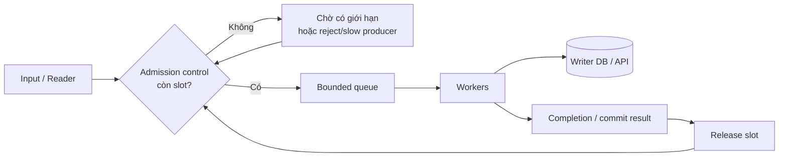
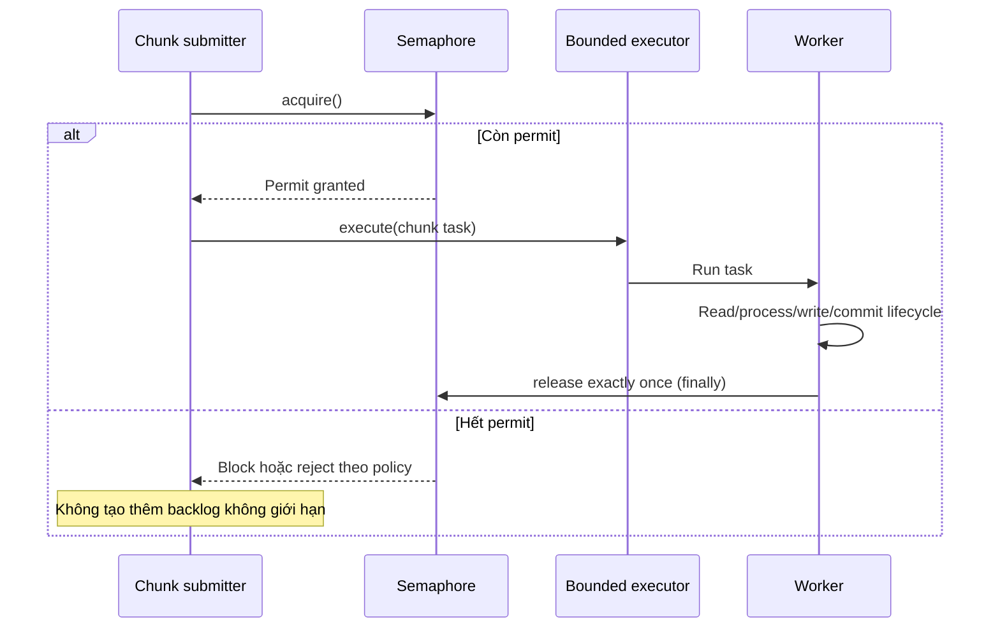
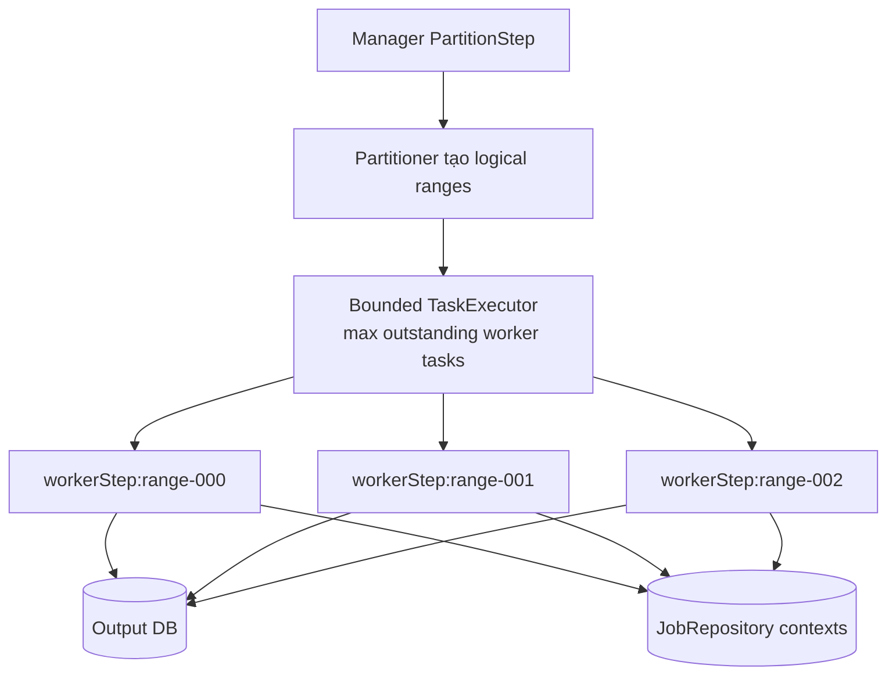
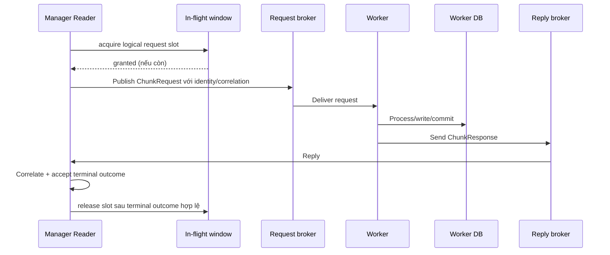
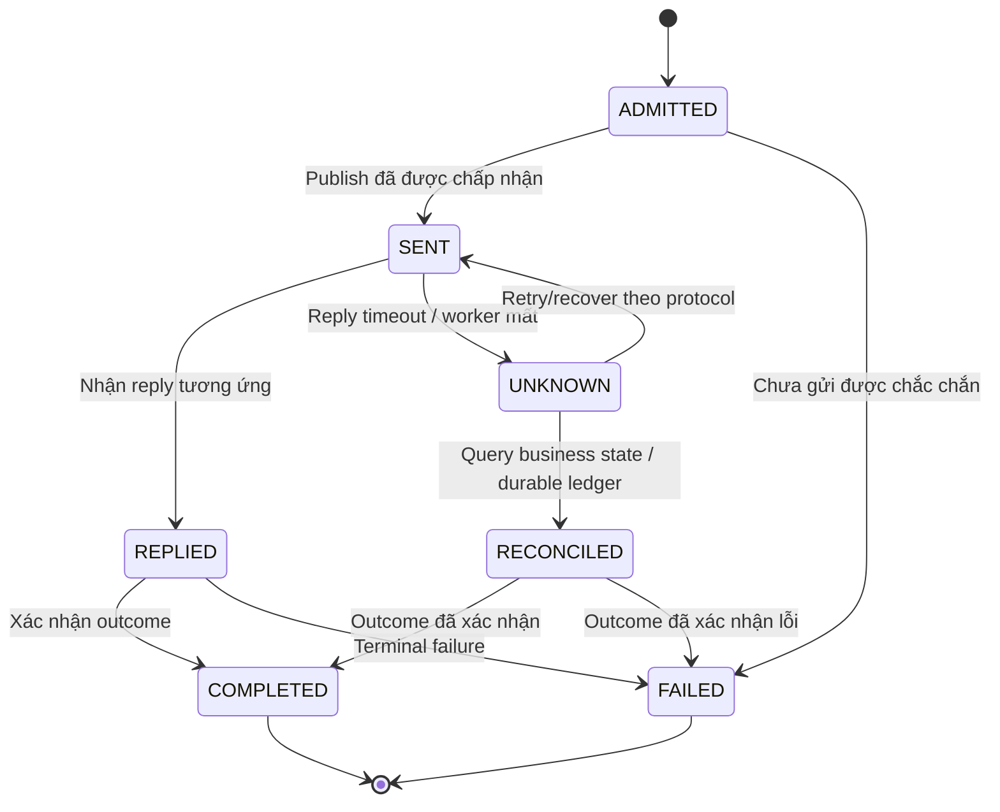
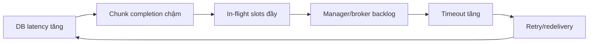

# Giới hạn in-flight chunk trong Spring Batch: backpressure để tăng tốc mà không quá tải

Khi mở rộng Spring Batch từ một Step tuần tự lên 8–32 worker threads hoặc sang remote chunking, câu hỏi đầu tiên thường là: **“Cần bao nhiêu worker để xử lý nhanh hơn?”** Nhưng nếu manager tạo chunk nhanh hơn tốc độ writer và database có thể commit, số chunk đang chờ có thể tăng liên tục. Hệ quả là bộ nhớ đầy, connection pool cạn, timeout tăng, broker backlog lớn và retry tạo thêm tải.

Bài học **“Giới hạn in-flight chunk”**, thuộc chương **Backpressure** của module **SPRING_BATCH_SCALING_OPERATIONS**, tập trung vào cách kiểm soát **số chunk đã được nhận vào pipeline nhưng chưa hoàn tất**, thay vì chỉ tăng thread pool. Đây là một phần của mục tiêu module: mở rộng Spring Batch cho workload dữ liệu lớn qua multi-threaded step, parallel steps, partitioning và các mô hình phân tán; đo bottleneck, bảo đảm thread safety, retry/restart và vận hành phù hợp tài nguyên thực tế.

**Kết luận cốt lõi:** *Giới hạn in-flight chunk là giới hạn lượng công việc chưa hoàn tất, không chỉ là giới hạn số thread đang chạy.* Muốn nó có tác dụng, phải đặt cơ chế chặn **trước khi phát sinh thêm công việc không thể giữ trong bộ nhớ**, và phải giải phóng slot theo một định nghĩa completion chính xác.

Sau bài học, bạn có thể:

- Định nghĩa và đo **in-flight chunk**, khác biệt với active workers, queued tasks và committed chunks.
- Ước lượng capacity bằng throughput, latency, RAM, DB pool và số request đang chờ.
- Dùng **bounded executor** và **admission control bằng semaphore** đúng vòng đời, tránh permit leak.
- Hiểu giới hạn của `TaskExecutor` trong multi-threaded Step và thay đổi liên quan `throttleLimit` ở Spring Batch 5.x.
- Áp dụng backpressure cho local partitioning, remote partitioning và đặc biệt remote chunking request/reply.
- Xử lý overload, timeout, broker redelivery, stop/restart và job correctness.
- Viết test, metric, dashboard, alert và runbook cho vận hành production.

## 1. In-flight chunk là gì?

Một *chunk* trong Spring Batch là đơn vị xử lý một nhóm item theo cơ chế chunk-oriented Step: đọc item, xử lý, ghi và kết thúc transaction theo lifecycle. *In-flight* là trạng thái của **công việc đã được chấp nhận vào pipeline nhưng chưa được xác nhận hoàn tất theo contract**.

Ví dụ một hệ thống cục bộ có 4 thread xử lý và 8 task trong hàng đợi:

```text
Đã nhận 12 chunk tasks
   ├── 4 chunk đang chạy
   └── 8 chunk đang xếp hàng
       = 12 chunk chưa hoàn tất
```

Trong định nghĩa **accepted-but-not-completed**, cả 12 đều in-flight; không chỉ 4 chunk đang chạy.

Với remote chunking:

```text
Manager đã gửi 20 ChunkRequest
  - 5 request worker đang xử lý
  - 7 request nằm trên broker hoặc đã được worker prefetch
  - 8 request chờ reply / đang có trạng thái không chắc chắn

Nếu chưa có reply hoàn tất hợp lệ hoặc reconciliation:
  in-flight phía manager = 20
```

Các số chỉ minh họa, và 3 nhóm trên có thể cần phân rã sâu hơn tùy contract broker. Cần **không đếm một request trong hai nhóm** nếu đang lập bảng cộng.

### Định nghĩa phải ghi vào tài liệu vận hành

Có ít nhất ba đại lượng:

| Đại lượng | Định nghĩa | Phù hợp để điều khiển gì? |
| --- | --- | --- |
| **Active chunk executions** | Chunk thực sự đang thực thi read/process/write hoặc chờ commit trên worker | CPU, DB pool, concurrency |
| **Queued chunk tasks** | Chunk đã được nhận vào executor/broker nhưng chưa được bắt đầu | RAM, queue delay, nguy cơ backlog |
| **Outstanding/in-flight chunks** | Chunk đã được tiếp nhận/dispatch nhưng chưa đạt completion theo contract | Giới hạn công việc chưa hoàn tất |

Hệ thống có thể có **in-flight=100 nhưng active=8**. Tăng số thread không chắc cải thiện throughput nếu database đã bị lock. Quan trọng hơn, **giới hạn queue nhưng không giới hạn outstanding remote requests** vẫn có thể đẩy quá nhiều công việc vào broker.

## 2. Một chunk bắt đầu và kết thúc in-flight khi nào?

Định nghĩa hợp lý tùy kiến trúc:

### Multi-threaded Step trong cùng JVM

- **Bắt đầu:** khi một chunk task được **admit** để submit vào executor, trước khi task bị đưa vào queue.
- **Kết thúc:** task hoàn tất bình thường hoặc kết thúc exceptional sau khi framework đã xử lý outcome theo lifecycle; không được giải phóng permit khi task vẫn chạy.
- **Không nên:** lấy số item đã read làm tiêu chí đóng slot, vì writer/commit có thể còn đang xử lý.

### Remote chunking

- **Bắt đầu:** manager tạo và chấp nhận một logical `ChunkRequest` để gửi đi.
- **Kết thúc:** manager xác nhận outcome tương ứng sau khi nhận và xử lý reply thành công, hoặc sau quy trình terminal failure/reconciliation đã chứng minh request không còn pending.
- **Không nên:** giải phóng slot ngay khi `send()` trả về hoặc khi broker ACK publish. ACK transport không đồng nghĩa worker đã commit và manager đã chấp nhận kết quả.

### Remote partitioning

Đơn vị công việc tự nhiên thường là **worker `StepExecution`/partition**, không phải từng chunk do manager gửi. Trong mỗi worker, chunk được quản lý bởi Step local của worker. Có thể giới hạn số partition đang thực thi **và** số chunk/connections ở từng worker, nhưng không được gọi mọi partition là một chunk.

**Đơn vị đo là một phần của API vận hành.** Đặt metric tên `batch_inflight_chunks` cho remote partitioning nhưng đo số worker StepExecutions sẽ gây nhầm lẫn; nên có metric `partition_inflight` riêng.

## 3. Sơ đồ pipeline và vị trí cần đặt backpressure



Đặt admission **sau khi manager đã đọc và giữ hàng nghìn chunk trong RAM** có thể quá muộn. Producer cần bị làm chậm **trước khi tiếp tục tạo thêm chunk payload** không có nơi lưu.

Một kiến trúc tốt thường có **hai lớp giới hạn**:

1. **Concurrency limit:** bảo vệ số hoạt động thật sự đang chạy, ví dụ tối đa 8 writer chunks dùng database.
2. **Backlog/in-flight limit:** bảo vệ tổng số chunk đã nhận nhưng chưa hoàn tất, ví dụ tối đa 16 task gồm 8 running và 8 queued.

Còn có các giới hạn độc lập cho **số item/bytes mỗi chunk**, kích thước buffer của reader, HTTP connection pool, broker prefetch và tổng job concurrency.

## 4. Vì sao chỉ tăng thread pool dẫn tới quá tải?

Giả sử writer mất trung bình 500 ms để hoàn tất một chunk, worker concurrency=8, và manager có khả năng tạo chunk nhanh hơn:

- Khả năng hoàn tất lý thuyết ban đầu ~ 16 chunks/s nếu cả 8 worker luôn bận và latency 0,5 s.
- Manager có thể tạo 60 chunks/s.
- Nếu không giới hạn admission, backlog sẽ tăng trung bình ~ 44 chunks/s trong trạng thái minh họa.
- Sau 60 giây có thể có khoảng 2.640 chunk pending, chưa tính retry và redelivery.

Các phép tính chỉ dùng cho minh họa trong một khoảng ổn định; thực tế latency tăng khi DB quá tải, nên tốc độ hoàn tất còn có thể giảm.

**Triệu chứng thường thấy:**

- Heap, allocation rate và GC tăng.
- Task queue, broker lag, unacknowledged messages tăng.
- Queue wait p95/p99 tăng dù executor CPU chưa chạm 100%.
- DB connection pool pending và lock wait tăng.
- Transaction timeout; retry sinh thêm request làm hạ tầng nghẽn hơn.
- Stop/restart kéo dài vì còn nhiều công việc in-flight có kết quả không chắc chắn.

Backpressure tránh *tích tụ không giới hạn*, nhưng không sửa được SQL thiếu index hoặc writer có side effect không idempotent.

## 5. Định luật Little và giới hạn in-flight

Trong một hệ thống ổn định, **Little’s Law** cho phép liên hệ số công việc đồng thời, throughput và thời gian tồn tại:

\[
L = \lambda W
\]

Trong đó:

- \(L\): số công việc trung bình ở trong hệ thống.
- \(\lambda\): throughput hoàn tất trung bình (chunks/s).
- \(W\): thời gian trung bình một chunk nằm trong phạm vi đang đo (s).

Ví dụ mục tiêu 24 chunks/s, latency trung bình từ admit tới completion 0,5 s:

\[
L = 24 \times 0.5 = 12\text{ chunks}
\]

Khoảng 12 outstanding chunks là một **điểm bắt đầu để benchmark**. Nó không phải công thức bảo đảm rằng đặt limit=12 sẽ đạt 24 chunks/s: DB pool, độ lệch chunk, transaction locks và startup overhead có thể khiến throughput thấp hơn.

**Cần dùng cùng ranh giới đo:** nếu \(W\) chỉ đo thời gian writer xử lý nhưng \(L\) bao cả queued chunks, công thức sẽ bị dùng sai. Muốn tính tổng in-flight, đo latency **admit → terminal completion** gồm queue delay.

### Cân nhắc p95/p99

Little’s Law áp dụng cho **giá trị trung bình** trong điều kiện ổn định. Có thể dùng p95 latency làm tín hiệu đặt một giới hạn thận trọng đối với spike, nhưng **không thay \(W\) bằng p95 rồi tuyên bố phương trình vẫn chính xác**. Hãy đo p50/p95/p99 để kiểm tra tail latency và queueing.

## 6. Giới hạn in-flight theo memory và kích thước chunk

Không phải mọi chunk có kích thước như nhau. Nếu mỗi chunk chứa 200 item và dữ liệu trong RAM trung bình 2 KiB/item, payload ước tính 400 KiB/chunk:

\[
M_{\text{payload}} \approx N_{\text{inflight}}
\times \text{chunkSize} \times \text{avgItemBytes}
\]

Với \(N=16\):

\[
M_{\text{payload}} \approx 16 \times 200 \times 2\,\mathrm{KiB}
\approx 6.25\,\mathrm{MiB}
\]

**Đây mới chỉ là payload thô giả định**; không tính object headers, collections, copies do serializer, JDBC buffers, reader prefetch, HTTP requests, retry state, stack/threads, broker client buffers hay GC overhead. Với object graph Java lớn, footprint thực có thể cao hơn đáng kể.

### Kích thước không đều

Nếu 1% chunk chứa dữ liệu rất lớn, giới hạn theo **số chunk** chưa đủ. Có thể bổ sung:

- `maxItemsPerChunk` hoặc giới hạn byte size khi tạo request.
- Admission theo **weighted permits/byte budget** thay vì mỗi chunk luôn chiếm 1 permit.
- Giới hạn tổng bytes in-flight ở manager và tổng bytes prefetched ở worker.
- Stream/manifest pointer cho payload lớn thay vì serialize cả object graph vào `ExecutionContext`.
- Kiểm tra worst-case/percentile, không chỉ average.

**Số chunk nhỏ chưa chắc nghĩa là memory thấp.** Một chunk chứa một file 2 GiB đưa vào RAM vẫn có thể làm OOM.

## 7. Các giới hạn phải phối hợp

| Lớp tài nguyên | Cấu hình thường gặp | Nếu chỉ giới hạn lớp này |
| --- | --- | --- |
| Worker concurrency | Executor core/max pool size | Queue có thể tăng |
| Executor queue | `queueCapacity` hữu hạn | Producer vẫn submit đến khi queue đầy, sau đó reject |
| Outstanding chunk tasks | Semaphore/window trước submit | Tạo backpressure cho producer |
| Chunk size | `chunk(n)` | Giảm item mỗi chunk, không giới hạn số chunk outstanding |
| JDBC connection pool | `maximumPoolSize` | Worker có thể block lâu và giữ RAM |
| Broker prefetch | Consumer prefetch/receive batch size | Manager có thể publish không giới hạn |
| Broker queue retention | TTL/size policies | Không thay thế admission ở producer |
| Remote request window | Manager limit uncompleted requests | Cần ack/reply tracking và timeout recovery |
| Job/partition concurrency | Số StepExecutions đang active | Chưa giới hạn chunks/task queue bên trong worker |
| Global cluster capacity | Shared quota/admission | Mỗi JVM limiter riêng có thể cộng lại vượt DB budget |

**Công thức tư duy:** end-to-end capacity chịu giới hạn của **nút thắt nhỏ nhất**. Ví dụ 16 chunk workers nhưng DB pool chỉ dành 6 connections cho job đó, tăng worker thường chỉ làm thread chờ connection và tăng tail latency.

## 8. Bounded queue không đồng nghĩa bounded in-flight an toàn

Một `ThreadPoolTaskExecutor` có `corePoolSize=8`, `maxPoolSize=8`, `queueCapacity=8` giữ tối đa khoảng 16 task được accepted trong executor tại một thời điểm. Nhưng điều gì xảy ra khi submit task thứ 17?

- Nếu dùng **AbortPolicy**, executor có thể từ chối task; phải xử lý lỗi đúng.
- Nếu dùng **CallerRunsPolicy**, thread đang submit có thể tự chạy task; điều này tạo feedback nhưng **thay đổi thread thực thi và latency của producer**.
- Nếu dùng policy **Discard/DiscardOldest**, task có thể biến mất âm thầm — **không chấp nhận được** với Batch cần correctness.
- Nếu có **unbounded submission buffer trước executor**, queue của executor không còn kiểm soát tổng outstanding work.

**Tách hai mục tiêu:** giới hạn tài nguyên executor và đảm bảo không làm rơi công việc. Với Spring Batch, không biến queue overflow thành “bỏ qua chunk” trừ khi đó là một policy nghiệp vụ được định nghĩa và chứng minh đầy đủ.

## 9. Giải pháp local: chặn trước submit bằng Semaphore

`Semaphore` có thể giới hạn số chunk tasks đã được chấp nhận nhưng chưa kết thúc ở **một JVM**. Ý tưởng:

1. Producer xin 1 permit **trước khi submit**.
2. Không còn permit thì **chờ** theo policy; producer không tiếp tục bơm task vào queue.
3. Khi task kết thúc thành công hoặc exceptional, **release** đúng một lần.
4. Nếu executor từ chối submission, release permit đã xin.
5. Ghi metric outstanding = capacity − availablePermits.



### Những ràng buộc quan trọng

- Đặt limiter ở **đúng nơi framework submit task**, không chỉ trước một log hay listener.
- Không gọi `acquire()` sau khi đọc hàng nghìn chunk vào một collection.
- Tránh block trong transaction DB đang giữ lock/connection và chờ chính worker cần tài nguyên đó.
- Một phép `release()` dư sẽ làm mất giới hạn. Một phép release thiếu sẽ khiến pipeline bị kẹt.
- Nếu dùng policy executor làm rơi task mà không throw, `finally` của task **không chạy**, nên phải cấm silent discard.
- Khi shutdown hủy các task queued mà không chạy, cần cơ chế cleanup/cancellation riêng; wrapper demo chưa thay thế một lifecycle manager hoàn chỉnh.

## 10. Java: TaskExecutor có giới hạn outstanding tasks

Ví dụ dưới dùng Spring `TaskExecutor` và semaphore. Nó bao quanh **task do executor nhận**, không mặc định bao quanh mọi request ngoài JVM. Phù hợp minh họa local multi-threaded Step/TaskExecutorPartitionHandler khi nơi submit thực sự dùng executor này.

```java
package example.batch.backpressure;

import java.util.Objects;
import java.util.concurrent.Semaphore;
import java.util.concurrent.atomic.AtomicBoolean;

import org.springframework.core.task.TaskExecutor;
import org.springframework.core.task.TaskRejectedException;

public final class PermitBoundTaskExecutor implements TaskExecutor {
    private final TaskExecutor delegate;
    private final Semaphore permits;
    private final int capacity;

    public PermitBoundTaskExecutor(
            TaskExecutor delegate, int maxOutstandingTasks) {

        if (maxOutstandingTasks <= 0) {
            throw new IllegalArgumentException(
                    "maxOutstandingTasks must be positive");
        }
        this.delegate = Objects.requireNonNull(delegate);
        this.capacity = maxOutstandingTasks;
        this.permits = new Semaphore(maxOutstandingTasks, true);
    }

    @Override
    public void execute(Runnable task) {
        Objects.requireNonNull(task);

        try {
            permits.acquire();
        } catch (InterruptedException interrupted) {
            Thread.currentThread().interrupt();
            throw new TaskRejectedException(
                    "Interrupted waiting for batch capacity",
                    interrupted);
        }

        // Bảo vệ đúng một release, kể cả khi execute() chạy inline
        // và exception từ task được truyền ngược cho submitter.
        AtomicBoolean released = new AtomicBoolean(false);

        Runnable wrapped = () -> {
            try {
                task.run();
            } finally {
                releaseOnce(released);
            }
        };

        try {
            delegate.execute(wrapped);
        } catch (RuntimeException | Error failure) {
            // Nếu delegate từ chối task trước khi chạy: trả permit.
            // Nếu delegate chạy inline rồi propagate lỗi:
            // AtomicBoolean tránh release lần thứ hai.
            releaseOnce(released);
            throw failure;
        }
    }

    private void releaseOnce(AtomicBoolean released) {
        if (released.compareAndSet(false, true)) {
            permits.release();
        }
    }

    public int capacity() {
        return capacity;
    }

    public int outstandingTasks() {
        return capacity - permits.availablePermits();
    }
}
```

### Bốn điều ví dụ giải quyết

1. **Chặn producer** khi đã có `maxOutstandingTasks` task chưa xong.
2. **Không vượt permit budget** do lỗi thả permit hai lần trong đường exception đồng bộ.
3. **Trả permit khi task kết thúc exceptional** bởi `finally`.
4. **Trả permit khi executor reject** một submission chưa thực thi.

### Bốn giới hạn của ví dụ

1. Đây là **in-memory limiter cho một JVM**, không phải global distributed semaphore.
2. Nếu executor có policy **silent discard** hoặc executor shutdown hủy một task queued mà không chạy `wrapped`, permit có thể bị giữ mãi. Production cần chặn admission khi shutdown và xử lý dropped/cancelled tasks rõ.
3. Nếu `task.run()` bị treo vô hạn, permit cũng bị giữ vô hạn; cần timeout, cancellation, health check và chính sách recovery phù hợp. Không giải phóng permit sớm trong khi task vẫn tiếp tục chạy.
4. Đo `outstandingTasks()` chỉ mô tả tasks qua wrapper này, không gồm các buffer/queue ở các tầng khác. Muốn giới hạn một **chunk logic**, phải xác nhận mỗi task tương ứng một đơn vị chunk ở chính integration đang chạy.

**Không dùng một `static Semaphore` để tự tạo “global budget” xuyên nhiều JVM.** Process khác không nhìn thấy bộ đếm đó.

## 11. Cấu hình executor có bounded queue và policy rõ ràng

`ThreadPoolTaskExecutor` cần queue hữu hạn; giữ `corePoolSize=maxPoolSize` để mô hình concurrency dễ hiểu.

```java
package example.batch.backpressure;

import java.util.concurrent.ThreadPoolExecutor;

import org.springframework.context.annotation.Bean;
import org.springframework.context.annotation.Configuration;
import org.springframework.core.task.TaskExecutor;
import org.springframework.beans.factory.annotation.Qualifier;
import org.springframework.scheduling.concurrent.ThreadPoolTaskExecutor;

@Configuration
public class ChunkExecutorConfiguration {

    @Bean(name = "physicalChunkExecutor")
    public ThreadPoolTaskExecutor physicalChunkExecutor() {
        ThreadPoolTaskExecutor executor = new ThreadPoolTaskExecutor();
        executor.setCorePoolSize(8);
        executor.setMaxPoolSize(8);
        executor.setQueueCapacity(8);
        executor.setThreadNamePrefix("batch-chunk-");
        executor.setRejectedExecutionHandler(
                new ThreadPoolExecutor.AbortPolicy());
        executor.initialize();
        return executor;
    }

    @Bean(name = "boundedChunkExecutor")
    public TaskExecutor boundedChunkExecutor(
            @Qualifier("physicalChunkExecutor")
            ThreadPoolTaskExecutor physical) {

        // 8 running + 8 queued at most through this wrapper.
        return new PermitBoundTaskExecutor(physical, 16);
    }
}
```

**Cơ chế:** nếu có tối đa 16 tasks được accepted và mỗi task release permit khi hoàn tất, submitter phải đợi. Queue của executor cũng chỉ nhận tối đa 8 tác vụ đang chờ.

**Không ngầm khẳng định sẽ luôn có 8 chunk đang chạy.** Spring Batch Step có thể có **cơ chế throttle ở tầng Step**, transaction manager hoặc tài nguyên I/O giới hạn thêm. Active concurrency thực tế phải **đo trên đúng phiên bản và cấu hình**.

### Vì sao dùng AbortPolicy?

`AbortPolicy` tạo lỗi rõ ràng nếu vượt giới hạn executor hoặc executor đã shutdown. Với wrapper đồng bộ cấu hình 16 permits/16 slots, trạng thái bình thường giúp producer chờ trước khi queue overflow; nhưng lúc shutdown/race, reject vẫn có thể xảy ra. Quan trọng là lỗi được **nhận biết**, không bỏ chunk âm thầm.

### Vì sao không chọn CallerRunsPolicy mặc định?

`CallerRunsPolicy` có thể hữu ích để tạo backpressure ở một số pipeline đơn giản, nhưng trong Batch có thể làm chunk task chạy trên **thread submitter/điều phối**. Điều này có thể ảnh hưởng Step context, transaction, listener assumptions và latency của manager. Chỉ dùng nếu đã thử đúng contract; không xem nó là chiến lược bảo toàn tính đúng đắn tự động.

## 12. Gắn TaskExecutor vào multi-threaded chunk Step

Một Step chunk-oriented dùng Spring Batch 5.x có thể cấu hình `TaskExecutor`:

```java
import org.springframework.batch.core.Step;
import org.springframework.batch.core.repository.JobRepository;
import org.springframework.batch.core.step.builder.StepBuilder;
import org.springframework.batch.item.ItemReader;
import org.springframework.batch.item.ItemProcessor;
import org.springframework.batch.item.ItemWriter;
import org.springframework.context.annotation.Bean;
import org.springframework.beans.factory.annotation.Qualifier;
import org.springframework.core.task.TaskExecutor;
import org.springframework.transaction.PlatformTransactionManager;

@Bean
public Step parallelImportStep(
        JobRepository jobRepository,
        PlatformTransactionManager transactionManager,
        ItemReader<RawOrder> reader,
        ItemProcessor<RawOrder, NormalizedOrder> processor,
        ItemWriter<NormalizedOrder> writer,
        @Qualifier("boundedChunkExecutor") TaskExecutor chunkExecutor) {

    return new StepBuilder("parallelImportStep", jobRepository)
            .<RawOrder, NormalizedOrder>chunk(200, transactionManager)
            .reader(reader)
            .processor(processor)
            .writer(writer)
            .taskExecutor(chunkExecutor)
            .build();
}
```

`RawOrder`/`NormalizedOrder`/reader/processor/writer là thành phần ứng dụng, chưa tạo project chạy độc lập. **Phần quan trọng là vị trí gắn executor có giới hạn**.

### Rất quan trọng: thread safety và restart

Gắn `TaskExecutor` không biến stateful `ItemReader` thành thread-safe:

- Nhiều chunk threads có thể chia sẻ **một `StepExecution` và `StepExecutionContext`**.
- `JdbcCursorItemReader`, `FlatFileItemReader` hoặc reader tùy chỉnh có cursor mutable có thể không hỗ trợ concurrent reads.
- `@StepScope` là scope theo **StepExecution**, không phải theo thread; không tự cấp reader riêng cho mỗi chunk thread.
- `synchronized read()` có thể chống race ở read nhưng **không tự bảo đảm thứ tự commit**.
- Khi chunk B commit trước chunk A, checkpoint con trỏ đơn có thể bỏ sót item A sau crash/restart.

Do đó, trước khi dùng multi-threaded chunk Step cho workload cần restart chắc chắn, kiểm tra **contract hỗ trợ concurrency của reader/writer**, và cân nhắc **partitioning với mỗi worker StepExecution/reader riêng** khi cần checkpoint theo phạm vi độc lập.

## 13. Spring Batch 5.x: không dựa duy nhất vào throttleLimit

Trong các hướng dẫn cũ, bạn có thể gặp:

```java
// API lịch sử; throttleLimit được đánh dấu deprecated ở Spring Batch 5.
.taskExecutor(taskExecutor)
.throttleLimit(8)
```

Ở Spring Batch 5.x, `throttleLimit` được đánh dấu deprecated và hướng mở rộng được tài liệu framework mô tả là dùng **custom `RepeatOperations`/`stepOperations`** nếu cần thay cơ chế throttle hiện tại. Vì vậy:

- Đừng coi `throttleLimit(8)` là chiến lược backpressure lâu dài.
- Đừng ngầm suy rằng `TaskExecutor.maxPoolSize=8` ⇒ Step chắc chắn có 8 chunks thực thi đồng thời.
- Giới hạn **outstanding tasks của executor** và giới hạn **số lần lặp/submit do Step quản lý** có thể cùng tồn tại.
- Nếu cần concurrency lớn hơn giới hạn nội bộ hiện hành, cần nghiên cứu và cấu hình `RepeatOperations` phù hợp với phiên bản **đang pin**, rồi load-test behavior.
- Nếu chưa cần vượt giới hạn nội bộ, wrapper permit + bounded queue giúp kiểm soát admission ngay tại executor; vẫn phải đo thực tế.

**Không tự viết custom `RepeatOperations` bằng cách thay vài hàm callback khi chưa hiểu restart/exception propagation.** Đây là hạ tầng Step ảnh hưởng trực tiếp tới commit/retry/rollback; cần integration tests chuyên biệt trước khi đưa production.

## 14. Khi nào bounded executor vẫn chưa đủ?

Giả sử reader ở manager đọc sẵn 10.000 chunks vào một `List<Chunk<?>>`, rồi mới submit từng chunk vào executor có semaphore. Executor đúng là chỉ có 16 tasks outstanding, **nhưng 9.984 chunks đã nằm trong RAM**.

```text
Anti-pattern:
  List<Chunk> allChunks = readEverythingFirst();
  for (Chunk chunk : allChunks) {
      boundedExecutor.execute(() -> write(chunk));
  }

Vẫn có bộ nhớ tăng theo toàn bộ input.
```

Phòng vệ:

- Đảm bảo admission xảy ra **trước khi materialize** payload không được quản lý.
- Giữ producer/reader làm việc theo nhu cầu; không prefetch vô hạn.
- Bounded queue phải áp dụng cả các buffer của middleware/adapter trước executor.
- Tách metadata chunk nhỏ khỏi payload nặng nếu kiến trúc cho phép.
- Với remote chunking, **không đọc/thành lập thêm ChunkRequest** khi request window đã đầy.

Khi wrapper chỉ kiểm soát task ở Step engine, cần kiểm tra **đường thực thi của reader/framework** xem việc tạo chunk xảy ra trước hay trong task, thay vì tự khẳng định có thể chặn ở bất kỳ vị trí nào.

## 15. Stop, failure và shutdown: phải đóng slot thế nào?

`finally { permits.release(); }` giải phóng slot khi task **trả quyền điều khiển**, không phải khi Job report `COMPLETED`. Với local task, đây là ranh giới tự nhiên của wrapper. Nhưng có ba tình huống:

| Tình huống | Slot | Hành động đúng |
| --- | --- | --- |
| Task hoàn tất | Release đúng một lần | Tiếp tục nhận chunk mới |
| Task ném exception | Release trong finally, framework xử lý failure | Không nuốt exception |
| Executor từ chối submission | Release và propagate exception | Không bỏ task âm thầm |
| Task đang chạy bị interrupt | Release **khi task thực sự kết thúc** | Không release chỉ vì đã gửi interrupt |
| Task queued bị `shutdownNow()` loại khỏi queue | Wrapper `run()` không chạy → chưa release | Shutdown controller cần reconcile queued tasks |
| JVM crash | Permit bộ nhớ biến mất cùng process | JobRepository/transaction quyết định restart, không dùng RAM để suy output đã commit |
| Task deadlock/hang | Permit giữ đến khi có kết quả | Timeout/health check/cancel có kiểm soát, không force-release khi task vẫn có side effect |

Đừng gọi `permits.release()` trong một timer chỉ vì task chạy quá 30 giây nếu task **vẫn tiếp tục ghi DB**. Permit bị thả sớm cho phép producer nạp thêm việc song song với task cũ, khiến cap mất tác dụng và có nguy cơ xử lý trùng.

## 16. Local partitioning: giới hạn worker Step executions

Với local partitioning, manager tách một Step thành nhiều worker `StepExecution`, mỗi worker có `ExecutionContext` riêng. `TaskExecutorPartitionHandler` có thể dùng một `TaskExecutor` để thực thi các worker Steps, nên bounded TaskExecutor có thể giúp giới hạn **outstanding worker-step tasks**.



**Đơn vị limit ở đây là worker StepExecution**, không nhất thiết mỗi chunk. Mỗi worker Step có thể commit hàng trăm chunks trong suốt đời nó. Nếu worker Step lại cấu hình multi-threaded chunks, có thể có nhiều concurrency layer cần giới hạn riêng.

### GridSize và concurrency khác nhau

`gridSize` thường ảnh hưởng số partition mà `Partitioner` được đề nghị tạo/handler quản lý; **không phải cam kết số threads đồng thời**. Ví dụ:

- `gridSize=64`: có thể tạo 64 logical partitions.
- Executor pool 8 threads: có thể chỉ 8 worker StepExecutions thực thi đồng thời.
- Context của 64 partitions vẫn tạo metadata overhead ở JobRepository.
- Mỗi worker chunk size 200 không có nghĩa manager có 64×200 items trong RAM.

Cần giữ **partition name → logical input range/bucket** ổn định qua restart. Không thay hash bucket count chỉ để thay concurrency nếu có các partition `COMPLETED` cần được nhận diện lại.

## 17. Remote partitioning: limit theo worker capacity và broker

Trong remote partitioning, manager gửi `StepExecutionRequest`, worker JVM thực thi một worker StepExecution. Backpressure cần quan tâm:

- **Số worker StepExecutions đang được giao/active**.
- **Khả năng xử lý thật** của worker cluster.
- Broker queue depth/prefetch và consumer concurrency.
- Pool kết nối DB/CPU/memory của worker.
- Chính sách timeout/redelivery và kết quả StepExecution trên JobRepository.

Nếu manager dispatch 500 partitions trong khi cluster chỉ có 10 worker slots, hàng trăm request có thể tích tụ trong broker. Nếu broker có disk và retention phù hợp, backlog có thể chấp nhận ở mức thiết kế, nhưng phải đặt ngưỡng và có phương án giảm producer; không mặc nhiên giới hạn số message bằng concurrency.

**Mỗi `StepExecution` có định danh và state bền vững**. Một in-memory semaphore trong manager chỉ điều tiết dispatch khi manager còn sống; restart phải dựa vào JobRepository/broker/dedup protocol để xác định partition nào đã hoàn tất, chứ không dùng permits cũ.

## 18. Remote chunking: tại sao phải giới hạn outstanding requests?

Trong remote chunking điển hình:

1. Manager đọc item và tạo `ChunkRequest`.
2. Request được publish lên broker.
3. Worker nhận chunk, processor/writer xử lý và commit theo transaction của worker.
4. Worker gửi `ChunkResponse`.
5. Manager xử lý response và tiếp tục/ghi nhận tiến độ theo Step protocol.



### Vì sao không release khi publish?

Một `send()` thành công chỉ chứng minh middleware **đã chấp nhận gửi/nhận** theo protocol, không chứng minh worker đã xử lý. Nếu giải phóng slot ngay, manager có thể publish vô hạn requests nhanh hơn cluster xử lý.

### Vì sao không release trên mọi timeout?

Nếu worker đã commit nhưng reply bị mất, trạng thái request **không chắc chắn**. Release permit rồi coi request mất hẳn có thể làm manager quên chunk chưa được ghi nhận; publish request khác có thể khiến skip/restart không nhất quán.

Khi timeout, request cần chuyển sang trạng thái **UNKNOWN/RECONCILE/RETRY** theo protocol; giải phóng slot chỉ khi đã có quy trình quyết định rõ outcome hoặc reassign có idempotency, không chỉ vì timer hết hạn.

## 19. Quản lý cửa sổ in-flight remote theo state machine

Một mô hình khái niệm có các trạng thái:



**Định nghĩa terminal failure:** request không còn bị xử lý/không có outstanding side effect chưa biết hoặc đã có recovery plan rõ; không phải chỉ một network timeout.

Với request đang `UNKNOWN`, cần biết:

- Có thể đã commit DB không?
- Broker có thể redeliver không?
- Worker nào đang xử lý request?
- Manager đã nhận reply nhưng chưa persist checkpoint chưa?
- Có unique business operation key nào để dedupe không?

**Không implement state machine bền vững chỉ bằng một `ConcurrentHashMap`.** Map trong RAM mất sau manager crash; JobRepository, broker state, work table/outbox và quy trình restart mới là nền tảng phục hồi thực tế.

## 20. Request identity, reply correlation và idempotency

Một logical remote chunk request cần định danh để manager có thể ghép reply và xử lý duplicate:

| Trường | Mục đích | Lưu ý |
| --- | --- | --- |
| JobInstance/business batch identity | Gắn công việc với snapshot logic | Không đồng nhất với token xác thực |
| JobExecution/StepExecution ID | Gắn request với execution đang xử lý | Có thể thay sau restart; không đủ làm business dedupe key |
| Request sequence/correlation ID | Ghép reply với request | Không mặc định là unique business operation qua nhiều lần restart |
| Input snapshot ID | Tránh áp request lên input khác | Phải ổn định hoặc có version |
| Business operation ID/item IDs | Dedupe output và side effects | Không thay đổi chỉ vì message được redeliver |
| Reply status/worker diagnostics | Phát hiện terminal/transient outcome | Không chứa credential hoặc payload nhạy cảm |

Một request có thể được giao **at-least-once**. Nếu worker commit DB rồi crash trước ACK/reply, broker/manager có thể gửi lại. Vì vậy giới hạn in-flight **không thay thế idempotent writer**.

### Chống reply duplicate

Khi reply đến:

1. Kiểm tra correlation với request đã biết.
2. Xác minh reply tương ứng đúng execution/protocol version.
3. Chỉ chuyển trạng thái request từ pending sang terminal **một lần**.
4. Chỉ giải phóng slot một lần; reply trùng không làm tăng capacity.
5. Nếu reply đến sau timeout/reassignment, dùng durable state và reconciliation; không giải phóng slot cho request mới không liên quan.

**Một reply trùng không được làm semaphore có thêm permit.** Đây là lỗi đặc biệt nguy hiểm khi manager dùng callback bất đồng bộ.

## 21. Broker prefetch không phải manager in-flight limit

Broker có thể có cấu hình như AMQP prefetch, Kafka consumer batch/poll capacity hoặc request batch size; các thông số này giới hạn lượng message mà **consumer lấy/đang giữ**, không nhất thiết hạn chế **manager publish**.

Ví dụ:

```text
Manager publish 1000 ChunkRequests
Broker prefetch=5
Có 10 consumers => khoảng 50 messages có thể được consumers giữ cùng lúc
950 messages còn lại vẫn có thể nằm trong broker backlog
```

Đó là ví dụ đơn giản theo cơ chế prefetch của broker tương ứng; semantics chính xác phụ thuộc loại middleware, ack mode, consumer concurrency và framework adapter.

**Ba giới hạn độc lập:**

- **Producer window:** manager được dispatch tối đa N logical chunks chưa có terminal reply.
- **Broker buffering/prefetch:** số requests broker/consumer đang giữ.
- **Worker concurrency:** số requests đang được process/write/commit.

Nếu worker concurrency=10 nhưng manager window=1, throughput có thể bị hạn chế mạnh. Nếu manager window=10.000 nhưng worker capacity=10, backlog/memory/timeout risk tăng. Cần cân bằng các lớp.

## 22. Timeout, retry và backpressure có thể tạo vòng lặp xấu

Giả sử DB đang chậm:



Backpressure đúng phải **giảm tốc độ producer**, không để timeout tạo thêm requests vô hạn:

- Đặt timeout đủ phù hợp p95/p99 **khi đã tính queue delay**, không chỉ thời gian xử lý business.
- Retry budget hữu hạn, backoff/jitter và phân loại lỗi.
- Không retry ngay một chunk vẫn có khả năng đang thực thi ở worker khác.
- Có request identity và business idempotency.
- Giới hạn độ dài queue và in-flight window.
- Cảnh báo saturation/queue age **trước khi** toàn hệ thống timeout.

**Tăng timeout đơn thuần** có thể che việc manager window quá lớn; giảm timeout đơn thuần có thể tạo nhiều duplicate attempts hơn. Cần đánh giá cả concurrency, DB pool và end-to-end latency.

## 23. Retry count và in-flight count có quan hệ thế nào?

Một logical chunk có thể trải qua nhiều processing attempts. Muốn dùng in-flight window chính xác phải phân biệt:

- **Logical in-flight chunks**: số công việc logic chưa terminal.
- **Physical attempts in-flight**: số execution/request attempts đang chạy hoặc chưa có kết quả chắc chắn.
- **Retry events**: số lần cơ chế retry thử lại.
- **Broker redeliveries**: số lần middleware giao lại request.

```text
Chunk business operation K
  Attempt 1 -> worker commit nhưng reply mất
  Attempt 2 -> broker redeliver, writer dedupe

Logical chunks pending: 1 (trước khi outcome được xác nhận)
Physical attempts xảy ra: 2
Business effects mong muốn: 1
```

**Không dùng phép trừ `sentChunks - receivedReplies` một cách mù quáng** nếu replies có thể duplicated, late hoặc không tương ứng đúng request. Nên có request state/dedup và gauge được tính theo **unique logical request identities**.

Mọi metric attempts cần chỉ rõ đơn vị: retry ở Batch step, HTTP client, DB transaction hay broker. Lỗi worker có thể tạo nested retries; việc tăng số retryLimit có thể làm saturation tệ hơn.

## 24. Transaction: slot completion và business commit không phải một

Trong Spring Batch, chunk transaction thường ràng buộc DML nếu writer và transaction manager cùng resource. Nhưng có nhiều mô hình thực tế:

| Mô hình | Commit boundary | Rủi ro in-flight |
| --- | --- | --- |
| Local chunk, writer/repository cùng DB transaction | DML + metadata có thể commit đồng nhất | Task kết thúc exceptional phải giải phóng slot nhưng Step fail đúng |
| JobRepository DB-A, writer DB-B | Hai local transaction độc lập | Output commit nhưng checkpoint chưa persist |
| Remote chunking | Manager reader/context, worker DB transaction và broker reply riêng | Publish/ack/reply không atomic với worker commit |
| External REST/email writer | Side effect ngoài transaction Spring Batch | Retry tạo tác dụng lặp |
| Transactional outbox | DB state + outbox event trong một DB transaction | Publisher có thể gửi trùng sau crash |

**Slot release là hành vi điều phối**, không phải bằng chứng dữ liệu đã commit ở mọi resource. Với remote chunking, manager cần có terminal outcome được xác nhận theo protocol; với local task, wrapper release khi task kết thúc và Step xử lý failure tiếp.

### Idempotent writer minh họa

```sql
CREATE TABLE processed_orders (
    batch_id varchar(80) NOT NULL,
    order_id bigint NOT NULL,
    normalized_amount numeric(18, 2) NOT NULL,
    PRIMARY KEY (batch_id, order_id)
);

-- PostgreSQL: ví dụ idempotent cho state hiện tại
-- khi cùng business operation phải sinh cùng amount.
INSERT INTO processed_orders
    (batch_id, order_id, normalized_amount)
VALUES
    (:batchId, :orderId, :amount)
ON CONFLICT (batch_id, order_id)
DO UPDATE SET normalized_amount = EXCLUDED.normalized_amount;
```

Với ledger cộng dồn, event streaming, tài khoản tài chính hay API tạo giao dịch, phải dùng operation ID/dedup và business invariant phù hợp; không giả định UPSERT nào cũng ngăn double side effect.

## 25. Backpressure và restart: điều gì được persist?

`ExecutionContext` lưu **checkpoint và metadata job/step**, không tự lưu số semaphore permits trong RAM như một state có thể phục hồi chính xác.

```text
Trước crash:
  In-flight local tasks = 12
  Đã commit một số chunks
  Một số tasks đang chạy / queued

Sau restart:
  Semaphore mới được khởi tạo
  JobRepository được dùng để xác định checkpoint
  Input snapshot + writer idempotency giúp xử lý lại an toàn
```

**Không đưa object `Semaphore`, `Executor`, `Thread` hoặc list mọi in-flight payload vào `ExecutionContext`.** Chúng không đại diện cho resource có thể khôi phục giữa JVMs và có thể làm metadata lớn/serializer lỗi.

Đối với remote chunking cần logic bền vững để biết request đã sent/chưa terminal, có thể thông qua JobRepository/protocol riêng, broker state hoặc durable request ledger; thiết kế tùy framework/middleware. Một semaphore mới **không được coi là bằng chứng các request cũ đã kết thúc**.

### Input snapshot và reader checkpoint

Nếu producer bị chặn nhưng reader đã advance quá nhiều, khi crash bạn phải xác định phần nào được commit. Với multi-threaded Step, chunk commit đảo thứ tự có thể làm cursor đơn không an toàn. Với remote chunking, manager reader state gắn với kết quả request/reply và transaction tương ứng; phải kiểm tra fault tolerance/restart theo chính phiên bản tích hợp đang dùng.

Backpressure là **kiểm soát tải**, không phải thuật toán checkpoint. Cả hai phải được thiết kế và kiểm thử riêng.

## 26. Tính toán giới hạn ban đầu theo bottleneck

Ví dụ workload:

- `chunkSize=250` items.
- Một chunk cần trung bình 0,4 giây xử lý và commit, chưa tính queue delay.
- DB cho phép tối đa khoảng 8 concurrent writer transactions ổn định ở tải hiện tại.
- Phân tích memory cho thấy tối đa 16 chunk payload outstanding là mức có thể chấp nhận.
- Mục tiêu 15 chunks/s (tương đương khoảng 3.750 items/s nếu mọi item được ghi).

Từ throughput và latency trung bình:

\[
L_{\text{needed}} \approx 15 \times 0.4 = 6
\]

Bắt đầu thử với worker concurrency 6–8, outstanding window 8–16, queue nhỏ thay vì không giới hạn. Sau đó load-test:

| Cấu hình thử | Active worker cap | Outstanding window | Điều cần kiểm tra |
| --- | ---: | ---: | --- |
| A | 4 | 8 | Throughput và queue wait thấp? |
| B | 6 | 12 | Đạt target chunks/s? |
| C | 8 | 16 | DB locks/connection wait tăng không? |
| D | 12 | 24 | Có vượt DB/memory budget? (không mặc định triển khai) |

**Đừng áp số 16 từ ví dụ làm mặc định Spring Batch.** Quyết định phải dựa trên p95/p99 latency, RAM, DB pool/locks, broker behavior, các job khác cùng resource và SLO.

### Cách hiểu kết quả

- Nếu throughput tăng và DB latency ổn: có thể scale tốt.
- Nếu throughput gần như không đổi nhưng p99 latency/rollback tăng: đã chạm bottleneck.
- Nếu in-flight luôn full còn active nhỏ: đang tắc queue/scheduler hoặc downstream dependency.
- Nếu active luôn full, queue gần 0, CPU/DB còn dư: xem xét tăng concurrency có kiểm soát.
- Nếu queue age tăng liên tục: admission/window chưa phản ánh tốc độ tiêu thụ thực hoặc consumer bị kẹt.

## 27. Metrics cần có để đo backpressure

| Metric | Kiểu / đơn vị | Ý nghĩa |
| --- | --- | --- |
| `batch_chunk_inflight` | Gauge, chunks | Outstanding tasks/requests theo contract |
| `batch_chunk_active` | Gauge, chunks | Chunk tasks đang thực thi |
| `batch_chunk_queued` | Gauge, tasks | Chờ trong executor |
| `batch_chunk_admission_wait` | Timer, seconds | Producer bị chặn khi thiếu permits |
| `batch_chunk_queue_wait` | Timer, seconds | Submit → bắt đầu chạy |
| `batch_chunk_completion_latency` | Timer, seconds | Admit → terminal completion |
| `batch_chunk_completed_total` | Counter, chunks | Chunk terminal success/failure phân loại |
| `batch_chunk_rejected_total` | Counter, tasks | Executor reject/closed |
| `batch_chunk_timeout_total` | Counter, requests | Hết thời gian chờ, **chưa chắc worker chưa commit** |
| `batch_remote_request_unknown` | Gauge, requests | Trạng thái outcome chưa xác minh |
| `batch_broker_redelivery_total` | Counter, messages | Broker giao lại message |
| `batch_chunk_retries_total` | Counter, attempts | Phải định nghĩa cấp độ và điểm instrument |
| `batch_job_repository_update_latency` | Timer, seconds | Metadata bottleneck |
| DB pool active/pending, lock waits | Gauge/Timer | Writer bottleneck |
| Committed items/s | Rate | Kết quả sản xuất thực, không phải số tasks submit |

Đây là **tên metric ví dụ do ứng dụng tự định nghĩa**, không được xem là tên built-in mà Spring Batch/Micrometer bảo đảm có sẵn.

### Metric nào giúp phát hiện leak?

- `inFlight` không giảm dù active=0, queue=0, worker không chạy.
- `admissionWait` p99 tăng liên tục.
- `rejectedTotal` tăng khi executor đã shutdown hoặc capacity mismatch.
- Remote `unknownRequests` tồn tại lâu không có reconciliation progress.

Tuy vậy, active=0, queue=0, in-flight>0 có thể là **request remote đang chờ reply hợp lệ**, không tự kết luận permit leak. Cần nhìn đúng state model.

## 28. Micrometer: đo admission wait và outstanding

Ví dụ một decorator đo duration chờ permit; wrapper ở mục 10 cần được thiết kế mở rộng để gọi instrumentation **tại lúc acquire/release**, thay vì cập nhật gauge bằng cách tự đọc biến không đồng bộ.

```java
import io.micrometer.core.instrument.Gauge;
import io.micrometer.core.instrument.MeterRegistry;
import io.micrometer.core.instrument.Timer;

// Pseudocode tích hợp trên PermitBoundTaskExecutor:
Timer admissionWait = Timer.builder("batch.chunk.admission.wait")
        .description("Time spent waiting for a slot")
        .tag("step", "parallelImportStep")
        .register(meterRegistry);

// Đăng ký gauge trên instance executor có vòng đời rõ:
Gauge.builder("batch.chunk.inflight", boundedExecutor,
                e -> e.outstandingTasks())
        .tag("step", "parallelImportStep")
        .register(meterRegistry);

// Khi đưa timer vào execute(): đo riêng thời gian acquire().
// Không gọi acquire() hai lần chỉ để đo!
long started = System.nanoTime();
// semaphore.acquire() ở đúng một vị trí trong implementation
admissionWait.record(
        System.nanoTime() - started,
        java.util.concurrent.TimeUnit.NANOSECONDS);
```

Đây là **mẫu tích hợp**, không phải một class độc lập chạy ngay: `meterRegistry`, `boundedExecutor`, semaphore thuộc component của ứng dụng. Muốn code production, đưa `record(...)` vào chính đường `acquire()` của wrapper, và quản lý meter lifecycle khi Step/Job được tạo lại.

### Lựa chọn tags

Nên dùng các tag cardinality thấp như `job_name`, `logical_step_name`, `resource_pool`, `result`. Tránh tạo một series cho từng:

- `JobExecutionId` hoặc `StepExecutionId`.
- Item ID, chunk ID, correlation ID.
- Partition name nếu có hàng nghìn partitions.
- Exception message hoặc SQL.
- Credential, access token, tenant secret.

Các ID chi tiết nên nằm trong **structured logs/traces đã phân quyền** khi điều tra cụ thể, không làm tags cho mọi time series.

## 29. Quan sát queue và consumer

Với `ThreadPoolTaskExecutor` có thể quan sát số thread đang active và queue size qua API/underlying executor phù hợp với framework version, nhưng cần phân biệt:

- `activeCount`: số worker threads đang hoạt động.
- `queueSize`: tasks chờ.
- `outstandingTasks` của wrapper: tasks đã admit chưa hoàn tất.
- `JobRepository`: Step metrics như commitCount, rollbackCount, readCount, writeCount.
- `inFlightRemote`: requests chờ terminal reply/reconciliation.

**Không dùng `StepExecution.readCount` làm số in-flight items.** Reader có thể đọc item trước commit, filter/skip/retry, và metadata có thể lag so với RAM.

### Dashboard ba lớp

| Lớp | Panel cần hiển thị | Mục đích |
| --- | --- | --- |
| Producer/manager | In-flight window, admission wait, send rate | Có đang sản xuất quá nhanh? |
| Broker/executor | Queue depth/oldest age, active workers, rejections | Backlog bị giữ ở đâu? |
| Consumer/DB | Commit latency, DB pool wait, throughput, failure/retry | Nút thắt thực tế nằm ở đâu? |

Khi tăng concurrency, hãy đo **throughput đã commit** và correctness, không dùng số message đã publish làm proxy cho thành công.

## 30. PromQL minh họa cho dashboard

Nếu ứng dụng có export metrics như các tên ví dụ ở mục trước:

```promql
# Giá trị in-flight trung bình theo Step logic.
avg by (step) (batch_chunk_inflight)
```

```promql
# Tốc độ chunk terminal success (tên/tags tùy ứng dụng).
sum by (step) (
  rate(batch_chunk_completed_total{result="success"}[5m])
)
```

```promql
# Độ trễ admission p95 nếu metric được export dạng histogram.
histogram_quantile(
  0.95,
  sum by (le, step) (
    rate(batch_chunk_admission_wait_seconds_bucket[5m])
  )
)
```

```promql
# Broker redeliveries/s.
sum by (queue) (
  rate(batch_broker_redelivery_total[5m])
)
```

**Tên metrics và suffix phải được xác minh từ exporter thực tế.** Micrometer `Timer` tên `batch.chunk.admission.wait` có thể map thành `batch_chunk_admission_wait_seconds...` nếu backend Prometheus được cấu hình phù hợp; **không mặc định histogram buckets được bật**. Đừng tạo alert “không có data” rồi suy rằng không có queueing.

### Phân tích bằng xu hướng

- In-flight đạt cap liên tục và admission wait tăng: backpressure đang tác dụng, cần xem downstream.
- Throughput vẫn tăng, commit latency ổn: có thể thử tăng window trong memory budget.
- Throughput giảm và retry/rollback tăng: giảm concurrency/tuning DB.
- Broker queue age tăng và redelivery tăng: request/reply hoặc worker đang bị nghẽn.
- In-flight không giảm dù worker không còn task: điều tra leak, cancellation hoặc remote UNKNOWN requests.

## 31. Load test có kiểm soát

Bước benchmark nên dùng input snapshot giống nhau và output DB reset/đối soát:

1. **Baseline:** Step tuần tự với chunk size cố định, đo throughput và commit latency.
2. **Bật bounded executor:** 2/4/8 workers, window và queue được công bố.
3. **Tăng producer pressure:** tạo input đủ lớn để queue thật sự đạt cap.
4. **Giả lập DB chậm:** delay writer/transaction ở môi trường test, kiểm queue không tăng vô hạn.
5. **Giả lập exception:** writer fail và rollback, kiểm permit được release.
6. **Giả lập executor reject:** shutdown hoặc capacity mismatch, kiểm không mất task và Step báo lỗi.
7. **Giả lập stop:** graceful shutdown rồi forced crash; kiểm JobRepository/restart.
8. **Remote fault injection:** worker commit nhưng manager không nhận reply, broker redelivery.
9. **Đối soát output:** tập business keys và giá trị, không chỉ `COMPLETED`.
10. **So sánh SLO:** p95/p99 latency, throughput thực, queue age, RAM/GC, DB locks và chi phí retries.

**Không chỉ đo thời gian chạy một lần khi hệ thống rảnh.** Khi có các job khác chung DB pool, hiệu năng có thể khác đáng kể; backpressure phải phản ánh tổng tải tài nguyên.

## 32. Unit test: không vượt giới hạn concurrent execution

Ví dụ JUnit kiểm tra các task qua executor wrapper, dùng `ThreadPoolTaskExecutor` thật và `AtomicInteger` để quan sát max active. Test này không thay thế việc kiểm outstanding queue ở integration test.

```java
import static org.junit.jupiter.api.Assertions.assertTrue;
import static org.junit.jupiter.api.Assertions.assertEquals;

import java.util.concurrent.CountDownLatch;
import java.util.concurrent.TimeUnit;
import java.util.concurrent.atomic.AtomicInteger;

import org.junit.jupiter.api.Test;
import org.springframework.scheduling.concurrent.ThreadPoolTaskExecutor;

class PermitBoundTaskExecutorTest {

    @Test
    void limitsExecutionConcurrencyAndCompletesAllTasks()
            throws Exception {

        ThreadPoolTaskExecutor physical =
                new ThreadPoolTaskExecutor();
        physical.setCorePoolSize(3);
        physical.setMaxPoolSize(3);
        physical.setQueueCapacity(3);
        physical.initialize();

        try {
            PermitBoundTaskExecutor bounded =
                    new PermitBoundTaskExecutor(physical, 6);

            AtomicInteger active = new AtomicInteger();
            AtomicInteger peak = new AtomicInteger();
            CountDownLatch completed = new CountDownLatch(40);

            for (int i = 0; i < 40; i++) {
                bounded.execute(() -> {
                    int now = active.incrementAndGet();
                    peak.accumulateAndGet(now, Math::max);
                    try {
                        Thread.sleep(5);
                    } catch (InterruptedException interrupted) {
                        Thread.currentThread().interrupt();
                    } finally {
                        active.decrementAndGet();
                        completed.countDown();
                    }
                });
            }

            assertTrue(completed.await(20, TimeUnit.SECONDS));
            assertTrue(peak.get() <= 3);
            assertEquals(0, bounded.outstandingTasks());
        } finally {
            physical.shutdown();
        }
    }
}
```

**Test xác nhận điều gì?** Không quá 3 worker tasks đồng thời và cuối cùng wrapper có 0 outstanding. Vì window=6, executor queue cap=3, 40 tasks sẽ được submit dần thay vì tồn tại đồng thời trong queue.

**Test chưa xác nhận:** đúng 6 outstanding ở mọi thời điểm, behavior khi shutdownNow drops queued tasks, transaction/reader thread safety, Step restart, hoặc remote request lifecycle. Phải test riêng.

### Test exception và release permit

```java
@Test
void releasesPermitAfterFailedTask() throws Exception {
    ThreadPoolTaskExecutor physical = new ThreadPoolTaskExecutor();
    physical.setCorePoolSize(1);
    physical.setMaxPoolSize(1);
    physical.setQueueCapacity(1);
    physical.initialize();

    try {
        var bounded = new PermitBoundTaskExecutor(physical, 2);
        var observed = new CountDownLatch(1);

        bounded.execute(() -> {
            try {
                throw new IllegalStateException("synthetic task failure");
            } finally {
                observed.countDown();
            }
        });

        assertTrue(observed.await(5, TimeUnit.SECONDS));
        // Do not race release in wrapped finally: poll under a bounded
        // deadline in the actual integration test, or use test hooks.
    } finally {
        physical.shutdown();
    }
}
```

Đây là **khung test failure path** minh họa, sử dụng các imports/`@Test` từ class ở trên. Để assert permit đã release, cần một tín hiệu test sau `wrapped.finally` hoặc polling có timeout; **`CountDownLatch` bên trong task có thể mở trước khi wrapper thả permit**, nên không được assert `outstandingTasks()==0` ngay lập tức sau latch mà thiếu đồng bộ.

## 33. Integration test: fail giữa chunk và restart

Một test Spring Batch đúng cần `JobRepository` bền vững và writer transaction tương tự production.

### Kịch bản

```text
Input:            1.000 orders có business key
Chunk size:       100
Executor:         4 running + 4 queued
Admission window: 8
DB output:        processed_orders có PK(batchId, orderId)

Run #1:
  2 chunks commit
  chunk kế tiếp bị inject writer exception
  Step FAILED hoặc xử lý theo fault-tolerant policy

Kiểm:
  outstanding trở về 0 khi tất cả tasks đã kết thúc
  không task bị silent discard
  JobRepository lưu Step state đúng lifecycle
  output đã commit có business keys như kỳ vọng

Run #2:
  Restart cùng JobInstance / identifying JobParameters
  Reader checkpoint và transaction semantics đúng
  Kết thúc và đối soát đủ 1.000 key, không duplicate effect
```

**Cẩn trọng ở multi-threaded Step:** đừng mặc định “2 chunks commit” nghĩa là “ID 1..200 đã commit” nếu chunk có thể hoàn tất đảo thứ tự. Muốn test checkpoint theo vị trí rõ ràng, dùng Step tuần tự hoặc partitioned worker Steps với phạm vi riêng. Nếu chọn multi-threaded Step, chủ động test commit đảo thứ tự và chứng minh data correctness theo business keys.

### SQL đối soát

```sql
-- Dùng khi mỗi input cần đúng một output trong cùng batch/snapshot.
SELECT s.id
FROM staging_orders s
LEFT JOIN processed_orders p
  ON p.batch_id = s.batch_id
 AND p.order_id = s.id
WHERE s.batch_id = :batchId
  AND p.order_id IS NULL;

-- Phát hiện output không thuộc tập input.
SELECT p.order_id
FROM processed_orders p
LEFT JOIN staging_orders s
  ON s.batch_id = p.batch_id
 AND s.id = p.order_id
WHERE p.batch_id = :batchId
  AND s.id IS NULL;

-- Tổng số và giá trị output.
SELECT COUNT(*) AS output_count,
       SUM(normalized_amount) AS amount_sum
FROM processed_orders
WHERE batch_id = :batchId;
```

Nếu processor filter/skip hoặc một input sinh nhiều output, điều chỉnh truy vấn theo hợp đồng nghiệp vụ. Unique constraint giúp ngăn duplicate keys, nhưng **không đảm bảo dữ liệu đã đúng số tiền hay đúng version**.

## 34. Fault injection cho remote request window

| Lỗi | Cách giả lập | Điều phải kiểm tra |
| --- | --- | --- |
| Worker xử lý chậm | Delay processor/writer | Manager dừng dispatch khi N requests pending |
| Broker queue đầy | Giới hạn queue/storage trong test | Producer có feedback, không tạo backlog vô hạn |
| Reply trễ | Delay reply | Slot vẫn được giữ đúng; timeout có policy |
| Reply mất | Drop reply sau DB commit | Request đi vào UNKNOWN/reconcile, không coi chưa commit |
| Reply trùng | Gửi hai replies cùng correlation | Release slot **một lần** |
| Broker redelivery | Giao cùng request hai lần | Worker idempotent; không tăng logical outstanding sai |
| Manager crash | Kill khi N requests đang pending | Restart đọc state/metadata phù hợp; không dựa permit RAM |
| Worker crash trước commit | Kill process mid transaction | Rollback/retry theo contract |
| Worker crash sau commit | Kill trước ack/reply | Duplicate attempt không nhân đôi business effect |
| Poison chunk | Luôn ném lỗi | Retry budget và DLQ/failure policy, không giữ slot vô hạn |
| Scale 1 → 20 workers | Tăng consumer concurrency | DB pool không bị vượt capacity |
| Thay chunk size | 100 → 1000 | Memory budget/transaction latency vẫn đạt |
| API 429/503 | Mock throttling downstream | Backoff/jitter, giảm pressure, không retry storm |

**Tiêu chí PASS:** không chỉ “queue không vượt N”. Cần xác nhận **không mất chunk, không double commit side effects, đúng StepExecution/JobRepository state và đúng dữ liệu sau restart**.

## 35. Những hiểu lầm về giới hạn in-flight

| Hiểu lầm | Thực tế |
| --- | --- |
| “Có 8 threads nghĩa là in-flight=8” | Còn queued tasks và remote outstanding requests |
| “Chỉ cần queueCapacity=8 là backpressure end-to-end” | Có thể có buffer trước queue/broker |
| “Broker prefetch=8 giới hạn manager publish=8” | Prefetch chủ yếu điều khiển consumer delivery |
| “Giới hạn in-flight thay thế checkpoint” | Capacity khác restart correctness |
| “Release permit khi send() xong” | Worker có thể chưa bắt đầu/commit |
| “Timeout nghĩa là worker rollback” | Worker có thể đã commit nhưng reply mất |
| “Có semaphore thì không thể duplicate” | Redelivery/retry vẫn xử lý lại |
| “CallerRunsPolicy luôn an toàn cho Spring Batch” | Thay execution thread, có thể ảnh hưởng assumptions |
| “DiscardPolicy chỉ bỏ chunk quá tải, rồi job vẫn ổn” | Silent data loss |
| “Tăng chunk size luôn giảm áp lực” | Memory/transaction locks có thể tăng |
| “Tăng concurrency luôn tăng throughput” | DB pool/lock contention có thể thành bottleneck |
| “Release permit theo timer là xử lý hung task” | Task cũ có thể vẫn ghi DB |
| “Một in-memory semaphore là global cluster limiter” | Mỗi JVM có state riêng |
| “GridSize là số chunk chạy song song” | Partition count không phải chunk concurrency |
| “Spring Batch 5 vẫn nên dùng throttleLimit như trước” | API deprecated; cần xét custom RepeatOperations/version |
| “Metric readCount là số item in-flight” | Reader/commit/retry khác lifecycle |
| “Job COMPLETED là không có mất dữ liệu” | Cần business reconciliation |

## 36. Runbook khi backlog tăng hoặc pipeline bị kẹt

1. **Xác định đơn vị đang đo:** chunk tasks, worker partitions hay remote ChunkRequests? Cùng tên “in-flight” nhưng khác nghĩa dẫn tới thao tác sai.
2. **Kiểm Job/Step status và JobRepository:** JobInstance, JobExecution, StepExecution, commit/rollback, restart attempts.
3. **Nhìn ba số:** outstanding, active, queued; thêm queue age và admission wait.
4. **Kiểm executor:** pool size, queueCapacity, rejection handler, shutdown state, có silent discard không?
5. **Kiểm DB:** active/pending connections, slow SQL, lock waits, transaction duration, deadlock/timeouts.
6. **Kiểm remote:** broker lag/prefetch, request/reply correlation, UNKNOWN requests, DLQ/redelivery và worker health.
7. **Kiểm permit release:** task hoàn tất exceptional? submit reject? queued tasks bị cancel khi shutdown? reply duplicate?
8. **Không tăng window ngay** nếu downstream đang lỗi; có thể cần giảm producer/concurrency.
9. **Dừng phát sinh backlog mới** theo admission/throttle hoặc điều phối stop hợp lệ; tránh hủy task bằng cách sửa metadata.
10. **Đối soát công việc chưa chắc chắn:** những chunk có DB commit nhưng manager chưa nhận reply phải có dedupe/reconciliation.
11. **Thử phục hồi trên môi trường đại diện**, bảo đảm input snapshot và partition mapping giữ ổn định.
12. **Restart có kiểm soát**, kiểm throughput, latency, queue age và business output sau phục hồi.

### Hai tình huống đối lập

**A. Window luôn full, active cũng full, DB pool pending cao:** backend quá tải. Ưu tiên tối ưu SQL/index, giảm concurrency, xem xét chunk size và backoff.

**B. Window luôn full nhưng active thấp, queue nhỏ, DB khỏe:** có thể có permit leak, message UNKNOWN chờ mãi, blocked producer/scheduler hoặc một bottleneck upstream khác. Kiểm state transitions/logs theo request identity và task completion.

Đây là dấu hiệu để khoanh vùng, không phải chẩn đoán chắc chắn nếu chưa xem toàn pipeline.

## 37. Checklist production: giới hạn in-flight chunk

- [ ] Định nghĩa rõ một in-flight unit là chunk local, chunk remote hay worker StepExecution.
- [ ] Có giới hạn cả active concurrency và accepted-but-not-completed backlog.
- [ ] Admission diễn ra **trước** khi tạo buffer/payload lớn không được quản lý.
- [ ] Executor `corePoolSize`/`maxPoolSize`/`queueCapacity` hữu hạn và đã được load-test.
- [ ] Không dùng silent discard policy với Batch workload cần correctness.
- [ ] Nếu dùng CallerRunsPolicy, đã test thread/transaction/scope assumptions.
- [ ] Semaphore acquire/release đúng một lần và xử lý executor rejection.
- [ ] Có chiến lược shutdown/cancellation cho task queued chưa chạy.
- [ ] Hung task không làm permit bị force-release khi tác vụ vẫn đang ghi.
- [ ] Đã kiểm tra Spring Batch 5.x `throttleLimit` deprecation và Step-level concurrency limit thực.
- [ ] Chunk size/item bytes và heap/GC trong worst-case đáp ứng memory budget.
- [ ] DB connection pool, max inflight writes và transaction locks phù hợp concurrency.
- [ ] Reader/writer/processor thread-safe theo mô hình Step đang dùng.
- [ ] Multi-threaded Step có checkpoint/restart contract đúng dưới commit đảo thứ tự.
- [ ] Local partitioning giới hạn **worker StepExecutions** và giữ partition mapping ổn định.
- [ ] Remote partitioning giới hạn dispatch theo worker capacity và broker backlog.
- [ ] Remote chunking có **manager outstanding request window** và reply correlation.
- [ ] Không release remote slot chỉ vì publish ACK hoặc timeout chưa xác minh outcome.
- [ ] Reply trùng/redelivery không làm double-release permits hay double business effect.
- [ ] Có retry budget, backoff và logic xử lý UNKNOWN/poison messages.
- [ ] In-memory limiter không được xem là state bền vững qua manager/JVM crash.
- [ ] JobRepository và output transaction topology đã được kiểm tra.
- [ ] Writer idempotent hoặc có dedupe/outbox/compensation phù hợp.
- [ ] Có metrics outstanding/active/queued/admission wait/completion latency.
- [ ] Có alerts queue saturation, timeout/unknown backlog, DB pool pressure, retries.
- [ ] Metric tags cardinality thấp; IDs chi tiết nằm ở log/traces được kiểm soát.
- [ ] Đã benchmark với nhiều window sizes/concurrency và tải downstream xấu.
- [ ] Đã test executor reject, shutdown, worker crash, manager crash, reply loss/duplicate.
- [ ] Đã đối soát output bằng business keys/giá trị sau restart và trước publish.

## 38. Bài tập và câu hỏi tự kiểm tra

1. Phân biệt active chunks, queued chunk tasks và outstanding/in-flight chunks.
2. Executor có 6 threads đang chạy và 10 task queued, chưa có task hoàn tất. Theo định nghĩa accepted-but-not-completed, in-flight bao nhiêu?
3. Vì sao `ThreadPoolTaskExecutor.queueCapacity(10)` không tự giới hạn số request mà manager có thể publish lên broker?
4. Sử dụng Little’s Law: mục tiêu 25 chunks/s, latency trung bình admit-to-complete 0,4 s. Số outstanding trung bình xấp xỉ bao nhiêu?
5. Vì sao không thể thay average latency bằng p95 trong phương trình Little’s Law mà vẫn gọi kết quả là định luật chính xác?
6. Chunk chứa 500 items × 4 KiB/item, window=20. Payload thô khoảng bao nhiêu, và cần tính thêm loại overhead nào?
7. `CallerRunsPolicy` có thể tạo backpressure, nhưng những rủi ro nào khi producer là thread điều phối của Batch Step?
8. Vì sao `DiscardOldestPolicy` nguy hiểm cho pipeline ETL có yêu cầu không mất item?
9. Giải thích tại sao `Semaphore.release()` cần được thực hiện **đúng một lần** khi task kết thúc hoặc bị reject.
10. Với `shutdownNow`, có trường hợp queued task không chạy `finally` không? Khắc phục thế nào?
11. Nếu task bị treo và chưa kết thúc, có nên force-release permit chỉ vì timeout 30 giây không?
12. Vì sao ở Spring Batch 5.x không nên dựa duy nhất vào `throttleLimit`?
13. Giữa `gridSize=64` và 8 worker threads, số partitions và concurrency khác nhau thế nào?
14. Một Step có 10 partitions, mỗi worker chạy 100 chunks. Limiter manager theo worker StepExecution có giới hạn trực tiếp 1.000 chunks không?
15. Trong remote chunking, tại sao permit chỉ được release sau terminal outcome hợp lệ thay vì khi `send()` trả về?
16. Worker đã commit DB nhưng reply bị mất. Tình trạng request là gì và manager nên làm gì?
17. Tại sao broker prefetch không phải manager outstanding request limit?
18. Tại sao semaphore trong RAM không phục hồi trạng thái remote requests sau manager crash?
19. Phân biệt physical retry attempts và logical in-flight chunks khi request bị redeliver hai lần.
20. Thiết kế test để tạo duplicate reply và chứng minh không có double-release permits.
21. Thiết kế fault injection để kill worker ngay sau commit nhưng trước reply, rồi chứng minh business output không trùng.
22. Những metric nào giúp nhận biết DB bottleneck, leak permits và over-buffering?
23. Vì sao giới hạn in-flight không tự sửa lỗi reader checkpoint khi multi-threaded chunks commit đảo thứ tự?
24. Khi tăng window từ 8 lên 32 mà throughput không tăng, p99 latency/rollback tăng, bạn sẽ quyết định gì?
25. Hãy đề xuất một ngưỡng in-flight dựa trên throughput mục tiêu, RAM, DB pool và cách xác nhận bằng load test.

## Kết luận

**Giới hạn in-flight chunk là cơ chế backpressure tại điểm nhận việc, không chỉ là số thread hay kích thước queue.** Trong Spring Batch cục bộ, bounded `TaskExecutor` kết hợp admission control có thể ngăn outstanding tasks tăng không kiểm soát. Trong partitioning, giới hạn cần tính theo worker `StepExecution`. Trong remote chunking, manager phải quản lý **request window từ dispatch tới terminal outcome**, đồng thời xử lý reply trễ, timeout, redelivery và kết quả không chắc chắn.

Backpressure giúp hệ thống **không tự quá tải**, nhưng không tự bảo đảm **restartability hay exactly-once business effects**. Để scale an toàn, hãy kết hợp **capacity limit, bounded memory, transaction/idempotency, fault injection, JobRepository checkpoint và đối soát output**. Chọn ngưỡng dựa trên phép đo end-to-end và tài nguyên thực, thay vì tăng concurrency đến khi job bắt đầu thất bại.
