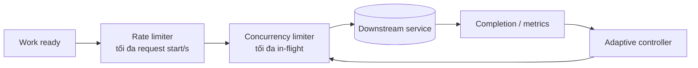
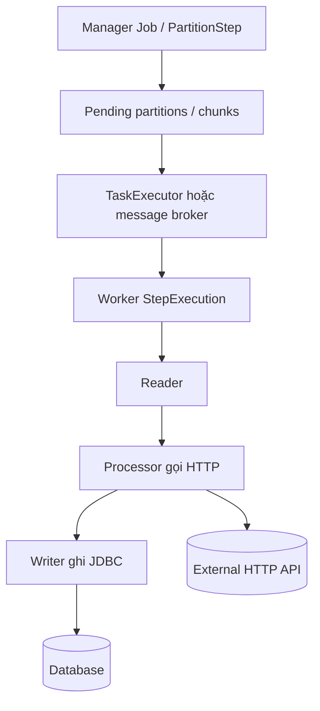
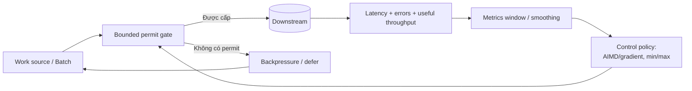
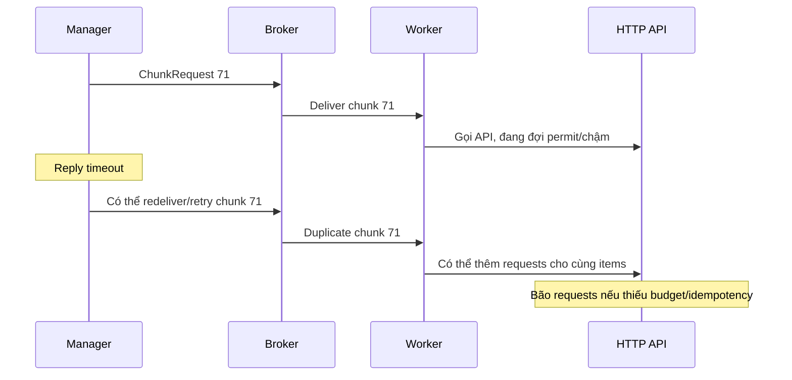
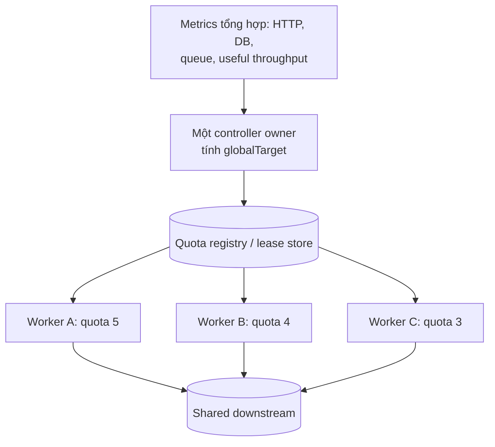

# Adaptive concurrency

## 1. Từ cấu hình số worker cố định đến điều khiển tải thích nghi

Trong chương **Backpressure** của module **SPRING_BATCH_SCALING_OPERATIONS**, chúng ta học cách mở rộng Spring Batch cho workload dữ liệu lớn bằng **multi-threaded step, parallel steps, partitioning và các mô hình xử lý phân tán**, đồng thời đo nút thắt, bảo đảm thread safety, retry/restart và vận hành job theo tài nguyên thực tế.

Một lựa chọn phổ biến khi scale là cấu hình sẵn `threadPoolSize=32` hoặc 32 worker JVM. Cách đó hợp lý khi năng lực các thành phần ổn định. Nhưng trong production, thông lượng của database, HTTP API, object storage và broker thay đổi theo giờ, người dùng tương tác, sự cố mạng hoặc khối lượng truy vấn. **Số worker tốt nhất lúc 2 giờ sáng có thể là số worker gây nghẽn lúc 9 giờ sáng**.

**Adaptive concurrency** là cơ chế điều chỉnh **số thao tác được phép đang thực thi cùng lúc** dựa trên tín hiệu sức khỏe của hệ thống: độ trễ, timeout, lỗi, hàng đợi, mức sử dụng kết nối, throughput và độ bão hòa của downstream. Khi hệ thống còn năng lực, controller tăng concurrency có kiểm soát; khi xuất hiện dấu hiệu quá tải, nó giảm số thao tác mới được bắt đầu.

Ví dụ một job chuẩn hóa 8 triệu hóa đơn:

```text
                             ┌──────────────────────┐
Spring Batch manager         │  Adaptive controller │
  40 logical partitions ─────┤  target permits:  12  │
                             └──────────┬───────────┘
                                        │ permit
            ┌───────────────────────────┼─────────────────────┐
            ▼                           ▼                     ▼
       Worker JVM A                 Worker JVM B          Worker JVM C
       4 HTTP calls                 4 HTTP calls          4 HTTP calls
            └───────────────────────────┼─────────────────────┘
                                        ▼
                                Risk-scoring API
                       quota 300 RPS; latency thay đổi
```

Con số trên là giả định minh họa. **40 partitions không đồng nghĩa 40 HTTP calls đang chạy**, và 12 permits **không đồng nghĩa 12 requests/giây**. Đây là hai giới hạn ở các đơn vị khác nhau.

### Mục tiêu học tập

Sau bài này, bạn có thể:

1. Phân biệt **concurrency**, **throughput**, **rate limit**, **queue length**, **latency** và **backpressure**.
2. Giải thích vì sao tăng worker có thể giảm throughput khi một tài nguyên downstream bão hòa.
3. Nhận biết các tín hiệu hữu ích để điều khiển: P50/P95 latency, queue wait, timeout, 429/503, DB pool và useful throughput.
4. Thiết kế thuật toán điều khiển như **AIMD** hoặc gradient-based adaptive limiter có giới hạn.
5. Hiểu vai trò của baseline latency, smoothing, hysteresis, cooldown, min/max, sample size và startup ramp-up.
6. Triển khai **bounded permit gate** bằng Java 17 không giữ queue vô hạn hoặc giảm permits đang được sử dụng.
7. Kết hợp controller với Spring Batch 5.x mà không giả định `gridSize` có thể tự thay đổi giữa chừng để tái partition.
8. Phân biệt local limiter với **quota chia sẻ trên nhiều worker JVM**.
9. Phối hợp retry/backoff, circuit breaker, transaction boundaries, idempotency và checkpoint.
10. Kiểm thử suy giảm downstream, redelivery, zombie worker, tải dao động và quá trình phục hồi.

> **Nguyên tắc cốt lõi:** Điều chỉnh **mức đồng thời mới được cấp phép** thay vì hủy bừa những chunk đang commit. Khi giảm limit từ 20 xuống 8, 20 request đã chạy có thể cần hoàn tất; controller chỉ **ngừng cấp thêm** cho đến khi số in-flight nhỏ hơn 8.

## 2. Năm đại lượng thường bị nhầm với nhau

| Đại lượng | Đơn vị | Ý nghĩa | Điều không suy ra được |
| --- | --- | --- | --- |
| **Concurrency** | requests/tasks đang in-flight | Số thao tác đang thực thi, kể cả đang đợi I/O | Không phải requests/giây |
| **Throughput** | items/s, useful commits/s | Lượng công việc thực sự hoàn tất | Không chứng minh có đủ/đúng business effects |
| **Rate** | requests/s | Tần suất khởi tạo requests tới downstream | Không cho biết có bao nhiêu request vẫn chưa hoàn thành |
| **Latency** | ms/request, P95/P99 | Thời gian hoàn tất một thao tác | Không tự chỉ ra nguyên nhân: CPU, queue, network? |
| **Queue/backlog** | items hoặc seconds of age | Lượng việc chưa được phục vụ | Không phải chỉ số năng lực thực thi trực tiếp |

Một semaphore 8 permits có thể tạo ra 800 RPS nếu mỗi request mất 10 ms và không có nguồn nghẽn khác. Ngược lại, nếu mỗi request mất 5 giây, 8 permits chỉ hỗ trợ thông lượng trung bình khoảng 1,6 requests/s ở trạng thái ổn định khi không có failure.

### 2.1. Concurrency limit khác rate limiting



- **Rate limiter** như token bucket giới hạn số lần **bắt đầu** request mỗi đơn vị thời gian, có thể cho phép burst theo policy.
- **Concurrency limiter** giới hạn số thao tác **chưa kết thúc** tại một thời điểm.
- **Adaptive controller** điều chỉnh limit dựa trên phản hồi được đo, không thay một trong hai cơ chế thành cơ chế còn lại.
- **Backpressure** bảo đảm tầng nguồn giảm/tạm ngừng tạo hoặc giao việc khi downstream không theo kịp; một limiter chỉ từ chối request nhưng upstream cứ retry tức thời vẫn có thể tạo bão.

### 2.2. Thread pool không phải concurrency toàn hệ thống

Trong local partitioning, `TaskExecutor` tối đa 8 threads chỉ giới hạn hoạt động trong **một JVM**. Với 12 worker JVM, tổng concurrency có thể tăng đến gần 96 tasks, chưa kể mỗi task tạo HTTP async calls. Trong remote chunking, số message outstanding và số consumer threads là hai phép đo khác nhau. Để áp một concurrency budget toàn cluster, cần tính đến **mọi JVM, async client, broker prefetch, retry attempts và ownership**.

## 3. Little's Law: vì sao latency tăng làm các request tích tụ?

Trong hệ thống tương đối ổn định, Little's Law:

\[
L = \lambda W,
\]

trong đó:

- \(L\) là số yêu cầu trung bình trong hệ thống (đang chờ và/hoặc đang phục vụ tùy ranh giới đo).
- \(\lambda\) là tốc độ hoàn tất/đến trung bình tính theo requests/s.
- \(W\) là thời gian trung bình trong cùng ranh giới, tính bằng giây.

Ví dụ một API xử lý khoảng 100 requests/s với mean service latency 0,2 giây thì mean in-flight theo ranh giới tương ứng vào khoảng 20 requests. Nếu latency tăng lên 0,8 giây mà vẫn muốn giữ throughput 100 requests/s, mean in-flight lý thuyết vào khoảng 80.

**Không được hiểu máy móc rằng latency tăng bốn lần thì nên tăng concurrency bốn lần.** Nếu latency tăng vì API đã bão hòa, thêm in-flight requests lại làm hàng đợi dài hơn và latency tiếp tục tăng.

### 3.1. Đường cong throughput theo mức đồng thời

```text
Throughput
  ^
  |                     __________
  |                  __/          \___  <- contention/timeout tăng
  |              ___/
  |          ___/
  |      ___/
  |  ___/
  +--------------------------------------------------> Concurrency
     quá ít       gần ngưỡng tối ưu           quá nhiều
```

Đây là hình minh họa khái niệm, không phải đường cong phổ quát của mọi hệ thống. Có workload throughput tăng rồi phẳng, có workload giảm mạnh vì lock, context switching, GC, network retries, pool exhaustion hoặc database deadlocks.

**Mục tiêu adaptive concurrency:** Tìm một vùng vận hành có **useful throughput tốt, latency/timeout chấp nhận được và downstream đủ headroom**, không nhất thiết đẩy CPU/connection pool lên 100%.

### 3.2. Vì sao chỉ nhìn CPU là chưa đủ?

Một HTTP service có thể CPU 15% nhưng vẫn quá tải vì database pool 100%, connection timeout hoặc API upstream đang rate-limit. Một batch job có thể CPU 95% vì parsing song song mà API hoàn toàn khỏe. Vì thế controller nên quan sát **đúng nút thắt** và không dùng một CPU metric của worker để quyết định tất cả.

## 4. Đặt đúng ranh giới điều khiển trước khi viết thuật toán

Một job Spring Batch có thể có nhiều lớp:



Bạn muốn điều khiển:

1. **Active partition count**: số `StepExecution` worker đang chạy.
2. **Active chunk count**: số chunk transactions đồng thời.
3. **Concurrent HTTP calls**: số request chưa kết thúc tới một downstream.
4. **Concurrent JDBC operations**: số thao tác đang dùng connection/database resources.
5. **Outstanding remote messages**: số `ChunkRequest`/`StepExecutionRequest` đã giao nhưng chưa rõ kết quả.

Các ranh giới **không tương đương**. Một worker partition có thể gọi tuần tự một HTTP request, hoặc fan-out 10 async requests. Nếu API rủi ro là nút thắt, **điều khiển HTTP concurrency tại API client boundary** thường chính xác hơn giảm bừa mọi worker/partition.

### 4.1. Quy tắc chọn scope

| Nút thắt quan sát | Gate phù hợp | Lý do |
| --- | --- | --- |
| HTTP API chậm, DB vẫn khỏe | Concurrent calls tới HTTP service | Không làm giảm quá mức phần parsing/DB độc lập |
| DB pool cạn, lock contention cao | Đồng thời DB writes/chunks | Bảo vệ database transaction |
| Manager gửi nhiều chunks hơn workers xử lý | Outstanding chunk cap + broker prefetch | Backpressure trước khi queue/broker nở lớn |
| Có quá nhiều partitions active | Dispatch/`PartitionHandler` capacity | Giảm overhead và tranh chấp tài nguyên |
| File output duy nhất | Single ordered final writer | Thứ tự và quyền sở hữu, không chỉ load |
| Một account “hot key” | Per-key serialization/sequence guard | Thêm worker không làm causal events độc lập |

### 4.2. Đặt gate trước hay trong transaction?

**Lý tưởng:** xin permit **trước khi mở transaction lâu hoặc trước khi tạo expensive work**. Nếu `ItemProcessor` nằm trong chunk transaction và phải đợi permit 20 giây, worker có thể giữ connection/lock trong lúc đợi, làm chính DB trở thành nút thắt mới.

Khi chưa thể tái cấu trúc, gate trong processor nên **non-blocking hoặc bounded wait rất ngắn**, trả tín hiệu capacity unavailable theo retry policy có giới hạn. Nhưng retry trong chunk transaction vẫn có thể kéo dài transaction; cần benchmark và cân nhắc tách enrichment thành staging step hoặc quản lý dispatch từ manager.

## 5. Những tín hiệu nào đáng dùng để điều chỉnh?

Adaptive control cần phản hồi từ downstream, nhưng mỗi metric có các bẫy.

| Tín hiệu | Khi tăng bất thường | Lưu ý |
| --- | --- | --- |
| HTTP P50/P95 latency | Queueing/service time có thể tăng | Sample nhỏ gây nhiễu; tách endpoint/operation |
| Connection/pool acquisition wait | Pool gần cạn | Đừng nhầm queue wait nội bộ với service latency |
| Timeout, 429, 503 rate | Overload/quota/outage | 429 có thể là quota cố định, không chữa chỉ bằng concurrency |
| DB lock wait/deadlock | Nhiều transactions cạnh tranh | Có thể do hot row, không phải số HTTP workers |
| Worker queue age/backlog | Nguồn đến nhanh hơn throughput | Queue age tăng có thể do nguồn burst; cần kết hợp useful throughput |
| Useful commits/s | Tốc độ xử lý có ích | Counters có thể đếm retries nếu không dựa business key |
| In-flight requests | Mức sử dụng permits | Limit lớn nhưng in-flight nhỏ nghĩa là không có nhu cầu/đầu vào |
| Error budget consumed | Mức độ rủi ro vận hành | Phải gắn threshold theo business SLA |
| JVM heap/GC pause | Tài nguyên bị áp lực | Không chắc downstream API bão hòa |

### 5.1. Baseline latency và queueing delay

Một kỹ thuật thường dùng: ước lượng latency nền khi downstream chưa bị queue, gọi là `baselineLatency`. Lúc peak, nếu latency đo được cao hơn đáng kể baseline, có thể có queueing hoặc contention.

\[
q_{\text{ratio}} =
\frac{L_{\text{observed}}}{L_{\text{baseline}}}.
\]

Ví dụ baseline P50 là 120 ms, quan sát P50 tăng lên 360 ms, ratio bằng 3. Tuy nhiên **không kết luận chắc chắn queue delay gấp ba**; có thể service xử lý các request phức tạp hơn, mạng thay đổi, cache lạnh hoặc mẫu requests khác nhau.

Muốn so sánh có ích cần phân nhóm theo **operation, tenant tier, payload size và downstream instance pool**, tránh dùng một baseline cho GET đơn giản và POST xử lý nặng.

### 5.2. Baseline phải được học/cập nhật cẩn thận

- Lấy baseline từ một khoảng đủ mẫu khi hệ thống ít queue và tỷ lệ lỗi thấp.
- Dùng sliding/min filter hoặc baseline TTL theo policy, không giữ minimum “thần kỳ” từ một request cache hit duy nhất mãi mãi.
- Khi downstream rollout tăng độ phức tạp thật, baseline cũ có thể quá thấp; controller dễ giảm limit không cần thiết.
- Khi downstream gặp outage, **không cập nhật baseline thành latency rất cao** rồi tưởng mọi thứ đã bình thường.
- Dùng histogram hoặc quantile nhất quán; không so `P50` baseline với `P99` observed mà không giải thích.

### 5.3. Cần đủ mẫu trước khi tăng limit

Một cửa sổ chỉ có hai requests, cả hai trả lời 50 ms, chưa đủ để tăng limit từ 8 lên 64. Nên đặt `minSamples`, cửa sổ tối thiểu, thời gian ổn định/hysteresis và cap mỗi lần tăng. Mặt khác, **timeout/429 bùng phát** là tín hiệu an toàn cần giảm nhanh, không phải đợi thống kê đẹp.

## 6. Vòng điều khiển thích nghi gồm những thành phần gì?



Đây là một **feedback control loop**:

1. **Actuator:** số permits đang cho phép, chẳng hạn `targetConcurrency=12`.
2. **Plant:** worker, queues, network và downstream đang được bảo vệ.
3. **Sensors:** latency, error, queue age, in-flight, throughput hữu ích.
4. **Controller:** quyết định tăng/giảm/giữ permits theo cửa sổ đo.
5. **Safety constraints:** `minConcurrency`, `maxConcurrency`, rate limit, hard capacity, timeout và circuit breaker.
6. **Work admission:** yêu cầu vượt limit bị **defer/queue có giới hạn/fail có kiểm soát**, không retry tức thì hàng nghìn lần.

Một controller tệ có thể **dao động**: giảm limit khi chậm, thấy latency khỏe liền tăng mạnh, lại bão hòa rồi giảm tiếp. Vì thế thiết kế phải có **damping** như smoothing, cooldown và tốc độ tăng có giới hạn.

### 6.1. Những quy tắc bất biến

- Không cấp nhiều hơn `maxConcurrency` permits cho ranh giới được bảo vệ.
- Không bắt đầu request mới khi `inFlight >= currentLimit`.
- Khi giảm limit, **không hủy một HTTP request/JDBC transaction đã bắt đầu** chỉ để đạt con số mới.
- Permit phải được trả trong `finally`/`try-with-resources`, kể cả exception, timeout hoặc cancellation.
- Không tăng limit khi **không có nhu cầu** hoặc cửa sổ ít mẫu.
- Nếu controller/sensor lỗi, hệ thống có **safe fallback** như limit bảo thủ hoặc tạm dừng admission; không tự đặt vô hạn.
- Một manual hard cap hoặc downstream quota **luôn có quyền ưu tiên** trên adaptive recommendation.

## 7. Thuật toán AIMD: dễ hiểu, dễ quan sát

**AIMD — Additive Increase, Multiplicative Decrease**:

- Nếu đo được hệ thống khỏe và có nhu cầu: tăng chậm, ví dụ `limit = limit + 1` sau một hoặc vài cửa sổ.
- Nếu quá tải: giảm theo tỷ lệ, ví dụ `limit = max(minLimit, floor(limit × 0,7))`.
- Khi tín hiệu chưa rõ: **giữ nguyên**, không nhất thiết phải thay đổi mỗi cửa sổ.

```text
min = 2
max = 32
start = 4

healthy windows  -> 4, 5, 6, 7, 8
overload detected -> floor(8 * 0.7) = 5
stabilize         -> hold 5
healthy again     -> 6, 7 ...
```

### 7.1. Pseudocode có giới hạn

```text
every controlWindow:
    measure completed attempts, errors, latency, demand, inFlight
    if metrics invalid or sample count too low:
        hold (or decrease conservatively on clear overload)
    else if overload (429/503/timeouts or latency far above baseline):
        target = clamp(floor(target * 0.7), min, max)
        enter cooldown
    else if healthy && demand >= 80% && consecutiveHealthy >= 2
         && cooldown expired:
        target = clamp(target + 1, min, max)
    else:
        hold
    gate.updateLimit(target)
```

Không có một threshold 80%, 0,7 hay P95 ratio 2,0 áp dụng cho mọi dịch vụ. Đây là **starting heuristic** để minh họa; phải điều chỉnh theo latency SLO, downstream quota, tail behavior và kết quả fault-injection.

### 7.2. Tại sao giảm theo tỷ lệ, tăng tuyến tính?

Khi quá tải, hệ thống cần **giảm áp lực nhanh**. Nếu giảm từ 32 xuống 31 rồi chờ 10 giây, một API đang 503 hàng loạt có thể chưa kịp phục hồi. Ngược lại, khi vừa hồi phục, tăng từ 2 lên 32 ngay có thể tạo một đợt bão mới. AIMD thực hiện “cắt nhanh, dò chậm”.

### 7.3. Hạn chế của AIMD

- Phụ thuộc cửa sổ và ngưỡng; cửa sổ quá ngắn gây dao động, quá dài phản ứng chậm.
- Nếu latency thay đổi do complexity của dữ liệu, có thể giảm sai.
- Khi demand thấp, throughput thấp không có nghĩa downstream yếu.
- Không giải quyết fairness giữa tenants/endpoints.
- Một controller mỗi JVM độc lập có thể **cùng tăng**, làm tổng cluster vượt quota.
- Khi có nhiều nút thắt, đo HTTP latency không đủ bảo vệ database lock contention.

## 8. Gradient/Vegas-style controller: dùng độ trễ để ước lượng queue

Ngoài AIMD, một số adaptive concurrency limiter dùng quan hệ giữa **latency baseline và latency quan sát** để ước lượng độ queueing.

Một heuristic minh họa:

\[
q_{\text{estimated}} =
C \left(1-\frac{L_{\text{baseline}}}
               {L_{\text{observed}}}\right),
\]

với `C` là in-flight concurrency mục tiêu. Nếu `C=20`, baseline 100 ms và observed 200 ms, heuristic ước lượng khoảng 10 requests có thể nằm trong phần “queue/congestion”.

**Đây là mô hình đơn giản hóa**, không phải phép đo chính xác số requests đang nằm trong queue hoặc công thức bắt buộc của bất kỳ thư viện nào. Nếu service time, payload distribution hoặc clock thay đổi, ước lượng có thể sai.

Controller có thể giảm concurrency khi `q_estimated` cao hơn ngưỡng và tăng nếu quá ít queue trong khi còn demand. Một số implementation sử dụng EWMA, percentile/min latency, sampling window, probe và gradient step sizes khác nhau.

### 8.1. So sánh nhanh

| Hướng | Tín hiệu chủ yếu | Ưu điểm | Điểm yếu |
| --- | --- | --- | --- |
| Fixed limit | Cấu hình thủ công | Dễ hiểu, dễ kiểm toán | Không thích ứng khi load/capacity đổi |
| AIMD | Error/latency threshold | Triển khai đơn giản, phản ứng nhanh khi lỗi | Chọn ngưỡng, dễ dao động |
| Gradient/Vegas-style | Base vs observed latency | Có thể phát hiện queue trước khi errors | Baseline nhiễu, cần đo cẩn thận |
| Concurrency limit dựa CPU | CPU/heap/pool utilization | Hữu ích cho tài nguyên nội bộ | Không phản ánh API/DB dependency phức tạp |
| Load shedding + circuit | Health/overload state | Bảo vệ khi outage rõ | Không thay thế điều chỉnh mềm khi load thay đổi |

**Không tự phối nhiều controller điều chỉnh cùng một knob không có cơ chế ưu tiên.** Nếu AIMD muốn tăng từ 8 lên 9, còn circuit breaker đang OPEN, circuit phải chặn admission thay vì tăng request thực ra ngoài.

## 9. Java 17: bounded permit gate không chặn vô hạn

Phần này minh họa một gate **thread-safe, non-blocking**, cấp một permit cho mỗi HTTP call. Một `AtomicInteger` lưu số request đang chạy; một `AtomicInteger` khác lưu limit. Khi giảm target, các permit đã cấp được giữ đến khi thao tác kết thúc.

### 9.1. Implementation gate

```java
import java.util.concurrent.atomic.AtomicBoolean;
import java.util.concurrent.atomic.AtomicInteger;

public final class AdaptivePermitGate {
    private final int minLimit;
    private final int maxLimit;
    private final AtomicInteger limit;
    private final AtomicInteger inFlight = new AtomicInteger();

    public AdaptivePermitGate(
            int minimum, int maximum, int initial) {
        if (minimum < 1 || minimum > maximum ||
                initial < minimum || initial > maximum) {
            throw new IllegalArgumentException("invalid permit bounds");
        }
        this.minLimit = minimum;
        this.maxLimit = maximum;
        this.limit = new AtomicInteger(initial);
    }

    // null nghĩa là hiện không thể nhận thêm việc.
    public Permit tryAcquire() {
        while (true) {
            int active = inFlight.get();
            int allowed = limit.get();
            if (active >= allowed) {
                return null;
            }
            if (inFlight.compareAndSet(active, active + 1)) {
                return new Permit(this);
            }
        }
    }

    public void updateLimit(int requested) {
        int bounded = Math.max(
            minLimit, Math.min(maxLimit, requested));
        limit.set(bounded);
        // Không cưỡng bức cancel các request đang chạy.
    }

    public int currentLimit() {
        return limit.get();
    }

    public int inFlight() {
        return inFlight.get();
    }

    public static final class Permit implements AutoCloseable {
        private final AdaptivePermitGate owner;
        private final AtomicBoolean returned = new AtomicBoolean();

        private Permit(AdaptivePermitGate owner) {
            this.owner = owner;
        }

        @Override
        public void close() {
            if (returned.compareAndSet(false, true)) {
                owner.inFlight.decrementAndGet();
            }
        }
    }
}
```

### 9.2. Vì sao không dùng `Semaphore` rồi “set số permit” đơn giản?

`Semaphore` thuận tiện khi số permits cố định. Nhưng giảm limit động mà không phá trạng thái in-flight cần policy rõ; `Semaphore.reducePermits` là phương thức protected, còn `release(n)` để tăng mà không theo dõi in-flight có thể khiến số permits bị tính sai khi thay đổi liên tiếp.

Gate ở trên dùng **target limit + inFlight**: khi limit từ 16 xuống 8 nhưng đang có 15 requests, không request mới nào được nhận; khi 8 requests kết thúc, inFlight giảm còn 7 và request tiếp theo mới có thể được cấp.

**Giới hạn cần biết:** Vì `limit.get()` và `inFlight.compareAndSet()` không nằm trong một critical section chung, một lần `updateLimit` chạy **đồng thời** với `tryAcquire` có thể cho phép một admission dựa trên limit cũ ngay thời điểm đổi limit. Gate bảo đảm không mất permits và drain dần sau khi limit mới có hiệu lực, **không** tạo một ranh giới cắt tuyệt đối tức thời khi limit giảm. Nếu hệ thống yêu cầu hard admission invariant tại mọi nano-giây, dùng lock/serialization cùng protocol; không được nhầm adaptive target với security quota.

### 9.3. Cách sử dụng permit an toàn

```java
AdaptivePermitGate.Permit permit = gate.tryAcquire();
if (permit == null) {
    throw new DownstreamCapacityUnavailableException(
        "No HTTP permit available");
}
try (permit) {
    return callRiskService(invoice);
}
```

`DownstreamCapacityUnavailableException` là exception ứng dụng tự định nghĩa, ví dụ subclass `RuntimeException`. `try-with-resources` trả permit khi HTTP call thành công, timeout hay ném exception.

Đừng giữ permit tới tận cuối job, hoặc cấp permit trước khi gửi message mà **không có lease/timeout dọn orphaned slot**. Gate trong-memory ở worker chỉ quản lý tiến trình đang sống; nếu dùng distributed permits/lease, phải thêm TTL/fencing/recovery protocol.

## 10. Java 17: bộ điều khiển AIMD trên cửa sổ metrics

Ví dụ tách **policy** khỏi actuator, giúp unit test bằng các cửa sổ giả lập deterministic thay vì chờ HTTP thật. Framework quan sát metrics (Micrometer, custom recorder, broker consumer telemetry...) gọi `onWindow` theo chu kỳ, không nhúng polling khó kiểm thử vào từng `ItemProcessor`.

### 10.1. Hợp đồng của một cửa sổ đo

```java
public record CapacityWindow(
    int completedAttempts,
    double p95LatencyMillis,
    double overloadRate,   // tỷ lệ 429/503/timeout trong [0,1]
    double utilization     // inFlight / currentLimit gần đúng [0,1+]
) {
    public CapacityWindow {
        if (completedAttempts < 0
                || !Double.isFinite(p95LatencyMillis)
                || p95LatencyMillis < 0
                || !Double.isFinite(overloadRate)
                || overloadRate < 0 || overloadRate > 1
                || !Double.isFinite(utilization)
                || utilization < 0) {
            throw new IllegalArgumentException("invalid window");
        }
    }
}
```

Một `CapacityWindow` phải được tạo từ **cùng ranh giới HTTP operation/downstream**. `overloadRate` gồm các lỗi biểu thị quá tải, không gộp validation 400/422 vào cùng nhóm để rồi giảm concurrency vô cớ.

`p95LatencyMillis` nên đo các attempts hoàn tất theo cách nhất quán (thường latency của thành công + lỗi với phân loại rõ), và không bỏ qua timeouts chỉ vì chúng không trả HTTP response. Nếu bỏ mọi request đang treo khỏi mẫu mà vẫn tăng limit, controller có thể nhìn thấy duy nhất các request nhanh và bị **survivorship bias**.

### 10.2. Controller minh họa

```java
public final class AimdCapacityController {
    private final AdaptivePermitGate gate;
    private final double healthyP95Millis;
    private int consecutiveHealthy;
    private int cooldownWindows;

    public AimdCapacityController(
            AdaptivePermitGate gate, double baselineP95Millis) {
        if (!Double.isFinite(baselineP95Millis)
                || baselineP95Millis <= 0) {
            throw new IllegalArgumentException("invalid baseline");
        }
        this.gate = gate;
        this.healthyP95Millis = baselineP95Millis;
    }

    // Gọi một lần trên mỗi cửa sổ ổn định, bởi một controller owner.
    public synchronized int onWindow(CapacityWindow w) {
        int current = gate.currentLimit();

        // Lỗi bùng phát rõ: giảm ngay cả khi ít mẫu.
        boolean severeOverload = w.completedAttempts() >= 10
            && w.overloadRate() >= 0.20;
        boolean ordinaryOverload = w.completedAttempts() >= 30
            && (w.overloadRate() >= 0.05
                || w.p95LatencyMillis() > 2.0 * healthyP95Millis);

        if (severeOverload || ordinaryOverload) {
            int reduced = Math.max(1,
                (int) Math.floor(current * 0.7));
            gate.updateLimit(reduced);
            cooldownWindows = 2;
            consecutiveHealthy = 0;
            return gate.currentLimit();
        }

        if (cooldownWindows > 0) {
            cooldownWindows--;
            consecutiveHealthy = 0;
            return current;
        }

        // Không tăng khi sample ít hoặc không có demand.
        boolean healthy = w.completedAttempts() >= 30
            && w.overloadRate() < 0.01
            && w.p95LatencyMillis() <= 1.3 * healthyP95Millis
            && w.utilization() >= 0.80;

        consecutiveHealthy = healthy ? consecutiveHealthy + 1 : 0;
        if (consecutiveHealthy >= 2) {
            gate.updateLimit(current + 1);
            consecutiveHealthy = 0;
        }
        return gate.currentLimit();
    }
}
```

**Đây là ví dụ thuật toán giáo dục**, chưa phải controller production hoàn chỉnh:

- Nó dùng baseline **cố định được đo trước**. Production cần baseline lifecycle, smoothing và thích ứng khi mix requests thay đổi.
- Nó chỉ có tín hiệu P95, overload rate và utilization; chưa trực tiếp dùng DB/queue saturation, useful throughput, global rate limit và fairness.
- `minLimit`/`maxLimit` được gate cưỡng chế; controller chỉ đề xuất.
- Khi không có request hoàn tất vì mọi request đang **treo**, cửa sổ rỗng khiến controller giữ nguyên. Production phải kết hợp **in-flight age, active timeout, no-progress watchdog và circuit breaker** để giảm/tạm dừng admission.
- `onWindow` cần được gọi bởi **một owner** cho một gate. Hai scheduler owners cùng điều khiển một gate có thể gây oscillation.
- Với nhiều JVM độc lập, mỗi JVM có một gate/controller riêng; **không suy ra global cluster budget**.

### 10.3. Một bộ cấu hình khởi đầu có thể đo được

```text
Downstream operation: GET /risk/{id}
baseline P95:            250 ms (đo lúc downstream khỏe)
min local concurrency:    2
initial concurrency:      4
max local concurrency:   16
control window:           5 s
min samples/window:      30
severe overload:         >= 20% failures/429/503 (>= 10 samples)
ordinary overload:       >= 5% overload hoặc P95 > 2 x baseline
decrease factor:          0.7
increase step:            +1 sau 2 healthy windows
cooldown:                  2 windows
global service quota:     được quản lý riêng
```

Các số chỉ là **ví dụ để test**. Với I/O kéo dài nhiều giây, một cửa sổ 5 giây có thể không đủ mẫu; với operation độ trễ 10 ms, cửa sổ 5 giây có thể quá dài để phản ứng. Cần thử dưới tải và outage thật của môi trường test.

## 11. Gắn gate vào HTTP client của Spring Batch worker

Giả sử một worker step cần gọi API chấm điểm rủi ro cho mỗi hóa đơn. Ta có thể **đặt gate ngay trước HTTP call**, đo duration rồi trả permit ở `finally`. Điều này giới hạn số HTTP requests đang hoạt động, không cần giả định một thread luôn tương ứng một HTTP call trong mọi kiến trúc.

### 11.1. DTO và exception về capacity

```java
import java.math.BigDecimal;

record Invoice(long id, BigDecimal amount) {}
record RiskScore(String grade) {}
record ScoredInvoice(
    long id, BigDecimal amount, String riskGrade) {}

class DownstreamCapacityUnavailableException
        extends RuntimeException {
    DownstreamCapacityUnavailableException(String message) {
        super(message);
    }
}
```

Exception `DownstreamCapacityUnavailableException` mang nghĩa **worker không nhận thêm HTTP work ngay bây giờ**. Nó không phải lỗi dữ liệu của invoice và **không nên được skip rồi coi như record đã xử lý**. Tầng caller phải có đường defer/retry với giới hạn hoặc fail step có kiểm soát.

### 11.2. HTTP client có timeout

```java
import org.springframework.context.annotation.Bean;
import org.springframework.http.client.SimpleClientHttpRequestFactory;
import org.springframework.web.client.RestClient;

@Bean
RestClient riskRestClient() {
    SimpleClientHttpRequestFactory requestFactory =
        new SimpleClientHttpRequestFactory();
    requestFactory.setConnectTimeout(1_000);
    requestFactory.setReadTimeout(2_000);

    return RestClient.builder()
        .baseUrl("https://risk.internal.example")
        .requestFactory(requestFactory)
        .build();
}
```

Đây là ví dụ API giả định và yêu cầu **Spring Framework 6.1+** cho `RestClient`; nếu dự án Spring Batch 5.x đang dùng Spring Framework phiên bản sớm hơn, thay bằng `RestTemplate` hoặc HTTP client đang được hỗ trợ. Production thường cần connection pool, TLS, tracing, tổng deadline và phân loại status 429/503; `connectTimeout` và `readTimeout` **chưa phải end-to-end deadline**.

### 11.3. Processor dùng try-with-resources

```java
import org.springframework.batch.item.ItemProcessor;
import org.springframework.context.annotation.Bean;
import org.springframework.web.client.RestClient;

@Bean
ItemProcessor<Invoice, ScoredInvoice> gatedRiskProcessor(
        AdaptivePermitGate riskGate,
        RestClient riskRestClient,
        CapacityRecorder recorder) {

    return invoice -> {
        AdaptivePermitGate.Permit permit = riskGate.tryAcquire();
        if (permit == null) {
            recorder.recordRejectedByGate();
            throw new DownstreamCapacityUnavailableException(
                "Risk API at concurrency capacity");
        }

        long started = System.nanoTime();
        boolean success = false;
        try (permit) {
            RiskScore response = riskRestClient.get()
                .uri("/score/{invoiceId}", invoice.id())
                .retrieve()
                .body(RiskScore.class);
            if (response == null || response.grade() == null) {
                throw new IllegalStateException("Invalid API response");
            }
            success = true;
            return new ScoredInvoice(
                invoice.id(), invoice.amount(), response.grade());
        } finally {
            double elapsedMs =
                (System.nanoTime() - started) / 1_000_000.0;
            recorder.recordAttempt(elapsedMs, success);
        }
    };
}

interface CapacityRecorder {
    void recordAttempt(double elapsedMillis, boolean success);
    void recordRejectedByGate();
    CapacityWindow snapshotAndReset();
}
```

**Điểm tích hợp:** `CapacityRecorder` là interface ứng dụng cần có implementation thread-safe. `snapshotAndReset()` phải tạo **window nhất quán** (không làm mất mẫu khi đang chuyển cửa sổ), bao gồm HTTP status/timeout classification thay vì chỉ boolean success; `recordAttempt` trong ví dụ này chỉ minh họa đo duration và success, chưa đủ để tính chính xác `overloadRate` khi một error là 400 hay 503.

Việc không đo những request **đang treo** cũng gây sai lệch: controller phải kết hợp in-flight age/per-attempt timeout và no-progress watchdog. **Không gọi `updateLimit` từ mỗi processor invocation**; một scheduler/controller riêng tiêu thụ metrics theo cửa sổ.

### 11.4. Khởi tạo gate và controller dùng chung trong một JVM

```java
import org.springframework.context.annotation.Bean;

@Bean
AdaptivePermitGate riskGate() {
    return new AdaptivePermitGate(
        2, 16, 4); // min, max, initial local permits
}

@Bean
AimdCapacityController riskCapacityController(
        AdaptivePermitGate riskGate) {
    return new AimdCapacityController(
        riskGate, 250.0); // baseline P95 milliseconds, minh họa
}
```

Các `@Bean` thuộc một `@Configuration` cùng với worker trong ứng dụng. `CapacityRecorder` cần implementation được đăng ký riêng, ví dụ một recorder thread-safe tiêu thụ HTTP metrics/Micrometer và tính histogram theo cửa sổ. **Không thể chạy nguyên ví dụ nếu thiếu implementation này**; cũng phải bật scheduling nếu dùng tick bên dưới. Giá trị baseline 250 ms phải đến từ phép đo thật, không mặc định mọi API có cùng latency.

### 11.5. Tick điều khiển định kỳ

```java
import org.springframework.scheduling.annotation.Scheduled;
import org.springframework.stereotype.Component;

@Component
final class CapacityControllerTick {
    private final CapacityRecorder recorder;
    private final AimdCapacityController controller;

    CapacityControllerTick(
            CapacityRecorder recorder,
            AimdCapacityController controller) {
        this.recorder = recorder;
        this.controller = controller;
    }

    @Scheduled(fixedDelay = 5_000)
    void adapt() {
        CapacityWindow window = recorder.snapshotAndReset();
        controller.onWindow(window);
    }
}
```

`@Scheduled` cần bật scheduling trong application context. `fixedDelay=5000` có nghĩa chạy lại sau khi lần trước hoàn tất và chờ delay, không cam kết ranh giới cửa sổ đúng 5 giây tuyệt đối. Nếu tick chậm hoặc metrics không đến, phải có watchdog/fallback. Chỉ một `CapacityControllerTick` nên điều khiển một gate trong một JVM; với nhiều instances, đây vẫn là **local controller**.

### 11.6. Spring Batch 5.x chunk step

```java
import org.springframework.batch.core.Step;
import org.springframework.batch.core.repository.JobRepository;
import org.springframework.batch.core.step.builder.StepBuilder;
import org.springframework.batch.item.ItemProcessor;
import org.springframework.batch.item.ItemReader;
import org.springframework.batch.item.ItemWriter;
import org.springframework.context.annotation.Bean;
import org.springframework.retry.backoff.ExponentialRandomBackOffPolicy;
import org.springframework.transaction.PlatformTransactionManager;
import org.springframework.web.client.ResourceAccessException;

@Bean
Step riskWorkerStep(
        JobRepository jobRepository,
        PlatformTransactionManager transactionManager,
        ItemReader<Invoice> invoiceReader,
        ItemProcessor<Invoice, ScoredInvoice> gatedRiskProcessor,
        ItemWriter<ScoredInvoice> scoredInvoiceWriter) {

    ExponentialRandomBackOffPolicy backoff =
        new ExponentialRandomBackOffPolicy();
    backoff.setInitialInterval(250);
    backoff.setMultiplier(2.0);
    backoff.setMaxInterval(2_000);

    return new StepBuilder("riskWorkerStep", jobRepository)
        .<Invoice, ScoredInvoice>chunk(100, transactionManager)
        .reader(invoiceReader)
        .processor(gatedRiskProcessor)
        .writer(scoredInvoiceWriter)
        .faultTolerant()
        .retry(DownstreamCapacityUnavailableException.class)
        .retry(ResourceAccessException.class)
        .retryLimit(3)
        .backOffPolicy(backoff)
        .build();
}
```

**Đây là cấu hình để minh họa cách nối gate vào một worker, không phải cấu hình production tối ưu dưới bão request.** Một item bị từ chối permit rồi retry ngay bên trong chunk step vẫn giữ slot worker và có thể giữ transaction mở khi backoff, nhất là nếu reader đã lấy connection. Nếu nhiều items tranh gate, chúng có thể đồng loạt hết `retryLimit` và làm job thất bại dù dữ liệu hợp lệ.

Với hệ thống tải lớn, **nên ưu tiên admission control trước khi task/chunk được dispatch**, hoặc durable defer/rescheduling, thay vì để mọi worker thread đợi permit trong transaction. Nếu thiết kế buộc retry trong processor, giữ bounded backoff, deadline, no-loop policy, đo transaction duration và không `skip` capacity exception.

**Một số ngữ nghĩa chính xác:**

- `retryLimit(3)` theo policy thông thường tương ứng tối đa **ba attempts**, bao gồm lần đầu, cho thao tác retry phù hợp.
- `ExponentialRandomBackOffPolicy` có thành phần random multiplier, **không tự là full-jitter** hay tự tôn trọng `Retry-After`.
- `ResourceAccessException` có thể bao gồm nhiều lỗi truyền tải; cần phân loại theo operation/idempotency và timeout outcome.
- Không dùng `.retry(Exception.class)` hoặc `.skip(Exception.class)` trên production khi chưa chứng minh taxonomy.
- `@StepScope` hỗ trợ state riêng theo `StepExecution`, **không** tạo scope riêng cho mỗi chunk thread.
- Nếu `RestClient` có interceptor retry ẩn, một lần thử Spring Batch có thể phát nhiều HTTP requests; cần budget xuyên tầng.

## 12. Local partitioning: điều chỉnh thực tế mà không phá checkpoint

Một `PartitionStep` tạo worker executions từ `Partitioner`. Manager/`PartitionHandler` chịu trách nhiệm dispatch, còn `StepExecution` và `ExecutionContext` giữ trạng thái restart.

### 12.1. Executor tạo hard ceiling, không phải adaptive target

```java
import org.springframework.context.annotation.Bean;
import org.springframework.core.task.TaskExecutor;
import org.springframework.scheduling.concurrent.ThreadPoolTaskExecutor;

@Bean
TaskExecutor partitionWorkerExecutor() {
    ThreadPoolTaskExecutor executor = new ThreadPoolTaskExecutor();
    executor.setCorePoolSize(8);
    executor.setMaxPoolSize(8);
    executor.setQueueCapacity(16);
    executor.setThreadNamePrefix("risk-partition-");
    executor.initialize();
    return executor;
}
```

Executor này giới hạn số worker tasks đồng thời trong **JVM hiện tại**. Một adaptive permit gate cho HTTP có thể bắt đầu `4`, tăng đến `8` hoặc giảm xuống `2` trong khi executor vẫn có hard max `8`.

**Quan trọng:** Đổi `gridSize` ngay giữa một `JobInstance` **không** phải thao tác hợp lệ để tăng/giảm concurrency một cách tự do. `gridSize` là hint cho `Partitioner`/handler; nếu partitioner tạo kế hoạch mới khi restart, mapping/cursor/checkpoint cũ có thể không còn tương thích. Hãy giữ manifest partition plan bất biến và điều chỉnh **worker admission/executor/HTTP permits** thay vì thay đổi logical partition identity.

### 12.2. Hai cấp điều khiển nên phối hợp

```text
JobInstance: immutable partition plan P0..P31
    |
    +-- PartitionHandler / executor: hard max active worker tasks = 8
    |
    +-- Per-downstream gate: adaptive HTTP calls = 2..8
    |
    +-- Global API quota: 200 requests/s (distributed)
    |
    +-- DB writer pool: bounded & monitored
```

Một partition worker có thể **đang hoạt động** nhưng không có HTTP permit. Nếu worker chỉ chờ trong transaction, thay đổi limiter không đem lại backpressure tốt. Một manager-side admission controller có thể chỉ khởi chạy thêm partitions khi capacity có sẵn; tuy nhiên cần dùng **PartitionHandler/dispatch integration phù hợp phiên bản** và giữ `JobRepository` nhất quán, không tự sửa trạng thái worker bằng SQL.

### 12.3. Dynamic thread pool size có đủ không?

Một số `ThreadPoolTaskExecutor` APIs cho phép thay đổi pool sizing khi runtime. Nhưng:

- Pool thay đổi không hủy tasks/HTTP calls đã chạy.
- Queue đã chứa tasks từ trước có thể làm thay đổi **effective concurrency** khác kỳ vọng.
- Thread pool là **một tầng**, không biết tự động RPS/timeout/DB lock.
- Trong `TaskExecutorPartitionHandler`, số partitions đã được submit và lịch chạy có thể ảnh hưởng việc thay đổi.
- Nếu `corePoolSize` và `maxPoolSize` được cập nhật không đúng thứ tự, có thể vi phạm ràng buộc pool.

Vì vậy đừng quảng cáo một lệnh `executor.setCorePoolSize(4)` là giải pháp adaptive concurrency hoàn chỉnh. Chọn **một điểm điều khiển chính** và test điều kiện thật của handler/executor.

## 13. Multi-threaded step: giới hạn concurrency không sửa được thread safety

Trong multi-threaded chunk step, nhiều threads chạy chunks của **cùng `StepExecution`**. Một adaptive limit giảm concurrent calls nhưng **không tự làm reader, writer và checkpoint thread-safe**.

Ví dụ:

```text
Thread A: reader.next() -> item 101
Thread B: reader.next() -> item 102
Thread B: writer.commit(item 102) trước thread A
Thread A: timeout, retry, rollback
```

Nếu reader có mutable cursor và `ExecutionContext` checkpoint theo vị trí chưa được đồng bộ đúng, restart có thể đọc lại/bỏ sót dữ liệu. `SynchronizedItemStreamReader` hoặc khóa quanh `read()` có thể serial hóa một phần read nhưng **không tự khôi phục ordering và checkpoint** khi chunk commit ngoài thứ tự.

Khi cần mở rộng có checkpoint mạnh, thường dễ kiểm soát hơn nếu **partitioning với một reader/StepExecution riêng mỗi partition**, và adaptive gate giới hạn HTTP/DB concurrency ở ranh giới thích hợp.

### 13.1. Kịch bản giảm limit ngay giữa chunk

Gate của ví dụ không hủy request đã chạy. Khi controller giảm limit:

- Worker requests đã nhận permit hoàn tất/timeout tự nhiên.
- Request mới bị từ chối hoặc được defer theo policy.
- Business transaction vẫn commit hoặc rollback theo framework, không bị force-complete vì limit giảm.
- `JobRepository` tiếp tục ghi checkpoint của các chunk commit hợp lệ.

Không gọi `Thread.interrupt` vào một transaction đang ghi DB chỉ vì adaptive limit giảm, trừ khi ứng dụng và driver có **contract cancellation/recovery** được kiểm chứng. Hủy không đúng có thể để lại outcome không rõ, tạo duplicate khi retry.

## 14. Remote partitioning: adaptive admission cho nhiều JVM

Trong remote partitioning, manager giao `StepExecutionRequest` tới workers. Nếu có 10 JVM x 8 threads, tổng worker slots danh nghĩa có thể là 80. Nếu mỗi worker độc lập tăng local permits, toàn cluster có thể gây bão downstream.

### 14.1. Phân biệt ba tầng admission

| Tầng | Điều khiển | Cần cảnh giác |
| --- | --- | --- |
| Manager dispatch | Active partitions / requests chưa được nhận | Không dùng timeout để kết luận worker cũ đã chết |
| Worker process | Số partition/chunk slots/JVM | Không phá `StepExecution` lifecycle khi co giãn |
| Downstream client | HTTP/DB in-flight + RPS | Local limit không phải cluster quota |

### 14.2. Phát lại request không được nhân đôi business effect

Worker A commit một số chunks rồi crash trước khi gửi reply. Manager hoặc broker có thể quan sát timeout/redelivery. Worker B nếu chạy lại cùng logical partition có thể xử lý những item đã commit trước đó.

**Adaptive concurrency không tự bảo đảm idempotency.** Khi quản lý failover, cần:

- Logical `partitionKey` ổn định theo dataset/version/range.
- `StepExecution`/`JobInstance` lifecycle và checkpoint hợp lệ.
- Business item effect key không phụ thuộc message delivery ID hoặc `StepExecutionId`.
- Claim/lease/fencing nếu có nguy cơ hai owners đồng thời ghi.
- Không đánh dấu DONE chỉ vì request được gửi hoặc reply timeout.

Nếu worker cũ mất heartbeat nhưng vẫn có kết nối database đích, **không auto-reassign** chỉ dựa trên hết lease nếu sink không có fencing hoặc workflow xác minh đã dừng.

### 14.3. Local AIMD trên mỗi worker và global budget

Giả sử 10 workers, mỗi worker local controller chọn 8 permits. Tổng tối đa có thể thành 80 in-flight requests. Nếu downstream chỉ chịu 30, mọi worker có thể đồng loạt thấy latency tăng, giảm, rồi lại tăng đồng pha.

Hai lựa chọn:

1. **Global coordinator** cấp budget tổng 30 permits, worker chỉ nhận quota con; coordinator tính toán từ health toàn cluster.
2. **Local limiter + global hard safety cap**: mỗi worker tự AIMD nhưng tất cả phải xin permit từ limiter chia sẻ trước khi gọi downstream.

Không nên chạy nhiều controller độc lập cùng cập nhật một global `maxConcurrent` mà không có leader election/CAS/version; chúng có thể ghi đè quyết định nhau.

## 15. Remote chunking: outstanding chunks là một loại concurrency khác

Trong remote chunking, manager thường giữ reader và gửi `ChunkRequest` tới workers, rồi chờ `ChunkResponse`. Không mặc định có một `StepExecution` riêng cho mỗi chunk; correlation/sequence được quản lý bởi giao thức remote chunking của Spring Batch Integration.

### 15.1. Các đơn vị có thể bị tích tụ

```text
Manager input reader
    -> 100 chunks đã publish
        -> 30 chunks được consumer nhận
            -> 12 chunks đang process
                -> 6 HTTP calls đang in-flight
                    -> 4 JDBC writes đang dùng connection
```

Mỗi con số đại diện **một phạm vi khác nhau**. Giới hạn HTTP in-flight bằng 6 có thể bảo vệ API, nhưng nếu manager vẫn publish vô hạn `ChunkRequest`, broker queue sẽ tiếp tục lớn. Nếu muốn backpressure end-to-end, phải hạn chế **outstanding requests** từ manager hoặc điều tiết tốc độ đọc/phát chunk.

### 15.2. Nguy cơ của response chậm



Timeout/reply redelivery thực tế phụ thuộc broker và handler của phiên bản đang dùng; sơ đồ chỉ minh họa cửa sổ lỗi. **Timeout không chứng minh worker chưa commit hoặc đã chết**.

### 15.3. Các giới hạn cần đồng bộ

| Control | Đơn vị | Tác dụng |
| --- | --- | --- |
| Manager outstanding cap | Chunk requests đã gửi nhưng chưa resolved | Ngăn backlog vô hạn |
| Broker consumer prefetch | Messages đang được giao chưa ACK | Giảm chênh lệch giữa consumer và queue |
| Worker active chunk cap | Chunk handlers đồng thời | Tránh quá nhiều chunk transactions |
| HTTP adaptive permit gate | HTTP requests đang in-flight | Bảo vệ API riêng |
| JDBC pool/write cap | Database operations | Bảo vệ DB riêng |
| Retry/backoff budget | Logical item/chunk/request | Ngăn khuếch đại retry |
| Circuit breaker | Khả năng gọi downstream | Tránh tiếp tục gọi khi outage |

**Không dùng mỗi `gridSize` như một cấu hình điều tiết remote chunking**. `gridSize` thuộc mô hình partitioning; remote chunking có writer/middleware/correlation và outstanding message semantics riêng.

### 15.4. Khi controller giảm limit từ 16 xuống 4

Worker đang xử lý 16 HTTP requests cần được phép hoàn thành/timeout; manager **không nên tiếp tục phát chunk mới** làm tăng broker backlog. Có thể tạm dừng dispatch theo capacity tín hiệu trả về, nhưng cần tránh hai lỗi:

1. **Deadlock vận hành:** manager giữ DB transaction/cursor lock trong lúc chờ slot vô hạn.
2. **ACK sai thời điểm:** worker ACK chunk trước khi business result bền vững rồi crash, làm mất dữ liệu dù adaptive limiter hoạt động đúng.

Backpressure phải phối hợp với transaction/ACK checkpoint contract; nó không phải một thay thế cho exactly-once business effect design.

## 16. Điều tiết toàn cluster: permits chia sẻ và phân bổ động

Một local `AtomicInteger` gate chỉ chính xác trong phạm vi một JVM. Khi cluster gồm nhiều pods, một global concurrency budget cần protocol riêng.

### 16.1. Mô hình coordinator cấp quota



Nếu global target là 12, có thể phân bổ 5/4/3 theo nhu cầu. Tuy nhiên các vấn đề phải giải quyết:

- Worker A chết: quota 5 có được thu hồi **ngay** không? Nếu cấp bằng leases, cần TTL và protocol xác minh slot orphaned.
- Worker mới đến: không lấy quota vượt global cap chỉ vì chưa nhận config cập nhật.
- Network partition: worker dùng cache quota cũ có thể chạy tiếp, gây **double spending**.
- Coordinator mất: fail-open/fail-closed theo mức nguy hiểm của downstream.
- Controller leader failover: tránh hai leaders cùng tăng quota.
- Đồng hồ/lease expiry: ưu tiên database/provider clock và monotonic generation/epoch.

Nếu downstream có side effect nghiêm trọng, một shared slot lease còn cần **fencing tại sink** hoặc business idempotency tùy threat model. Giới hạn concurrency chủ yếu bảo vệ tải, **không phải khóa giao dịch**.

### 16.2. Distributed counter đơn giản chưa đủ

Một thiết kế kiểu:

```text
GET activeCount
if activeCount < limit:
    SET activeCount = activeCount + 1
    call API
SET activeCount = activeCount - 1
```

là **race-prone** nếu `GET`/`SET` không nguyên tử. Thêm nữa, khi worker crash trước decrement, activeCount có thể bị “kẹt”, làm giảm throughput vĩnh viễn.

Một implementation thật cần:

- Atomic acquire/release hoặc leases bằng primitives có giao thức đúng (CAS, transaction, script nguyên tử, gateway).
- TTL, token identity, retry/idempotent release và chống release nhầm permit của owner khác.
- Metric orphan permits, renew failures và recovered permits.
- Bound số permits và chiến lược degrade khi coordinator unavailable.
- Kiểm thử concurrency và network partitions bằng nhiều JVM, không chỉ unit test.

### 16.3. Global concurrency limit khác quota RPS

Giả sử downstream có **hard limit 100 RPS** và controller chọn **max 40 concurrent calls**. Khi API trả nhanh 50 ms:

\[
\text{RPS tiềm năng}\approx \frac{40}{0.05}=800.
\]

Đây là ước lượng steady-state rất đơn giản, chưa tính overhead/burst. Nó chứng minh **concurrency limit 40 không bảo đảm 100 RPS**. Cần phối hợp global rate limiter/token bucket **nếu service contract giới hạn tốc độ**.

Ở chiều ngược lại, rate limit 100 RPS mà response mất 10 giây có thể tích lũy tới khoảng 1.000 requests đang in-flight nếu không có concurrency cap. Bởi vậy **rate và concurrency thường cần hai guard độc lập**.

## 17. Fairness, priority và bảo vệ tenant quan trọng

Adaptive concurrency đo “cluster khỏe” có thể gây **starvation**: một tenant gửi lượng job rất lớn chiếm hết permits, tenant khác không có slot.

### 17.1. Hai kiểu fairness

- **Fairness theo tenant/job:** cấp quota tối thiểu hoặc weighted fair sharing, giới hạn một batch job không chiếm hết API.
- **Fairness theo request type:** tách GET nhẹ khỏi POST nặng, hoặc theo endpoint có service time/budget khác nhau.

Một global controller có thể phân bổ:

```text
Global adaptive limit: 20 concurrent HTTP calls

Tier critical   : reserved min 5, weighted max 10
Tier standard   : reserved min 2, weighted max 8
Batch backfill  : opportunistic remainder, cap 6
```

Đây là chính sách minh họa. Nếu reserved slots không được dùng, có thể cho borrow theo protocol, nhưng phải thu hồi mềm để batch không ảnh hưởng latency của critical traffic khi nhu cầu tăng.

### 17.2. Head-of-line blocking

Giả sử một queue trộn 100.000 chunks I/O 30 giây với 10 yêu cầu latency-sensitive 100 ms. Nếu FIFO và mọi permit bị batch tasks chiếm lâu, các yêu cầu ngắn có thể đợi rất lâu dù nhu cầu tài nguyên nhỏ.

Các cách xử lý:

1. Separate queues/worker pools hoặc bulkheads theo workload class.
2. Priority scheduling với giới hạn chống starvation.
3. Bounded queue + admission policy có audit.
4. Phân tách adaptive controllers theo endpoint/resource thay vì một limiter cho mọi thứ.
5. Giữ job restart/idempotency: nếu defer một partition, không tự ý tạo JobInstance mới hoặc mất checkpoint.

## 18. Retry, circuit breaker và adaptive concurrency

### 18.1. Ba cơ chế giải quyết ba vấn đề

| Cơ chế | Câu hỏi nó trả lời | Không thay thế |
| --- | --- | --- |
| **Retry + backoff** | Một lỗi tạm thời có nên thử lại không, sau bao lâu? | Capacity limit |
| **Circuit breaker** | Downstream có quá hỏng để tiếp tục thử ngay không? | Transaction/idempotency |
| **Adaptive concurrency** | Bao nhiêu requests nên cùng chạy vào lúc này? | Rate limit và retry budget |

Khi downstream trả 503 liên tục:

- Circuit có thể OPEN và chặn real HTTP calls.
- Adaptive controller giảm permits nhưng **không bắt buộc xuống 0** nếu `minLimit>=1`.
- Retry coordinator phải tôn trọng circuit OPEN, không retry exception “call not permitted” mỗi 100 ms.
- Backpressure tại nguồn phải giảm new dispatch/chunk backlog, không chỉ biến mọi request thành rejected rồi broker requeue ngay.

### 18.2. Retry amplification khi không có ngân sách tổng

Giả sử:

```text
HTTP SDK:             2 attempts
Spring Batch:         3 attempts
Broker redelivery:    4 deliveries
Worst-case nested:    2 * 3 * 4 = 24 downstream calls/logical item
```

Đây là worst-case lý thuyết **khi các tầng thực sự lồng nhau và mọi lần thử đều tới HTTP**. Với remote chunking, broker phát lại cả chunk chứ không phải chính xác một item; số HTTP attempts thật có thể khác. Vấn đề là **mỗi tầng tưởng chỉ retry “một chút”**, cộng lại thành bão.

Chọn một tầng chủ trách nhiệm cho từng loại lỗi. Ví dụ:

- HTTP SDK max attempts 1 cho operation do Spring Batch xử lý retry.
- Spring Batch retry transient exception có giới hạn, backoff có jitter.
- Broker redelivery xử lý mất ACK/process failure theo quota/TTL hữu hạn, không lập vòng poison message vô hạn.
- Scheduler không restart toàn job mỗi giây khi downstream outage.
- Tất cả attempts vẫn phải xin **global permits/rate tokens**; không bypass gate vì “đây chỉ là retry”.

### 18.3. HTTP 429 và Retry-After

`429 Too Many Requests` thường yêu cầu chờ đến thời điểm hoặc khoảng thời gian do downstream chỉ ra qua `Retry-After`. Controller giảm concurrency có thể hữu ích, nhưng **không thay việc tuân thủ quota/thời điểm chờ**.

Nếu API trả `Retry-After: 10`, đừng retry sau 100 ms chỉ vì vừa có permit mới. Cần:

1. Parse header hợp lệ (seconds hoặc HTTP-date).
2. So với overall deadline.
3. Điều phối qua rate limiter/cooldown, không retry sớm hơn server yêu cầu.
4. Không cho retry queue phát triển vô hạn.
5. Giữ idempotency key cho POST nếu API contract cho phép retry.

### 18.4. Fault-tolerant step và transaction còn sống

Backoff trong `ItemProcessor`/`ItemWriter` có thể giữ chunk transaction mở. Một controller đang cố giảm tải API nhưng lại khiến database connection bị giữ lâu hơn có thể **chuyển sự cố từ API sang DB**.

Nên đo transaction duration, DB connection pending và lock wait. Với HTTP enrichment dài, hãy xem xét stage tách biệt, outbox/work queue hoặc admission trước transaction để giảm load; không mặc định `faultTolerant().retry(...)` là lời giải tối ưu cho request throttling kéo dài.

## 19. Idempotency và trạng thái batch khi điều chỉnh động

**Adaptive concurrency thay đổi thời điểm một yêu cầu bắt đầu/hoàn tất**, không thay đổi danh tính nghiệp vụ của yêu cầu đó.

### 19.1. Khóa nào phải giữ ổn định?

```text
Logical partition:
  normalize|snapshot-v8|range:100001-125000

Business effect:
  invoice:INV-2026-843|operation:SAVE_SCORE_V1

Attempt/owner:
  worker-B|generation:12
```

Khi adaptive controller giảm concurrency, worker có thể defer một item hoặc partition; khi tiếp tục, **logical identity và business effect key giữ nguyên**. Chỉ attempt/owner generation có thể đổi theo failover.

**Không dùng một UUID mới mỗi retry làm business idempotency key.** Nếu worker POST thành công nhưng response timeout, attempt sau dùng key mới có thể tạo double effect.

### 19.2. Không đánh dấu “completed” vì bị throttle

Một item bị gate từ chối **chưa được xử lý**, không phải input invalid. Không `return null` từ `ItemProcessor` chỉ để giảm HTTP calls rồi coi như filter hợp lệ. `null` làm tăng `FILTER_COUNT`, có thể khiến job xanh trong khi thiếu risk score.

Lựa chọn theo hợp đồng:

- Durable defer/requeue với cùng logical key và attempt budget.
- Fail/stop step có kiểm soát, restart cùng `JobInstance` sau khi capacity phục hồi.
- Tạo business status `PENDING_ENRICHMENT` có audit, nếu cho phép; publish gate kiểm tra pending.

Không dùng `skip(DownstreamCapacityUnavailableException.class)` để làm “backpressure” trừ khi nghiệp vụ thật sự cho phép bỏ dữ liệu đó và có reconciliation rõ ràng.

### 19.3. Commit/checkpoint và cửa sổ lỗi

Nếu worker đã commit business DB nhưng reply mất, broker có thể redeliver. Nếu adaptive limit mới là 2, redelivery sẽ đến chậm hơn nhưng **vẫn có thể đến**. Correctness dựa vào:

- Chunk transaction, checkpoint và `JobRepository`.
- Idempotent business writer hoặc unique effect ledger.
- Claim/lease/fencing khi có multiple owners.
- Stable partition plan và input snapshot.
- Message correlation, reply handler và bounded recovery.

Controller không tự biết item đã commit chỉ từ `inFlight`; một permit được release **không chứng minh business transaction thành công**.

## 20. Metrics và dashboard cho adaptive concurrency

Một controller có thể tự đưa ra quyết định nhưng nếu không biết **vì sao nó tăng/giảm**, khó debug và khó chứng minh hiệu quả.

### 20.1. Những metrics tối thiểu

| Metric | Đơn vị/scope | Dùng để trả lời |
| --- | --- | --- |
| `adaptive_limit` | permits/downstream/JVM | Controller hiện cho bao nhiêu in-flight? |
| `adaptive_inflight` | requests đang chạy | Có dùng hết permits không? |
| `adaptive_rejected_total` | request attempts | Bao nhiêu lần không được cấp permit? |
| `adaptive_decision_total{action=...}` | tăng/giảm/giữ | Controller có oscillate không? |
| `adaptive_target_change` | permits per window | Tốc độ ramp-up/down có hợp lý? |
| `http_request_duration_seconds` | latency histogram | P50/P95/P99 thay đổi ra sao? |
| `http_outcomes_total{kind=...}` | status/timeout/budget | Tỷ lệ 429/503/timeouts thực tế |
| `http_requests_started_total` | requests/s | RPS thật có vượt quota không? |
| `useful_business_commits_total` | effect keys/s | Công việc có ích có tăng không? |
| `batch_stage_rows_total` | rows staged | Có tiến triển liên tục không? |
| `batch_partition_active` | worker executions | Partitions active khác HTTP in-flight thế nào? |
| `batch_partition_age_seconds` | duration | Có hot partition/straggler không? |
| `broker_queue_age_seconds` | oldest message | Backpressure có làm backlog quá già? |
| `broker_outstanding_chunks` | chunks | Có phát vượt khả năng workers không? |
| `db_pool_pending_connections` | connections | API tuning có chuyển nghẽn sang DB không? |
| `retry_attempts_total` | attempts | Backpressure có gây retry amplification không? |
| `circuit_breaker_state` | state | Circuit OPEN/HALF_OPEN có tương tác đúng? |

Một dashboard tốt đặt trên cùng timeline: **adaptive limit**, **in-flight**, **P95 latency**, **429/503/timeout**, **useful commits/s** và **queue age**. Xem riêng từng đồ thị có thể khiến ta tối ưu sai:

- P95 giảm khi limit từ 16 xuống 2, nhưng useful commits/s giảm từ 1.000 xuống 50, queue age tăng nhanh: có thể **throttle quá mức**.
- Throughput tăng khi limit từ 8 lên 16, nhưng P99 latency vượt SLA, timeout tăng: có thể **đẩy quá gần ngưỡng bão hòa**.
- HTTP latency bình thường nhưng DB lock wait tăng: bottleneck có thể chuyển sang writer/transaction.

### 20.2. Controller phải đo “work hữu ích”

Không dùng tổng `processor invocation count` làm throughput nghiệp vụ nếu retries và duplicate deliveries có thể xảy ra. Một request có thể chạy ba lần nhưng chỉ có **một business effect đã commit**. Khi đánh giá, nên đối chiếu:

\[
\text{usefulEfficiency} =
\frac{\text{unique useful business effects}}
     {\text{physical request attempts}},
\]

với điều kiện numerator/denominator cùng phạm vi dataset và thời gian quan sát. Trên dashboard cửa sổ ngắn, event bắt đầu ở cửa sổ trước và commit sau có thể làm tỷ lệ dao động; đo lâu hơn hoặc correlation theo logical request để diễn giải đúng.

### 20.3. SQL quan sát JobRepository

```sql
SELECT
    STEP_EXECUTION_ID,
    JOB_EXECUTION_ID,
    STEP_NAME,
    STATUS,
    READ_COUNT,
    WRITE_COUNT,
    FILTER_COUNT,
    COMMIT_COUNT,
    ROLLBACK_COUNT,
    READ_SKIP_COUNT,
    PROCESS_SKIP_COUNT,
    WRITE_SKIP_COUNT,
    START_TIME,
    END_TIME,
    LAST_UPDATED
FROM BATCH_STEP_EXECUTION
WHERE JOB_EXECUTION_ID = ?
ORDER BY STEP_EXECUTION_ID;
```

Đây là **metadata về StepExecution**, không phải một bảng metric chuẩn của adaptive controller. Spring Batch không lưu sẵn `adaptive_limit` hoặc mọi HTTP attempts ở `BATCH_STEP_EXECUTION`. Phải instrument riêng.

Trong partitioning, manager `StepExecution` có thể tổng hợp counters từ workers; không **cộng manager counters với tổng worker counters** rồi coi là số records duy nhất.

### 20.4. Độ trễ một chunk và checkpoint

```sql
SELECT STEP_NAME, STATUS,
       READ_COUNT, WRITE_COUNT,
       COMMIT_COUNT, ROLLBACK_COUNT,
       START_TIME, END_TIME, LAST_UPDATED
FROM BATCH_STEP_EXECUTION
WHERE JOB_EXECUTION_ID = ?
  AND STEP_NAME LIKE 'riskWorkerStep:%'
ORDER BY ROLLBACK_COUNT DESC, LAST_UPDATED ASC;
```

`LAST_UPDATED` **không phải heartbeat đều đặn**; một chunk đang block I/O có thể chưa update. Để phát hiện no-progress, đo thêm `inFlightAge`, last successful commit time, worker liveness và broker queue age. Khi worker dừng bất thường và repository còn `STARTED`, xử lý bằng recovery lifecycle có kiểm soát, không chỉnh `STATUS`/`VERSION` bằng SQL mù.

### 20.5. Giới hạn cardinality của telemetry

Không dùng `invoiceId`, `partitionKey`, `messageId` hoặc URL có path parameter đa dạng làm metric labels. Dùng `downstreamService`, `operation`, `statusClass`, `workerPool` và `decision` có số giá trị nhỏ. Business keys/correlation lưu trong logs/traces có kiểm soát quyền truy cập, retention và redaction.

## 21. Kiểm thử Java 17: controller có giới hạn và không mất permit

Những class ở mục 9–10 là các Java class độc lập, vì vậy có thể unit test **mà không khởi tạo Spring Batch**, tránh phụ thuộc timing của broker/database cho logic điều khiển.

### 21.1. Test giảm limit không hủy in-flight

```java
import org.junit.jupiter.api.Test;
import static org.junit.jupiter.api.Assertions.*;

class AdaptivePermitGateTest {

    @Test
    void loweringLimitDrainsExistingPermitsWithoutCancel() {
        AdaptivePermitGate gate =
            new AdaptivePermitGate(1, 8, 3);

        var p1 = gate.tryAcquire();
        var p2 = gate.tryAcquire();
        var p3 = gate.tryAcquire();

        assertNotNull(p1);
        assertNotNull(p2);
        assertNotNull(p3);
        assertNull(gate.tryAcquire());
        assertEquals(3, gate.inFlight());

        gate.updateLimit(1);
        assertEquals(1, gate.currentLimit());
        assertEquals(3, gate.inFlight());
        assertNull(gate.tryAcquire());

        p1.close();
        p2.close();
        assertEquals(1, gate.inFlight());
        assertNull(gate.tryAcquire());

        p3.close();
        assertEquals(0, gate.inFlight());
        try (var next = gate.tryAcquire()) {
            assertNotNull(next);
            assertEquals(1, gate.inFlight());
        }
        assertEquals(0, gate.inFlight());
    }
}
```

Test trên chứng minh behavior **drain sau khi giảm limit**, không chứng minh claim/fencing giữa nhiều JVM. Trong production, `try (var next = gate.tryAcquire())` chỉ an toàn khi test đã bảo đảm `next != null` trước khi cần dùng; Java cho phép null resource trong try-with-resources nhưng code không nên dựa vào điều đó khi xử lý request thật.

### 21.2. Test permit chỉ release một lần

```java
@Test
void permitIsReleasedExactlyOnceEvenIfClosedTwice() {
    AdaptivePermitGate gate =
        new AdaptivePermitGate(1, 4, 1);

    var permit = gate.tryAcquire();
    assertNotNull(permit);
    assertEquals(1, gate.inFlight());

    permit.close();
    permit.close();

    assertEquals(0, gate.inFlight());
    var again = gate.tryAcquire();
    assertNotNull(again);
    again.close();
    assertEquals(0, gate.inFlight());
}
```

**Lưu ý test hygiene:** Luôn đóng cả permit mới được cấp trong test. Nếu bỏ `again.close()`, test sẽ để fixture có in-flight không được release và dễ che giấu lỗi resource ownership trong các bài thử dài hơn.

### 21.3. Test controller tăng chậm, giảm nhanh

```java
import org.junit.jupiter.api.Test;
import static org.junit.jupiter.api.Assertions.*;

class AimdCapacityControllerTest {

    @Test
    void increasesAfterTwoHealthyWindowsThenDropsOnOverload() {
        AdaptivePermitGate gate =
            new AdaptivePermitGate(2, 16, 4);
        AimdCapacityController controller =
            new AimdCapacityController(gate, 200);

        CapacityWindow healthy =
            new CapacityWindow(100, 220, 0.00, 0.95);

        assertEquals(4, controller.onWindow(healthy));
        assertEquals(5, controller.onWindow(healthy));

        CapacityWindow overloaded =
            new CapacityWindow(100, 700, 0.10, 1.0);

        assertEquals(3, controller.onWindow(overloaded));
        assertEquals(3, controller.onWindow(healthy));
        assertEquals(3, controller.onWindow(healthy));
        assertEquals(3, controller.onWindow(healthy));
        assertEquals(4, controller.onWindow(healthy));
    }

    @Test
    void noDemandDoesNotCauseUnlimitedGrowth() {
        AdaptivePermitGate gate =
            new AdaptivePermitGate(2, 16, 4);
        AimdCapacityController controller =
            new AimdCapacityController(gate, 200);

        CapacityWindow idle =
            new CapacityWindow(0, 0, 0.0, 0.0);
        for (int i = 0; i < 20; i++) {
            controller.onWindow(idle);
        }
        assertEquals(4, gate.currentLimit());
    }
}
```

Các test này deterministic vì truyền `CapacityWindow` trực tiếp. Chúng chưa chứng minh controller có thể **ước lượng P95 từ dữ liệu thật**, không xử lý timeouts bị treo, hoặc có global quota chính xác. Những điều đó cần integration/fault tests bên dưới.

### 21.4. Test cạnh tranh acquire/release

Chạy 50 threads cùng cố `tryAcquire` với hard limit 8; ghi max `inFlight` nhìn thấy và xác minh không vượt 8 trong điều kiện **limit cố định**. Dùng `CountDownLatch` hoặc barrier thay vì `Thread.sleep` để tạo tranh chấp xác định.

Sau đó chạy một thread cập nhật limit từ 8 → 2 → 5 trong lúc requests đang chạy; xác minh không có số permit âm hoặc leak, và sau khi mọi tasks hoàn thành, `inFlight=0`. Do `updateLimit`/CAS có thể giao nhau, **không bắt assert admission tuyệt đối theo limit mới tại một timestamp mơ hồ**; hãy định nghĩa rõ linearization contract nếu cần strict cap.

### 21.5. Kiểm thử metrics sai hoặc mất

- Không có đủ mẫu: controller giữ hoặc giảm bảo thủ, không tăng.
- Báo `NaN`/negative latency: validator từ chối.
- Controller mất tick trong 30 giây: watchdog/fallback có hành động rõ.
- Toàn bộ requests bị treo, không có completion: **no-progress protection** phải hoạt động, vì controller mẫu đơn giản sẽ giữ nguyên.
- Metric source thay phiên bản/đổi đơn vị milliseconds ↔ seconds: test phát hiện trước rollout.
- Baseline cũ sau downstream deploy: test policy re-calibration không làm tăng/giảm cực đoan.

## 22. Fault-injection: chứng minh controller không tạo bão tải

Unit test policy không thể thay cho **integration test dưới tải**. Cần một downstream giả lập có capacity hữu hạn, Spring Batch job thật, database/broker thật hoặc môi trường test tương đương, và bộ điều khiển test có thể thay đổi latency/error rate có kiểm soát.

### 22.1. Ma trận thử nghiệm

| Test ID | Kịch bản | Điều phải kiểm chứng |
| --- | --- | --- |
| A01 | Downstream khỏe, latency thấp | Limit tăng chậm khi có demand, không vượt max |
| A02 | Không có input | Limit không tăng liên tục chỉ vì latency bằng 0 |
| A03 | P95 tăng vì queueing | Limit giảm hoặc hold, useful throughput phục hồi |
| A04 | HTTP 429 trên toàn cluster | Global quota/Retry-After được tôn trọng |
| A05 | HTTP 503 80% trong 30 giây | Giảm nhanh, tránh retry storm; không bỏ dữ liệu |
| A06 | Toàn bộ requests bị treo trước timeout | No-progress watchdog/circuit xử lý, không tăng limit vì thiếu samples |
| A07 | API hồi phục từng bước | Ramp-up có hysteresis, không thundering herd |
| A08 | Một trong hai endpoints chậm | Bulkhead: endpoint khỏe vẫn tiến triển |
| A09 | Hàng đợi broker tăng 10 lần | Manager dispatch/backpressure giữ backlog bounded |
| A10 | Worker JVM crash khi đang giữ permits | Local resources được giải phóng khi process chết; global leases được thu hồi đúng |
| A11 | Worker mất đường tới quota coordinator | Fail-open/fail-closed theo policy đã định, không vượt hard budget |
| A12 | Hai controller leaders cùng cập nhật quota | Chỉ một generation/owner hợp lệ |
| A13 | Controller giảm từ 16 xuống 4 khi in-flight=16 | Không cancel transaction bừa; không nhận request mới cho tới khi drain |
| A14 | HTTP POST commit rồi response timeout | Retry với business idempotency key không nhân đôi effect |
| A15 | Broker redeliver chunk sau commit trước ACK | Effect không trùng, manager correlation đúng |
| A16 | Một partition hot, các partition khác nhỏ | Không starve công việc khác; nhận diện skew |
| A17 | DB pool cạn nhưng HTTP latency tốt | Controller không tăng mù; DB capacity guard bảo vệ writer |
| A18 | 100 requests cùng được release khỏi backoff | Jitter + rate limiter tránh đỉnh tải đồng bộ |
| A19 | Deploy worker pods đồng loạt | Startup ramp-up không vượt quota |
| A20 | Restart cùng JobInstance sau crash | Manifest, checkpoint, idempotency và kết quả đúng |

### 22.2. Mẫu thử tải có thể đo được

Tạo một fake risk-scoring service:

```text
Seconds  0..20:
  latency P50 ~= 120 ms, 1% HTTP 503
  supported concurrency ~= 20

Seconds 20..50:
  60% requests HTTP 503
  rest latency P50 ~= 650 ms
  supported concurrency ~= 6

Seconds 50..80:
  10% HTTP 503
  latency P50 ~= 200 ms
  supported concurrency ~= 12

Seconds 80..120:
  healthy again, P50 ~= 120 ms
  supported concurrency ~= 20
```

Các giá trị chỉ là **điều kiện test**. Nếu fake server quyết định lỗi theo concurrency, hãy mô tả rõ công thức error/latency response và seed random để lặp lại. Nếu server luôn trả 503 bất kể tải, giảm concurrency có thể giảm hại nhưng không làm request thành công hơn; bài test phải đánh giá **hành vi an toàn** thay vì ép controller “khắc phục” outage không thể khắc phục.

### 22.3. So sánh ba cấu hình

| Scenario | Admission control | Controller | Kỳ vọng |
| --- | --- | --- | --- |
| **Static-low** | Fixed concurrency 4 | Không | Rất an toàn nhưng có thể dùng không hết capacity khỏe |
| **Static-high** | Fixed concurrency 32 | Không | Throughput tốt lúc khỏe, quá tải ở giai đoạn suy giảm |
| **Adaptive** | Hard max 32, target 2..32 | AIMD hoặc gradient | Cải thiện cân bằng throughput, latency và overload |

**Không mặc định adaptive sẽ luôn thắng static**. Nếu service capacity rất ổn định, static limit được tune tốt có thể đơn giản và hiệu quả hơn. Adaptive cần đánh đổi complexity, metrics overhead và nguy cơ controller oscillation.

### 22.4. Bộ assertion quan trọng

1. `actualInFlight <= hardLimit` trong điều kiện không giảm limit đồng thời, hoặc hợp đồng admission tương đương đã được định nghĩa.
2. `targetLimit` nằm trong `[minLimit, maxLimit]`.
3. Sau overload, target giảm trong số cửa sổ tối đa đã quy định.
4. Sau recovery, target **không nhảy ngay về max**, trừ khi policy cố ý có hành vi khác.
5. Queue/outstanding chunks không tăng vô hạn; khi nguồn vượt capacity lâu dài phải có policy fail/defer.
6. Tỷ lệ timeout/429/503 và latency P95/P99 theo SLO không xấu hơn đường baseline mà team chấp nhận.
7. Useful commits/s được đo bằng **business effect duy nhất**, không phải retry attempts.
8. Cùng logical item sau crash/restart không tạo duplicate output.
9. Không có lost permits, orphaned distributed leases hoặc stuck `StepExecution` không được cảnh báo.
10. Không có silent skip/filter chỉ vì thiếu capacity.

### 22.5. Vì sao phải dùng hai mức test?

**Test controller độc lập:** truyền `CapacityWindow` giả lập để xác minh thuật toán quyết định ổn định, ít tốn thời gian.

**Test hệ thống thật:** chạy job với nhiều partition/worker, PostgreSQL, broker và fake downstream. Chèn lỗi **sau commit trước reply/ACK** để xác minh idempotency, và test source backpressure để bảo đảm broker backlog không bùng nổ.

Một unit test `onWindow` PASS không chứng minh metric classifier, recorder thread safety, Spring scheduling, listener ACK, global permits hay checkpoint thực tế.

## 23. Runbook khi adaptive limiter giảm throughput bất thường

### Giai đoạn 1 — Xác định giới hạn nào đang tác động

1. Kiểm tra `adaptive_limit`, `adaptive_inflight`, gate rejects và controller decisions.
2. Kiểm tra **hard executor limit**, global rate limit, distributed concurrency permits, HTTP client pool và broker outstanding cap.
3. So sánh **request attempts/s** với **useful commits/s**; có retry amplification không?
4. Xác định downstream nào bị giới hạn, endpoint/tenant nào. Đừng áp dụng một global giảm tải lên mọi dependency khi chỉ một endpoint lỗi.

### Giai đoạn 2 — Phân biệt overthrottle và downstream overload

5. Nếu latency thấp, errors thấp, in-flight luôn sát limit và queue age tăng: có thể đang **under-admitting**, cân nhắc tăng dần sau khi xác minh tài nguyên.
6. Nếu latency/429/503/timeout tăng khi in-flight sát limit: có thể đã **over-admitting**; giữ hoặc giảm, mở circuit nếu outage.
7. Nếu HTTP latency tốt nhưng DB pool pending/lock wait tăng: bottleneck ở DB, cần điều tiết writer/chunk và kiểm tra transaction span.
8. Nếu limit không tăng do thiếu `minSamples` dù nguồn có nhu cầu: kiểm tra recorder, sample window, timeouts và histogram validity.
9. Nếu limit dao động 4→16→4 liên tục: kiểm tra cooldown, smoothing, controller window và hai controllers cùng điều khiển một gate.

### Giai đoạn 3 — Giảm tải an toàn

10. Điều chỉnh **manual max cap** hoặc tạm dừng dispatch theo runbook, không hủy chunks đã commit dở tùy tiện.
11. Nếu API 429 với `Retry-After`, tuân thủ thời điểm retry và quota chung; không bypass vì thiếu throughput.
12. Nếu service outage, circuit OPEN + backoff/defer; không biến gate rejects thành broker requeue tức thời vô hạn.
13. Khi nhiều workers cùng restart, ramp-up từng nhóm; theo dõi queue age và HTTP/DB pools.
14. Bảo đảm outstanding remote requests có bound; không xóa broker queue hoặc ACK chưa xử lý chỉ để giảm biểu đồ backlog.

### Giai đoạn 4 — Khôi phục và đối soát

15. Khi downstream khỏe, tăng concurrency có kiểm soát, quan sát useful commits/s, P95/P99, DB lock wait.
16. Kiểm tra `JobRepository`, các partitions `FAILED/STOPPED/COMPLETED` và những execution bị treo sau crash.
17. Restart cùng `JobInstance`/manifest theo lifecycle hợp lệ; xác minh worker cũ đã dừng hoặc có fencing.
18. Đối soát source records, intentional filters, quarantine, business output và duplicate effects.
19. Chỉ publish kết quả khi quality gate đạt yêu cầu; limiter không chứng minh dữ liệu đã xử lý đầy đủ.
20. Ghi root cause: downstream capacity thay đổi, retry storm, limiter bug, metric classifier sai, quota coordinator outage hay queue/backpressure chưa được nối end-to-end.

**Điều kiện dừng khẩn cấp:** Nếu có dấu hiệu double business effect, mất checkpoint, owner cũ tiếp tục ghi hoặc admission bypass hard downstream quota, phải fail/hold công việc và bảo vệ dữ liệu trước khi ưu tiên throughput.

## 24. Những sai lầm phổ biến

| Ngộ nhận | Vấn đề | Sửa bằng |
| --- | --- | --- |
| “Adaptive concurrency là tự tăng `gridSize`.” | Grid size/partition plan liên quan identity/restart | Giữ plan, điều tiết admission/permits |
| “Semaphore(8) nghĩa là 8 RPS.” | Chỉ giới hạn in-flight | Thêm rate limiter khi có quota RPS |
| “Mỗi worker giới hạn 10, cluster cũng chỉ có 10.” | 12 JVM có thể có 120 in-flight | Global coordinator/hard quota |
| “Giảm limit 16→4 phải cancel 12 requests.” | Có thể phá transaction/outcome | Drain permits, stop new admissions |
| “Retry ngay khi gate reject là backpressure.” | Tạo retry storm, tăng CPU/queue | Durable defer/backoff hoặc manager admission |
| “HTTP 503 luôn giảm bằng cách thêm worker.” | Overload tệ hơn | Giảm concurrency/circuit, quan sát capacity |
| “Latency thấp nghĩa nên tăng mãi.” | Có thể không có demand hoặc số mẫu quá ít | Min samples + utilization |
| “Không có completion thì API chắc khỏe.” | Mọi request có thể đang treo | In-flight age/timeout/no-progress watchdog |
| “P95 tăng luôn do concurrency.” | Payload mix, cache, network có thể đổi | Segmented baseline + nhiều signals |
| “Một baseline dùng cho mọi endpoint.” | Request complexity khác nhau | Baseline theo resource/operation |
| “Dùng CPU của worker để điều chỉnh API calls là đủ.” | API có thể nghẽn DB/quota | Downstream health metrics |
| “Circuit breaker đã bảo vệ retry budget.” | Tầng HTTP SDK, broker vẫn retry | Budget xuyên tầng và control admission |
| “Token bucket đủ, không cần concurrent cap.” | Slow requests tích tụ in-flight | Cả rate và concurrency |
| “`@StepScope` làm mọi chunk thread độc lập.” | Scope là StepExecution | Thread safety/partition isolation |
| “Manager timeout nghĩa worker đã chết.” | Zombie worker còn có thể ghi | Ownership/fencing, controlled recovery |
| “Broker redelivery là item mới.” | Cùng business effect có thể lặp | Stable key/idempotent writer |
| “Job COMPLETED nghĩa data đã đầy đủ.” | Capacity rejection có thể bị skip/filter | Reconciliation và publish gate |
| “Adaptive limiter bảo đảm exactly-once.” | Limiter chỉ bảo vệ tải | Transactions/ledger/ACK/restart |
| “Nhiều quyết định của nhiều controllers tốt hơn.” | Có thể ghi đè, oscillate | Một owner/epoch và rõ phạm vi |
| “Metrics label theo invoiceId càng chi tiết càng tốt.” | Cardinality bùng nổ và lộ dữ liệu | Aggregate labels, tracing riêng |

## 25. Bài thực hành: adaptive concurrency cho job phân vùng

**Tình huống:** Mỗi đêm một job xử lý 6 triệu hóa đơn. Input snapshot được chia thành 24 logical partitions, chạy trên sáu JVM worker, mỗi JVM có tối đa bốn worker threads. Mỗi item gọi một API tra cứu thông tin rủi ro rồi ghi kết quả PostgreSQL. Khi hệ thống người dùng tăng tải, API giảm năng lực từ khoảng 24 concurrent requests xuống 8. Broker hỗ trợ at-least-once delivery. Yêu cầu: throughput tốt lúc khỏe, giảm tải khi API quá tải, không thiếu/trùng dữ liệu và restart an toàn.

### Phần A — Xác định bottleneck và scope

1. Liệt kê các giới hạn riêng: active partitions, active chunks, HTTP in-flight, HTTP RPS, JDBC pool, broker outstanding messages.
2. Giải thích vì sao 24 partitions không đồng nghĩa 24 HTTP requests đồng thời.
3. Chốt identifying `JobParameters`, input snapshot và partition names/ranges bất biến.
4. Xác định SLA latency và quota API, tìm baseline P50/P95 lúc khỏe.
5. Quyết định adaptive limiter nằm tại HTTP client boundary hay manager dispatch; lập luận dựa trên transaction span.

### Phần B — Viết controller và gate

6. Cài `AdaptivePermitGate(2,16,4)`; viết unit test không rò permit.
7. Thực hiện AIMD trên các cửa sổ metrics, có minSamples, cooldown và bound.
8. Tạo recorder thread-safe tính latency histogram, overload rate và utilization; tránh bỏ các request timeout.
9. Cài hard executor cap và kiểm thử gate không cho in-flight vượt giới hạn ổn định.
10. Thêm safe fallback khi controller không tick hoặc metrics source mất.

### Phần C — Nối Spring Batch

11. Dùng Spring Batch 5.x `PartitionStep`, `TaskExecutorPartitionHandler` hoặc builder có executor; giữ `Partitioner` cố định.
12. Cấp reader `@StepScope` theo `ExecutionContext` và writer idempotent theo business effect key.
13. Gọi API với per-attempt timeout, xin/trả permit bằng `try-with-resources`.
14. Thực hiện bounded retry/backoff cho transient 503/timeout; **không** skip item chỉ vì thiếu permit.
15. Đo chunk transaction duration và connection pool pending khi controller giảm limit.

### Phần D — Kiểm thử quá tải và phục hồi

16. Fake API healthy 20 giây, overload 30 giây, recovery 30 giây; log target limit, in-flight, P95, 503 và useful commits/s.
17. So sánh static concurrency 4/24 với adaptive 2..24, giữ input snapshot và test server capacity tương đương.
18. Chèn 429 với `Retry-After`; kiểm tra controller phối hợp rate limiter chứ không retry sớm.
19. Chạy sáu JVM cùng tăng local limit; chứng minh **global concurrency/rate cap** không bị vượt.
20. Tạm ngắt quota coordinator; xác minh fail-open/fail-closed đúng chính sách.
21. Trong remote chunking, cố làm reply chậm rồi redeliver chunk; quan sát manager outstanding và item idempotency.
22. Trong remote partitioning, làm worker A mất heartbeat nhưng vẫn sống; kiểm tra khả năng fencing trước khi B được quyền ghi.
23. Kill worker sau business commit trước ACK/reply; restart với cùng logical keys, đối soát không thiếu/trùng effects.
24. Cho source tăng đầu vào 10 lần trong 10 giây; kiểm tra bounded queue và source backpressure thay vì chỉ gate rejects.

### Phần E — Báo cáo kỹ thuật

25. Vẽ trên cùng trục thời gian: adaptive limit, in-flight, P95, HTTP errors, queue age và useful commits/s.
26. Đo recovery time, retry amplification, lock waits và tỷ lệ duplicate deliveries.
27. So tập `source_id` của snapshot với staging/business output; phân loại intentional filters/quarantine riêng.
28. Ghi các ràng buộc: local vs global permits, rate quotas, fallback, controller ownership, data correctness.
29. Viết runbook giảm tải khi API 503, rollback/restart khi worker crash và ramp-up sau phục hồi.
30. Kết luận giới hạn thích hợp cho từng endpoint; không chọn thông số chỉ từ CPU hay một run không có fault injection.

### Câu hỏi tự kiểm tra

1. Adaptive concurrency khác rate limiting ở đơn vị và cơ chế nào?
2. Little's Law giải thích mối quan hệ concurrency, latency và throughput thế nào?
3. Vì sao latency tăng không đồng nghĩa nên tăng concurrency?
4. Những tín hiệu nào gợi ý downstream đang quá tải, và tín hiệu nào có thể đánh lừa controller?
5. AIMD khác điều khiển dựa latency gradient ở điểm nào?
6. Vì sao giảm nhân nhanh nhưng tăng cộng chậm thường hữu ích dưới outage?
7. Tại sao cần `minSamples`, smoothing, cooldown và hysteresis?
8. Baseline P95 lấy từ một cache hit cực nhanh có nguy cơ gì?
9. Khi không có completion nào vì mọi request đang treo, controller chỉ dựa vào completed samples sẽ sai ra sao?
10. Vì sao limit giảm từ 16 xuống 4 không nên cancel 12 HTTP/JDBC operations đang chạy?
11. Khi `Semaphore` có số permits thay đổi động, điều gì phải được thiết kế để tránh sai permit accounting?
12. `tryAcquire` thất bại trong `ItemProcessor` có nên `return null` để bỏ item không?
13. Vì sao retry thiếu permit ngay trong chunk transaction có thể làm database chậm thêm?
14. `gridSize` có phải nút điều khiển an toàn để rebalance các partition của cùng `JobInstance` không?
15. `@StepScope` có bảo đảm một bean per chunk thread hay không?
16. Limiter local của 12 JVM có bảo đảm global concurrency không?
17. Vì sao cần cả global rate limit và global concurrency limit?
18. Quota coordinator bị chia cắt mạng cần lease/fencing hoặc fallback gì?
19. Remote chunking cần giới hạn outstanding `ChunkRequest` bên cạnh HTTP permits vì sao?
20. Manager timeout trong remote partitioning có chứng minh worker cũ đã chết không?
21. AIMD giảm permits có thể tự bảo đảm idempotent side effect không?
22. Khi HTTP POST đã commit nhưng client timeout, giải pháp an toàn để retry là gì?
23. Vì sao không thể suy số HTTP retries từ `BATCH_STEP_EXECUTION.ROLLBACK_COUNT`?
24. Những metrics nào phải quan sát cùng nhau để phát hiện overthrottle?
25. Nếu P95 giảm nhưng queue age tăng nhanh và useful throughput giảm, bạn sẽ điều tra gì?
26. Vì sao circuit breaker không thay thế adaptive permits hoặc retry budget?
27. Vì sao mỗi tenant/job có thể cần quota riêng thay vì tranh một global FIFO queue?
28. Khi nào nên giữ concurrency cố định thay vì adaptive?
29. Test fault-injection nào chứng minh hệ thống không nhân đôi business effect sau broker redelivery?
30. Điều kiện nào cần đạt trước khi publish dữ liệu đã xử lý sau outage/restart?

## 26. Tài liệu tham khảo

- [Spring Batch 5.2 — Scaling and Parallel Processing / Partitioning](https://docs.spring.io/spring-batch/reference/5.2/scalability.html).
- [Spring Batch 5.2 — Chunk-oriented Processing](https://docs.spring.io/spring-batch/reference/5.2/step/chunk-oriented-processing.html).
- [Spring Batch 5.2 — Configuring Retry Logic](https://docs.spring.io/spring-batch/reference/5.2/step/chunk-oriented-processing/retry-logic.html).
- [Spring Batch 5.2 — Late Binding / Step Scope](https://docs.spring.io/spring-batch/reference/5.2/step/late-binding.html).
- [Spring Batch 5.2 — ItemStream](https://docs.spring.io/spring-batch/reference/5.2/readers-and-writers/item-stream.html).
- [Spring Batch 5.2 — JobRepository](https://docs.spring.io/spring-batch/reference/5.2/job/configuring-repository.html).
- [Spring Batch 5.2 — Batch Meta-Data Schema](https://docs.spring.io/spring-batch/reference/5.2/schema-appendix.html).
- [Spring Batch 5.2 — Remote Chunking and Remote Partitioning](https://docs.spring.io/spring-batch/reference/5.2/scalability.html).
- [Spring Retry — BackOffPolicy](https://docs.spring.io/spring-retry/docs/current/reference/html/).
- [Spring Framework — RestClient](https://docs.spring.io/spring-framework/reference/integration/rest-clients.html).
- [Spring Integration — Message Channels](https://docs.spring.io/spring-integration/reference/channel.html).
- [Micrometer — Concepts and Instrumentation](https://docs.micrometer.io/micrometer/reference/).
- [Netflix concurrency-limits — Adaptive concurrency control patterns](https://github.com/Netflix/concurrency-limits).
- [AWS Builders' Library — Timeouts, retries and backoff with jitter](https://aws.amazon.com/builders-library/timeouts-retries-and-backoff-with-jitter/).

**Ghi nhớ:** Adaptive concurrency là **vòng phản hồi điều chỉnh số thao tác mới được phép chạy đồng thời**, không phải tự tăng `gridSize` hay thay thế rate limiter. Chọn đúng ranh giới tài nguyên, đo latency và dấu hiệu bão hòa cùng throughput hữu ích, dùng AIMD/gradient với min/max, smoothing và cooldown, đồng thời bảo vệ API bằng quota toàn cluster, circuit breaker, retry budget và backpressure từ nguồn. Trong Spring Batch, điều chỉnh permits không được phá `StepExecution`, checkpoint, transaction hoặc ownership. Hãy kiểm thử request chậm, broker redelivery và crash sau commit; cuối cùng phải chứng minh **dữ liệu đầy đủ, không trùng và downstream phục hồi mà không có retry storm**.


