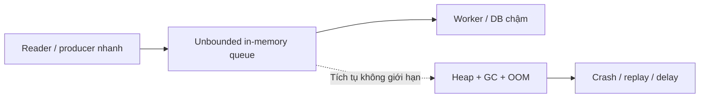
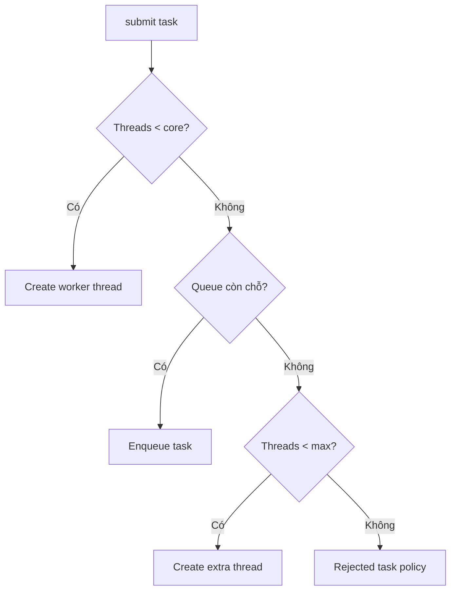
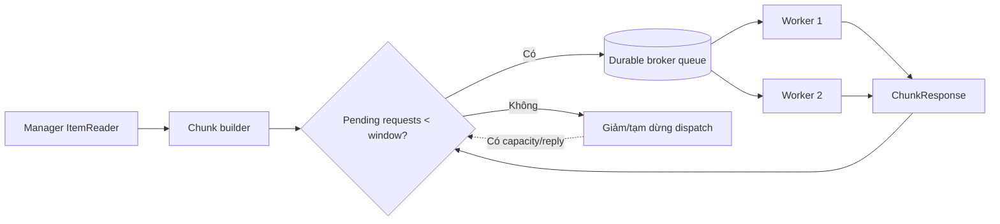
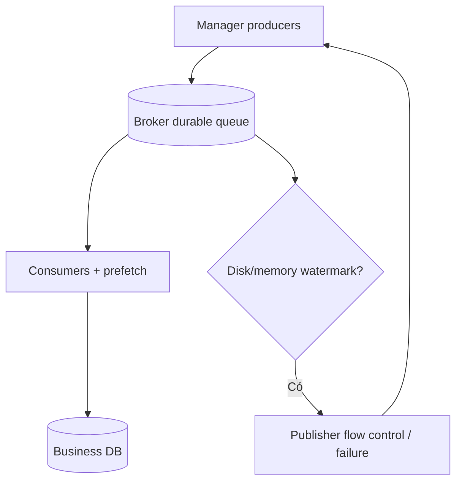
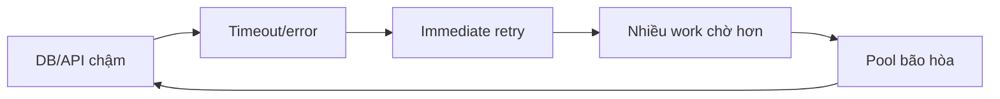
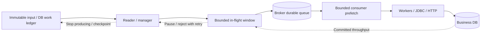
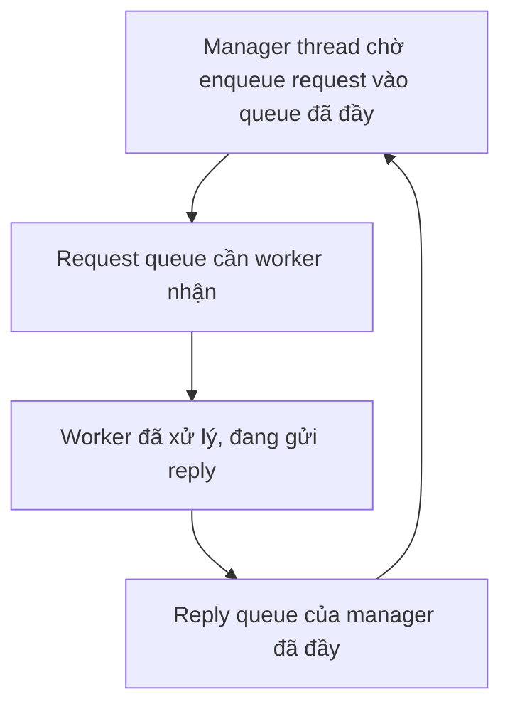

# Không dùng queue vô hạn: Backpressure khi mở rộng Spring Batch

Một Spring Batch manager đọc dữ liệu nhanh hơn tốc độ worker ghi vào database. Ban đầu job có vẻ khỏe: CPU còn thấp, request được gửi đều và không thấy exception. Sau vài phút, số task/message chờ tăng liên tục, JVM heap phình lên, garbage collection kéo dài, broker có hàng nghìn message chưa ACK. Cuối cùng manager hoặc worker bị `OutOfMemoryError`/`OOMKilled` và job phải restart. **Nguyên nhân sâu xa không nhất thiết là thiếu RAM: hệ thống đã cho phép producer tạo việc nhanh hơn consumer xử lý trong một hàng đợi gần như vô hạn.**

Bài **“Không dùng queue vô hạn”** thuộc chương **Backpressure** của module `SPRING_BATCH_SCALING_OPERATIONS`. Mục tiêu là mở rộng Spring Batch trên workload dữ liệu lớn qua **multi-threaded step, parallel steps, partitioning và mô hình phân tán** mà không đánh đổi tính đúng khi retry/restart. Người học sẽ biết xác định ranh giới hàng đợi, đặt capacity theo memory/SLA, dùng cơ chế **chặn, từ chối có kiểm soát hoặc làm chậm producer**, đo throughput và độ trễ, thiết kế durable work queue khi process crash và kiểm thử overload trước production.

Các ví dụ sử dụng **Java 17+, Spring Batch 5.2.x, Spring Framework 6.2.x, Spring Integration 6.2.x, RabbitMQ và PostgreSQL**. Cấu hình và số liệu là **ví dụ để thực hành**, không phải ngưỡng khuyến nghị cố định. Các thành phần `lease`, `outbox`, `admission controller`, `reconciler` trình bày dưới dạng thiết kế ứng dụng bổ sung, không phải tính năng Spring Batch tự tạo.

## 1. Vì sao “queue vô hạn” không thực sự vô hạn?

Các collection và queue Java vẫn bị giới hạn bởi **heap, kích thước object, tài nguyên OS và số nguyên capacity**. Tuy nhiên, trong thực tế một queue có capacity `Integer.MAX_VALUE` được coi là **gần như vô hạn đối với workload**: nó có thể làm process hết memory từ lâu trước khi chạm mức phần tử tối đa.



Trong batch, “queue” có thể là:

- Hàng đợi task của `ThreadPoolTaskExecutor` hoặc custom `ExecutorService`.
- `QueueChannel` trong Spring Integration; request/reply nội bộ ở manager.
- `BlockingQueue<Chunk<?>>`, `List`, `CompletableFuture` hay map giữ pending work do nhóm phát triển tự tạo.
- Message broker queue, unacked deliveries và consumer prefetch buffers.
- Queue retry, scheduled retry, DLQ hoặc outbox pending records.
- Pool connection waiting queue (JDBC/HTTP) và request in-flight ở upstream.

**Không dùng queue vô hạn** không có nghĩa **không được có backlog**. Nghĩa là **mỗi nơi giữ việc phải có giới hạn được tính toán, hành vi khi đầy rõ ràng và một nguồn lưu công việc bền vững đủ tin cậy để không làm mất dữ liệu**.

## 2. Điều kiện tích tụ: tốc độ đến lớn hơn tốc độ xử lý

Đặt:

- `λ` = tốc độ producer tạo việc (items/s hoặc tasks/s).
- `μ` = tốc độ consumer **hoàn thành và commit** (cùng đơn vị mỗi giây).
- `Q(t)` = số công việc đang đợi tại thời điểm `t`.

Khi hệ thống quá tải bền vững và không có backpressure:

```text
dQ/dt ≈ max(0, λ - μ)

Nếu λ = 1.500 items/s và μ = 1.000 items/s:
Tốc độ tăng backlog ≈ 500 items/s

Sau 60 giây: thêm khoảng 30.000 items chờ
```

Với mỗi item đã decode giữ tối thiểu 8 KiB:

```text
30.000 × 8 KiB = 240.000 KiB ≈ 234,4 MiB
```

Đây **mới chỉ** là ước lượng payload. Java object headers, queue nodes, copied buffers, metadata, retries và serializer có thể làm memory thực cao hơn. Nếu item lớn, producer có thể gây OOM trước khi dashboard thấy queue length đáng báo động.

**Quan trọng:** `λ` và `μ` thay đổi theo thời gian. Một spike ngắn có thể được queue hữu hạn hấp thụ; **quá tải kéo dài** phải được giải quyết bằng **giảm tốc nhận việc, tăng processing capacity hợp lệ hoặc từ chối/hoãn công việc trước khi chiếm thêm memory**.

## 3. Little's Law: hàng đợi dài cũng là độ trễ lớn

Ở trạng thái tương đối ổn định, Little's Law:

```text
L = λ × W
```

Trong đó `L` là **số công việc trung bình đang ở trong phạm vi đo**, `λ` là throughput trung bình và `W` là thời gian trung bình mỗi công việc nằm trong phạm vi đó. Nếu đo **chỉ hàng đợi chờ**, thì `Lq = λ × Wq`; nếu đo cả đang chạy thì dùng tổng số in-flight và thời gian end-to-end tương ứng.

Ví dụ queue giữ trung bình **2.000 chunk requests**, hệ thống xử lý ổn định **200 chunks/s**:

```text
Wq ≈ Lq / λ = 2.000 / 200 = 10 giây chờ queue trung bình
```

Nếu `Lq` tăng liên tục thì hệ thống chưa ở steady state: áp dụng công thức trạng thái ổn định như một dự báo chính xác sẽ sai. Tuy nhiên điều cốt lõi vẫn đúng: **cho phép backlog tăng không giới hạn tức cho phép latency tăng không giới hạn** và làm timeout/retry xuất hiện dù worker cuối cùng vẫn có thể xử lý xong.

## 4. Backpressure khác rate limiting, concurrency limit và retry

| Cơ chế | Thứ được giới hạn | Thời điểm tác động | Nếu dùng sai |
| --- | --- | --- | --- |
| Bounded queue | Số nhiệm vụ **đang chờ** | Trước khi enqueue | Rejection không xử lý có thể làm mất việc |
| Concurrency limit | Số nhiệm vụ **đang chạy** | Khi nhận/lease task | Queue chờ vẫn có thể phình |
| Rate limit | Số nhiệm vụ **đến mỗi đơn vị thời gian** | Tại producer/admission | Burst dài vẫn tạo queue nếu μ giảm |
| Backpressure | Tốc độ producer theo capacity downstream | Khi consumer chậm/đầy | Blocking sai thread có thể deadlock |
| Retry budget/backoff | Số lần/tần suất thử lại | Sau lỗi | Retry tức thời tạo thêm tải |
| Broker prefetch | Số delivery **chưa ACK** phía consumer | Trước khi deliver message mới | Không giới hạn broker-ready backlog |
| DLQ/quarantine | Phân luồng message lỗi không thể xử lý | Sau policy retry | Không thay thế bảo vệ queue chính |

Một hệ thống thường cần **kết hợp**: concurrency hữu hạn, queue hữu hạn, producer có backpressure, retry với backoff và nguồn công việc durable. **Chỉ tăng pool size** hoặc **chỉ tăng RAM** hiếm khi là giải pháp bền vững khi downstream throughput thấp hơn arrival rate.

## 5. Cơ chế overload cần định nghĩa trước khi có sự cố

Khi queue đầy, hệ thống cần một **chính sách rõ ràng**:

1. **Block có giới hạn:** producer đợi capacity tối đa một khoảng thời gian; nếu hết hạn, trả lỗi có thể retry từ nguồn bền vững.
2. **Fail fast/reject:** không enqueue, báo overload cho tầng điều phối để dừng dispatch và giữ lại work intent.
3. **Caller-runs:** producer tự thực thi task để giảm tốc độ submit; chỉ hợp lệ khi thread gọi có quyền thực thi logic, transaction, error propagation và không gây deadlock.
4. **Pause/resume consumption:** tạm dừng reader/consumer ở ranh giới an toàn; dùng manual ACK và capacity guard khi phù hợp.
5. **Durable staging:** giữ công việc trong DB/broker và chỉ lấy ra khi worker còn capacity.
6. **Shed non-critical work:** loại bỏ công việc chỉ khi **business contract cho phép**, ví dụ metric sampling; **không tự drop invoice/payment batch items**.

**Mục tiêu khi đầy không phải “giấu lỗi”** mà là “giữ toàn bộ công việc hợp lệ ở nơi bền vững, không làm JVM mất kiểm soát và có khả năng phục hồi”.

## 6. Hàng đợi task và hàng đợi business work không giống nhau

Một `Runnable` trong `ThreadPoolTaskExecutor` có thể chứa reference tới `Chunk`, DTO hay closure giữ cả một graph object trên heap. Nếu JVM crash, task chưa chạy trong RAM thường **biến mất**. Dữ liệu đầu vào bền vững có thể được đọc lại **nếu checkpoint/restart thiết kế đúng**, nhưng **không phải cứ là Batch thì tự khôi phục mọi queue task trong memory**.

Ngược lại, broker durable queue hoặc DB outbox giữ intent sau process crash, nhưng:

- Message có thể được gửi/nhận **nhiều lần** (at-least-once).
- Durable storage **không tự giới hạn** backlog hoặc bộ nhớ broker.
- Consumer ACK và business commit không atomic mặc định.
- Dead-letter/retry không bảo đảm business idempotency.

Hãy tách **admission/dispatch queue** (gắn với bền vững và ownership) khỏi **execution queue** (tối đa vài chục/hàng trăm task để tận dụng threads). Không biến queue task trong JVM thành system of record.

## 7. Dấu hiệu queue đang là điểm nghẽn

Một số triệu chứng đặc trưng:

| Quan sát | Khả năng | Cần xác minh |
| --- | --- | --- |
| Queue depth tăng tuyến tính | Producer nhanh hơn consumer | Delta arrival vs committed throughput |
| Heap tăng cùng queue depth | Payload/closures được giữ trong RAM | Heap dump, retained objects, queue entries |
| Active threads ít hơn dự kiến dù queue lớn | Executor core/queue config không phù hợp | Core/max/queue behavior, step throttle |
| Queue gần đầy và p99 job latency tăng | Chờ queue lớn | Queue age, enqueue/dequeue times |
| Nhiều `TaskRejectedException` | Bounded queue đang từ chối overload | Có nguồn retry/durability không? |
| RabbitMQ unacked/prefetch cao | Worker nhận quá nhiều deliveries | ACK delay, chunk size, consumer capacity |
| Broker ready backlog tăng | Toàn bộ downstream không bắt kịp | Consumers, CPU/DB/API quotas |
| GC pause/OOM sau burst | In-flight objects vượt memory budget | JVM/cgroup peak, byte size/item |
| HTTP/JDBC pending dài | Bottleneck ở resource pool ngoài executor | Pool active/wait, DB locks, HTTP 429 |

Một queue gần đầy **không nhất thiết là lỗi nếu đã có chiến lược giảm tốc nguồn và backlog rút về sau spike**. Điều đáng cảnh báo là **tốc độ tăng kéo dài**, queue age vượt SLA và không có kế hoạch xử lý work còn chờ.

## 8. Đặt queue capacity theo bytes và thời gian chờ

Đừng chỉ đặt `queueCapacity=10000` vì số trông “lớn”. Tính ít nhất **hai giới hạn**:

```text
Q_memory  = floor(M_queue_budget_bytes / M_average_task_bytes)
Q_latency = floor(μ_committed_tasks_per_second × W_max_queue_wait_seconds)
Q_capacity <= min(Q_memory, Q_latency)
```

Ví dụ worker có **64 MiB budget** cho các task đang chờ, mỗi task giữ trung bình **128 KiB** đã tính object overhead:

```text
Q_memory = 64 × 1024 KiB / 128 KiB = 512 tasks
```

Nếu consumer xử lý **40 tasks/s** và muốn queue wait trung bình **không quá 3 giây** khi steady-state:

```text
Q_latency ≈ 40 × 3 = 120 tasks
```

Từ hai mục tiêu, chọn capacity **không quá 120** rồi giảm thêm headroom theo **p95/p99 payload, burst, GC và retry**. Đây là phép tính định hướng, không phải chứng minh SLA p99; độ trễ tail phải đo dưới tải thật.

**Một queue có capacity 100 tasks vẫn có thể OOM** nếu mỗi task chứa file 50 MiB hoặc giữ cả danh sách 1 triệu DTO. Sizing bằng **bytes, số task active và mọi bản sao payload**, không chỉ số entries.

## 9. Đếm toàn bộ lượng việc in-flight

Trong một pipeline:

```text
Total in-flight work =
    queued executor tasks
  + active executor tasks
  + items/chunks buffered by reader/processor
  + network/broker deliveries unacked
  + manager pending requests/replies
  + retry/backoff scheduled work
```

Tổng trên là cách **kiểm kê logic**, không cộng số item với số chunk như cùng đơn vị. Muốn tính memory, quy đổi từng nhóm thành bytes và tránh đếm hai lần cùng payload được share reference.

Ví dụ 8 workers, mỗi worker 2 chunk active, chunk size 100, item decoded giữ trung bình 64 KiB và factor 2 cho input/output/intermediate:

```text
8 × 2 × 100 × 64 KiB × 2 = 204.800 KiB ≈ 200 MiB
```

Đây chỉ là payload active, **chưa tính queue chờ, broker prefetch, JVM baseline, thread stacks và native buffers**. Khi tăng `chunk(100)` thành `chunk(1000)` mà giữ concurrency, working set lý thuyết tăng mười lần nếu retention tương tự.

## 10. ThreadPoolTaskExecutor: mặc định dễ gây hiểu lầm

`ThreadPoolTaskExecutor` của Spring Framework có cấu hình mặc định **corePoolSize = 1, maxPoolSize = Integer.MAX_VALUE, queueCapacity = Integer.MAX_VALUE**. Tuy `maxPoolSize` rất lớn, hàng đợi gần như vô hạn khiến executor thường **chỉ mở đến core threads** rồi đưa task vào queue, **chưa cần tăng lên max**. Đây là một lỗi cấu hình hiệu năng hay gặp: tăng `maxPoolSize` lên 16 nhưng để queue mặc định, sau đó thắc mắc vì sao chỉ có một thread xử lý.

Với `ThreadPoolExecutor` thông thường, trình tự chấp nhận task cơ bản:

1. Nếu số thread hiện tại **ít hơn core**, tạo thread mới.
2. Khi đã đủ core, cố **enqueue**.
3. Chỉ khi queue **đã đầy** mới tăng thêm thread (nếu còn dưới max).
4. Khi cả thread capacity và queue capacity hết, **reject** theo policy.



Chú ý `queueCapacity=0` dùng `SynchronousQueue`: không có buffer, executor có thể mở thêm thread nhanh tới `maxPoolSize`. Điều đó **không đồng nghĩa luôn nhanh hơn**; với DB/API chậm, quá nhiều thread có thể đốt connection, native stacks và heap. Chọn cấu hình theo CPU/DB capacity và số active chunks đã đo.

## 11. Cấu hình ThreadPoolTaskExecutor có giới hạn

Ví dụ Java/Spring Framework 6.2:

```java
import java.util.concurrent.ThreadPoolExecutor;

import org.springframework.context.annotation.Bean;
import org.springframework.context.annotation.Configuration;
import org.springframework.scheduling.concurrent.ThreadPoolTaskExecutor;

@Configuration
public class BoundedBatchExecutorConfig {

    @Bean("batchTaskExecutor")
    ThreadPoolTaskExecutor batchTaskExecutor() {
        ThreadPoolTaskExecutor executor = new ThreadPoolTaskExecutor();
        executor.setCorePoolSize(4);
        executor.setMaxPoolSize(8);
        executor.setQueueCapacity(32);
        executor.setThreadNamePrefix("bounded-batch-");
        executor.setRejectedExecutionHandler(
                new ThreadPoolExecutor.AbortPolicy());
        executor.setWaitForTasksToCompleteOnShutdown(true);
        executor.setAwaitTerminationSeconds(60);
        return executor;
    }
}
```

Với queue capacity 32, executor có thể có **tối đa 8 threads đang thực thi + 32 tasks đang đợi** theo cấu hình. Điều đó **không bảo đảm** Spring Batch sẽ luôn tạo 8 concurrent chunks, vì repeat operations/step throttle, resource pools và workload quyết định concurrency thực.

**Giới hạn thực tế:** một task có thể giữ nhiều items; các task đã chạy có thể tạo thêm HTTP requests, broker messages hoặc futures. `queueCapacity=32` chỉ giới hạn **queue của executor này**, không bao trùm mọi in-flight state của ứng dụng.

### 11.1. Khi queue đầy, không được bỏ qua rejection

Với `AbortPolicy`, một `execute` khi quá capacity gây rejection; Spring `TaskExecutor` có thể báo `TaskRejectedException`. Ví dụ ở **tầng gửi task tùy chỉnh**, nếu không được chấp nhận:

```java
import org.springframework.core.task.TaskRejectedException;
import org.springframework.scheduling.concurrent.ThreadPoolTaskExecutor;

public final class BoundedTaskSubmission {
    private final ThreadPoolTaskExecutor executor;

    public BoundedTaskSubmission(ThreadPoolTaskExecutor executor) {
        this.executor = executor;
    }

    public boolean trySubmit(Runnable task) {
        try {
            executor.execute(task);
            return true;
        } catch (TaskRejectedException rejected) {
            // Caller phải giữ work intent ở durable store, rồi thử sau.
            // Không ACK broker delivery hay đánh dấu item hoàn thành ở đây.
            return false;
        }
    }
}
```

Đây là **illustration**, không phải một dispatcher production đầy đủ. Nếu `task` chỉ tồn tại trong RAM và caller nhận `false` rồi bỏ qua, công việc **đã mất**. Phải có **durable outbox, broker delivery chưa ACK hoặc checkpoint nguồn** cùng retry policy. Nếu `task` có side effect khi chạy, cần theo dõi completion/error và không coi `execute()` trả về thành công là business commit.

Trong Spring Batch, rejection từ executor của step phải **được phát hiện và dẫn đến outcome/restart hợp lệ**, không nuốt exception trong listener rồi trả `COMPLETED` giả.

## 12. Multi-threaded Step: executor không phải rào chắn duy nhất

Ở Spring Batch 5.2, một multi-threaded step có thể cấu hình:

```java
import org.springframework.batch.core.Step;
import org.springframework.batch.core.repository.JobRepository;
import org.springframework.batch.core.step.builder.StepBuilder;
import org.springframework.batch.item.ItemProcessor;
import org.springframework.batch.item.ItemReader;
import org.springframework.batch.item.ItemWriter;
import org.springframework.scheduling.concurrent.ThreadPoolTaskExecutor;
import org.springframework.transaction.PlatformTransactionManager;

@Bean
Step safeConcurrentStep(
        JobRepository jobRepository,
        PlatformTransactionManager transactionManager,
        ItemReader<InputItem> threadSafeReader,
        ItemProcessor<InputItem, OutputItem> threadSafeProcessor,
        ItemWriter<OutputItem> threadSafeWriter,
        ThreadPoolTaskExecutor batchTaskExecutor) {

    return new StepBuilder("safeConcurrentStep", jobRepository)
            .<InputItem, OutputItem>chunk(100, transactionManager)
            .reader(threadSafeReader)
            .processor(threadSafeProcessor)
            .writer(threadSafeWriter)
            .taskExecutor(batchTaskExecutor)
            .build();
}
```

Các kiểu `InputItem`/`OutputItem` và beans là giả định. Đoạn code chỉ có ý nghĩa khi **reader, processor, writer đã được kiểm chứng thread-safe**. `@StepScope` tạo instance theo `StepExecution`, **không phải mỗi chunk thread**, nên không tự làm `JdbcCursorItemReader` stateful an toàn khi chia sẻ trên nhiều thread.

Tài liệu Spring Batch 5.x nêu `throttleLimit` của multi-threaded step **deprecated** từ 5.0. Nếu cần điều khiển số concurrent tasklet/chunk executions **vượt ngoài giới hạn của executor**, framework có `RepeatOperations` và khả năng cấu hình `StepBuilder.stepOperations(...)` để dùng chiến lược tùy chỉnh. **Không coi setMaxPoolSize=32 là bằng chứng 32 chunks thực sự active**; đo executor active count và `StepExecution`/chunk metrics. Cũng không bê nguyên chính sách rejection của một custom producer vào đường nội bộ của framework mà chưa test restart semantics.

### 12.1. Kết hợp concurrency với tài nguyên downstream

Với 8 worker threads, nếu writer cần một JDBC connection/transaction mỗi chunk:

- Pool JDBC quá nhỏ làm threads chờ, giữ chunk objects và tăng latency.
- Pool JDBC quá lớn so với DB server tạo lock contention, WAL/fsync và CPU pressure.
- Tăng chunk size từ 100 lên 1000 nhân working set khi nhiều chunks chạy.
- Reader/writer stateful dùng chung có thể gây mất/ghi trùng dữ liệu, ngay cả khi không OOM.

Benchmark **active chunks × chunk size × item size** cùng DB pool wait, throughput commit và restart correctness thay vì tối ưu mỗi queue depth.

## 13. CallerRunsPolicy: backpressure hữu ích nhưng không phải mặc định an toàn

`ThreadPoolExecutor.CallerRunsPolicy` thường buộc thread gửi task tự chạy task khi pool/queue đầy, **nếu executor chưa shutdown**. Điều đó làm chậm producer và có thể giảm backlog tự nhiên.

Tuy nhiên trong Spring Batch/Integration cần đặc biệt thận trọng:

- Nếu caller là **broker listener thread**, chạy business task ngay trên thread ấy có thể giữ delivery unacked lâu, đụng broker consumer ACK timeout.
- Nếu caller đang giữ **transaction/lock**, chạy thêm task đồng bộ có thể gây self-deadlock hoặc phá isolation mong muốn.
- Nếu caller là **manager dispatch thread**, nó có thể chặn việc nhận replies, metadata updates hoặc heartbeat.
- Khi executor đã **shutdown**, `CallerRunsPolicy` của Java có thể **không thực thi task**; nếu không có acknowledgment/handoff rõ, work sẽ mất.
- Task có exception phải được xử lý, không để một callback bất thường giết luồng điều phối hoặc ACK sai.

Vì vậy, **ưu tiên reject rõ ràng + giữ durable work intent**, hoặc **block có thời hạn ở ranh giới đã thiết kế**. Chỉ chọn caller-runs khi đã xác minh thread sở hữu, transaction, broker ACK và shutdown behavior.

## 14. Blocking queue và timeout: tránh treo producer mãi

Một `BlockingQueue.put(item)` có thể chờ vô hạn khi queue đầy. Nếu consumer đã dừng, producer có thể **kẹt mãi**, làm manager không cập nhật status hoặc không xử lý shutdown. Một `offer(item, timeout, unit)` hữu hạn giúp caller nhận biết quá tải:

```java
import java.util.concurrent.ArrayBlockingQueue;
import java.util.concurrent.BlockingQueue;
import java.util.concurrent.TimeUnit;

public final class LocalWorkBuffer<T> {
    private final BlockingQueue<T> queue = new ArrayBlockingQueue<>(64);

    public boolean offerWithBoundedWait(T item) throws InterruptedException {
        return queue.offer(item, 2, TimeUnit.SECONDS);
    }

    public T pollWithBoundedWait() throws InterruptedException {
        return queue.poll(2, TimeUnit.SECONDS);
    }
}
```

`null` khi poll timeout nghĩa là **chưa có item tại thời điểm ấy**, không đồng nghĩa nguồn đã EOF hay `JobExecution` hoàn thành. `false` khi offer timeout nghĩa là queue chưa nhận item, không có nghĩa business work được phép drop.

Nếu Java thread bị interrupt, **đừng nuốt `InterruptedException` rồi tiếp tục submit vô hạn**; để cancellation/shutdown diễn ra theo contract. Ở ranh giới executor/transport, không giữ transaction database mở trong khi chờ queue minutes.

**Không sử dụng `ArrayBlockingQueue` như JobRepository mới:** nó chỉ là **buffer trong một JVM**; crash làm mất entries. Nếu nguồn đã ACK/commit trước khi đưa vào queue, ứng dụng phải có cách recovery riêng.

## 15. Spring Integration QueueChannel phải khai báo capacity

`QueueChannel` là một `PollableChannel` thường giữ messages **trong memory**. Constructor không tham số tạo queue gần như unbounded; tài liệu Spring Integration khuyến nghị khai báo capacity hữu hạn.

```java
import org.springframework.context.annotation.Bean;
import org.springframework.context.annotation.Configuration;
import org.springframework.integration.channel.QueueChannel;
import org.springframework.messaging.PollableChannel;

@Configuration
public class BoundedChannelConfig {

    @Bean("internalChunkBuffer")
    PollableChannel internalChunkBuffer() {
        return new QueueChannel(64);
    }
}
```

Khi queue đã đầy, `send(message, timeoutMillis)` có thể đợi chỗ trống tới timeout; nếu hết thời gian, trả về `false`. Nếu gọi `send(message)` không có timeout, nó có thể đợi vô hạn trong điều kiện không có consumer giải phóng chỗ.

```java
import org.springframework.messaging.Message;
import org.springframework.messaging.MessageChannel;

public final class SafeInternalPublisher {
    private final MessageChannel channel;

    public SafeInternalPublisher(MessageChannel channel) {
        this.channel = channel;
    }

    public void publishOrSignalOverload(Message<?> message) {
        boolean accepted = channel.send(message, 2_000L);
        if (!accepted) {
            // Caller không được ACK upstream / đánh dấu committed trước
            // khi có durable handoff hoặc cơ chế retry hợp lệ.
            throw new IllegalStateException("Internal queue is full");
        }
    }
}
```

**Không hiểu `send() == true` là worker đã xử lý thành công**: nó chỉ có nghĩa channel đã chấp nhận message theo contract; nếu internal queue là memory-only, message vẫn có thể mất khi JVM chết. Nếu channel được backing bằng persistent `MessageStore`, vẫn phải tính capacity, retention, transaction và cách reconcile khi store/consumer gặp lỗi.

### 15.1. DirectChannel không có backlog nội bộ — nhưng có thể đẩy áp lực đi nơi khác

`DirectChannel` thường dispatch handler trên **caller thread**; không giữ queue message như `QueueChannel`. Điều đó có thể tạo áp lực ngược, nhưng handler blocking lâu có thể làm upstream listener hoặc transaction treo. `ExecutorChannel` dùng executor và chịu behavior queue/rejection của executor ấy. Hãy biết rõ **channel implementation** trong mỗi hop.

## 16. Remote chunking: giới hạn pending requests ngay ở manager

Trong remote chunking, manager đọc item, gom chunk và gửi `ChunkRequest` tới workers qua middleware. Nếu manager tạo chunks nhanh hơn tốc độ worker xử lý, **pending requests, reply correlation và message payloads** có thể tăng tới mức gây áp lực memory/transport.



Spring Batch Integration 5.2 có `RemoteChunkingManagerStepBuilder.throttleLimit(long)` để **giới hạn số pending requests xử lý chunk, tránh quá tải receivers**. Đây là **khác** `throttleLimit(int)` đã deprecated của multi-threaded tasklet step trong Spring Batch 5.x; không nhầm lẫn hai API.

Ví dụ phác thảo builder cho worker chunk:

```java
// Đặt trong phần cấu hình remote chunking manager Spring Batch 5.2.
return new RemoteChunkingManagerStepBuilder<InputItem, InputItem>(
        "remoteChunkManagerStep", jobRepository)
        .chunk(100)
        .transactionManager(transactionManager)
        .reader(inputReader)
        .outputChannel(chunkRequests)
        .inputChannel(chunkReplies)
        .throttleLimit(8)
        .maxWaitTimeouts(40)
        .build();
```

Ví dụ giả định beans `jobRepository`, `transactionManager`, `inputReader`, `chunkRequests`, `chunkReplies` và adapter/broker integration đã tồn tại. `throttleLimit(8)` khống chế pending requests theo contract của writer/builder, **không bảo đảm RabbitMQ chỉ có đúng 8 messages trong mọi queue**, và không thay thế giới hạn queue/consumer prefetch.

**`maxWaitTimeouts(40)` không phải queue capacity**: nó liên quan số lần chờ reply khi pending requests chưa hoàn tất, phối hợp với receive timeout riêng của gateway. Tăng số lần đợi chỉ khiến manager đợi lâu hơn, không tự xử lý producer overload hoặc worker chết. Cần thiết kế **reply correlation**, broker durability và idempotent writer khi message/reply bị redeliver.

### 16.1. Phân biệt 3 ngân sách

| Giới hạn | Nơi áp dụng | Cần đạt |
| --- | --- | --- |
| Manager pending `ChunkRequest` window | Trước/trong dispatch | Không giữ vô hạn state chờ reply |
| Broker queue/disk/memory budget | Middleware | Backlog durable nhưng không bùng storage |
| Worker consumer prefetch/in-flight chunks | Sau broker delivery | Không đưa quá nhiều payload vào RAM worker |

**Đặt cả ba**, không suy rằng `throttleLimit(8)` ở manager tự động bảo vệ heap của một worker nếu broker còn chứa hàng triệu request từ những job khác.

## 17. Remote partitioning: chia nhỏ việc ≠ chạy mọi partition cùng lúc

Với remote partitioning, `Partitioner` sinh map `partitionName -> ExecutionContext` và manager tạo/dispatch `StepExecutionRequest` cho workers. `gridSize` là hint số partitions, **không phải giới hạn threads, consumer count hay memory của mọi JVM**.

Ví dụ:

```text
gridSize (partition plan)       = 100
Worker JVM replicas            = 4
Concurrent partitions/worker   = 2
Peak active partition budget   ≈ 4 × 2 = 8
Partitions waiting/dispatched  = còn tới 92
```

Đó là **giới hạn danh nghĩa theo worker**, với giả định queues/handlers áp dụng đúng và không có execution trùng. Một số workers có thể xử lý partition lớn lâu hơn, tạo tail latency; tăng `gridSize` không làm CPU/DB nhanh lên theo tỷ lệ 1:1.

Đối với hàng đợi request partition:

1. Giữ `StepExecution` và `ExecutionContext` ở **shared `JobRepository`**.
2. Gửi request qua broker durable/route có kiểm soát, ghi nhận publish outcome nếu cần.
3. Chỉ worker có capacity mới nhận delivery; giảm concurrency/prefetch theo resources.
4. Nếu worker mất, broker có thể redeliver unacked delivery, nhưng **không tự chứng minh metadata/restart an toàn**.
5. Không dispatch lại chỉ vì manager reply timeout trong khi worker cũ có thể vẫn ghi dữ liệu.

Khi worker crash bất ngờ, `BatchStatus.STARTED` có thể còn trong repository. Việc xử lý execution mồ côi phải theo runbook, xác minh owner cũ không còn hoạt động; **không tự sửa bảng `BATCH_*` và giao lại ngay** vì queue đang giảm.

## 18. RabbitMQ prefetch: giới hạn lượng giao hàng chưa ACK

RabbitMQ hỗ trợ `basic.qos`/prefetch để hạn chế số delivery **chưa ACK** mà broker gửi cho consumer. Trong RabbitMQ AMQP 0-9-1:

- `prefetchCount=2`: mỗi consumer có thể giữ tối đa khoảng 2 deliveries unacked theo chính sách RabbitMQ tương ứng.
- `prefetchCount=0`: theo RabbitMQ, **không giới hạn** prefetch count (đừng dùng để biểu thị zero messages).
- Khi đạt cửa sổ unacked, broker ngừng giao thêm đến khi có ACK giải phóng chỗ.
- Prefetch **không giới hạn** số messages **ready** còn nằm trong broker queue.
- Với auto-ACK hoặc ACK không đúng lifecycle, prefetch có thể **không thực sự chặn** heap growth như mong đợi.

Spring AMQP listener factory minh họa:

```java
import org.springframework.amqp.core.AcknowledgeMode;
import org.springframework.amqp.rabbit.config.SimpleRabbitListenerContainerFactory;
import org.springframework.amqp.rabbit.connection.ConnectionFactory;
import org.springframework.context.annotation.Bean;

@Bean
SimpleRabbitListenerContainerFactory workerRabbitListenerFactory(
        ConnectionFactory connectionFactory) {

    SimpleRabbitListenerContainerFactory factory =
            new SimpleRabbitListenerContainerFactory();
    factory.setConnectionFactory(connectionFactory);
    factory.setConcurrentConsumers(2);
    factory.setMaxConcurrentConsumers(4);
    factory.setPrefetchCount(2);
    factory.setAcknowledgeMode(AcknowledgeMode.MANUAL);
    return factory;
}
```

Đây chỉ là **mẫu cấu hình broker consumer**: nếu dùng manual ACK, handler phải **thực hiện ACK/NACK đúng protocol** sau khi xử lý và theo chính sách retry, thay vì cấu hình manual rồi quên ACK khiến toàn bộ deliveries kẹt `unacked`. Thứ tự reply, ACK, business transaction phải được test với adapter và Spring AMQP version thực tế.

### 18.1. Tính memory phía consumer theo prefetch

Giả sử có 16 consumers trong cụm, prefetch=2, mỗi message remote chunk chứa 200 items, mỗi item chiếm 16 KiB khi serialized:

```text
Max unacked deliveries danh nghĩa = 16 × 2 = 32
Data bytes danh nghĩa             = 32 × 200 × 16 KiB
                                  = 102.400 KiB = 100 MiB
```

Con số **100 MiB** là kích thước serialized payload ở cửa sổ unacked, chưa tính headers, object graph sau deserialize, copies, worker output hay memory ở broker. Số messages thực, layout người giữ payload và quyền ACK phụ thuộc clients. Nếu nâng prefetch lên 20, lượng serialized payload có thể tăng **10 lần** ở cùng số consumers.

## 19. Durable broker queue không có nghĩa có thể để backlog vô hạn

Queue durable lưu intent sau process crash (tùy publisher confirms, message persistence và broker guarantees), nhưng nó vẫn tiêu **disk, memory, network, CPU, replication và thời gian drain**. Khi producer phát nhanh mãi hơn consumer, disk hoặc broker resource alarms cuối cùng sẽ tạo áp lực:



Với RabbitMQ, có thể thiết lập **queue length/byte policies**, message TTL, dead-letter và overflow behavior tùy queue type/version. Tuy nhiên:

- Các policy **drop-head** hoặc TTL loại message tự động có thể làm **mất công việc batch**, chỉ sử dụng khi business có nguồn replay đã được kiểm chứng.
- **Reject-publish** cần producer xử lý nack/return/confirm và giữ intent trong durable store; không coi reject là success.
- Broker disk-full/flow-control có thể khiến producer block hoặc publish fail; phải có timeout và retry budget.
- DLQ giữ message lỗi để phân tích, **không thay thế** business idempotency hay reassign metadata.
- Một backlog durable kéo dài có thể vẫn **vi phạm SLA**, mặc dù JVM không OOM.

Nếu ứng dụng chỉ cần batch throughput một lần mỗi đêm, **giảm tốc producer hoặc đợi consumer rảnh** thường an toàn hơn gửi sớm hàng triệu messages rồi dựa hoàn toàn vào disk queue.

## 20. Retry queue vô hạn gây “retry storm”

Với downstream DB/API bị lỗi:

```text
1.000 requests/s đang bị timeout
Mỗi request retry ngay 3 lần
=> có thể tạo nhiều nghìn requests/s vào chính dịch vụ đang lỗi
```

Nếu retry được enqueue vô hạn, lượng work tăng trong khi `μ` giảm mạnh, dẫn đến **feedback loop**:



Một policy an toàn:

- Phân loại **transient** (connection reset, retryable 503) vs **permanent** (schema invalid, business rule violation).
- Tổng số lần thử hữu hạn; tính cả các lần redelivery khi thiết kế budget.
- **Exponential backoff + jitter** để không làm hàng nghìn workers retry cùng thời điểm.
- Giới hạn **retry concurrency** và số retries pending trong memory.
- Dùng **durable delayed retry/retry queue có chính sách retention**, hoặc giữ nextAttemptAt trong DB.
- Hết budget thì **quarantine/DLQ** với cảnh báo và runbook replay sau sửa lỗi.

Mẫu thời gian (ví dụ, không phải khuyến nghị chung):

```text
retry 1: ~0.5s
retry 2: ~1s
retry 3: ~2s
retry 4: ~4s
max backoff: 30s + jitter tùy policy
```

**Đừng `Thread.sleep(30_000)` trong một thread đang giữ DB transaction/chunk item graph lớn** nếu có thể đưa work vào durable delayed retry mà không phá checkpoint. Khi lỗi ngoài transaction, cần kiểm lại idempotency trước lần thử tiếp theo.

## 21. Hàng đợi vô hạn trong code “ẩn” dễ bị bỏ sót

Không chỉ các class tên `*Queue` mới tạo backlog:

```java
// Anti-pattern: mọi future được giữ tới cuối job.
List<CompletableFuture<Result>> pending = new ArrayList<>();
for (InputItem item : millionsOfItems) {
    pending.add(
            CompletableFuture.supplyAsync(
                    () -> expensiveTransform(item), executor));
}
// pending có thể giữ millions of futures + captured item references.
```

Đây là code **chống chỉ định cho workload lớn**; thậm chí executor có bounded queue, list `pending` vẫn giữ nhiều futures/metadata và producer có thể submit quá nhanh. Nếu executor reject và exception bị nuốt, work có thể thất lạc; nếu dùng common pool thì capacity/concurrency càng khó quan sát.

Thiết kế khác:

1. **Stream** nguồn; không materialize hàng triệu items.
2. **Giới hạn in-flight futures** với semaphore/window, chỉ tạo thêm khi một future hoàn thành.
3. **Thu kết quả và giải phóng references** càng sớm càng tốt.
4. **Đảm bảo input/operation có identity bền vững**, không phải chỉ một future.
5. **Bound mọi retry/delay queue** theo bytes và tuổi.

Các map `Map<requestId, CompletableFuture<?>>` để correlate reply cũng là hàng đợi logic: nếu reply thất lạc mà entry không được cleanup/reconciled, memory tăng theo **số requests từng gửi** thay vì requests đang hoạt động.

## 22. Semaphore/admission window cho in-flight operations

`Semaphore` hữu hạn có thể dùng để giới hạn số operation cùng chạy trước khi tạo payload hoặc gọi external API:

```java
import java.util.concurrent.Semaphore;
import java.util.concurrent.TimeUnit;

public final class BoundedInFlightGuard {
    private final Semaphore slots = new Semaphore(16, true);

    public void runWithinBudget(Runnable operation)
            throws InterruptedException {
        if (!slots.tryAcquire(2, TimeUnit.SECONDS)) {
            // Caller cần ghi/giữ work intent bền vững hoặc fail chunk
            // để framework retry/restart theo policy.
            throw new IllegalStateException("Backpressure: no capacity");
        }
        try {
            operation.run();
        } finally {
            slots.release();
        }
    }
}
```

Ví dụ này chạy **đồng bộ** và thả slot sau khi `operation.run()` hoàn tất. Với `CompletableFuture` bất đồng bộ, phải thả slot **khi future hoàn tất**, không thả ngay sau khi submit (nếu không guard mất tác dụng). Đồng thời phải xử lý exception và interruption để không rò permit.

Một semaphore chặn concurrency **không tự giới hạn** hàng triệu tasks đã enqueue trước nó; **đặt guard ở admission boundary trước khi tạo những tasks/payload lớn**. Nếu chỉ acquire trong `ItemProcessor` sau khi tất cả requests đã vào queue, đã quá muộn.

### 22.1. Semaphore không thay thế transaction/idempotency

16 permits chỉ đảm bảo tối đa số operation đang giữ permit trong một JVM. Khi có 10 replicas, nếu không có điều phối chung thì tổng tối đa có thể **160 operations**, vượt quota API. Cần global rate/concurrency policy ở một tầng được chia sẻ hoặc tính per-worker budget từ global quota. Semaphore mất state khi process crash; `JobRepository`/broker/outbox chịu phần recovery.

## 23. Backpressure nên đẩy ngược đến đâu?

Tại mỗi ranh giới, phải biết **ai có khả năng giảm tốc** và **ai giữ work intent**:



Ví dụ đường điều phối an toàn:

1. Input nằm trong **immutable source** hoặc bảng work ledger có status/lease.
2. Manager chỉ lấy/dispatch một **cửa sổ hữu hạn** việc mà broker/workers có khả năng nhận.
3. Khi cửa sổ hết, manager **không materialize thêm hàng nghìn chunk vào RAM**; chờ capacity/reply hoặc kết thúc step bằng lỗi có thể restart.
4. Worker nhận với bounded prefetch, chỉ commit/ACK khi contract được đáp ứng.
5. Nếu worker chậm, manager giảm tốc dispatch, nhưng **input chưa xử lý vẫn nằm ở source**.

Đây là **mô hình luồng điều khiển**, không đảm bảo rằng mọi `ItemReader` tự tạm dừng đúng ranh giới của một implementation remote chunking. Với Spring Batch, hãy áp dụng backpressure qua builder/options được hỗ trợ hoặc một custom dispatcher có integration test về transaction/checkpoint; không tùy tiện chặn thread giữa open transaction.

### 23.1. Điều kiện để “stop reading” không làm mất việc

Nếu reader checkpoint đã advance **trước khi request được broker/durable store xác nhận**, manager crash có thể khiến items bị bỏ sót khi restart. Nếu request đã vào broker nhưng checkpoint chưa advance, restart có thể đọc lại **cùng item**. Không có distributed atomic transaction mặc định giữa reader source, `JobRepository` và broker; idempotency cùng reconciliation xử lý cửa sổ bất định.

**Backpressure không được phá transaction boundary**: kiểm thời điểm reader advance, chunk commit, broker publish confirm, worker business commit và ACK/reply theo topology thật.

## 24. Deadlock do chặn sai thread khi queue đầy

Backpressure bằng blocking rất hiệu quả **nếu đúng vị trí**, nhưng có thể tạo vòng chờ:



Ở đây manager vừa là **producer requests** vừa là **consumer replies** trên cùng thread/event loop; blocking send vô hạn khiến nó không còn cơ hội drain replies. Worker bị kẹt gửi reply; request queue không được drain đủ; hệ thống có thể đứng dù CPU thấp.

Các biện pháp:

- Tách **dispatcher** và **reply consumer** với executor/lifecycle độc lập, có capacity và quyền shutdown rõ ràng.
- Không giữ transaction/lock trong lúc chờ queue lâu.
- Dùng timeout hữu hạn, fail có kiểm soát và retry từ durable source.
- Không để cùng một pool toàn bộ threads bị chiếm bởi **tasks chỉ đợi replies** của những tasks đang đợi slot trong chính pool ấy.
- Đo thread dump, queue depth cả **request lẫn reply**, oldest pending age và executor active/blocked threads.

**Không tự ý tăng queue request thành vô hạn để chữa deadlock**: chỉ chuyển deadlock thành OOM, còn ranh giới ownership vẫn sai.

## 25. Reply queue và correlation map cũng phải hữu hạn

Remote chunking và remote partitioning với reply aggregation có hai chiều message. Chỉ bound **request queue** chưa đủ nếu:

- Manager lưu `Map<correlationId, PendingReply>` mà không cleanup.
- Reply consumer chậm hơn worker gửi replies.
- Reply queue trong RAM không có capacity.
- Manager crash, reply đã ACK ở broker nhưng chưa cập nhật aggregator state.
- Late/stale replies của `JobExecution` cũ vẫn tới sau restart.

Một quản lý pending an toàn cần:

1. **In-flight window** hữu hạn cho requests.
2. Timeout và cleanup **theo execution/correlation identity**, không chỉ xóa mọi entry quá 30 giây.
3. Durable reply routing hoặc repository-polling reconciliation tùy mô hình.
4. Phân biệt reply **duplicate, stale, unmatched, failed**.
5. Không cho late reply của attempt cũ làm tăng completion count của attempt mới.

**Không xóa pending record và coi business item đã được xử lý chỉ vì deadline hết.** Timeout tạo trạng thái cần điều tra; business side effect có thể đã commit, nhất là khi broker/DB connection mất.

## 26. Bounded queue và JobRepository: retry/restart có thể làm đầy hàng đợi trở lại

`JobRepository` lưu `JobInstance`, `JobExecution`, `StepExecution` và `ExecutionContext`, nhưng không phải một message broker. Khi worker/manager crash:

- Một `StepExecution` có thể còn `STARTED` dù process đã chết.
- Broker có thể redeliver unacked requests.
- Reader checkpoint có thể khiến item được đọc lại theo transaction/restart semantics.
- Manager có thể mất in-memory pending request/reply state.
- Bản thân queue task trong `ThreadPoolTaskExecutor` **không có persistence**.

Nếu restart toàn bộ manager/workers đồng thời khi broker còn backlog lớn, hệ thống dễ gặp **recovery storm**. Thay vì nâng queue capacity:

1. Xác minh worker cũ đã dừng hoặc mất quyền ghi; tránh split-brain.
2. Đọc JobRepository và broker ready/unacked/reply status.
3. Đối soát business output, phân loại commit-before-ACK/reply.
4. Khôi phục với concurrency và prefetch **giới hạn**, tăng dần khi healthy.
5. Bảo đảm writer idempotent theo **business operation key** ổn định qua attempts.
6. Chỉ đánh dấu `COMPLETED` sau khi framework/metadata và business correctness khớp.

Không tự chạy `UPDATE BATCH_STEP_EXECUTION SET STATUS='FAILED'` để xóa “tắc nghẽn queue”. Execution mồ côi cần runbook reconciliation với quyền và điều kiện restart xác minh; `JobOperator.restart` chỉ làm việc khi `JobExecution` ở trạng thái framework cho phép.

## 27. Đánh đổi giữa buffer burst và bảo vệ SLA

Không phải mọi spike cần reject ngay. Queue hữu hạn có thể hấp thụ một burst ngắn:

```text
Producer burst:  250 tasks/s trong 10 giây
Consumer:        200 tasks/s
Backlog tăng:     50 × 10 = 500 tasks
```

Nếu capacity=600 và throughput ổn định ≥200 tasks/s sau burst, backlog có thể được drain khi producer giảm xuống dưới 200 tasks/s. Nếu producer vẫn duy trì 250 tasks/s, backlog **không bao giờ tự giảm**; queue 600 chỉ trì hoãn thời điểm chạm giới hạn thêm khoảng 12 giây từ lúc rỗng theo mô hình đơn giản.

**Cần xác định capacity theo burst profile thực tế**:

| Tình huống | Cách ứng xử |
| --- | --- |
| Spike vài giây, downstream rảnh sau đó | Buffer hữu hạn có headroom |
| Overload kéo dài 30 phút | Throttle producer, scale có căn cứ hoặc hoãn việc |
| Có job SLA rất gấp | Admission control theo priority/quota, không cho backlog không giới hạn |
| Work idempotent và nguồn durable | Backoff/retry từ source khi reject |
| Work ngoài DB không idempotent | Không auto-replay trước khi đối soát |
| Broker disk/replication đang áp lực | Giảm publisher; không tăng queue length vô điều kiện |

Trong báo cáo, theo dõi **time-to-drain** = backlog / net processing capacity **khi lượng đến tương lai thấp hơn lượng xử lý**, không tuyên bố queue sẽ rỗng nếu arrival ≥ service.

## 28. Đo end-to-end thay vì chỉ nhìn queue capacity

Metric quan trọng cho từng hop:

| Nhóm | Metric/quan sát | Câu hỏi |
| --- | --- | --- |
| Producer | Arrival rate, accepted/rejected count, dispatch duration | Có giảm tốc khi downstream chậm không? |
| Executor | `activeCount`, `poolSize`, queue depth/capacity, rejection count | Pool đang chạy hay chỉ giữ tasks? |
| Queue | Oldest item age, enqueue/dequeue rate, high-water mark | SLA chờ queue có đạt không? |
| JVM | Heap used/committed, GC pause, allocation, threads | Queue có làm memory tăng theo backlog? |
| Cgroup | CPU throttling, `memory.current/events` | Process có vượt resource budget? |
| Broker | ready, unacked, publish confirms/nacks, redelivery, DLQ | Message ở đâu, bao nhiêu chưa ACK? |
| Business | committed items/s, output distinct IDs, duplicate suppression | Throughput thật có tăng không? |
| SQL/HTTP | Pool active/pending, DB locks, HTTP 429/503, latency | Bottleneck nằm ở downstream? |
| Failover | Step status, stale replies, time-to-recover | Queue đầy có gây mất việc khi restart? |

### 28.1. Đọc executor metrics qua Spring

`ThreadPoolTaskExecutor` cung cấp một số thông tin kiểm tra:

```java
import org.springframework.scheduling.concurrent.ThreadPoolTaskExecutor;

public record ExecutorSnapshot(int active, int poolSize,
                               int queued, int remainingCapacity) {
    public static ExecutorSnapshot of(ThreadPoolTaskExecutor executor) {
        // Chỉ gọi sau khi bean được initialize.
        var queue = executor.getThreadPoolExecutor().getQueue();
        return new ExecutorSnapshot(
                executor.getActiveCount(),
                executor.getPoolSize(),
                queue.size(),
                queue.remainingCapacity());
    }
}
```

`remainingCapacity()` của queue hữu hạn giúp thấy chỗ trống tại thời điểm đo; snapshot không atomic với threads khác đang enqueue/dequeue. Không dùng số này làm **quyết định chính xác** kiểu “queue còn 1 slot nên gửi 100 items”; hãy dựa vào return value của `execute/offer/send` và admission boundary. Với `SynchronousQueue`, `remainingCapacity()` thường bằng 0; điều đó **không đồng nghĩa executor không thể nhận thêm task** nếu còn worker thread capacity.

### 28.2. Ưu tiên gauge + counter + timer

- Gauge: queue depth/capacity, active tasks, broker ready/unacked, heap.
- Counter: accepted/rejected tasks, redelivery, retries, business duplicate suppressed.
- Timer/histogram: enqueue wait, time-in-queue, chunk duration, DB pool acquire.

Một dashboard nên hiển thị cả **queue depth** lẫn **oldest item age**. Queue 100 entries có thể bình thường nếu xử lý 10.000/s, nhưng là sự cố nếu xử lý 1/s. Gắn `jobExecutionId`/`itemId` vào logs/traces, tránh metric label có cardinality cao.

## 29. Alerting: cảnh báo trước khi queue chạm trần

Ví dụ **ngưỡng ban đầu để thí nghiệm**, không phải chuẩn production:

```text
WARN:
  queue utilization > 70% trong 5 phút
  hoặc oldest item age > queue_wait_SLA × 0.7

CRITICAL:
  queue utilization > 90% và arrival rate > committed rate
  hoặc rejected tasks tăng liên tục
  hoặc OOM/EMFILE/restart tăng
```

Với queue không có capacity rõ ràng, tỷ lệ utilization **không được định nghĩa**; đó là một **lỗi thiết kế cần xử lý**, không nên đặt alarm theo `current size / Integer.MAX_VALUE` rồi coi hệ thống an toàn.

Tách:

- **Business SLA alert** khi output đã commit chậm so với deadline.
- **Queue saturation alert** khi backlog tăng dài.
- **Downstream health alert** khi DB/API/broker chậm.
- **Correctness alert** khi retries/duplicate suppression hoặc reconciliation drift bất thường.

Không tự scale lên 100 replicas chỉ dựa trên queue depth nếu DB đã bão hòa: thêm consumers có thể **khuếch đại** lock waits, memory và retries.

## 30. Mẫu thiết kế: work ledger bền vững, chỉ claim khi còn capacity

Với workload cần xử lý từng work unit độc lập, ứng dụng có thể dùng **bảng work ledger** trong DB để tách **tập việc chưa chạy** khỏi **số task đang chạy trong RAM**. Đây là một **kiến trúc tùy chỉnh**, không thay thế `JobRepository` và không thể gắn tùy tiện vào partition restart mà không hiểu metadata Spring Batch.

Schema PostgreSQL minh họa:

```sql
CREATE TABLE batch_work_unit (
    work_id        BIGINT PRIMARY KEY,
    snapshot_id    VARCHAR(100) NOT NULL,
    business_key   VARCHAR(150) NOT NULL,
    status         VARCHAR(20) NOT NULL DEFAULT 'PENDING',
    owner_id       VARCHAR(100),
    generation     BIGINT NOT NULL DEFAULT 0,
    lease_until    TIMESTAMPTZ,
    next_attempt_at TIMESTAMPTZ NOT NULL DEFAULT CURRENT_TIMESTAMP,
    attempt_count  INTEGER NOT NULL DEFAULT 0,
    created_at     TIMESTAMPTZ NOT NULL DEFAULT CURRENT_TIMESTAMP,
    UNIQUE (snapshot_id, business_key)
);

CREATE INDEX batch_work_unit_pending_idx
    ON batch_work_unit(status, next_attempt_at, work_id);
```

Ứng dụng chỉ claim **một batch nhỏ**, ví dụ ≤16 work units, khi semaphore/worker slots còn capacity:

```sql
WITH candidates AS (
    SELECT work_id
      FROM batch_work_unit
     WHERE status = 'PENDING'
       AND next_attempt_at <= clock_timestamp()
     ORDER BY next_attempt_at, work_id
     LIMIT :claimLimit
     FOR UPDATE SKIP LOCKED
)
UPDATE batch_work_unit AS w
   SET status = 'CLAIMED',
       owner_id = :ownerId,
       generation = w.generation + 1,
       lease_until = clock_timestamp() + INTERVAL '2 minutes',
       attempt_count = w.attempt_count + 1
  FROM candidates AS c
 WHERE w.work_id = c.work_id
RETURNING w.work_id, w.business_key, w.generation, w.lease_until;
```

`SKIP LOCKED` giúp các claim transactions cạnh tranh không phải đợi row đang bị claim, nhưng không tự bảo đảm fairness; work có thể bị bỏ qua trong một vòng. `ORDER BY` và indexes phải đo với khối lượng lớn. Claim transaction **ngắn**; không giữ DB transaction/row lock trong lúc HTTP request chạy nhiều phút.

**Các phần bắt buộc chưa được viết trong ví dụ SQL:** logic gia hạn lease, xử lý lease hết, phân loại retry/permanent failure, fencing tại điểm ghi nghiệp vụ, cleanup, audit và transaction outbox nếu claim cần publish broker message. Nếu consumer chết sau claim nhưng trước commit, detector phải phát hiện và **cho phép claim lại có kiểm soát**; khi worker cũ chưa chắc đã dừng, phải có fencing/idempotency để chống double write.

### 30.1. Vì sao thiết kế này tốt hơn queue trong RAM?

- Số work units `PENDING` có thể rất lớn nhưng nằm trên storage có kế hoạch capacity/retention.
- Chỉ khoảng **K claims** được đưa thành tasks trong mỗi đợt; process không giữ một future/item cho tất cả records.
- Work có identity và status để debug/reconcile.
- Worker mới có thể tiếp tục phần chưa hoàn tất **nếu ledger/recovery/idempotency được thiết kế đúng**.

Nhược điểm: thêm DB load, locks, metadata state machine và yêu cầu vận hành. Nếu Spring Batch partitioning mặc định đã đáp ứng tính đúng/restart, **không nên xây ledger chỉ vì muốn có queue hữu hạn**: có thể dùng giới hạn worker/consumer, partition plan và JobRepository sẵn có.

## 31. Runbook khi phát hiện queue tăng không kiểm soát

### Bước 1 — Xác định queue nào đang phình

Ghi chính xác queue type, instance/pod, `jobExecutionId`, step name, channel/consumer name và thời gian bắt đầu tăng. Kiểm queue task JVM, `QueueChannel`, broker ready/unacked, retry queue và pending reply map. Phân biệt **RAM buffer** với **durable backlog**.

### Bước 2 — Đo tình trạng hiện tại trước khi restart

Lấy `queue depth/capacity`, oldest age, arrival/committed rates, executor active/pool size, heap/cgroup memory, CPU/GC, DB/HTTP pool wait và broker connection/ACK status. Nếu Pod sắp OOM, ưu tiên hạn chế producer/traffic theo khả năng hệ thống thay vì giữ process để thu debug dump khổng lồ.

### Bước 3 — Chẩn đoán theo bằng chứng

| Quan sát | Hướng điều tra |
| --- | --- |
| Queue tăng, executor active thấp | Core/queue settings, step internal throttle, consumer chưa subscribe |
| Queue tăng, executor active=max, DB pending cao | DB pool/server/locks là bottleneck |
| Queue tăng, HTTP 429/503 tăng | Upstream quota và retry storm |
| Broker ready tăng, consumer unacked thấp | Worker không có hoặc nhận quá ít; routing/prefetch |
| Broker unacked cao, reply delay | Worker xử lý chậm hoặc chưa ACK, message size |
| Heap tăng theo item count | Unbounded queue, futures, cache hoặc retry map leak |
| Queue depth ổn, oldest age tăng | Head-of-line blocking/poison work hoặc mất khả năng drain |
| Mọi nơi chờ lẫn nhau, CPU thấp | Deadlock do blocking request/reply channels |

### Bước 4 — Giảm nguồn phát việc an toàn

Ưu tiên **pause producer/admission** ở tầng có nguồn bền vững, giữ những công việc chưa dispatch trong input/DB/broker. Nếu cần giảm worker count/partition concurrency, thực hiện ở **ranh giới chunk/step an toàn**, không chặn thread đang giữ DB lock vô hạn. Với queue memory-only, trước khi restart phải biết những entries đã ACK từ upstream hay chưa.

### Bước 5 — Sửa đúng giới hạn

Đặt `queueCapacity` hữu hạn, `QueueChannel(capacity)`, producer send timeout, reply correlation cleanup, RabbitMQ prefetch và bounded retries. Tính lại chunk size/concurrent partitions theo heap và downstream resources. Không chỉ tăng heap hoặc broker memory watermark.

### Bước 6 — Xử lý job/recovery

Kiểm `JobRepository`, broker requests/replies, actual business output và consumer owners. Chỉ restart đúng `JobInstance` khi trạng thái và checkpoint cho phép; với execution `STARTED` mồ côi cần runbook đặc biệt đã xác nhận không còn worker cũ ghi. Idempotency là điều kiện bắt buộc với commit-before-ACK/reply.

### Bước 7 — Xác minh sau thay đổi

Đo queue high-water mark, time-to-drain, committed throughput, p95/p99 queue wait, memory peak, rejection handling và output correctness qua ít nhất một chu kỳ tải dài hơn spike trước đó. Nếu queue không còn OOM nhưng producer âm thầm làm mất items khi reject, thay đổi **không đạt**.

## 32. Failure injection và load test cho bounded queues

Một bài test hoàn chỉnh không chỉ kiểm queue không vượt capacity. Nó phải kiểm **toàn bộ đường dẫn overload → reject/block → retry/restart → business output đúng**. Thực hiện trong **lab cách ly**, không chủ ý gây broker disk-full/OOM trên production.

1. **Baseline:** một worker, chunk size cố định, queue capacity 16; đo throughput/heap/queue age khi `λ < μ`.
2. **Burst ngắn:** producer tăng lên `λ > μ` 10 giây rồi giảm; kiểm queue đạt high-water mark nhưng drain được.
3. **Overload bền vững:** giữ `λ > μ` vài phút; verify producer nhận overload signal hoặc chờ có giới hạn, không heap growth mãi.
4. **Executor queue vô hạn đối chứng lab:** phát hiện queue/heap tăng theo time; **không** đẩy tới mức OOM host chia sẻ.
5. **ThreadPool max behavior:** queue rất lớn vs queue 32, kiểm actual active threads/pool size, rejection.
6. **QueueChannel timeout:** fill `QueueChannel(2)`, `send(..., 100ms)` trả false/hợp đồng lỗi, caller không mất work intent.
7. **Caller-runs:** đo tác động producer slowdown và xác minh không deadlock/ACK sớm; test shutdown behavior.
8. **Consumer prefetch 2 vs 20:** đo unacked/messages, worker memory và throughput.
9. **Remote chunk payload lớn:** tăng chunk size 100→500→1000, đo serialized bytes, pending replies và cgroup peak.
10. **Manager mất reply channel:** pending window bị chặn, không materialize unlimited chunk requests.
11. **Broker restart giữa dispatch:** publisher confirms/nacks, request redelivery, không mất/nhân đôi business work.
12. **Worker crash sau business commit trước ACK:** idempotent writer chặn duplicate khi delivery lại.
13. **JDBC pool cạn:** queue tăng vì downstream, admission chặn producer, không retry storm.
14. **HTTP 429/503 trong 5 phút:** retry có budget/backoff/jitter và DLQ cho permanent failures.
15. **Poison message:** message sai schema không giữ mãi vị trí đầu queue hoặc quay vòng vô hạn.
16. **Graceful shutdown:** producer dừng, drain tasks đã nhận, ngăn ACK trước commit; kill cưỡng bức vẫn có recovery.
17. **Scale 2→4→8 workers:** throughput, DB locks, worker memory, broker prefetch vẫn trong giới hạn; không coi tăng Pod là lời giải mặc định.
18. **Long run:** chạy nhiều JobInstances liên tiếp; queue depth/heap phải plateau hoặc drain, không tăng theo tổng số job từng chạy.

### 32.1. Bảng mẫu kết quả

| Case | Queue capacity | Arrival tasks/s | Committed tasks/s | Peak depth | Oldest age | Rejected/paused | Business correctness |
| --- | ---: | --- | --- | --- | --- | --- | --- |
| A: baseline | 16 | Đo | Đo | Đo | Đo | Đo | PASS/FAIL |
| B: short burst | 16 | Đo | Đo | Đo | Đo | Đo | PASS/FAIL |
| C: overload | 16 | Đo | Đo | Đo | Đo | Đo | PASS/FAIL |
| D: broker restart | 16 | Đo | Đo | Đo | Đo | Đo | PASS/FAIL |
| E: worker crash | 16 | Đo | Đo | Đo | Đo | Đo | PASS/FAIL |

Bảng là **template thí nghiệm**, không phải số đã chạy. Lưu raw run IDs, seed, input snapshot, job status, broker configuration, JVM/resource limits và lỗi cuối để tái lập.

### 32.2. Điều kiện nghiệm thu overload

```text
JVM queued tasks <= configured queue capacity
Peak memory <= approved container budget with headroom
Producer admission waits/rejections are observable
Retry attempts <= retry budget per logical operation
No unbounded pending replies/futures
Output unique business IDs == expected input IDs
Missing business operations == 0
Duplicate committed external effects == 0
Job restart/recovery == valid under JobRepository state
```

Tất cả là **điều kiện cần đo**, không phải kết quả đã xác minh. Business correctness sau failure quan trọng hơn hình dạng đẹp của queue-depth graph.

## 33. Mô hình quyết định nhanh: block, reject, pause hay scale?

| Nguồn và loại work | Hành động phù hợp khi đầy | Điều không được làm |
| --- | --- | --- |
| Reader từ immutable DB snapshot | Pause/dừng dispatch tại checkpoint an toàn | Đọc hết dataset vào RAM rồi chờ |
| Custom executor nhận tasks từ durable ledger | Reject có kiểm soát, giữ status `PENDING` để claim sau | Nuốt `TaskRejectedException` |
| `QueueChannel` RAM tạm thời | Bounded send timeout, xử lý failed handoff | ACK upstream trước khi handoff durable |
| RabbitMQ consumer | Manual ACK lifecycle + bounded prefetch | Auto-ACK rồi giữ task vô hạn trong JVM |
| Remote chunk manager | Pending request throttle + reply reconciliation | Gửi chunk không giới hạn rồi tăng timeout |
| HTTP API rate-limited | Rate limit, bounded in-flight, backoff/jitter | Retry tức thì vô hạn |
| Database lock contention | Giảm concurrent writers/chunk hold time | Tăng worker cho tới khi lock storm |
| Poison message | Finite retries, quarantine/DLQ | Requeue mãi một payload sai |
| Noncritical telemetry | Drop/sampling có chủ đích | Trộn drop policy của telemetry vào business records |

Nếu hệ thống **không thể giảm nguồn phát hoặc lưu việc ở đâu bền vững**, việc thêm một bounded queue có thể biến OOM thành **silent data loss**. Khi ấy cần sửa **protocol và nguồn dữ liệu** trước khi coi task hoàn tất.

## 34. Những sai lầm phổ biến

| Sai lầm | Vì sao sai? | Cách xử lý đúng |
| --- | --- | --- |
| “Queue `Integer.MAX_VALUE` nghĩa có đủ chỗ” | Heap/GC/OOM sẽ hết trước | Đặt capacity theo bytes và latency |
| “Tăng maxPoolSize là đủ, không cần queueCapacity” | Queue mặc định lớn có thể giữ ở core threads | Cấu hình core/max/capacity cùng nhau |
| “`queueCapacity=0` chắc chắn an toàn” | Không buffer nhưng có thể tạo quá nhiều threads | Giới hạn max threads và downstream |
| “Reject là mất việc không tránh được” | Có thể giữ intent trong broker/DB/checkpoint | Xử lý failed admission có trách nhiệm |
| “`execute` accepted nghĩa business committed” | Chỉ nhận task, task có thể chưa chạy | Completion tracking + transaction |
| “`QueueChannel.send()==true` nghĩa message durable” | In-memory queue mất khi JVM crash | Durable handoff hoặc recovery protocol |
| “`QueueChannel` chỉ có request, không cần bound reply” | Pending replies và correlation map cũng lớn | Bound hai chiều và cleanup |
| “CallerRunsPolicy luôn chống mất việc” | Có thể chạy sai thread; shutdown có thể discard | Test lifecycle, prefer explicit failure |
| “Blocking `put` mãi là backpressure hoàn hảo” | Có thể deadlock, chặn shutdown | Timeout hữu hạn và fail/retry |
| “Một `Semaphore` trong mỗi JVM là global limit” | N replicas nhân tổng capacity | Tính global quota hoặc shared governor |
| “Gắn permit trong processor là đủ” | Item/task đã enqueue trước acquire | Guard ở admission boundary |
| “Broker durable nên backlog không cần trần” | Disk/memory/replication/SLA vẫn hữu hạn | Capacity, retention, flow control, monitoring |
| “RabbitMQ prefetch=0 nghĩa không giao message” | RabbitMQ coi 0 là no prefetch limit | Dùng prefetch dương, kiểm ACK |
| “RabbitMQ prefetch giới hạn queue ready” | Prefetch chỉ giới hạn delivery unacked | Bound producer/broker backlog riêng |
| “Auto-ACK giúp throughput và không cần retry” | Process chết sau ACK có thể mất việc | Manual ACK theo contract + idempotency |
| “DLQ làm work hoàn thành” | DLQ chỉ lưu việc lỗi để xử lý sau | Quarantine/replay/audit |
| “Mọi lỗi đều retry ngay” | Retry storm làm downstream càng quá tải | Retry budget, backoff và jitter |
| “Mỗi future chỉ là một ít RAM” | Millions futures/captured payload gây retention | Bound in-flight và release references |
| “Timeout tức worker chết, gửi lại ngay” | Worker có thể còn commit | Liveness/ownership/fencing/reconciliation |
| “Tăng heap sửa toàn bộ vấn đề” | Chỉ trì hoãn accumulation | Chặn producer, sửa queue lifecycle |
| “Scale replicas tăng throughput tuyến tính” | DB/API/CPU/FD/locks giới hạn | Đo committed throughput và headroom |
| “Queue depth giảm về 0 nghĩa job đúng” | Message có thể mất/ACK sớm/DLQ | So business IDs và JobRepository |

## 35. Câu hỏi tự kiểm tra

**Câu 1.** Một executor có core=2, max=16, queueCapacity mặc định rất lớn. Khi 10.000 tasks được submit, có chắc nó dùng 16 threads không?

**Đáp án:** Không. Với queue gần như vô hạn, sau khi đạt core, tasks thường được enqueue; max threads chỉ phát huy khi queue đầy. Cần đo actual pool size.

**Câu 2.** `ThreadPoolTaskExecutor.setQueueCapacity(0)` có phải nghĩa là không chấp nhận task nào?

**Đáp án:** Không. Nó dùng `SynchronousQueue`, không có buffer chờ, nhưng có thể handoff trực tiếp tới thread hoặc tạo thêm thread tới max. Khi hết capacity có thể reject.

**Câu 3.** Producer phát 1200 items/s, consumer commit 800 items/s. Nếu không backpressure, sau 100 giây backlog tăng khoảng bao nhiêu?

**Đáp án:** Khoảng `(1200-800)×100 = 40.000 items` trong mô hình tốc độ không đổi, chưa tính retry và burst.

**Câu 4.** Queue depth trung bình 500 chunks, committed throughput 100 chunks/s ở steady state. Thời gian chờ queue trung bình xấp xỉ?

**Đáp án:** Khoảng `500/100 = 5 giây`, nếu quan sát cùng phạm vi và áp dụng Little's Law đúng điều kiện.

**Câu 5.** Vì sao một bounded executor vẫn có thể OOM?

**Đáp án:** Task có thể rất lớn; JVM còn giữ active chunks, broker prefetch, pending futures/replies và native buffers. Capacity theo **số entry** không thay giới hạn bytes.

**Câu 6.** `QueueChannel(64).send(message, 2000)` trả `false`. Có được ACK upstream và bỏ qua item không?

**Đáp án:** Không, trừ khi business cho phép bỏ. Cần giữ work intent bền vững và retry/restart phù hợp, hoặc fail step với checkpoint đúng.

**Câu 7.** `ThreadPoolExecutor.CallerRunsPolicy` có luôn an toàn với manager remote chunking?

**Đáp án:** Không. Manager thread có thể đang cần drain replies/giữ transaction; chạy task đồng bộ có thể deadlock, kéo dài timeout hoặc sai ACK. Shutdown còn có discard semantics cần biết.

**Câu 8.** Với 16 RabbitMQ consumers, prefetch=2, mỗi delivery chứa 200 items ×16 KiB serialized, window dữ liệu unacked danh nghĩa bao nhiêu?

**Đáp án:** `16×2×200×16KiB = 100MiB`, chưa tính copies và object graph sau deserialize.

**Câu 9.** Tại sao `prefetch=2` không đảm bảo RabbitMQ queue luôn ngắn?

**Đáp án:** Prefetch giới hạn unacked deliveries tới consumers, không giới hạn số messages ready đã nằm trong broker hay producer publish rate.

**Câu 10.** `RemoteChunkingManagerStepBuilder.throttleLimit(8)` có nghĩa broker chỉ có tối đa 8 messages không?

**Đáp án:** Không. Nó hạn chế pending chunk-processing requests theo cơ chế builder/manager; broker có thể giữ các messages khác và nhiều job/manager khác.

**Câu 11.** Worker commit DB rồi mất kết nối trước ACK. Queue broker giao lại. Vì sao business writer cần idempotency?

**Đáp án:** Delivery lại là tình huống hợp lệ của at-least-once messaging. Nếu không chống trùng ở tầng nghiệp vụ, cùng operation có thể commit hai lần dù queue hữu hạn.

**Câu 12.** Vì sao không thêm infinite retry queue khi DB bị 503/connection timeout?

**Đáp án:** Retry tăng arrival rate trong lúc service rate giảm, tạo positive feedback loop, queue/memory phình và kéo dài outage. Cần backoff, jitter, budget và DLQ.

**Câu 13.** Queue RAM đã đầy khiến `JobExecution` thất bại. Nếu restart Pod, các tasks chưa ACK trong memory queue có tự trở lại không?

**Đáp án:** Không mặc định. Phải biết upstream ACK/checkpoint/durable store và restart semantics; queue RAM không giữ nội dung sau crash.

**Câu 14.** Khi queue depth còn thấp nhưng oldest message age rất cao, cần xem gì?

**Đáp án:** Head-of-line blocking, poison message, worker stalled, reply routing hoặc fairness; không chỉ tăng capacity.

**Câu 15.** Vì sao cần giữ `JobInstance` và `ExecutionContext` ổn định khi recovery sau overload?

**Đáp án:** Nếu tự tạo identifying parameters mới hoặc đổi partition ranges, job có thể xử lý lại/skip input. Restart đúng metadata kết hợp idempotency và owner reconciliation.

**Câu 16.** Điều gì chứng minh chính sách bounded queue đã thành công?

**Đáp án:** Queue/memory/latency nằm trong budget, overload signal được quan sát, retry không vô hạn, job có thể restart hợp lệ và **business output đủ/đúng, không có committed effects trùng**.

## 36. Checklist trước khi đưa queue hữu hạn vào production

- [ ] Liệt kê tất cả queue/buffer từ reader, executor, Integration channel, broker, retry đến replies.
- [ ] Xác định **source of truth** bền vững cho từng loại work, không dựa vào một RAM queue.
- [ ] Đo `λ` arrival và `μ` committed throughput dưới tải ổn định lẫn downstream chậm.
- [ ] Cấu hình `ThreadPoolTaskExecutor` core/max/queueCapacity rõ ràng, không để default mơ hồ.
- [ ] Cấu hình `QueueChannel(capacity)` và timed send/receive theo semantics đã test.
- [ ] Định nghĩa rejection/block/CallerRuns policy có xử lý task chưa nhận, không âm thầm drop.
- [ ] Tính memory capacity từ kích thước payload p95/p99 và mọi bản sao, không chỉ số entries.
- [ ] Giới hạn active chunks/partitions, broker prefetch và pending request/reply windows.
- [ ] Giữ JDBC/HTTP pool và global upstream quota phù hợp số JVM/worker replicas.
- [ ] Giới hạn retries, dùng exponential backoff/jitter và quarantine poison messages.
- [ ] Không tạo deadlock khi producer blocking làm ngừng reply consumer hoặc giữ DB transaction.
- [ ] Ghi metrics queue depth/age, active tasks, rejections, committed rate và heap/cgroup.
- [ ] Kiểm worker crash/manager crash/commit-before-ACK/reply, không thiếu hoặc trùng side effects.
- [ ] Giữ partition names/snapshot/JobParameters và restart metadata hợp lệ.
- [ ] Chạy overload test đủ lâu để phát hiện queue growth, deadlock và retry storm.
- [ ] Có runbook drain, replay, failover và đối soát business output trước khi tăng tải.

## 37. Tài liệu tham khảo

- [Spring Framework 6.2 — ThreadPoolTaskExecutor Javadoc](https://docs.spring.io/spring-framework/docs/6.2.x/javadoc-api/org/springframework/scheduling/concurrent/ThreadPoolTaskExecutor.html): `corePoolSize`, `maxPoolSize`, `queueCapacity`, queue thực thi và runtime metrics.
- [Spring Framework 6.2 — ExecutorConfigurationSupport Javadoc](https://docs.spring.io/spring-framework/docs/6.2.x/javadoc-api/org/springframework/scheduling/concurrent/ExecutorConfigurationSupport.html): `setRejectedExecutionHandler` và shutdown lifecycle.
- [Spring Integration 6.2 — Message Channel Implementations](https://docs.spring.io/spring-integration/reference/6.2/channel/implementations.html): `QueueChannel` bounded/unbounded, send timeout và `DirectChannel`.
- [Spring Integration — Configuring Message Channels](https://docs.spring.io/spring-integration/reference/channel/configuration.html): khai báo `QueueChannel` capacity và persistent channel store.
- [Spring Batch 5.2 — Scaling and Parallel Processing](https://docs.spring.io/spring-batch/reference/5.2/scalability.html): multi-threaded step, `RepeatOperations`, partitioning và remote chunking.
- [Spring Batch 5.2 — RemoteChunkingManagerStepBuilder Javadoc](https://docs.spring.io/spring-batch/docs/5.2.x/api/org/springframework/batch/integration/chunk/RemoteChunkingManagerStepBuilder.html): pending `throttleLimit` và `maxWaitTimeouts`.
- [Spring Batch 5.2 — ItemStream and Restart](https://docs.spring.io/spring-batch/reference/5.2/readers-and-writers/item-stream.html): checkpoint và lifecycle khi chunk/restart.
- [Spring Batch 5.2 — Advanced Metadata Usage](https://docs.spring.io/spring-batch/reference/5.2/job/advanced-meta-data.html): `JobExplorer`, `JobOperator` và operational recovery.
- [RabbitMQ — Consumer Prefetch](https://www.rabbitmq.com/docs/consumer-prefetch): unacknowledged deliveries, `basic.qos` và prefetch count.
- [RabbitMQ — Consumer Acknowledgements and Publisher Confirms](https://www.rabbitmq.com/docs/confirms): ACK, redelivery, publisher confirms và cửa sổ lỗi.
- [RabbitMQ — Queues](https://www.rabbitmq.com/docs/queues): queue ready/unacked, durability, overload và queue length.
- [PostgreSQL — SELECT](https://www.postgresql.org/docs/current/sql-select.html): `FOR UPDATE SKIP LOCKED` cho claim work unit có kiểm soát.
- [Java 17 — ThreadPoolExecutor](https://docs.oracle.com/en/java/javase/17/docs/api/java.base/java/util/concurrent/ThreadPoolExecutor.html): `AbortPolicy`, `CallerRunsPolicy` và hành vi queue.

**Ghi nhớ:** **Queue vô hạn không tạo ra năng lực xử lý mới — nó chỉ chuyển việc chưa xử lý thành memory, disk và latency vô hạn theo thời gian.** Mở rộng Spring Batch an toàn cần **bound mọi queue/in-flight window**, giữ work intent bền vững, áp backpressure từ downstream về producer, xử lý overload bằng **block hữu hạn hoặc reject có kiểm soát**, đo arrival vs committed throughput, và giữ checkpoint/idempotency khi crash. Một cấu hình được coi là thành công khi **không OOM, không deadlock, không silent data loss, không side effects trùng và có thể restart đúng `JobInstance`**.
