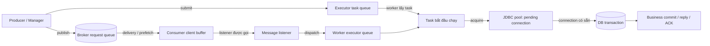
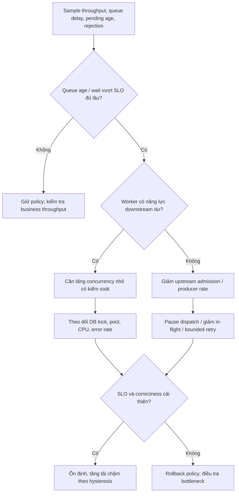

# Đo thời gian chờ trong queue khi mở rộng Spring Batch

## 1. Bài toán: queue dài nhưng job vẫn báo đang chạy

Một job Spring Batch nhập 10 triệu dòng, dùng local partitioning để chia 32 partition. Manager gửi các worker step vào `ThreadPoolTaskExecutor` có bốn core threads và hàng đợi 100 task. Dashboard cho thấy `queueSize=28`, `activeCount=4`. Không có lỗi, nhưng 95% partition hoàn thành trễ hơn SLA.

Tăng `queueCapacity` lên 1000 khiến số lần rejection giảm; tuy nhiên job **không nhanh hơn**, thậm chí nhiều partition chờ lâu hơn trước khi bắt đầu. Lỗi gốc có thể nằm ở DB, worker service time, phân chia partition không đều hoặc executor đang ưu tiên queue trước khi mở thêm threads. Chỉ nhìn `queueSize` không trả lời được:

- Một task chờ **bao lâu** từ lúc có thể được thực thi tới lúc worker bắt đầu?
- Task đang đứng trong **executor queue, JMS broker, client prefetch buffer** hay chờ lấy JDBC connection?
- Phân vị p95/p99 thời gian chờ có tăng dù queue length trung bình vẫn nhỏ?
- Những task bị reject, timeout hoặc hủy **có được tính** trong biểu đồ không?
- Cần điều tiết producer, tăng worker hay sửa bottleneck downstream?

**Đo thời gian chờ trong queue** (*queue waiting time*, *queue delay*, *queue residence time*) là bước đầu để triển khai **backpressure dựa trên bằng chứng**. Nó đo độ trễ trước khi task/message bắt đầu được xử lý, thay vì đo duy nhất thời gian thực thi hay số task đang tồn đọng.

Bài thuộc chương **Backpressure** của module `SPRING_BATCH_SCALING_OPERATIONS`. Mục tiêu module là mở rộng Spring Batch cho dữ liệu lớn bằng **multi-threaded step, parallel steps, partitioning và xử lý phân tán**, đo bottleneck, giữ thread safety, retry/restart và lựa chọn kiến trúc theo tài nguyên thực tế. Vì vậy ta phải đo queue tại **đúng ranh giới** trong pipeline và đặt kết quả vào bối cảnh throughput, tài nguyên và tính đúng nghiệp vụ.

### Kết quả học tập

Sau bài này, bạn có thể:

1. Định nghĩa thời điểm **enqueue/submit**, **dequeue/start**, **finish**, **ACK** và độ trễ tương ứng.
2. Phân biệt executor queue time, broker queue residence, listener/prefetch wait, JDBC connection-acquire wait và end-to-end latency.
3. Dùng `TaskDecorator` và Micrometer đo **start delay** cho `ThreadPoolTaskExecutor` trong Spring Framework 6.x.
4. Thiết kế cách đo qua JMS/Spring Integration khi producer và worker ở các JVM khác nhau; xử lý clock skew và redelivery.
5. Diễn giải queue size, queue wait p95/p99, rejection và throughput theo Little’s Law nhưng không đánh đồng các metric.
6. Kiểm thử saturation, cancellation, failover và tự động điều tiết khi downstream quá tải.
7. Xây dashboard, SLO, quy trình chẩn đoán và checklist trước production.

> **Phạm vi:** Spring Batch **5.2.x**, Spring Framework 6.x, Spring Boot 3.x, Java 17+, Micrometer; JMS/Jakarta Messaging dùng để minh họa transport. Các đoạn code cấu hình executor có thể tái sử dụng cho local partitioning hoặc parallel flows. Đo chính xác broker enqueue/dequeue phụ thuộc từng message broker; không tự suy từ một header chuẩn rằng đã đo được queue residence trong broker.

## 2. Cần thống nhất “đang chờ ở đâu” trước khi đo

Một công việc đi qua nhiều hàng đợi và trạng thái. Tên “queue time” chỉ có ý nghĩa khi xác định **hai mốc đầu–cuối**.



Đây là **sơ đồ logic về các điểm có thể chờ**, không hàm ý mọi job đều đi cả hai nhánh hoặc mọi consumer đều có thêm executor queue. Một local partitioning job có thể chỉ đi nhánh executor; remote chunking đi qua broker và có thể qua client prefetch, listener hoặc executor khác.

### 2.1. Từ điển các khoảng thời gian

| Tên metric | Mốc bắt đầu | Mốc kết thúc | Nó trả lời |
| --- | --- | --- | --- |
| **Executor submit-to-start delay** | Ngay trước khi producer submit task | Ngay khi worker bắt đầu chạy `Runnable` | Task mất bao lâu để được CPU/thread trong pool nhận? |
| **Executor queue residence** | Task thực sự được đặt vào hàng đợi executor | Task được lấy ra khỏi queue | Task nằm trong cấu trúc queue bao lâu? |
| **Broker queue residence** | Broker **nhận/commit enqueue** message | Broker **dequeue/dispatch** cho consumer | Message nằm trong broker bao lâu? |
| **Producer-to-listener latency** | Producer giao message để gửi | Listener bắt đầu xử lý | Tổng trễ publish/network/broker/prefetch/listener, không thuần broker wait |
| **Prefetch/client buffer wait** | Client nhận/prefetch message | Listener bắt đầu xử lý | Message đã rời broker queue nhưng vẫn đợi trong consumer |
| **JDBC connection acquire wait** | Task yêu cầu connection từ pool | Pool cung cấp connection hợp lệ | Worker đang chờ DB connection, dù executor task đã start |
| **Processing/service time** | Worker thực sự bắt đầu xử lý | Xử lý/transaction tương ứng hoàn thành | Năng lực thực thi của consumer |
| **End-to-end latency** | Input nghiệp vụ được chấp nhận | Side effect được commit và/hoặc kết quả được xác nhận theo contract | Toàn bộ hành trình, gồm nhiều khoảng chờ |

**Không được gọi mọi khoảng trong bảng là `queueWait`**. Nên đặt tên metric có layer và boundary, ví dụ `batch.executor.start.delay` hoặc `batch.jms.producer_to_listener.age`, để người đọc dashboard hiểu đang đo gì.

### 2.2. Submit-to-start khác residence trong queue thật

Với `ThreadPoolExecutor`, một task có thể được giao **trực tiếp cho worker mới** mà không đi qua queue. Thời gian từ submit tới start lúc này gồm scheduling/worker creation, nhưng **queue residence thực tế bằng 0**.

Tương tự, `TaskDecorator` thường đo từ thời điểm task được wrap cho tới `Runnable.run()` bắt đầu. Con số đó gần với submit-to-start delay, **không phải timestamp enqueue chính xác** của `LinkedBlockingQueue`. Đổi nhãn thành “thời gian ở hàng đợi nội bộ chính xác” là sai khi task không được enqueue hoặc khi overhead submit đáng kể.

Ở tầng broker, message có thể được dequeue vào client prefetch buffer trước khi listener sẵn sàng. Broker báo queue depth bằng 0 nhưng end-to-end wait vẫn dài. Muốn phân tách, phải có các mốc từ **broker và consumer** hoặc ít nhất một phép đo bao trùm đủ rõ giới hạn.

### 2.3. Mốc ACK và DB commit khác mốc bắt đầu xử lý

Trong remote chunking, một worker có thể:

```text
Broker receive → Listener invoked → ItemProcessor
→ ItemWriter → Business DB COMMIT → ChunkResponse publish
→ Request ACK → Manager nhận reply → JobRepository progress
```

Thứ tự tương đối một số ACK/reply tùy middleware và cách cấu hình transaction; đây chỉ là một **timeline minh họa**. Đo queue wait dừng ở mốc *bắt đầu xử lý*, còn thời gian đợi kết quả ở manager có thể bao gồm **thời gian ghi DB và chuyển reply**. Không dùng `ChunkResponse` về chậm làm bằng chứng duy nhất cho broker queue đang nghẽn.

## 3. Công thức, đơn vị thời gian và những lỗi tính toán

Với một task trong **cùng JVM/process**:

\[
W_{\mathrm{start}} = t_{\mathrm{runStart}}-t_{\mathrm{submit}}
\]

Với message và broker có quan sát enqueue/dequeue trên **cùng đồng hồ broker**:

\[
W_{\mathrm{broker}} =
t_{\mathrm{brokerDispatch}}-t_{\mathrm{brokerEnqueue}}
\]

Nếu đo trong Java:

- Dùng `System.nanoTime()` để tính **khoảng thời gian trong một tiến trình**; đây là nguồn monotonic phù hợp tính elapsed, không phải epoch timestamp.
- Dùng `Instant`/`Clock`/`System.currentTimeMillis()` khi cần **mốc thời gian có thể trao đổi giữa processes**, nhưng phải xử lý **NTP/PTP synchronization, clock drift, skew và message serialization**.
- Không trừ `System.nanoTime()` từ **hai JVM hoặc hai máy khác nhau**; các giá trị không có epoch chung để so.
- Ghi rõ đơn vị: `nanoseconds`, `milliseconds`, `seconds`; Micrometer Timer nhận duration, còn dashboard có thể hiển thị đơn vị khác.

### 3.1. Không lấy giá trị âm làm 0 một cách im lặng

Nếu consumer đồng hồ chậm hơn producer 500 ms, phép tính `receiveEpochMs - sendEpochMs` có thể âm. Điều đó **không chứng minh message được xử lý trước khi gửi**; đây là dấu hiệu clock skew, header lỗi hoặc sai cách đo.

Phải có metric như `batch.message.timestamp.invalid` và giữ trace để điều tra. Có thể không ghi số âm vào latency histogram, nhưng **đừng clamp về 0 rồi che dữ liệu lỗi**. Khi muốn broker queue residence thật, ưu tiên metric do chính broker đo bằng nguồn thời gian nhất quán.

### 3.2. Tail latency quan trọng hơn trung bình đơn lẻ

Giả sử 99 tasks chờ 10 ms, một task chờ 10.000 ms. Mean:

\[
\overline{W}=\frac{99\times10+10\,000}{100}
=109{,}9\ \mathrm{ms}
\]

Mean khoảng 110 ms không nói rõ rằng **một task đã chờ 10 giây**. Với batch SLA, phải quan sát **p50, p95, p99, maximum và tỷ lệ vượt ngưỡng** bên cạnh mean.

Phân vị được định nghĩa trên **phân phối thời gian đợi của một tập task**, không phải lấy `p99(queueSize)` rồi đổi sang thời gian bằng một phép chia đơn giản. Queue length và queue wait là hai đại lượng khác nhau.

### 3.3. Chú ý survivor bias và censored tasks

Một `Timer` ghi ở **lúc task bắt đầu** chỉ chứa những task **đã thật sự bắt đầu**. Những task đang bị kẹt trong queue nhiều phút, đã timeout, bị cancel, bị reject hoặc mất vì process crash **không đóng góp duration vào Timer**.

Hệ thống quá tải có thể hiện `p95 queue wait=50 ms` cho những task may mắn được chạy, trong khi 10.000 tasks còn đang chờ. Vì vậy phải kết hợp:

1. **Start-delay histogram** của tasks đã bắt đầu.
2. **Queue depth và oldest pending age** của tasks chưa bắt đầu (nếu có instrumentation phù hợp).
3. **Accepted/rejected/canceled/expired counts** và queue timeout/backpressure events.
4. **Throughput hữu ích, end-to-end delay** và số task đã hoàn thành.

Đừng đưa ra kết luận “queue không nghẽn” chỉ từ timer đẹp khi queue length đang tăng và throughput không theo kịp.

## 4. Queue length, queue wait và định luật Little

Gọi:

- `L_q`: số task chờ **trung bình theo thời gian** trong hàng đợi;
- `λ_completed`: throughput task rời queue để bắt đầu service, trong trạng thái ổn định;
- `W_q`: thời gian chờ trung bình của những task trong cùng population;
- `λ_in`: tốc độ task đến;
- `μ`: năng lực service của các worker (tasks/s).

Với hệ thống **ổn định** và các điều kiện áp dụng Little's Law:

\[
L_q=\lambda_{\mathrm{throughput}}\times W_q
\]

Ví dụ một executor phục vụ **100 tasks/s**, hàng đợi trung bình **80 tasks**:

\[
W_q\approx 80/100=0{,}8\ \mathrm{s}
\]

Con số 0,8 giây là **trung bình**, không bảo đảm p95/p99 dưới 0,8 giây. Nếu tasks có service times rất khác nhau hoặc nhiều workload chung pool, tail wait có thể cao hơn nhiều.

### 4.1. Khi producer nhanh hơn consumer

Giả sử manager tạo **150 task/s**, executor chỉ có thể bắt đầu và hoàn thành **100 task/s** trong 20 giây; nếu capacity còn:

\[
\Delta Q\approx(150-100)\times20=1000\ \text{tasks}
\]

Queue capacity 500 có thể đầy sau khoảng 10 giây nếu bắt đầu rỗng, không có thay đổi số worker, arrival rate hoặc rejection policy. **Tăng capacity lên 5.000 chỉ kéo dài thời gian trước khi đầy**, không tự tăng tốc consumer.

Khi `λ_in > μ` kéo dài, **Little's Law cho trạng thái cân bằng không còn phù hợp** để diễn giải queue đang phình liên tục. Lúc này đo **slope của queue depth, rejected rate, oldest age, arrival và completion** sẽ quan trọng hơn chỉ lấy một giá trị W trung bình.

### 4.2. Cần phân biệt offered load và accepted load

Nếu producer submit 1.000 tasks/s nhưng executor reject 800 tasks/s, số task accepted chỉ 200/s. Một dashboard chỉ vẽ accepted tasks và queue wait có thể trông bình thường, trong khi **80% work không được nhận**.

Theo dõi tối thiểu:

```text
offered/submitted count
accepted count
rejected count
started count
completed count
canceled/expired count
queueSize gauge
queueWait histogram
```

Các counters trên phải có định nghĩa chính xác để tránh double-count một attempt do retry. `TaskExecutor` không tự cung cấp đầy đủ mọi counter; phải instrument ở đúng admission boundary và hiểu race giữa submit, shutdown và cancel.

### 4.3. Queue size tại thời điểm chụp không có nghĩa wait time

`queueSize=100` có thể đi cùng 10 ms wait nếu 10.000 tasks/s được xử lý, hoặc 100 giây wait nếu worker chỉ xử lý 1 task/s. Không chuyển đổi đơn giản một số queue length **đơn lẻ** sang wait p99.

Ngược lại, `queueSize=0` chưa chắc là không có chờ: `SynchronousQueue` không giữ task, còn producer có thể đang bị **block khi submit**, chờ semaphore, chờ DB connection hoặc message nằm ở client prefetch buffer.

## 5. Spring Batch đặt queue ở những vị trí nào?

| Mô hình | Nơi có thể chờ | Metric cần đo |
| --- | --- | --- |
| **Multi-threaded step** | `TaskExecutor` nhận các chunk iterations | Executor submit-to-start, active threads, queue depth, chunk processing/commit latency |
| **Parallel steps / split flows** | Executor queue giữ flow/step tasks | Flow start delay, số active flows, longest pending flow |
| **Local partitioning** | `TaskExecutorPartitionHandler` gửi worker `StepExecution` tasks | Partition dispatch→run start, executor queue delay, per-partition runtime |
| **Remote partitioning** | Manager dispatch, transport, worker listener và local executor | Request publish→delivery, listener wait, worker start, partition completion |
| **Remote chunking** | Broker request queue, consumer prefetch, worker executor, reply channel | Request age, broker queue residence, worker start, reply wait |
| **Job launch scheduler** | Scheduler/admission queue trước `JobLauncher` | Requested launch→JobExecution actual start; không nhầm với chunk queue |

Spring Batch `BATCH_STEP_EXECUTION.START_TIME` và `END_TIME` cho biết thời gian thực thi step theo metadata, **không tự có trường “executor queue wait milliseconds”**. Muốn biết partition đợi 12 giây trước khi worker bắt đầu, phải đo tại ranh giới điều phối/executor chứ không chỉ lấy `READ_COUNT` và `COMMIT_COUNT` từ `JobRepository`.

### 5.1. Đừng nhầm `gridSize`, `throttleLimit` và `queueCapacity`

- `gridSize` thuộc **partitioning**, gợi ý quy mô phân chia/dispatch partition.
- `queueCapacity` thuộc **executor trong JVM**, giới hạn số `Runnable` nằm chờ ở queue của pool.
- `throttleLimit` legacy ở multi-threaded step được **deprecated trong Spring Batch 5.2**; có thể còn ảnh hưởng concurrency nếu cấu hình cũ, nhưng không phải số task đang chờ.
- Broker `queueDepth` và `consumerPrefetch` nằm ở hệ messaging khác, không theo một property của Spring Batch executor.

Ví dụ có 24 partitions, executor `core=4,max=8,queueCapacity=20`; manager có thể submit 24 tasks và chúng được chấp nhận, nhưng một số partition **chưa hề bắt đầu**. Queue wait đo tại executor sẽ cho biết độ trễ này; tăng gridSize không chứng minh có thêm concurrency.

## 6. Thực hành: đo executor submit-to-start bằng `TaskDecorator`

Spring Framework cung cấp `TaskDecorator` để wrap các `Runnable` sắp được thực thi. Trong `ThreadPoolTaskExecutor`, ta có thể ghi dấu thời gian khi tạo wrapper và tính thời gian ngay trước khi gọi task gốc. Đây là **start delay tính từ lúc decorate**, một phép đo thực dụng gần submit-to-start time.

### 6.1. Java configuration với Micrometer

Ví dụ dùng một pool **riêng cho local partition worker steps**. Code không chạm vào implementation nội bộ của Spring Batch:

```java
// TimedPartitionExecutorConfig.java
package example.batch.backpressure;

import io.micrometer.core.instrument.Counter;
import io.micrometer.core.instrument.Gauge;
import io.micrometer.core.instrument.MeterRegistry;
import io.micrometer.core.instrument.Timer;
import java.util.concurrent.RejectedExecutionException;
import java.util.concurrent.TimeUnit;
import org.springframework.context.annotation.Bean;
import org.springframework.context.annotation.Configuration;
import org.springframework.scheduling.concurrent.ThreadPoolTaskExecutor;

@Configuration
public class TimedPartitionExecutorConfig {

    @Bean("batchPartitionExecutor")
    public ThreadPoolTaskExecutor batchPartitionExecutor(
            MeterRegistry registry) {

        Timer submitToStart = Timer.builder(
                    "batch.executor.submit_to_start")
                .description("Time between task decoration and run start")
                .tag("executor", "batch-partition")
                .publishPercentileHistogram()
                .register(registry);

        Counter rejected = Counter.builder(
                    "batch.executor.rejected")
                .description("Rejected executor task submissions")
                .tag("executor", "batch-partition")
                .register(registry);

        ThreadPoolTaskExecutor executor = new ThreadPoolTaskExecutor();
        executor.setThreadNamePrefix("batch-partition-");
        executor.setCorePoolSize(4);
        executor.setMaxPoolSize(8);
        executor.setQueueCapacity(16);
        executor.setKeepAliveSeconds(60);

        executor.setTaskDecorator(task -> {
            // Cùng JVM, dùng monotonic clock cho elapsed time.
            final long preparedAtNanos = System.nanoTime();
            return () -> {
                long startDelayNanos =
                        System.nanoTime() - preparedAtNanos;
                submitToStart.record(
                        startDelayNanos, TimeUnit.NANOSECONDS);
                task.run();
            };
        });

        executor.setRejectedExecutionHandler((task, pool) -> {
            rejected.increment();
            throw new RejectedExecutionException(
                    "batch-partition executor cannot accept task"
                    + (pool.isShutdown()
                            ? " because it is shutting down"
                            : " because it is saturated"));
        });

        Gauge.builder("batch.executor.queue.depth",
                        executor, ThreadPoolTaskExecutor::getQueueSize)
                .tag("executor", "batch-partition")
                .register(registry);

        Gauge.builder("batch.executor.threads.active",
                        executor, ThreadPoolTaskExecutor::getActiveCount)
                .tag("executor", "batch-partition")
                .register(registry);

        Gauge.builder("batch.executor.threads.current",
                        executor, ThreadPoolTaskExecutor::getPoolSize)
                .tag("executor", "batch-partition")
                .register(registry);

        // @Bean lifecycle của Spring sẽ initialize executor.
        // Khi tạo thủ công ngoài container, gọi initialize().
        return executor;
    }
}
```

**Điểm cần hiểu rõ:**

- `TaskDecorator.decorate` chạy trước khi callback được worker gọi. Khoảng `preparedAtNanos → run start` là **độ trễ bắt đầu**, có thể bao gồm chút overhead từ submission/thread creation. Nó không phân biệt chắc chắn một task được đưa vào queue hay handoff trực tiếp.
- `TaskDecorator` **không nhất thiết nhận chính `Runnable` người dùng submit**; có thể nhận execution callback wrapper. Vì thế không cast nó thành một kiểu domain task mà chưa kiểm chứng.
- Với `submit(Callable/Runnable)`, wrapper có thể là `FutureTask`; decorator vẫn đo start delay, nhưng exception từ `run()` có thể được giữ trong `Future` thay vì ném ra wrapper. **Không dùng catch quanh `task.run()` để thay thế kiểm tra job failure**.
- Timer chỉ ghi khi task **bắt đầu**. Nếu task bị reject, canceled trước run hoặc process crash khi còn queue, duration không được ghi; counter rejection bên trên là **một metric bổ sung**, không thay thế pending age.
- Rejection handler có thể được gọi cả khi pool đầy lẫn khi shutdown. Vì vậy ví dụ đưa lý do vào exception, còn nếu muốn metric phân loại, hãy tạo **counter reason có tập giá trị hữu hạn**.
- `publishPercentileHistogram()` chuẩn bị histogram cho backend có hỗ trợ phân vị; p95/p99 xuất hiện thế nào còn tùy exporter/Prometheus/registry config.

**Tính đúng:** Nếu executor không nhận một partition task, phải để exception truyền về `PartitionHandler`/manager. Không swallow rejection để làm dashboard đẹp: phần việc chưa bắt đầu phải được xử lý theo error/restart contract.

### 6.2. Gắn pool vào `PartitionStep`

Ví dụ Spring Batch 5.2, giả định đã định nghĩa `JobRepository`, `Partitioner` và worker `Step`:

```java
import org.springframework.batch.core.Step;
import org.springframework.batch.core.partition.support.Partitioner;
import org.springframework.batch.core.repository.JobRepository;
import org.springframework.batch.core.step.builder.StepBuilder;
import org.springframework.beans.factory.annotation.Qualifier;
import org.springframework.context.annotation.Bean;
import org.springframework.core.task.TaskExecutor;

@Bean
public Step managerStep(
        JobRepository jobRepository,
        @Qualifier("orderPartitioner") Partitioner partitioner,
        @Qualifier("partitionWorkerStep") Step worker,
        @Qualifier("batchPartitionExecutor") TaskExecutor executor) {

    return new StepBuilder("managerStep", jobRepository)
            .partitioner("partitionWorkerStep", partitioner)
            .step(worker)
            .gridSize(16)
            .taskExecutor(executor)
            .build();
}
```

Trong ví dụ, `gridSize=16` là thông tin partitioning; `core=4,max=8,queue=16` là thông tin thực thi của pool. Một `Partitioner` có thể tạo 16 `StepExecution`, nhưng thời gian submit-to-start sẽ khác nhau tùy thời gian chạy của những partition đã được worker nhận.

Nếu task executor còn được dùng bởi `@Async`, web requests hoặc nhiều jobs khác, latency đo được là **cho toàn pool**, không chỉ một Step. Để đo theo workload, gán pool riêng hoặc thêm nhãn **được kiểm soát cardinality** từ ranh giới dispatch; không lấy `jobExecutionId` của mọi lần chạy làm tag mặc định trên một histogram dài hạn.

### 6.3. Tại sao không đo bằng `@Around` trên `ItemWriter`?

Một interceptor quanh `ItemWriter.write(...)` đo **thời gian ghi** sau khi worker đã bắt đầu. Nó không biết task đã chờ bao lâu trong executor trước đó. `ChunkListener.beforeChunk` cũng thường chỉ chạy **khi chunk iteration đã bắt đầu**; không đủ để suy thời điểm producer submit.

Phân biệt:

```text
manager submit task ---- [executor delay] ---- worker starts
                                              |
                                       beforeChunk
                                              |
                                      reader/processor
                                              |
                                          writer
                                              |
                                       DB COMMIT
```

Muốn thấy cả hai, instrument ở **executor boundary** cho submit-to-start, và ở **chunk/transaction boundary** cho processing latency. Khi so sánh metric, chúng có thể chồng lấp tùy điểm đánh dấu; không cộng các timer lẫn nhau mà chưa xác định parent/child spans.

### 6.4. `queueCapacity` và ảnh hưởng đến phép đo

Theo `ThreadPoolTaskExecutor`:

| Cấu hình | Hành vi thường gặp | Queue-delay interpretation |
| --- | --- | --- |
| `queueCapacity > 0` | `LinkedBlockingQueue` hữu hạn, sau core ưu tiên queue | Có cả trực tiếp chạy và task chờ; Timer đo start delay của cả hai |
| `queueCapacity = 0` | `SynchronousQueue`, không lưu task chờ | Queue depth thường 0 nhưng có thể reject; start delay vẫn có vì thread scheduling |
| `queueCapacity` rất lớn | Pool có thể chỉ chạy core workers dù max cao | Start delay tăng khi backlog tích lại; max threads không tự giải quyết |

Đừng vẽ `queueSize=0` rồi gắn badge “healthy” khi `queueCapacity=0`: pool có thể đã đạt `maxPoolSize` và reject mọi task tiếp theo. Hãy luôn quan sát rejection và số thread đang active.

## 7. Thực hành kiểm thử phép đo với một worker bị giữ lại

Test này không cần database: dùng `CountDownLatch` để giữ worker đang chạy, đặt task thứ hai vào queue và xác nhận nó phải chờ. Nó kiểm tra **instrumentation ở mức executor**, chưa phải kiểm thử một Batch job.

### 7.1. JUnit 5 test

```java
// QueueStartDelayTest.java
package example.batch.backpressure;

import java.util.Queue;
import java.util.concurrent.ConcurrentLinkedQueue;
import java.util.concurrent.CountDownLatch;
import java.util.concurrent.TimeUnit;
import org.junit.jupiter.api.Test;
import org.springframework.core.task.TaskRejectedException;
import org.springframework.scheduling.concurrent.ThreadPoolTaskExecutor;

import static org.junit.jupiter.api.Assertions.*;

class QueueStartDelayTest {

    @Test
    void measuresWaitAndRejectsWhenPoolAndQueueAreFull()
            throws Exception {
        Queue<Long> observedNanos = new ConcurrentLinkedQueue<>();

        ThreadPoolTaskExecutor pool = new ThreadPoolTaskExecutor();
        pool.setCorePoolSize(1);
        pool.setMaxPoolSize(1);
        pool.setQueueCapacity(1);
        pool.setTaskDecorator(original -> {
            long preparedAt = System.nanoTime();
            return () -> {
                observedNanos.add(System.nanoTime() - preparedAt);
                original.run();
            };
        });
        pool.initialize();

        CountDownLatch firstStarted = new CountDownLatch(1);
        CountDownLatch releaseFirst = new CountDownLatch(1);
        CountDownLatch secondFinished = new CountDownLatch(1);

        try {
            pool.execute(() -> {
                firstStarted.countDown();
                try {
                    releaseFirst.await();
                } catch (InterruptedException ex) {
                    Thread.currentThread().interrupt();
                }
            });

            assertTrue(firstStarted.await(5, TimeUnit.SECONDS));

            pool.execute(secondFinished::countDown); // queued
            assertEquals(1, pool.getQueueSize());
            assertThrows(TaskRejectedException.class,
                    () -> pool.execute(() -> {}));   // no capacity

            Thread.sleep(150); // giữ task thứ hai trong queue
            releaseFirst.countDown();

            assertTrue(secondFinished.await(5, TimeUnit.SECONDS));
            assertEquals(2, observedNanos.size());
            assertTrue(observedNanos.stream().anyMatch(
                    n -> n >= TimeUnit.MILLISECONDS.toNanos(100)));
        } finally {
            releaseFirst.countDown();
            pool.shutdown();
        }
    }
}
```

**Lý do có ngưỡng 100 ms:** test chủ động giữ task thứ hai khoảng 150 ms nên một observed delay phải vượt ngưỡng. Đây là phép kiểm thực hành, không phải SLO production; trên CI nhiều jitter, dùng latch/đo lặp và ngưỡng có headroom để tránh test flakiness. `getQueueSize()` chỉ được chụp sau khi task đầu đã start và trước khi release.

### 7.2. Kiểm thử các dạng task khác

| Kịch bản | Setup | Điều cần xác nhận |
| --- | --- | --- |
| Worker rảnh | `core=max=1`, submit task ngắn | Delay nhỏ, task thực sự chạy |
| Worker bị giữ | Một task chặn latch, task sau chờ | Delay task sau tăng theo thời gian chặn |
| Queue đầy | `core=1,max=1,queue=1`, submit task thứ ba | Rejection tăng, task thứ ba **không có start sample** |
| Queue không lưu chờ | `queueCapacity=0` | QueueSize≈0 nhưng start delay/rejection vẫn được đo |
| Pool mở rộng | `core=1,max=4,queue=2` | Sau queue đầy mới tạo worker mới; histogram gồm cả tasks không queue |
| Cancel trước start | Submit bằng `Future` rồi cancel khi task còn queue | Không được coi Timer đã đo được duration của canceled task |
| JVM crash | Kill process khi còn pending tasks | Queue RAM mất; cần Spring Batch restart/reconciliation |
| Shared pool | Hai jobs submit cùng lúc | Tag pool dùng chung không tự chia latency theo job |

Trong load test, không chỉ quan sát `max(queueSize)`. Hãy phát ra **tốc độ gửi có kiểm soát**, đo p50/p95/p99 start delay, pending age, accepted/rejected, completed tasks/s và CPU/JDBC pool để xác nhận nguyên nhân.

## 8. Đo message age trong JMS: không gọi nhầm thành broker queue time

Một manager remote chunking gửi `ChunkRequest` qua JMS. Khi worker nhận message, có ba khoảng:

```text
producer send call
   → provider/broker network + transaction commit
   → broker message ready
   → waiting in broker queue
   → broker dispatch / consumer prefetch
   → client buffer / listener scheduling
   → listener begins processing
```

Một timestamp được set tại producer và đọc ở listener đo **toàn hành trình phía trên**, **không tách riêng broker queue residence**. Với Jakarta Messaging, `JMSTimestamp` là thời điểm message được **giao cho provider để gửi**; nó có thể sớm hơn lúc message thực sự được transmit hoặc transaction gửi message được commit.

### 8.1. Dùng `JMSTimestamp` để đo producer-to-listener age

Một probe gắn vào **listener hiện có** có thể ghi tuổi message từ header JMS:

```java
// JmsMessageAgeProbe.java
package example.batch.backpressure;

import io.micrometer.core.instrument.Counter;
import io.micrometer.core.instrument.MeterRegistry;
import io.micrometer.core.instrument.Timer;
import jakarta.jms.JMSException;
import jakarta.jms.Message;
import java.time.Clock;
import java.util.concurrent.TimeUnit;

public final class JmsMessageAgeProbe {
    private final Clock clock;
    private final Timer firstDeliveryAge;
    private final Timer redeliveryAge;
    private final Counter invalidTimestamp;

    public JmsMessageAgeProbe(MeterRegistry registry, Clock clock) {
        this.clock = clock;
        this.firstDeliveryAge = Timer.builder(
                    "batch.jms.producer_to_listener.age")
                .tag("destination", "chunk-requests")
                .tag("delivery", "first")
                .publishPercentileHistogram()
                .register(registry);
        this.redeliveryAge = Timer.builder(
                    "batch.jms.producer_to_listener.age")
                .tag("destination", "chunk-requests")
                .tag("delivery", "redelivery")
                .publishPercentileHistogram()
                .register(registry);
        this.invalidTimestamp = Counter.builder(
                    "batch.jms.timestamp.invalid")
                .tag("destination", "chunk-requests")
                .register(registry);
    }

    public void recordAtListenerEntry(Message message)
            throws JMSException {
        long sentAtMs = message.getJMSTimestamp();
        long observedAtMs = clock.millis();

        if (sentAtMs <= 0 || observedAtMs < sentAtMs) {
            invalidTimestamp.increment();
            return;
        }

        long ageMs = observedAtMs - sentAtMs;
        Timer timer = message.getJMSRedelivered()
                ? redeliveryAge : firstDeliveryAge;
        timer.record(ageMs, TimeUnit.MILLISECONDS);
    }
}
```

Gọi `probe.recordAtListenerEntry(message)` **ngay đầu listener đang xử lý ChunkRequest**, trước xử lý nghiệp vụ; **không đăng ký một listener phụ trên cùng queue chỉ để đo latency** vì listener mới sẽ cạnh tranh tiêu thụ request với worker thật.

Ví dụ này cho phép nhìn thấy tuổi message và so nhóm first delivery/redelivery, nhưng có các giới hạn:

- `JMSTimestamp` có thể bằng **0** khi producer/provider tắt message timestamp; mẫu ghi `invalidTimestamp` thay vì đưa 0 vào histogram.
- Consumer và provider dùng đồng hồ khác; **clock skew có thể khiến duration âm**. Đồng bộ NTP/PTP, quan sát skew và không clamp âm thành 0.
- `JMSRedelivered` thể hiện header redelivery, không kết luận DB write chưa commit. Một request có thể đã commit rồi bị giao lại sau worker crash trước ACK.
- Age của **redelivery** thường tính từ timestamp gốc, có thể gồm nhiều lần chờ và nhiều lần xử lý. Nó không bằng broker wait của lần dispatch hiện tại.
- Nếu broker **prefetch nhiều message**, listener age bao gồm client buffer wait. Broker queue depth có thể giảm trước khi ứng dụng thực sự xử lý.
- Đây không phải metric do Spring Batch tự phát ra; nó là instrumentation do ứng dụng gắn vào transport boundary.

Nếu muốn queue residence đúng nghĩa tại broker, dùng **metric enqueue→dequeue/dispatch do broker cung cấp** hoặc custom event timestamps của broker theo một clock domain, sau đó đối chiếu với tuổi message tại consumer. Chọn vendor-specific metric có định nghĩa rõ, không giả định mọi broker đều có cùng tên “QueueTime”.

### 8.2. Broker queue, JMS reply và worker executor là ba hàng đợi khác nhau

Một `ChunkRequest` có thể chờ 3 giây trong broker, 1 giây trong client prefetch, 2 giây trong executor, rồi xử lý 5 giây trước khi gửi reply. Nếu manager chỉ đo `requestSend→replyReceive=12 giây`, **không thể suy riêng broker chờ 12 giây**.

```text
request publish  ──────┐
                       │ broker delay
broker dispatch   ─────┤
                       │ client/prefetch delay
listener entry    ─────┤
                       │ executor start delay (nếu có)
worker start      ─────┤
                       │ process + DB commit
worker reply      ─────┤
                       │ reply broker + consumer
manager accounted ─────┘
```

Trong Spring Integration, `QueueChannel` có thể dùng hàng đợi **trong RAM** hoặc có cấu hình backing store. Khi message đã được nhận/ACK từ broker nhưng nằm chờ trong memory channel, broker có thể báo queueDepth nhỏ trong khi manager không nhận được reply kịp thời. Phải instrument **queue channel receive/poll boundary** nếu nó là thành phần quan trọng của pipeline.

### 8.3. Không dùng client timestamp để che clock skew

Nếu cần tương quan xuyên JVM, có thể mang header `producerSentAtEpochMillis`, `logicalOperationId` và `traceId` qua broker. Tuy nhiên:

- Header thời gian phải được định nghĩa rõ: **trước publish, sau publish hay lúc broker accept**?
- Đồng hồ hai JVM cần được đồng bộ và giám sát.
- Một message có thể bị broker delay theo `JMSDeliveryTime`/TTL, hoặc transaction gửi chưa commit, làm age lớn **không do queue saturation**.
- Message ID và correlation ID có thể thay đổi khi gửi lại; không dùng chúng làm business idempotency key duy nhất.
- Không gắn `messageId`/`operationId` làm metric labels có cardinality không giới hạn; dùng tracing/logs có sampling.

Khi có đủ span/tracing với timestamps liên quan, báo cáo **end-to-end age** và broker queue residence như **hai metric khác nhau**.

## 9. Đo thời gian chờ của task chưa bắt đầu: pending age

Đây là điểm dễ bỏ sót nhất khi dùng `TaskDecorator`: **chỉ task đã bắt đầu mới đóng góp histogram**. Một job có thể có 500 tasks chờ 15 phút trong executor, trong khi `batch.executor.submit_to_start` của phút gần nhất chỉ có vài task nhanh.

### 9.1. Định nghĩa `oldestPendingAge`

Tại thời điểm quan sát `t_now`:

\[
\mathrm{oldestPendingAge} =
\max_{i \in \mathrm{pending}}
 (t_{\mathrm{now}}-t_{\mathrm{submitted},i})
\]

Nếu queue rỗng và không còn task pending, metric có thể báo **0 hoặc không có sample** theo convention đã chốt; dashboard phải phân biệt “không có task” với “sample bị thiếu vì instrumentation lỗi”.

Một phép đo gần đúng khác là **tuổi task đầu queue** (*head-of-line age*), nếu queue hoạt động FIFO. Nhưng `oldest pending` có thể khác `head-of-line` khi có priority queue, cancellation, fairness, nhiều loại tasks hoặc task đã được handoff nhưng chưa thực sự bắt đầu.

### 9.2. Thiết kế bộ theo dõi pending an toàn

Một `SubmissionTracker` có thể ghi trạng thái của từng task theo một internal token duy nhất:

```text
Producer:
  t0 = System.nanoTime()
  tracker.register(taskToken, t0, state=SUBMITTING)
  try executor.execute(wrappedTask):
      tracker.markAcceptedIfStillPending(taskToken)
  catch TaskRejectedException:
      tracker.markRejectedAndRemove(taskToken)
      rethrow

Worker wrapper at run entry:
  tracker.recordStartDelay(taskToken, System.nanoTime()-t0)
  tracker.removeFromPending(taskToken)
  executeOriginalTask()

Cancel/expire/shutdown:
  tracker.removeFromPending(taskToken)
  record cancellation/timeout reason

Periodic sample:
  pendingCount
  oldestPendingAge
  readyQueueDepth
```

Đây là **pseudocode thiết kế**, không phải một lớp Spring Framework có sẵn. Chú ý race: một task có thể **bắt đầu trước khi `execute(...)` trả về**. Do đó, `markAcceptedIfStillPending` không được tạo lại entry đã bị worker xóa; mọi chuyển trạng thái phải atomic. Nếu dùng `Future.cancel(...)`, phải có callback cleanup phù hợp; không giữ token vô hạn.

Với hàng nghìn/millions tasks, không nên mỗi scrape duyệt cả một `ConcurrentHashMap` khổng lồ nếu gây áp lực GC. Các lựa chọn:

- Dùng một queue/priority index của timestamps cùng cơ chế xóa **có giới hạn**.
- Lấy sample đại diện với sampling rate được công bố, đồng thời vẫn đếm tổng accepted/rejected/expired.
- Dùng metric **oldest message age** được broker hỗ trợ và phân loại rõ scope.
- Khi cần chính xác ở executor, viết một **TaskExecutor wrapper** có lifecycle tracker và test mọi nhánh rejection/cancel/shutdown, thay vì lạm dụng reflection vào hàng đợi nội bộ.

**Không để instrumentation làm tắc producer**: mỗi task bị ép chờ ghi metric đồng bộ vào DB hay mạng sẽ làm sai chính phép đo queue latency.

### 9.3. Pending age khác thời gian chờ của task đã bắt đầu

| Metric | Bao phủ ai? | Khi nào hữu ích nhất? |
| --- | --- | --- |
| Start-delay p95/p99 | Tasks đã bắt đầu chạy | Đo trải nghiệm của requests/tasks được phục vụ |
| `pendingCount` | Tasks đã chấp nhận nhưng chưa bắt đầu | Tìm backlog tại thời điểm hiện tại |
| `oldestPendingAge` | Task pending lâu nhất hiện tại | Bắt dead queue, starvation và tail chưa quan sát |
| `rejectedCount` | Tasks không được pool nhận | Tìm overload/admission failure |
| `expiredOrCanceledCount` | Tasks hết hạn/hủy trước hoặc giữa xử lý | Tìm việc bị bỏ hoặc SLO vi phạm |
| `completedBusinessCount` | Logical operations đã hoàn tất theo nghiệp vụ | Phân biệt queue drain với output đúng |

Để debug stall, cần quan sát cùng một thời gian **pendingAge tăng**, `activeCount`, thread dump, JDBC pending/lock wait và downstream throughput. Nếu pending age tăng mà worker đều blocked trên DB, tăng queue size chỉ làm chậm thời điểm reject.

### 9.4. Cách đo “oldest message” ở broker

Một số message brokers cung cấp metric độ tuổi message cũ nhất **đang chờ**. Tên và semantics phụ thuộc vendor và version:

- Có broker tính từ **enqueue time** tới now; broker clock nhất quán.
- Có broker chỉ đếm message **ready**; message đã dispatch/unacked không còn tính vào queue ready age.
- Có broker đo tuổi theo **producer timestamp** chứ không phải enqueue; transactional sends và clock skew ảnh hưởng.
- Với priority, delayed delivery, DLQ và redelivery, oldest có thể là một **poison message** chứ không đại diện p95.

Vì vậy phải đối chiếu tài liệu broker, queue ready, in-flight/unacked, DLQ và listener processing delay. Không gộp mọi queue broker vào một nhãn "Backlog time" thiếu boundary.

## 10. Phân biệt executor wait, JDBC pool wait và worker processing

Một worker task có thể bắt đầu ngay nhưng **đứng chờ DB connection 5 giây**. Nếu chỉ vẽ executor start delay, hệ thống có vẻ healthy dù toàn bộ Batch throughput đang nghẽn.

```text
request submitted
  └─ executor submit-to-start: 10 ms
      └─ business DataSource getConnection(): 5.0 s
          └─ SQL execution + lock wait: 2.0 s
              └─ COMMIT: 0.1 s
                  └─ reply publish: 20 ms
```

Trong ví dụ trên, bottleneck là **DB pool hoặc DB**, không phải queue của executor. Tuy nhiên khi nhiều worker bị block trên DB, executor active threads sẽ dần đạt max và **task mới bắt đầu phải đợi**, làm executor wait tăng theo **hậu quả của bottleneck downstream**.

### 10.1. HikariCP connection-acquire metrics

Theo dõi ít nhất:

- `active connections`: số connection đang được sử dụng;
- `idle connections`: connection rảnh trong pool;
- `pending threads`: callers đang chờ lấy connection;
- `acquire wait duration/p95/p99` hoặc connection timeout;
- `connection usage duration`: connection được giữ bao lâu, có leak không?

Tên meter cụ thể phụ thuộc HikariCP/Micrometer/Actuator và registry. Hãy đối chiếu cấu hình metrics thật thay vì giả định mọi môi trường có cùng tên. **Một connection-acquire timeout không phải executor task rejection**; nó xảy ra sau khi task có thể đã bắt đầu.

### 10.2. Đếm concurrent tasks không đồng nghĩa số transactions

Một partition step có thể dùng nhiều connections cho reader, writer hoặc metadata, hoặc có thời điểm không cần DB. Với 8 worker JVM, mỗi JVM 10 active executor threads, số concurrent tasks có thể lên tới 80, nhưng business DB chỉ có 40 connections khả dụng. Khi đó nhiều tasks sẽ bị block.

Trước khi tăng `maxPoolSize` để chữa queue wait, tính tổng budget trên **mọi worker và mọi resource pool**, kiểm tra hot locks và transaction duration. Tăng threads khi DB đã bão hòa thường khiến queue wait/total latency xấu đi.

### 10.3. Đo ở đâu với Spring Batch?

| Thành phần | Nơi đặt instrumentation | Tránh suy sai |
| --- | --- | --- |
| `TaskExecutorPartitionHandler` | Wrapper/decorator của executor khi submit worker step | `StepExecution` runtime không bao gồm chính xác pre-start wait |
| Chunk-oriented worker step | `ChunkListener`, reader/processor/writer timer | Đây là thời gian **đang xử lý**, không phải task queue wait |
| `JdbcTemplate` / `DataSource` | Connection pool / JDBC tracing | Bắt nguồn DB wait, không đẩy nhầm sang executor |
| `JobRepository` | Repository transaction latency | Metadata DB chậm có thể chặn job dù business DB khỏe |
| Spring Integration `QueueChannel` | Channel send/receive/poll boundary | Pollable queue chờ trong JVM khác broker wait |
| Remote worker listener | Ngay đầu inbound handler, trước handoff executor | Listener entry khác thời điểm broker dispatch |
| Manager reply aggregation | Reply receive/accounting timestamps | Đo round-trip, không thuần request queue wait |

Trong multi-threaded step, `throttleLimit`/repeat concurrency và thread safety của reader/writer còn ảnh hưởng số work thực sự có thể chạy. Queue wait nhỏ không chứng minh step đang có concurrency như dự kiến.

## 11. Thiết kế dashboard và SLO cho queue waiting time

Một dashboard đáng tin cậy phải trả lời ba câu: **work có đến nhanh hơn năng lực xử lý không?**, **task phải chờ bao lâu?**, và **kết quả nghiệp vụ có hoàn tất đúng không?**

### 11.1. Panel nên đặt cạnh nhau

| Panel | Các chỉ số | Câu hỏi |
| --- | --- | --- |
| **Load/admission** | Offered tasks/s, accepted/s, rejected/s, canceled/s | Có đang bỏ việc trước khi xử lý không? |
| **Executor** | `activeCount`, `poolSize`, `maxPoolSize`, `queueSize` | Pool có đạt trần hay vẫn giữ core threads? |
| **Queue delay** | Start-delay p50/p95/p99 và duration histogram | Tasks đã bắt đầu phải đợi bao lâu? |
| **Pending age** | Oldest pending age, pending tasks count | Có task chờ mãi mà histogram chưa thấy? |
| **Business output** | Unique committed operations/s, missing/duplicate count | Throughput hữu ích có tăng không? |
| **Worker service** | Task duration p95/p99, CPU, GC, retries | Service time đang tăng do lỗi/tài nguyên? |
| **Database** | Hikari pending/acquire, lock wait, commit latency | Bottleneck thực sự nằm ở DB? |
| **Broker** | Ready/unacked, oldest message age, redeliveries, DLQ, consumer lag | Message đang ở broker hay trong client buffer? |
| **Recovery** | Failed/restarted partitions, outstanding replies, stale executions | Có công việc cần khôi phục sau failover không? |

Với remote chunking, nên có các panels riêng cho **request**, **reply**, **worker-local executor** và business DB. Không tạo một biểu đồ “queueLatency” cộng dồn các hệ thống mà người dùng không biết timestamp nào được dùng.

### 11.2. SLO ví dụ và ngưỡng bảo vệ

Ví dụ **mang tính giả định**, không phải cấu hình chuẩn:

```text
Executor start delay:
  p95 < 500 ms trong cửa sổ 5 phút
  p99 < 2 s trong cửa sổ 5 phút

Oldest pending task:
  < 10 s ở tải bình thường

Rejection:
  0 ngoài những sự kiện admission throttle được thiết kế

Business:
  0 missing/duplicate committed operations không được phép
  job complete trước business deadline
```

Một Batch job chạy theo lịch có thể chấp nhận vài giây queue wait nhưng **không chấp nhận mất partition**; một job SLA gần real-time có thể cần p99 thấp hơn. Hãy chọn SLO theo **deadline và cost of failure** của công việc, không dùng p95 của hệ thống web làm mặc định.

### 11.3. Prometheus/Micrometer histogram

`Timer.publishPercentileHistogram()` cho phép backend hỗ trợ histogram buckets. Trong Prometheus, nếu metric được export với tên và `_bucket` phù hợp, có thể dùng ý tưởng truy vấn:

```promql
histogram_quantile(
  0.95,
  sum by (le) (
    rate(batch_executor_submit_to_start_seconds_bucket{
      executor="batch-partition"
    }[5m])
  )
)
```

Đây là **ví dụ dựa trên quy ước Micrometer→Prometheus naming**; tên thực tế có thể khác theo meter naming convention, histogram config và registry. Chỉ dùng sau khi kiểm tra endpoint `/actuator/prometheus` hoặc metric exposition của app. Không tạo histogram query khi backend thực tế chỉ có client-side percentile gauges.

Một truy vấn khác để tìm rejected rate:

```promql
sum(
  rate(batch_executor_rejected_total{
    executor="batch-partition"
  }[5m])
)
```

Một số exporter có thể đổi suffix `_total`/`_count` hoặc normalize tên khác; kiểm tra số liệu thật. Từ một biểu đồ p95 có vẻ tốt, phải nhìn cùng `queue.depth`, `oldest.pending.age` và rejection để phát hiện survivor bias.

### 11.4. Cardinality: không tag mỗi item/job execution

Các tag tương đối an toàn:

```text
executor = batch-partition | batch-chunk | batch-reply
step     = importOrdersStep | aggregateStep
outcome  = success | error | rejected | canceled
layer    = executor | broker | prefetch | jdbc
env      = staging | production
```

Tránh dùng `operationId`, `JMSMessageID`, `jobExecutionId`, filename tùy ý hoặc user ID làm metric labels dài hạn: cardinality có thể tăng tới hàng triệu series. Muốn điều tra một attempt cụ thể, dùng **structured logs/trace spans** và lưu metadata có giới hạn/truy cập phù hợp.

### 11.5. Đồng bộ thời gian và trace propagation

Trong một JVM, dùng `System.nanoTime()` cho duration đáng tin. Qua các tiến trình, mỗi span có thể mang relative duration do clock nội bộ đo; wall-clock timestamps cần được đồng bộ để nối timeline và tính chênh lệch giữa các JVM.

Với observability:

- Truyền trace/correlation ID qua Spring Integration/JMS headers theo schema được hỗ trợ.
- Ghi **span start/end** ở producer, broker instrumentation (nếu có), listener, executor, DB acquire, writer và reply.
- Không đưa secrets hay payload PII vào spans.
- Báo riêng **clock-offset alarms**, không coi timestamp âm là latency 0.
- Không làm instrumentation ném exception khiến worker không ACK/commit được business message chỉ vì metric backend đang lỗi.

## 12. Từ metric sang backpressure: quyết định ở đâu?

**Backpressure** là phản ứng có kiểm soát khi downstream không tiêu thụ kịp. Đo queue wait chỉ là **tín hiệu**. Hành động phải ở **upstream/admission**, nơi có thể giảm nhịp tạo/giao việc hoặc hạn chế concurrency mà không âm thầm bỏ task.



### 12.1. Không tăng threads chỉ vì queue wait cao

Nếu `activeCount=maxPoolSize`, CPU 20% nhưng `Hikari.pending=40` và DB lock wait cao, workers **đang block**. Tăng `maxPoolSize` tạo thêm threads cạnh tranh connection/locks và có thể khiến p99 tệ hơn.

Nếu CPU 80–90% trên worker, GC thấp, DB còn dư, tăng concurrency có thể làm throughput tăng đến một điểm, nhưng cũng có thể gây context-switch overhead. Thử một bước nhỏ, đo **unique business commits/s và tail latency**, không chỉ số threads active.

### 12.2. Hysteresis để tránh điều khiển dao động

Ví dụ policy ứng dụng **minh họa**, không phải thuật toán mặc định Spring Batch:

```text
Mỗi 30 giây:
  Nếu queueWaitP95 > 2 s trong 3 cửa sổ liên tiếp
  VÀ pendingAge tiếp tục tăng
  VÀ DB connections đã sát trần:
      giảm admission permits / tạm pause dispatch partitions mới

  Nếu queueWaitP95 < 500 ms trong 5 cửa sổ liên tiếp
  VÀ pendingAge đã giảm
  VÀ business throughput ổn:
      mở thêm một lượng nhỏ permits
```

Đây là **logic high-level**, không được copy thành automation thay đổi `JobRepository` hoặc skip partitions. Có thể giữ **Semaphore/RateLimiter ở tầng producer** với hạn mức rõ; release permits khi task hoàn thành/cancel/rejected một cách chính xác. Nếu dùng `Semaphore` đồng bộ nhưng quên release sau exception, hệ thống có thể tự deadlock.

### 12.3. Queue hữu hạn và rejection là một tín hiệu, không phải chính sách phục hồi

`ThreadPoolTaskExecutor` có thể dùng:

- `AbortPolicy`: reject rõ ràng khi đầy. Spring có thể bọc thành `TaskRejectedException`; Batch manager phải biết task chưa được nhận.
- `CallerRunsPolicy`: chạy task trên producer thread khi pool chưa shutdown, có thể tạo backpressure, nhưng **đổi execution context và làm chậm manager/listener**; kiểm tra transaction, retry và thread-local assumptions trước khi dùng.
- `DiscardPolicy`/`DiscardOldestPolicy`: có nguy cơ **mất partition/chunk im lặng**; không phù hợp với công việc cần đầy đủ dữ liệu.
- Bounded blocking admission: producer chờ giới hạn trước submit, nhưng phải tránh giữ DB transaction/lock khi chờ và có timeout/error propagation.

Một queue nhỏ giúp quá tải **lộ ra sớm**; nó không tự làm business operations exactly-once. Nếu reject dẫn đến restart, cần cùng `JobInstance`, input snapshot ổn định và writer idempotent.

### 12.4. Tăng broker consumer concurrency có thể làm queue wait giảm nhưng DB tệ hơn

Trong remote chunking, nếu broker queue age tăng, việc tăng consumers có thể giảm **ready backlog** nhưng đồng thời tăng:

- Message **unacked/in-flight** trong listener/client.
- Số requests đang xử lý và DB transactions.
- Lock/contention/retry/rollback và reply latency.
- Redelivery khi consumers timeout hoặc crash.

Chỉ tăng consumer count khi **business DB, connection pool, CPU và reply flow** còn headroom. Phải nhìn cả producer-to-listener age, processing time, DB acquired wait, broker ready/unacked và end-to-end completion.

## 13. Case study: cùng queue size, thời gian chờ hoàn toàn khác

Xét một job `recalculateBalances` có 40.000 logical operations, manager tạo `Runnable` để xử lý các partition hoặc nhóm công việc. Tất cả con số bên dưới **chỉ là ví dụ mô phỏng**; không phải benchmark thực tế.

### 13.1. Kịch bản A — Queue đầy vì core threads thấp

```text
ThreadPoolTaskExecutor:
  corePoolSize = 4
  maxPoolSize = 24
  queueCapacity = 10.000

Producer arrival rate = 60 tasks/s
Four active workers finish ~20 tasks/s
DB connection pool still has spare capacity
```

Vì `ThreadPoolExecutor` thường **ưu tiên queue sau khi đạt core**, backlog có thể tích lại hàng nghìn tasks trước khi mở thêm thread quá core; `maxPoolSize=24` không tự chạy hết 24 threads. Metrics:

- `poolSize` thường quanh 4, `queueSize` tăng.
- Submit-to-start p95, pending age cùng tăng.
- DB active connections còn thấp.
- Business throughput gần năng lực của bốn workers, không phải 24.

Hành động hợp lý là **xác minh cấu hình executor thực tế**, chọn core concurrency cao hơn hoặc queue capacity hữu hạn nhỏ hơn, kiểm thử lại DB/CPU và admission. Đừng chỉ đổi `maxPoolSize=100` trong khi giữ queue rất lớn.

### 13.2. Kịch bản B — Queue đầy do DB đã nghẽn

```text
Executor:  core=max=16, queueCapacity=32
HikariCP:  maximumPoolSize=8
DB:       nhiều transaction giữ hot-row lock
```

Metrics:

- `activeCount=16`, một số tasks chờ connection hoặc DB locks.
- `queueSize≈32` và pending age tăng.
- Hikari pending/acquire p99 cao, DB lock wait cao.
- CPU workers thấp, business commits/s không tăng khi thêm thread.

Đây là **backpressure từ downstream DB**, không đơn giản là executor thiếu thread. Giảm concurrency, tối ưu SQL/index, phân vùng hot key, rút ngắn transaction hoặc giảm tần suất giao việc có thể tốt hơn tăng queue capacity.

### 13.3. Kịch bản C — Broker ready thấp nhưng message age cao

Trong remote chunking, worker listener có prefetch 100 messages và chỉ xử lý hai requests đồng thời:

- Broker dispatch nhiều messages vào client buffer, làm `ready queue depth` giảm nhanh.
- 98 messages có thể vẫn chờ trong process worker.
- `JMSTimestamp→listener entry` tăng, dù broker báo ready thấp.
- `requestSend→ChunkResponse` ở manager còn tăng thêm thời gian DB commit/reply.

Hãy giảm prefetch/credit hoặc cấu hình concurrency/admission theo khả năng xử lý và tài nguyên DB. Nếu client đã prefetch quá nhiều, **broker queue length không còn phản ánh backlog end-to-end**.

### 13.4. Kịch bản D — Histogram tốt giả vì job đang kẹt

```text
Queue at 10:00:
  1.000 pending tasks, oldest pending = 8 min

10:00–10:05:
  Không task nào bắt đầu: Timer không có sample mới
  Dashboard có thể vẫn hiển thị p95 cũ = 50 ms
  300 tasks đã hết deadline và bị hủy
```

Nếu dashboard giữ giá trị p95 cũ khi cửa sổ mới **không có task nào bắt đầu**, p95 thấp **không có nghĩa mọi task chờ 50 ms**. Phải theo dõi trạng thái không có sample mới, pending age, canceled/expired count và business coverage. Với FIFO queue, một task bắt đầu sau tám phút chờ sẽ ghi nhận start delay lớn.

### 13.5. Một phép tính sizing đơn giản

Nếu arrival `λ=80 tasks/s`, service capacity `μ=50 tasks/s` kéo dài 20 giây:

\[
\Delta Q \approx (80-50)\times20=600\ \text{tasks}
\]

Với queue capacity 400 và ban đầu rỗng, queue có thể chạm capacity sau khoảng:

\[
t_{\mathrm{full}}\approx 400/(80-50)=13{,}3\ \mathrm{s}
\]

Đây là approximation giữ rates không đổi, tasks không hoàn thành ở giữa các phép đo có độ dao động nhỏ và không có hiệu ứng backpressure tự động. Khi queue đầy, admission phải **pause/block bounded hoặc reject có thể quan sát**. Tăng capacity lên 800 có thể chứa burst 20 giây này, nhưng nếu overload kéo dài 10 phút thì 800 cũng đầy; cần cân bằng theo **burst profile và deadline**, không chỉ đỉnh của một lần chạy.

### 13.6. Deadline budget của một chunk

Giả sử một chunk có SLO end-to-end 15 giây:

```text
Execution admission/executor wait budget : 2 s
Broker/prefetch budget                   : 3 s
DB acquire + processing + commit         : 8 s
Reply/metadata margin                    : 2 s
Total illustrative budget                : 15 s
```

Đây là **phân bổ ngân sách thiết kế**, không phải phép cộng các giá trị p99 độc lập. `p99(A)+p99(B)` không tự bằng `p99(A+B)` vì correlation và phân phối. Muốn xác minh SLO, phải đo **end-to-end duration của cùng request/trace** và phân tích các spans con.

Một job theo lô có thể không cần mọi chunk đạt 15 giây, nhưng deadline tổng job có thể bắt buộc phân bổ theo số partitions và độ lệch tải. Chờ queue dài ở cuối job có thể làm mất toàn bộ margin.

## 14. Thiết kế kiểm thử queue wait trong môi trường gần production

Không chỉ thử `queueSize` tăng rồi giảm. Bộ thử cần gây đủ các failure windows để xác minh **metric và backpressure phản ánh đúng hành vi**.

### 14.1. Ma trận test

| Ca | Failure / load injection | Điều phải quan sát |
| --- | --- | --- |
| **1. Idle executor** | Có worker rảnh, submit từng task | Start delay thấp, queue depth nhỏ |
| **2. Queued executor** | Giữ workers bằng latch rồi submit tasks | Start delay tăng theo thời gian giữ; pending age tăng |
| **3. Saturated executor** | `core=max=2,queue=1`, submit thêm | Rejected counter tăng; rejected task không có start sample |
| **4. Direct handoff** | `queueCapacity=0`, gửi quá nhanh | Queue size≈0 nhưng rejection/active max vẫn báo quá tải |
| **5. Unbounded queue** | `core` nhỏ, queue rất lớn, max cao | Pool gần core, pending age/queue depth tăng dù max cao |
| **6. Caller-runs** | Bật `CallerRunsPolicy` trong staging | Delay trên producer thread; verify không đổi transaction/ACK semantics |
| **7. Cancel queued task** | Hủy `Future` trước khi run | Có canceled count/cleanup; không ghi start-delay giả |
| **8. Shutdown with pending** | Stop app khi queue còn tasks | Metrics/recovery xác định tasks nào chưa bắt đầu; queue RAM không bền |
| **9. DB connection pressure** | Giảm Hikari max pool, giữ executor pool | Executor wait có thể tăng **sau** DB acquire wait tăng |
| **10. Hot-row locks** | Hai partitions ghi cùng DB aggregate | DB lock wait tăng, thêm threads không cải thiện useful throughput |
| **11. JMS prefetch** | Consumer lấy trước nhiều request nhưng xử lý chậm | Broker ready giảm, producer-to-listener age tăng |
| **12. Broker delayed delivery** | Dùng message delivery delay | Phân biệt intentional delay với broker saturation |
| **13. JMS redelivery** | Worker commit rồi crash trước ACK/reply | Age của redelivery lớn; business writer idempotent |
| **14. Producer/consumer clock skew** | Giả lập consumer clock chậm | Negative cross-JVM age được đưa vào invalid/skew metrics |
| **15. Pending age vs histogram** | Block workers nhiều phút, không có starts | Pending age tăng dù Timer không phát sample mới |
| **16. Shared executor fairness** | Job lớn và job nhỏ cùng submit | Phát hiện long wait/starvation của job nhỏ |
| **17. Local partition restart** | Kill JVM khi còn queued partitions | Restart đúng `JobInstance`, không mất work dù queue RAM mất |
| **18. Remote chunking reply** | Chặn reply khi worker DB đã commit | Tách broker request age với reply wait/unknown outcome |
| **19. Sustained overload** | Arrival rate luôn vượt service rate | Backpressure/rejection observable, không OOM |
| **20. Ramp-up recovery** | DB failover rồi worker reconnect dần | Queue age phục hồi, không xảy ra reconnect storm |

Không chạy failure injection làm kill DB, broker hoặc JVM production đang xử lý giao dịch thật. Thực hành trong staging có dữ liệu giả, backup và kiểm soát phạm vi.

### 14.2. Tiêu chí đo đúng

Trước test, công bố một **measurement contract**:

```yaml
metric: batch.executor.submit_to_start
source: ThreadPoolTaskExecutor TaskDecorator
clock: System.nanoTime within same JVM
start: Runnable was decorated before executor dispatch
end: Runnable begins execution
unit: seconds when exported to metrics backend
samples: only tasks that started
excluded: rejected, canceled-before-start, still-pending
related:
  - batch.executor.queue.depth
  - batch.executor.rejected
  - oldestPendingAge
  - businessUniqueCommits
```

Đây là **ví dụ tài liệu mô tả metric**, không phải YAML Spring Boot tự hiểu. Một dashboard thiếu phần `samples`/`excluded` rất dễ dẫn người vận hành kết luận sai.

### 14.3. Kiểm tra phép cộng và quan hệ giữa các mốc

Với một request mẫu, ghi:

```text
traceId=sample-123
producerAtEpochMs=...
brokerEnqueueAt=...          (nếu provider cho phép)
brokerDispatchAt=...         (nếu provider cho phép)
listenerEntryAtEpochMs=...
executorSubmitAtNano=...     (chỉ dùng cùng JVM)
executorRunStartAtNano=...
businessCommitAtEpochMs=...
replyReceivedAtEpochMs=...
```

Không trừ bừa các mốc nano của process này với process khác. Với những khoảng có clock domain chung, kiểm tra timeline không âm. Với spans xuyên process, dùng trace context, NTP offset và phép đo từ từng bên.

### 14.4. Kiểm thử correctness song song với latency

Một job có p95 queue wait thấp nhưng dùng `DiscardPolicy` để bỏ việc có thể “nhanh” do **xử lý ít item hơn**. Vì vậy, mỗi load/failover test phải đối chiếu:

1. Tập logical operation IDs trong immutable input manifest.
2. Tập business operations đã commit theo unique ledger hoặc nguồn chân lý của đích.
3. Job/step `READ_COUNT/WRITE_COUNT`, skips, rollback và checkpoint.
4. Broker ready/unacked/DLQ, reply pending và redelivery.
5. Số task accepted, started, rejected, canceled, expired và bị mất do crash.

Metric performance **không bao giờ thay thế phép đối soát tính đầy đủ dữ liệu**.

## 15. Runbook khi queue wait tăng đột biến

### Pha A — Xác định layer và phạm vi

1. Chọn đúng job/step/run, xác nhận đang dùng executor/broker queue nào.
2. Đọc start-delay p95/p99 **cùng sample count**, queue depth, pending age và rejection.
3. Nếu remote: tách **broker queue age**, JMS producer-to-listener age, worker executor delay, DB connection wait và reply wait.
4. Xác định đó là một burst ngắn sau launch hay **sustained overload**.
5. Kiểm tra có process cũ/stale `JobExecution` hoặc worker failover đang tạo hai nguồn dispatch cùng lúc không.

### Pha B — Tìm nơi worker đang bị giữ

1. Nếu executor active gần max, lấy thread dump/stack trace có kiểm soát: tasks đang CPU, JDBC pool wait, network, lock hay `Future.get`?
2. Nếu poolSize chỉ quanh core nhưng queue dài, kiểm tra `queueCapacity` và thứ tự core→queue→max của `ThreadPoolTaskExecutor`.
3. Nếu broker ready thấp nhưng age cao, kiểm tra prefetch, listener concurrency và client-local queue.
4. Nếu Hikari pending/DB lock wait tăng, xử lý bottleneck DB trước khi thêm worker.
5. Nếu business throughput vẫn ổn và oldest age giảm sau burst, tránh điều chỉnh tự động quá nhạy.

### Pha C — Bảo vệ completeness và giảm áp lực

1. Tạm **giảm admission rate** hoặc pause dispatch mới theo policy có kiểm soát.
2. Không xóa request queue hay xóa queued `Runnable` để làm chỉ số đẹp. Với task chưa durable, mất queue có thể làm mất công việc.
3. Không nuốt `TaskRejectedException`/JMS send failure; để scheduler/Batch biết task chưa được nhận.
4. Nếu cần dừng job, dùng quy trình stop/restart an toàn, xác minh old owner đã dừng/fenced và business commits đã đối soát.
5. Tránh retry storms: bounded retries với backoff/jitter và idempotent operations.

### Pha D — Điều chỉnh từng yếu tố

1. Với executor: thử `core/max/queueCapacity` hoặc admission permits riêng, chỉ đổi **một nhóm thông số** mỗi lần.
2. Với DB: tối ưu query/index/transaction/hot keys, JDBC pool và connection usage; giảm concurrency nếu contention đang cao.
3. Với messaging: điều chỉnh consumer concurrency, prefetch và message batching, nhưng đánh giá ACK/reply semantics và DB capacity.
4. Với partitioning: sửa skew, grid/partition granularity ở **ranh giới run hợp lệ**, không đổi partition ownership/input scope giữa restart bừa bãi.
5. Theo dõi useful business throughput, p99 queue wait, pending age, rejection và end-to-end SLA sau mỗi thay đổi.

### Pha E — Xác minh phục hồi và ghi postmortem

1. Pending age giảm thật, queue depth có xu hướng trở về mức phù hợp.
2. Rejection/cancellation ngoài thiết kế giảm; không còn task stuck.
3. Throughput **logical operations đã commit** tăng hoặc trở lại baseline.
4. Không có missing/duplicate business effects ngoài skip đã được phê duyệt.
5. Ghi ngưỡng SLO, ngữ cảnh load, version executor/broker/DB, tác động của backpressure và thời gian phục hồi.

**Điểm quyết định:** queue wait giảm sau khi **bỏ bớt việc** không phải phục hồi hợp lệ. Khi Batch phải xử lý đủ input, runbook phải chứng minh những việc không được nhận hoặc bị cancel vẫn có đường retry/restart an toàn.

## 16. Những anti-pattern khi đo thời gian chờ trong queue

| Anti-pattern | Vì sao sai | Cách làm đúng |
| --- | --- | --- |
| **Dùng queue depth thay queue wait** | Cùng 100 tasks có thể tương ứng 10 ms hay 10 phút tùy service rate | Đo duration thực, kết hợp queue depth và throughput |
| **Gọi thời gian `submit→start` là broker residence** | Task trong JVM khác message trong broker | Gắn tên metric theo từng boundary |
| **Lấy `JMSTimestamp` = broker enqueue time** | JMS timestamp được gán khi gửi cho provider, có thể trước broker commit/dispatch | Tách producer-to-listener age và broker metric |
| **Trừ `nanoTime()` giữa hai JVM** | Không có origin chung để so | Dùng nano trong cùng JVM; wall-clock đồng bộ/tracing xuyên process |
| **Clamp timestamp âm về 0** | Che clock skew hoặc header không hợp lệ | Counter invalid/skew và kiểm tra đồng bộ thời gian |
| **Chỉ vẽ Timer của tasks đã start** | Pending/canceled/rejected không có sample; survivor bias | Pending count/oldest age, rejection, cancellation cùng Timer |
| **Thấy queueSize=0 nên kết luận không nghẽn** | `SynchronousQueue` hoặc client prefetch buffer có thể báo queue rỗng | Active/max, rejection, broker unacked, pending age |
| **Chỉ nhìn p95 mà không nhìn sample count** | Ít samples khi workers kẹt có thể trông đẹp | Hiển thị started count/s, pending age và sample volume |
| **Đo tại writer rồi đặt nhãn queue wait** | Writer đã bắt đầu sau thời điểm xếp hàng | Instrument executor/handler admission boundary |
| **Một histogram chung cho mọi layer** | Broker, executor, DB pool không có cùng semantics | Tách queue/residence/acquire/service/end-to-end |
| **Dùng `StepExecution.END_TIME-START_TIME` làm executor wait** | Chủ yếu là execution lifecycle, không phải pre-start queue | Instrument manager submit và worker start |
| **Tăng queueCapacity để chữa latency** | Chỉ cho phép tích backlog nhiều hơn, không tăng service capacity | Tìm bottleneck, backpressure và bounded queue |
| **Tăng max threads khi DB pending cao** | Thêm blocked threads và lock contention | Điều chỉnh DB/transactions và admission trước |
| **Dùng `DiscardPolicy` để “giảm p99”** | Bỏ công việc, timer chỉ còn những task sống sót | Fail/reject minh bạch và restart/reconciliation |
| **Thêm listener phụ để đo JMS queue** | Competing consumer lấy mất messages của worker thật | Instrument listener hiện có hoặc broker management API |
| **Prefetch cao rồi chỉ xem broker ready count** | Nhiều message đã nằm trong client buffer | Đo producer-to-listener age và unacked/prefetched count |
| **Gắn eventId/JMSMessageID thành metric tags** | Cardinality tăng vô hạn, metric backend quá tải | Dùng tags thấp cardinality; IDs vào trace/audit |
| **Đo metric bằng synchronous DB/API call mỗi task** | Instrumentation tự tạo backpressure giả | Micrometer in-process, scrape/export tách biệt |
| **Báo p99 end-to-end bằng tổng p99 từng span** | Percentiles không cộng trực tiếp | Đo duration end-to-end của từng request |
| **Đổi worker count, prefetch, queue size cùng lúc** | Không thể kết luận thay đổi nào giúp ích | Benchmark có biến kiểm soát |
| **Coi redelivery wait là một lần queue residence** | Age có thể bao trùm nhiều lần delivery/processing | Tách first/redelivery, attempt timeline và broker metric |
| **Auto-retry vô hạn khi reject** | Tạo retry storm và duplicate attempts | Bounded backoff, durable handoff, idempotency |
| **Đo job throughput chỉ bằng messages/s** | Retry/duplicate có thể làm attempts tăng nhưng unique output không tăng | Ledger/manifest và business commits/s |

### 16.1. Tình huống đặc biệt: thứ tự và fairness

Một FIFO queue chứa một số partition tasks rất dài phía trước các task ngắn có thể tạo **head-of-line blocking**: task ngắn chờ lâu dù có rất ít dữ liệu. Queue wait p99 có thể bị tác động mạnh bởi task duration skew.

Nhưng không được chỉ chia task dài ra nhiều tasks nhỏ khi partition scope/ordering yêu cầu một owner và checkpoint ổn định. Cần xem **phân phối thời gian mỗi partition, hot keys, input ordering, executor fairness** và thiết kế partition granularity ở ranh giới run phù hợp. Nếu có priority/fair queue, phải đo wait theo **nhóm workload** thay vì chỉ một histogram toàn hệ.

### 16.2. Tình huống đặc biệt: số liệu “thật” nhưng kết luận sai

Một dashboard có thể hiển thị đúng:

```text
Executor queue wait p95 = 2 seconds
Broker ready messages   = 0
Database CPU             = 10%
```

Từ ba số đó **chưa đủ** kết luận phải tăng workers:

- Worker có thể đang chờ API ngoài DB; DB CPU thấp là bình thường.
- Broker ready=0 vì prefetch, còn client có nhiều messages chưa xử lý.
- Một pool executor khác có thể đang chia sẻ resources với HTTP tasks.
- Có thể có `CallerRunsPolicy`, producer tự xử lý tasks làm tốc độ submit giảm, khiến queue wait trông tốt hơn.

Hãy nối metrics theo **trace/task lifecycle** và đo offered/accepted/started/completed cùng downstream service time trước khi can thiệp.

## 17. Checklist đo queue waiting time trước production

- [ ] Đã nêu rõ queue cần đo: executor, broker ready, consumer prefetch, Spring Integration channel, JDBC pool hay job admission.
- [ ] Metric được đặt tên theo **hai mốc start/end** và ghi rõ đơn vị, clock domain.
- [ ] Với cùng JVM, dùng `System.nanoTime()` để đo elapsed thay vì trừ wall-clock có thể nhảy.
- [ ] Với cross-process, có đồng bộ clock, invalid/skew counter và không trộn `nanoTime()` của hai JVM.
- [ ] `TaskDecorator` đo submit/decorate-to-run, **không được quảng bá** là exact enqueue residence.
- [ ] Timer queue wait chỉ bao gồm **tasks đã bắt đầu**; có pending age/count để thấy backlog chưa xử lý.
- [ ] Có counters accepted/rejected/started/completed/canceled/expired hoặc kế hoạch xây các metric còn thiếu.
- [ ] `TaskRejectedException` được truyền về Spring Batch manager/scheduler, không bị nuốt âm thầm.
- [ ] `ThreadPoolTaskExecutor` đã được phân biệt với `SimpleAsyncTaskExecutor` và các executor không có queue tương đương.
- [ ] Đã hiểu thứ tự core→queue→max→rejection của `ThreadPoolExecutor` và `queueCapacity=0`/`SynchronousQueue`.
- [ ] Có p50/p95/p99/max wait và sample count, không chỉ average.
- [ ] Với broker, dùng đúng định nghĩa vendor enqueue/dispatch age; không coi `JMSTimestamp` là actual broker enqueue time.
- [ ] Đã giám sát broker ready/unacked, prefetch, redelivery, DLQ và listener processing time.
- [ ] Với remote chunking, đã tách request age, worker executor wait, DB commit và reply/accounting latency.
- [ ] Với local partitioning, đã đo partition dispatch→worker start trên đúng executor bean.
- [ ] Với multi-threaded step, reader/writer thread safety và repeat concurrency đã được kiểm tra.
- [ ] HikariCP connection acquire/pending, DB lock wait, CPU/GC và JobRepository latency hiển thị cạnh queue wait.
- [ ] Không dùng metric labels động như `itemId` hoặc `JMSMessageID`, tránh cardinality explosion.
- [ ] Instrumentation không chặn worker bằng synchronous metric export hoặc làm thay đổi business ACK semantics.
- [ ] Có histogram buckets phù hợp SLO và đã xác minh tên meter thật ở backend.
- [ ] Có phép đo end-to-end cùng trace, không cộng p99 các spans như một giá trị p99 tổng.
- [ ] Đã thử executor idle, queue saturated, rejection, canceled-before-start và JVM shutdown.
- [ ] Đã thử queueDepth thấp nhưng client prefetch wait cao, clock skew và JMS redelivery.
- [ ] Đã thử sustained overload và DB pool saturation; backpressure điều tiết producer thay vì tăng queue vô hạn.
- [ ] Với restart/failover, có `JobRepository` bền, input manifest ổn định và writer idempotent để replay an toàn.
- [ ] Có phép đối soát business ledger/manifest xác nhận **không mất và không nhân đôi** logical operations.
- [ ] Runbook xác định rõ người/logic được phép pause admission, thay concurrency và resume job.
- [ ] Thresholds có hysteresis, cooldown và rollback plan; không auto-scale dựa trên một snapshot queueSize.

## 18. Tổng kết

**Đo thời gian chờ trong queue** là đo khoảng **trước khi công việc được bắt đầu**, ở một ranh giới được định nghĩa chính xác. Với `ThreadPoolTaskExecutor`, `TaskDecorator` cho phép ghi **submit/decorate-to-start delay** bằng `System.nanoTime()` và Micrometer; với remote chunking/JMS, `JMSTimestamp` có thể hỗ trợ đo tuổi message ở listener nhưng **không thay thế broker enqueue→dispatch measurement**.

Một queue wait p95/p99 thấp **không tự chứng minh hệ khỏe**: Timer không thấy pending tasks chưa bắt đầu hoặc requests bị reject/cancel. Một queue depth nhỏ **cũng không tự chứng minh độ trễ thấp** khi tasks nằm ở prefetch buffer, DB connection pool hoặc một queue khác.

Hãy vận hành bằng **bộ số liệu có liên hệ**: offered/accepted/rejected, queue depth, start-delay distribution, oldest pending age, worker service time, JDBC/broker resource wait và **unique committed business throughput**. Khi có overload, giảm admission hoặc thay concurrency **có kiểm soát**, không chỉ tăng queue capacity; giữ được restart/idempotency để một lần backpressure hay failover không biến thành mất việc hoặc ghi trùng.

### Tài liệu tham khảo chính thức

- [Spring Framework 6.2 — `TaskDecorator` API](https://docs.spring.io/spring-framework/docs/6.2.14/javadoc-api/org/springframework/core/task/TaskDecorator.html) — decorate `Runnable` để quan sát thời gian bắt đầu thực thi, giới hạn với `FutureTask`.
- [Spring Framework 6.2 — `ThreadPoolTaskExecutor` API](https://docs.spring.io/spring-framework/docs/6.2.14/javadoc-api/org/springframework/scheduling/concurrent/ThreadPoolTaskExecutor.html) — `setTaskDecorator`, core/max, queue capacity và metric getters.
- [Java SE — `ThreadPoolExecutor`](https://docs.oracle.com/en/java/javase/21/docs/api/java.base/java/util/concurrent/ThreadPoolExecutor.html) — thứ tự core→queue→max→rejection.
- [Java SE — `System.nanoTime()`](https://docs.oracle.com/en/java/javase/21/docs/api/java.base/java/lang/System.html#nanoTime()) — đo elapsed time trong JVM, khác wall-clock.
- [Spring Batch 5.2 — Scaling and Parallel Processing](https://docs.spring.io/spring-batch/reference/5.2/scalability.html) — multi-threaded step, parallel flows, partitioning và remote chunking.
- [Spring Batch 5.2 — Chunk-oriented Processing](https://docs.spring.io/spring-batch/reference/5.2/step/chunk-oriented-processing.html) — read/process/write, transaction và checkpoint.
- [Spring Batch 5.2 — Meta-Data Schema](https://docs.spring.io/spring-batch/reference/5.2/schema-appendix.html) — `StepExecution` counters, timestamps và context.
- [Spring Integration — Messaging Channels](https://docs.spring.io/spring-integration/reference/channel.html) — `QueueChannel` và ranh giới dispatch/poll.
- [Spring Integration — JMS Support](https://docs.spring.io/spring-integration/reference/jms.html) — inbound/outbound adapters, request/reply và transaction.
- [Jakarta Messaging 3.1 — Specification](https://jakarta.ee/specifications/messaging/3.1/jakarta-messaging-spec-3.1.html) — ý nghĩa `JMSTimestamp`, `JMSDeliveryTime` và `JMSRedelivered`.
- [Micrometer — Timers](https://docs.micrometer.io/micrometer/reference/concepts/timers.html) — duration histogram, percentiles và registry.
- [Micrometer — Gauges](https://docs.micrometer.io/micrometer/reference/concepts/gauges.html) — snapshot metrics cho queue depth.
- [Spring Boot 3.4 — Metrics](https://docs.spring.io/spring-boot/3.4/reference/actuator/metrics.html) — Actuator và Micrometer integration.
