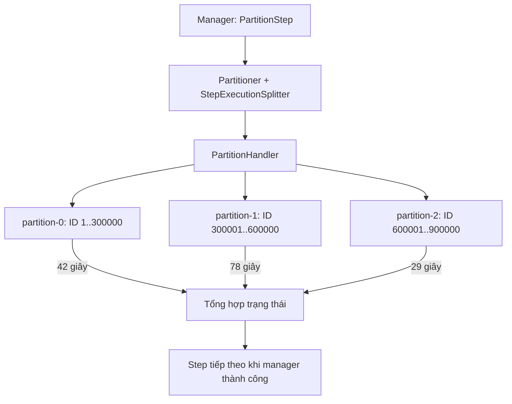
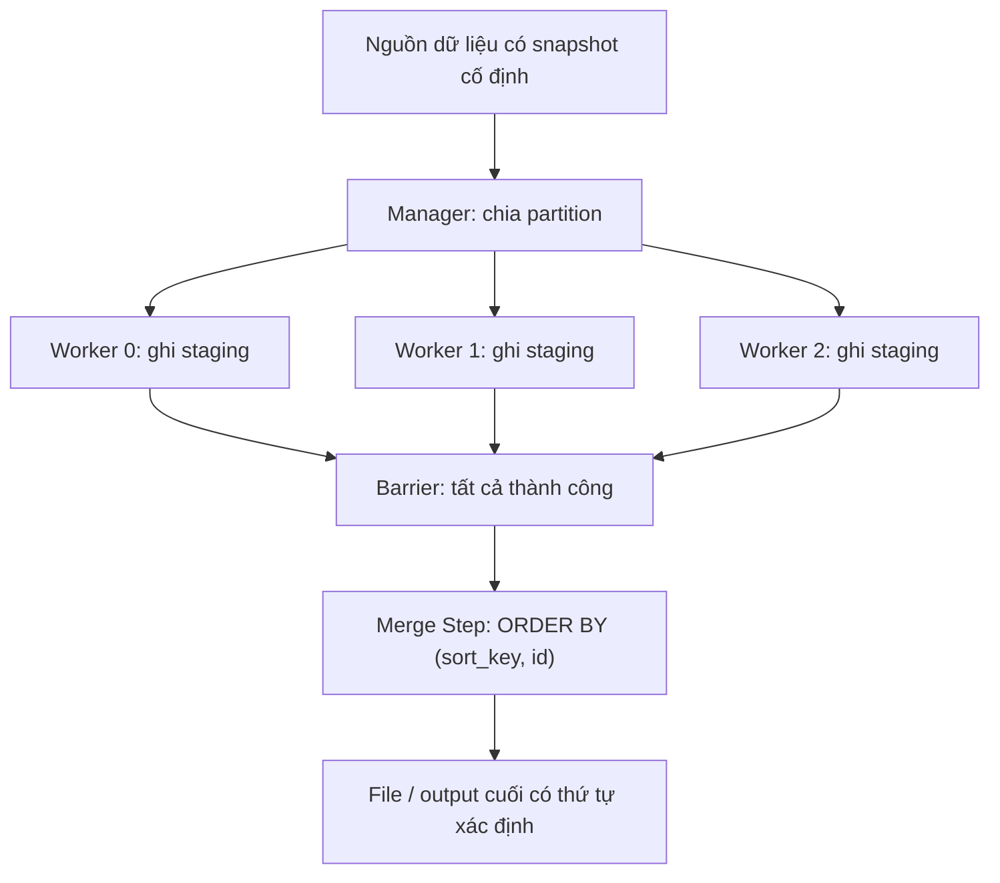

# Ordering giữa các partition trong Spring Batch

## Mục tiêu bài học

Trong module **SPRING_BATCH_SCALING_OPERATIONS**, chúng ta mở rộng Spring Batch cho workload dữ liệu lớn bằng multi-threaded step, parallel steps, partitioning và các mô hình phân tán; đồng thời phải đo nút thắt, giữ thread safety, retry/restart an toàn và chọn kiến trúc theo tài nguyên thực tế. Bài thuộc chương **Ordering**, tập trung vào câu hỏi:

> Khi một step được chia thành nhiều partition chạy song song, có thể dựa vào thứ tự partition để bảo đảm thứ tự xử lý hoặc thứ tự kết quả hay không?

Câu trả lời là **không có bảo đảm thứ tự thực thi giữa các partition theo mặc định**. Spring Batch quản lý từng `StepExecution` và trạng thái hoàn thành, nhưng tên partition, số thứ tự khi tạo partition hay cách chọn `PartitionHandler` không phải là một hợp đồng về thứ tự nghiệp vụ. Muốn bảo đảm thứ tự, cần **định nghĩa chính xác mức ordering cần giữ** rồi thiết kế phân vùng, bước hợp nhất hoặc cơ chế đồng bộ tương ứng.

Sau bài học, bạn có thể:

- Phân biệt thứ tự đọc, xử lý, commit, hoàn thành partition và xuất kết quả cuối.
- Giải thích vì sao `partition-0`, `partition-1`, ... có thể hoàn tất khác thứ tự.
- Chọn giải pháp phù hợp cho ordering theo từng khóa nghiệp vụ, ordering toàn cục và công việc có phụ thuộc thứ tự.
- Viết partitioner tạo các khoảng không chồng lấn, reader có sort key xác định và pipeline **partition → staging → merge**.
- Thiết kế kiểm thử concurrency, idempotency và restart để phát hiện thứ tự sai trong production.

> **Phạm vi:** Ví dụ Java hướng tới Spring Batch **5.2.x**; ý tưởng ordering áp dụng cả local partitioning và remote partitioning. Cú pháp API có thể thay đổi ở phiên bản khác. Những đoạn minh họa rút gọn sẽ ghi rõ nơi cần tích hợp thêm hạ tầng.

## 1. “Ordering” thực chất có nhiều cấp độ

Ví dụ job cần xử lý 900.000 giao dịch theo `transaction_id` tăng dần. `Partitioner` tạo ba phần:

| Partition | Dải ID | Thời điểm bắt đầu giả định | Thời điểm hoàn thành giả định |
| --- | --- | --- | --- |
| `partition-0` | 1–300.000 | 09:00:00 | 09:00:42 |
| `partition-1` | 300.001–600.000 | 09:00:00 | 09:01:18 |
| `partition-2` | 600.001–900.000 | 09:00:01 | 09:00:30 |

`partition-2` xong trước `partition-0` và `partition-1`, dù tên và dải ID đứng sau. Thứ tự có thể khác ở lần chạy kế tiếp do tốc độ CPU, cache, I/O, khóa DB, độ lệch dữ liệu, lịch thread, độ trễ mạng và retry.

Cần nêu rõ yêu cầu ordering ở cấp nào:

| Cấp độ | Điều muốn bảo đảm | Partitioning có tự bảo đảm? |
| --- | --- | --- |
| **Thứ tự tạo partition** | Manager tạo `partition-0` trước `partition-1` | Có thể chủ động xây dựng thứ tự tạo; **không** suy ra thứ tự chạy |
| **Thứ tự bắt đầu** | Worker của `partition-0` bắt đầu trước `partition-1` | Không |
| **Thứ tự đọc trong một partition** | Reader đọc ID 1, 2, 3,... | Có thể bảo đảm bằng truy vấn/sort key phù hợp và worker tuần tự |
| **Thứ tự xử lý trong một partition** | Processor xử lý cùng thứ tự reader | Chỉ khi không thêm xử lý bất đồng bộ hoặc concurrency làm đảo thứ tự |
| **Thứ tự commit giữa các partition** | Partition A commit tất cả trước B | Không |
| **Thứ tự hoàn thành partition** | A hoàn thành trước B | Không |
| **Thứ tự kết quả cuối cùng** | File/bảng/report có các record theo thứ tự xác định | Có thể thiết kế **bước hợp nhất sau khi mọi partition thành công** |
| **Thứ tự sự kiện theo business key** | Với một tài khoản, sự kiện `seq=2` không được áp dụng trước `seq=1` | Phải gom cùng key và kiểm soát thứ tự trong worker hoặc qua bộ điều phối |

**Câu hỏi đầu tiên khi thiết kế** là: hệ thống cần thứ tự *hiển thị*, thứ tự *ghi dữ liệu*, hay thứ tự *tác động nghiệp vụ*? Nếu chỉ cần report cuối sắp theo thời gian, sắp xếp sau khi xử lý song song thường đủ. Nếu phải trừ tiền trước khi hoàn tiền cho một tài khoản, thao tác nghiệp vụ phải thực hiện theo thứ tự của **chính tài khoản đó**; sắp xếp report sau cùng không sửa được tác động sai đã xảy ra.

## 2. Vì sao Spring Batch không giữ thứ tự giữa các partition?

Một `PartitionStep` phối hợp các thành phần:

1. `Partitioner` tạo `Map<String, ExecutionContext>`, mỗi entry gắn với một vùng dữ liệu.
2. `StepExecutionSplitter` tạo hoặc khôi phục các `StepExecution` con và trả tập công việc cần chạy. `gridSize` chỉ là gợi ý cho splitter; trên restart, số phần cần chạy lại có thể khác.
3. `PartitionHandler` giao việc cho worker. `TaskExecutorPartitionHandler` dùng thread pool trong JVM; `MessageChannelPartitionHandler` có thể gửi yêu cầu qua middleware đến các worker ở máy khác.
4. Các worker đọc/xử lý/ghi và cập nhật `JobRepository` độc lập. Manager tổng hợp kết quả để xác định bước thành công hay thất bại.



Đường từ manager tới từng worker thể hiện **phân công công việc**, không phải trình tự thời gian. Những điều sau **không** tạo cam kết về thứ tự hoàn thành:

- Đặt tên partition theo số tăng dần (`partition-0`, `partition-1`).
- Dùng `LinkedHashMap` hoặc `TreeMap` trong `Partitioner`: tập `StepExecution` có thể được xử lý qua cấu trúc/handler khác; ngay cả thứ tự submission xác định cũng không kiểm soát thời gian hoàn tất.
- Cấu hình `gridSize=4` hoặc pool có 4 thread: đây là giới hạn/cấu hình chia việc, không phải bộ sắp thứ tự.
- Sắp thứ tự `ORDER BY` bên trong từng partition: điều này chỉ áp dụng **trong vùng dữ liệu riêng**, không tạo thứ tự commit giữa nhiều worker.
- Dựa vào thứ tự reply từ broker, `Future` hoặc log timestamp: thời gian giao nhận và xử lý phụ thuộc hạ tầng.

Ngay cả khi tạm giới hạn concurrency về 1, nếu thứ tự lấy partition không được định nghĩa rõ và restart bỏ qua những partition đã hoàn thành, **không thể** coi tên partition là hợp đồng ordering. Cần một bước điều phối có chủ đích nếu thứ tự toàn cục là yêu cầu bắt buộc.

## 3. Ba kiểu yêu cầu ordering và cách giải

### 3.1. Không yêu cầu ordering toàn cục

**Ví dụ:** ETL hàng triệu sản phẩm, mỗi bản ghi độc lập và ghi vào bảng theo primary key; báo cáo sau đó chạy `SELECT ... ORDER BY product_id`.

Cách xử lý: chia các dải dữ liệu độc lập, cho worker xử lý song song, ghi idempotent. Kết quả bảng quan hệ **không có thứ tự hàng mặc định**; mọi truy vấn cần thứ tự phải có `ORDER BY` riêng.

Đây thường là trường hợp mở rộng dễ nhất. Đừng trả thêm chi phí đồng bộ chỉ để làm log “nhìn đẹp”.

### 3.2. Ordering theo business key

**Ví dụ:** Các giao dịch của cùng `account_id` phải áp dụng theo `event_seq` tăng dần, nhưng hai tài khoản khác nhau có thể chạy đồng thời.

Cách giải: bảo đảm **mọi sự kiện thuộc cùng account đi về cùng partition**, và worker xử lý tuần tự các sự kiện theo khóa đó:

```text
partition-0: account 10 -> seq 1,2,3 ; account 13 -> seq 1,2
partition-1: account 11 -> seq 1,2,3
partition-2: account 12 -> seq 1,2,3,4

Các partition chạy song song.
Trong mỗi account, seq phải tăng; giữa các account không đòi thứ tự.
```

Có thể phân chia theo hash `account_id` hoặc dải `account_id`, miễn là tất cả bản ghi cùng key luôn ở **cùng một partition** trong một lần chạy và trên restart. Ví dụ SQL minh họa cho PostgreSQL với account ID không âm:

```sql
SELECT account_id, event_seq, event_id, amount
FROM account_event
WHERE mod(account_id, :partitionCount) = :partitionIndex
  AND event_id <= :snapshotMaxEventId
ORDER BY account_id ASC, event_seq ASC, event_id ASC;
```

- `event_id` là tie-breaker duy nhất khi hai bản ghi có cùng `event_seq`.
- `partitionCount` phải được cố định trong ngữ cảnh của **cùng một JobInstance**; thay số partition trong lúc restart có thể đổi owner của một account và phá vỡ checkpoint.
- Lưu thêm snapshot/watermark ổn định để không vừa xử lý vừa thay đổi tập bản ghi đầu vào.
- Reader của mỗi partition phải chạy tuần tự, và writer không phát sinh side effect bất đồng bộ làm đảo `event_seq`.
- Nếu sự kiện có thể thiếu sequence, cần quy tắc phát hiện gap (ví dụ `seq=4` tới khi `seq=3` chưa tồn tại) và chính sách dừng/đợi/xử lý lỗi.

**Lưu ý:** Sắp xếp query không thay thế kiểm soát transaction hoặc tính nguyên tử của update trạng thái tài khoản. Cơ sở dữ liệu vẫn cần ràng buộc, optimistic/pessimistic lock hoặc quy tắc `expectedSequence` thích hợp.

### 3.3. Ordering toàn cục của dữ liệu đầu ra

**Ví dụ:** Xuất một file thanh toán duy nhất bắt buộc được sắp theo `transaction_id` từ nhỏ tới lớn.

Cách giải thường phù hợp với batch dữ liệu lớn: **chia → xử lý song song → ghi staging riêng → hợp nhất có sort sau barrier**.



Trong Spring Batch, có thể định nghĩa `job.start(managerStep).next(mergeStep)`. `mergeStep` chỉ bắt đầu sau khi `managerStep` hoàn thành thành công theo flow cấu hình. Đây là barrier **giữa hai step**, không phải cam kết thứ tự bên trong các partition.

Nếu worker ghi các dải ID riêng không chồng lấn, **mỗi file đã được sort đúng trong dải**, có thể ghép file theo thứ tự dải để có đầu ra tăng dần. Nếu các partition phân phối theo hash hoặc các dải khóa chồng lấn theo sort key, phải **merge nhiều stream đã sort** hoặc dùng `ORDER BY` toàn cục tại bước cuối.

## 4. Ví dụ Java: chia dải ID và tạo manager/worker

Giả sử bảng `orders` có khóa `id` dương, dữ liệu của một lần chạy được đóng băng tới `snapshotMaxId`. Ta dùng local partitioning để thấy rõ nguyên tắc; remote partitioning áp dụng được cùng thiết kế dữ liệu.

### 4.1. Partitioner tạo các khoảng không chồng lấn

```java
@Bean
Partitioner orderRangePartitioner() {
    return gridSize -> {
        long firstId = 1;
        long lastId = 900_000;  // Minh họa: thực tế lấy từ snapshot/job parameters.
        int count = Math.max(1, gridSize);
        long width = (lastId - firstId + 1 + count - 1) / count;

        Map<String, ExecutionContext> partitions = new LinkedHashMap<>();
        for (int index = 0; index < count; index++) {
            long fromId = firstId + index * width;
            if (fromId > lastId) {
                break;
            }

            long toId = Math.min(lastId, fromId + width - 1);
            ExecutionContext context = new ExecutionContext();
            context.putLong("fromId", fromId);
            context.putLong("toId", toId);
            partitions.put("range-" + index, context);
        }
        return partitions;
    };
}
```

Khoảng `[fromId, toId]` không chồng lấn, phủ đủ dải `[1, 900000]`. Với 3 partition, ta nhận `[1,300000]`, `[300001,600000]`, `[600001,900000]`.

`LinkedHashMap` giúp mã ví dụ dễ đọc; **không được dùng thứ tự duyệt map làm bảo đảm thứ tự khởi chạy/commit**.

Trong production, nếu ID bị khuyết hoặc dữ liệu lệch (skew), độ lớn dải ID chưa chắc tương ứng số bản ghi. Hãy đo số row/khối lượng thực tế trên mỗi partition để cân bằng thời gian hoàn thành.

### 4.2. Cấu hình manager

```java
@Bean
Step managerStep(
        JobRepository jobRepository,
        Step orderWorkerStep,
        Partitioner orderRangePartitioner,
        TaskExecutor partitionTaskExecutor) {

    return new StepBuilder("managerStep", jobRepository)
            .partitioner("orderWorkerStep", orderRangePartitioner)
            .step(orderWorkerStep)
            .gridSize(3)
            .taskExecutor(partitionTaskExecutor)
            .build();
}

@Bean
TaskExecutor partitionTaskExecutor() {
    ThreadPoolTaskExecutor executor = new ThreadPoolTaskExecutor();
    executor.setCorePoolSize(3);
    executor.setMaxPoolSize(3);
    executor.setQueueCapacity(8);
    executor.setThreadNamePrefix("partition-");
    executor.initialize();
    return executor;
}
```

Manager có thể giao ba partition cùng lúc. `ThreadPoolTaskExecutor` kiểm soát concurrency; `gridSize` là số phần **gợi ý**, không phải thứ tự. Nếu worker xử lý nhanh/chậm khác nhau, thứ tự hoàn thành vẫn thay đổi.

### 4.3. Reader sắp thứ tự ổn định trong từng partition

Ví dụ Spring Batch 5.2.x: cấu hình `JdbcPagingItemReader` dưới `@StepScope`, nhận bounds từ `ExecutionContext` của `StepExecution` đang chạy.

```java
@Bean
@StepScope
JdbcPagingItemReader<Long> orderIdReader(
        DataSource dataSource,
        @Value("#{stepExecutionContext['fromId']}") Long fromId,
        @Value("#{stepExecutionContext['toId']}") Long toId) {

    return new JdbcPagingItemReaderBuilder<Long>()
            .name("orderIdReader")
            .dataSource(dataSource)
            .selectClause("SELECT id")
            .fromClause("FROM orders")
            .whereClause("WHERE id BETWEEN :fromId AND :toId")
            .sortKeys(Map.of("id", Order.ASCENDING))
            .parameterValues(Map.of("fromId", fromId, "toId", toId))
            .pageSize(500)
            .rowMapper((rs, rowNum) -> rs.getLong("id"))
            .build();
}
```

Ví dụ giả định reader chỉ đọc ID để writer cập nhật bảng staging. Các phần còn lại (transaction manager, worker step, `ItemWriter`, `DataSource`, schema metadata) do ứng dụng cấu hình. Nếu dùng paging theo các cột không duy nhất, **phải thêm tie-breaker duy nhất** vào sort key (chẳng hạn `(created_at, id)`) để hạn chế trùng/bỏ sót do thứ tự không xác định. Cần index phù hợp.

**Phân biệt:** Truy vấn `ORDER BY id` hoặc `sortKeys(id ASC)` chỉ xác định thứ tự **trong worker này**. Worker khác vẫn có thể commit bản ghi ID lớn trước worker đang xử lý ID nhỏ.

## 5. Thiết kế staging + merge để xuất dữ liệu đúng thứ tự

Giả sử phải xuất toàn bộ `orders` thành một file CSV sắp theo `id ASC`. Worker không nên cùng append vào **một file chung** vì thread/transaction/network có thể làm bản ghi xen kẽ và việc append không rollback nguyên tử theo DB transaction.

Thiết kế dùng bảng staging, có khóa giúp ghi lại không trùng:

```sql
-- DDL minh họa cho PostgreSQL.
CREATE TABLE export_stage (
    run_key       varchar(100) NOT NULL,
    order_id      bigint       NOT NULL,
    csv_payload   text         NOT NULL,
    PRIMARY KEY (run_key, order_id)
);
```

Mỗi worker ghi (hoặc upsert) theo cùng `run_key` xác định **một lần xử lý logic**. `run_key` cần giữ nguyên qua restart của cùng `JobInstance`, không lấy từ ID của từng `JobExecution` mới. Với PostgreSQL:

```sql
INSERT INTO export_stage (run_key, order_id, csv_payload)
VALUES (:runKey, :orderId, :payload)
ON CONFLICT (run_key, order_id)
DO UPDATE SET csv_payload = EXCLUDED.csv_payload;
```

Sau khi manager step thành công, bước merge chạy **tuần tự**, đọc:

```sql
SELECT order_id, csv_payload
FROM export_stage
WHERE run_key = :runKey
ORDER BY order_id ASC;
```

Sau đó ghi file tạm, flush/close, kiểm tra checksum/count rồi **publish** bằng cơ chế phù hợp với filesystem/object store. Chỉ publish khi file hoàn chỉnh; việc retry merge không được append thêm vào file đã publish.

```java
@Bean
Job orderedExportJob(
        JobRepository jobRepository,
        Step managerStep,
        Step mergeStep) {

    return new JobBuilder("orderedExportJob", jobRepository)
            .start(managerStep)
            .next(mergeStep)
            .build();
}
```

**Điều kiện đúng của mô hình:**

1. Phân vùng tạo **đủ và không chồng lấn** trên snapshot xác định; trong một phân vùng dữ liệu không bị lọt do thay đổi trong lúc chạy.
2. Staging không làm rơi record hoặc gây trùng kết quả; mỗi row gắn `run_key`.
3. `mergeStep` có sort key duy nhất, cùng hướng sắp xếp của output yêu cầu.
4. Nếu một partition fail, job không được publish file dở dang như kết quả thành công.
5. Cleanup staging chỉ diễn ra sau khi publish và nghiệm thu; rollback/restart còn cần dữ liệu staging thì không xóa sớm.

### Tối ưu cho dữ liệu rất lớn

Nếu cần xử lý hàng trăm triệu record, sort toàn cục sau khi ghi có thể là nút thắt mới. Có ba hướng:

- **Range partition trên cùng sort key:** mỗi worker tạo file riêng đã sort trong dải; bước ghép tuần tự theo `fromId ASC`. Cần xác minh mọi dải không chồng lấn.
- **K-way merge:** khi mỗi worker tạo luồng đã sort nhưng dải khóa đan xen, đọc một phần tử đầu từ mỗi luồng bằng min-heap, xuất nhỏ nhất, rồi nạp phần tử kế tiếp từ luồng đó. Bộ nhớ xấp xỉ `O(P)` phần tử với `P` luồng; độ phức tạp tính toán xấp xỉ `O(N log P)`.
- **Đẩy sort về DB:** bảng staging có index `(run_key, order_id)` giúp đọc theo thứ tự. Đo plan thực tế, I/O, spill-to-disk, pool và throughput; cách này đơn giản hơn nhưng có thể gây tải tập trung.

Không cố tạo đầu ra có thứ tự bằng cách cho nhiều worker tranh nhau ghi vào cùng một stream rồi “hy vọng” worker hoàn thành theo tên partition.

## 6. Khi nào phải bảo đảm thứ tự ngay trong quá trình xử lý?

Staging + merge chỉ giải quyết **thứ tự kết quả cuối**. Nó không phù hợp nếu mỗi hành động đã tạo side effect không thể đảo ngược, ví dụ:

- Ghi bút toán có phụ thuộc vào số dư sau bút toán trước.
- Phát sự kiện ra hệ thống ngoài với quy tắc `event_seq` phải tăng theo khách hàng.
- Điều chỉnh tồn kho khi event “nhập” phải xảy ra trước event “xuất” tương ứng.
- Gửi lệnh cập nhật trạng thái có điều kiện phiên bản (version) cho cùng một đối tượng.

Với các trường hợp này, có ba chiến lược:

| Chiến lược | Bảo đảm | Đánh đổi |
| --- | --- | --- |
| **Serialize theo business key** | Các sự kiện cùng key đi chung partition/consumer, xử lý tuần tự và kiểm tra sequence | Key “nóng” có thể là nút thắt; số partition cần ổn định |
| **Tách tính toán và commit có thứ tự** | Tính toán song song phần độc lập, commit/publish theo sequence đã xác định | Cần coordinator, bộ đệm và cơ chế backpressure |
| **Chạy tuần tự toàn bộ** | Dễ thiết lập thứ tự toàn cục nghiêm ngặt | Giảm throughput; phù hợp khi logic có phụ thuộc toàn cục thật sự |

**Ví dụ serialize theo tài khoản:** Với `account_id = 42`, worker chỉ được áp dụng `seq = 101` sau khi `seq = 100` đã commit thành công. Nếu hai transaction có cùng `account_id` vào hai worker khác nhau, cần khóa/sequence gate ở nơi ghi hoặc thiết kế phân vùng lại. `ORDER BY` ở mỗi worker không đủ nếu cùng key bị chia ra nhiều worker.

Có thể dùng kiểm tra optimistic concurrency:

```sql
UPDATE account_state
SET balance = :nextBalance,
    last_event_seq = :nextSeq
WHERE account_id = :accountId
  AND last_event_seq = :expectedPrevSeq;
```

Nếu số row cập nhật là 0, phải phân biệt **event trùng**, **event đi trước/gap**, hoặc **ghi song song**; xử lý theo chính sách nghiệp vụ. Ví dụ trên chỉ minh họa sequence guard: việc tính `nextBalance`, transaction boundary và lịch sử event cũng cần được bảo đảm nguyên tử; không tự suy luận “0 row = retry vô hạn”.

## 7. Restart, retry và ordering

Một số sai lệch chỉ xuất hiện khi job lỗi rồi restart:

| Kịch bản | Nguy cơ | Biện pháp |
| --- | --- | --- |
| `partition-2` hoàn tất trước khi `partition-1` fail | Side effect của ID lớn đã xảy ra trước ID nhỏ | Chỉ dùng nếu side effect độc lập; nếu cần output toàn cục, hoãn publish tới merge |
| Restart chạy lại partition thất bại | Partition đã hoàn tất có thể không chạy lại | Không dựa vào thứ tự chạy lại để tạo thứ tự xuất; đọc metadata và staging |
| `gridSize` đổi giữa các lần chạy | Cách chia range/hash thay đổi, checkpoint không còn tương ứng | Giữ version/chính sách partition ổn định theo `JobInstance` |
| Message remote bị redeliver | Cùng partition/record có thể gây side effect lặp | Idempotency key, unique constraint, xác minh trạng thái hiện tại và chính sách retry |
| Tập dữ liệu đầu vào có insert/update giữa lúc chạy | Paging/biên partition có thể lọt hoặc xử lý trùng record | Snapshot/watermark, isolation phù hợp, keyset paging và quy tắc xử lý dữ liệu đến muộn |
| Merge fail khi file xuất gần xong | File dở dang có thể được người dùng đọc nhầm | Ghi ra tên tạm, publish atomically nếu storage hỗ trợ hoặc dùng manifest/pointer đã xác thực |

`StepExecutionSplitter` được thiết kế hỗ trợ restart và phân biệt các `StepExecution` cần chạy lại. **Restartability bảo vệ metadata thực thi, không tự bảo đảm thứ tự nghiệp vụ hoặc exactly-once của side effect ở hệ thống ngoài.**

Trong mô hình remote partitioning, reply/broker delivery cũng có thể đến đảo thứ tự. Vì vậy phải nhận diện bản ghi theo **business key + sequence** hoặc **run key + record ID**, không dùng “thứ tự message tới” làm sort key.

## 8. Kiểm thử ordering dưới concurrency thực tế

Không chỉ chạy thử một lần trên dữ liệu nhỏ. Tạo test cố tình làm worker hoàn tất đảo thứ tự: partition có ID cao ngủ ngắn hơn, partition thấp xử lý chậm hơn, có retry và có worker bị dừng giữa chunk.

### 8.1. Invariant cần xác minh

- **Đủ và duy nhất:** tập ID đầu ra bằng tập ID đầu vào cần xử lý; không bỏ sót/nhân đôi.
- **Đúng thứ tự toàn cục (nếu yêu cầu):** với mỗi hai row liên tiếp, `(sort_key, id)` không giảm và tie-breaker xác định.
- **Đúng thứ tự theo key (nếu yêu cầu):** `event_seq` của từng `account_id` tăng theo quy tắc, không có lỗ hổng không được phép.
- **Tách biệt giữa các lần chạy:** staging của hai `run_key` không bị trộn.
- **Restart an toàn:** kết quả sau lần chạy lại giống kết quả chạy hoàn chỉnh một lần (về tập bản ghi và thứ tự), không cần giống timestamp hay thứ tự hoàn thành partition.

### 8.2. Bộ kiểm thử gợi ý

1. Tạo 10.000 record, cố ý trộn thứ tự insert và có sort key trùng nhưng ID khác.
2. Chạy với `gridSize=1, 2, 4, 8` và pool/worker chậm nhanh khác nhau; so sánh kết quả nghiệp vụ.
3. Cố ý làm `partition-0` chậm và `partition-3` nhanh; xác nhận file cuối vẫn sort đúng.
4. Gây exception giữa chunk, restart cùng `JobInstance`; đối chiếu count, checksum và unique key.
5. Với hệ thống message, gửi trùng/đảo reply, kiểm tra xử lý idempotent và timeout.
6. Thêm dữ liệu đầu vào giữa lúc job chạy; kiểm tra quy tắc snapshot/watermark.
7. Chạy hai job đồng thời với `run_key` khác nhau, kiểm tra không trộn staging/output.

Đo đồng thời `elapsed time`, p95/p99 thời gian mỗi partition, queue lag, commit latency, DB lock wait, kích thước staging, thời gian merge và số lần retry. Nếu bước merge chiếm phần lớn tổng thời gian, tăng worker thêm có thể không còn giúp tăng throughput.

## 9. Ma trận quyết định

| Yêu cầu nghiệp vụ | Cấu trúc phù hợp | Điều cần bảo vệ |
| --- | --- | --- |
| Cập nhật độc lập theo primary key, không cần output có thứ tự | Partitioning song song, writer idempotent | Tập bản ghi đúng, tránh trùng và lock contention |
| Báo cáo cuối phải sort toàn cục | Partition → staging → merge/sort | Barrier thành công, sort key duy nhất, publish nguyên vẹn |
| File đầu ra sort theo key có thể chia dải | Range partition → file riêng đã sort → concat theo dải | Dải không chồng lấn, sort trong mỗi file, manifest xác thực |
| Sự kiện phải đúng thứ tự theo customer/account | Affinity theo business key + worker tuần tự + sequence guard | Không split cùng key, checkpoint và xử lý gap |
| Mỗi thao tác phụ thuộc vào kết quả thao tác trước trên toàn bộ dữ liệu | Sequential step hoặc commit coordinator | Bảo đảm thứ tự nghiệp vụ, giới hạn mức song song hữu ích |
| Muốn đồng thời tính toán nặng nhưng xuất theo sequence | Parallel compute + ordered commit/publish | Buffer bounded, backpressure, retry và tránh deadlock |

### Checklist trước khi đưa vào production

- [ ] Có định nghĩa ordering cần bảo đảm ở **cấp nào**, với **sort key và tie-breaker nào**.
- [ ] Biên phân vùng, snapshot và partition name giữ ổn định qua restart.
- [ ] Không coi thứ tự map/partition name/queue delivery là thứ tự nghiệp vụ.
- [ ] Không có writer bất đồng bộ khiến event cùng key đảo thứ tự ngoài ý muốn.
- [ ] Mọi side effect có idempotency hoặc cơ chế chống phát lại rõ ràng.
- [ ] Nếu cần thứ tự output toàn cục, chỉ publish sau khi tất cả partition hoàn thành thành công và merge được kiểm chứng.
- [ ] Có test đảo thứ tự hoàn thành, restart, trùng message, skew và dữ liệu đến muộn.
- [ ] Có metric/alert cho partition chậm, thời gian barrier và merge, queue lag, lỗi thứ tự/sequence gap.

## Tài liệu tham khảo

- [Spring Batch 5.2 Reference — Scaling and Parallel Processing](https://docs.spring.io/spring-batch/reference/5.2/scalability.html): `PartitionStep`, `PartitionHandler`, `Partitioner`, `gridSize` và restart.
- [Spring Batch 5.2 API — StepExecutionSplitter](https://docs.spring.io/spring-batch/docs/5.2.x/api/org/springframework/batch/core/partition/StepExecutionSplitter.html): cách sinh tập `StepExecution` và gợi ý về số partition.
- [Spring Batch Reference — Spring Batch Architecture](https://docs.spring.io/spring-batch/reference/spring-batch-architecture.html): yêu cầu tránh tranh chấp tài nguyên khi xử lý song song.

**Ghi nhớ:** **Partitioning là công cụ chia và chạy công việc song song, không phải cơ chế sắp thứ tự**. Muốn tốc độ cao mà vẫn đúng, hãy giữ thứ tự ở phạm vi hẹp nhất nghiệp vụ thực sự cần (thường là business key); khi cần output toàn cục, đặt một bước merge rõ ràng sau khi các partition đã hoàn thành thành công.
