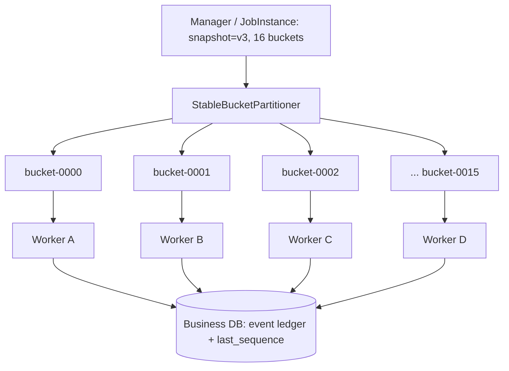

# Partition key ổn định: giữ đúng thứ tự và ownership khi mở rộng Spring Batch

## 1. Vấn đề: scale-out có thể làm thay đổi người xử lý một bản ghi

Một job Spring Batch tính số dư từ chuỗi sự kiện giao dịch. Tài khoản `A` có ba sự kiện tăng dần theo `eventSequence`:

```text
A / sequence=101 / +100
A / sequence=102 / -30
A / sequence=103 / +20
```

Nếu chạy tuần tự, số dư từ 0 sẽ thành 90. Nhưng khi mở rộng bằng partitioning, manager có thể giao sự kiện 101 cho worker 1, 102 cho worker 2 và 103 cho worker 3. Khi worker 2 chạy trước worker 1, một logic phụ thuộc thứ tự (số dư, trạng thái đơn hàng, version cập nhật) có thể sai, ngay cả khi mỗi sự kiện đều được xử lý đúng một lần.

Giải pháp thường là chọn **partition key ổn định** (*stable partition key*) để tất cả sự kiện cùng **đơn vị có yêu cầu thứ tự** được giao vào một **logical partition/bucket** xác định. Tuy nhiên, cần phân biệt ba việc:

1. **Gán cùng key vào cùng bucket:** mọi sự kiện của tài khoản A thuộc bucket K.
2. **Đảm bảo thứ tự trong bucket:** worker đọc và áp dụng sự kiện của A theo đúng sequence.
3. **Giữ mapping ổn định qua restart, rebalance và failover:** cùng logical run không tự chuyển A sang bucket khác khi số worker thay đổi.

Một key ổn định giải quyết **bước 1**, tạo điều kiện cho bước 2 và bước 3; nó **không tự tạo ordering hoặc exactly-once effect**.

Bài thuộc chương **Ordering** của module `SPRING_BATCH_SCALING_OPERATIONS`. Module hướng tới mở rộng Spring Batch với multi-threaded step, parallel steps, partitioning và các kiến trúc phân tán để xử lý dữ liệu lớn; đồng thời đo bottleneck, bảo đảm thread safety, retry/restart, vận hành và chọn phương án theo tài nguyên thực tế. **Partition key** là một hợp đồng ở tầng dữ liệu: chọn sai có thể tạo duplicate, gap, race hoặc khiến checkpoint không còn tương thích.

### Mục tiêu học tập

Sau bài học, bạn có thể:

- Chọn khóa bất biến theo **đơn vị cần giữ thứ tự**, không theo worker/thread hiện tại.
- Phân biệt **business key**, hash key, logical bucket, partition name và physical worker.
- Xây hàm ánh xạ deterministic, có version, cùng encoding/normalization giữa các hệ.
- Cố định kế hoạch partition và `ExecutionContext` của Spring Batch 5.2 để restart an toàn.
- Dùng `@StepScope` reader, writer có **sequence guard** và idempotency để bảo vệ thứ tự khi retry/failover.
- Xử lý tăng số worker, skew/hot key, Kafka/JMS/remote chunking và vấn đề rebalancing.
- Viết bài thử bảo đảm *same-key affinity*, coverage, order, replay và restart.

> **Phiên bản ví dụ:** Spring Batch **5.2.x**, Spring Framework 6.x, Spring Boot 3.x, Java 17+; SQL thực hành dùng PostgreSQL. Những điểm liên quan Kafka/JMS là mô hình phối hợp với Spring Batch, không phải mặc định của mọi `PartitionHandler`/broker. Nếu dùng Spring Batch 6.x hoặc transport khác, đối chiếu API và semantics của version thực tế.

## 2. “Partition key” là gì? Năm khái niệm khác nhau

| Khái niệm | Ví dụ | Vai trò |
| --- | --- | --- |
| **Business/ordering key** | `(tenantId=7, accountId=9001)` | Định nghĩa các sự kiện **cần được xử lý theo một trật tự** |
| **Canonical key bytes** | UTF-8 biểu diễn `7:9001` theo version v1 | Đầu vào ổn định cho thuật toán hash |
| **Hash/bucket mapping** | `bucket = hash(keyBytes) mod 16` | Ánh xạ key thành **logical bucket** từ 0 tới 15 |
| **Partition identity trong Batch** | `bucket-0007` → `workerStep:bucket-0007` | Danh tính `StepExecution`/`ExecutionContext` phục vụ quản lý và restart |
| **Physical worker** | Thread `batch-worker-3` hoặc pod `worker-5` | Tài nguyên *tạm thời* đang thực thi bucket đó |

Worker A hôm nay và worker B ngày mai có thể lần lượt xử lý **cùng bucket 7** mà business key vẫn không đổi. Ngược lại, tăng số worker từ bốn lên tám **không nên** tự đổi `bucketCount` từ 4 lên 8 giữa cùng một JobInstance.

### 2.1. Key ổn định khác partition number ổn định

Một business key có thể là `accountId=9001`, không đổi theo thời gian. Tuy nhiên:

\[
p = \operatorname{floorMod}(H(key), N)
\]

Nếu `N` đổi từ 4 sang 8, nhiều key **đổi partition** dù `H(key)` và key không đổi. Vì vậy một hợp đồng ổn định cần ít nhất:

```text
keyFields          = tenantId + accountId
canonicalFormat    = decimal-v1
hashAlgorithm      = sha256-v1
logicalBucketCount = 16
snapshotId         = events-2026-11-26-v3
partitionName      = bucket-0000 ... bucket-0015
```

Tất cả giá trị là ví dụ. `snapshotId` chỉ hữu ích nếu thật sự chỉ tới tập input đã chốt và có thể kiểm chứng; một chuỗi đặt tùy ý không biến dữ liệu đang thay đổi thành snapshot.

### 2.2. Partition key không nhất thiết bằng database primary key

Tùy nghiệp vụ:

- Đơn hàng: nếu các sự kiện của **cùng đơn hàng** cần thứ tự, dùng `(tenantId, orderId)`.
- Tài khoản: nếu mọi ghi số dư của **cùng tài khoản** phải nối tiếp, dùng `(tenantId, accountId)`.
- Thiết bị IoT: nếu chuỗi trạng thái của cùng device phải tăng version, dùng `(tenantId, deviceId)`.
- Tổng hợp theo khách hàng: nếu một khách hàng có nhiều đơn hàng nhưng **điểm tích lũy chung** không được race, key có thể là `customerId` thay vì `orderId`.

**Chọn khóa theo phạm vi side effect dùng chung**, không theo việc cột nào dễ hash nhất. Nếu hai tài khoản cùng thao tác vào một shared aggregate, chỉ partition theo account riêng có thể **không đủ** bảo vệ tính tuần tự của shared resource; có thể cần khóa/transaction hoặc thiết kế lại aggregate boundary.

### 2.3. Partition key khác `JobParameters`

`JobParameters` (đặc biệt identifying parameters) xác định **JobInstance**, ví dụ `businessDate` và `manifestId`. `Partitioner` dùng một số tham số ấy để lập kế hoạch bucket cho **một run**.

`partitionKey` ở đây là khóa **của bản ghi/aggregate**, không nên dùng `JobExecutionId`, container ID hay thời gian khởi động làm business partition key vì chúng đổi qua retry/restart. Nếu sự kiện của cùng account đi vào các bucket khác nhau chỉ vì manager restart, ordering đã mất.

## 3. Ba bất biến cần giữ

Gọi `k(e)` là ordering key của sự kiện `e`; `b(e)` là bucket được manager hoặc ingestion ghi nhận; `P_i` là tập event thuộc bucket `i`.

**Bất biến 1 — Same-key affinity:**

\[
\forall e_1,e_2,\quad
k(e_1)=k(e_2)\Rightarrow b(e_1)=b(e_2)
\]

**Bất biến 2 — Mỗi event chỉ thuộc một logical bucket và toàn bộ input được bao phủ:**

\[
P_i\cap P_j=\varnothing\ (i\neq j),\qquad
\bigcup_i P_i=D
\]

**Bất biến 3 — Per-key apply order:**

\[
seq(e_1)<seq(e_2)\ \land\ k(e_1)=k(e_2)
\Rightarrow apply(e_1)\prec apply(e_2)
\]

Trong đó `D` là **tập input của snapshot/manifest hiện tại**. Bất biến 3 **không suy ra** từ bất biến 1: một bucket có thể chứa nhiều events đúng key nhưng bị xử lý bất đồng bộ rồi commit trái sequence.

### 3.1. Per-key ordering khác global ordering

Giả sử:

```text
account A: A1 -> A2 -> A3
account B: B1 -> B2
```

Yêu cầu thường là **A1 trước A2 trước A3**, **B1 trước B2**, còn thứ tự tương đối giữa `A2` và `B1` không quan trọng. Với 16 buckets, hai account có thể ở hai buckets khác nhau và xử lý song song.

Nếu nghiệp vụ yêu cầu **một global order duy nhất** của tất cả sự kiện, partitioning song song thường không thể tự bảo đảm. Khi đó có thể cần một commit coordinator/sequencer, một luồng tuần tự ở bước nhạy cảm hoặc thiết kế lại để phân rã invariant.

### 3.2. “Cùng bucket” không có nghĩa “cùng thread mãi mãi”

Lúc worker crash, một worker mới có thể **tiếp quản bucket**. Đây là failover hợp lệ nếu:

- Worker cũ đã dừng hoặc bị **fence** khỏi side effect.
- Worker mới khôi phục đúng checkpoint/snapshot và event sequence.
- Side effect đã commit ở attempt cũ **không bị lặp** nhờ transaction/idempotency.
- Không có khoảng thời gian hai worker cùng commit ra ngoài thứ tự.

Không gắn business key với địa chỉ pod/IP hoặc index thread như `Thread.currentThread().getId()`; những thứ đó thay đổi khi autoscale hoặc redeploy.

## 4. Anti-pattern khi chọn partition key

| Cách chọn | Vấn đề | Phương án tốt hơn |
| --- | --- | --- |
| `random.nextInt(workerCount)` | Mỗi event cùng aggregate có thể sang worker khác | Hash deterministic trên business key |
| `Thread.currentThread().getId()` | Đổi theo scheduler/JVM, không đại diện dữ liệu | Logical key độc lập hạ tầng |
| `JobExecutionId` làm key | Đổi khi restart một JobInstance | Business key/manifest ID theo hợp đồng |
| `hash(key) % liveWorkerCount` | Membership thay đổi liên tục → event cùng key dịch bucket | Fixed logical buckets, worker count là tài nguyên riêng |
| `Object.hashCode()` tùy class | Có thể là identity hash, không ổn định giữa process | Canonical bytes + hash algorithm versioned |
| Java `String.hashCode()` không có hợp đồng encoding với hệ khác | `String.hashCode()` deterministic trong Java nhưng không tự thống nhất với Kafka/Go/Python hoặc Unicode normalization | Codec và hash version chung, golden vectors |
| Thêm `eventSequence` vào ordering key | Mỗi event cùng account có key khác → dễ rơi bucket khác | Dùng account/aggregate ID; sequence dùng để **sắp thứ tự** |
| Dùng status như `NEW`/`PROCESSED` làm key | Key thay đổi theo xử lý | Khóa nghiệp vụ bất biến |
| Chỉ dùng `customerId` trong hệ đa tenant | Có thể gộp nhầm khách hàng trùng ID ở tenant khác | Composite key có tenant |
| Dùng `accountId + timestampNow` | Timestamp thay đổi mỗi retry | Key chỉ gồm identity bất biến |
| Hash trực tiếp chuỗi người dùng không chuẩn hóa | Unicode/case/whitespace có thể ánh xạ khác dù cùng logical identity | Canonicalization có version |
| Query `ORDER BY event_time` duy nhất | Nhiều event cùng timestamp, thứ tự không xác định | Tên key + sequence duy nhất + tie-breaker rõ |

Một hash ổn định **vẫn có collision**: hai business keys khác nhau có thể vào cùng bucket. Điều này **không sai** về ownership; worker xử lý tuần tự các keys cùng bucket, chỉ có thể ảnh hưởng cân bằng tải. Không đòi “mỗi key một bucket” trừ khi business thực sự cần mapping một-một.

### 4.1. Thay đổi khóa nghiệp vụ là một migration

Nếu `accountId` bị merge hoặc `tenantId` chuyển theo tái cơ cấu, business key của một aggregate có thể đổi. Đừng đổi âm thầm giữa một job đang chạy. Cần có:

1. Tập input và checkpoint được đóng băng ở phiên bản key cũ.
2. Quy tắc mapping từ key cũ sang key mới và biên thời điểm hiệu lực.
3. Đảm bảo không có worker cũ đang commit sau cutover.
4. Kế hoạch replay/backfill và dedup theo logical operation ID.

Một event cũ không nên bị áp dụng ở cả bucket cũ và bucket mới chỉ vì bảng account mapping vừa được cập nhật.

## 5. Thiết kế hàm hash và hợp đồng canonicalization

Để có key ổn định qua nhiều JVM, nhiều bản deploy và có thể cả nhiều ngôn ngữ lập trình, hãy mô tả **byte đầu vào** và **thuật toán biến đổi** chính xác. Chỉ nói “dùng hash của tài khoản” là chưa đủ.

Một hợp đồng minh họa:

| Thuộc tính | Quy ước `sha256-decimal-v1` |
| --- | --- |
| Business key fields | `tenantId` và `accountId`, đều là số nguyên dương |
| Canonical text | `tenantId + ":" + accountId`, decimal ASCII, không leading zeros |
| Encoding | UTF-8 của canonical text |
| Hash | SHA-256, dùng đủ 32 bytes |
| Xử lý số | 32 bytes được xem là **unsigned integer, big-endian** |
| Bucket | `hashUnsigned % logicalBucketCount` |
| Bucket count | Ví dụ 16, được chốt trong partition plan/JobInstance |
| Version | `sha256-decimal-v1`, được lưu kèm input/manifest/context |

### 5.1. Java code tính bucket deterministic

```java
// StableBucketKey.java
package example.batch.ordering;

import java.math.BigInteger;
import java.nio.charset.StandardCharsets;
import java.security.MessageDigest;
import java.security.NoSuchAlgorithmException;

public final class StableBucketKey {
    public static final String HASH_VERSION = "sha256-decimal-v1";

    private StableBucketKey() {}

    public static int bucket(
            long tenantId, long accountId, int logicalBucketCount) {
        if (tenantId <= 0 || accountId <= 0 || logicalBucketCount <= 0) {
            throw new IllegalArgumentException("Invalid bucket key/plan");
        }

        String canonical = tenantId + ":" + accountId;
        byte[] bytes = canonical.getBytes(StandardCharsets.UTF_8);

        try {
            byte[] hash = MessageDigest.getInstance("SHA-256")
                    .digest(bytes);
            return new BigInteger(1, hash)
                    .mod(BigInteger.valueOf(logicalBucketCount))
                    .intValueExact();
        } catch (NoSuchAlgorithmException ex) {
            throw new IllegalStateException("SHA-256 unavailable", ex);
        }
    }
}
```

Ví dụ gọi:

```java
int a = StableBucketKey.bucket(7L, 9001L, 16);
int b = StableBucketKey.bucket(7L, 9001L, 16);
assert a == b; // Same business key + same plan -> same bucket.
assert a >= 0 && a < 16;
```

Code dùng thuật toán xác định để **định tuyến**, không phải bảo mật/ẩn danh tài khoản. SHA-256 có chi phí tính toán; với throughput lớn, bạn có thể dùng hash nhanh hơn nếu có hợp đồng versioned và kiểm thử cross-language, hoặc tính `bucket_id` **một lần ở ingestion** rồi lưu cùng row.

### 5.2. Vì sao không luôn dùng Java `hashCode()`?

`String.hashCode()` có thuật toán xác định trong Java và có thể hữu ích trong hệ thuần Java, nhưng:

- Các kiểu object mặc định có thể dùng **identity hash**, khác qua process.
- Java, Python, Kafka producer và DB có thể dùng **hàm hash và byte encoding khác nhau**.
- Unicode có thể có hai chuỗi hiển thị tương tự nhưng bytes khác nhau (NFC/NFD), khác chữ hoa/chữ thường hoặc khoảng trắng.
- Dù dùng một hash cố định, thay số lượng bucket vẫn làm key đổi bucket.

Với khóa dạng **chuỗi** như email/device ID, xác định chính sách chuẩn hóa **có version**: Unicode NFC hay không, case sensitivity, trimming, locale, handling null/empty. Không tùy tiện chuyển tất cả email thành lowercase nếu nghiệp vụ có quy tắc identity khác.

Với composite strings, tránh nối `tenant + ":" + customerId` khi các trường có thể chứa dấu `:`; cần escape hoặc **length prefix**/binary codec có schema để không sinh hai cặp khác nhau cùng canonical bytes.

### 5.3. Golden vectors và tính tương thích

Một “golden vector” nên lưu:

```yaml
hashVersion: sha256-decimal-v1
logicalBucketCount: 16
cases:
  - tenantId: 7
    accountId: 9001
    # expectedBucket: tính bằng implementation chuẩn,
    # sau đó cố định trong test contract trước rollout.
  - tenantId: 7
    accountId: 9002
  - tenantId: 8
    accountId: 9001
```

Đây là **mẫu thiết kế contract test**, không phải kết quả hash đã tính sẵn. Khi tạo bộ kiểm thử thực tế, tính một lần với implementation reference, cố định expected buckets và cho **mọi producer/worker** chạy cùng vectors. Đừng tự tính lại expected value bằng đúng hàm đang kiểm tra rồi khẳng định đã bảo đảm compatibility — như vậy test sẽ bỏ sót việc thuật toán bị sửa đồng thời ở cả expected và actual.

### 5.4. Bucket count là một phần của phiên bản kế hoạch

Số workers **không bằng** số logical buckets:

```text
Logical buckets   : 16, cố định cho một JobInstance
Physical workers  : 4 hôm nay, 8 ngày mai
Assignments:
  worker A -> buckets [0, 4, 8, 12]
  worker B -> buckets [1, 5, 9, 13]
  worker C -> buckets [2, 6, 10, 14]
  worker D -> buckets [3, 7, 11, 15]
```

Khi tăng số workers, **chuyển ownership của bucket** đến worker khác thay vì **đổi công thức bucket của từng event**. Nếu có yêu cầu tăng `logicalBucketCount` từ 16 lên 32, hãy coi đó là **migration partition plan** và chọn biên cutover an toàn, không thay đổi giữa restart của một JobInstance đang dang dở.

## 6. Input schema: lưu bucket ổn định ngay từ ingestion

Ví dụ PostgreSQL có bảng sự kiện nguồn:

```sql
CREATE TABLE account_event_source (
    snapshot_id VARCHAR(120) NOT NULL,
    tenant_id BIGINT NOT NULL,
    account_id BIGINT NOT NULL,
    event_id VARCHAR(120) NOT NULL,
    event_sequence BIGINT NOT NULL,
    delta NUMERIC(20, 2) NOT NULL,
    bucket_id INTEGER NOT NULL,
    hash_version VARCHAR(40) NOT NULL,
    PRIMARY KEY (snapshot_id, tenant_id, event_id),
    UNIQUE (snapshot_id, tenant_id, account_id, event_sequence),
    CHECK (bucket_id >= 0),
    CHECK (event_sequence > 0)
);

CREATE INDEX idx_source_snapshot_bucket_order
    ON account_event_source (
        snapshot_id, bucket_id,
        tenant_id, account_id, event_sequence, event_id
    );
```

Khi ingestion, tính `bucket_id` bằng hàm `StableBucketKey.bucket(tenantId, accountId, 16)` và ghi `hash_version='sha256-decimal-v1'`. **Kế hoạch phải được chốt trước khi nhập dữ liệu**; nếu số bucket thay đổi, không trộn các hàng từ hai kế hoạch mà không có version hoặc migration.

Một logical snapshot có thể được **append** trong lúc job đang chạy nếu chỉ gắn tên snapshot vào row; điều đó **chưa phải snapshot bất biến**. Cần freeze manifest, transaction snapshot/version hoặc một data-lake immutable object set. Khi cần restart bằng checkpoint, cả tập item và thứ tự sắp xếp phải không đổi.

### 6.1. Định nghĩa thứ tự khi cùng account có nhiều events

Trong ví dụ, `event_sequence` là số **tăng liên tục theo từng `(tenant_id, account_id)`** và bắt đầu từ 1 khi account state được seed tương ứng. Unique constraint ngăn hai event khác nhau có cùng sequence trong cùng snapshot. Nếu hệ thống có nhiều snapshots, sequence của account phải **tiếp tục tăng xuyên snapshot** và không có event bị lặp với ID khác, hoặc phải có logic version/ledger phù hợp.

SQL đọc:

```sql
SELECT event_id, snapshot_id, tenant_id, account_id,
       event_sequence, delta, bucket_id
FROM account_event_source
WHERE snapshot_id = :snapshotId
  AND hash_version = :hashVersion
  AND bucket_id = :bucketId
ORDER BY tenant_id, account_id, event_sequence, event_id;
```

`ORDER BY` đưa tất cả events của cùng account thành một chuỗi và sắp theo sequence. Nếu hai account cùng bucket, có thể hoàn thành toàn bộ account A rồi B; không yêu cầu thứ tự giữa A và B. **Không chạy parallel chunks bên trong cùng một bucket step** khi còn cần strict ordering: hai chunk độc lập có thể commit trái thứ tự dù reader trả rows có thứ tự.

### 6.2. Vì sao không lọc `processed = FALSE` khi reader dùng checkpoint vị trí?

Anti-pattern:

```sql
SELECT event_id, ...
FROM account_event_source
WHERE snapshot_id = :snapshotId
  AND bucket_id = :bucketId
  AND processed = FALSE
ORDER BY tenant_id, account_id, event_sequence;
```

Nếu writer vừa đánh dấu `processed=TRUE` trong cùng nguồn, tập kết quả của lần restart đã **co lại**. Reader checkpoint theo vị trí có thể bỏ qua thêm các rows chưa xử lý. Thay vào đó giữ **input snapshot ổn định**, dùng business ledger hoặc trạng thái đích để idempotent replay; nếu dùng query theo trạng thái thay đổi, cần một checkpoint/keyset protocol được thiết kế riêng.

### 6.3. Đúng thứ tự phụ thuộc số sequence và nguồn sự kiện

Nếu nguồn có sự kiện sequence 101 và 103 nhưng 102 chưa đến, reader chỉ thấy 101, 103. Một `ORDER BY` vẫn sẽ trả 103 sau 101, nhưng **không biết có gap 102** nếu không có invariant về sequence. Trong nghiệp vụ cần contiguous sequence, writer phải phát hiện gap và fail/retry có giới hạn, chờ backfill hoặc quarantine; không âm thầm áp dụng 103.

Với event time và các nguồn phát không có sequence toàn cục theo aggregate, bạn phải định nghĩa total order hợp lệ cho **mỗi key**: database transaction log position, version hoặc monotonic sequence do nguồn cấp. Dùng timestamp một mình không luôn đủ, nhất là khi clocks lệch hoặc nhiều events trùng timestamp.

## 7. Spring Batch `Partitioner` trả về logical buckets bất biến

Trong Spring Batch 5.2, `Partitioner` triển khai:

```java
Map<String, ExecutionContext> partition(int gridSize);
```

**Key của Map** là tên logical partition. Spring Batch dùng nó để tạo những `StepExecution` có tên như `bucketWorkerStep:bucket-0007`; `ExecutionContext` là nơi gắn `bucketId`, `bucketCount`, `hashVersion` và `snapshotId` cho worker.

**`gridSize` chỉ là gợi ý** kích thước phân vùng cho `Partitioner`/`StepExecutionSplitter`, không phải buộc phải thay hash modulo theo số JVM đang chạy. Trong bài này, ta **cố định 16 logical buckets** và cho phép worker parallelism là một tham số tài nguyên riêng.

### 7.1. Implement `Partitioner` + `PartitionNameProvider`

```java
// StableBucketPartitioner.java
package example.batch.ordering;

import java.util.ArrayList;
import java.util.Collection;
import java.util.LinkedHashMap;
import java.util.List;
import java.util.Locale;
import java.util.Map;
import org.springframework.batch.core.partition.support.Partitioner;
import org.springframework.batch.core.partition.support.PartitionNameProvider;
import org.springframework.batch.item.ExecutionContext;

public final class StableBucketPartitioner
        implements Partitioner, PartitionNameProvider {

    private final int logicalBucketCount;
    private final String snapshotId;

    public StableBucketPartitioner(int logicalBucketCount, String snapshotId) {
        if (logicalBucketCount <= 0 || snapshotId == null
                || snapshotId.isBlank()) {
            throw new IllegalArgumentException("Invalid bucket plan");
        }
        this.logicalBucketCount = logicalBucketCount;
        this.snapshotId = snapshotId;
    }

    @Override
    public Map<String, ExecutionContext> partition(int ignoredGridSize) {
        Map<String, ExecutionContext> plan = new LinkedHashMap<>();
        for (int bucket = 0; bucket < logicalBucketCount; bucket++) {
            ExecutionContext context = new ExecutionContext();
            context.putLong("bucketId", bucket);
            context.putLong("bucketCount", logicalBucketCount);
            context.putString("hashVersion", StableBucketKey.HASH_VERSION);
            context.putString("snapshotId", snapshotId);
            plan.put(name(bucket), context);
        }
        return plan;
    }

    @Override
    public Collection<String> getPartitionNames(int ignoredGridSize) {
        List<String> names = new ArrayList<>(logicalBucketCount);
        for (int i = 0; i < logicalBucketCount; i++) {
            names.add(name(i));
        }
        return names;
    }

    private static String name(int bucket) {
        return String.format(Locale.ROOT, "bucket-%04d", bucket);
    }
}
```

**Quan trọng về `PartitionNameProvider`:** Spring Batch có thể dùng `getPartitionNames(...)` trên restart thay vì gọi lại `partition(...)` để tiết kiệm việc tính kế hoạch. Danh sách tên trả về **phải khớp chính xác** những keys đã trả từ `partition(...)` của lần chạy ban đầu; context lịch sử được repository khôi phục theo tên. Nếu đổi hàm đặt tên giữa restart, framework có thể không liên hệ đúng partition đã hoàn tất/lỗi. <https://docs.spring.io/spring-batch/reference/5.2/scalability.html>

### 7.2. Tại sao bỏ qua `gridSize` là chủ ý?

Giả sử 16 buckets đã được tạo và `bucket-0005` có checkpoint đang xử lý account A. Nếu restart với `gridSize=8` rồi `Partitioner` thay công thức thành `hash % 8`:

- Nhiều keys của bucket 5 cũ chuyển sang bucket khác.
- Checkpoint của `bucket-0005` cũ **không đại diện tập dữ liệu mới**.
- Partition đã `COMPLETED` trong metadata có thể che một số events nay bị chuyển vào đó.
- Hai partition có thể tranh cùng aggregate, gây reordering/duplicate.

Vì vậy, `gridSize` ở đây chỉ ảnh hưởng **bố trí tài nguyên ở handler**, không ảnh hưởng mapping hay tên partition. Manager có thể giao 16 logical partitions cho 4 hoặc 8 worker threads theo executor capacity.

**Giới hạn mẫu:** khi dùng 16 buckets và chỉ có 4 worker threads, số partition có thể chờ. Cần executor/handler có capacity và backpressure thích hợp để không reject các task vượt queue. Không đưa 16 partition vào một executor có `maxPoolSize=4` và `queueCapacity=0` rồi ngạc nhiên khi bị từ chối submit.

### 7.3. Từ `Partitioner` đến manager step

```java
// Wiring minh họa Spring Batch 5.2: các bean JobRepository,
// partitioner, bucketWorkerStep, executor được cấu hình riêng.
@Bean
public Step bucketManagerStep(
        JobRepository jobRepository,
        @Qualifier("stableBucketPartitioner") Partitioner partitioner,
        @Qualifier("bucketWorkerStep") Step workerStep,
        @Qualifier("bucketExecutor") TaskExecutor executor) {

    return new StepBuilder("bucketManagerStep", jobRepository)
            .partitioner("bucketWorkerStep", partitioner)
            .step(workerStep)
            .gridSize(4) // Gợi ý tài nguyên, KHÔNG đổi 16 buckets.
            .taskExecutor(executor)
            .build();
}
```

Các import chính gồm `org.springframework.batch.core.Step`, `org.springframework.batch.core.repository.JobRepository`, `org.springframework.batch.core.step.builder.StepBuilder`, `org.springframework.batch.core.partition.support.Partitioner` và `org.springframework.core.task.TaskExecutor`.

Trong ứng dụng thực, `StableBucketPartitioner` phải được tạo từ **kế hoạch của chính JobInstance**: `snapshotId`, `hashVersion` và `logicalBucketCount` được lưu/đối chiếu tại thời điểm launch. Mã ví dụ không trình bày đầy đủ cách khởi tạo job-scoped partitioner vì phụ thuộc chiến lược application/JobParameters. **Không lấy snapshot mới từ đồng hồ hoặc một cấu hình đã thay đổi khi restart.**

### 7.4. Khác biệt tên partition, worker thread và consumer instance

`bucketWorkerStep:bucket-0007` là định danh metadata theo **logical partition**. Nó không hàm ý pod thứ 7 hay thread thứ 7. Khi một task hoàn tất và thread nhận bucket khác, business partition key vẫn không đổi. Sau failover, instance mới có thể nhận bucket 7 và tiếp tục theo checkpoint nếu scope/ownership hợp lệ.

Trong **remote partitioning**, manager gửi `StepExecution`/context cho worker process thay vì chạy local executor, nhưng nguyên tắc **tên partition và context ổn định** vẫn như vậy. Backend metadata cần nhìn thấy cùng một `JobRepository` logic để quản lý restart.

## 8. Worker `@StepScope` đọc đúng bucket và giữ thứ tự

Đầu tiên định nghĩa DTO truyền qua reader, processor, writer:

```java
// AccountEvent.java
package example.batch.ordering;

import java.math.BigDecimal;

public record AccountEvent(
        String eventId,
        String snapshotId,
        long tenantId,
        long accountId,
        long sequence,
        BigDecimal delta,
        int bucketId
) {}
```

Reader nhận context của **partition hiện tại**. Không dùng bean reader singleton chia sẻ cursor giữa các partition, không tự tính lại số buckets dựa vào số worker online:

```java
// BucketReaderConfig.java
package example.batch.ordering;

import javax.sql.DataSource;
import org.springframework.batch.core.configuration.annotation.StepScope;
import org.springframework.batch.item.database.JdbcCursorItemReader;
import org.springframework.batch.item.database.builder.JdbcCursorItemReaderBuilder;
import org.springframework.beans.factory.annotation.Value;
import org.springframework.context.annotation.Bean;
import org.springframework.context.annotation.Configuration;

@Configuration
public class BucketReaderConfig {

    @Bean("bucketEventReader")
    @StepScope
    public JdbcCursorItemReader<AccountEvent> bucketEventReader(
            DataSource dataSource,
            @Value("#{stepExecutionContext['bucketId']}") Long bucketId,
            @Value("#{stepExecutionContext['bucketCount']}") Long bucketCount,
            @Value("#{stepExecutionContext['hashVersion']}") String hashVersion,
            @Value("#{stepExecutionContext['snapshotId']}") String snapshotId) {

        if (bucketId == null || bucketCount == null
                || bucketCount <= 0 || bucketId < 0
                || bucketId >= bucketCount
                || !StableBucketKey.HASH_VERSION.equals(hashVersion)
                || snapshotId == null || snapshotId.isBlank()) {
            throw new IllegalArgumentException("Invalid partition context");
        }

        return new JdbcCursorItemReaderBuilder<AccountEvent>()
                .name("bucketEventReader")
                .dataSource(dataSource)
                .sql("""
                    SELECT event_id, snapshot_id, tenant_id, account_id,
                           event_sequence, delta, bucket_id
                    FROM account_event_source
                    WHERE snapshot_id = ? AND hash_version = ?
                      AND bucket_id = ?
                    ORDER BY tenant_id, account_id, event_sequence, event_id
                    """)
                .preparedStatementSetter(ps -> {
                    ps.setString(1, snapshotId);
                    ps.setString(2, hashVersion);
                    ps.setLong(3, bucketId);
                })
                .rowMapper((rs, rowNum) -> new AccountEvent(
                        rs.getString("event_id"),
                        rs.getString("snapshot_id"),
                        rs.getLong("tenant_id"),
                        rs.getLong("account_id"),
                        rs.getLong("event_sequence"),
                        rs.getBigDecimal("delta"),
                        rs.getInt("bucket_id")))
                .saveState(true)
                .build();
    }
}
```

**Vì sao cần `@StepScope`?** Context của bucket 3 khác bucket 7, và `JdbcCursorItemReader` có trạng thái/cursor. Mỗi `StepExecution` phải có reader instance riêng khi dùng partitioning. Tuy nhiên, `@StepScope` **không làm một reader thread-safe trong trường hợp nhiều thread cùng xử lý chung StepExecution**. Vì strict order, worker step minh họa **không gắn `taskExecutor(...)` để chạy nhiều chunk cùng lúc**.

### 8.1. Thứ tự từ SQL đến commit

Để có per-key order, cần đồng thời:

1. Truy vấn reader có `ORDER BY tenant_id, account_id, event_sequence, event_id`.
2. Một worker step xử lý **tuần tự từng chunk** cho bucket.
3. Processor không spawn async work rồi để writer commit kết quả lệch thứ tự.
4. Writer kiểm tra **expected sequence** tại DB, không chỉ tin thứ tự dữ liệu nhận.
5. Khi retry/restart, một event đã commit có thể được đọc lại nhưng không gây side effect lần nữa.

Nếu tasklet/processor gọi REST async rồi trả về trước khi future hoàn tất, thứ tự gọi writer có thể không đồng nghĩa thứ tự side effect. Khi thật sự cần ordering cho hệ ngoài, phải có một **downstream queue/operation sequencer** hoặc API hỗ trợ conditional version/idempotency.

### 8.2. Giới hạn của cursor checkpoint

`saveState(true)` cho phép `ItemStream` duy trì checkpoint theo cách reader hỗ trợ. Điều này chỉ an toàn khi **input snapshot và thứ tự record là bất biến**. Nếu thêm event có sequence nhỏ vào snapshot đã chạy, vị trí cursor cũ không còn biểu diễn đúng tiến độ.

Mục tiêu không phải “không bao giờ đọc lại một event”; mục tiêu là **không bỏ sót sequence** và **không áp dụng side effect trùng**. Cần kết hợp context với một operation ledger/sequence guard ở writer.

## 9. Writer bảo vệ cả thứ tự, phạm vi bucket và replay

Đọc đúng `ORDER BY` chưa đủ: worker cũ có thể commit sau failover, hai process có thể cùng thử một event, và broker có thể giao lại cùng chunk. Vì vậy **DB commit** phải kiểm tra sequence cùng operation ID.

### 9.1. Bảng đích và idempotency ledger

```sql
CREATE TABLE account_state (
    tenant_id BIGINT NOT NULL,
    account_id BIGINT NOT NULL,
    balance NUMERIC(20, 2) NOT NULL,
    last_sequence BIGINT NOT NULL DEFAULT 0,
    PRIMARY KEY (tenant_id, account_id)
);

CREATE TABLE applied_account_event (
    tenant_id BIGINT NOT NULL,
    event_id VARCHAR(120) NOT NULL,
    account_id BIGINT NOT NULL,
    event_sequence BIGINT NOT NULL,
    delta NUMERIC(20, 2) NOT NULL,
    PRIMARY KEY (tenant_id, event_id),
    UNIQUE (tenant_id, account_id, event_sequence)
);
```

Các account phải được **seed** với `balance` và `last_sequence` nhất quán trước job. Với account hoàn toàn mới bắt đầu ở sequence 1, `last_sequence=0`. Với account đã có lịch sử qua những batch trước, phải seed giá trị cuối cùng đã commit, **không reset về 0** nếu input đang tiếp tục sequence.

**Định nghĩa nghiệp vụ của hai ràng buộc unique:**

- `(tenant_id,event_id)`: một logical event ID được áp dụng tối đa một lần, kể cả khi nó xuất hiện ở nhiều lần chạy batch.
- `(tenant_id,account_id,event_sequence)`: một vị trí sequence của một account chỉ thuộc một logical event; hai event IDs khác nhau cùng sequence không được chấp nhận.

Nếu đầu vào cho phép **cập nhật/correct** một event đã commit, không dùng lại ID cũ với payload khác rồi overwrite. Thiết kế một **compensating event** hoặc business version mới có identity rõ ràng.

### 9.2. Writer `@StepScope` kiểm tra key và sequence

Ví dụ dùng Spring JDBC. Writer **không tự mở transaction riêng** vì `StepBuilder.chunk(..., transactionManager)` bên dưới đã quản lý một transaction cho toàn bộ chunk. `JdbcTemplate` phải dùng cùng DataSource/transaction manager với worker step.

```java
// BucketWriterConfig.java
package example.batch.ordering;

import java.math.BigDecimal;
import org.springframework.batch.core.configuration.annotation.StepScope;
import org.springframework.batch.item.ItemWriter;
import org.springframework.beans.factory.annotation.Value;
import org.springframework.context.annotation.Bean;
import org.springframework.context.annotation.Configuration;
import org.springframework.jdbc.core.JdbcTemplate;

@Configuration
public class BucketWriterConfig {

    private record StoredEvent(
            long accountId, long sequence, BigDecimal delta) {}

    @Bean("bucketEventWriter")
    @StepScope
    public ItemWriter<AccountEvent> bucketEventWriter(
            JdbcTemplate jdbc,
            @Value("#{stepExecutionContext['bucketId']}") Long bucketId,
            @Value("#{stepExecutionContext['bucketCount']}") Long bucketCount,
            @Value("#{stepExecutionContext['hashVersion']}") String hashVersion,
            @Value("#{stepExecutionContext['snapshotId']}") String snapshotId) {

        if (bucketId == null || bucketCount == null
                || bucketCount <= 0 || bucketCount > Integer.MAX_VALUE
                || bucketId < 0 || bucketId >= bucketCount
                || !StableBucketKey.HASH_VERSION.equals(hashVersion)
                || snapshotId == null || snapshotId.isBlank()) {
            throw new IllegalArgumentException("Invalid worker partition");
        }
        int bucketCountValue = Math.toIntExact(bucketCount);
        int assignedBucket = Math.toIntExact(bucketId);

        return chunk -> {
            for (AccountEvent e : chunk.getItems()) {
                if (e == null || e.eventId() == null
                        || e.eventId().isBlank()
                        || e.tenantId() <= 0 || e.accountId() <= 0
                        || e.sequence() <= 0 || e.delta() == null
                        || !snapshotId.equals(e.snapshotId())
                        || e.bucketId() != assignedBucket
                        || StableBucketKey.bucket(
                                e.tenantId(), e.accountId(),
                                bucketCountValue) != assignedBucket) {
                    throw new IllegalStateException(
                            "Event outside assigned bucket/snapshot");
                }

                // PostgreSQL: claim event ID cùng transaction với business write.
                int inserted = jdbc.update("""
                    INSERT INTO applied_account_event
                        (tenant_id, event_id, account_id,
                         event_sequence, delta)
                    VALUES (?, ?, ?, ?, ?)
                    ON CONFLICT (tenant_id, event_id) DO NOTHING
                    """,
                    e.tenantId(), e.eventId(), e.accountId(),
                    e.sequence(), e.delta());

                if (inserted == 0) {
                    // Redelivery của cùng logical event. Đối chiếu payload.
                    StoredEvent old = jdbc.queryForObject("""
                        SELECT account_id, event_sequence, delta
                        FROM applied_account_event
                        WHERE tenant_id = ? AND event_id = ?
                        """,
                        (rs, rowNum) -> new StoredEvent(
                                rs.getLong("account_id"),
                                rs.getLong("event_sequence"),
                                rs.getBigDecimal("delta")),
                        e.tenantId(), e.eventId());

                    if (old == null
                            || old.accountId() != e.accountId()
                            || old.sequence() != e.sequence()
                            || old.delta().compareTo(e.delta()) != 0) {
                        throw new IllegalStateException(
                                "Duplicate event ID with different payload");
                    }
                    continue; // Đã commit trước đó, không cộng số dư.
                }

                // Chỉ chấp nhận event tiếp theo của chính account.
                long expectedPrevious = Math.subtractExact(e.sequence(), 1L);
                int updated = jdbc.update("""
                    UPDATE account_state
                       SET balance = balance + ?,
                           last_sequence = ?
                     WHERE tenant_id = ?
                       AND account_id = ?
                       AND last_sequence = ?
                    """,
                    e.delta(), e.sequence(),
                    e.tenantId(), e.accountId(), expectedPrevious);

                if (updated != 1) {
                    // Mất event trước đó, stale writer hoặc account chưa seed.
                    // Exception khiến transaction chunk rollback CẢ marker.
                    throw new IllegalStateException(
                            "Out-of-order event or missing account: "
                            + e.eventId());
                }
            }
        };
    }
}
```

**Transaction là điều kiện sống còn.** Nếu marker được insert/commit riêng trước khi cập nhật `account_state`, một crash sẽ để lại marker “đã làm” nhưng số dư chưa thay đổi. Trong mẫu, Spring Batch worker step mở một transaction cho chunk; nếu `UPDATE` thất bại, marker vừa insert cũng rollback. Không đặt `REQUIRES_NEW` cho thao tác marker.

**Thứ tự trong cùng account được chứng minh bằng điều kiện DB:** event sequence 103 chỉ được áp dụng nếu `last_sequence=102`. Nếu 102 chưa commit, `UPDATE` trả 0, worker fail/rollback chunk. Retry sau khi 102 đã được áp dụng có thể thành công. Không skip sự kiện 102 để “cho throughput đi tiếp”.

**Cạnh tranh worker:** nếu A và B cùng thử event sequence 102, unique marker/transaction và điều kiện `last_sequence` ngăn việc hai transaction cùng commit double effect trong database. Điều này **không thay thế** fencing khi worker cũ có thể gây HTTP/email side effect ngoài DB.

**Tình huống replay:** nếu event 102 đã commit từ attempt trước, ledger chứa cùng event ID và payload, writer bỏ qua. Nhưng nếu attempt mới nhận một ID **khác** cho cùng `(tenant,account,sequence)`, unique constraint thứ hai từ chối; không coi đó là “bản sao hợp lệ” chỉ vì sequence trùng.

### 9.3. Gắn reader/writer vào một worker step tuần tự

```java
// BucketWorkerStepConfig.java
package example.batch.ordering;

import org.springframework.batch.core.Step;
import org.springframework.batch.core.repository.JobRepository;
import org.springframework.batch.core.step.builder.StepBuilder;
import org.springframework.batch.item.ItemWriter;
import org.springframework.batch.item.database.JdbcCursorItemReader;
import org.springframework.beans.factory.annotation.Qualifier;
import org.springframework.context.annotation.Bean;
import org.springframework.context.annotation.Configuration;
import org.springframework.transaction.PlatformTransactionManager;

@Configuration
public class BucketWorkerStepConfig {

    @Bean("bucketWorkerStep")
    public Step bucketWorkerStep(
            JobRepository jobRepository,
            PlatformTransactionManager transactionManager,
            @Qualifier("bucketEventReader")
            JdbcCursorItemReader<AccountEvent> reader,
            @Qualifier("bucketEventWriter")
            ItemWriter<AccountEvent> writer) {

        return new StepBuilder("bucketWorkerStep", jobRepository)
                .<AccountEvent, AccountEvent>chunk(100, transactionManager)
                .reader(reader)
                .writer(writer)
                .build(); // Không .taskExecutor(...) bên trong bucket step.
    }
}
```

Đây là **worker step minh họa**, không phải ứng dụng đầy đủ. Khi metadata DB và business DB dùng các DataSources/transaction managers khác nhau, **business commit và checkpoint không tự atomic**. Writer idempotent xử lý replay khi checkpoint lùi; nếu metadata đi trước business data do mất WAL ở một DB khác, cần phép **manifest-to-ledger reconciliation** để phát hiện event bị mất.

### 9.4. Chuyện gì xảy ra nếu xử lý 100 events trong một chunk?

Giả sử cùng account có sequence 1..100, dữ liệu được reader trả theo sequence:

- `chunk(100, tx)` tạo transaction ở worker step.
- Writer lần lượt insert marker + update `last_sequence=1,2,...,100` trong **cùng transaction**.
- Nếu event 80 không hợp lệ, transaction rollback cả 79 markers/updates trước đó.
- Nếu DB commit thành công nhưng worker crash trước cập nhật metadata, restart có thể đọc lại 100 events; writer thấy markers và không áp dụng lại.

Ở PostgreSQL, các SQL statement cùng connection/transaction có thể nhìn thấy những update trước đó của chính transaction. Vì thế điều kiện `last_sequence = expectedPrevious` tiếp tục đúng cho 2,3,...,100 trong một chunk.

Không áp dụng mô hình này nếu nghiệp vụ cho phép **gap sequence có chủ đích**; hãy thay `expectedPrevious=seq-1` bằng một invariant/version contract khác đúng với nguồn. Trong ví dụ, **contiguous sequence** là giả định rõ ràng để phát hiện out-of-order và missing event.

### 9.5. Vì sao tính đúng tốt hơn việc chỉ dùng lock theo account?

`SELECT ... FOR UPDATE` có thể serialize transaction theo account, nhưng nếu worker B đến trước với sequence 103, lock chỉ cho B chạy **trước**, không tự nhận biết phải chờ 102. Cần một **expected sequence/previous version guard** hoặc một sequencer có quy tắc cụ thể. Lock giải quyết cạnh tranh; sequence guard giải quyết **thứ tự hợp lệ**.

Trong một số hệ thống, item processing có thể song song và kết quả được **resequence** trước khi commit. Đó là một kiến trúc khác: phải có buffer theo key, gap timeout, duplicate detection, watermark và owner/fencing. Chỉ tăng executor threads rồi hy vọng DB lock tạo thứ tự đúng là không đủ.

## 10. Kafka, JMS và remote chunking: key ổn định chưa đủ để giữ order

Trong một hệ thống đọc dữ liệu qua broker, thuật ngữ “partition” có thể chỉ **Kafka topic partition**, **Spring Batch `StepExecution` partition** hoặc **logical bucket của ứng dụng**. Ba khái niệm này không tự đồng nhất với nhau.

| Hệ thống | Đơn vị phân phối | Ordering mặc định thường có thể dựa vào | Điều không tự được bảo đảm |
| --- | --- | --- | --- |
| **Spring Batch local/remote partitioning** | `StepExecution` + `ExecutionContext` | Worker step tuần tự đọc có `ORDER BY` | Nếu worker chạy async bên trong hoặc phân vùng sai thì per-key order mất |
| **Spring Batch remote chunking** | `ChunkRequest<T>` gửi qua message broker | Thứ tự do manager đọc/gom chunk | Các worker competing consumers có thể commit các chunks trái thứ tự |
| **Kafka** | Topic partitions + offsets | Thứ tự các records trong **một topic partition** | Global order giữa partitions; cùng business key giữ partition khi partition count/partitioner đổi |
| **JMS queue** | Message deliveries | Phụ thuộc broker, consumer session và concurrency | Một business key tự động gắn một worker và được commit theo event sequence |
| **DB worker/task queue tự triển khai** | Task claim/lease | Quy tắc claim, lock, transaction và sequence guard | Một consumer tự query thêm việc nhưng vẫn giữ đúng order |

### 10.1. Kafka chỉ có partition order, không tự có per-business-key order

Khi Kafka producer gửi những sự kiện của cùng account với **cùng record key**, partitioner cố định và số partitions ổn định, chúng thường vào **cùng topic partition**. Kafka lưu một thứ tự theo offset **trong partition đó**; consumer group phân chia topic partitions cho consumers.

Nhưng cần tách hai mệnh đề:

1. Kafka partition chứa records có **thứ tự theo offset**.
2. Một ứng dụng Spring Batch/consumer **áp dụng side effect theo đúng business sequence**.

Mệnh đề thứ nhất không tự chứng minh mệnh đề thứ hai nếu consumer spawn nhiều async tasks, phát API không chờ hoàn tất, retry có thể tái giao, hoặc một record bị gửi tới partition khác vì key/hash topology thay đổi.

Ngoài ra, các producers độc lập có thể phát sự kiện cho cùng account không theo thứ tự business expected. Kafka append theo thứ tự nhận trên partition, không tự sửa thành `eventSequence=101,102,103`. Nếu yêu cầu đúng **business sequence**, vẫn cần authoritative sequence và guard ở hệ đích.

### 10.2. Khi tăng số Kafka topic partitions

Giả sử topic ban đầu có 8 partitions và producer dùng hashing theo số partitions. Sau khi tăng lên 16, một số keys có thể ánh xạ sang partitions mới. Records của cùng account trước và sau cutover có thể nằm **ở hai partitions khác nhau**, và consumers có thể xử lý chồng chéo.

Các lựa chọn:

- Giữ số topic partitions cố định cho giai đoạn có yêu cầu strict ordering và scale theo **consumer assignments** thay vì đổi số partitions.
- Lập kế hoạch migration/cutover: dừng hoặc fence producer/consumer cũ, drain/chốt offsets, thay đổi routing có version, khởi động mới khi đã xác nhận ranh giới.
- Dùng **logical buckets** độc lập với số Kafka partitions và một routing layer/explicit partition contract để ánh xạ buckets ổn định.
- Dùng một **sequence-aware sink** bảo vệ điều kiện `last_sequence` để phát hiện order sai khi có sự cố; không coi sink guard là cách tự chữa mà không cần phục hồi missing records.

**Không mặc định hàm `StableBucketKey` ở mục 5 cho ra cùng Kafka partition như Kafka default partitioner.** Nếu cần đồng nhất, cấu hình explicit partitioner và kiểm thử cùng codec/algorithm. Với một Kafka topic đã tồn tại, thay hashing algorithm trong producer cũng là một thay đổi topology dữ liệu.

### 10.3. JMS queue: `JMSXGroupID` là phương án phụ thuộc broker

JMS cơ bản mô tả queue và delivery, nhưng một số brokers như ActiveMQ/Artemis hỗ trợ **message groups** giúp các message có cùng group affinity tới một consumer:

```text
event.accountId = 9001
JMSXGroupID     = "tenant-7:account-9001"

event.accountId = 9002
JMSXGroupID     = "tenant-7:account-9002"
```

Cách dùng phụ thuộc broker/provider, message producer, listener/session, acknowledgement và hành vi khi consumer fail. **Không coi `JMSXGroupID` là một bảo đảm exactly-once hoặc thứ tự DB commit xuyên failover.** Nếu listener giao message tiếp cho một executor xử lý async, thứ tự delivery tới listener có thể vẫn bị phá tại tầng side effect.

Một message group cho mỗi account rất nhiều keys có thể tạo overhead; ngược lại một group chung cho mọi account triệt tiêu parallelism. Cần đo theo topology và retention/group eviction của broker.

### 10.4. Remote chunking có thể phá thứ tự dù manager reader đã sort

Ví dụ manager đọc `A101, A102, A103` rồi tạo:

```text
ChunkRequest #11 : [A101, A102]
ChunkRequest #12 : [A103]
```

Broker giao `#11` cho worker X và `#12` cho worker Y. Worker Y xử lý nhanh hơn và thử commit A103 **trước A101/A102**. `sequence guard` ở mục 9 sẽ khiến A103 bị từ chối vì `last_sequence` chưa bằng 102.

Guard bảo vệ **tính đúng**, nhưng không có nghĩa workload sẽ hoàn tất nếu request #12 liên tục retry trước #11 hoặc đã bị đưa DLQ. Khi nghiệp vụ yêu cầu strict ordering, cần một cơ chế **serialization/routing theo key**:

- Chia chunks sao cho mỗi chunk chỉ chứa một aggregate hoặc một nhóm keys có ownership rõ, rồi route theo bucket/group.
- Một logical bucket chỉ có **một consumer/owner đang được phép commit** vào một thời điểm, với fencing khi owner thay đổi.
- Nếu một bucket có nhiều requests, đảm bảo thứ tự sequence hoặc có buffer/resequencer theo key với chính sách gap/timeout.
- Có idempotency cho request redelivery và ledger cho business operations.

Spring Batch **remote chunking mặc định** không tự biến một `business key` trong payload thành Kafka partition/JMS group key hay tự đảm bảo mọi chunks cùng account do một worker xử lý tuần tự. Nếu cần semantics đó, phải thiết kế và kiểm thử layer messaging/dispatch tương ứng.

### 10.5. Không nhầm correlation với partition key

`ChunkRequest.sequence`/`jobId`, `JMSCorrelationID` và `event.accountId` mang các ý nghĩa khác nhau:

| Giá trị | Dùng để | Không thể thay thế cho |
| --- | --- | --- |
| `jobId` / run identity | Phân biệt công việc của manager | Đơn vị ordering theo account |
| `ChunkRequest.sequence` | Ghép request/reply trong một job context | Monotonic business event sequence toàn hệ |
| `JMSCorrelationID` | Định tuyến/ghép response | Business operation ID để chống duplicate commit |
| `(tenantId,accountId)` | Quyết định aggregate owner | Reply correlation của chunk/manager |
| `eventId` | Unique logical event/idempotency | Bucket affinity hay thứ tự tuyệt đối |

Một chunk có thể chứa **nhiều accountIds**. Gán nó một `JMSXGroupID` của account đầu tiên không chứng minh mọi item còn lại được route đúng. Muốn giữ strict order theo account, phải chỉnh **cách gom chunk** hoặc dùng architecture owner-per-key/bucket có hợp đồng rõ.

## 11. Rebalance và failover: chuyển worker, không tự đổi logical bucket

Một kế hoạch tốt có nhiều logical buckets hơn số worker, để có thể chuyển bucket mà không đổi hash của records:



Khi worker B chết, manager có thể giao lại `bucket-0001` cho worker khác sau khi xác nhận quyền owner và trạng thái metadata. **Không cần tính lại `hash % newWorkerCount`**.

### 11.1. Năm bước chuyển ownership

1. **Ngừng cấp việc cho old owner** của logical bucket, hoặc xác định old owner thực sự đã chết/fenced.
2. **Chốt checkpoint/sequence** cuối cùng được kiểm chứng trên database, không chỉ dựa vào log in-memory.
3. **Khôi phục bucket với cùng tên, hashVersion, bucketCount và snapshotId** trong cùng JobInstance.
4. **Replay có kiểm soát** những events chưa chắc đã được ghi nhận; operation ID + unique ledger ngăn double effect.
5. **Chỉ mở concurrency mới** khi không có hai worker cùng commit cho một aggregate ở hai nơi không có transaction coordination.

Với **local partitioning**, Spring Batch `StepExecutionSplitter` và repository hỗ trợ xác định những partition cần restart. Tuy nhiên manager mới không được tự cho rằng worker cũ đã chết chỉ vì heartbeat timeout; trong topology có split-brain, cần coordinator/fencing ở tầng vận hành.

### 11.2. Thay `gridSize` giữa restart có luôn nguy hiểm?

Thay **gợi ý `gridSize`** hoặc số worker không nhất thiết làm sai nếu `Partitioner` và `PartitionNameProvider` vẫn trả **cùng danh tính các logical partitions**, và Spring Batch tái dùng context đã lưu. Điều nguy hiểm là thay **actual partition plan**: bucket count, ranges, naming, snapshot hoặc hash algorithm của cùng JobInstance.

Theo API Spring Batch 5.2, `SimpleStepExecutionSplitter` có thể bỏ qua gợi ý grid size trên restart để khôi phục những `StepExecution` cần chạy lại. Vì vậy đừng viết logic giả định mỗi lần gọi `partition(gridSize)` sẽ luôn chạy lại và trả lại cùng tập context mới.

### 11.3. Khi đổi hashVersion hoặc bucketCount

Một migration có thể thực hiện theo chuỗi:

```text
v1: hash=sha256-decimal-v1, bucketCount=16, snapshot=v3
  1. Ngừng nhận input mới vào kế hoạch v1.
  2. Drain/fence các workers của v1.
  3. Chốt điểm đã commit theo eventId/sequence; reconcile gaps.
  4. Tạo snapshot/manifest mới và kế hoạch v2.

v2: hash=sha256-decimal-v1, bucketCount=32, snapshot=v4
  5. Ghi bucket_id mới cho tập event của v2.
  6. Tạo JobInstance/version hợp lệ theo nghiệp vụ.
  7. Chạy v2 với sequence guards và idempotency.
```

Nếu nghiệp vụ cần tiếp tục account từ `last_sequence=200`, job v2 phải bắt đầu ở 201; không reset về 1 chỉ vì đổi bucket mapping. Các old events đã commit giữ `eventId` cũ để dedup; sự kiện điều chỉnh hợp lệ cần ID/version mới có semantic rõ.

**Consistent hashing** có thể giảm phần keys phải remap khi số nodes thay đổi, nhưng không tự giải quyết event ordering/restart: ring membership, virtual node count, hash version và ownership cutover cũng phải được quản lý. Với một JobInstance đang xử lý, fixed logical buckets thường dễ audit và khôi phục hơn việc âm thầm thay ring theo workers online.

### 11.4. Remote worker bị nhận hai bản giao cùng bucket

Nếu manager A timeout và manager B giao lại bucket trong khi A vẫn chạy, **cùng key có thể bị commit song song**, dù hàm hash hoàn toàn đúng. Đây là lỗi **ownership/fencing**, không phải lỗi hash.

Ở tầng DB, `last_sequence` compare-and-set và unique ledger giảm nguy cơ double business commit. Với external API hoặc messaging, cần **run/partition epoch** được downstream kiểm tra, hoặc chuyển side effect qua outbox/command sequencer. Không dùng only in-memory flag “I am owner” làm bằng chứng an toàn khi failover.

## 12. Hot key và phân phối tải không đều

Stable partition key có thể tạo **skew**: một tài khoản có 500.000 events trong khi hàng nghìn tài khoản khác chỉ có 1–2 events. Nếu tất cả events của tài khoản nóng phải được xử lý theo thứ tự nghiêm ngặt, chúng **không thể tùy tiện chia sang nhiều workers đồng thời rồi commit theo bất kỳ thứ tự nào**.

### 12.1. Tối ưu không phá invariant

| Tình huống | Cách cải thiện | Điều cần giữ |
| --- | --- | --- |
| Nhiều account nhưng phân phối vào ít buckets | Tăng **số logical buckets ở run/version mới** | Không đổi mapping giữa restart của run hiện tại |
| Một bucket có nhiều account nhưng account nào cũng nhỏ | Di chuyển **nguyên bucket** tới worker khỏe hơn, cân lại assignment | Mỗi bucket chỉ một active owner |
| Một account cực lớn yêu cầu order | Tối ưu I/O, batch SQL, cache hoặc split tính toán *thuần túy* rồi serial commit | Thứ tự business commit theo sequence |
| Aggregate có phép toán kết hợp/giao hoán thật | Có thể map-reduce theo partition phụ rồi merge có quy tắc | Chứng minh associativity/commutativity và semantics nghiệp vụ |
| Account/event processing có API rate limit | Chọn concurrency theo quota, backpressure | Không áp dụng duplicate hoặc vượt sequence |
| DB row lock nóng | Giảm transaction duration, dùng staged processing/reducer | `last_sequence` và idempotency vẫn là source of truth |

### 12.2. Sai lầm “salt key” để chia một tài khoản nóng

`bucket = hash(accountId + randomSalt) % N` có thể phân tán events A101,A102,A103 sang nhiều worker. Nếu nghiệp vụ chỉ đếm số lượng event bằng phép cộng giao hoán và có reducer cuối cùng, salting **có thể hợp lệ** theo một thiết kế mới.

Nhưng với thay đổi trạng thái theo thứ tự như `OPEN → PAID → REFUNDED` hoặc cập nhật một số dư cần sequence:

```text
A101 -> A102 -> A103
     chuyển thành
bucket 1: A101, A103
bucket 7: A102
```

Không thể chỉ “sort mỗi bucket” rồi khôi phục global per-account order. Nếu cần throughput cao cho hot account, hãy **đổi mô hình tính toán/commit**, không phá key một cách ngẫu nhiên.

### 12.3. Chọn số logical buckets

Quá ít buckets: một vài worker chiếm nhiều việc, thiếu parallelism. Quá nhiều buckets: `JobRepository` tạo nhiều `StepExecution`, metadata transaction và dispatch overhead lớn. Có thể chọn số bucket lớn hơn concurrency mục tiêu để tăng khả năng cân bằng, nhưng không có quy tắc cố định như “phải bằng 4 × số CPU”.

Đo histogram số events và thời gian xử lý **theo bucket và key**, không chỉ tổng số rows. Các khoảng ID/range khác nhau vẫn có thể có **độ nặng** khác nhau nếu event logic hoặc downstream latency khác nhau.

## 13. Audit và SQL kiểm tra partition key sau khi chạy

Một job `COMPLETED` chưa chứng minh events cùng account thực sự đi cùng bucket. Cần kiểm tra ở **nguồn, kế hoạch phân công và dữ liệu đích**.

### 13.1. Phát hiện một key đi vào nhiều buckets trong cùng snapshot

```sql
SELECT snapshot_id,
       tenant_id,
       account_id,
       COUNT(DISTINCT bucket_id) AS distinct_buckets,
       MIN(bucket_id) AS min_bucket,
       MAX(bucket_id) AS max_bucket,
       COUNT(*) AS event_count
FROM account_event_source
WHERE snapshot_id = :snapshotId
GROUP BY snapshot_id, tenant_id, account_id
HAVING COUNT(DISTINCT bucket_id) > 1;
```

Kết quả kỳ vọng là **0 hàng**. Query này chứng minh **same-key affinity của dữ liệu đã ghi** trong snapshot, nhưng nếu tất cả events của key cùng bị gán vào **một bucket sai** thì nó không phát hiện. Vì thế ingestion còn cần validator tính lại bucket bằng implementation độc lập/golden vectors.

### 13.2. Phát hiện record không khớp kế hoạch

Giả sử hệ thống có bảng manifest mapping được kiểm chứng ở một bước riêng:

```sql
CREATE TABLE approved_key_bucket (
    snapshot_id VARCHAR(120) NOT NULL,
    tenant_id BIGINT NOT NULL,
    account_id BIGINT NOT NULL,
    expected_bucket INTEGER NOT NULL,
    hash_version VARCHAR(40) NOT NULL,
    PRIMARY KEY (snapshot_id, tenant_id, account_id)
);
```

So sánh:

```sql
SELECT e.snapshot_id, e.tenant_id, e.account_id,
       e.event_id, e.bucket_id, m.expected_bucket
FROM account_event_source e
LEFT JOIN approved_key_bucket m
  ON m.snapshot_id = e.snapshot_id
 AND m.tenant_id = e.tenant_id
 AND m.account_id = e.account_id
WHERE e.snapshot_id = :snapshotId
  AND (
       m.account_id IS NULL
       OR e.bucket_id <> m.expected_bucket
       OR e.hash_version <> m.hash_version
  );
```

Kết quả cũng cần **rỗng**. Bảng mapping phải được tạo từ kế hoạch/manifest được phê duyệt và kiểm chứng; nếu cả nguồn lẫn bảng mapping đều được tính bằng **cùng một implementation sai**, truy vấn này sẽ “khớp” dù routing chưa đúng. Đó là lý do cần golden vectors/cross-language tests ở mục 5.

### 13.3. Tìm business events chưa được commit

Trong mô hình mẫu, marker có khóa `(tenant_id,event_id)`:

```sql
SELECT e.tenant_id,
       e.account_id,
       e.event_sequence,
       e.event_id
FROM account_event_source e
LEFT JOIN applied_account_event a
  ON a.tenant_id = e.tenant_id
 AND a.event_id = e.event_id
WHERE e.snapshot_id = :snapshotId
  AND a.event_id IS NULL
ORDER BY e.tenant_id, e.account_id, e.event_sequence;
```

Với snapshot đã xử lý hoàn tất và không có skip được cho phép, kết quả kỳ vọng là **0 hàng**. Nếu event bị skip hợp lệ, audit phải xác định skip reason; không âm thầm coi row thiếu là success.

Nếu `account_event_source` và `applied_account_event` thuộc **hai databases khác nhau**, phép JOIN trực tiếp trên một DB không khả dụng nếu không có federation/staging phù hợp. Cần xuất hai snapshots nhất quán hoặc xây một service reconciliation; không suy ra có distributed transaction chỉ vì viết một truy vấn SQL.

### 13.4. Tìm mismatch payload của event đã commit

```sql
SELECT e.tenant_id, e.account_id, e.event_id,
       e.event_sequence, e.delta,
       a.account_id AS applied_account,
       a.event_sequence AS applied_sequence,
       a.delta AS applied_delta
FROM account_event_source e
JOIN applied_account_event a
  ON a.tenant_id = e.tenant_id AND a.event_id = e.event_id
WHERE e.snapshot_id = :snapshotId
  AND (
       e.account_id <> a.account_id
       OR e.event_sequence <> a.event_sequence
       OR e.delta <> a.delta
  );
```

Cùng logical event ID nhưng payload khác là vi phạm contract. Không “sửa” bằng cách xóa marker rồi thực thi lại nếu side effect cũ đã commit; cần **compensation hoặc event điều chỉnh có identity riêng**.

### 13.5. Quan sát độ lệch tải theo bucket

```sql
SELECT bucket_id,
       COUNT(*) AS event_count,
       COUNT(DISTINCT (tenant_id, account_id)) AS key_count,
       MIN(event_sequence) AS min_sequence,
       MAX(event_sequence) AS max_sequence
FROM account_event_source
WHERE snapshot_id = :snapshotId
GROUP BY bucket_id
ORDER BY event_count DESC, bucket_id;
```

`MIN/MAX(event_sequence)` ở đây **chỉ dùng để quan sát**, không được suy thành một thứ tự giữa các accounts khác nhau. Với cùng số event, một bucket có thể nặng hơn vì DB queries, business processing hoặc external API của keys trong đó chậm hơn.

### 13.6. Kiểm tra StepExecution và partition timing

```sql
SELECT STEP_NAME,
       STATUS,
       READ_COUNT,
       WRITE_COUNT,
       COMMIT_COUNT,
       ROLLBACK_COUNT,
       START_TIME,
       END_TIME
FROM BATCH_STEP_EXECUTION
WHERE JOB_EXECUTION_ID = :jobExecutionId
  AND STEP_NAME LIKE 'bucketWorkerStep:bucket-%'
ORDER BY STEP_NAME;
```

`StepExecution` phản ánh tình trạng thực thi theo Spring Batch, nhưng **không phải audit mỗi event**. Muốn biết bản ghi cụ thể đã commit và có đúng sequence không, kiểm tra `applied_account_event`/`account_state` và manifest nguồn.

## 14. Kiểm thử tính ổn định của key, plan và ordering

### 14.1. Unit test cho `Partitioner`

```java
// StableBucketPartitionerTest.java
package example.batch.ordering;

import java.util.List;
import java.util.Set;
import org.junit.jupiter.api.Test;

import static org.junit.jupiter.api.Assertions.*;

class StableBucketPartitionerTest {

    @Test
    void partitionNamesAndScopesDoNotDependOnWorkerGridSize() {
        StableBucketPartitioner partitioner =
                new StableBucketPartitioner(16, "snapshot-v3");

        var first = partitioner.partition(4);
        var afterScale = partitioner.partition(8);

        assertEquals(16, first.size());
        assertEquals(first.keySet(), afterScale.keySet());
        assertEquals(Set.copyOf(first.keySet()),
                     Set.copyOf(partitioner.getPartitionNames(2)));

        for (String name : first.keySet()) {
            assertEquals(first.get(name).getLong("bucketId"),
                         afterScale.get(name).getLong("bucketId"));
            assertEquals(first.get(name).getLong("bucketCount"),
                         afterScale.get(name).getLong("bucketCount"));
            assertEquals("snapshot-v3",
                         afterScale.get(name).getString("snapshotId"));
        }
    }

    @Test
    void sameBusinessKeyMapsToSameBucket() {
        int original = StableBucketKey.bucket(7, 9001, 16);
        for (int i = 0; i < 100; i++) {
            assertEquals(original, StableBucketKey.bucket(7, 9001, 16));
        }
        assertTrue(original >= 0 && original < 16);
    }
}
```

Test này chứng minh **hàm hiện tại trả cùng kết quả** và kế hoạch không dựa vào `gridSize`, nhưng **không phát hiện** cả hai phiên bản producer/worker cùng đổi thuật toán. Vì vậy phải thêm *golden vector test* với các bucket expected **đã được đóng băng trong tài liệu contract**, và test cross-language/codec.

### 14.2. Test writer với sự kiện đến sai thứ tự

Giả sử `account_state(tenant=7, account=9001, balance=0, last_sequence=0)`, dùng PostgreSQL thật trong integration test:

| Thứ tự gọi writer | Kỳ vọng DB |
| --- | --- |
| `A1` | Commit, balance thay đổi, `last_sequence=1` |
| `A1` lần hai cùng eventId/payload | No-op idempotent, `last_sequence` vẫn 1 |
| `A3` khi chưa có A2 | Lỗi out-of-order; transaction rollback marker A3 |
| `A2` | Commit, `last_sequence=2` |
| `A3` sau A2 | Commit, `last_sequence=3` |
| `A2'` có eventId khác nhưng `sequence=2` | Lỗi unique/mismatch, không commit |
| `A3` cùng eventId nhưng khác amount | Fail mismatch, không sửa số dư |
| Event thuộc account khác nhưng bucketId của A | Scope/hash guard từ chối nếu hash không khớp |

**Cảnh báo:** event của hai accounts khác nhau có thể thật sự cùng bucket. Một item account B có cùng `bucketId` với A là hợp lệ **nếu** hash(B) == assigned bucket. Bài test phải chọn cặp keys cho kết quả hash khác nhau một cách xác định, không giả định mọi accountId khác nhau vào bucket khác nhau.

### 14.3. Test chunk rollback toàn bộ

Gửi một chunk chứa `A1` và `A3` trong khi `last_sequence=0`. A1 có thể update state trong transaction, nhưng A3 không có A2 nên writer throw exception. Sau rollback:

- `account_state.last_sequence` vẫn bằng 0;
- `balance` vẫn giá trị ban đầu;
- `applied_account_event` không có marker A1/A3;
- retry chunk sau khi sửa input và đủ sequence có thể thành công.

Nếu marker A1 vẫn còn sau rollback, kiểm tra writer có vô tình dùng transaction manager khác hoặc `REQUIRES_NEW` không.

### 14.4. Test restart/rebalance/failover

| Kịch bản | Cách thử | Tiêu chí đạt |
| --- | --- | --- |
| Đổi số worker 4→8 giữa **các run** | Giữ 16 buckets và `hashVersion` | Same key giữ bucket; worker assignment có thể khác |
| Restart **cùng JobInstance** | Giữ manifest, hash version, logical buckets | Partition names/context và checkpoint khôi phục |
| Thay `gridSize` nhưng giữ plan | Cấu hình executor/handler khác ở lần restart | Không đổi tên/bucket ownership của mỗi event |
| Cố tình đổi `bucketCount` giữa restart | Inject config sai | Validation/plan contract từ chối thay đổi |
| Cố tình đổi canonicalization | Một producer dùng trim/case khác | Golden vectors phát hiện drift |
| Worker crash trước commit | Kill khi giữa chunk | Rollback; replay đúng scope/order |
| Worker crash **sau commit** trước metadata/reply | Kill ở failure window | Idempotency ngăn double effect |
| Hai owners cùng bucket | Gây timeout/failover nhưng worker cũ còn chạy | Fencing/DB guard chặn double/out-of-order writes |
| Remote chunk #12 hoàn thành trước #11 | Delay worker xử lý chunk #11 | Sequence guard phát hiện; dispatcher/resequencer đảm bảo cuối cùng tiến triển |
| Kafka tăng topic partition count | Test cutover với cùng key | Phát hiện nguy cơ dịch partition; không áp dụng trái sequence |
| Hot account 80% records | Load test skew | Có số liệu p95/throughput; không salt key tùy tiện |
| DB RPO làm checkpoint lệch | Metadata/business DB failover độc lập | Reconciliation phát hiện duplicate **và** missing event |

### 14.5. Test tính đúng khác test performance

Một benchmark cho thấy tăng từ 4 lên 8 worker nhanh hơn 2 lần **chưa đủ**. Cần đối chiếu:

1. Tập `eventId` đã commit có bằng tập event IDs trong snapshot, trừ skip hợp lệ?
2. `last_sequence` của mỗi account có liên tiếp và đúng event cuối?
3. Có hai marker cùng `(tenantId,accountId,eventSequence)` không?
4. Sau replay, balance không bị cộng lần hai?
5. Có event sau được commit **trước** event trước không?
6. Các keys giống nhau có bị phân vào hai buckets trong một snapshot không?

Chỉ sau khi bộ kiểm thử correctness đạt, mới chọn cấu hình cho throughput, queue size, DB pool và worker concurrency.

## 15. Quan sát và đo bottleneck theo key/bucket

Không chỉ đếm số messages hoặc tổng `READ_COUNT`/`WRITE_COUNT`. Với stable partition key, cần có metric chứng minh **ownership và thứ tự đúng**, đồng thời phát hiện keys/buckets gây nghẽn.

### 15.1. Log cấu trúc

```text
jobName=accountEventRebuild
jobInstanceId=501
jobExecutionId=902
stepExecutionName=bucketWorkerStep:bucket-0007
snapshotId=events-2026-11-26-v3
hashVersion=sha256-decimal-v1
logicalBucketCount=16
bucketId=7
workerInstance=worker-c
tenantId=7
accountId=9001
eventId=event-1002
eventSequence=102
previousCommittedSequence=101
businessOutcome=COMMITTED
redeliveryAttempt=1
```

Đây là **field log gợi ý**, không phải tất cả đều là field chuẩn của Spring Batch. Nếu account/customer ID là dữ liệu nhạy cảm, dùng correlation có quyền hoặc pseudonymization theo chính sách, không ghi PII, token hoặc payload đầy đủ vào log.

### 15.2. Metrics quan trọng

| Nhóm | Metric | Điều muốn phát hiện |
| --- | --- | --- |
| **Ownership** | `keyBucketMismatchCount` | Event có bucket ghi sẵn không khớp hash/plan |
| **Ordering** | `outOfOrderRejectedCount` | Event sequence tới trước trạng thái cần thiết |
| **Missing sequence** | `sequenceGapCount`, tuổi gap | Event còn thiếu hoặc mất sau failover/RPO |
| **Replay** | `duplicateSuppressedCount` | Worker đã nhận lại event đã commit |
| **Correctness** | `manifestMissingEventCount` | Job metadata hoàn tất nhưng ledger còn thiếu |
| **Performance** | `eventsProcessedPerSecond` theo bucket | Bất cân bằng tải |
| **Queueing** | `bucketWaitP95`/`bucketDurationP95` | Hot buckets, executor saturation |
| **DB** | `connectionWait`, `lockWait`, `commitLatency` | DB là bottleneck thay vì hash/worker |
| **Orchestration** | Concurrent owners per bucket | Nguy cơ hai worker commit cùng logical scope |
| **Messaging** | Redelivery, stale replies, DLQ count | Request bị replay, reply không được đối chiếu |

**Không mặc định label metric bằng mọi `accountId`** nếu có hàng triệu keys, vì đó là cardinality rất lớn và có thể làm hệ thống metrics quá tải. Với per-key điều tra, dùng tracing/log có sampling và audit được lưu ở tầng phù hợp; metric aggregation nên theo bucket, job, worker, tenant nhóm hoặc error reason có cardinality được kiểm soát.

### 15.3. Phân bố throughput và chi phí checkpoint

Đặt:

- `N`: số worker steps đang hoạt động đồng thời.
- `B`: số logical buckets.
- `t_b`: thời gian xử lý bucket `b`.

Ở điều kiện không chia nhỏ bucket, lower bound đơn giản của makespan:

\[
T_{\mathrm{job}} \geq
\max\left(\max_b t_b,\ \frac{\sum_b t_b}{N}\right)
\]

Nếu một bucket chiếm 30 phút nhưng các bucket còn lại cộng lại chỉ 5 phút, tăng số worker từ 4 lên 16 **không thể làm job dưới khoảng 30 phút** chỉ bằng phân phối buckets hiện có. Cần tối ưu hot key hoặc thay đổi quy tắc tính toán.

Mặt khác, tạo 100.000 buckets thay vì 100 có thể làm `JobRepository` phải quản lý quá nhiều `StepExecution`/context. Chọn số buckets theo chi phí metadata, phân bố key và mức concurrency dự kiến; kiểm thử với data skew thực tế.

### 15.4. Scope guard trước backpressure

Nếu worker gặp event sai bucket, **fail-fast/audit** là đúng hơn việc đưa item sang queue khác một cách tự phát. Tự “reroute để tiếp tục” có thể làm record mất checkpoint ở bucket gốc và chạy trùng tại bucket mới. Nếu cần sửa mapping sai, thực hiện **data-quality quarantine và plan migration** qua cơ chế điều phối có biết về ownership.

## 16. Runbook khi ordering sai hoặc key drift sau failover

### Pha A — Khoanh vùng

1. Dừng hoặc giới hạn **job/partition bị ảnh hưởng**, không kill vô tội vạ mọi worker nếu điều đó làm tăng cửa sổ commit chưa rõ.
2. Chốt `jobName`, identifying `JobParameters`, `JobInstance ID`, `snapshotId`, `hashVersion`, bucket count, partition names và các worker owners.
3. Kiểm tra producer/ingestion version, codecs và broker partition topology gần thời điểm lỗi.
4. Thu thập dấu vết `eventId`, `eventSequence`, `bucketId`, marker DB và trạng thái `StepExecution`.

### Pha B — Ngăn tiếp tục sai

1. Nếu có hai owners cùng bucket, **fence old owner** ở resource có side effect, không chỉ dừng một pod theo suy đoán.
2. Ngừng gửi events vào plan có version sai; không thay bucket count nóng giữa một JobInstance.
3. Không tự bỏ sequence guard để “giải phóng backlog”; làm vậy có thể commit sự kiện sau trước sự kiện trước.
4. Những records lệch bucket/key codec phải đưa vào vùng quarantine/audit, không tự đọc thêm từ bucket khác.

### Pha C — Đối soát nguyên nhân

1. So dữ liệu nguồn với `approved_key_bucket`/golden vectors: same-key affinity có bị phá không?
2. So source `eventSequence` với `account_state.last_sequence` và `applied_account_event`: có gap, duplicate hoặc payload mismatch không?
3. Kiểm tra metadata checkpoint và trạng thái partition; xác định worker nào đã commit trước crash.
4. Kiểm tra broker reply/redelivery/correlation nếu dùng remote chunking.
5. Phân loại những effects ngoài DB như payment/email là **committed / not-applied / unknown**; không blind replay.

### Pha D — Phục hồi có kiểm soát

1. Nếu **plan vẫn hợp lệ**, restart đúng JobInstance/partition theo Spring Batch metadata sau khi xác nhận old owner dừng/fenced.
2. Nếu **plan/hash đã thay đổi**, thực hiện migration ở ranh giới run/version mới, không sửa `ExecutionContext` cũ bằng SQL tùy tiện.
3. Replay những event thiếu với **stable event ID** và writer idempotent; giữ sequence guard để phát hiện tiếp gap.
4. Với event đã commit nhưng metadata lùi, cho replay no-op hợp lệ; xác minh ledger vẫn ở một primary nhất quán.
5. Nếu mất event do DB RPO nhưng checkpoint đã qua, thực hiện repair từ manifest, không chỉ restart job và tin rằng framework sẽ tự đọc lại.

### Pha E — Xác minh kết quả

1. Không còn key thuộc nhiều buckets trong cùng snapshot.
2. Event đã commit bao phủ đúng tập input và không có payload mismatch.
3. `last_sequence` của mỗi account đúng chuỗi nguồn, balance/state đã được đối soát.
4. `JobExecution`/`StepExecution` có lịch sử restart hợp lý và không còn message vô chủ.
5. Ghi nhận nguyên nhân: change hash, change bucket count, codec drift, stale owner, out-of-order transport, input mutation hay mất WAL.

**Chỉ phục hồi throughput sau khi kết quả đúng.** Một job chạy nhanh nhưng có sequence gap không phải một ca failover thành công.

## 17. Checklist thiết kế partition key ổn định trước production

- [ ] Đơn vị ordering được định nghĩa đúng theo invariant nghiệp vụ: account, order, device hoặc shared aggregate.
- [ ] Business key **bất biến** trong một logical event/run; có chính sách version/migration nếu khóa đổi.
- [ ] Composite key chứa tenant/namespace khi cần, không gộp nhầm key trùng ở hai tenant.
- [ ] Canonical bytes, Unicode/case, numeric formatting, hash algorithm và `hashVersion` được ghi thành contract.
- [ ] Có golden vectors cố định giữa producer, manager, worker và ngôn ngữ/codec khác nhau.
- [ ] `logicalBucketCount` và mapping key → bucket được chốt theo JobInstance/manifest.
- [ ] `gridSize`/worker count không bị dùng làm **bucket modulo runtime** khi restart hoặc autoscale.
- [ ] `Partitioner.partition(...)` và `PartitionNameProvider.getPartitionNames(...)` trả **cùng partition names**.
- [ ] `ExecutionContext` chứa bucket ID/count, snapshot ID và hash version; worker fail-fast nếu sai/missing.
- [ ] Reader lọc đúng bucket/snapshot và sắp xếp bằng **business sequence + tie-breaker deterministic**.
- [ ] Input snapshot thực sự bất biến để reader checkpoint không đọc sai sau restart.
- [ ] Không dùng multi-threaded chunk processing **bên trong cùng bucket step** nếu chưa có resequencing/commit protocol.
- [ ] Writer xác minh bucket theo key, event ID, expected sequence và transaction boundary.
- [ ] Unique ledger cùng DB transaction với business write; duplicate payload khác phải fail/audit.
- [ ] Nếu event sequence cần liên tiếp, có cơ chế phát hiện gap và nguồn backfill/recovery.
- [ ] Owner/fencing bảo vệ bucket khi worker/manager failover, không chỉ dựa vào heartbeat timeout.
- [ ] Kafka/JMS routing và broker partition/group semantics được kiểm thử; không mặc định business key tự kích hoạt broker affinity.
- [ ] Remote chunking không cho hai chunks cùng aggregate commit trái thứ tự; đã có routing/serialization hoặc resequencer.
- [ ] Có kế hoạch đổi hash/bucket count ở **ranh giới cutover có kiểm soát**, không thay mapping giữa job đang chạy.
- [ ] Đã đánh giá hot key/skew, metadata StepExecution overhead, DB lock wait và throughput theo bucket.
- [ ] Đã thử worker crash trước/sau commit, redelivery, stale reply, metadata/business RPO mismatch và restart.
- [ ] Có audit SQL phát hiện key drift, missing events, payload mismatch, duplicate attempts và gap sequence.
- [ ] Metrics tránh cardinality quá lớn theo account/event ID; có trace/correlation cho điều tra khi cần.
- [ ] Runbook dừng owner → kiểm tra plan/snapshot → reconcile → repair/restart → xác minh đã được diễn tập.

## 18. Tổng kết

**Partition key ổn định** là hợp đồng giữa **dữ liệu, thuật toán ánh xạ và danh tính logical partition**. Key đúng phải phản ánh aggregate cần giữ thứ tự; hash/codec có version rõ ràng; bucket count và `Partitioner` name mapping không được âm thầm đổi giữa restart. **Physical worker có thể thay đổi**, nhưng **logical bucket và checkpoint** của một JobInstance phải được bảo vệ.

Tuy nhiên, **stable key không tự bảo đảm ordered commit**. Cần reader sắp theo event sequence, một owner/luồng commit phù hợp cho bucket, **sequence guard + idempotency** trong transaction và cơ chế phục hồi khi worker/DB/broker failover. Khi có Kafka/JMS hoặc remote chunking, phải xác minh chính xác message routing và concurrency; nếu không, cùng key vẫn có thể được xử lý trái thứ tự.

Cuối cùng, **ordering và throughput có đánh đổi**. Đừng phá key để tăng số worker khi chưa chứng minh nghiệp vụ cho phép tính toán giao hoán hoặc merge có thứ tự. Hãy đo skew, chia logical buckets hợp lý, tối ưu hot keys và giữ một kế hoạch migration rõ ràng.

### Tài liệu tham khảo chính thức

- [Spring Batch 5.2 — Scaling and Parallel Processing](https://docs.spring.io/spring-batch/reference/5.2/scalability.html) — partitioning, `Partitioner`, `ExecutionContext`, `gridSize` và restart.
- [Spring Batch 5.2 — Partitioner API](https://docs.spring.io/spring-batch/docs/5.2.3/api/org/springframework/batch/core/partition/support/Partitioner.html).
- [Spring Batch 5.2 — PartitionNameProvider API](https://www.springframework.org/spring-batch/docs/5.2.3/api/org/springframework/batch/core/partition/support/PartitionNameProvider.html).
- [Spring Batch 5.2 — SimpleStepExecutionSplitter API](https://www.springframework.org/spring-batch/docs/5.2.3/api/org/springframework/batch/core/partition/support/SimpleStepExecutionSplitter.html) — phân biệt grid-size hint và restart partition identity.
- [Spring Batch — Late Binding of Job and Step Attributes](https://docs.spring.io/spring-batch/reference/5.2/step/late-binding.html) — `@StepScope` và `stepExecutionContext`.
- [Spring Batch 5.2 — Externalizing Batch Process Execution](https://docs.spring.io/spring-batch/reference/5.2/spring-batch-integration/externalizing-execution.html) — remote chunking/partitioning.
- [Apache Kafka — Introduction and Ordering](https://kafka.apache.org/documentation/#introduction) — topic partitions, offsets và thứ tự trong partition.
- [Apache Kafka — Protocol / Partitioning](https://kafka.apache.org/11/design/protocol/) — trách nhiệm đồng nhất partition mapping của các producers.
- [Spring Integration — JMS Support](https://docs.spring.io/spring-integration/reference/jms.html) — JMS inbound/outbound adapters và transaction.
- [PostgreSQL — INSERT / ON CONFLICT](https://www.postgresql.org/docs/current/sql-insert.html) — idempotent insert và unique constraint.
- [PostgreSQL — Explicit Locking](https://www.postgresql.org/docs/current/explicit-locking.html) — concurrency và row-level locks.
