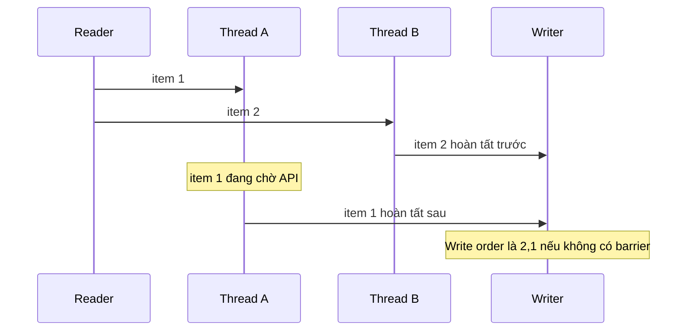
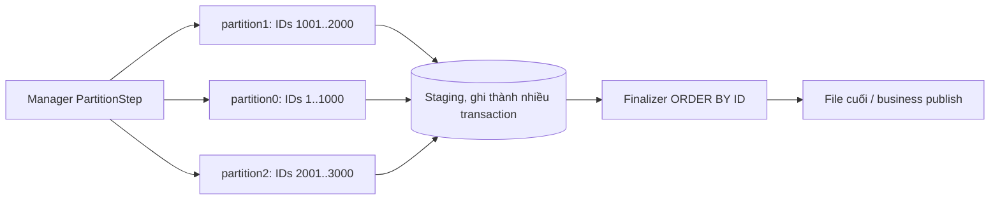
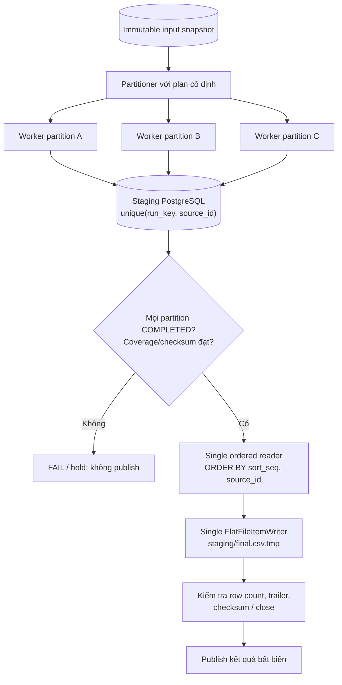
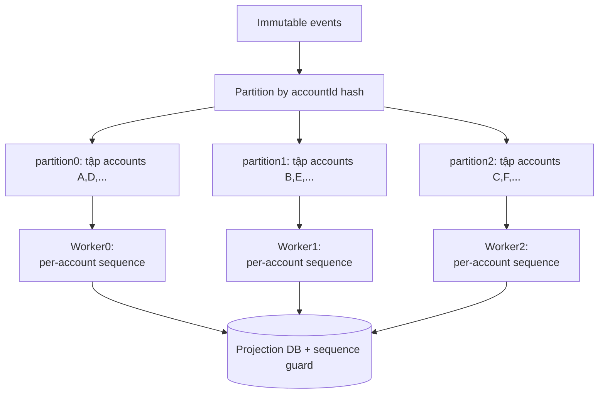

# Writer yêu cầu thứ tự

## 1. Bài toán: chạy nhanh hơn nhưng không được ghi sai thứ tự

Trong chương **Ordering** của module **SPRING_BATCH_SCALING_OPERATIONS**, chúng ta học cách mở rộng Spring Batch bằng multi-threaded step, parallel steps, partitioning và những mô hình phân tán, đồng thời duy trì thread safety, retry/restart và tính đúng đắn dữ liệu. Có một ràng buộc rất dễ bị bỏ sót khi tăng số worker: **writer có thể yêu cầu đầu ra theo một thứ tự xác định**.

Hãy tưởng tượng job nhập 100 triệu giao dịch được sắp theo `event_sequence`. Bước trước xử lý một số giao dịch nhanh, một số giao dịch chậm vì gọi API. Nếu 16 thread hoàn thành bất kỳ lúc nào rồi ghi ngay kết quả, dữ liệu đích có thể có thứ tự `1, 2, 5, 3, 6, 4` thay vì `1, 2, 3, 4, 5, 6`. Điều này:

- Có thể **không quan trọng** nếu ghi vào bảng quan hệ và ứng dụng luôn truy vấn bằng khóa phù hợp.
- Có thể **làm hỏng nghiệp vụ** nếu từng event phải cập nhật một tài khoản theo số thứ tự tăng dần.
- Có thể **làm hỏng hợp đồng xuất file** nếu file CSV cần sắp tăng theo `customerId, event_sequence`.
- Có thể **phá checkpoint/publish** nếu writer một luồng chưa đóng file nhưng worker khác cùng ghi hoặc quản lý offset.

Vì thế, câu hỏi đầu tiên không phải “dùng bao nhiêu thread?” mà là **“thứ tự nào thực sự cần được bảo đảm, và ở ranh giới nào?”**.

### Mục tiêu học tập

Sau bài này, bạn sẽ có thể:

1. Phân biệt thứ tự **đọc, xử lý, ghi, commit, giao message và công bố kết quả**.
2. Hiểu vì sao `TaskExecutor`, parallel steps, partitioning và remote worker **không tự giữ global order**.
3. Nhận diện writer cần **total order**, **per-key order** hoặc chỉ cần **idempotent unordered writes**.
4. Biết khi nào giữ **single writer**, khi nào dùng **parallel staging + ordered finalizer**.
5. Thiết kế partition key, sequence number, tie-breaker và snapshot để dữ liệu có thứ tự **ổn định qua restart**.
6. Xây dựng ví dụ Spring Batch 5.x ghi song song vào staging PostgreSQL rồi xuất file cuối theo `ORDER BY`.
7. Giữ đúng thứ tự thay đổi trạng thái từng aggregate bằng sequence guard/optimistic concurrency.
8. Hiểu giới hạn của `SynchronizedItemStreamWriter`, reorder buffer và message broker.
9. Kiểm thử out-of-order completion, rollback, crash, duplicate delivery và missing sequence.
10. Đo thông lượng, độ lệch partition, sort cost và backlog để chọn cách scale thực tế.

> **Thông điệp chính:** Song song hóa làm các tác vụ **hoàn tất không theo thứ tự bắt đầu**. Nếu writer đòi hỏi thứ tự, phải biến nó thành một **ràng buộc kiến trúc rõ ràng**: sắp xếp trước một writer tuần tự, ghi staging rồi merge/sort, hoặc khóa/định tuyến theo business key. Một mutex chỉ ngăn hai thread ghi cùng lúc; **mutex không tái lập thứ tự nghiệp vụ**.

## 2. Những định nghĩa về ordering cần tách biệt

| Loại thứ tự | Ý nghĩa | Ví dụ | Có được Spring Batch tự bảo đảm khi scale không? |
| --- | --- | --- | --- |
| **Input/read order** | Thứ tự reader trả item | File có dòng 1..N, SQL `ORDER BY` | Chỉ khi reader/query ổn định và cách gọi không phá thứ tự |
| **Processing start order** | Item vào processor trước/sau | Item 1 bắt đầu trước item 2 | Không quyết định thời điểm hoàn tất |
| **Processing completion order** | Item xử lý xong trước/sau | Item 2 trả API trước item 1 | Có thể đảo khi song song |
| **Writer invocation order** | Thứ tự gọi `write(chunk)` | Chunk #7 được writer gọi trước chunk #6 | Có thể đảo với multi-threaded chunks |
| **Transaction commit order** | Thứ tự transaction được database commit | TX của chunk #8 commit trước #7 | Có thể đảo, khác thứ tự gọi writer |
| **Output presentation order** | Thứ tự người đọc nhìn thấy khi xuất file/truy vấn | CSV phải tăng theo timestamp và ID | Phải có sort/serialization contract |
| **Business effect order** | Trình tự tác dụng phụ làm thay đổi state | `balance` theo sequence mỗi account | Cần bảo vệ tại aggregate/sink |
| **Message delivery order** | Broker gửi/consumer nhận trước/sau | Event 5 đến trước event 4 | Phụ thuộc broker, key/partition và retry |

### 2.1. Ba mức cam kết phổ biến

**Mức A — Unordered, chỉ cần đúng tập kết quả.** Ví dụ chuẩn hóa invoice sang bảng có `PRIMARY KEY(invoice_id)`, rồi consumer truy vấn `ORDER BY invoice_id` nếu cần. Các writes có thể đến bất kỳ thứ tự nào nếu tất cả độc lập, deterministic và idempotent.

**Mức B — Thứ tự theo khóa nghiệp vụ (*per-key order*).** Ví dụ các event của `accountId=42` phải áp dụng theo `seq=1,2,3...`, nhưng event của account 42 và 99 có thể chạy song song. Có thể partition theo account, duy trì một consumer tuần tự cho mỗi nhóm và kiểm soát `expectedSequence`.

**Mức C — Thứ tự toàn cục (*total order*).** Ví dụ một file báo cáo duy nhất phải có header, các dòng tăng theo `trade_timestamp, trade_id`, rồi trailer checksum/tổng. Nếu output cần một byte stream chính xác, thường phải có một giai đoạn **single ordered final writer** hoặc một merge được chứng minh tương đương.

### 2.2. Thứ tự không đồng nghĩa tính duy nhất

Một tập bản ghi có thể được ghi theo đúng thứ tự nhưng bị **lặp**:

```text
1, 2, 2, 3, 4
```

Hoặc mỗi ID xuất hiện đúng một lần nhưng thứ tự sai:

```text
1, 3, 2, 4
```

Cần hai nhóm kiểm tra độc lập:

1. **Uniqueness/coverage:** không thiếu, không trùng business effect.
2. **Ordering:** mọi cặp liên tiếp và mọi chuỗi cùng key tuân thủ comparator/sequence contract.

`JobRepository` và checkpoint hỗ trợ restart nhưng không tự bảo đảm hai điều này ở business sink.

## 3. Vì sao song song làm đảo thứ tự?

Giả sử reader lần lượt trả các item `1,2,3,4`. Item 2 mất 1 giây, item 1 mất 8 giây. Với hai thread:



**Đọc theo thứ tự không suy ra ghi theo thứ tự** khi xử lý đồng thời. Ngay cả nếu hai thread khóa quanh writer, thread nào lấy lock trước vẫn phụ thuộc scheduler và thời gian xử lý. Một `ORDER BY` trên reader SQL **không** tự biến writer multi-thread thành sorted writer.

### 3.1. Multi-threaded chunk step

Trong một multi-threaded step dùng `TaskExecutor`, nhiều chunk có thể được xử lý đồng thời trong **cùng StepExecution**. Tùy cấu hình/version, thứ tự chunk hoàn tất/commit có thể khác thứ tự được đọc. Spring Batch không cam kết global write order khi bật concurrency.

`FlatFileItemReader`/`FlatFileItemWriter` có mutable state và không nên mặc định coi là thread-safe. `@StepScope` là theo **StepExecution**, không theo thread: nhiều chunk threads của **cùng** step có thể vẫn sử dụng chung reader/writer.

### 3.2. Parallel steps (`split`)

Hai nhánh chạy step A và step B song song. Không có bảo đảm rằng kết quả A luôn được writer/publisher ghi trước B chỉ vì A xuất hiện trước trong DSL. Nếu bước tiếp theo cần kết quả cả hai nhánh, phải đặt **join sau split** rồi finalizer có thứ tự xác định.

### 3.3. Partitioning

Một `PartitionStep` chia input thành các partition, chẳng hạn `ids:1-1000` và `ids:1001-2000`. Worker của vùng thứ hai có thể chạy xong trước vùng thứ nhất.



Mỗi worker step có thể đọc tuần tự trong partition của mình, nhưng **không có global ordering giữa các partitions**. `gridSize` là tham số gợi ý cho partitioner; nó không phải bộ tái sắp xếp global và không phải giới hạn đồng thời duy nhất.

### 3.4. Remote chunking và remote partitioning

- **Remote chunking:** manager thường giữ reader, gửi `ChunkRequest` cho workers. Worker có thể trả `ChunkResponse` khác thứ tự request; mất reply/redelivery làm thứ tự xử lý ngoài manager còn phức tạp hơn. Không mặc định một `StepExecution` riêng cho từng chunk.
- **Remote partitioning:** manager phát `StepExecutionRequest`, mỗi worker xử lý một partition; thứ tự cập nhật `StepExecution` và thứ tự reply của các worker không xác định trên toàn cluster.

**Đừng dùng reply arrival order làm output order.** Reply là bằng chứng transport/lifecycle theo protocol, không phải khóa sắp xếp dữ liệu nghiệp vụ.

## 4. Các loại writer và điều chúng thực sự đòi hỏi

| Writer/sink | Thứ tự thường cần? | Lý do và điều kiện |
| --- | --- | --- |
| `JdbcBatchItemWriter` ghi các hàng độc lập theo unique key | Thường không cần global order | SQL table là tập quan hệ; query sau phải `ORDER BY` |
| Ghi append vào một file CSV | Cần thứ tự các dòng đúng hợp đồng | Vị trí byte, header/footer, checkpoint |
| Ghi một file cho mỗi partition | Chỉ cần thứ tự bên trong file nếu format yêu cầu | Cần merge/sort nếu muốn một file tổng toàn cục |
| Cập nhật balance bằng event sequence | Thường cần **per-account order** | Event sau có thể phụ thuộc event trước |
| Gửi sự kiện tới Kafka theo entity key | Cần key-based order nếu consumer phụ thuộc | Phải định tuyến, hạn chế retry/replay sai thứ tự |
| Ghi snapshot theo timestamp | Có thể không cần write order, nhưng cần deterministic latest version | Compare-and-set/version guard |
| Phát file báo cáo có trailer checksum | Cần output bytes/order và finalization | Không cho worker khác append sau trailer |
| Gọi HTTP API thay đổi state | Tùy API contract | Retry có thể đổi thứ tự thực thi và side effect |

### 4.1. SQL table không có thứ tự ngầm định

Kể cả các câu `INSERT` chạy theo ID tăng dần, **SELECT không có `ORDER BY` không cam kết thứ tự kết quả**. Không suy từ thứ tự physical pages, clustered index hay insertion order rằng query sau luôn đọc đúng chuỗi.

Ví dụ truy vấn có thứ tự xác định:

```sql
SELECT invoice_id, customer_id, amount
FROM invoice_result
WHERE business_date = :businessDate
ORDER BY event_time ASC, invoice_id ASC;
```

`invoice_id` ở đây là tie-breaker để xử lý trường hợp nhiều events cùng `event_time`. Nếu một comparator không phân biệt được hai hàng, thứ tự hai hàng đó **vẫn có thể thay đổi giữa các lần chạy**, đặc biệt khi parallel query, pagination hoặc database plan đổi.

### 4.2. Writer yêu cầu global order có thể là giới hạn throughput có chủ đích

Nếu có đúng một file output mà mọi dòng phải xuất hiện trong một thứ tự hoàn toàn xác định, **một điểm tuần tự là điều tất yếu ở giai đoạn công bố**. Ta có thể mở rộng các bước tốn CPU/I/O trước đó, nhưng không thể hứa rằng 16 writers cùng append vào một byte stream sẽ tự tạo thứ tự đúng.

Mục tiêu tối ưu là **thu hẹp vùng tuần tự**: cho 16 workers parse/validate/enrich song song, rồi để một final writer chỉ thực hiện thao tác tuần tự đơn giản với dữ liệu đã sắp xếp.

## 5. Những giải pháp tưởng đúng nhưng không đủ

### 5.1. Chỉ khóa writer bằng synchronized

```java
// Minh họa lỗi tư duy: mutex bảo vệ critical section,
// KHÔNG đảm bảo item 1 đến trước item 2.
synchronized (writerLock) {
    writer.write(chunk);
}
```

Một synchronized writer hoặc wrapper `SynchronizedItemStreamWriter` (nếu dùng đúng phiên bản) có thể ngăn **hai lời gọi `write()` đồng thời**, nhưng thread có chunk #8 có thể lấy lock **trước** thread chunk #7. Nó không phải *sorter*, *sequence barrier* hay cơ chế toàn cục đảm bảo commit order. Thêm nữa, serialization qua lock có thể làm throughput của writer trở thành nút thắt.

### 5.2. Chỉ tăng `gridSize` hoặc thread pool

Thêm worker thường tăng số chunk hoàn tất **out of order**, không khôi phục thứ tự. `gridSize(16)` không có nghĩa “Spring Batch sẽ ghi partition0, rồi partition1, ... partition15”. `PartitionHandler` điều phối worker work, không phải ordered merge writer.

### 5.3. Chỉ `ORDER BY` tại reader rồi xử lý song song

Reader SQL trả `id=1,2,3,...` có thể vẫn ghi `1,3,2,...` nếu processors/chunks được xử lý bất đồng bộ. Nếu writer đòi global order, cần **serialization/reorder tại ranh giới ghi** hoặc giai đoạn sort sau parallel stage.

### 5.4. Chỉ dựa vào `StepExecution` hoặc message sequence

`StepExecutionId` và `JobExecutionId` định danh **execution attempt**, không phải một thứ tự nghiệp vụ ổn định xuyên restart. Transport sequence có thể được broker cấp theo scope khác với business order; message ID hoặc thời điểm nhận reply **không** đại diện chính xác `event_sequence`.

### 5.5. Dùng offset không ổn định khi restart

Một reader lưu vị trí dòng, nhưng nguồn file bị ghi đè, hoặc SQL query thiếu `ORDER BY` unique, có thể tiếp tục từ sai record sau crash. Ordering cần đi kèm **snapshot/version của input, comparator xác định và checkpoint tương thích**.

## 6. Ma trận chọn kiến trúc theo yêu cầu thứ tự

| Nhu cầu | Lựa chọn ưu tiên | Có thể scale phần nào? | Đánh đổi |
| --- | --- | --- | --- |
| Một CSV duy nhất tăng theo khóa toàn cục | **Parallel staging → ordered finalizer** | Parse, enrichment, DB staging | Sort + một writer tuần tự |
| Các update của mỗi account đúng sequence | **Per-key routing + sequence guard** | Song song giữa accounts | Hot key có thể là straggler |
| Bảng độc lập, truy vấn cần sorted | **Parallel JDBC upsert**, `ORDER BY` khi đọc | Toàn bộ processing và writes | Index/sort cost khi truy vấn |
| Một file rất nhỏ, ordering nghiêm ngặt | Single-threaded chunk step | Không cần scale phức tạp | Throughput bị giới hạn |
| Nhiều file output độc lập | Một writer/partition, file riêng | Mỗi partition | Consumer phải hiểu manifest |
| Stream có bounded out-of-order | Keyed bounded reorder buffer + watermark | Worker parse/compute | Memory/backpressure, gaps và durability |
| Events có thể đến muộn vô hạn | Durable staging/sort hoặc replay workflow | Ingestion song song | Latency tăng, không thể publish “hoàn tất” ngay |
| API external yêu cầu sequence | Một pipeline per key, idempotency token và ACK | Song song giữa keys | Cần hợp đồng với API đích |

> Nếu yêu cầu thứ tự chỉ phục vụ **hiển thị hoặc export**, đừng ép mọi bước upstream chạy tuần tự. Hãy giữ business processing có thể song song và sắp xếp **đúng lúc tạo output có thứ tự**.

## 7. Pattern quan trọng: parallel staging rồi ordered finalizer

Giả sử 10 triệu hóa đơn cần chuẩn hóa và xuất thành **một file duy nhất**, tăng theo `event_sequence, source_id`. Việc chuẩn hóa có thể tốn nhiều thời gian vì CPU/HTTP, trong khi việc ghi CSV chỉ cần formatter và I/O tuần tự.

Thay vì cho nhiều worker cùng mở một CSV cuối, chia thành hai phase:

**Phase A — Parallel stage:** các worker xử lý partition bất kỳ và ghi các hàng đã chuẩn hóa vào staging **bằng key ổn định**. Không cần ghi theo thứ tự vào database.

**Phase B — Ordered export:** sau khi mọi partition hoàn thành và dữ liệu đã đối soát, một step đọc staging bằng `ORDER BY event_sequence, source_id` rồi ghi **một file staging cuối cùng**. Một bước publish có kiểm soát mới chuyển file này thành output chính thức.



### 7.1. Lợi ích và chi phí

| Lợi ích | Đánh đổi |
| --- | --- |
| Worker xử lý độc lập, không chờ nhau trong hot path | Cần staging database/disk |
| Không tranh nhau ghi một file | Phải sort hoặc scan index có thứ tự |
| Có thể retry/restart từng partition từ checkpoint | Phải giữ input và partition plan ổn định |
| Có checkpoint/bằng chứng rõ ở staging | Cần cleanup staging theo retention |
| Final output deterministic với tie-breaker | Final writer vẫn là điểm tuần tự |
| Có thể kiểm tra toàn dữ liệu trước publish | End-to-end latency gồm cả phase export |

### 7.2. Vì sao finalizer chạy sau manager?

Một `Job` có thể khai báo:

```text
partitionManagerStep
        |
        v
orderedExportStep
        |
        v
publishStep
```

Với flow mặc định, bước kế tiếp chỉ bắt đầu sau khi partition manager step đã hoàn tất thành công. Nếu một worker thất bại, manager có thể thất bại và **finalizer không được bắt đầu**. Nếu muốn cho phép skip hoặc partial export, phải diễn đạt bằng **business quality gate rõ ràng**, không cấu hình flow bỏ qua lỗi tùy tiện.

### 7.3. Khi nào nên tách thành hai Job?

Nếu export phải chạy riêng vào giờ chốt sổ, nguồn staging cần retention dài, hoặc manager/worker có vòng đời khác, có thể tách:

- `ingestJob`: nhập song song và xác minh staging.
- `exportJob`: đọc snapshot staging đã “sealed”, sort/merge và publish.

Tuy nhiên phải có **manifest state/version** nối hai job, không chỉ tin tên bảng/staging path. Nếu `exportJob` chạy khi `ingestJob` chưa seal snapshot, kết quả có thể thiếu hàng hoặc có thứ tự không nhất quán.

## 8. Lược đồ PostgreSQL: staging có thứ tự xác định

Một thiết kế đơn giản:

```sql
CREATE TABLE ordered_invoice_stage (
    run_key        VARCHAR(120) NOT NULL,
    source_id      BIGINT NOT NULL,
    sort_seq       BIGINT NOT NULL,
    account_id     VARCHAR(80) NOT NULL,
    amount         NUMERIC(18, 2) NOT NULL,
    payload_hash   CHAR(64) NOT NULL,
    created_at     TIMESTAMPTZ NOT NULL DEFAULT CURRENT_TIMESTAMP,
    PRIMARY KEY (run_key, source_id)
);

CREATE INDEX idx_ordered_invoice_stage_export
    ON ordered_invoice_stage(run_key, sort_seq, source_id);
```

Đây là **bảng ứng dụng**, không phải bảng `BATCH_*` chuẩn. Ý nghĩa:

- `run_key`: identity ổn định của snapshot/kỳ dữ liệu; phải gắn đúng `JobInstance`/manifest.
- `source_id`: ID logic bất biến của source record trong kỳ chạy.
- `sort_seq`: khóa sắp xếp nghiệp vụ theo yêu cầu.
- `account_id` và `amount`: dữ liệu đã chuẩn hóa.
- `payload_hash`: phát hiện **cùng identity nhưng payload khác** sau replay/restart.
- Index `(run_key, sort_seq, source_id)` hỗ trợ export theo đúng thứ tự, nhưng database vẫn có thể cần sort tùy plan/filter.

### 8.1. Không chọn comparator chỉ có timestamp

```sql
-- Thiếu tie-breaker: hai dòng trùng timestamp có thể hoán vị.
SELECT * FROM ordered_invoice_stage
WHERE run_key = :runKey
ORDER BY event_time;
```

Nếu cột `event_time` tồn tại nhưng không unique, kết quả giữa các dòng trùng timestamp **chưa có total order**. Với lược đồ đang dùng, comparator đầy đủ là:

```sql
SELECT source_id, sort_seq, account_id, amount
FROM ordered_invoice_stage
WHERE run_key = :runKey
ORDER BY sort_seq ASC, source_id ASC;
```

`source_id` là unique trong `run_key`, nên cặp `(sort_seq, source_id)` xác định một total order trong tập của run. Khi sort key có thể `NULL`, còn cần hợp đồng `NULLS FIRST/LAST` và normalization ổn định.

### 8.2. Writer stage phải idempotent và phát hiện conflict

Ví dụ PostgreSQL upsert cho cùng source identity:

```sql
INSERT INTO ordered_invoice_stage (
    run_key, source_id, sort_seq, account_id, amount, payload_hash
) VALUES (
    :runKey, :sourceId, :sortSeq, :accountId, :amount, :payloadHash
)
ON CONFLICT (run_key, source_id)
DO UPDATE SET
    sort_seq = EXCLUDED.sort_seq,
    account_id = EXCLUDED.account_id,
    amount = EXCLUDED.amount
WHERE ordered_invoice_stage.payload_hash = EXCLUDED.payload_hash;
```

Nếu replay **cùng payload**, update không đổi ý nghĩa nghiệp vụ. Nếu cùng `run_key/source_id` nhưng hash khác, mệnh đề `WHERE` không khớp và PostgreSQL trả **0 rows affected** cho thao tác này. Writer có thể bật `assertUpdates(true)` để fail thay vì **âm thầm ghi đè** dữ liệu đã commit trước đó.

**Điều kiện:** hash phải được tính từ **toàn bộ canonical payload quyết định ý nghĩa hàng**, bao gồm `sourceId/sortSeq/accountId/amount` và version của quy tắc chuẩn hóa. Nếu hash chỉ bao gồm `amount`, việc cùng amount nhưng khác `sortSeq` sẽ qua mặt guard. Bản thân hash là biện pháp phát hiện xung đột, **không thay thế** việc giữ input snapshot bất biến.

### 8.3. Đối soát trước khi export

```sql
-- Bao nhiêu source records đã được stage?
SELECT COUNT(*) AS staged_count
FROM ordered_invoice_stage
WHERE run_key = :runKey;

-- Dải sequence, hỗ trợ chẩn đoán (không đủ để chứng minh coverage).
SELECT
    MIN(sort_seq) AS min_seq,
    MAX(sort_seq) AS max_seq,
    COUNT(*) AS actual_rows
FROM ordered_invoice_stage
WHERE run_key = :runKey;

-- Phát hiện sequence trùng nếu contract yêu cầu sort_seq unique.
SELECT sort_seq, COUNT(*) AS duplicates
FROM ordered_invoice_stage
WHERE run_key = :runKey
GROUP BY sort_seq
HAVING COUNT(*) > 1;
```

Nếu nghiệp vụ cho phép nhiều bản ghi cùng `sort_seq`, query trùng ở trên chỉ có giá trị **chẩn đoán**, không phải lỗi; `source_id` đóng vai trò tie-breaker. Muốn chứng minh coverage, phải so tập `source_id` staging với **manifest nguồn đã chốt** hoặc checksum/tổng theo nguồn.

## 9. Spring Batch 5.x: cấu hình worker staging song song

Ví dụ dùng **Java 17+, Spring Batch 5.x, PostgreSQL**. Đầu vào là bảng `invoice_source(id, sort_seq, account_id, amount)` đã được snapshot cho kỳ chạy. Với mỗi partition, worker đọc một dải `id`, chuẩn hóa dữ liệu rồi ghi staging; mọi worker có thể commit **không theo sort_seq** vì finalizer sẽ sắp xếp sau.

### 9.1. Record mô hình

```java
import java.math.BigDecimal;

record SourceInvoice(
    long id,
    long sortSeq,
    String accountId,
    BigDecimal amount
) {}

record StagedInvoice(
    String runKey,
    long sourceId,
    long sortSeq,
    String accountId,
    BigDecimal amount,
    String payloadHash
) {}
```

Các DTO có thể đặt trong package ứng dụng. Tất cả snippet `@Bean` dưới đây thuộc một hoặc nhiều `@Configuration` thích hợp; cần cung cấp `JobRepository`, `PlatformTransactionManager`, `DataSource` và Spring Batch metadata schema.

### 9.2. Partitioner theo dải ID ổn định

```java
import java.util.LinkedHashMap;
import java.util.List;
import java.util.Map;

import org.springframework.batch.core.partition.support.Partitioner;
import org.springframework.batch.item.ExecutionContext;
import org.springframework.context.annotation.Bean;

record FrozenRange(long fromId, long toId) {}

@Bean
Partitioner invoiceRangePartitioner() {
    // Production: tải từ manifest bất biến của cùng JobInstance.
    List<FrozenRange> ranges = List.of(
        new FrozenRange(1, 250_000),
        new FrozenRange(250_001, 500_000),
        new FrozenRange(500_001, 750_000),
        new FrozenRange(750_001, 1_000_000)
    );

    return gridSize -> {
        Map<String, ExecutionContext> contexts = new LinkedHashMap<>();
        for (FrozenRange range : ranges) {
            String name = "range_" + range.fromId()
                + "_" + range.toId();

            ExecutionContext context = new ExecutionContext();
            context.putLong("fromId", range.fromId());
            context.putLong("toId", range.toId());
            contexts.put(name, context);
        }
        return contexts;
    };
}
```

`gridSize` ở đây là **hint**, không phải định danh partition. Partitioner trả bốn partition dù `gridSize(8)` được cấu hình. Cùng `JobInstance` cần **giữ chính xác partition names và dải nguồn** khi restart. Nếu số lượng/range đổi, checkpoint của partition cũ không được áp dụng tùy tiện vào dữ liệu mới.

### 9.3. Reader riêng cho mỗi StepExecution

```java
import javax.sql.DataSource;
import org.springframework.batch.core.configuration.annotation.StepScope;
import org.springframework.batch.item.database.JdbcCursorItemReader;
import org.springframework.batch.item.database.builder.JdbcCursorItemReaderBuilder;
import org.springframework.beans.factory.annotation.Value;
import org.springframework.context.annotation.Bean;

@Bean
@StepScope
JdbcCursorItemReader<SourceInvoice> invoicePartitionReader(
        DataSource dataSource,
        @Value("#{stepExecutionContext['fromId']}") Long fromId,
        @Value("#{stepExecutionContext['toId']}") Long toId) {

    return new JdbcCursorItemReaderBuilder<SourceInvoice>()
        .name("invoicePartitionReader")
        .dataSource(dataSource)
        .sql("""
            SELECT id, sort_seq, account_id, amount
            FROM invoice_source
            WHERE id BETWEEN ? AND ?
            ORDER BY id
            """)
        .preparedStatementSetter(ps -> {
            ps.setLong(1, fromId);
            ps.setLong(2, toId);
        })
        .rowMapper((rs, rowNum) -> new SourceInvoice(
            rs.getLong("id"),
            rs.getLong("sort_seq"),
            rs.getString("account_id"),
            rs.getBigDecimal("amount")))
        .saveState(true)
        .build();
}
```

`ORDER BY id` là thứ tự đọc **bên trong dải partition**, không phải yêu cầu global export. `saveState(true)` hỗ trợ checkpoint của reader qua `ExecutionContext`; sự ổn định còn phụ thuộc input snapshot và thứ tự unique. `@StepScope` tạo reader target theo worker `StepExecution`, không chia sẻ một cursor singleton giữa các partitions.

### 9.4. Processor deterministic và payload hash

```java
import java.nio.charset.StandardCharsets;
import java.security.MessageDigest;
import java.util.HexFormat;

import org.springframework.batch.core.configuration.annotation.StepScope;
import org.springframework.batch.item.ItemProcessor;
import org.springframework.beans.factory.annotation.Value;
import org.springframework.context.annotation.Bean;

@Bean
@StepScope
ItemProcessor<SourceInvoice, StagedInvoice> invoiceStageProcessor(
        @Value("#{jobParameters['runKey']}") String runKey) {

    return item -> {
        var amount = item.amount().setScale(
            2, java.math.RoundingMode.HALF_UP);

        // Dấu phân tách và version là ví dụ canonical.
        // Production: dùng length-prefix/canonical encoding tránh nhập nhằng.
        String canonical = "STAGE_V1|" + item.id() + "|"
            + item.sortSeq() + "|" + item.accountId() + "|"
            + amount.toPlainString();
        String hash;
        try {
            byte[] digest = MessageDigest.getInstance("SHA-256")
                .digest(canonical.getBytes(StandardCharsets.UTF_8));
            hash = HexFormat.of().formatHex(digest);
        } catch (java.security.NoSuchAlgorithmException error) {
            throw new IllegalStateException("SHA-256 unavailable", error);
        }

        return new StagedInvoice(
            runKey, item.id(), item.sortSeq(),
            item.accountId(), amount, hash);
    };
}
```

Nếu `accountId` chứa ký tự `|`, mẫu canonical bằng delimiter đơn giản có thể nhập nhằng. Trên production, nên dùng **serialization canonical có length-prefix hoặc escape rõ**, và gắn version của thuật toán hash/canonical. Đối với ordering, bảo đảm các giá trị dùng so sánh (timezone, decimal normalization, collation) cũng cố định theo kỳ chạy.

### 9.5. Writer staging, không phụ thuộc thứ tự worker tới

```java
import javax.sql.DataSource;
import org.springframework.batch.item.database.JdbcBatchItemWriter;
import org.springframework.batch.item.database.builder.JdbcBatchItemWriterBuilder;
import org.springframework.context.annotation.Bean;
import org.springframework.jdbc.core.namedparam.MapSqlParameterSource;

@Bean
JdbcBatchItemWriter<StagedInvoice> invoiceStageWriter(
        DataSource dataSource) {

    return new JdbcBatchItemWriterBuilder<StagedInvoice>()
        .dataSource(dataSource)
        .sql("""
            INSERT INTO ordered_invoice_stage (
                run_key, source_id, sort_seq,
                account_id, amount, payload_hash
            ) VALUES (
                :runKey, :sourceId, :sortSeq,
                :accountId, :amount, :payloadHash
            )
            ON CONFLICT (run_key, source_id)
            DO UPDATE SET
                sort_seq = EXCLUDED.sort_seq,
                account_id = EXCLUDED.account_id,
                amount = EXCLUDED.amount
            WHERE ordered_invoice_stage.payload_hash
                  = EXCLUDED.payload_hash
            """)
        .itemSqlParameterSourceProvider(item ->
            new MapSqlParameterSource()
                .addValue("runKey", item.runKey())
                .addValue("sourceId", item.sourceId())
                .addValue("sortSeq", item.sortSeq())
                .addValue("accountId", item.accountId())
                .addValue("amount", item.amount())
                .addValue("payloadHash", item.payloadHash()))
        .assertUpdates(true)
        .build();
}
```

Đây là **PostgreSQL-specific SQL**. `assertUpdates(true)` yêu cầu mỗi item trong batch write có affected row count hợp lệ; nếu một conflict bị từ chối do hash khác và update count bằng 0, writer phải **báo lỗi** thay vì âm thầm cho qua. Cần kiểm tra behavior JDBC driver/SQL ở integration test, đặc biệt khi dùng batch update. Không chuyển tùy tiện sang `ON CONFLICT DO NOTHING` nếu điều đó che giấu payload mismatch.

Writer này có thể được nhiều partition worker gọi song song nếu database, driver và cách dùng bean không chứa mutable shared state ngoài hợp đồng. Bản thân logic staging là **set-based idempotent theo primary key**, không cần các partition tới theo thứ tự. Nếu cùng `source_id` bị đưa vào hai partitions vì kế hoạch chia sai, unique key vẫn ngăn hai rows khác nhau cùng identity nhưng **không sửa được sai sót coverage**; cần kiểm tra manifest.

### 9.6. Worker step, manager step và Job

```java
import org.springframework.batch.core.Job;
import org.springframework.batch.core.Step;
import org.springframework.batch.core.job.builder.JobBuilder;
import org.springframework.batch.core.partition.support.Partitioner;
import org.springframework.batch.core.repository.JobRepository;
import org.springframework.batch.core.step.builder.StepBuilder;
import org.springframework.batch.item.ItemProcessor;
import org.springframework.batch.item.database.JdbcBatchItemWriter;
import org.springframework.batch.item.database.JdbcCursorItemReader;
import org.springframework.beans.factory.annotation.Qualifier;
import org.springframework.context.annotation.Bean;
import org.springframework.core.task.TaskExecutor;
import org.springframework.scheduling.concurrent.ThreadPoolTaskExecutor;
import org.springframework.transaction.PlatformTransactionManager;

@Bean
Step stageInvoiceWorker(
        JobRepository repository,
        PlatformTransactionManager transactionManager,
        JdbcCursorItemReader<SourceInvoice> invoicePartitionReader,
        ItemProcessor<SourceInvoice, StagedInvoice> invoiceStageProcessor,
        JdbcBatchItemWriter<StagedInvoice> invoiceStageWriter) {

    return new StepBuilder("stageInvoiceWorker", repository)
        .<SourceInvoice, StagedInvoice>chunk(250, transactionManager)
        .reader(invoicePartitionReader)
        .processor(invoiceStageProcessor)
        .writer(invoiceStageWriter)
        .build();
}

@Bean
TaskExecutor stageExecutor() {
    ThreadPoolTaskExecutor executor = new ThreadPoolTaskExecutor();
    executor.setCorePoolSize(4);
    executor.setMaxPoolSize(4);
    executor.setQueueCapacity(8);
    executor.setThreadNamePrefix("stage-invoice-");
    executor.initialize();
    return executor;
}

@Bean
Step stageInvoiceManager(
        JobRepository repository,
        @Qualifier("stageInvoiceWorker") Step worker,
        Partitioner invoiceRangePartitioner,
        @Qualifier("stageExecutor") TaskExecutor executor) {

    return new StepBuilder("stageInvoiceManager", repository)
        .partitioner("stageInvoiceWorker", invoiceRangePartitioner)
        .step(worker)
        .gridSize(8)
        .taskExecutor(executor)
        .build();
}
```

`TaskExecutor` có bốn threads, `gridSize` là 8 và partitioner trả bốn ranges. Các workers có thể ghi rows bất kỳ thứ tự nào; unique staging key và global ordered finalizer sẽ bảo đảm output. Đây là **local partitioning**; remote partitioning cần `PartitionHandler`/message channels, worker deployments và repository/transport phù hợp.

## 10. Ordered finalizer: một reader có sort key, một file writer

Sau khi manager hoàn tất, finalizer mở staging query có `ORDER BY sort_seq, source_id`. Bởi file writer phải xuất một dòng sau dòng trước, bước này **không bật multi-threaded chunks hoặc partitioning**.

### 10.1. Reader đọc staging theo total order

```java
import javax.sql.DataSource;
import org.springframework.batch.core.configuration.annotation.StepScope;
import org.springframework.batch.item.database.JdbcCursorItemReader;
import org.springframework.batch.item.database.builder.JdbcCursorItemReaderBuilder;
import org.springframework.beans.factory.annotation.Value;
import org.springframework.context.annotation.Bean;

@Bean
@StepScope
JdbcCursorItemReader<StagedInvoice> orderedStageReader(
        DataSource dataSource,
        @Value("#{jobParameters['runKey']}") String runKey) {

    return new JdbcCursorItemReaderBuilder<StagedInvoice>()
        .name("orderedStageReader")
        .dataSource(dataSource)
        .sql("""
            SELECT run_key, source_id, sort_seq,
                   account_id, amount, payload_hash
            FROM ordered_invoice_stage
            WHERE run_key = ?
            ORDER BY sort_seq ASC, source_id ASC
            """)
        .preparedStatementSetter(ps -> ps.setString(1, runKey))
        .rowMapper((rs, rowNum) -> new StagedInvoice(
            rs.getString("run_key"),
            rs.getLong("source_id"),
            rs.getLong("sort_seq"),
            rs.getString("account_id"),
            rs.getBigDecimal("amount"),
            rs.getString("payload_hash")))
        .saveState(true)
        .build();
}
```

Truy vấn có index hỗ trợ sort key, nhưng database có thể vẫn chọn plan sort; **đo `EXPLAIN (ANALYZE, BUFFERS)` trên dữ liệu thử**, không giả định index luôn được sử dụng. Với hàng chục triệu rows, cần cấu hình cursor/fetch size, connection timeout, isolation/snapshot và memory hợp lý.

**Đầu vào finalizer phải “sealed”.** Nếu worker khác vẫn thêm rows vào `ordered_invoice_stage` khi finalizer đang đọc bằng cursor, kết quả có thể thiếu/khác lần restart. Step flow giúp chờ manager hoàn tất, nhưng với nhiều process hoặc operator chạy trùng vẫn cần ownership/manifest gate để không có một run khác tiếp tục ghi cùng `runKey`.

### 10.2. FlatFileItemWriter ghi một output staging path ổn định

```java
import org.springframework.batch.core.configuration.annotation.StepScope;
import org.springframework.batch.item.file.FlatFileItemWriter;
import org.springframework.batch.item.file.builder.FlatFileItemWriterBuilder;
import org.springframework.beans.factory.annotation.Value;
import org.springframework.context.annotation.Bean;
import org.springframework.core.io.FileSystemResource;

@Bean
@StepScope
FlatFileItemWriter<StagedInvoice> orderedCsvWriter(
        @Value("#{jobParameters['outputTempPath']}") String tempPath) {

    return new FlatFileItemWriterBuilder<StagedInvoice>()
        .name("orderedCsvWriter")
        .resource(new FileSystemResource(tempPath))
        .encoding("UTF-8")
        .headerCallback(w ->
            w.write("source_id,account_id,amount"))
        .lineAggregator(item ->
            item.sourceId() + ","
            + quoteCsv(item.accountId()) + ","
            + item.amount().toPlainString())
        .saveState(true)
        .shouldDeleteIfEmpty(true)
        .build();
}

// Hàm utility trong cùng @Configuration/class (hoặc import static).
private static String quoteCsv(String value) {
    return "\"" + value.replace("\"", "\"\"") + "\"";
}
```

Lưu ý:

- `outputTempPath` phải là **đường dẫn staging được cấp phát riêng cho JobInstance/runKey**, được giữ ổn định qua restart của cùng execution logic. Không đưa input từ bên ngoài vào path mà không kiểm soát traversal/symlink.
- `FlatFileItemWriter` không nên được nhiều workers cùng mở một output path. Finalizer là **một StepExecution tuần tự**.
- `saveState(true)` hỗ trợ restart qua `ExecutionContext`; phải giữ tên writer/resource phù hợp và **không tự ý sửa/truncate file tạm** bên ngoài.
- Header được phát theo cơ chế writer, nhưng nội dung file chỉ nên được publish **sau khi writer đã đóng thành công và đã đối soát**.
- Helper `quoteCsv` xử lý dấu ngoặc kép và dấu phân cách theo kiểu CSV quoted field. Nếu dữ liệu có newline trong chuỗi, output vẫn có thể là **một CSV record gồm nhiều physical lines**; consumer phải có CSV parser đúng chuẩn, không đếm newline để suy số record.
- File output nằm ngoài cùng JDBC transaction với checkpoint. Spring Batch có logic restart/truncate theo resource state, nhưng **không hứa atomic ACID giữa commit database và bytes trên filesystem**; cần crash test và publish gate.

### 10.3. Bước export và job flow

```java
import org.springframework.batch.core.Job;
import org.springframework.batch.core.Step;
import org.springframework.batch.core.job.builder.JobBuilder;
import org.springframework.batch.core.repository.JobRepository;
import org.springframework.batch.core.step.builder.StepBuilder;
import org.springframework.batch.item.database.JdbcCursorItemReader;
import org.springframework.batch.item.file.FlatFileItemWriter;
import org.springframework.beans.factory.annotation.Qualifier;
import org.springframework.context.annotation.Bean;
import org.springframework.transaction.PlatformTransactionManager;

@Bean
Step orderedExportStep(
        JobRepository repository,
        PlatformTransactionManager transactionManager,
        JdbcCursorItemReader<StagedInvoice> orderedStageReader,
        FlatFileItemWriter<StagedInvoice> orderedCsvWriter) {

    return new StepBuilder("orderedExportStep", repository)
        .<StagedInvoice, StagedInvoice>chunk(1_000, transactionManager)
        .reader(orderedStageReader)
        .writer(orderedCsvWriter)
        .build();
}

@Bean
Job orderedInvoiceJob(
        JobRepository repository,
        @Qualifier("stageInvoiceManager") Step manager,
        @Qualifier("orderedExportStep") Step export) {

    return new JobBuilder("orderedInvoiceJob", repository)
        .start(manager)
        .next(export)
        .build();
}
```

Mã minh họa tạo một Job hai bước **stage → export**. Trong production cần **bước quality gate và publish riêng** nếu hợp đồng yêu cầu không cho consumer thấy output chưa xác minh. Ví dụ:

```text
stageInvoiceManager  ->  reconcileStageStep
                     ->  orderedExportStep
                     ->  verifyAndPublishStep
```

Không gọi “CSV đã publish” chỉ vì `orderedExportStep` chuyển `COMPLETED`. Publish phải có quyền sở hữu staging, xác minh checksum/record count, ghi manifest/ready marker và chống publisher khác công bố phiên bản chưa đúng.

### 10.4. Dữ liệu staging và file xuất phải gắn cùng snapshot

Một yêu cầu thường bị bỏ quên: nếu `orderedExportStep` restart sau crash, query `ORDER BY` phải nhìn thấy **cùng tập rows**. Các workers đã `COMPLETED` và input đã snapshot không có nghĩa một tiến trình ngoài Batch không thể sửa bảng staging.

Cách bảo vệ:

1. Cấp `runKey` bất biến, liên kết với identifying `JobParameters` và manifest.
2. Không cho ghi/update/delete staging rows sau khi run đã được sealed.
3. Tách quyền process và export/publish; kiểm tra trạng thái run trước khi đọc.
4. Không chạy song song hai `orderedExportStep` cùng `runKey/outputTempPath`.
5. Nếu cần sửa dữ liệu, tạo **staging run version mới** hoặc một correction process riêng, không sửa âm thầm trong khi export.

## 11. Publish output theo thứ tự và restart sau crash

### 11.1. Không để consumer đọc file đang được ghi

Đường dẫn `/reports/invoices-2026-11-26.csv` chỉ nên xuất hiện sau khi file đã hoàn tất. Worker xuất file có thể ghi tới:

```text
/reports/staging/invoices-2026-11-26-run17.csv.tmp
```

Sau khi hoàn thành và đóng file, publisher có thể:

- Kiểm tra số records và SHA-256/checksum so với staging.
- Kiểm tra **first/last sort key** và sequence toàn file.
- Đảm bảo chỉ **một phiên bản thắng** theo run/manifest state.
- Trên filesystem có hỗ trợ, dùng atomic move **trong cùng filesystem**.
- Với object storage, dùng immutable key + versioned manifest/pointer; **không giả định rename object là atomic**.

### 11.2. Ví dụ Java NIO minh họa atomic move

```java
import java.io.IOException;
import java.nio.file.Files;
import java.nio.file.Path;
import java.nio.file.StandardCopyOption;

void publishIfAtomicMoveSupported(
        Path tempFile, Path finalFile) throws IOException {

    // Trước khi gọi: writer đã đóng, file đã verify,
    // quyền publish thuộc đúng run/version.
    Files.move(
        tempFile,
        finalFile,
        StandardCopyOption.ATOMIC_MOVE
    );
}
```

`ATOMIC_MOVE` có thể không được filesystem hỗ trợ và ném `AtomicMoveNotSupportedException`. Nó không tự bảo đảm durability sau mất điện hoặc ngăn publisher khác ghi cùng `finalFile`. Với yêu cầu strict no-overwrite, cần **exclusive ownership/conditional publish protocol**, bởi kiểm tra `Files.exists()` rồi move không phải một giao thức chống race hoàn chỉnh.

### 11.3. Những cửa sổ lỗi quanh finalizer

| Thời điểm crash | Điều có thể xảy ra | Cách khôi phục |
| --- | --- | --- |
| Trước khi export | Staging đã complete nhưng chưa có CSV | Chạy finalizer trên cùng sealed snapshot |
| Giữa các chunk export | File tạm có phần đầu, checkpoint từng chunk | Restart writer/resource đúng contract, verify lại |
| Sau khi file đã đóng, trước publish | File tạm hoàn chỉnh nhưng chưa được công bố | Verify rồi retry publish idempotent |
| Trong publish | Có thể chưa rõ pointer/file cuối đã được đổi | Kiểm tra trạng thái version/manifest trước retry |
| Sau publish, trước status JobRepository cuối | Consumer có thể đã thấy file | Publish operation phải idempotent, không tự overwrite bằng attempt mới |
| Worker khác đột nhiên thêm staging rows | Export có thể thiếu/thừa so với run đã chốt | Cấm ghi sau seal, fail reconciliation |

**Thứ tự dữ liệu** và **thứ tự công bố** là hai hợp đồng độc lập. Tạo CSV đã được sắp xếp đúng nhưng publish hai lần với checksum khác nhau vẫn là lỗi hệ thống.

## 12. Một writer tuần tự có nhất thiết chậm?

Không phải lúc nào cũng vậy. Giả sử một record cần 15 ms để gọi API, nhưng chỉ cần 0,03 ms để serialize ra CSV. Nếu serial cả pipeline, HTTP là điểm nghẽn lớn; nếu parallel enrichment rồi finalizer chỉ serialize, single writer có thể xử lý hàng chục nghìn records/s tùy disk/network.

### 12.1. Công thức throughput gần đúng

Nếu phase stage và export chạy **nối tiếp**:

\[
T_{\mathrm{total}}=T_{\mathrm{stage}}+T_{\mathrm{export}}+T_{\mathrm{publish}}.
\]

Giả sử phase stage có `P` partitions và `W` worker slots. Khi mỗi partition không thể chia nhỏ hơn, thời gian stage có giới hạn dưới trực giác:

\[
T_{\mathrm{stage}} \ge
\max\left(
\frac{\sum_{p=1}^{P}w_p}{W},
\max_p w_p
\right)
\text{overhead},
\]

với `w_p` là thời gian công việc của partition `p` theo điều kiện tài nguyên được giả định. Công thức bỏ qua phần contention/tài nguyên chia sẻ nhưng chỉ ra hai lực cản: **tổng workload/W** và **partition chậm nhất**.

Nếu finalizer ghi được 50.000 rows/s, 10 triệu rows sẽ cần **ít nhất khoảng 200 giây** riêng cho output, chưa kể sort/query, flush, checksum, disk và publish. Đây là ví dụ tính toán, không phải benchmark Spring Batch.

### 12.2. Tối ưu đúng nơi

- Đo CPU parse/enrichment, network calls, staging DB IOPS và ordered export bytes/s riêng.
- Nếu export chiếm 5% tổng thời gian, giữ one writer thường đáng tin hơn tối ưu phức tạp.
- Nếu export chiếm 70%, cân nhắc nhiều **sorted shard files** rồi merge theo khóa, hoặc một pipeline external-sort/streaming merge có contract rõ.
- Nén output có thể làm finalizer CPU-bound; đo nén, buffer và I/O thay vì tăng worker không liên quan.
- Tuning `chunk(1000)` của finalizer thay đổi overhead commit/buffer, **không làm write order tự biến thành parallel**.
- Đảm bảo index/query sort đủ hiệu quả; không giữ toàn bộ 10 triệu rows trong JVM chỉ để sắp xếp.

## 13. Writer yêu cầu thứ tự theo khóa nghiệp vụ

Một file báo cáo toàn cục là một bài toán về **presentation order**. Ngược lại, khi writer cập nhật trạng thái từ event stream, thứ tự có thể là **một invariant nghiệp vụ**.

Ví dụ hệ thống giữ projection tài khoản:

```text
accountId=A:
  event seq=1: OPEN
  event seq=2: CREDIT 100
  event seq=3: DEBIT  20
  event seq=4: CLOSE

accountId=B:
  event seq=1: OPEN
  event seq=2: CREDIT 50
```

Account A phải xử lý `1→2→3→4`. Account B có thể xử lý đồng thời với A. Nếu `CLOSE` đến trước `CREDIT` và API/sink cho phép cập nhật vô điều kiện, projection có thể sai dù sau cùng tất cả event IDs đều có mặt.

### 13.1. Có thực sự cần order không, hay chỉ cần một phép hợp nhất xác định?

Nên xác minh business rule:

- **Phép cộng tổng độc lập** có thể không yêu cầu arrival order, miễn **dedup** và numeric semantics phù hợp.
- **Last-write-wins theo version** không cần arrival order nếu sink chỉ chấp nhận version mới hơn bằng conditional write.
- **Một state machine có transition phụ thuộc trạng thái** như `OPEN→ACTIVE→CLOSED` thường cần per-key sequence hoặc validation phiên bản.
- **Các event thanh toán có causal dependency** cần thêm quy tắc sequencing; không thể tùy tiện xử lý theo timestamp đến nơi.

Nếu có thể thay ordered mutation bằng **commutative/deterministic reduction hoặc version guard**, hệ thống sẽ có nhiều cơ hội scale hơn. Nhưng không được tự coi các operation có side effect là commutative chỉ vì output cuối cùng nhìn giống nhau.

## 14. Pattern per-key routing: giữ đúng owner của aggregate

Với `accountId` là aggregate key, có thể dùng một phép ánh xạ ổn định tới `N` worker partitions:

\[
p=\operatorname{floorMod}(\operatorname{stableHash}(accountId),N).
\]

Mục tiêu: mọi event của cùng account đi vào **cùng logical partition**, nơi chúng có thể được đọc theo `accountId, sequence_no` và xử lý tuần tự.



### 14.1. Điều gì được bảo đảm?

Nếu:

1. Mỗi `accountId` được route tới đúng **một logical partition** theo một plan cố định.
2. Trong partition, reader cung cấp các event của từng account theo `sequence_no` tăng dần.
3. Một partition chỉ có **một worker owner hợp lệ** tại thời điểm thực thi.
4. Worker xử lý tuần tự, không chia thêm event của cùng account sang concurrent chunk threads.
5. Writer có sequence/version guard tại database hoặc hệ thống đích.

...thì hệ thống có thể duy trì thứ tự **theo account**, trong khi accounts khác nhau vẫn được xử lý song song.

Tuy nhiên, **routing cùng key vào một partition chưa đủ** nếu bên trong partition chạy xử lý bất đồng bộ rồi ghi theo completion order. Hoặc nếu worker mới tiếp nhận khi worker cũ vẫn có khả năng ghi, hai owner có thể làm hỏng thứ tự. Cần kiểm soát concurrency và ownership ở **đúng ranh giới tác dụng phụ**.

### 14.2. Đừng đổi số partitions một cách tùy tiện khi restart

Giả sử dùng hash modulo `N=8`. Nếu đổi `N=16`, cùng account có thể được gán vào partition khác. Trong cùng `JobInstance`, đó có thể là sự thay đổi ownership/`ExecutionContext` không tương thích với checkpoint cũ.

Hãy giữ `partitionPlanVersion` và `N` bất biến trong manifest. Nếu muốn rebalance ở kỳ dữ liệu sau, tạo plan/version mới và có protocol chuyển ownership, không cho hai owners cùng ghi trong thời gian overlap.

### 14.3. Java routing logic minh họa

```java
import java.util.Objects;

record KeyRoutingPlan(int partitionCount, String planVersion) {
    KeyRoutingPlan {
        if (partitionCount <= 0) {
            throw new IllegalArgumentException(
                "partitionCount must be positive");
        }
        Objects.requireNonNull(planVersion);
    }

    int partitionOf(String accountId) {
        // String.hashCode() deterministic với cùng chuỗi Java,
        // nhưng N và canonical form phải giữ nguyên trong plan.
        return Math.floorMod(
            Objects.requireNonNull(accountId).hashCode(),
            partitionCount);
    }
}
```

Đây là phép hash để minh họa **định tuyến đồng nhất theo một kế hoạch**. Trên production phải định nghĩa normalization của `accountId`, version của hash, chiến lược skew/hot key và compatibility giữa các hệ thống/ngôn ngữ. Không dựa vào một `Map` iteration order không ổn định, random seed hay thay đổi partition count giữa attempts.

### 14.4. Hot key: điểm nghẽn không thể sửa chỉ bằng thêm thread

Nếu account A có 10 triệu events nhưng 999.999 accounts khác chỉ có 10 events, partition chứa A vẫn bị kéo dài vì phải giữ sequence của A. Tăng workers từ 8 lên 64 có thể cải thiện tổng workload của accounts khác nhưng **không làm A có thể xử lý 64 events phụ thuộc nhau đồng thời**.

Có thể tối ưu bằng:

- Xử lý **phần không phụ thuộc thứ tự** trước (parse, enrich, validate), song song.
- Gom các event của A thành một state transition/batch fold deterministic nếu nghiệp vụ cho phép.
- Dùng snapshot/version/checkpoint cho aggregate để tránh replay từ đầu.
- Giữ một writer tuần tự hiệu quả cho **mỗi hot key**; không chia sai causal order chỉ để tăng CPU utilization.
- Tách các aggregate độc lập nếu business model có thể phân rã thực sự.

## 15. Sequence guard ở database: bảo vệ khi message đến sai thứ tự

Routing giúp giảm khả năng out-of-order, nhưng retry/redelivery, manager failover hoặc consumer bug vẫn có thể đưa `seq=4` đến trước `seq=3`. **Sink nên từ chối cập nhật trái thứ tự** chứ không chỉ tin sự tuần tự của worker.

### 15.1. Lược đồ projection và ledger

```sql
CREATE TABLE account_projection (
    account_id VARCHAR(80) PRIMARY KEY,
    last_seq   BIGINT NOT NULL DEFAULT 0,
    balance    NUMERIC(18, 2) NOT NULL DEFAULT 0
);

CREATE TABLE account_applied_event (
    account_id    VARCHAR(80) NOT NULL,
    sequence_no   BIGINT NOT NULL,
    event_id      VARCHAR(120) NOT NULL,
    payload_hash  CHAR(64) NOT NULL,
    applied_at    TIMESTAMPTZ NOT NULL DEFAULT CURRENT_TIMESTAMP,
    PRIMARY KEY (account_id, sequence_no),
    UNIQUE (event_id)
);
```

Ví dụ giả định sequence bắt đầu từ `1`, account đã có row với `last_seq=0` và mỗi event làm thay đổi `balance` theo một delta. Trong hệ thống thực, cần xử lý tạo account, state transition, correction, tenant namespace và event ID uniqueness theo đúng business domain.

### 15.2. Conditional update yêu cầu đúng expected sequence

```sql
-- Chạy bên trong MỘT transaction, cùng DB với ledger.
UPDATE account_projection
SET balance = balance + :delta,
    last_seq = :sequenceNo
WHERE account_id = :accountId
  AND last_seq = :previousSequence;
```

Giá trị `previousSequence = sequenceNo - 1`. Khi update được **1 row**, sink mới chấp nhận event tiếp theo. Tiếp đó insert ledger:

```sql
INSERT INTO account_applied_event (
    account_id, sequence_no, event_id, payload_hash
) VALUES (
    :accountId, :sequenceNo, :eventId, :payloadHash
);
```

Hai SQL này **phải nằm trong cùng transaction**. Nếu insert ledger thất bại do duplicate event ID hoặc constraint, transaction rollback cả update `balance/last_seq`. Nếu update ảnh hưởng 0 rows, **không insert ledger**; truy vấn trạng thái và quyết định duplicate/gap/conflict.

### 15.3. Phân loại khi update count = 0

```text
received event seq=S; projection has last_seq=L

if L == S-1:
    có thể tranh chấp; thử lại transaction có giới hạn
elif L >= S:
    event đã cũ hoặc giao lại:
       tra account_applied_event(account_id, S)
       cùng eventId và payloadHash -> ALREADY_APPLIED
       khác -> CONFLICT, FAIL/hold
else (L < S-1):
    thiếu một hoặc nhiều event trước:
       DEFER/PENDING_GAP, đợi sequence còn thiếu
       không update balance vượt qua lỗ hổng
```

Thực tế sau một `UPDATE` bị 0 rows vì điều kiện không khớp, phải **đọc lại trạng thái trong transaction/isolation hợp lệ** và xử lý race. Với nhiều writers đồng thời, PostgreSQL row lock/unique constraints hỗ trợ serialization, nhưng cần test lock waits/deadlocks và dùng retry toàn transaction có giới hạn khi hợp lý.

### 15.4. Java service minh họa transaction bảo vệ sequence

```java
import java.math.BigDecimal;
import org.springframework.jdbc.core.JdbcTemplate;
import org.springframework.transaction.support.TransactionTemplate;

record AccountEvent(
    String accountId, long seq,
    String eventId, BigDecimal delta,
    String payloadHash
) {}

enum SequenceResult { APPLIED, ALREADY_APPLIED, GAP }

final class AccountSequenceWriter {
    private final JdbcTemplate jdbc;
    private final TransactionTemplate transactions;

    AccountSequenceWriter(
            JdbcTemplate jdbc,
            TransactionTemplate transactions) {
        this.jdbc = jdbc;
        this.transactions = transactions;
    }

    SequenceResult apply(AccountEvent e) {
        return transactions.execute(status -> {
            int updated = jdbc.update("""
                UPDATE account_projection
                SET balance = balance + ?, last_seq = ?
                WHERE account_id = ? AND last_seq = ?
                """,
                e.delta(), e.seq(),
                e.accountId(), e.seq() - 1);

            if (updated == 1) {
                // Trong cùng transaction: nếu INSERT lỗi,
                // UPDATE projection phải rollback cùng.
                jdbc.update("""
                    INSERT INTO account_applied_event
                    (account_id, sequence_no, event_id, payload_hash)
                    VALUES (?, ?, ?, ?)
                    """,
                    e.accountId(), e.seq(),
                    e.eventId(), e.payloadHash());
                return SequenceResult.APPLIED;
            }

            java.util.List<Long> positions = jdbc.query("""
                SELECT last_seq FROM account_projection
                WHERE account_id = ?
                """,
                (rs, row) -> rs.getLong("last_seq"),
                e.accountId());
            if (positions.isEmpty()) {
                throw new IllegalStateException("Unknown account");
            }
            long last = positions.get(0);

            if (last >= e.seq()) {
                java.util.List<Boolean> duplicates = jdbc.query("""
                    SELECT event_id, payload_hash
                    FROM account_applied_event
                    WHERE account_id = ? AND sequence_no = ?
                    """,
                    (rs, row) ->
                        rs.getString("event_id").equals(e.eventId())
                        && rs.getString("payload_hash")
                             .equals(e.payloadHash()),
                    e.accountId(), e.seq());

                if (duplicates.size() == 1 && duplicates.get(0)) {
                    return SequenceResult.ALREADY_APPLIED;
                }
                throw new IllegalStateException(
                    "Sequence conflict / missing ledger");
            }
            if (last == e.seq() - 1) {
                // Đã cạnh tranh hoặc có logic cập nhật bất thường.
                // Retry lại toàn transaction theo policy có giới hạn;
                // không ACK và bỏ qua event này.
                throw new org.springframework.dao.ConcurrencyFailureException(
                    "Sequence update race; retry transaction");
            }
            return SequenceResult.GAP;
        });
    }
}
```

Đây là **mẫu Java 17/Spring JDBC minh họa**, không phải replacement hoàn chỉnh cho `ItemWriter`: khi đưa vào chunk step cần điều chỉnh scope transaction để **cùng tài nguyên với checkpoint và không commit từng item trái ý muốn**. `SequenceResult.GAP` chưa ghi event vào bảng pending; caller phải có giao thức **defer bền vững**, không coi một GAP bị bỏ qua là thành công rồi ACK message vĩnh viễn.

Nếu nhiều events của cùng account được xử lý trong một chunk mà chunk rollback, tất cả các updates/ledger của chunk phải rollback theo contract. Nếu business transaction và `JobRepository` khác datasource, vẫn cần idempotency để khôi phục khi metadata và effect commit không đồng bộ.

### 15.5. Vì sao chỉ kiểm tra sequence không đủ?

Nếu writer nhận đúng `seq=4` sau `seq=3`, nhưng broker phát lại chính `seq=4`, conditional update lần hai sẽ không khớp, và ledger giúp xác minh đó là **cùng event cũ**. Nếu ledger không có payload hash, một producer có thể dùng lại cùng sequence với value khác mà hệ thống vô tình coi là duplicate vô hại.

**Cần cả sequence guard lẫn event idempotency key.** Sequence guard bảo vệ thứ tự, idempotency bảo vệ tác dụng phụ khi retry.

## 16. Bounded reorder buffer: khi nào nên dùng?

Một lựa chọn khác là cho workers xử lý song song rồi đặt một **reorder buffer** trước writer. Buffer giữ các kết quả out-of-order cho đến khi kết quả có sequence tiếp theo sẵn sàng.

Ví dụ:

```text
expectedSeq = 101

receive 103 -> buffer {103}
receive 104 -> buffer {103,104}
receive 101 -> write 101; expectedSeq=102
receive 102 -> write 102,103,104; expectedSeq=105
```

### 16.1. Pseudocode thuật toán

```text
expected = checkpoint.nextSequence
pending = ordered map<sequence, result>()

onResult(result):
    verify runKey, partitionKey, eventId, payloadHash
    if result.seq < expected:
        verify duplicate/idempotency; do not write twice
    else:
        pending.putIfAbsent(result.seq, result)

    while pending.contains(expected):
        r = pending.remove(expected)
        persist result r / writer output in valid transaction
        advance durable checkpoint to expected + 1
        expected += 1

    if pending.size() >= maxBufferedItems:
        apply backpressure, do not keep accepting unbounded items

    if gapTimeoutExpired(expected):
        fail/defer + investigate missing sequence
```

**Đây là mô hình thuật toán, không phải API có sẵn tự động của Spring Batch**. Implement production phải xử lý atomicity giữa buffer, writer, checkpoint và broker ACK. Nếu chỉ giữ `pending` trong RAM, JVM crash làm mất các results đã nhận nhưng chưa write; manager phải có khả năng **redeliver/recompute** chúng hoặc lưu buffer bền vững.

### 16.2. Vì sao buffer có thể gây head-of-line blocking?

Nếu `seq=101` lỗi HTTP trong 20 phút trong khi `102..1.000.000` xử lý xong, buffer hoặc queue sẽ tăng rất lớn; không thể đợi vô hạn trong heap.

Giải pháp:

- Giới hạn `maxBufferedItems` và `maxBufferedBytes`.
- Backpressure nguồn: chỉ phát thêm khi đang có window.
- Thiết lập bounded gap deadline và chính sách fail/quarantine nếu nghiệp vụ cho phép.
- Có cơ chế retry/replay của **missing sequence** thay vì retry toàn bộ data stream.
- Nếu cần chờ lâu, chuyển pending sang **durable staging** thay vì giữ trong-memory.

### 16.3. Reorder buffer thường không phải lựa chọn tốt nhất cho batch lớn

Với dữ liệu hữu hạn của một `JobInstance`, **staging + ORDER BY + one finalizer** thường dễ kiểm toán và restart hơn một buffer stream sống lâu. Reorder buffer phù hợp khi yêu cầu **phát kết quả liên tục** với độ lệch thứ tự có giới hạn rõ ràng, có backpressure và checkpoint/durable replay.

### 16.4. Watermark không phải lời đảm bảo nếu input có thể tới muộn vô hạn

Một số pipeline streaming dùng *watermark* để nói rằng không kỳ vọng thêm event cũ hơn một mốc. Watermark phải dựa trên **hợp đồng lateness và nguồn dữ liệu**, không chỉ `System.currentTimeMillis()` hoặc số message đã nhận. Khi dữ liệu tới muộn ngoài cửa sổ, phải có policy correction/quarantine/rebuild. Nếu không, “đã publish đúng thứ tự” chỉ là một giả định chưa được chứng minh.

## 17. Ordering khi gửi message và nhận reply từ worker từ xa

Trong kiến trúc có broker, thường tồn tại thêm ít nhất ba luồng:

1. Manager **dispatch** work.
2. Broker **deliver/redeliver** request.
3. Worker xử lý và gửi **reply/completion**.

Không được suy luận:

```text
request #1 published before request #2
        => worker #1 commits before worker #2
        => reply #1 arrives before reply #2
```

Các mệnh đề suy ra đều **không được bảo đảm** trong mô hình song song chung. Retry, broker prefetch, consumer concurrency, network latency và process restart có thể đảo kết quả.

### 17.1. Remote chunking

Manager đọc và gửi `ChunkRequest`, mỗi chunk thường mang dữ liệu cho worker processor/writer. Nếu chunk #12 trả reply nhanh hơn #11, manager có thể nhận `ChunkResponse#12` trước `ChunkResponse#11`. **Thứ tự nhận response không phải thứ tự ghi business data**.

Nếu worker dùng một writer yêu cầu global order, có những lựa chọn:

- **Không thực hiện external ordered write ở worker remote**: worker chỉ chuẩn hóa và lưu staging, manager/finalizer ghi theo sort key.
- Để manager giữ **writer tuần tự có order control** khi contract/volume cho phép, phân tán phần tính toán độc lập.
- Nếu dữ liệu cần per-key order, route/keyed serialize với sequence guard; không phân phát random chunk chứa nhiều events của cùng key cho workers không phối hợp.

**Một `ChunkRequest` không mặc định có một `StepExecution` riêng.** Không thể “sort theo StepExecutionId” để tái tạo thứ tự chunk. Hãy dùng business sequence/correlation theo protocol được hỗ trợ ở đúng Spring Batch Integration version.

### 17.2. Remote partitioning

Manager gửi `StepExecutionRequest` theo partition; remote workers có thể:

- Nhận request khác thứ tự publish.
- Bắt đầu xử lý các partition với concurrency khác nhau.
- Hoàn thành/commit và reply khác thứ tự.
- Bị crash sau commit trước reply.
- Tiếp tục làm việc khi manager bị restart và chưa xác minh owner cũ.

Do vậy nếu cần **một output file** sau khi tất cả partitions hoàn tất, không cho workers đồng thời ghi trực tiếp file đó; dùng stage/merge như ví dụ. Nếu cần **per-key state transition**, giữ routing/ownership theo key.

### 17.3. Kafka “có thứ tự” nhưng trong phạm vi nào?

Kafka duy trì thứ tự record trong **mỗi topic-partition log** theo offset. Điều đó không tự tạo total order **giữa nhiều topic-partitions**, và application-level parallel processing có thể hoàn tất out-of-order ngay cả khi poll theo offset tăng.

Muốn giữ per-key order:

1. Publish cùng aggregate key để record của key đó được route nhất quán vào cùng topic partition theo partitioner hợp đồng.
2. Producer/SDK config cần bảo toàn thứ tự mong muốn, nhất là khi retry, batching và nhiều producers cùng gửi.
3. Consumer không chạy nhiều independent in-flight side effects cho **cùng aggregate** nếu operation có dependency.
4. Offset commit/ACK phải gắn với kết quả đã xử lý hợp lệ, không commit vượt qua missing event.
5. Khi rebalancing/thay số partitions, xử lý chuyển quyền và event ordering theo protocol.
6. Business sequence guard vẫn là tuyến phòng thủ cuối cùng khi event bị phát lại hoặc nguồn gửi sai thứ tự.

**Kafka partition order không đồng nghĩa business event sequence order**: hai producers có thể gửi `seq=9` trước `seq=8` dù broker sắp xếp chúng hoàn toàn đúng theo thời điểm append.

### 17.4. JMS/AMQP và multiple consumers

Một queue có thể đưa message tới các consumers theo thứ tự nhận, nhưng consumer A xử lý chậm, consumer B xử lý nhanh và ACK B trước A. Prefetch, redelivery, consumer cancellation và DLQ còn làm thứ tự thực thi thay đổi.

Với business contract cần strict per-key ordering, kiểm tra tính năng **message grouping/single-active consumer/ordered routing** của broker đang dùng, và **kiểm thử lúc redelivery/rebalance**, không chỉ dựa vào FIFO queue hay concurrency=1 trong một trong nhiều JVM.

## 18. Retry/restart có thể phá thứ tự thế nào?

### 18.1. Retry một item có thể cho item sau vượt lên

```text
event 10 -> API 503, retry sau 5 giây
event 11 -> API 200 sau 100 ms
event 12 -> API 200 sau 100 ms

Nếu writer commit theo completion:
  11, 12, 10

Nếu state machine yêu cầu 10 trước 11:
  đây là lỗi nghiệp vụ
```

Với ordered writer phải chọn:

- **Block/defer per-key** cho đến khi event 10 hoàn tất.
- **Staging** 11/12 và chỉ apply khi 10 được commit.
- Nếu event 10 là poison record, dùng policy fail/quarantine/correction; không tự cho 11 nhảy qua nếu causal dependency bắt buộc.

Retry limit, exponential backoff và jitter giúp giảm retry storm nhưng **không tự bảo toàn business ordering**.

### 18.2. Checkpoint, commit và replay

Giả sử export đã ghi 20.000 dòng, metadata `ItemStream` đã checkpoint đến dòng 20.000. Worker crash giữa dòng 20.001:

| Trường hợp | Nguy cơ | Cần xác minh |
| --- | --- | --- |
| Metadata và file state cùng khôi phục nhất quán | Có thể tiếp tục từ dòng sau checkpoint | Stable resource/name, file không bị can thiệp |
| File có bytes ngoài checkpoint cuối | Dòng cuối có thể bị ghi dở/trùng | Writer restart/truncate contract và checksum |
| Staging bị sửa sau checkpoint | Reader ordinal không còn trỏ cùng record | Sealed run snapshot, stable `ORDER BY` |
| Finalizer được chạy lại như JobInstance mới | Có thể ghi một file thứ hai khác identity | RunKey, output key, publish dedup |
| Sau khi publish, JobRepository chưa ghi trạng thái cuối | Có thể publish lại hoặc overwrite | Idempotent publication manifest/conditional CAS |

### 18.3. Source identity, sort key và execution ID

Đừng dùng `JobExecutionId` hoặc `StepExecutionId` làm **khóa thứ tự**: khi restart cùng `JobInstance`, ID execution có thể mới. Business comparator phải dựa trên **source event version/sequence + tie-breaker**.

Một contract cho export:

```text
runKey        = invoice-close-2026-11-26-v1
inputSnapshot = hash/sourceVersion validated
sortComparator = (sortSeq ASC, sourceId ASC)
encoding       = UTF-8
CSV dialect    = quoted fields, newline convention
outputIdentity = report/runKey/manifestVersion
```

Nếu timezone, collation, normalization hoặc CSV quoting thay đổi giữa attempts, **byte-for-byte reproducibility** có thể bị phá dù cùng business records. Bảo đảm thứ tự cần ghi rõ comparator/dialect/version, không chỉ nói “sorted”.

### 18.4. Idempotency và ordering bảo vệ hai mặt khác nhau

Một event `seq=8` có thể đã commit một lần và được gửi lại. Idempotency giúp không áp dụng lại; sequence guard giúp không cho `seq=9` chạy trước `8`. Nếu chỉ dùng một trong hai:

- Chỉ sequence guard, thiếu event hash/ledger: duplicate cũ có thể bị coi là bỏ qua nhưng không biết payload có giống hay không.
- Chỉ item ledger, thiếu sequence guard: mọi event đều được áp dụng đúng một lần nhưng state transition vẫn sai thứ tự.

**Đối với tác dụng phụ phụ thuộc chuỗi, cần cả hai**.

### 18.5. Process crash của manager và remote worker

Nếu manager JVM crash nhưng remote workers còn chạy, một manager mới không được tự gửi lại toàn bộ partitions dựa trên thiếu reply. Worker cũ có thể tiếp tục commit dữ liệu hoặc publish file. Phải xác minh:

- `StepExecution` trong shared `JobRepository` và các `JobExecution` liên quan.
- Process/heartbeat/lease của worker cũ.
- Generation/fencing tại sink nếu tự động chuyển owner.
- Staging rows/file output đã commit/publish.
- Broker reply chưa đọc hoặc có thể đến muộn.

**Timeout không chứng minh worker đã chết.** Một bài toán ordering có thể biến thành double-writer collision nếu tự failover mù.

## 19. Quan sát ordering và các truy vấn chẩn đoán

### 19.1. SQL kiểm tra thứ tự đọc staging

```sql
SELECT source_id, sort_seq, account_id
FROM ordered_invoice_stage
WHERE run_key = :runKey
ORDER BY sort_seq, source_id
LIMIT 100;
```

Muốn kiểm tra thiếu rows phải so tập nguồn với staged IDs:

```sql
-- Ví dụ input snapshot đã được cố định trong invoice_source_snapshot.
-- Không dùng khi bảng snapshot chưa tồn tại.
SELECT s.id
FROM invoice_source_snapshot s
LEFT JOIN ordered_invoice_stage t
  ON t.run_key = :runKey
 AND t.source_id = s.id
WHERE s.run_key = :runKey
  AND t.source_id IS NULL;
```

`invoice_source_snapshot` là bảng minh họa của ứng dụng, không có trong ví dụ schema bắt buộc ở mục 8. Khi chưa có bảng này, dùng manifest/source checksum thực tế; không đánh giá completeness chỉ bằng `MIN(sort_seq)` và `MAX(sort_seq)`.

### 19.2. SQL phát hiện gaps/duplicate sequences theo aggregate

Giả sử source có `account_id, sequence_no`:

```sql
WITH x AS (
    SELECT
        account_id,
        sequence_no,
        LAG(sequence_no) OVER (
            PARTITION BY account_id
            ORDER BY sequence_no
        ) AS previous_seq
    FROM account_event_source
    WHERE run_key = :runKey
)
SELECT account_id, previous_seq, sequence_no
FROM x
WHERE previous_seq IS NOT NULL
  AND sequence_no <> previous_seq + 1
ORDER BY account_id, sequence_no;
```

Truy vấn phát hiện **gaps giữa các sequence liên tiếp hiện có**. Nó không chứng minh sequence bắt đầu từ 1 hay kết thúc đúng mốc mong đợi; phải kiểm tra against manifest/expected last sequence.

Nếu source cho phép revisions hoặc duplicate event IDs, cần một input validation phase để xác định **canonical event** trước khi chạy ordered writer.

### 19.3. Theo dõi JobRepository

```sql
SELECT
    STEP_EXECUTION_ID,
    JOB_EXECUTION_ID,
    STEP_NAME,
    STATUS,
    READ_COUNT,
    WRITE_COUNT,
    COMMIT_COUNT,
    ROLLBACK_COUNT,
    START_TIME,
    END_TIME,
    LAST_UPDATED
FROM BATCH_STEP_EXECUTION
WHERE JOB_EXECUTION_ID = ?
ORDER BY STEP_EXECUTION_ID;
```

`JobRepository` giúp biết manager/worker/finalizer nào đã chạy, số commit/rollback và trạng thái checkpoint. Nhưng nó **không tự lưu global business sequence của từng output row**. Một manager `StepExecution` có thể tổng hợp counters workers; không cộng manager count với mọi worker count để suy số business records duy nhất.

`LAST_UPDATED` không phải heartbeat định kỳ bắt buộc. Một worker đang xử lý chunk dài có thể chưa ghi metadata mới dù vẫn sống; dùng liveness/progress metrics riêng để kết luận stall hay crash.

### 19.4. Bộ metric nên có

| Metric | Mục đích |
| --- | --- |
| `parallel_stage_rows_per_sec` | Đo throughput phần có thể scale |
| `ordered_export_rows_per_sec` | Xác định writer tuần tự có thành bottleneck? |
| `stage_pending_partitions` / `partition_age` | Phát hiện straggler/partition skew |
| `sort_query_seconds` / `db_temp_bytes` | Đo chi phí sort spilling/index scan |
| `ordering_violation_total` | Đếm sequence guard rejects/trật tự sai |
| `missing_sequence_age_seconds` | Phát hiện key bị kẹt do gap |
| `reorder_buffer_items/bytes` | Ngăn buffer tăng vô hạn |
| `stale_owner_reject_total` | Quan sát worker mất fencing |
| `duplicate_effect_key_total` | Idempotency có được kiểm soát? |
| `file_publish_conflicts_total` | Có hai attempts cùng cố publish? |
| `final_output_checksum_mismatch_total` | Phát hiện byte output sai/kém reproducible |
| `worker_retry/rollback_total` | Retry làm đảo ordering hoặc giữ backlog? |

Không đưa `accountId`, `sourceId` hoặc full `partitionKey` có cardinality rất lớn làm nhãn metrics. Dùng aggregation theo stage, operation, partition pool hoặc buckets; lưu IDs cần điều tra trong structured logs/tracing có phân quyền.

## 20. Chi phí và tối ưu hóa khi có ràng buộc ordering

### 20.1. Sort ở database hay sort trong JVM?

**Sort ở database** thường thuận tiện với dữ liệu lớn nếu có index thích hợp, storage/temp disk đủ, được đo plan và tránh load toàn bộ vào heap. Tuy nhiên, sort trên hàng trăm triệu rows có thể tốn CPU, I/O và temporary files.

**Sort trong JVM** bằng `list.sort` dễ làm với vài nghìn rows, nhưng không phù hợp nếu một run chứa hàng trăm triệu rows và không có memory budget. Một external merge sort có thể xử lý lớn hơn RAM bằng sorted runs trên disk; cần code, recovery và checksum/manifest riêng.

### 20.2. Khi nào dùng sorted shard + k-way merge?

Nếu một finalizer đơn quá chậm:

1. Mỗi worker nhận một **range theo sort key** hoặc tạo shard output đã sort theo comparator giống nhau.
2. Mỗi shard có file immutable, checksum, min/max key, record count và version.
3. Manager chỉ merge sau khi mọi shard `COMPLETED` và metadata được verify.
4. Nếu ranges **không chồng lấn**, có thể concatenate shards **theo min key** khi ranh giới được chứng minh; nếu ranges chồng lấn, phải dùng **k-way merge** theo comparator.
5. Final output được publish qua manifest/atomic protocol đúng storage.

**Đừng mặc định concatenate theo partitionName**. `partition1` không nhất thiết có sort keys nhỏ hơn `partition2` khi partitioner chia theo hash, file size hoặc nguồn dữ liệu không đồng nhất.

### 20.3. Chi phí của sequence guard

Guard ở account projection thường tạo row locking theo aggregate. Nếu một account nhận hàng nghìn events/s, tất cả cập nhật account đó có thể serialize tại row; đó là **giá phải trả cho causal ordering**. Tăng workers hoặc chunk size không giải quyết được hot-key contention nếu mọi event vẫn cần cùng `last_seq`.

Ngược lại, khi có nhiều accounts độc lập, keyed partitioning có thể đạt concurrency tốt mà vẫn giữ per-account order. Cần đo **distribution của events/key**, không chỉ tổng số events.

### 20.4. Benchmark gợi ý

| Scenario | Partition | Worker slots | Finalizer | Dùng để kiểm tra |
| --- | ---: | ---: | --- | --- |
| A | 1 | 1 | Single writer | Baseline và output checksum |
| B | 8 | 4 | Single ordered export | Lợi ích parallel staging |
| C | 32 | 8 | Single ordered export | Metadata/DB pool overhead |
| D | 32 | 16 | Single ordered export | Stage có đạt giới hạn API/DB chưa? |
| E | 32 | 8 | k-way merge sorted shards | Có cải thiện export bottleneck không? |
| F | Hash theo 64 keys | 8 | Per-key sequence guard | Ordering và hot-key skew |
| G | Hash theo 64 keys | 16 | Per-key sequence guard | Lock waits/throughput |

Mỗi benchmark phải cùng dữ liệu nguồn, comparator, encoding, retry policy và output contract. Ngoài thời gian chạy, cần so sánh **hash file cuối**, coverage, duplicate effects và sequence violations. Chạy nhanh hơn nhưng vi phạm order là **FAIL**.

## 21. Kiểm thử ordering với delay, retry và crash có chủ đích

**Ordering cần được kiểm thử trong điều kiện completion đảo chiều**. Nếu chỉ dùng 10 records chạy tuần tự, bài test có thể PASS dù code sai hoàn toàn khi bật concurrency.

### 21.1. Ma trận fault-injection

| Test | Cách chèn lỗi/đảo thứ tự | Assertion cần có |
| --- | --- | --- |
| O01 | Cho partition có khóa nhỏ nhất xử lý chậm 5–10 lần | CSV cuối vẫn tăng theo comparator |
| O02 | Cho các partition hoàn tất theo `P3,P1,P2,P0` | Finalizer không phụ thuộc completion order |
| O03 | Một số `sort_seq` trùng nhau | Tie-breaker tạo output xác định |
| O04 | Đổi thứ tự đọc rows khi không có `ORDER BY` | Test phơi bày query chưa ổn định |
| O05 | Worker stage crash giữa chunk | Restart không thiếu/trùng staged source IDs |
| O06 | Same `source_id` bị dispatch lại cùng payload | Stage writer idempotent; không tạo duplicate |
| O07 | Same `source_id` bị dispatch lại payload khác | Writer báo conflict; run không được publish |
| O08 | Finalizer crash giữa file staging | Restart hoặc rebuild đúng contract; file cuối không bị ghi dở |
| O09 | Crash sau final file đóng, trước publish | Retry publish không tạo hai versions “đã công bố” |
| O10 | Broker trả `ChunkResponse` đảo/trùng thứ tự | Manager không dùng reply order làm business order |
| O11 | Event cùng account đến `1,3,2,4` | Sequence guard không áp dụng 3 trước 2 |
| O12 | Event `seq=2` bị phát lại với hash khác | Conflict/FAIL, không silently skip |
| O13 | Missing `seq=2` trong khi có 3..1000 | Bounded backlog, không xử lý vượt gap trái policy |
| O14 | Worker A mất lease nhưng vẫn ghi DB | Sink từ chối stale generation hoặc không auto-failover |
| O15 | Restart với partition count/manifest đổi | Từ chối reuse checkpoint sai |
| O16 | Source được cập nhật sau staging seal | Chặn sửa hoặc tạo snapshot version mới |
| O17 | CSV chứa commas, quotes, newline, Unicode | Deterministic encoding/escaping, parser đọc lại đúng |
| O18 | Một partition khổng lồ và nhiều partition nhỏ | Đo skew, straggler và end-to-end SLA |

### 21.2. Assert thứ tự bằng comparator chính xác

Ví dụ JUnit 5 + JDBC để kiểm tra output stage của một run (mã minh họa test utility):

```java
import java.util.List;
import org.junit.jupiter.api.Test;
import org.springframework.beans.factory.annotation.Autowired;
import org.springframework.boot.test.context.SpringBootTest;
import org.springframework.jdbc.core.JdbcTemplate;

import static org.junit.jupiter.api.Assertions.*;

record SortKey(long seq, long sourceId)
        implements Comparable<SortKey> {
    @Override
    public int compareTo(SortKey other) {
        int bySeq = Long.compare(seq, other.seq);
        return bySeq != 0
            ? bySeq
            : Long.compare(sourceId, other.sourceId);
    }
}

@SpringBootTest(properties = "spring.batch.job.enabled=false")
class OrderedStageTest {
    @Autowired JdbcTemplate jdbc;

    @Test
    void sortedStageHasMonotonicTotalOrder() {
        List<SortKey> keys = jdbc.query("""
            SELECT sort_seq, source_id
            FROM ordered_invoice_stage
            WHERE run_key = ?
            ORDER BY sort_seq, source_id
            """,
            (rs, row) -> new SortKey(
                rs.getLong("sort_seq"),
                rs.getLong("source_id")),
            "fixture-run");

        for (int i = 1; i < keys.size(); i++) {
            assertTrue(
                keys.get(i - 1).compareTo(keys.get(i)) < 0,
                "Output not strictly increasing at " + i);
        }
    }
}
```

**Giới hạn test:** Query có `ORDER BY` tự tạo rows có thứ tự, nên test này chủ yếu kiểm tra comparator và dữ liệu stage theo query contract; **nó chưa chứng minh writer CSV thật xuất đúng thứ tự**. Cần một integration test chạy `orderedExportStep` rồi **đọc lại file cuối bằng CSV parser** và assert từng record; tránh đo thứ tự bằng cách split physical lines nếu quoted fields có newline.

Test class giả định ứng dụng có **Spring Boot test context**, `JdbcTemplate` và schema/fixture PostgreSQL cho `fixture-run`. Với dự án không dùng Spring Boot, thay `@SpringBootTest` bằng cách tạo test `ApplicationContext`/`JdbcTemplate` tương ứng; test cũng cần **assert có đúng số records mong đợi**, vì danh sách rỗng có thể vượt vòng lặp kiểm tra order mà vẫn thiếu toàn bộ dữ liệu.

### 21.3. Test bắt buộc: so file cuối giữa các lịch chạy

Cho cùng input snapshot:

1. Lần A chạy với một worker, không delay, tạo output A.
2. Lần B chạy với 8 worker, cố ý delay partition đầu, tạo output B.
3. Lần C chạy 8 worker, gây rollback/crash rồi restart, tạo output C.
4. Parse và so business records + comparator của A/B/C.
5. Nếu hợp đồng yêu cầu byte-for-byte reproducibility, **so SHA-256 của file** sau khi cố định encoding, newline convention, header/trailer và formatter version.

Khi dùng chính `runKey` và staging chung cho nhiều lần test, phải **reset/recreate namespace fixture có kiểm soát**, tránh nhầm output cũ với output vừa tạo. Dùng test run identity riêng nhưng giữ **cùng business snapshot/comparator**.

### 21.4. Assert per-key sequence không bỏ qua gaps

Ví dụ:

```text
Account A: input arrival order 1,3,2,2,4

Expected:
  apply seq 1  -> last_seq 1
  see seq 3    -> GAP / defer
  apply seq 2  -> last_seq 2
  replay seq 3 -> last_seq 3
  duplicate 2  -> ALREADY_APPLIED, hash matches
  apply seq 4  -> last_seq 4

Forbidden:
  last_seq 3 while event 2 was never applied
  balance/event ledger has two effects for sequence 2
```

Ở test concurrency, cho hai threads/JVM cùng gửi `seq=2` và `seq=3`. Không dựa vào sleep để bảo đảm thứ tự; dùng barrier/transaction hooks và assert **trạng thái cuối cùng + audit ledger**. Nếu cùng `seq` nhưng payload khác, phải fail/xử lý xung đột.

### 21.5. Không nhầm lỗi test với yêu cầu sai

Nếu người dùng yêu cầu “sort theo timestamp” nhưng không định nghĩa timezone, tie-breaker hoặc khi nào snapshot đóng, **không tồn tại một output byte order duy nhất để assert**. Trước khi viết test, phải biến yêu cầu thành contract cụ thể:

```text
Business date: 2026-11-26
Input version: immutable snapshot S7
Sort key: (eventTimeUTC ASC, eventId ASC)
Null ordering: disallow null eventTime
Duplicate eventId: reject
Normalization: UTC milliseconds precision
Output: UTF-8 CSV, RFC-style quoting, LF line endings
Finalizer: one writer, only after all stage partitions complete
```

Đây là một ví dụ contract; dự án có thể dùng comparator khác. Không bịa thứ tự tổng nếu nghiệp vụ chỉ yêu cầu per-key order.

## 22. Runbook xử lý sự cố sai thứ tự

### Giai đoạn 1 — Phân loại biểu hiện

1. Xác định output đang sai **presentation order**, **commit order** hay **business effect order**.
2. Thu thập `runKey, JobInstanceId, JobExecutionId, StepExecutionId`, partition names, input manifest và output file version.
3. Kiểm tra đó có phải cùng một source record được xử lý lặp, hay là hai source records đúng nhưng bị đảo thứ tự.
4. Đối chiếu comparator đang dùng, tie-breaker, timezone/collation/normalization.

### Giai đoạn 2 — Cô lập output và owner

5. Nếu output đã publish sai, **không ghi đè im lặng**; đặt trạng thái hold/revoke theo business policy.
6. Dừng new publishes nếu có nguy cơ hai publisher cùng ghi đường dẫn.
7. Kiểm tra worker cũ còn chạy không; đừng coi heartbeat stale hoặc reply timeout là bằng chứng process đã chết.
8. Với per-key order, dùng fencing/sequence guard chặn writer stale và event vượt gap.

### Giai đoạn 3 — Kiểm tra nguồn và staging

9. Đối soát input snapshot/manifest, staged `source_id` và business effect ledger.
10. Truy vấn staging với `ORDER BY` đầy đủ; kiểm tra source có sort key null/duplicate bất hợp lệ không.
11. Kiểm tra `JobRepository` status/checkpoint, rollback, workers hoàn tất, có JobExecution restart nào đã đổi plan không.
12. Kiểm tra các files staging, trailers, checksums và publisher manifest; không sửa checkpoint/status bằng SQL tùy tiện.

### Giai đoạn 4 — Khôi phục và phòng ngừa

13. Nếu chỉ file presentation sai nhưng staging đúng và sealed, có thể **export lại từ snapshot staging** theo một output version mới có audit.
14. Nếu business effects đã áp dụng **sai sequence**, cần correction/compensation theo nghiệp vụ; chỉ sort lại file sau đó **không sửa được state đã sai**.
15. Nếu thiếu event sequence, truy tìm nguồn/replay, không cho event sau nhảy qua nếu causality bắt buộc.
16. Sau recovery, chạy lại test monotonic ordering, coverage, idempotency và output checksum.
17. Ghi root cause: sai comparator, multi-threaded writer, duplicate delivery, ownership, unstable snapshot hay unsynchronized publish.

**Không dùng `JobOperator.stop` như một cách chắc chắn giết worker remote đang block.** Stop là yêu cầu hợp tác; cần xác minh process/ownership và không cho writer cũ tiếp tục side effect trái protocol.

## 23. Sai lầm thường gặp

| Ngộ nhận | Vì sao sai | Thay bằng |
| --- | --- | --- |
| “Reader có `ORDER BY` thì writer đa luồng sẽ ghi đúng thứ tự.” | Processing/commit out-of-order | Finalizer sort hoặc keyed barrier |
| “`synchronized(write)` giữ thứ tự source.” | Chỉ bảo đảm mutual exclusion | Comparator/sequence gate |
| “`gridSize(8)` làm partition0 hoàn tất trước partition1.” | Partitions độc lập | Merge/order sau partition |
| “`@StepScope` tạo writer riêng cho mọi chunk thread.” | Scope theo `StepExecution` | Thread-safe design hoặc partitioning |
| “SQL rows luôn trả theo thứ tự INSERT.” | Quan hệ không có order ngầm định | `ORDER BY` đầy đủ |
| “`ORDER BY timestamp` luôn deterministic.” | Timestamp có thể trùng/null | Tie-breaker + null policy |
| “Một output file có thể được nhiều worker append nếu khóa từng write.” | Lock không sắp xếp chunks; metadata/checkpoint chung | Staging riêng + one final writer |
| “Có one writer thì mọi thứ trong job đều phải single-thread.” | Có thể song song ở phase trước | Parallel compute + ordered export |
| “Reply đến trước là record nhỏ hơn.” | Network/retry làm đảo reply | Business sort key/correlation |
| “Kafka giữ total order toàn topic.” | Order chỉ trong từng partition log | Per-key routing và sequence guard |
| “Routing cùng key đủ nếu handler vẫn async.” | Completion order vẫn có thể đảo | Per-key serial apply/guard |
| “Idempotency key đủ bảo đảm causal order.” | Không double effect nhưng vẫn sai sequence | Thêm expected-sequence check |
| “Sequence guard đủ thay idempotency.” | Duplicate khác payload có thể bị bỏ qua | Event ledger/hash |
| “Có một gap thì cứ đợi trong RAM đến khi được.” | Unbounded buffer/head-of-line | Bounded pending + durable replay |
| “Đổi partition count khi restart chỉ ảnh hưởng hiệu năng.” | Owner và checkpoint có thể đổi | Frozen plan/version |
| “`saveState(true)` đủ dù staging thay đổi.” | Reader checkpoint ứng với snapshot khác | Sealed staging/input snapshot |
| “FlatFileItemWriter có thể ACID chung với JDBC.” | Filesystem không phải cùng database transaction | Restart contract + verify/publish |
| “`COMPLETED` nghĩa đã publish đúng file.” | Có thể còn bước publish/reconciliation | Quality gate + manifest |
| “Thêm thread giải quyết hot account key.” | Per-key causal dependency vẫn tuần tự | Tối ưu phase độc lập hoặc fold hợp lệ |

## 24. Bài thực hành tổng hợp

**Tình huống:** Hệ thống nhập 5 triệu events từ nhiều đối tác. Trường `source_id` là duy nhất trong kỳ, `sort_seq` xác định thứ tự xuất file báo cáo; `account_id` và `account_seq` xác định thứ tự cập nhật balance. Có 16 worker trong 4 JVM, database PostgreSQL, có thể có worker crash và broker redelivery. Cuối ngày cần một CSV tăng theo `sort_seq, source_id` và projection tài khoản có sequence hợp lệ.

### Phần A — Thiết kế hợp đồng ordering

1. Viết hợp đồng **global order** cho CSV: comparator, tie-breaker, null policy, timezone, encoding, header/trailer.
2. Viết hợp đồng **per-account order**: `account_seq` tăng từ đâu, được phép gap không, duplicate cùng seq xử lý thế nào.
3. Xác định hai loại business idempotency keys: cho staging records và cho account events.
4. Đóng băng input snapshot/manifest, partition plan, identifying `JobParameters` và output version.

### Phần B — Stage và export

5. Tạo `ordered_invoice_stage` và index `(run_key,sort_seq,source_id)`.
6. Tạo partitioner chia theo dải source IDs nhưng **không giả định dải source ID tương ứng sort order**.
7. Dùng `@StepScope JdbcCursorItemReader` cho mỗi partition, ghi staging bằng `JdbcBatchItemWriter`.
8. Tăng `gridSize` và executor pool; cố ý làm partition đầu xử lý chậm, quan sát staging write order khác global sort.
9. Tạo finalizer đọc `ORDER BY sort_seq,source_id` và ghi một CSV staging path.
10. So kết quả với baseline single-thread: parse CSV, check records, comparator, checksum/amount và **byte hash** nếu format cố định.
11. Crash finalizer sau nhiều chunk, restart với cùng runKey/path; không cho file đã ghi dở bị publish.
12. Thực hiện bước publish versioned output sau khi tất cả partitions và reconciliation đạt.

### Phần C — Account ordering

13. Định tuyến events theo account key với `N=8`, giữ routing plan ổn định.
14. Tạo `account_projection` và `account_applied_event`, dùng conditional update `last_seq`.
15. Gửi sự kiện một account theo thứ tự `1,3,2,2,4`, xác minh gap/defer, duplicate và final sequence.
16. Gửi cùng `seq` nhưng payload hash khác; đảm bảo conflict không bị nuốt.
17. Mô phỏng hai workers cùng claim một account/partition và kiểm tra fencing/sequence guard.
18. Tạo một hot account có 80% events; đo throughput và giải thích vì sao tăng worker không làm causal chain xử lý đồng thời.

### Phần D — Retry, restart và benchmark

19. Trong remote chunking, gửi `ChunkRequest` có reply out-of-order; kiểm tra manager correlation và không dùng reply order cho CSV.
20. Trong remote partitioning, crash một worker giữa chunk, restart cùng `JobInstance`; xác minh staging đủ, không trùng.
21. Thử đổi `N` của keyed routing hoặc đổi tie-breaker khi restart; hệ thống phải từ chối nếu không có migration/version.
22. Đo 1/4/8/16 worker slots, finalizer `chunk(100/1000/5000)` và tổng thời gian stage/export/publish.
23. Đo I/O/temp disk của sort, DB connection pool, `ROLLBACK_COUNT`, sequence violations và missing-sequence age.
24. Viết runbook khi CSV output sai thứ tự nhưng staging đúng; so sánh với case projection đã áp dụng sự kiện sai sequence.

### Câu hỏi tự kiểm tra

1. Input order, processing completion order, write order và commit order khác nhau ra sao?
2. Vì sao `ORDER BY` ở reader không bảo đảm writer multi-threaded giữ thứ tự?
3. `SynchronizedItemStreamWriter` bảo vệ điều gì, không bảo vệ điều gì?
4. Thế nào là total order và per-key order? Nêu trường hợp mỗi loại.
5. Vì sao SQL không có `ORDER BY` không được coi là sorted?
6. Tại sao cần tie-breaker như `source_id` ngoài timestamp?
7. Vì sao parallel staging + ordered finalizer thường phù hợp hơn nhiều workers cùng ghi một CSV?
8. Khi nào có thể concatenate sorted shard files, khi nào phải k-way merge?
9. Tại sao `gridSize` không quyết định thứ tự partition hoàn tất?
10. Vì sao `@StepScope` không tách state theo từng chunk thread?
11. Khi restart finalizer, vì sao staging phải được sealed và output temp path phải ổn định?
12. FlatFileItemWriter cùng JobRepository có tạo một ACID transaction xuyên filesystem và DB không?
13. Khi file đã đóng nhưng publish reply thất lạc, làm sao tránh publish hai phiên bản trái hợp đồng?
14. Hash modulo `N` có ích gì cho per-account order? Vì sao không đổi `N` tùy tiện giữa restart?
15. Vì sao cùng key vào một worker chưa đủ nếu worker vẫn xử lý nhiều events cùng key bất đồng bộ?
16. Sequence guard `WHERE last_seq=seq-1` chặn điều gì?
17. Khi nhận `seq=9` mà projection mới ở `last_seq=7`, nên làm gì?
18. Vì sao sequence guard vẫn cần ledger/hash cho duplicate delivery?
19. Bounded reorder buffer có thể bị head-of-line blocking khi nào?
20. Vì sao watermark không đáng tin nếu late event không có giới hạn?
21. Kafka giữ order ở phạm vi nào, và application-level concurrency có thể phá gì?
22. Remote chunking có thể trả reply không theo request order không? Vì sao?
23. Khi worker bị timeout, có được mặc định gửi lại partition cho owner mới không?
24. Metrics nào giúp phân biệt stage bottleneck, sort bottleneck và hot-key contention?
25. Vì sao “job COMPLETED” chưa đủ chứng minh output đúng thứ tự và được publish?

## 25. Tài liệu tham khảo

- [Spring Batch 5.2 — Scaling and Parallel Processing / Partitioning](https://docs.spring.io/spring-batch/reference/5.2/scalability.html).
- [Spring Batch 5.2 — Configuring a Step / Chunk-oriented Processing](https://docs.spring.io/spring-batch/reference/5.2/step/chunk-oriented-processing.html).
- [Spring Batch 5.2 — ItemStream và checkpoint](https://docs.spring.io/spring-batch/reference/5.2/readers-and-writers/item-stream.html).
- [Spring Batch 5.2 — Late Binding và Step Scope](https://docs.spring.io/spring-batch/reference/5.2/step/late-binding.html).
- [Spring Batch 5.2 — FlatFileItemWriter](https://docs.spring.io/spring-batch/reference/5.2/readers-and-writers/flat-files/file-item-writer.html).
- [Spring Batch 5.2 — JDBC Cursor ItemReader](https://docs.spring.io/spring-batch/reference/5.2/readers-and-writers/database.html).
- [Spring Batch 5.2 — JobRepository](https://docs.spring.io/spring-batch/reference/5.2/job/configuring-repository.html).
- [Spring Batch 5.2 — Batch Metadata Schema](https://docs.spring.io/spring-batch/reference/5.2/schema-appendix.html).
- [Spring Batch 5.2 — Externalizing Batch Process Execution](https://docs.spring.io/spring-batch/reference/5.2/spring-batch-integration/externalizing-execution.html).
- [Spring Integration — Message Channels](https://docs.spring.io/spring-integration/reference/channel.html).
- [PostgreSQL — SELECT / ORDER BY](https://www.postgresql.org/docs/current/sql-select.html).
- [PostgreSQL — Window Functions](https://www.postgresql.org/docs/current/tutorial-window.html).
- [PostgreSQL — INSERT ON CONFLICT](https://www.postgresql.org/docs/current/sql-insert.html).
- [Apache Kafka — Documentation](https://kafka.apache.org/documentation/).

**Ghi nhớ:** Khi writer yêu cầu thứ tự, cần xác định đó là **thứ tự toàn cục của output** hay **thứ tự theo khóa nghiệp vụ**. Multi-threaded step, parallel steps và partitioned/remote workers có thể hoàn tất bất kỳ thứ tự nào; khóa writer bằng mutex hoặc chỉ sort reader không đủ khôi phục ordering. Để tạo một file sorted, cách dễ kiểm chứng là **xử lý song song → staging idempotent → finalizer một luồng đọc theo comparator xác định → publish có kiểm soát**. Để cập nhật state phụ thuộc chuỗi, hãy dùng **keyed routing + sequence guard + event idempotency/fencing**. Luôn giữ snapshot/partition plan ổn định qua restart, thử crash và duplicate delivery, rồi đối soát **thứ tự, tính đầy đủ và tác dụng phụ thực tế** trước khi công bố thành công.


