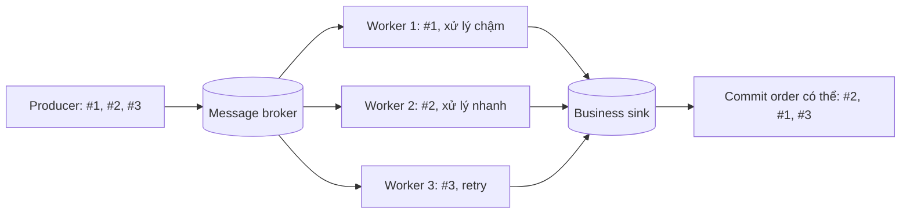
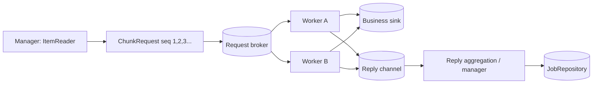
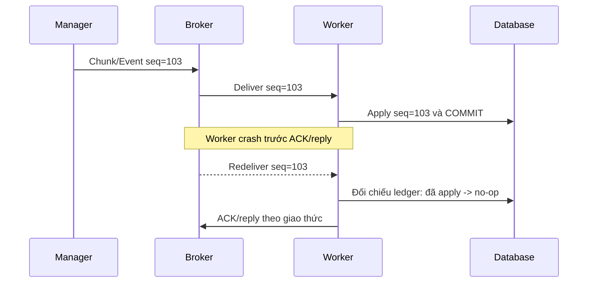

# Sequence number trong message

## 1. Tình huống: message đến đủ nhưng kết quả vẫn sai

Giả sử một hệ thống Spring Batch xử lý các thay đổi số dư của tài khoản bằng remote chunking. Manager đọc ba sự kiện đã được sắp xếp rồi phát chúng qua message broker:

```text
Tài khoản ACC-42:
  sequence = 101: mở kỳ, balance = 1.000
  sequence = 102: ghi nợ 200
  sequence = 103: ghi có 50

Manager publish:        101 -> 102 -> 103
Worker nhận:            101 -> 103 -> 102
Worker commit:          103 -> 101 -> 102  (nếu xử lý song song không ràng buộc)
Kết quả kỳ vọng:        850, theo đúng nghiệp vụ và không xử lý lặp
```

Ngay cả khi **cả ba message được giao thành công**, các worker có thể commit **không theo thứ tự**. Nếu một message bị redeliver, số lần xử lý vật lý còn có thể lớn hơn ba. Với sự kiện kiểu “đặt trạng thái”, “chuyển đơn từ CREATED sang PAID rồi SHIPPED”, hoặc “ghi bút toán theo kỳ”, xử lý sai thứ tự có thể làm hỏng dữ liệu.

**Sequence number** là thông tin thứ tự **trong một phạm vi đã định nghĩa**. Nó giúp phát hiện message thiếu, lặp, đến muộn hoặc sai thứ tự, nhưng **không có tác dụng thần kỳ** buộc broker, executor, writer và database commit theo đúng thứ tự.

Bài học này thuộc chương **Ordering** trong module **SPRING_BATCH_SCALING_OPERATIONS**. Khi mở rộng Spring Batch bằng multi-threaded step, parallel steps, partitioning, remote chunking và worker phân tán, cần thiết kế sequence number cùng correlation, retry/restart, backpressure và bảo vệ transaction.

### Mục tiêu học tập

Sau bài này, bạn có thể:

1. Phân biệt **sequence number**, **correlation ID**, **message ID**, **sequence size**, **Kafka offset** và **business version**.
2. Xác định phạm vi bảo đảm thứ tự: **toàn hệ thống, từng JobInstance, từng partition, từng entity/key hay một message group hữu hạn**.
3. Hiểu cách Spring Integration dùng `correlationId`, `sequenceNumber` và `sequenceSize` cho aggregator/resequencer.
4. Phân biệt sequence header ở tầng transport với `ChunkRequest.getSequence()` của Spring Batch Integration.
5. Xử lý duplicate, gap, out-of-order, late reply và crash sau commit mà không làm sai sink.
6. Thiết kế reader/partitioner và writer theo key để vừa scale vừa có thể restart.
7. Kiểm thử thứ tự bằng failure injection thay vì suy luận từ FIFO hoặc `ORDER BY`.

## 2. “Thứ tự” là một hợp đồng, không phải một tính chất chung

Trước khi gắn số thứ tự vào message, cần trả lời:

- **Đơn vị nào phải đúng thứ tự?** Các event của cùng một tài khoản, hay **mọi** event trong một batch?
- **Thứ tự dựa trên đâu?** Thứ tự commit của nguồn, thứ tự nghiệp vụ, thứ tự được ghi vào log, hay thứ tự manager publish?
- **Ai cần giữ thứ tự?** Broker delivery, worker processing, **database commit**, output file, hoặc consumer cuối cùng?
- **Khi có gap thì sao?** Đợi, retry, quarantine, bỏ qua theo nghiệp vụ, hay fail job?
- **Khi có replay thì sao?** Nhận diện message cũ bằng khóa nào? Ai lưu tiến độ đã áp dụng?
- **Qua restart có giữ được hợp đồng không?** Cùng JobInstance, snapshot, partition mapping và sequence namespace?

Ví dụ một batch xây **projection số dư theo tài khoản** có thể chỉ cần thứ tự **trong từng tài khoản**. Hai tài khoản khác nhau được xử lý đồng thời mà không xung đột:

```text
Account A: A#1 -> A#2 -> A#3
Account B: B#1 -> B#2 -> B#3

Hợp lệ:
  A#1 | B#1 | B#2 | A#2 | A#3 | B#3

Không hợp lệ nếu nghiệp vụ yêu cầu A đúng chuỗi:
  A#1 | A#3 | A#2
```

Cố tạo một **global sequence duy nhất** cho mọi account có thể làm throughput giảm mạnh vì phải xếp hàng những công việc vốn độc lập. Hãy chọn **phạm vi thứ tự nhỏ nhất đáp ứng hợp đồng nghiệp vụ**.

### 2.1. Ba lớp cần tách riêng

| Lớp | Ví dụ | Có đảm bảo lớp tiếp theo đúng thứ tự? |
| --- | --- | --- |
| **Publish order** | Producer phát event #1 rồi #2 | Không tự bảo đảm delivery/commit |
| **Delivery order** | Consumer nhận #1 rồi #2 | Không bảo đảm processing/commit khi async |
| **Commit / side-effect order** | DB áp dụng #1 rồi #2 | Đây mới là điểm cần bảo vệ với stateful business logic |

**Đọc đúng thứ tự không có nghĩa ghi đúng thứ tự.** Có thể `JdbcPagingItemReader` dùng `ORDER BY sequence` nhưng processor async, remote chunking hoặc retry làm chunk #12 commit trước chunk #11.

## 3. Sáu khái niệm dễ nhầm

| Trường/khái niệm | Mục đích | Phạm vi điển hình | Không nên suy ra |
| --- | --- | --- | --- |
| `messageId` | Nhận diện một message/envelope | Một delivery hoặc event envelope tùy thiết kế | Là số thứ tự nghiệp vụ |
| `correlationId` | Gom request/reply hoặc một nhóm message | Request, batch, scatter-gather group | Bản thân nó sắp xếp message |
| `sequenceNumber` | Vị trí trong **một sequence/group** | Thường 1..N khi group hữu hạn | Đơn điệu trên toàn hệ thống |
| `sequenceSize` | Tổng phần tử dự kiến trong group | Nhóm hữu hạn đã biết kích thước | Đồng nghĩa số item/chunk commit thành công |
| Kafka `partition+offset` | Vị trí record trong một partition log | Một topic-partition | Thứ tự toàn topic hay business version |
| `sourceVersion` / business sequence | Phiên bản/trình tự cập nhật entity | Entity/key và nguồn cụ thể | Tự có nếu dùng timestamp/DB sequence |

**Quan trọng:** hai messages có cùng `sequenceNumber=5` nhưng `correlationId` khác nhau **không phải duplicate**. Ngược lại, hai deliveries cùng `correlationId + sequenceNumber` có thể là replay **hoặc** dữ liệu mâu thuẫn; phải so thêm event identity/hash và nghiệp vụ.

### 3.1. Message mẫu

```json
{
  "headers": {
    "correlationId": "billing-2026-11:aggregate-ACC-42",
    "sequenceNumber": 2,
    "sequenceSize": 3,
    "messageId": "transport-9d8a"
  },
  "payload": {
    "businessBatchId": "billing-2026-11",
    "aggregateId": "ACC-42",
    "eventId": "event-8f21",
    "sourceVersion": 102,
    "operation": "DEBIT",
    "amount": 200
  }
}
```

Đây là một **envelope minh họa**, không phải JSON mặc định do Spring Integration, RabbitMQ hay Kafka tự serialize đúng cấu trúc này. Khi chọn transport, phải xác định mỗi field là **header thực** hay payload property và có được giữ lại qua serialization/adapter hay không.

### 3.2. Namespace không được bỏ qua

Một sequence hợp lệ cần ít nhất:

```text
(sequence namespace, sequence number)

Ví dụ:
(namespace = "billing-2026-11 / ACC-42", number = 102)
```

Nếu chỉ dùng số nguyên `102`, hai account, hai business batches hoặc hai lần rerun đều có thể va chạm. Với restart, namespace phải giữ **cùng logical identity**; với một lần **reprocess** tạo kết quả độc lập, cần xác định có namespace/version mới hay dùng lại event identity cũ để dedup.

## 4. Message có thể đảo thứ tự vì sao?



Nguyên nhân thường gặp:

- Nhiều producers ghi đồng thời: **thứ tự ứng dụng tạo event** có thể khác thứ tự broker nhận.
- Network retries/timeout và broker redelivery làm message cũ xuất hiện sau message mới.
- Consumer concurrency, prefetch, partition assignment và thread pool cho phép các tác vụ hoàn tất khác nhau.
- Processor gọi API với thời gian đáp ứng khác nhau; job có thể **đọc #1 trước nhưng commit #2 trước**.
- Worker chết sau khi commit DB nhưng trước ACK/reply, khiến cùng work item được gửi lại.
- Một JobInstance restart có thể đọc lại item/chunk quanh checkpoint.
- Rebalance/scale-in làm cùng stream key chuyển consumer generation.
- Broker priority/delay/retry queue có thể làm thứ tự delivery khác publish order.

Để thiết kế đúng, cần phân biệt:

1. **Ordering at source:** ai cấp sequence và bằng hợp đồng nào?
2. **Ordering in transport:** broker bảo vệ thứ tự trong phạm vi nào?
3. **Ordering at sink:** điều kiện nào ngăn một phiên bản/event được áp dụng sai?

Chỉ dựa vào bước 2 là không đủ cho hệ thống cần dữ liệu đúng sau lỗi.

## 5. Spring Integration: correlation, sequenceNumber và sequenceSize

Spring Integration có các message headers phổ biến:

- `IntegrationMessageHeaderAccessor.CORRELATION_ID`: khóa gom các messages có quan hệ với nhau.
- `IntegrationMessageHeaderAccessor.SEQUENCE_NUMBER`: vị trí message trong sequence.
- `IntegrationMessageHeaderAccessor.SEQUENCE_SIZE`: số phần tử dự kiến của sequence hữu hạn.

**Splitter** thường tạo bộ headers này khi tách một message thành nhiều phần. Với publish-subscribe channel hoặc recipient-list router, việc tự thêm sequence headers phụ thuộc `applySequence` và cấu hình endpoint; **không mặc định mọi channel đều gắn sequence**.

### 5.1. Ví dụ dựng message với headers (Java)

```java
import org.springframework.integration.IntegrationMessageHeaderAccessor;
import org.springframework.messaging.Message;
import org.springframework.messaging.support.MessageBuilder;

record WorkMessage(
        String batchId,
        String entityId,
        String eventId,
        long sourceVersion,
        String command) {}

class WorkEnvelopeFactory {

    static Message<WorkMessage> message(
            WorkMessage payload,
            String correlationId,
            int position,
            int expectedCount) {

        if (position < 1 || expectedCount < position) {
            throw new IllegalArgumentException("Invalid sequence metadata");
        }

        return MessageBuilder.withPayload(payload)
                .setHeader(
                        IntegrationMessageHeaderAccessor.CORRELATION_ID,
                        correlationId)
                .setHeader(
                        IntegrationMessageHeaderAccessor.SEQUENCE_NUMBER,
                        position)
                .setHeader(
                        IntegrationMessageHeaderAccessor.SEQUENCE_SIZE,
                        expectedCount)
                .build();
    }
}
```

Đoạn code minh họa **một message group hữu hạn đã biết `expectedCount`**, ví dụ ba work messages của một yêu cầu tổng hợp. Nó **không** tự thực hiện:

- Persist message vào broker;
- Cấp sequence một cách an toàn giữa nhiều producers;
- Bảo đảm các message được tiêu thụ theo thứ tự;
- Dedup khi redelivery;
- Lưu business cursor để restart.

**Không dùng `sequenceSize` tùy tiện bằng tổng số records của cả job** khi một group chỉ bao gồm một số replies. Group size phải phản ánh chính xác **đơn vị được aggregator/resequencer gom**. Với stream vô hạn chưa biết N, phải có release strategy khác thay vì bịa một số cố định.

### 5.2. Aggregator: đợi đủ phần của nhóm, không phải máy đảm bảo đúng nghiệp vụ

Giả sử có group:

```text
correlationId = request-ABC
sequenceSize  = 3

Nhận:
  sequenceNumber=2
  sequenceNumber=1
  sequenceNumber=3

Aggregator có thể thu đủ ba phần và release nhóm.
```

Theo Spring Integration, aggregator mặc định thường dùng `correlationId` để gom group, và release strategy dựa trên `sequenceSize`. Tuy nhiên:

- **Đủ ba messages** không tự chứng minh mọi sequence number là **1, 2, 3 khác nhau** nếu dùng release strategy không kiểm tra duplicates đầy đủ. `SimpleSequenceSizeReleaseStrategy` thiên về hiệu năng; **đừng xem nó là business dedup validator**.
- Một số phần bị filter/skip trước aggregator: group có thể **không bao giờ đủ** nếu size vẫn là N ban đầu.
- Group cần timeout, error/discard policy và trạng thái lưu giữ nếu manager crash.
- **Aggregator output** thường là một message chứa các payloads; nó không tự bảo đảm một downstream writer async sẽ commit theo thứ tự business.

**Đối chiếu tài liệu Spring Integration theo phiên bản:** cách xử lý duplicates, partial release và group expiry có thay đổi. Nếu quyết định nghiệp vụ yêu cầu đủ đúng từng sequence, phải có validation riêng và integration test.

### 5.3. Resequencer: phát theo thứ tự đã biết

Spring Integration có **Resequencer** để gom theo `correlationId` và phát lại messages theo `sequenceNumber` mà không tổng hợp payloads.

```text
Đầu vào:  (#3, #1, #2)
                |
                v
          Resequencer
                |
                v
Đầu ra:   (#1, #2, #3)
```

Nhưng điều này chỉ bảo vệ **thứ tự phát ra tại endpoint resequencer**. Nếu ngay sau đó là executor có 10 consumers, #3 có thể vẫn commit trước #2.

**Giới hạn:** resequencer thích hợp với các chuỗi tương đối ngắn và ít gaps. Nếu có hàng triệu entity streams, nhiều gaps kéo dài, không được giữ mọi message trong memory không giới hạn; phải có `MessageGroupStore` bền vững, timeout, retention và backpressure phù hợp.

### 5.4. Lưu trạng thái nhóm và expiry

| Vấn đề | Hệ quả | Hướng xử lý |
| --- | --- | --- |
| Group chưa đủ N | Manager chờ mãi nếu thiếu timeout | Bounded group timeout, error flow |
| Group lưu trong memory | JVM restart mất thông tin đang gom | Durable message store nếu contract cần |
| Nhiều duplicate sequence | Group count có thể đánh lừa | Event identity + sequence validation |
| Message đến sau group đã release | Có thể bị discard hoặc lập group mới tùy cấu hình | Late-message policy, audit và retention |
| Group ID dùng lại giữa jobs | Replies của job khác bị gom nhầm | Correlation namespace duy nhất |
| Expiry/cleanup quá sớm | Replay đến sau không còn state dedup | Retention gắn SLA/retry window |
| Chờ nhiều gaps | Buffer phình, head-of-line blocking | Window cap + quarantine/fail rõ |

**Không bật partial release khi nghiệp vụ không chấp nhận bỏ một sequence.** “Bỏ qua #2 rồi tiếp tục #3 vì timeout” có thể giúp throughput nhưng làm sai business projection.

## 6. Remote chunking: sequence của ChunkRequest không phải commit order

Trong Spring Batch Integration, **remote chunking** thường có:



Spring Batch cung cấp lớp `ChunkRequest<T>` chứa items và **chunk sequence** (API `getSequence()`), đồng thời bao gồm định danh JobInstance và StepContribution trong các phiên bản có hỗ trợ. Sequence này hữu ích cho **nhận diện chunk request thuộc một lần điều phối**, nhưng phải phân biệt nó với **Spring Integration message header `sequenceNumber`** dùng trong correlation/aggregation của một message flow.

**Không được suy luận rằng `ChunkRequest.getSequence() = headers['sequenceNumber']` trong mọi cấu hình.** Hai giá trị thuộc **hai lớp giao thức khác nhau**; mapping và phạm vi sequence phụ thuộc implementation/version. Chỉ dùng tương đương khi đã xác minh bằng source, logs và test của chính ứng dụng.

### 6.1. Thứ tự phát chunk không bảo đảm thứ tự commit

Giả sử manager gửi:

```text
ChunkRequest #10: events account A, versions 100..109
ChunkRequest #11: events account A, versions 110..119

Worker 1 (#10): chờ external API 3 giây
Worker 2 (#11): ghi DB sau 100 ms
```

Mặc dù manager đọc đúng thứ tự, **chunk #11 có thể được commit trước chunk #10**. Đây là điều cần tránh nếu output logic có thứ tự bắt buộc.

**Các hướng thiết kế:**

1. Đưa **cùng business key** về một đơn vị xử lý tuần tự hoặc một partition được sở hữu duy nhất.
2. Dùng sink **version-aware/sequence-aware** với rule đúng; trường hợp không cho phép nhảy số phải **chờ #10** thay vì ghi #11.
3. Nếu operation có thể commutative/idempotent, định nghĩa rõ rằng commit order vật lý không ảnh hưởng output.
4. Nếu cần global order toàn bộ output, dùng một stage cuối tuần tự hoặc một service điều phối total order; đánh đổi throughput và latency.
5. Không chuyển “cứ tăng sequence header” thành một lời hứa rằng Spring Batch sẽ tự khóa writer theo thứ tự.

### 6.2. Reply đến đảo thứ tự vẫn có thể hợp lệ

```text
Requests sent: #10, #11, #12
Replies seen:  #12, #10, #11
```

Nếu replies là **kết quả hoàn tất độc lập của các chunks**, manager có thể cần **correlate và tổng hợp đủ kết quả** thay vì bắt buộc nhận reply theo thứ tự request. **Reply order** và **business write order** không phải một vấn đề.

Không tự tạo reply success cho #11 chỉ vì #12 đã trả về. Nếu reply #11 mất sau worker commit, phải đối soát trạng thái sink trước khi re-drive.

### 6.3. JMS: bảo toàn correlation/sequence headers trên reply adapter

Tài liệu Spring Batch Integration hiện hành lưu ý: với **JMS transport** trong các phiên bản Spring Integration **7.0.6+**, `DefaultJmsHeaderMapper` inbound adapter có allowlist mặc định hạn chế; nếu không cấu hình, `correlationId`, `sequenceNumber` và `sequenceSize` có thể **không được map lại**, khiến reply aggregator lỗi hoặc treo.

Mẫu cấu hình **header mapper**, không phải nguyên một remote chunking flow:

```java
import org.springframework.integration.jms.DefaultJmsHeaderMapper;

DefaultJmsHeaderMapper replyHeaderMapper =
        new DefaultJmsHeaderMapper(
                "correlationId",
                "sequenceNumber",
                "sequenceSize");

// Gắn replyHeaderMapper vào đúng JMS inbound/message-driven
// channel adapter nhận worker replies của phiên bản đang dùng.
```

**Cần kiểm tra:**

- Mapper được gắn vào **đúng inbound reply adapter**, không chỉ khai báo bean rồi để không dùng.
- Giá trị headers sống qua serialize/deserialize và cross-version transport.
- `correlationId` trỏ đúng group đang chờ trên manager.
- `sequenceNumber` và `sequenceSize` có định nghĩa hợp lệ cho group ấy.
- Missing/duplicate replies dẫn tới lỗi có timeout và quan sát được, không silently success.

Không tự thêm/rewrite header mới ở worker khi không hiểu quy ước Spring Batch Integration. Nếu sử dụng RabbitMQ/AMQP hoặc Kafka thay JMS, phải xác minh adapter mapping và header serialization tương ứng, **không copy nguyên quy tắc allowlist JMS**.

## 7. Remote partitioning: partitionName không phải sequenceNumber

Trong **remote partitioning**, manager giao **StepExecution** với `ExecutionContext` cho các workers; mỗi partition có ID/tên logic riêng, ví dụ:

```text
workerStep:range-0000
workerStep:range-0001
workerStep:range-0002
```

Các hậu tố `0000`, `0001` chỉ giúp đặt tên/đối chiếu logical partitions; **không** có nghĩa partition 0001 phải được commit sau partition 0000. Mỗi partition được thiết kế để **độc lập và không overlap**.

| Thành phần | Dùng để làm gì? | Không phải |
| --- | --- | --- |
| Partition name | Định danh logical input/StepExecution | Global event order |
| StepExecution ID | Theo dõi một step execution | Business event sequence |
| ExecutionContext | Lưu snapshot/range/checkpoint | Một hàng đợi FIFO toàn cluster |
| ChunkRequest sequence | Nhận diện chunk request thuộc remote chunking | Phân vùng input của partitioning |
| Business sequence/version | Định nghĩa thứ tự của cùng entity | JobExecution count |

Nếu mỗi entity có các sự kiện phụ thuộc thứ tự, cần bảo đảm **mọi event của một entity luôn thuộc đúng một partition** và được áp dụng tuần tự/đúng rule. Chia partition chỉ theo thời gian có thể đưa account A#10 vào partition tháng trước, A#11 vào tháng sau và cho hai worker ghi song song. Nếu hai partitions cần thứ tự chéo, phải có coordination hoặc thiết kế lại phạm vi.

## 8. Chọn sequence scope: global, per-partition hay per-entity?

| Scope | Lợi ích | Hạn chế |
| --- | --- | --- |
| **Global sequence** | Một thứ tự tổng quát duy nhất | Khó cấp đúng khi nhiều producers; tạo bottleneck |
| **Per business batch** | Dễ đối soát, khôi phục theo JobInstance | Batch sau vẫn có thể chồng dependency với batch trước |
| **Per transport partition** | Phù hợp Kafka partition log | Chỉ có thứ tự trong partition, không phải toàn topic |
| **Per entity/aggregate key** | Cho phép nhiều keys chạy song song | Cần route cùng key và quản lý cursor riêng |
| **Per request/reply group** | Dễ dùng với Spring Integration aggregator | Group có thể ngắn, không đại diện business history |
| **Per producer instance** | Cấp nhanh, không cần coordinator chung | Không tạo thứ tự giữa các producer instances |

**Gợi ý mặc định với nghiệp vụ stateful:** dùng **per-entity sequence**, route cùng entity tới cùng shard/partition hoặc bảo vệ bằng **transactional sequence gate** ở sink. Những keys độc lập mới được parallelize mạnh.

### 8.1. Một sequence không phải timestamp

Các trường sau **không tương đương**:

```text
eventTime      = 10:00:01
ingestionTime  = 10:00:07
databaseId     = 1051
sourceVersion  = 14
messageSeq     = 3
kafkaOffset    = 97821
```

`eventTime` nói **khi nghiệp vụ xảy ra**, nhưng đồng hồ có thể lệch và event đến muộn. `databaseId` từ sequence database có thể được cấp **trước commit**, không bảo đảm thứ tự commit. Kafka offset là log position trên **một partition**, không trực tiếp đại diện version cập nhật account. Một hệ thống có thể dùng các trường này đồng thời vì chúng trả lời **những câu hỏi khác nhau**.

## 9. Cấp sequence number tại nguồn: chọn đúng điểm bền vững

Một producer đơn lẻ tăng bộ đếm trong RAM có thể cấp các số 1,2,3 khi chạy bình thường nhưng gặp vấn đề khi restart:

```text
Producer P1:
  cấp seq=10, publish thành công
  cấp seq=11, crash trước publish
  restart và chỉ nhớ seq=9 trong RAM
  cấp lại seq=10 cho event khác

=> Va chạm, không biết event #11 có tồn tại hay không.
```

**Bộ đếm in-memory không đủ** nếu sequence là một phần của hợp đồng business/khôi phục.

### 9.1. Cách cấp theo mức yêu cầu

| Cách cấp | Phù hợp | Rủi ro |
| --- | --- | --- |
| In-memory counter | Một flow ngắn, không cần resume qua process crash | Trùng/nhảy số sau restart |
| DB sequence/auto-increment | Cấp ID duy nhất hiệu quả | Thứ tự cấp **không đồng nghĩa thứ tự commit**, có gaps |
| Transactional row counter per entity | Cần thứ tự per key | Row lock contention ở hot key, cần bounded transactions |
| Transactional outbox + per-key ordering | Có DB source, cần publish bền vững | Dispatcher/relay phải giữ ordering policy |
| Kafka offset per partition | Event log append-only theo partition | Không phải per-entity business version tự có |
| Manifest ordinal cố định | Batch input bất biến có thứ tự xác định | Phải giữ manifest/order qua restart |

### 9.2. Cẩn thận với database sequence

```text
T1: lấy nextval -> 200, chưa COMMIT
T2: lấy nextval -> 201, COMMIT trước
Consumer thấy #201 trước
T1: COMMIT #200 sau
```

Nếu consumer luôn đòi `last+1` theo sequence database và không có protocol commit-aware, nó có thể **chờ #200 quá lâu**, hoặc nếu bỏ qua gap thì đánh dấu sai completeness. Database sequence không rollback số đã cấp khi transaction rollback: **gaps có thể hợp lệ**.

**Nếu nghiệp vụ bắt buộc chuỗi không có gap**, producer cần commit protocol riêng, ví dụ khóa row trạng thái mỗi entity trong cùng transaction tạo event/outbox, và quy định gap/retry rõ ràng. Không dùng `MAX(id)` làm bằng chứng mọi transaction nhỏ hơn đã commit.

### 9.3. Transactional outbox làm gì và chưa làm gì?

Một mẫu tốt:

1. Trong transaction nghiệp vụ, cập nhật aggregate và ghi outbox event có **eventId + aggregateId + sourceVersion**.
2. Commit transaction.
3. Outbox relay publish events và ghi nhận delivery theo cơ chế retry.
4. Consumer dedup/sequence-gate theo ID và version.

Nhưng transactional outbox **không tự giữ total order** nếu nhiều relay workers gửi events cùng aggregate song song. Cần route/serialize theo aggregate, bảo đảm version/commit ordering và kiểm thử duplicate/retry. “Outbox” là nền tảng durability, **không thay mọi quyết định ordering**.

## 10. Khi có duplicate, gap và event đến muộn

Giả sử với tài khoản A, sink đã xác nhận `lastAppliedSequence = 5`.

| Event mới | Loại tình huống | Cách xử lý khi yêu cầu strict sequence |
| --- | --- | --- |
| A#6 | Đúng bước kế tiếp | Áp dụng trong transaction, tăng cursor lên 6 |
| A#5 với cùng eventId/hash | Duplicate/replay | Xác minh ledger rồi ACK idempotent |
| A#4 | Stale/đến muộn | Đối chiếu lịch sử; không áp dụng lại |
| A#5 với eventId/hash **khác** | Conflict ở cùng sequence | Fail/quarantine, không âm thầm bỏ |
| A#8 | Gap #6, #7 | Đưa vào pending bền vững/chờ có timeout, không áp dụng ngay |
| A#6 đến hai workers cùng lúc | Concurrent duplicate | Unique constraint/row lock quyết định chỉ một commit |
| B#1 | Key độc lập | Có thể xử lý song song với account A |

**Không ACK và quên** một message hợp lệ #8 khi #6 đang thiếu nếu không có durable pending store hoặc cách broker bảo đảm redelivery sau delay. Nếu #8 bị ACK và xóa khỏi mọi nơi lưu, sau này #6 đến cũng không thể hoàn tất chuỗi.

### 10.1. Hai mode business khác nhau

**Mode strict-order**: mỗi event có dependency vào event trước (bút toán tuần tự, workflow trạng thái). Điều kiện áp dụng là:

```text
incomingSequence == lastAppliedSequence + 1
```

**Mode latest-version-wins**: mỗi event là **toàn bộ snapshot state** của entity. Nếu incoming version lớn hơn, có thể chọn bản mới hơn và bỏ bản cũ:

```text
incomingVersion > currentVersion
```

Hai mode **không thể thay nhau**. Nếu #8 là phép `balance = balance + 50`, áp dụng #8 trước #6/#7 có thể sai; chỉ giữ version lớn nhất không khôi phục được các phép cộng đã bỏ. Nếu #8 là snapshot độc lập `balance=850` với version đáng tin, update lớn hơn có thể hợp lệ theo contract.

### 10.2. Phải kiểm tra payload conflict

Cùng `(aggregateId, sequence)` nhưng khác eventId hoặc payloadHash là **dấu hiệu hỏng dữ liệu/producer bug**, không phải một duplicate vô hại. Chỉ coi là replay an toàn nếu event identity và nội dung/operation phù hợp. Không để hai producers ghi đè nhau theo “last arrival wins” khi nghiệp vụ không cho phép.

## 11. SQL: gate theo sequence tại sink

Ví dụ PostgreSQL cho một phép cập nhật cộng/trừ phải được áp dụng **chính xác theo thứ tự**.

### 11.1. Schema lưu cursor và event đã áp dụng

```sql
CREATE TABLE account_projection (
    account_id TEXT PRIMARY KEY,
    last_sequence BIGINT NOT NULL DEFAULT 0,
    balance NUMERIC(20, 2) NOT NULL DEFAULT 0,
    CHECK (last_sequence >= 0)
);

CREATE TABLE applied_account_event (
    account_id TEXT NOT NULL,
    event_sequence BIGINT NOT NULL,
    event_id TEXT NOT NULL,
    payload_hash TEXT NOT NULL,
    applied_at TIMESTAMPTZ NOT NULL DEFAULT now(),
    PRIMARY KEY (account_id, event_sequence),
    UNIQUE (event_id)
);

CREATE TABLE pending_account_event (
    account_id TEXT NOT NULL,
    event_sequence BIGINT NOT NULL,
    event_id TEXT NOT NULL,
    payload_hash TEXT NOT NULL,
    payload JSONB NOT NULL,
    received_at TIMESTAMPTZ NOT NULL DEFAULT now(),
    PRIMARY KEY (account_id, event_sequence)
);
```

**Contract của ví dụ:** sequence bắt đầu từ 1 cho mỗi account mới; nếu import lịch sử đã ở version 100, phải seed `last_sequence=100` từ một checkpoint đã được đối soát. Không để `pending_account_event` tăng vô hạn: đặt limit, TTL, retry/reconciliation và quyền truy cập.

### 11.2. Thuật toán transaction với row lock

```text
BEGIN TRANSACTION

1. Ensure account_projection row exists (nếu nghiệp vụ cho phép tạo).
2. SELECT last_sequence, balance
     FROM account_projection
    WHERE account_id = :accountId
      FOR UPDATE;

3. Nếu incomingSequence == last_sequence + 1:
     - INSERT applied_account_event với eventId + payloadHash.
     - UPDATE account_projection:
         balance = balance + :delta
         last_sequence = :incomingSequence
     - COMMIT.

4. Nếu incomingSequence <= last_sequence:
     - Kiểm tra applied_account_event theo account + sequence.
     - Nếu eventId + payloadHash trùng: duplicate -> COMMIT/no-op.
     - Nếu khác hoặc ledger không còn đủ: ERROR/RECONCILE.

5. Nếu incomingSequence > last_sequence + 1:
     - Không áp dụng balance.
     - ROLLBACK transaction này.
     - Lưu event vào pending store bằng transaction bền vững riêng
       hoặc giữ message unacked/retry theo contract.
     - Báo missing range/timeout, không tuyên bố đã áp dụng.
```

Đây là **pseudocode protocol**, không phải một transaction SQL duy nhất có thể copy chạy. Cần bảo đảm **write pending và ACK** phối hợp đúng: chỉ xác nhận message khi pending đã được lưu bền vững hoặc đã có cơ chế redelivery chắc chắn; không lưu pending trong cùng transaction vừa ROLLBACK.

### 11.3. Một conditional update minh họa

```sql
-- Thực thi trong transaction trên đúng account row.
-- Điều kiện last_sequence = seq - 1 bảo vệ không nhảy qua gap.
UPDATE account_projection
SET
    balance = balance + :delta,
    last_sequence = :incomingSequence
WHERE account_id = :accountId
  AND last_sequence = :incomingSequence - 1;
```

Nếu update tác động **một hàng**, sequence có thể tiến đúng một bước. **Nếu tác động 0 hàng**, không suy ra ngay là duplicate: nó có thể là gap, stale, account chưa tồn tại hoặc conflict. Phải query state/ledger để phân loại, và ghi event log **trong cùng transaction** nếu cần atomicity.

Với concurrent workers, row lock hoặc conditional update theo version bảo vệ race; unique constraint ở `applied_account_event` chặn hai events cùng sequence. Dù vậy, hệ thống vẫn phải xử lý deadlock/timeout có bounded retry.

### 11.4. Vì sao `WHERE incoming > current` chưa đủ?

```sql
-- Chỉ phù hợp khi output có semantics latest-full-state-wins:
UPDATE account_projection
SET last_sequence = :incomingSequence
WHERE account_id = :accountId
  AND last_sequence < :incomingSequence;
```

Lệnh này **cho phép nhảy từ 5 tới 8** mà không có #6/#7; không phù hợp với các phép tính phụ thuộc đủ mọi event. Đối với projection last-write-wins, có thể dùng conditional version compare, nhưng phải định nghĩa rõ cách xử lý delete, tombstone, event correction và version conflict.

## 12. Buffering, resequencing và head-of-line blocking

Khi nhận #8 nhưng đang đợi #6, hệ thống có thể buffer các message đến sớm:

```text
lastApplied = 5
pending = {8, 9}

Nhận #6  -> apply #6
Nhận #7  -> apply #7
Drain    -> apply #8, rồi #9
lastApplied = 9
```

Nếu #7 **không bao giờ tới**, buffer không thể được giải phóng trong chế độ strict order.

### 12.1. Bound theo key và toàn hệ thống

- `maxPendingPerKey`: số events chờ tối đa cho một aggregate, ví dụ 100 (minh họa).
- `maxGapAge`: tối đa bao lâu cho một khoảng thiếu trước khi incident, ví dụ 5 phút.
- `maxTotalPendingBytes`: quota cho toàn service/pending store.
- `maxConcurrentKeys`: số business streams được xử lý song song.
- `maxInFlightPerKey`: với strict side effects, thường chỉ một logic writer có thể commit đúng bước một lúc.
- `dead-letter/quarantine`: khi có conflict/poison hoặc gap đã quá SLA, không âm thầm “nhảy số”.

Các giá trị nên được benchmark và gắn với broker retention/capacity thật. Queue/in-memory map không giới hạn là rủi ro OOM dưới burst hoặc khi một key bị thiếu message kéo dài.

### 12.2. Head-of-line blocking: phải biết tradeoff

Một key bị thiếu #6 có thể block mọi message của **key đó**, nhưng không cần block key khác. Nếu thiết kế global FIFO/sequence vô điều kiện, một message lỗi đầu tiên có thể làm **toàn bộ cluster dừng tiến độ**.

**Gợi ý:** nhóm theo business key, partition theo key hoặc chọn nhiều lanes độc lập. Chỉ dùng total ordering toàn cục nếu nghiệp vụ thật sự cần.

### 12.3. Timeout có nghĩa gì?

Một timeout nên báo một **trạng thái nghiệp vụ rõ**:

```text
sequence-gap-detected(account=ACC-42, expected=6, received=8)
-> retry missing event retrieval / reconciliation
-> nếu không khôi phục được, fail/quarantine theo SLA
-> không giả mạo "sequence #6 đã xử lý"
```

Bật `sendPartialResultOnExpiry` hay release partial sequences có thể phù hợp cho report *best-effort*; với ledger tài chính yêu cầu mọi event, không được xem timeout là lý do bỏ lỗ hổng dữ liệu.

## 13. Spring Batch: reader đã ORDER BY vẫn cần worker strategy

Một nguồn SQL có thứ tự rõ ràng:

```sql
SELECT account_id, event_sequence, event_id, delta
FROM sealed_account_event
WHERE snapshot_id = :snapshotId
  AND account_id >= :fromAccount
  AND account_id < :toAccount
ORDER BY account_id ASC, event_sequence ASC;
```

Truy vấn sắp xếp đúng để đọc. Nhưng nếu worker Step dùng nhiều chunks đồng thời hoặc gửi remote chunks song song, **commit order vẫn có thể khác**.

### 13.1. Thiết kế partition để giữ một key ở một worker

Một lựa chọn phù hợp:

1. Chốt **snapshot/manifest bất biến** cho JobInstance.
2. Chia partitions theo **dải/hàm băm của `account_id`**, không chia cùng account thành nhiều worker không liên hệ.
3. Một reader `@StepScope` cho mỗi `StepExecution`, SQL sắp xếp `account_id + event_sequence`.
4. Trong mỗi worker, dùng **chunk step tuần tự** nếu nghiệp vụ cần strict per-key order; không gắn `TaskExecutor` multi-threaded bên trong worker chỉ để tăng tốc.
5. Writer dùng transaction sequence gate và ledger để chịu retry.
6. Các partition/key khác vẫn được phép chạy song song.
7. Khi restart, giữ nguyên `partitionName → account range/hash bucket` và snapshot.

**Không có chiến lược “vừa global strict order vừa tùy ý fan-out mọi event” mà không phải trả chi phí điều phối.** Nếu cần global order khi publish output, có thể có bước merge/publish cuối tuần tự, hoặc một ordered log consumer riêng.

### 13.2. Java reader theo StepExecution, Spring Batch 5.x

Schema nguồn giả định:

```sql
CREATE TABLE sealed_account_event (
    snapshot_id TEXT NOT NULL,
    account_id TEXT NOT NULL,
    event_sequence BIGINT NOT NULL,
    event_id TEXT NOT NULL,
    delta NUMERIC(20, 2) NOT NULL,
    PRIMARY KEY (snapshot_id, account_id, event_sequence),
    UNIQUE (snapshot_id, event_id)
);
```

Reader chỉ đọc snapshot đã seal:

```java
record AccountEvent(
        String accountId,
        long eventSequence,
        String eventId,
        BigDecimal delta) {}

@Bean("orderedAccountReader")
@StepScope
JdbcPagingItemReader<AccountEvent> orderedAccountReader(
        DataSource dataSource,
        @Value("#{stepExecutionContext['snapshotId']}")
            String snapshotId,
        @Value("#{stepExecutionContext['fromAccount']}")
            String fromAccount,
        @Value("#{stepExecutionContext['toAccount']}")
            String toAccount) {

    Map<String, Order> order = new LinkedHashMap<>();
    order.put("account_id", Order.ASCENDING);
    order.put("event_sequence", Order.ASCENDING);

    return new JdbcPagingItemReaderBuilder<AccountEvent>()
            .name("orderedAccountReader")
            .dataSource(dataSource)
            .selectClause(
                "SELECT account_id, event_sequence, event_id, delta")
            .fromClause("FROM sealed_account_event")
            .whereClause(
                "WHERE snapshot_id = :snapshotId " +
                "AND account_id >= :fromAccount " +
                "AND account_id < :toAccount")
            .parameterValues(Map.of(
                "snapshotId", snapshotId,
                "fromAccount", fromAccount,
                "toAccount", toAccount))
            .sortKeys(order)
            .rowMapper((rs, rowNum) -> new AccountEvent(
                rs.getString("account_id"),
                rs.getLong("event_sequence"),
                rs.getString("event_id"),
                rs.getBigDecimal("delta")))
            .pageSize(200)
            .saveState(true)
            .build();
}
```

Đây là ví dụ **không đầy đủ imports/config/Step/Writer**; `JdbcPagingItemReader` dùng cơ chế sort key cho paging/restart, yêu cầu **unique sort keys trong tập được truy vấn**. Trong ví dụ, với `snapshot_id` cố định, cặp `(account_id, event_sequence)` unique theo primary key.

**Những điểm phải kiểm chứng:**

- `snapshot_id` thực sự chỉ dữ liệu **immutable**; không insert/delete/update sau seal.
- Ranges accounts không overlap, không có gaps ngoài policy, và toàn bộ events của cùng account thuộc đúng một logical partition.
- `@StepScope` tạo reader instance cho mỗi worker StepExecution, **không** tự bảo đảm singleton writer có mutable state thread-safe.
- Reader `ORDER BY` không sửa được input mutable hoặc writer async out-of-order.
- `pageSize=200` không phải yêu cầu có đúng `chunk(200)`; benchmark hai giá trị theo workload.
- Với Spring Batch 6.x, builder APIs có thể khác. Đối chiếu phiên bản dùng thực tế.

### 13.3. Chunk boundary có thể chia một account qua nhiều chunk

```text
chunk #10: ACC-42 seq 100..199
chunk #11: ACC-42 seq 200..299
```

Với **worker step tuần tự**, chunk #10 thường hoàn tất trước chunk #11 theo flow local. Nhưng với **remote chunking**, hai chunks có thể đến hai workers khác nhau, nên writer #11 phải chờ nếu cần strict sequence. Một key thuộc một partition **chưa đủ** nếu bên trong partition đó vẫn dispatch chunks song song.

### 13.4. Partition count và gridSize

`Partitioner.partition(int gridSize)` sinh `Map<String, ExecutionContext>` theo logic ứng dụng. `gridSize` là tham số gợi ý, không tự bảo đảm mọi implementation chỉ tạo đúng N partitions. Khi cần restart, **partition name và mapping phải ổn định**; không thay đổi dải account chỉ vì thêm worker pods hoặc tăng `gridSize`.

Tăng số partitions có thể cải thiện CPU utilization, nhưng nếu phân chia cùng key sang nhiều writers mà không có thứ tự, **tính đúng sẽ suy giảm**. Chọn thiết kế phân vùng từ business key trước khi tối ưu throughput.

## 14. Kafka: offset và key bảo đảm phạm vi nào?

Kafka gán **offset tăng trong từng topic-partition log**. Consumer group có thể phân phối partitions qua nhiều consumers, nhưng một offset không phải **global sequence của toàn topic**.

```text
Topic orders:
  partition-0: offset 10, 11, 12...
  partition-1: offset 90, 91, 92...

Không tồn tại ý nghĩa tự nhiên:
  partition-0 offset 11 phải xảy ra trước
  partition-1 offset 90.
```

Với business key ổn định và partitioner thích hợp, các events cùng key thường được route vào cùng partition, giúp giữ một thứ tự **append log** cho key. Tuy nhiên:

- Nhiều producers cùng gửi một key cần có **protocol business ordering**, không chỉ một hash key.
- Thay đổi partition count/partitioner có thể làm **mapping key → partition** thay đổi; phải lập kế hoạch migration.
- Consumer đọc theo offset nhưng xử lý bất đồng bộ sang executor vẫn có thể **commit side effect out-of-order**.
- Retry pipeline đưa record tới retry topic hoặc DLT có thể làm thứ tự áp dụng khác stream gốc.
- Kafka producer với retry nhưng **tắt idempotence** và `max.in.flight.requests.per.connection > 1` có thể làm records được append khác thứ tự gửi trong trường hợp retry. Xem producer config đúng version.
- Offset đã commit không tự bảo đảm DB sink tương ứng đã commit; crash window cần idempotency.

### 14.1. Ví dụ message key từ aggregate

```java
// Ví dụ producer event ngoài Spring Batch, không phải cấu hình
// remote chunking Kafka đầy đủ.
ProducerRecord<String, String> record =
        new ProducerRecord<>(
                "account-events",
                event.accountId(),       // Kafka record key
                serializeEvent(event)); // event chứa business sequence/version

producer.send(record);
```

Record key giúp quyết định partition theo partitioner, nhưng **không thay thế business `eventSequence`**. Consumer vẫn kiểm tra sequence, dedup và gap tại sink.

### 14.2. Offset có thể không liên tục theo business key

Nếu account A xuất hiện ở offsets 100, 108 và 120 vì các accounts khác xen vào, đó **không phải** gap của A. Không đòi Kafka offset của account A phải tăng 100→101→102. Dùng business sequence per key để kiểm tra completeness.

## 15. RabbitMQ/JMS: FIFO không đồng nghĩa commit theo thứ tự

RabbitMQ có cơ chế queue và consumer delivery; nhưng khi nhiều consumers hoặc nhiều unacked deliveries cùng xử lý, completion order không nhất thiết là queue order.

```text
Queue delivery:   msg A#1 -> msg A#2
Consumer-1:       A#1 đang gọi API chậm
Consumer-2:       A#2 ghi DB trước
```

`prefetch` giới hạn số deliveries chưa ACK ở consumer; nó **không** tạo một thứ tự commit business. Giảm `prefetch=1` có thể giảm buffering/inflight ở mỗi consumer, nhưng với **nhiều consumers** vẫn có thể đảo commit order.

Nếu bắt buộc per-key ordering:

- Dùng routing/sharding giúp cùng key được xử lý tuần tự ở cùng consumer lane, hoặc
- Cho phép nhiều workers nhưng dùng DB sequence gate có cơ chế chờ/gap, hoặc
- Serialize theo key trước side-effect stage.

**Thứ tự ACK** cũng không bằng thứ tự DB commit hay manager reply. Với JMS, mapping header và transaction semantics cần được đối chiếu adapter cụ thể; đừng suy ra `JMSMessageID` hay `JMSCorrelationID` là business sequence.

## 16. Retry và restart: sequence không được thay đổi theo attempt

Trong Spring Batch, **restart** một JobInstance thất bại tạo JobExecution mới cho **cùng JobInstance**, còn **rerun có chủ đích** thường là JobInstance mới với identifying parameters mới.

Nếu một event nghiệp vụ được gửi lại sau worker crash:

```text
First attempt:
  businessBatchId = B-2026-11
  accountId       = ACC-42
  eventId         = EVT-123
  eventSequence   = 103
  jobExecutionId  = 900
  transportId     = MSG-1

Restart/redelivery:
  businessBatchId = B-2026-11
  accountId       = ACC-42
  eventId         = EVT-123
  eventSequence   = 103   (giữ nguyên)
  jobExecutionId  = 901   (có thể khác)
  transportId     = MSG-2 (có thể khác)
```

**Business event identity và sequence giữ nguyên qua retry/restart.** Không dùng `JobExecutionId`, message delivery tag hoặc attempt number làm khóa dedup chính cho nghiệp vụ.

### 16.1. Crash sau commit trước ACK/reply



Nếu worker chỉ kiểm tra `seq <= last` rồi ACK mà không kiểm tra **eventId/payloadHash**, một event khác bị cấp trùng sequence có thể bị bỏ âm thầm. Nếu worker cộng tiền lần nữa mà không có gate, replay sẽ nhân đôi side effect.

**Cần kiểm chứng thực tế:** một chunk writer commit DB thành công chưa có nghĩa manager đã nhận reply hoặc persist checkpoint; transaction giữa broker, DB, HTTP và JobRepository thường không nguyên tử.

### 16.2. Checkpoint sequence nên lưu ở đâu?

| Trạng thái | Nơi lưu phù hợp | Vì sao |
| --- | --- | --- |
| Reader row/file position | `ExecutionContext` của StepExecution | Spring Batch restart |
| Input snapshot/manifest/partition ID | Identifying JobParameters + manifest registry + ExecutionContext | Giữ input ổn định |
| Last applied business sequence per key | **Business DB/ledger bền vững** | Độc lập với JobExecution và broker replay |
| Request/reply correlation | Transport metadata/message group store | Ghép đúng replies |
| Pending out-of-order event | Durable pending store hoặc broker chưa ACK theo protocol | Sống qua worker restart |
| Kafka consumer offset | Consumer group/offset protocol | Quản lý vị trí log |
| Last published business version | Projection/publish registry | Chặn output phiên bản cũ ghi đè mới |

Không nhét hàng triệu `lastSequence` per-account vào `ExecutionContext` của manager. Nó làm metadata phình to và không được Spring Batch transactionally cập nhật cùng mọi external side effect. Dùng ledger/bảng cursor có unique keys.

### 16.3. Không tái cấp message sequence khi retry

Nếu retry tạo một event mới với `sequence=104` chỉ vì lần gửi `103` bị timeout, hệ thống có thể tồn tại **hai nghiệp vụ khác nhau** hoặc xuất hiện gap 103. Retry nên phát lại **cùng logical message** với eventId/sequence cũ và có attempt metadata riêng.

Chỉ cấp sequence mới khi thực sự có **một business operation mới** hoặc một correction event được định nghĩa độc lập.

## 17. Ordering không giống exactly-once hoặc completeness

Ba thuộc tính độc lập:

| Thuộc tính | Câu hỏi | Cơ chế |
| --- | --- | --- |
| **Ordering** | Event 2 có bị áp dụng trước event 1 không? | Per-key sequence, single-writer lane, gate/resequence |
| **Deduplication/idempotency** | Event 2 bị giao hai lần có tác động hai lần không? | EventId/sequence ledger, unique constraint |
| **Completeness** | Event 1 có mất không? | Snapshot/manifest coverage, gap detection, reconciliation |

Một hệ thống có thể:

- **Đúng thứ tự nhưng thiếu event:** áp dụng #1, #3 mà không phát hiện thiếu #2 nếu chỉ sort các events hiện có.
- **Đủ events nhưng sai thứ tự:** xử lý #3, #1, #2 và thay đổi trạng thái sai.
- **Đúng thứ tự lần đầu nhưng trùng sau replay:** #1, #2, #2, #3; không có dedup.
- **Dedup tốt nhưng thiếu:** nhận #1 và #3, không bao giờ nhận #2.
- **Cả ba đúng:** nhận diện đúng namespace/event IDs, không nhảy gap, áp dụng một lần nghiệp vụ và đối soát tập nguồn.

**Đừng coi `ORDER BY`, Kafka offset hay `sequenceNumber` là một bằng chứng duy nhất đủ cho mọi thuộc tính.**

## 18. Metrics và quan sát ordering end-to-end

### 18.1. Metric gợi ý

| Metric | Chẩn đoán |
| --- | --- |
| `message_sequence_gap_detected_total` | Có sự kiện nhảy qua expected sequence |
| `message_out_of_order_received_total` | Delivery khác expected sequence |
| `message_duplicate_detected_total` | Replay xác nhận cùng identity |
| `message_sequence_conflict_total` | Cùng sequence nhưng eventId/hash khác |
| `message_resequence_pending_count` | Số messages đang chờ gaps |
| `message_resequence_oldest_age_seconds` | Tuổi message chờ lâu nhất |
| `message_sequence_expected_lag` | Khoảng expected→highest seen per key |
| `message_group_timeout_total` | Aggregator/resequencer không đủ nhóm |
| `message_missing_correlation_total` | Header/correlation bị mất |
| `remote_chunk_missing_replies_total` | Chunks chưa có reply hợp lệ |
| `message_redelivery_total` | Broker giao lại |
| `sequence_apply_transaction_failures_total` | DB gate/ledger conflicts hoặc deadlock |
| `batch_partition_duration_seconds` | Skew và straggler |
| `job_restart_count` | Tỷ lệ recovery/replay |
| `business_reconciliation_mismatch_total` | Sai output theo hợp đồng |
| `sequence_pending_bytes` | Nguy cơ overload memory/disk |

Đây là **tên đề xuất**; không phải metric mặc định Spring Batch/Micrometer/Broker cùng cung cấp sẵn. Tránh label `accountId`, `eventId` trong metrics cardinality cao; giữ chúng trong structured logs/traces và audit store có quyền truy cập.

### 18.2. Log có thể theo dõi một event qua các tầng

```json
{
  "businessBatchId": "billing-2026-11",
  "jobInstanceId": 100,
  "jobExecutionId": 205,
  "stepExecutionId": 708,
  "partitionName": "range-004",
  "aggregateId": "ACC-42",
  "eventId": "EVT-123",
  "eventSequence": 103,
  "messageCorrelationId": "corr-66",
  "chunkSequence": 18,
  "deliveryAttempt": 2,
  "workerGeneration": "worker-3-g7",
  "sinkLastAppliedSequence": 103,
  "outcome": "duplicate-noop"
}
```

Các trường là **log schema tự thiết kế**, không phải framework tự điền toàn bộ. Đặc biệt phân biệt `eventSequence` trong payload, `chunkSequence` và header `sequenceNumber`; nếu trộn chúng thành một field `seq`, điều tra mất reply/replay sẽ rất khó.

### 18.3. Alert nên dựa trên gap age, không chỉ gap count

Một số sequence có thể đến sai thứ tự nhưng tự hoàn chỉnh sau vài milliseconds. Điều đáng báo động là:

- Gap lâu hơn ngưỡng nghiệp vụ.
- Pending buffer tăng trong khi last applied không tiến.
- Một key nóng gây head-of-line blocking rất lớn.
- Duplicate tăng mạnh sau rolling deploy/broker outage.
- Correlation headers mất và reply group chờ quá timeout.
- Sink báo `COMPLETED` nhưng business projection có lỗ hổng sequence.
- Sau restart, last applied sequence **giảm** hoặc writer chấp nhận event cũ sai quy tắc.

## 19. Test plan: buộc ordering thật sự bị phá

Một integration test chỉ gửi #1, #2, #3 theo thứ tự và nhận đủ kết quả **chưa chứng minh được hệ thống đúng khi song song**. Cần cố tình đảo thứ tự, duplicate, mất message và crash.

| Test | Dữ liệu/tiêm lỗi | Kết quả cần chứng minh |
| --- | --- | --- |
| Đúng thứ tự | #1 → #2 → #3 | Áp dụng đủ, cursor=3 |
| Đảo đầu vào | #3 → #1 → #2 | Áp dụng theo business sequence hoặc fail/pending rõ |
| Duplicate | #1 → #2 → #2 → #3 | #2 chỉ có một business effect |
| Conflict | Hai events khác nhau đều #2 | Phát hiện conflict, không âm thầm bỏ |
| Gap | #1, #3 thiếu #2 | Không áp dụng #3 nếu strict-order |
| Late arrival | #2 đến sau timeout | Recovery/correction policy hợp lệ |
| Bị filter | Group size=3 nhưng #2 bị filter | Không chờ vô hạn; release strategy/policy rõ |
| Nhiều keys | A#1, B#1, A#2, B#2 | Cho phép cross-key concurrency, giữ per-key order |
| Hot key | 90% tải dồn một account | Head-of-line/throughput tradeoff đo được |
| Worker crash trước commit | Rollback event #2 | Retry không nhảy cursor |
| Worker crash **sau commit** | Event #2 DB commit rồi mất ACK | Replay no-op, ledger và cursor đúng |
| Manager crash | Reply #3 đã đến broker | Không dựng fake success, correlate/recover |
| Broker redelivery | #2 redeliver khi #3 đã chờ | Không tạo tác động trùng |
| Header mapping mất | JMS inbound làm mất `correlationId` | Aggregator lỗi/timeout quan sát được |
| Restart cùng JobInstance | Step failed, snapshot không đổi | Sequence mapping/ledger ổn định |
| Rerun mới | Identifying params khác, cùng nguồn | Policy dedup/reprocess rõ |
| Partition rebalancing | Cùng key bị đổi worker sau retry | Không xử lý song song sai sequence |
| Pending store crash | #3 đã ACK sau khi pending durable | #3 vẫn tồn tại sau restart |
| Scale-in | Consumer bị kill giữa chunk | Cùng business cursor, no double apply |
| Replay Kafka offset | Consumer crash trước offset commit | Sink idempotent, không lùi version |

### 19.1. Test xác nhận strict order và dedup

```text
Arrange:
  businessKey = ACC-42
  cursor = 0
  messages = [#1, #2, #3]
  expected balance = initial + delta1 + delta2 + delta3

Act:
  deliver #2 before #1
  deliver #2 again
  delay #3
  crash worker after #2 DB COMMIT, before ACK
  restart same JobInstance / same manifest
  release #3

Assert:
  final lastAppliedSequence = 3
  ledger contains exactly one event per sequence 1..3
  duplicate #2 has identical eventId/hash and no second effect
  balance equals expected
  no pending gap remains
  JobRepository and transport status are reconciled
```

Đây là **test scenario**, không phải bằng chứng đã chạy. Khi xây test harness, dùng fault hooks/barriers hoặc broker proxy để khống chế thời điểm lỗi; `Thread.sleep` ngẫu nhiên dễ làm test flaky và có thể không đánh trúng **sau commit**.

### 19.2. Assertions SQL

```sql
-- Tìm sequence trùng hoặc conflict ở dữ liệu staging
-- nếu schema cho phép lưu nhiều delivery attempts.
SELECT account_id, event_sequence, COUNT(*)
FROM received_event_attempt
WHERE business_batch_id = :batchId
GROUP BY account_id, event_sequence
HAVING COUNT(*) > 1;

-- Kiểm tra trạng thái và progression tại sink:
SELECT account_id, last_sequence, balance
FROM account_projection
WHERE account_id = :accountId;

-- Đối soát ledger đã áp dụng:
SELECT event_sequence, event_id, payload_hash
FROM applied_account_event
WHERE account_id = :accountId
ORDER BY event_sequence;
```

`received_event_attempt` là **bảng audit minh họa**, không nằm trong schema ở mục 11 và phải do test harness/ứng dụng tạo nếu cần. Việc đếm deliveries nhiều lần **không đồng nghĩa business duplication**: một message được giao lại hợp lệ có thể xuất hiện trong audit nhiều lần nhưng áp dụng nghiệp vụ một lần.

Với source có sequence bắt đầu ở 1 và **không cho gaps**, có thể đối soát `MIN=1, MAX=COUNT(DISTINCT sequence)` theo từng account trong dữ liệu đã seal. Nhưng nếu nguồn cho phép gaps hợp lệ (DB sequence bị rollback, filter theo rule, delete event), phải dùng **expected event list/manifest** thay vì suy luận dãy liên tục.

## 20. Performance: sequence bảo đảm được bao nhiêu khi scale?

### 20.1. Per-key ordering có giới hạn song song tự nhiên

Giả sử có 100.000 accounts, mỗi account cần strict-order, nhưng độc lập với account khác. Nếu hash account IDs vào 16 workers và mỗi worker xử lý các accounts được giao tuần tự, hệ thống vẫn tận dụng nhiều CPU và I/O. Tuy nhiên:

- Một **hot account** có 1 triệu events cần serialize có thể thành critical path.
- Mọi event của account đó phải đi qua một lane/gate hoặc protocol đủ mạnh.
- Nhiều accounts nhỏ giúp scale gần tuyến tính nếu sink còn headroom.
- Thêm workers chỉ giúp khi có **nhiều keys độc lập** và partition mapping cân bằng.

### 20.2. Resequence buffer ăn tài nguyên theo gap

Ví dụ 10.000 accounts cùng thiếu một event, mỗi account đệm 50 messages, mỗi message 2 KB payload:

```text
10.000 keys × 50 messages/key × 2 KB
≈ 1.000.000 KB ≈ 1 GB payload (decimal)
```

Chưa tính message headers, indexes, replication, heap objects và retention. Vì vậy cần bounded pending, quota theo key và tổng, cùng một **gap-resolution process**. Resequencing không tự tạo thêm throughput nếu một event đầu dòng chưa xuất hiện.

### 20.3. Tradeoff lựa chọn kiến trúc

| Kiến trúc | Ordering strength | Throughput/chi phí |
| --- | --- | --- |
| Single worker toàn job | Dễ hiểu thứ tự đọc/ghi | Khó scale, bottleneck |
| Nhiều workers, mỗi key gán một lane | Strict per-key khi worker thật sự tuần tự | Scale theo số keys độc lập |
| Nhiều workers + DB sequence gate | Chống sai thứ tự tại sink | Lock/gap buffer và retry overhead |
| Resequencer trước một writer tuần tự | Ordered emission cho group hữu hạn | Memory/latency, bottleneck writer |
| Full-state version-aware UPSERT | Cho phép đến đảo thứ tự nếu đúng business semantics | Không phù hợp với delta phụ thuộc đủ sự kiện |
| Global ordered log/service | Total order theo một nguồn sequenced | Điều phối tốn kém, single hot path |
| No ordering + idempotent commutative operations | Tối đa song song khi đúng toán học | Không dùng được cho mọi nghiệp vụ |

**Khuyến nghị:** chỉ yêu cầu strict ordering nơi tính đúng đòi hỏi, không dùng nó như một mặc định bao trùm toàn bộ batch. Nhiều ETL transformations **độc lập từng record** không cần reorder chỉ để khớp thứ tự input nếu business output không phụ thuộc order.

## 21. Case study: hóa đơn, thanh toán và trạng thái vận chuyển

Một sàn thương mại điện tử ingest **30 triệu sự kiện/ngày** để dựng projection trạng thái đơn hàng. Mỗi order có:

```text
ORDER-9:
  version 1: CREATED
  version 2: PAYMENT_AUTHORIZED
  version 3: PAID
  version 4: SHIPPED
```

### 21.1. Thiết kế sai

Manager `JdbcPagingItemReader` dùng `ORDER BY version` trên source, rồi remote chunking gửi các chunks cho tám workers. Version 4 được ghi trước version 3 vì worker của chunk sau chạy nhanh hơn. Sink dùng câu:

```sql
UPDATE order_projection
SET status = :incomingStatus
WHERE order_id = :orderId;
```

Khi version 3 đến muộn, status bị hạ từ `SHIPPED` về `PAID`. Job cuối cùng `COMPLETED`, nhưng khách hàng nhìn thấy trạng thái sai. Việc tăng `prefetch` hoặc thêm consumers không giải quyết ordering.

### 21.2. Thiết kế cải thiện

1. Nguồn cấp `sourceVersion` **có ý nghĩa trong một order**, phát eventId duy nhất và lưu bền vững.
2. Ingest vào durable log/staging; chốt input snapshot/manifest cho JobInstance.
3. Partition events theo **orderId** hoặc route cùng order vào cùng sequential lane.
4. Với events biểu thị **full state**, sink `UPDATE ... WHERE current.version < incoming.version` có thể chống downgrade.
5. Với events biểu thị **state transitions có preconditions**, dùng `expectedVersion=current+1` hoặc state-machine validator; không nhảy từ CREATED trực tiếp SHIPPED nếu nghiệp vụ yêu cầu các bước trung gian.
6. Nếu version #3 đến muộn, store pending/quarantine theo contract và đối soát; không giả complete khi thiếu.
7. Retry/redelivery giữ cùng eventId/version; writer ledger ngăn side effect lặp.
8. JobRepository theo dõi StepExecution nhưng **không thay thế** business cursor/ledger.
9. Khi worker crash sau commit, replay được xác minh no-op; khi manager mất reply, correlation được khôi phục.
10. Publish projection sau khi checks tính đúng, không chỉ khi queue rỗng hoặc job status COMPLETED.

### 21.3. Khi nào được dùng latest-version-wins?

Nếu `ORDER-9 version 4` đã chứa **toàn bộ trạng thái hiện tại** (không phụ thuộc side effect của version 3), có thể chấp nhận version 4 trước version 3 rồi bỏ version 3 theo sourceVersion, nếu contract nguồn và consumers cho phép. Nếu version 3 gửi lệnh **capture payment** cần thực thi đúng một lần, bỏ version 3 vì version 4 cao hơn có thể gây mất thanh toán. Không dùng một thuật toán cho cả **state projection** và **command processing**.

## 22. Những hiểu lầm thường gặp

| Nhận định | Điều đúng |
| --- | --- |
| “Message có sequenceNumber thì broker tự giao đúng thứ tự.” | Header chỉ là metadata, cần cơ chế ordering cụ thể. |
| “correlationId cũng chính là sequence.” | Correlation gom nhóm; sequence xác định vị trí trong nhóm. |
| “sequenceSize là số chunk đã xử lý thành công.” | Là kích thước group dự kiến theo giao thức. |
| “Cùng sequence number ở hai groups là duplicate.” | Phải so namespace/correlation và event identity. |
| “Aggregator mặc định luôn phát hiện mọi duplicate sequence.” | Cần kiểm tra release strategy và business dedup. |
| “Resequencer đảm bảo DB commits đúng thứ tự dù downstream async.” | Nó chỉ đảm bảo thứ tự emission tại endpoint, không đảm bảo sink. |
| “ChunkRequest.getSequence là header sequenceNumber.” | Hai lớp có sequence riêng, cần xác minh mapping. |
| “Remote partitioning partition-0001 phải chạy sau 0000.” | Partition names không áp đặt execution order. |
| “Kafka offset là thứ tự global của topic.” | Offset chỉ có thứ tự trên từng partition. |
| “Kafka record key tự đảm bảo per-key business version.” | Key hỗ trợ routing; sequence business vẫn phải quản lý. |
| “RabbitMQ FIFO có nhiều consumers vẫn đảm bảo commit FIFO.” | Processing/commit order có thể đảo. |
| “prefetch=1 thì nhiều consumers cũng tuần tự toàn queue.” | Mỗi consumer có một delivery in-flight nhưng tổng thể vẫn đồng thời. |
| “DB auto-increment luôn đúng commit order.” | Cấp ID có thể trước commit và có gaps. |
| “ORDER BY sequence ở reader đủ để đảm bảo worker commits theo thứ tự.” | Parallel chunks/remote workers có thể commit khác thứ tự. |
| “Version lớn hơn luôn được phép ghi.” | Chỉ đúng với latest-full-state semantics; delta cần strict/ledger. |
| “Nhận #8 thì có thể bỏ #6/#7 để job nhanh.” | Có thể mất business events; tùy hợp đồng. |
| “Sequence number bảo đảm exactly-once.” | Cần event ledger, idempotency và transaction/reconciliation. |
| “JobExecutionId phù hợp làm event identity qua restart.” | JobExecutionId đổi, business eventId nên ổn định. |
| “Group timeout nghĩa có thể tuyên bố thành công.” | Timeout cần failure/correction policy rõ. |
| “Mọi account phải dùng chung global sequence.” | Per-key order thường đủ và scale tốt hơn. |
| “Queue rỗng nghĩa không còn gap.” | Có thể còn unacked/pending/late messages. |

## 23. Câu hỏi tự kiểm tra

**Câu 1.** Có messages `correlationId=A, seq=1` và `correlationId=B, seq=1`. Đây có phải duplicate không?

*Gợi ý:* Không. Hai nhóm khác nhau có sequence namespace khác nhau.

**Câu 2.** Manager publish remote chunks #10 và #11 theo thứ tự, nhưng worker của #11 commit trước #10. Có vi phạm gì không?

*Gợi ý:* Về transport chưa chắc; về nghiệp vụ thì tùy chunks có dependency. Nếu cùng account có strict-order events, phải bảo vệ commit order/sequence gate.

**Câu 3.** Account có `lastAppliedSequence=5`, nhận event #8. Có nên chạy SQL `WHERE last_sequence < 8` và áp dụng ngay?

*Gợi ý:* Không nếu sự kiện là delta/state transition bắt buộc đủ #6/#7. Cần gap handling; version-aware overwrite chỉ phù hợp full-state semantics.

**Câu 4.** Vì sao Kafka offset 120 của account A không chứng minh offset 119 cũng là account A?

*Gợi ý:* Partition chứa nhiều keys; offset là thứ tự chung của partition log, không phải per-entity sequence liên tục.

**Câu 5.** Nếu gửi event #2 hai lần với **hai eventId khác nhau** nhưng cùng account và sequence, phải làm gì?

*Gợi ý:* Conflict. Cần kiểm tra event identity/payload và fail/quarantine, không coi là replay an toàn.

**Câu 6.** Worker commit event #3 rồi chết trước broker ACK. Restart dùng `JobExecutionId` mới. Idempotency key nào nên giữ nguyên?

*Gợi ý:* Aggregate ID + eventId + sourceVersion/operation, không dùng JobExecutionId hay delivery attempt.

**Câu 7.** Spring Integration resequencer phát #1, #2, #3 đúng thứ tự rồi đưa vào một executor có 8 threads. Sink chắc chắn commit đúng thứ tự chưa?

*Gợi ý:* Chưa. Phải giữ single-writer lane theo key hoặc dùng sequence gate tại sink.

**Câu 8.** Khi group có `sequenceSize=3` nhưng #2 bị filter, aggregator mặc định có luôn release không?

*Gợi ý:* Không nên giả định. Cần custom release strategy, compensation hoặc timeout/error policy phù hợp.

## 24. Checklist triển khai production

- [ ] Đã xác định order theo phạm vi **global / JobInstance / partition / entity / request group**.
- [ ] Có quy tắc rõ về **publish, delivery và commit order**; biết điểm nào phải strict.
- [ ] Có `correlationId`/namespace không va chạm giữa các groups, jobs và reruns.
- [ ] `sequenceNumber` và `sequenceSize` có semantics đúng cho message group hữu hạn.
- [ ] Không trộn Spring Integration header sequence với `ChunkRequest.getSequence()`.
- [ ] Đã test serialization/header mapping qua broker; với JMS kiểm tra reply mapper.
- [ ] Có eventId/sourceVersion và business cursor bền vững độc lập JobExecutionId.
- [ ] Producer sequence cấp bền vững, phù hợp với thứ tự transaction/commit nghiệp vụ.
- [ ] Không suy luận commit order chỉ từ DB sequence/auto-increment hoặc event timestamp.
- [ ] Có lựa chọn rõ giữa strict sequence gate và latest-full-state-wins.
- [ ] Worker dedup dựa trên eventId/sequence + payload hash, kiểm tra conflict.
- [ ] Missing sequence đi pending bền vững hoặc retry có contract, không ACK rồi quên.
- [ ] Pending store có capacity, deadline, retention, cleanup và metrics.
- [ ] Có chiến lược tránh head-of-line blocking toàn cluster khi chỉ một key thiếu.
- [ ] Nếu cần per-key order, mọi event cùng key có routing/ownership phù hợp.
- [ ] `@StepScope` reader có deterministic unique sort và input snapshot bất biến.
- [ ] Không coi `ORDER BY` là cam kết remote commit order.
- [ ] Partition ID/manifest không thay đổi khi restart cùng JobInstance.
- [ ] Mọi replay/duplicate có idempotent writer và transaction ledger.
- [ ] Với Kafka: test same-key routing, offset/rebalance, producer retry và consumer async.
- [ ] Với RabbitMQ/JMS: test multiple consumers, prefetch, ACK timing và lost replies.
- [ ] Đã kiểm thử out-of-order, gaps, duplicates, conflicting sequence, late events và restart.
- [ ] Có fault injection **sau DB commit nhưng trước ACK/reply**.
- [ ] Có alert gap age, pending count, group timeout, duplicate/conflict và data mismatch.
- [ ] Business output được đối soát completeness/order/version, không chỉ Job status.
- [ ] Security: không tin vô điều kiện headers do nguồn ngoài gắn, validate namespace/size/sequence.
- [ ] Đã benchmark latency, backlog và throughput ở peak với chính ordering policy chọn.

## Tài liệu tham khảo

- [Spring Integration — Message](https://docs.spring.io/spring-integration/reference/message.html): `IntegrationMessageHeaderAccessor` và các headers định danh/sequence.
- [Spring Integration — Aggregator](https://docs.spring.io/spring-integration/reference/aggregator.html): correlation strategy, release strategy, `SimpleSequenceSizeReleaseStrategy`, duplicate/expiry.
- [Spring Integration — Resequencer](https://docs.spring.io/spring-integration/reference/resequencer.html): nhóm theo correlation, sắp theo sequence và giới hạn của resequencing.
- [Spring Integration — Message Store](https://docs.spring.io/spring-integration/reference/message-store.html): stateful aggregation, persistent group stores và lifetime.
- [Spring Batch — Scaling and Parallel Processing](https://docs.spring.io/spring-batch/reference/scalability.html): multi-threaded step, partitioning, remote chunking và remote step.
- [Spring Batch Integration — Externalizing Batch Process Execution](https://docs.spring.io/spring-batch/reference/spring-batch-integration/externalizing-execution.html): chunk request/replies, correlation và JMS header mapper.
- [Spring Batch API — ChunkRequest](https://docs.spring.io/spring-batch/reference/api/org/springframework/batch/integration/chunk/ChunkRequest.html): `getSequence()`, items và JobInstance identity.
- [Spring Batch — Database ItemReaders and ItemWriters](https://docs.spring.io/spring-batch/reference/readers-and-writers/database.html): `JdbcPagingItemReader` và unique sort keys.
- [Spring Batch — Late Binding of Job and Step Attributes](https://docs.spring.io/spring-batch/reference/step/late-binding.html): `@StepScope`, `ExecutionContext` và partition contexts.
- [Spring Batch — Configuring a Step for Restart](https://docs.spring.io/spring-batch/reference/step/chunk-oriented-processing/restart.html): checkpoint/`ItemStream` và restart.
- [Apache Kafka — Producer Configuration](https://kafka.apache.org/documentation/#producerconfigs): idempotent producer, retries, in-flight ordering.
- [Apache Kafka — Consumer Configuration](https://kafka.apache.org/documentation/#consumerconfigs): poll, offset, rebalance và consumer semantics.
- [RabbitMQ — Consumer Acknowledgements and Publisher Confirms](https://www.rabbitmq.com/docs/confirms): delivery ACK/redelivery và publisher confirms.
- [RabbitMQ — Consumer Prefetch](https://www.rabbitmq.com/docs/consumer-prefetch): giới hạn message chưa ACK, không bảo đảm commit order.
- [PostgreSQL — INSERT / ON CONFLICT](https://www.postgresql.org/docs/current/sql-insert.html): unique/conditional upsert cho event ledger.

**Ghi nhớ:** `sequenceNumber` giúp biết **message đứng ở đâu trong một nhóm**, nhưng phải kết hợp **correlation namespace, business event identity, gap detection, durable cursor, retry/restart và idempotent writer** để giữ tính đúng. Với Spring Batch scaling, cách hiệu quả thường là **giữ strict ordering theo business key, song song hóa giữa các keys độc lập và đối soát tại sink**; không giả định FIFO, `ORDER BY` hay một header sequence sẽ bảo đảm thứ tự commit trên toàn hệ thống.
