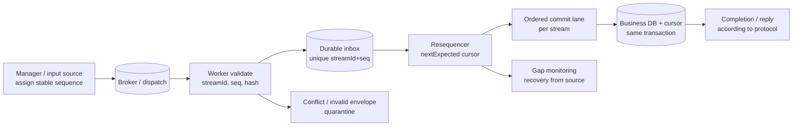
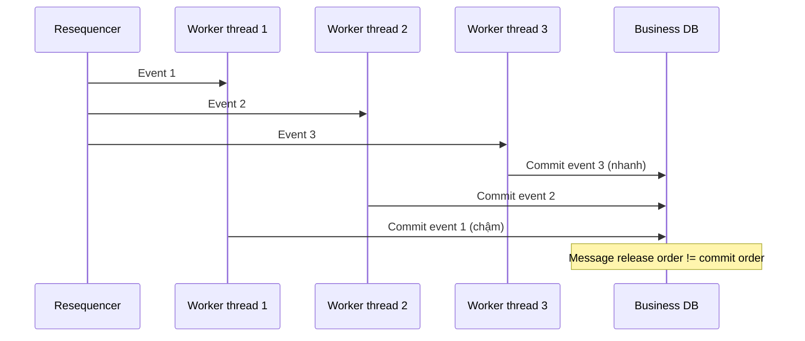
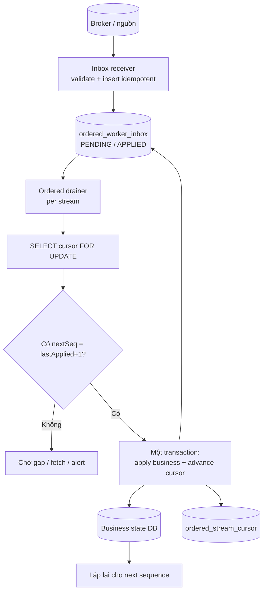
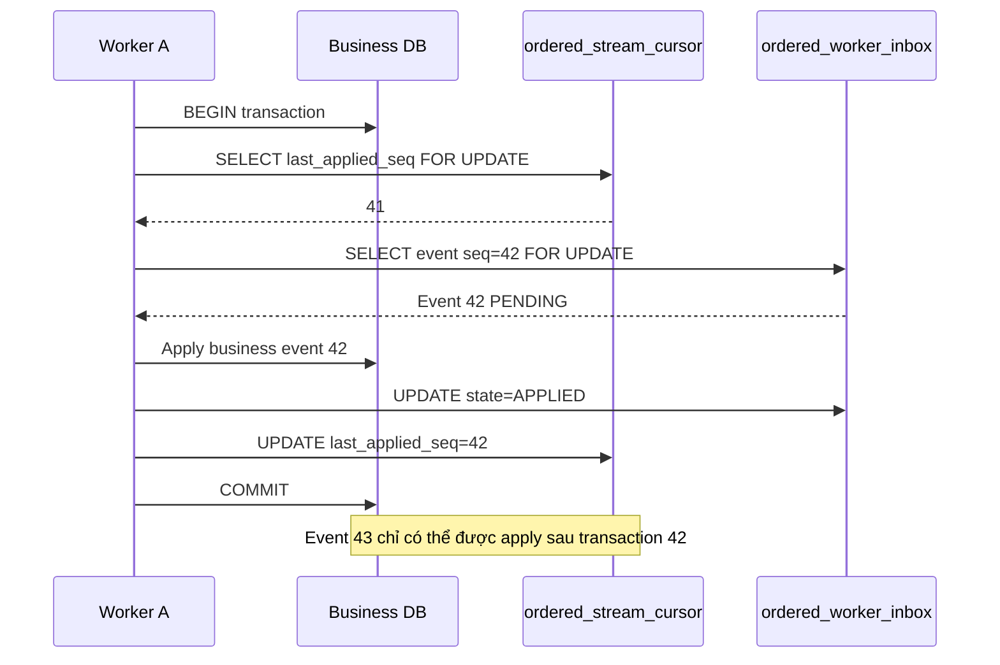
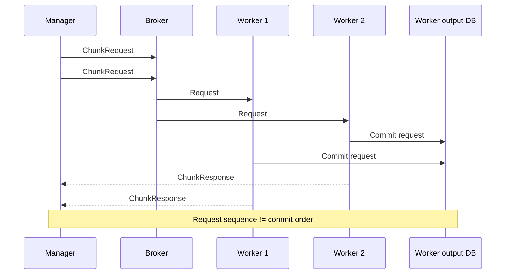

# Resequencing ở worker trong Spring Batch: khôi phục thứ tự khi xử lý song song

Khi mở rộng Spring Batch từ một Step tuần tự sang nhiều worker threads hoặc JVMs, tốc độ xử lý có thể tăng đáng kể. Nhưng một vấn đề mới xuất hiện: **chunk hoặc message được đọc theo thứ tự A, B, C không nhất thiết được xử lý, commit và trả reply theo cùng thứ tự**. Nếu writer chỉ tạo các bản ghi độc lập, điều này có thể chấp nhận. Nếu writer cập nhật trạng thái phụ thuộc lịch sử — như số dư tài khoản, phiên bản inventory, chuỗi sự kiện hoặc báo cáo cần thứ tự — kết quả có thể sai dù Step cuối cùng có trạng thái `COMPLETED`.

**Resequencing ở worker** là cơ chế nhận những công việc đến **không theo thứ tự** rồi giữ lại, sắp xếp và phát hành theo **một hợp đồng thứ tự đã xác định**. Vấn đề khó không nằm ở việc gọi `sort`, mà ở các câu hỏi: thứ tự do ai cấp, thiếu sequence thì làm gì, buffer có giới hạn không, ACK/commit vào lúc nào và worker crash/restart ra sao?

Bài thuộc chương **Ordering**, module **SPRING_BATCH_SCALING_OPERATIONS**. Module hướng tới mở rộng Spring Batch cho workload dữ liệu lớn bằng multi-threaded step, parallel steps, partitioning và các mô hình phân tán; học cách đo nút thắt, bảo đảm thread safety, retry/restart và chọn kiến trúc theo tài nguyên thực tế.

**Mục tiêu học tập:**

- Phân biệt **read order**, **arrival order**, **processing order**, **output order**, **commit order** và **reply order**.
- Xác định nên giữ **global order**, **per-key order** hay chỉ cần **deterministic final output**.
- Thiết kế sequence contract gồm `streamId`, `sequence`, `eventId`, `snapshotVersion` và nội dung bất biến.
- Xử lý out-of-order arrival, duplicates, gaps, late arrivals, timeout và head-of-line blocking.
- Viết một **resequencer trong RAM để học thuật toán**, rồi nâng lên **durable inbox + cursor** để bảo đảm restart.
- Hiểu cách áp dụng trong local/remote partitioning, multi-threaded Step và remote chunking.
- Kết hợp resequencing với bounded queue, transactional writer, idempotency, outbox, metrics và fault-injection tests.

## 1. Vì sao xử lý song song phá vỡ thứ tự?

Trong pipeline tuần tự, reader lấy item 1, writer hoàn tất item 1, rồi mới xử lý item 2. Ở chế độ song song, thời gian xử lý mỗi item/chunk không bằng nhau:

```text
Manager phát công việc:       [1] [2] [3] [4]
Thời gian worker:             80  20  70  10 ms

Thứ tự nhận của worker:        1   2   3   4
Thứ tự hoàn thành có thể là:   4   2   3   1
Thứ tự commit có thể là:      2   4   1   3
Thứ tự reply có thể là:       4   2   1   3
```

Ví dụ này **minh họa**, không suy rằng mọi broker hay mọi Step đều có thể cho đúng thứ tự đó. Sự khác nhau xuất hiện vì có queue, scheduling, CPU/I/O, transaction locks, retry, network và consumer concurrency.

Theo Spring Batch 5.2, multi-threaded Step không bảo đảm một fixed item processing order; chunk còn có thể chứa những item không liên tiếp so với xử lý tuần tự. Vì vậy **không thể gắn `TaskExecutor` rồi mặc định thứ tự vẫn giữ nguyên**.

### Một phản ví dụ nghiệp vụ

Tài khoản A có ba event theo thứ tự logic:

| Sequence | Nghiệp vụ | Tác động giả định |
| --- | --- | --- |
| 1 | Nạp 100 | Số dư 100 |
| 2 | Trừ 40 | Số dư 60 |
| 3 | Kiểm tra hạn mức/rút 80 | Bị từ chối nếu số dư chỉ có 60 |

Nếu worker xử lý event 3 trước event 1 hoặc 2, quyết định có thể khác. Đối với phép cộng thuần túy, tổng cuối có thể giao hoán; nhưng **validation, phí, giới hạn, ledger và side effect** thường không giao hoán.

**Vì vậy trước hết phải hỏi: có thực sự cần giữ thứ tự không?** Không nên tự áp resequencer toàn cục lên dữ liệu độc lập vì nó sẽ làm mất lợi ích của song song hóa.

## 2. Có ít nhất sáu loại thứ tự

| Loại thứ tự | Phạm vi | Ví dụ | Có tự được bảo đảm khi parallel? |
| --- | --- | --- | --- |
| **Source order** | Nguồn/snapshot | ID tăng hoặc thứ tự line CSV | Chỉ khi reader/query có ordering xác định |
| **Dispatch order** | Manager gửi việc | ChunkRequest 1 rồi 2 | Send theo thứ tự không kéo theo completion |
| **Arrival order** | Worker/broker consumer | Worker nhận 2 trước 1 | Phụ thuộc queue, consumers, retries |
| **Processing order** | Logic processor | Hàm processor event 2 chạy trước event 1 | Không khi có nhiều threads |
| **Commit order** | Transaction output | DB commit event 2 trước event 1 | Không trừ khi có cơ chế tuần tự hóa |
| **Reply/ACK order** | Middleware/manager | Response 3 về trước response 2 | Không phản ánh chắc chắn DB commit order |

**Resequencing message arrival** mới giải quyết một phần: worker nhận/giải phóng message theo thứ tự. Để bảo đảm **commit order**, worker phải giới hạn hoặc điều phối downstream execution và transaction.

Ví dụ tệ:

```text
Resequencer phát message theo 1,2,3.
Executor sau resequencer có 3 threads.
Thread xử lý 3 xong trước 1.
DB commit: 3,2,1.

=> Arrival đã được sắp, commit vẫn đảo thứ tự.
```

Do đó phải định nghĩa **“ordered completion” ở ranh giới nào**, không chỉ “đã sort trước writer”.

## 3. Ba cấp độ ordering: global, per-key và final-output

### 3.1. Global order

Tất cả events của toàn bộ batch phải được commit đúng một thứ tự tuyệt đối. Ví dụ: một ledger với quy tắc phụ thuộc các events của nhiều tài khoản.

- Rất khó scale bằng nhiều writer độc lập.
- Một sequence bị thiếu làm cả pipeline mắc kẹt.
- Cần một **sequencing authority** và một đường commit tuần tự hoặc một mô hình giao dịch tương đương.
- Nếu thật sự bắt buộc, cần chứng minh throughput mục tiêu có phù hợp với serialization point không.

### 3.2. Per-key order

Chỉ các events thuộc **cùng business key** phải theo thứ tự. Khác key có thể xử lý song song.

```text
Account A: A1 → A2 → A3   (giữ thứ tự)
Account B: B1 → B2       (giữ thứ tự)

Có thể:
  A1 chạy song song B1
  A2 không commit trước A1
  B2 không commit trước B1
```

Đây thường là phương án thực tế hơn. Key có thể là `accountId`, `orderId`, `customerId`, `aggregateId` hoặc một stream nghiệp vụ khác. **Dùng key đúng dependency**, không chọn ngẫu nhiên chỉ để cân bằng tải.

### 3.3. Chỉ cần final output có thứ tự

Nếu mỗi item được biến đổi độc lập, ta có thể **xử lý và commit song song** rồi dùng Step merge/sort sau cùng:

```text
Workers ghi:
  (sequence=3, result=C)
  (sequence=1, result=A)
  (sequence=2, result=B)

Output/export step:
  SELECT ... ORDER BY sequence
  => A, B, C
```

Phương án này thường rẻ và an toàn hơn resequence trước từng DB write khi nghiệp vụ chỉ yêu cầu **file/report cuối có thứ tự**. Không được dùng nó nếu cập nhật trạng thái khi xử lý có dependency theo thứ tự.

## 4. Chọn kiến trúc trước khi viết resequencer

| Nhu cầu | Phương án ưu tiên | Khi nào cần resequencer? |
| --- | --- | --- |
| Items hoàn toàn độc lập | Parallel workers + idempotent writer | Thường không cần |
| Chỉ final file cần sắp xếp | Parallel writes vào staging + merge `ORDER BY` | Không cần online resequencer |
| Per-key order, có stable routing | Partition/shard theo key, **một ordered lane cho mỗi key** | Nếu transport vẫn cho arrival lệch |
| Per-key order, consumer cạnh tranh | Durable inbox + cursor theo key | Khi worker arrival không đều hoặc redelivery |
| Global commit order | Serial commit gate hoặc kiến trúc khác | Resequencer không tránh được serialization point |
| Một chuỗi message ngắn, có sequence headers | Spring Integration `Resequencer` | Có thể phù hợp |
| Dữ liệu khổng lồ, nhiều gap và replay dài | Durable staging/index + batch ordered scan | In-memory group store thường không phù hợp |

**Bắt đầu bằng giải pháp ít trạng thái nhất.** Nếu chỉ cần sắp xếp cuối batch, online resequencing có thể là độ phức tạp không cần thiết.

## 5. Hợp đồng sequence phải được định nghĩa từ nguồn

Không có sequence đáng tin cậy thì resequencer không biết thứ tự “đúng” là gì.

Một event logic có thể có:

```json
{
  "streamId": "B2026-11:account-A",
  "sequence": 103,
  "eventId": "account-A-event-103-v1",
  "snapshotVersion": "orders-2026-11-v3",
  "eventType": "DEBIT",
  "amount": "40.00"
}
```

Mỗi trường đóng vai trò khác nhau:

| Trường | Ý nghĩa | Điều cần cam kết |
| --- | --- | --- |
| `streamId` | Phạm vi mà ordering phải giữ | Ổn định qua retry/restart |
| `sequence` | Thứ tự trong một stream | Đơn điệu; gapless nếu thuật toán yêu cầu |
| `eventId` | Định danh sự kiện nghiệp vụ | Giữ nguyên qua redelivery |
| `snapshotVersion` | Phiên bản input bất biến | Không đổi trên cùng logical batch |
| `payload`/`payloadHash` | Nội dung nghiệp vụ | Một `(streamId,sequence)` không được âm thầm đổi payload |
| `jobExecutionId` | Lần chạy Spring Batch | Dùng vận hành/correlation, **không làm business order key** |

**Không lấy arrival timestamp để suy ra thứ tự nghiệp vụ** nếu nhiều producer dùng clock khác nhau. Timestamp có thể trùng, đồng hồ có thể lệch, network có thể reorder.

### Sequence gapless hay monotonic?

- **Monotonic:** sequence tăng nhưng có thể thiếu số, ví dụ 10, 20, 30.
- **Gapless:** mỗi stream có 1,2,3,... hoặc một quy luật successor xác định.

Thuật toán “chờ `nextExpected+1`” đòi hỏi **gapless sequence hoặc một danh sách expected IDs**. Nếu nguồn chỉ cấp ID tăng có lỗ hổng (database auto-increment sau rollback chẳng hạn), không được coi mọi số thiếu là event đang đến trễ. Cần **manifest thứ tự**, watermark hoặc predecessor link đáng tin.

## 6. Ai có quyền cấp số thứ tự?

Khả năng đúng phụ thuộc vào *sequencing authority*:

1. **Nguồn sự kiện** cấp version/sequence dưới một transaction gắn với business aggregate.
2. **Manager** đọc snapshot có thứ tự xác định và gán sequence trước dispatch.
3. **Broker partition** bảo đảm thứ tự append trong cùng partition khi producer/consumer/ack configuration phù hợp; nhưng có thể không tương đương thứ tự nghiệp vụ nếu input bị phát sai.
4. **Database staging** có `source_seq`/`batch_seq` được chuẩn hóa và kiểm tra unique.

**Không cho từng worker độc lập gọi `AtomicLong.incrementAndGet()` và coi đó là global business sequence.** Mỗi JVM có state riêng; số có thể reset khi restart và thứ tự cấp số phản ánh arrival, không phải thứ tự đúng của nguồn.

### Tên scope cần rõ

```text
businessOrder = (snapshotId, accountId, eventVersion)
transportCorrelation = (stepExecutionId, requestSequence)
workerExecution = (workerNodeId, workerThreadName)
```

Ba phạm vi khác nhau. Sequence ở tầng middleware có thể hỗ trợ sắp **ChunkRequest** nhưng không tự trở thành version của account.

## 7. Vì sao không dùng ChunkRequest.getSequence() làm business sequence?

Spring Batch Integration có `org.springframework.batch.integration.chunk.ChunkRequest<T>` với `getSequence()`. Nó là thông tin sequence trong protocol **remote chunking**.

**Có thể dùng để correlate/reorder các request hoặc reply trong phạm vi protocol tương ứng**, nhưng không được mặc định coi nó là:

- Version duy nhất của một business aggregate.
- Khóa dedupe nghiệp vụ ổn định qua mọi `JobExecution` restart.
- Chuỗi gapless vĩnh viễn trên tất cả workers/JVMs.
- Bằng chứng một chunk đã commit tại database.
- Thứ tự các **items bên trong chunk** theo business dependency.

Nếu restart dùng JobExecution/StepExecution khác hoặc manager tạo lại chunk theo plan khác, request numbering/correlation có thể khác dù vẫn là cùng business item.

### Ví dụ sai

```java
// Pseudocode: SAI nếu dùng làm idempotency key nghiệp vụ.
String dedupeKey = stepExecutionId + ":" + chunkRequest.getSequence();
```

Để chống double business effect, dùng `batchId + accountId + sourceEventVersion` hoặc `eventId` độc lập với lần gửi transport.

## 8. Resequencing khác Sorting và Aggregation

| Kỹ thuật | Dữ liệu | Kết quả | Rủi ro |
| --- | --- | --- | --- |
| **Sorting** | Có toàn bộ tập cần sắp | Trả tập đã sắp theo comparator | Có thể tốn RAM/I/O và phải chờ đủ tập |
| **Resequencing** | Nhận events dần dần, không theo thứ tự | Phát các events **theo sequence** khi đủ điều kiện | Gaps, buffer growth, timeout, duplicates |
| **Aggregation** | Gom nhiều events thành một nhóm/kết quả | Một message/summary/aggregate | Group completion, memory/state |
| **Ordered commit gate** | Events/operations đã biết sequence | Chỉ cho business operation kế tiếp commit | Contention/head-of-line |
| **Merge after partition** | Các kết quả từ nhiều sorted streams | Output đã merge theo total order | Merge buffer, tie-breaker, snapshot |

Spring Integration có component `Resequencer` dùng `CORRELATION_ID` để nhóm message và `SEQUENCE_NUMBER` để phát theo thứ tự. Nó **không kết hợp payload thành một output** như aggregator. Tài liệu Spring Integration cũng lưu ý resequencer phù hợp với **chuỗi tương đối ngắn và gap nhỏ**; nhiều chuỗi rời rạc/gap lớn có thể gây vấn đề hiệu năng.

**Không tự biến `resequence()` thành “exactly-once committed output”**. Nó xử lý thứ tự **message release** ở kênh; transaction, message persistence, delivery, writer commit phải thiết kế riêng.

## 9. Pipeline worker resequencing



Lưu ý: sơ đồ thể hiện một **kiến trúc ứng dụng được thiết kế thêm**, không phải một chuỗi component tự động được Spring Batch tạo ra khi chỉ bật remote chunking.

### Hai bước cần tách

- **Reception:** đã nhận một message vào hệ thống và lưu nó trong inbox bền vững.
- **Application:** business effect theo thứ tự đã được commit.

**Reception ACK ≠ business completion ACK.** Trong một inbox consumer độc lập, broker có thể được ACK sau khi inbox đã commit, rồi drainer xử lý sau. Nhưng trong một **worker remote chunking dùng ChunkResponse để báo manager chunk đã xử lý**, trả reply thành công **chỉ vì đã staging vào inbox** sẽ vi phạm contract nếu manager hiểu reply là processor/writer đã hoàn tất.

## 10. Thuật toán cửa sổ resequencing đơn giản

Giữ state theo mỗi stream:

```text
nextExpected: sequence kế tiếp được phép phát
pending:      map(sequence -> event)
window:       số sequence tương lai được chấp nhận
maxBuffered:  số event chưa phát tối đa trong RAM
```

Khi nhận event có sequence `s`:

1. Xác nhận `streamId`, `eventId`, sequence, snapshot và hash.
2. Nếu `s < nextExpected`: đây là late/duplicate candidate; xác minh bằng durable history nếu cần.
3. Nếu `s > nextExpected + window`: từ chối/defer bằng backpressure, không tích vô hạn.
4. Nếu `s` đã có trong buffer: cùng hash có thể là duplicate; hash khác là **conflict**, không lấy event đến sau ghi đè.
5. Lưu vào buffer.
6. Trong lúc buffer chứa `nextExpected`, lấy event ra theo thứ tự và tăng cursor “đã phát”.
7. Khi xử lý **bền vững**, cập nhật một cursor **“đã commit” riêng**; không dùng cursor trong RAM làm bằng chứng commit.

### Ví dụ arrival 3,1,4,2,5

| Message đến | Buffer sau admission | Được phát ra | nextExpected |
| --- | --- | --- | ---: |
| 3 | {3} | Không | 1 |
| 1 | {3} | 1 | 2 |
| 4 | {3,4} | Không | 2 |
| 2 | {} | 2,3,4 | 5 |
| 5 | {} | 5 | 6 |

Điều này chỉ chứng minh **thứ tự phát theo một resequencer duy nhất**. Nếu đưa [2,3,4] vào ba executor threads khác nhau, **thứ tự commit có thể đảo**. Phải đưa tới ordered lane hoặc khóa/cursor transaction phù hợp.

## 11. Java: resequencer trong RAM cho một JVM

Ví dụ JDK 17+, dùng `TreeMap` để lưu events đến sớm. Nó **chỉ minh họa cách sắp lại thứ tự message**, không giải quyết durability, ack, checkpoint hay thứ tự commit của side effects.

```java
package example.batch.ordering;

public record OrderedEvent(
        String streamId,
        long sequence,
        String eventId,
        String payloadHash) {
}
```

```java
package example.batch.ordering;

import java.util.ArrayList;
import java.util.HashMap;
import java.util.List;
import java.util.Map;
import java.util.TreeMap;

public final class InMemoryResequencer {

    private static final class StreamWindow {
        long nextToRelease;
        final TreeMap<Long, OrderedEvent> pending = new TreeMap<>();

        StreamWindow(long firstSequence) {
            this.nextToRelease = firstSequence;
        }
    }

    private final Map<String, StreamWindow> streams = new HashMap<>();
    private final int maxBufferedPerStream;
    private final long maxLookAhead;
    private final long initialSequence;

    public InMemoryResequencer(
            long initialSequence,
            int maxBufferedPerStream,
            long maxLookAhead) {

        if (initialSequence <= 0
                || maxBufferedPerStream <= 0
                || maxLookAhead < 0) {
            throw new IllegalArgumentException("Invalid window");
        }
        this.initialSequence = initialSequence;
        this.maxBufferedPerStream = maxBufferedPerStream;
        this.maxLookAhead = maxLookAhead;
    }

    public synchronized List<OrderedEvent> accept(OrderedEvent event) {
        if (event == null || event.streamId() == null
                || event.streamId().isBlank()
                || event.eventId() == null
                || event.eventId().isBlank()
                || event.payloadHash() == null
                || event.payloadHash().isBlank()
                || event.sequence() < initialSequence) {
            throw new IllegalArgumentException("Invalid event");
        }

        StreamWindow window = streams.computeIfAbsent(
                event.streamId(),
                key -> new StreamWindow(initialSequence));

        long expected = window.nextToRelease;

        if (event.sequence() < expected) {
            // CHỈ cho demo: bỏ qua late arrival theo cursor RAM.
            // Production phải xác minh durable event ID/payload hash.
            return List.of();
        }

        if (event.sequence() - expected > maxLookAhead) {
            throw new IllegalStateException(
                    "Sequence is outside the admission window");
        }

        OrderedEvent existing = window.pending.get(event.sequence());
        if (existing != null) {
            if (!existing.equals(event)) {
                throw new IllegalStateException(
                        "Same stream/sequence but conflicting payload");
            }
            return List.of();
        }

        // Nếu event đúng expected, có thể drain cả pending dù
        // buffer đang đầy vì thiếu event expected trước đó.
        if (window.pending.size() >= maxBufferedPerStream
                && event.sequence() != expected) {
            throw new IllegalStateException(
                    "Resequencing buffer is full");
        }

        window.pending.put(event.sequence(), event);
        List<OrderedEvent> ready = new ArrayList<>();

        while (true) {
            OrderedEvent next = window.pending.remove(
                    window.nextToRelease);
            if (next == null) {
                break;
            }
            ready.add(next);
            window.nextToRelease =
                    Math.addExact(window.nextToRelease, 1L);
        }
        return List.copyOf(ready);
    }

    public synchronized int pendingCount(String streamId) {
        StreamWindow window = streams.get(streamId);
        return window == null ? 0 : window.pending.size();
    }
}
```

### Điều code làm đúng

- Một stream có **cursor phát hành riêng**.
- Dùng sequence thay vì arrival time.
- Không vượt `maxLookAhead` và `maxBufferedPerStream` cho pending events của một stream.
- Kiểm tra message cùng sequence đang chờ nhưng payload/hash khác.
- `synchronized` bảo vệ state **của instance trong một JVM**, tránh hai threads sửa TreeMap cùng lúc.
- Khi event bị thiếu cuối cùng đến, phát được **nhiều events liên tiếp**.

### Điều code không cam kết

- Không lưu state bền vững; crash là mất cả map và cursor.
- Không giới hạn **số stream IDs**, nên có thể tăng RAM vô hạn nếu nhận nhiều keys; production cần quota/eviction hoặc durable store.
- Không chứng minh payloadHash thật tương ứng payload; cần xác thực ở ingress.
- Không so hash của late duplicate đã được phát vì demo không giữ durable history.
- Trả `List<OrderedEvent>` chỉ có nghĩa “đủ điều kiện **phát**”, **chưa hề commit business effects**.
- Nếu nhiều threads nhận các lists và ghi DB song song, commit order vẫn có thể sai.
- Không nên dùng demo này như một `ItemProcessor` độc lập rồi cho rằng Spring Batch đã hỗ trợ transactional resequencing.

**Đây là một công cụ học thuật toán, không phải worker component có thể deploy thẳng để đảm bảo correctness.**

## 12. Unit test thuật toán arrival 3,1,4,2

```java
package example.batch.ordering;

import static org.junit.jupiter.api.Assertions.*;

import java.util.List;
import org.junit.jupiter.api.Test;

class InMemoryResequencerTest {

    private OrderedEvent event(long seq) {
        return new OrderedEvent(
                "B2026-11:account-A",
                seq,
                "evt-" + seq,
                "sha-" + seq);
    }

    @Test
    void releasesOnlyContiguousSequence() {
        var reorder = new InMemoryResequencer(1, 4, 8);

        assertEquals(List.of(), reorder.accept(event(3)));
        assertEquals(List.of(1L),
                reorder.accept(event(1))
                        .stream().map(OrderedEvent::sequence).toList());
        assertEquals(List.of(), reorder.accept(event(4)));
        assertEquals(List.of(2L, 3L, 4L),
                reorder.accept(event(2))
                        .stream().map(OrderedEvent::sequence).toList());
        assertEquals(0,
                reorder.pendingCount("B2026-11:account-A"));
    }

    @Test
    void rejectsConflictingPendingSequence() {
        var reorder = new InMemoryResequencer(1, 4, 8);
        reorder.accept(event(3));

        var changed = new OrderedEvent(
                "B2026-11:account-A", 3,
                "another-event", "different-hash");

        assertThrows(IllegalStateException.class,
                () -> reorder.accept(changed));
    }

    @Test
    void rejectsBeyondWindow() {
        var reorder = new InMemoryResequencer(1, 2, 4);

        assertThrows(IllegalStateException.class,
                () -> reorder.accept(event(7)));
    }

    @Test
    void handlesExactDuplicateWhilePending() {
        var reorder = new InMemoryResequencer(1, 4, 8);
        reorder.accept(event(3));
        assertEquals(List.of(), reorder.accept(event(3)));
        assertEquals(1,
                reorder.pendingCount("B2026-11:account-A"));
    }
}
```

Các test trên **không có Spring Batch JobRepository, database hay broker**. Chúng kiểm tra map/window và định dạng; phải có integration tests riêng cho commit/restart/ACK.

## 13. Vì sao phát đúng thứ tự vẫn có thể ghi sai?

Giả sử resequencer phát 1,2,3 vào một executor có 3 threads:



**Nếu nghiệp vụ đòi order of effects**, có hai hướng:

1. **Per-stream serial consumer/lane:** chỉ một operation cùng `streamId` được write/commit tại một thời điểm; khác streams có thể song song.
2. **Transactional ordered cursor:** DB chỉ cho phép apply `nextSeq=lastCommitted+1` dưới row lock/CAS, rồi update business state và cursor trong cùng transaction.

Hướng thứ hai thích hợp khi nhiều worker processes có thể nhận event cùng stream mà không muốn dựa vào in-memory locks.

## 14. Resequencing tạo head-of-line blocking

Nếu stream nhận `1,3,4,5,6` nhưng sequence 2 biến mất, tất cả các event 3–6 phải chờ. Đây là **head-of-line (HOL) blocking**.

```text
nextExpected = 2
buffer       = {3,4,5,6}
event #2     = missing

Nếu "không được skip sequence #2":
    Không event nào từ 3..6 được commit.
```

Tác động:

- Buffer/queue tăng, latency p99 tăng.
- Worker có thể nhàn dù đã nhận nhiều messages.
- Nếu một stream nóng bị kẹt, throughput toàn partition có thể giảm.
- Retry/redelivery khiến duplicate attempts xuất hiện.
- Nếu manager chờ reply cho một chunk bị block, **in-flight window** có thể đầy và kéo chậm producer.

### Không “fix” bằng cách tăng timeout vô hạn

Một timeout dài giúp chờ late arrival nhưng tăng memory và thời gian thất bại. Timeout ngắn giúp phát hiện gap nhưng có thể tạo false alarms. Cần:

- Gap age metric, dựa trên thời điểm nhận event tương lai đầu tiên.
- Giới hạn `maxBuffered`, `maxLookAhead`, in-flight requests/bytes.
- Cơ chế lấy lại sequence thiếu từ **source/snapshot bền vững**.
- Quy trình xác nhận một sequence đã bị hủy theo nghiệp vụ, dùng **tombstone/no-op có xác thực**.
- Chỉ skip gap khi **business contract cho phép**, có audit và versioning rõ.

## 15. Gapless vs watermark vs tombstone

### Nguồn có sequence gapless

Nếu nguồn đảm bảo `1,2,3,...` thì thiếu số 2 có thể là late arrival, transmission failure hoặc producer crash. Có thể chờ và retry fetch số 2.

### Nguồn chỉ có sequence tăng

Nếu nguồn chỉ đảm bảo `10,20,30`, thuật toán +1 sẽ chờ 11–19 mãi mãi. Cần:

- `manifest` liệt kê expected sequence IDs.
- Thứ tự trên một snapshot đã chốt để biết next expected.
- Sequence predecessor link/offset từ nguồn có hợp đồng rõ.

### Watermark

Watermark chỉ có ích nếu nguồn cung cấp **cam kết về tiến độ**: “không còn event có sequence thấp hơn X có thể đến nữa” hoặc một ngữ nghĩa tương đương. Một worker tự đo “đã chờ 10 giây” **không phải watermark đáng tin**.

### Tombstone

Tombstone cho `sequence=2` là một **event có version/identity rõ ràng** xác nhận nghiệp vụ đã hủy/không áp dụng số 2. Nếu domain cho phép, resequencer có thể tiến tới 3 sau khi tombstone 2 được xử lý/commit. Không tự chế tombstone vì queue bị tắc.

## 16. Resequencing window và backpressure

Gọi:

- \(N\): số streams active.
- \(B_k\): số events đang pending của stream \(k\).
- \(S_k\): kích thước payload trung bình trong RAM của stream \(k\).

Memory thô cho pending events:

\[
M_{\mathrm{pending}} \approx \sum_{k=1}^{N} B_k S_k
\]

Chưa tính object headers, map overhead, serializer copies, retry state, broker prefetch, database buffers, thread stacks và GC.

Nếu 1.000 streams, mỗi stream pending 50 events, payload 4 KiB/event:

\[
M_{\mathrm{payload}} \approx 1000 \times 50 \times 4\,\text{KiB}
\approx 195\,\text{MiB}
\]

Đây chỉ là **payload estimate**, không phải heap thực. Nếu mỗi stream có unbounded window và một số sequence mất hẳn, memory có thể tăng không giới hạn.

### Backpressure đúng chỗ

1. Giới hạn **bytes hoặc events** cho từng stream.
2. Giới hạn **số streams active**/số message groups.
3. Chặn producer/broker consumer bằng bounded admission hoặc lưu ở **durable inbox** có quota/retention.
4. Đừng lấy một limit per JVM làm global limit khi có 20 worker pods.
5. Khi quá ngưỡng, áp retry-after/backoff/throttle theo contract; **không discard** các sequence chưa commit một cách âm thầm.
6. Với remote chunking, manager phải giới hạn outstanding `ChunkRequest`; worker resequencer không tự hạn chế manager publish.

**Không release broker message quá sớm nếu chưa có nơi lưu bền vững để phục hồi.**

## 17. Đo throughput và độ trễ resequencing

Một số metric nên tách:

| Metric | Loại | Ý nghĩa |
| --- | --- | --- |
| `resequence_received_total` | Counter | Message arrivals, gồm attempts/duplicates |
| `resequence_duplicate_total` | Counter | Trùng sequence/event ID sau validation |
| `resequence_conflict_total` | Counter | Cùng sequence nhưng payload/hash khác |
| `resequence_pending_events` | Gauge | Events đang chờ gap |
| `resequence_active_streams` | Gauge | Số streams có state |
| `resequence_gap_age_seconds` | Gauge/histogram | Tuổi của sequence thiếu lâu nhất |
| `resequence_release_total` | Counter | Messages đã được phát khỏi resequencer |
| `business_applied_total` | Durable counter/ledger | Business effects đã commit |
| `inbox_oldest_pending_age` | Gauge | Thời gian pending trong durable inbox |
| `stream_commit_cursor_lag` | Gauge | Chênh giữa max received và last applied |
| `stream_lock_wait_seconds` | Timer | Contention ở cursor row lock |
| `broker_redelivery_total` | Counter | Attempts do broker giao lại |
| `chunk_reply_timeout_total` | Counter | Manager chưa nhận reply, **chưa chắc DB rollback** |

Những tên trên là **metric do ứng dụng tự định nghĩa**, không phải Spring Batch built-ins.

**Release rate ≠ committed throughput.** Nếu resequencer phát 1.000 events/s nhưng ordered writer chỉ commit được 300/s, queue sau resequencer vẫn có thể tăng. Đo **arrival → durable apply** và **inbox → applied** riêng.

## 18. Từ bộ đệm RAM sang durable inbox và ordered cursor

Resequencer RAM có thể phù hợp để tổ chức các message ngắn khi hệ thống chịu được replay, nhưng **nếu correctness yêu cầu state không mất qua crash**, worker phải có nơi lưu bền vững và biết **sequence nào đã được apply thành công**.

Một cách thiết kế với PostgreSQL:



**Hai đối tượng bền vững khác nhau:**

- **Inbox:** message đã được nhận, nhưng chưa chắc đã tác động nghiệp vụ.
- **Cursor:** sequence lớn nhất đã **commit nghiệp vụ liên tục** trong stream.

Ví dụ inbox có `1,2,4,5`, cursor bằng 2; không được tăng cursor lên 5 chỉ vì đã nhận message 5.

### Những bất biến cần giữ

1. `(streamId,seq)` là duy nhất và gắn với payload/event identity bất biến.
2. Cursor không được tăng nếu chưa có business effect hợp lệ của sequence kế tiếp.
3. Business effect và cursor update nằm trong **cùng DB transaction** khi cần exactly-once state update.
4. Khi thiếu sequence, drainer **không tiến qua gap** nếu không có quyết định nghiệp vụ được audit.
5. Retry/redelivery cùng message không tạo **business effect thứ hai**.
6. Worker restart phải tái tạo state từ inbox + cursor bền vững, không từ RAM.

**Exactly-once effect chỉ được hiểu trong phạm vi transaction và business key đã định nghĩa**, không đồng nghĩa exactly-once transport hoặc exactly-once HTTP/email.

## 19. SQL schema tham khảo cho inbox + cursor

Ví dụ dùng stream là tài khoản trong một batch, sequence từ 1 và nghiệp vụ cập nhật số dư bằng một `delta_amount`. PostgreSQL:

```sql
CREATE TABLE ordered_stream_cursor (
    stream_id varchar(160) PRIMARY KEY,
    last_applied_seq bigint NOT NULL DEFAULT 0
        CHECK (last_applied_seq >= 0)
);

CREATE TABLE ordered_worker_inbox (
    stream_id varchar(160) NOT NULL,
    seq bigint NOT NULL CHECK (seq >= 1),
    event_id varchar(160) NOT NULL,
    payload_hash varchar(64) NOT NULL,
    delta_amount numeric(18,2) NOT NULL,
    state varchar(16) NOT NULL DEFAULT 'PENDING'
        CHECK (state IN ('PENDING','APPLIED')),
    received_at timestamptz NOT NULL DEFAULT clock_timestamp(),
    applied_at timestamptz NULL,
    PRIMARY KEY (stream_id, seq),
    UNIQUE (stream_id, event_id)
);

CREATE INDEX ordered_inbox_pending_idx
    ON ordered_worker_inbox (stream_id, seq)
    WHERE state = 'PENDING';

CREATE TABLE account_balance (
    stream_id varchar(160) PRIMARY KEY,
    balance numeric(18,2) NOT NULL DEFAULT 0
);
```

**Giới hạn của mô hình:**

- Dữ liệu số dư dùng phép cộng để minh họa transaction/ordering; production có thể cần currency, precision, kiểm soát âm số dư, ledger bất biến và kiểm toán.
- `stream_id` cần bao gồm phạm vi version/snapshot nếu sequence reset qua batch; không dùng một ID tái sử dụng với lịch sử không tương thích.
- `payload_hash` phải được tính từ payload canonical **ở biên đáng tin**, không tin header do caller có thể tự giả mạo.
- `UNIQUE(stream_id,event_id)` ngăn cùng eventId xuất hiện ở sequence khác của một stream; collision phải xử lý như lỗi dữ liệu.
- Nếu mỗi stream có hàng triệu inbox rows, cần index/partition/retention/vacuum thích hợp; tránh lưu object graph rất lớn trong metadata.
- Inbox không tự phải là `ExecutionContext`; đây là **business/delivery state**, nằm ở storage được quản lý riêng.

### Vì sao UNIQUE(streamId,seq) chưa đủ?

Hai message có cùng `(streamId,seq)` nhưng khác payload vẫn có thể được xử lý bằng `INSERT ... ON CONFLICT DO NOTHING`. Nếu bỏ qua không kiểm tra, bạn đang **che data corruption**.

Lúc ingest, cần:

1. Chèn message với unique constraint.
2. Nếu conflict, đọc record đã có.
3. So `eventId`, `payloadHash`, snapshot/contract và payload canonical nếu cần.
4. Nếu cùng identity: ghi metric duplicate, tiếp tục protocol idempotent.
5. Nếu khác: **quarantine/alert**, không ghi đè nội dung cũ hay tự chọn message đến sau.

## 20. Ingest: lưu vào inbox trước khi xác nhận reception

SQL nhận event:

```sql
INSERT INTO ordered_worker_inbox (
    stream_id, seq, event_id, payload_hash, delta_amount
)
VALUES (
    :streamId, :seq, :eventId, :payloadHash, :deltaAmount
)
ON CONFLICT (stream_id, seq) DO NOTHING;
```

**Không sử dụng riêng row-count trả về như đủ quyết định.**

- Nếu insert 1 row: message được chấp nhận để xử lý.
- Nếu insert 0 row: đã có sequence. Phải so identity/hash để biết duplicate hay conflict.
- Nếu unique constraint trên `(stream_id,event_id)` bị vi phạm: cùng eventId ở sequence khác, cần fail/quarantine.
- Nếu DB lỗi trước commit: **không ACK reception** dựa trên thao tác `jdbc.update` chưa commit.

### Hai loại ACK ở hai giao thức

**Giao thức inbox consumer độc lập:** nếu broker cho at-least-once delivery, có thể ACK **broker reception** sau khi inbox insert transaction commit thành công. Sau đó một drainer riêng xử lý business effect. Broker redeliver trước ACK không sao nếu inbox có dedup.

**Giao thức Spring Batch remote chunking:** worker nhận `ChunkRequest`, manager mong `ChunkResponse` đại diện outcome xử lý chunk. **Không trả ChunkResponse thành công chỉ vì inbox đã lưu request**, nếu actual processor/writer chưa commit và contract tích hợp không hỗ trợ deferred completion. Muốn deferred processing phải thiết kế một **protocol khác** hoặc tích hợp lại manager/worker completion semantics.

Một request được giữ trong inbox không có nghĩa là Step manager đã có thể checkpoint reader vượt qua request đó.

## 21. Thuật toán ordered apply dưới một row lock

Thay vì “sắp rồi đưa cho nhiều writers tự commit”, có thể cho mỗi stream một **cursor row** để serialize transaction theo sequence.

Trong một transaction:

1. `INSERT cursor row nếu chưa có`.
2. `SELECT last_applied_seq FOR UPDATE` để khóa stream.
3. Tính `next = last_applied_seq + 1`.
4. `SELECT inbox[streamId,next] FOR UPDATE`.
5. Nếu thiếu: kết thúc transaction không thay đổi cursor.
6. Nếu có: áp business effect đúng của `next`.
7. Cập nhật inbox `APPLIED` và cursor `last_applied_seq=next`.
8. **COMMIT tất cả cùng nhau**.



Nếu worker B cũng xử lý stream này, nó phải chờ cursor lock; sau khi worker A commit, worker B đọc được cursor mới. Nếu A rollback, B vẫn thấy cursor cũ và có thể apply sequence 42 lại trong transaction đúng.

### Điều kiện để lập luận này đúng

- Cursor row, inbox row và output **cùng một DB transaction** (cùng datasource/transaction manager thật).
- Mọi code path ghi cùng business state phải tuân ordered-cursor contract; không có một writer khác bỏ qua cursor.
- Không tự mở transaction `REQUIRES_NEW` để commit business trước cursor.
- Không gọi external HTTP/email khi đang giữ cursor lock rồi giả định rollback được external side effect.
- Không sử dụng `READ UNCOMMITTED`/custom data flow làm vô hiệu khóa.
- Nếu cần serial order qua **nhiều databases**, một row lock tại DB-A không tự tuần tự hóa commit DB-B; cần kiến trúc khác và reconciliation.

## 22. Java: ordered apply service với TransactionTemplate

Mẫu Java 17+, Spring JDBC và Spring Batch 5.x; giả định `JdbcTemplate` và `TransactionTemplate` cùng quản lý **một PostgreSQL datasource** chứa inbox/cursor/business output.

```java
package example.batch.ordering;

import java.math.BigDecimal;
import java.util.List;
import java.util.Objects;

import org.springframework.jdbc.core.JdbcTemplate;
import org.springframework.transaction.support.TransactionTemplate;

public final class OrderedApplyService {

    private record PendingEvent(
            long sequence, BigDecimal delta) {}

    private final JdbcTemplate jdbc;
    private final TransactionTemplate transaction;

    public OrderedApplyService(
            JdbcTemplate jdbc,
            TransactionTemplate transaction) {

        this.jdbc = Objects.requireNonNull(jdbc);
        this.transaction = Objects.requireNonNull(transaction);
    }

    public boolean applyOne(String streamId) {
        if (streamId == null || streamId.isBlank()) {
            throw new IllegalArgumentException("Missing streamId");
        }

        Boolean applied = transaction.execute(status -> {
            // Idempotent initialization, không reset cursor cũ.
            jdbc.update("""
                INSERT INTO ordered_stream_cursor (
                    stream_id, last_applied_seq
                )
                VALUES (?, 0)
                ON CONFLICT (stream_id) DO NOTHING
                """, streamId);

            Long last = jdbc.queryForObject("""
                SELECT last_applied_seq
                FROM ordered_stream_cursor
                WHERE stream_id = ?
                FOR UPDATE
                """, Long.class, streamId);

            if (last == null) {
                throw new IllegalStateException("Missing cursor row");
            }

            long next = Math.addExact(last, 1L);

            List<PendingEvent> rows = jdbc.query("""
                SELECT seq, delta_amount
                FROM ordered_worker_inbox
                WHERE stream_id = ?
                  AND seq = ?
                  AND state = 'PENDING'
                FOR UPDATE
                """, (rs, rowNum) -> new PendingEvent(
                        rs.getLong("seq"),
                        rs.getBigDecimal("delta_amount")),
                    streamId, next);

            if (rows.isEmpty()) {
                // Gap: không apply seq cao hơn để "giải phóng queue".
                return false;
            }

            PendingEvent event = rows.get(0);

            // Tác động nghiệp vụ cùng database/transaction.
            jdbc.update("""
                INSERT INTO account_balance (stream_id, balance)
                VALUES (?, ?)
                ON CONFLICT (stream_id)
                DO UPDATE SET balance =
                    account_balance.balance + EXCLUDED.balance
                """, streamId, event.delta());

            int inboxUpdated = jdbc.update("""
                UPDATE ordered_worker_inbox
                SET state = 'APPLIED',
                    applied_at = clock_timestamp()
                WHERE stream_id = ?
                  AND seq = ?
                  AND state = 'PENDING'
                """, streamId, next);

            if (inboxUpdated != 1) {
                throw new IllegalStateException(
                        "Inbox update lost the expected event");
            }

            int cursorUpdated = jdbc.update("""
                UPDATE ordered_stream_cursor
                SET last_applied_seq = ?
                WHERE stream_id = ?
                  AND last_applied_seq = ?
                """, next, streamId, last);

            if (cursorUpdated != 1) {
                throw new IllegalStateException(
                        "Cursor changed unexpectedly");
            }

            return true; // TransactionTemplate commit sau callback
        });

        return Boolean.TRUE.equals(applied);
    }
}
```

### Tại sao ví dụ này chặt chẽ hơn bộ đệm RAM?

- `FOR UPDATE` trên cursor row tuần tự hóa các transaction của **cùng stream** dù worker ở JVM khác.
- Chỉ đọc/apply `last+1`; không đi qua gap.
- Business state, inbox status và cursor được cập nhật trong **một transaction DB**.
- Nếu exception ném trước commit, Spring transaction rollback cả ba.
- Nếu JVM crash **sau commit** rồi broker redeliver, cursor đã tăng; event cũ không được cộng lại.
- Khác stream có cursor row khác nhau, có thể xử lý song song nếu DB chịu được.

**Quan trọng:** caller chỉ gọi `applyOne` sau khi inbox event đã được persist. Nếu transaction ingest chưa commit, việc apply không thấy event là đúng và cần được đánh thức lại khi event đã commit.

### Khi có nhiều events liên tiếp

Đừng dùng một transaction khổng lồ để drain 1 triệu events của một stream, vì lock giữ lâu, rollback lớn và WAL/latency tăng. Có thể lặp **ngoài transaction**:

```java
public int drainAvailable(
        OrderedApplyService service,
        String streamId,
        int maxEventsPerWakeUp) {

    if (maxEventsPerWakeUp <= 0) {
        throw new IllegalArgumentException("Invalid drain budget");
    }

    int committed = 0;
    while (committed < maxEventsPerWakeUp
            && service.applyOne(streamId)) {
        committed++;
    }
    return committed;
}
```

Mỗi `applyOne` có transaction riêng; điều này giúp fairness giữa nhiều streams. Khi `applyOne` trả `false` vì gap, **không busy-spin**; chờ event đến, scheduled poll hợp lý hoặc wake-up signal sau inbox commit.

Một worker crash giữa vòng lặp không mất cursor đã commit; vòng tiếp theo sẽ resume ở sequence kế.

## 23. Tính đúng đắn của ordered cursor qua các cửa sổ crash

| Thời điểm crash | DB có gì? | Khi chạy lại |
| --- | --- | --- |
| Trước inbox insert commit | Chưa có message bền vững | Broker redeliver/producer retry |
| Sau inbox commit, trước broker ACK | Message đã nằm inbox, có thể nhận lại | Dedupe theo stream+seq+hash |
| Sau inbox commit, trước drainer wake-up | Inbox PENDING | Sweeper/poll khôi phục |
| Đang chờ cursor row lock | Không có business effect của transaction này | Retry/read lại cursor |
| Sau DML balance, trước cursor update | Chưa COMMIT transaction | Rollback DML/cursor cùng nhau |
| Sau cursor update, trước COMMIT | Transaction chưa chắc đã durable | DB commit/rollback quyết định; retry idempotent |
| Sau COMMIT, trước reply/ACK | Business effect và cursor đã commit | Duplicate arrival không cộng lại |
| Sau trả reply nhưng manager chưa persist state | Worker đã hoàn tất, manager có thể replay | Durable cursor/inbox bảo vệ side effect |
| Trong upgrade schema | Context cũ và cursor còn trong DB | Dùng migration/compatibility tests |

**Không có phương pháp chỉ nhìn log để biết chắc kết quả của commit khi connection mất ngay thời điểm commit.** Phải query durable DB state bằng business key/cursor và replay idempotently.

## 24. Kiểm tra số dư và invariant liên tục

Một cursor tốt cần được đối soát với dữ liệu đã apply.

```sql
-- Tìm inbox records được đánh dấu applied vượt quá cursor.
SELECT i.stream_id, i.seq, c.last_applied_seq
FROM ordered_worker_inbox i
JOIN ordered_stream_cursor c
  ON c.stream_id = i.stream_id
WHERE i.state = 'APPLIED'
  AND i.seq > c.last_applied_seq;

-- Tìm records đã đi qua cursor nhưng chưa đánh dấu APPLIED.
SELECT i.stream_id, i.seq, c.last_applied_seq
FROM ordered_worker_inbox i
JOIN ordered_stream_cursor c
  ON c.stream_id = i.stream_id
WHERE i.state <> 'APPLIED'
  AND i.seq <= c.last_applied_seq;

-- Các stream có event đã nhận phía trước cursor:
SELECT i.stream_id,
       c.last_applied_seq,
       MIN(i.seq) AS earliest_pending_seq,
       MAX(i.seq) AS latest_pending_seq,
       COUNT(*) AS pending_count
FROM ordered_worker_inbox i
JOIN ordered_stream_cursor c
  ON c.stream_id = i.stream_id
WHERE i.state = 'PENDING'
GROUP BY i.stream_id, c.last_applied_seq
ORDER BY pending_count DESC;
```

Các query **đầu tiên** tìm inconsistency giữa trạng thái inbox và cursor theo contract. Chúng không đủ chứng minh mọi expected sequence có mặt: **sự kiện bị thiếu hoàn toàn không có row** để truy vấn.

### Kiểm chứng gap với nguồn truth

Để biết stream thiếu sequence nào, cần:

- Manifest expected range/sequence IDs từ nguồn.
- Producer high watermark được xác nhận có semantics rõ.
- Durable event log/CDC offset có khả năng replay.
- Tombstone đã được nguồn ký/ủy quyền.

Ví dụ `last_applied_seq=41`, inbox có `43,44`, producer đã xác nhận version 44 tồn tại ⇒ sequence 42 đang thiếu và cần điều tra. Nếu producer chỉ nói “max seen 44”, vẫn không chắc 42 đáng lẽ phải tồn tại trong một nguồn không gapless.

## 25. Resequencing với Spring Integration

Spring Integration có `Resequencer`, làm việc với các message headers như:

- `CORRELATION_ID` để nhóm messages cùng một logical sequence.
- `SEQUENCE_NUMBER` để sắp xếp messages trong nhóm.
- `SEQUENCE_SIZE` khi cần biết tổng số phần của chuỗi.

Một ví dụ Java DSL ở mức minh họa:

```java
import org.springframework.context.annotation.Bean;
import org.springframework.integration.dsl.IntegrationFlow;

@Bean
public IntegrationFlow workerResequenceFlow() {
    return IntegrationFlow.from("unorderedWorkerInput")
            .resequence()
            .channel("workerOrderedOutput")
            .get();
}
```

**Đây là sơ đồ flow rất tối giản**, không phải một hệ thống bền vững/production config đầy đủ:

1. Producer phải cấp đúng correlation/sequence headers; không tự giả định middleware tự biết business order.
2. Mỗi message group cần **completion/release strategy** thích hợp. Nếu `SEQUENCE_SIZE` cố định mà có missing message, group có thể không bao giờ hoàn tất.
3. Cần chọn `MessageGroupStore` phù hợp nếu phải giữ state qua JVM crash; default in-memory không tự tạo durability.
4. Cần expiration/timeout/release-partial policy rõ. **Release partial không tự có nghĩa “được phép bỏ qua gap” theo nghiệp vụ**.
5. Nếu output channel phía sau dùng executor song song, **message release order ≠ DB commit order**.
6. Tài liệu Spring Integration khuyến cáo resequencer cho **các chuỗi tương đối ngắn, gap nhỏ**, không phải vô hạn message groups.

### Khi sequence size không biết trước

Nếu worker nhận các events liên tục của một account, có thể không tồn tại `SEQUENCE_SIZE` cố định. Khi đó bộ resequencer dạng group hoàn chỉnh không phải lúc nào cũng phù hợp; dùng **durable inbox + cursor liên tục** hoặc routing/partitioning theo stream có thể rõ hơn.

### Khi có nhiều batches và reuse correlation ID

Nếu `CORRELATION_ID=account-A` cho mọi tháng, message từ tháng trước có thể lẫn tháng sau, sequence reset sẽ conflict. Phải bao gồm scope version/snapshot hoặc giữ một cursor global thực sự cho account. **Correlation scope là một phần của tính đúng đắn.**

## 26. Worker Spring Batch xử lý item hay chunk?

Đừng nhầm hai nơi đặt resequencer:

### Resequencing item

Các events trong một stream có sequence riêng:

```text
Message/chunk #17 có [A103, B9, A104]
Message/chunk #18 có [B10, A102]
```

Nếu account A cần A102 → A103 → A104, **chỉ sắp thứ tự chunk #17, #18 chưa đủ**, vì items của cùng stream có thể nằm khác chunk và dispatch order có thể khác business sequence.

### Resequencing chunk

Các `ChunkRequest` có sequence do manager/protocol gán:

```text
ChunkRequest sequence 17, 18, 19
Workers hoàn thành: 19, 17, 18
```

Một resequencer có thể giúp **quan sát/merge replies theo sequence** hoặc điều phối chunk application, nhưng chỉ đúng nghiệp vụ nếu **chunk boundaries và item order** đã được xác định theo một contract phù hợp.

**Một chunk có thể chứa nhiều stream keys**. Nếu cứ chờ chunk 17 trước khi cho chunk 18 commit, bạn vô tình tuần tự hóa tất cả keys, gây head-of-line blocking. Khi business order chỉ per-key, hãy phân tuyến/routing theo key hoặc dùng inbox + per-stream cursor.

## 27. Multi-threaded Step: đừng dùng ItemProcessor để sort toàn cục

Một `ItemProcessor` thường xử lý từng item, không biết toàn bộ events đến sau và không có quyền quyết định thứ tự commit của các chunk khác.

```java
// Anti-pattern: không bảo đảm thứ tự commit trong Step nhiều threads.
public NormalizedOrder process(RawOrder item) {
    synchronized (someSharedLock) {
        return normalize(item);
    }
}
```

`synchronized` chỉ bảo vệ đoạn processor, không bảo đảm **chunk writer transaction** của thread trước commit trước thread sau. Sau khi thoát lock, nhiều threads có thể ghi DB đồng thời và commit đảo.

### Biện pháp đúng hơn

- Nếu phải giữ thứ tự nghiêm ngặt, **Step tuần tự** có thể phù hợp hơn.
- Nếu chỉ per-key order, phân chia input thành **worker Step riêng theo key/range** với một reader/writer tuần tự per lane.
- Nếu arrival không theo thứ tự, đưa vào durable inbox và ordered drainer.
- Nếu chỉ final output order, dùng staging + final sort/merge.
- Đảm bảo reader stateful/`ItemStream` restart đúng khi concurrent chunks commit đảo thứ tự.
- `@StepScope` là scope theo StepExecution, **không tự tách bean theo thread**.

Đừng đổi concurrency mà không chạy crash/restart test: throughput tăng nhưng mất bản ghi là thất bại.

## 28. Local và remote partitioning: thứ tự trong mỗi partition

Partitioning cho mỗi worker một `StepExecution` và `ExecutionContext` riêng. Các workers thường hoàn tất không theo thứ tự partition name.

Ví dụ:

```text
range-000: rows 1..1000, hoàn tất ở t=20s
range-001: rows 1001..2000, hoàn tất ở t=35s
range-002: rows 2001..3000, hoàn tất ở t=10s
```

Nếu chỉ cần file CSV cuối đúng thứ tự ID, **đừng buộc range-002 chờ range-000 trước khi ghi staging**. Sau khi mọi partition hoàn tất, một Step merge xuất:

```sql
SELECT id, normalized_amount
FROM staging_normalized_orders
WHERE batch_id = :batchId
ORDER BY id;
```

Nếu cần order của business effects, mỗi partition phải chứa dependency streams đúng. `hash(accountId) % bucketCount` thường gom các events của account vào cùng bucket, nhưng **không bảo đảm thứ tự trong bucket** nếu consumer dùng nhiều chunk threads hoặc nguồn query không sort xác định.

### Partition plan phải ổn định qua restart

Không thay `bucketCount`/hash version hay mapping partition name → logical data subset khi restart cùng JobInstance có StepExecutions đã completed. Nếu thay bucketCount từ 16 sang 32 rồi dùng status cũ, một phần dữ liệu có thể bị skip hoặc xử lý lại sai.

### Remote partitioning

Worker JVM cần đọc đúng `StepExecutionContext` và input snapshot, tương thích `JobRepository`/serializer. Một stateful resequencer in-memory ở worker A **không tự chuyển sang worker B** khi partition được restart. Nếu ordering state phải bền vững, cần database/message store và kế hoạch lease/claim phù hợp.

## 29. Remote chunking: điểm rủi ro lớn nhất

Remote chunking thường có **manager reader**, gửi `ChunkRequest` qua broker, nhiều remote worker xử lý `ItemProcessor`/`ItemWriter` rồi trả `ChunkResponse`. Manager có thể gửi requests theo một thứ tự nhưng workers hoàn tất theo thứ tự khác.



Nếu A3 phụ thuộc A1/A2, kết quả DB có thể sai. **Manager sắp lại các replies #10,#11 sau khi commit không sửa được tác động đã commit sai trên worker**.

### Những cách xử lý

1. **Không có dependency:** cho workers xử lý song song, writer idempotent; chỉ cần correlate replies đúng.
2. **Per-key dependency:** thiết kế chunks/routing theo key hoặc durable per-key inbox/cursor; không gửi các events phụ thuộc tới worker tự commit mà thiếu gate.
3. **Global dependency:** chấp nhận một ordered commit bottleneck hoặc thiết kế lại business computation; cân nhắc staging và Step merge nếu chỉ final order.
4. **Giao thức manager/worker:** nếu worker deferred apply vì gap, cần đảm bảo reply thành công chỉ khi hoàn tất đúng contract; nếu manager chờ blocking, phải tính backpressure/timeouts.

### Một timeout không đồng nghĩa worker chưa commit

Request #11 có thể đã commit DB nhưng reply mất. Manager có thể replay #11 trên restart; chỉ một durable business key/cursor/idempotency strategy mới giúp tránh double effect. Sequence field của `ChunkRequest` không thay thế eventId bền vững.

## 30. Transaction boundary, ACK và outbox

Cần phân biệt tối thiểu bốn thời điểm:

```text
A. Broker message được worker nhận
B. Inbox insert được DB commit
C. Business effect + ordered cursor được DB commit
D. Manager nhận reply / broker ACK / downstream event được gửi
```

Các mốc này **không tự atomic với nhau**.

### Durable inbox + broker ACK

Trong một inbox consumer thông thường, worker có thể:

1. Nhận message.
2. Insert idempotently vào inbox dưới local DB transaction.
3. Commit inbox.
4. ACK broker reception.
5. Drainer xử lý B → C sau đó.

Nếu worker crash sau bước 3 trước bước 4, broker redeliver; inbox dedupe xử lý. Nhưng **ACK reception** chỉ chứng minh dữ liệu đã được lưu bền vững, chưa phải business apply.

### Ordered business effect + outbox

Nếu sau khi xử lý event phải phát Kafka/HTTP message, hãy ghi **outbox event** trong transaction cùng business effect + cursor:

```sql
CREATE TABLE ordered_outbox (
    stream_id varchar(160) NOT NULL,
    seq bigint NOT NULL,
    event_id varchar(160) NOT NULL,
    payload jsonb NOT NULL,
    sent_at timestamptz NULL,
    PRIMARY KEY (stream_id, seq)
);
```

Publisher riêng gửi outbox sau commit. Nó có thể gửi lặp khi crash sau publish trước khi đánh dấu `sent_at`; consumer phải dedupe theo `event_id` hoặc operation ID.

**Quan trọng:** nếu downstream cũng đòi nhận event theo thứ tự per stream, publisher phải có **ordered send/ack policy** hoặc downstream ordered cursor. Outbox trong DB tự nó chỉ bảo đảm **event tồn tại bền vững và gắn với business transaction**; một publisher chạy đa luồng vẫn có thể gửi theo thứ tự khác.

## 31. Missing sequence, poison message và DLQ

Không phải mọi lỗi đều có cùng cách xử lý:

| Tình huống | Trạng thái | Hướng xử lý |
| --- | --- | --- |
| Event 42 chưa đến, 43 đã pending | Gap tạm thời | Chờ/fetch theo nguồn, đo gap age |
| Event 42 bị mất trên broker | Delivery failure | Replay từ durable producer/outbox |
| Event 42 chưa từng tồn tại trong domain | Contract gapless không đúng | Sửa sequence contract hoặc dùng manifest |
| Event 42 malformed | Poison message | Quarantine, alert, policy tombstone nếu business cho phép |
| Event 42 gây SQL deadlock | Transient failure | Retry hữu hạn + backoff |
| Event 42 vi phạm validation vĩnh viễn | Permanent business error | Fail stream/compensate/tombstone theo quyết định rõ |
| Event 42 đã APPLY nhưng broker redeliver | Duplicate delivery | So durable cursor/inbox, không apply lại |
| Cùng seq=42, payload hash khác | Data conflict | Quarantine, không overwrite |
| Event 41 đến muộn sau cursor=45 | Late/duplicate/corruption | So durable history; không coi tự nhiên là event mới |

**Không tự skip poison event chỉ vì đã retry 3 lần.** Nếu sequence có ý nghĩa nhân quả, bỏ event 42 có thể làm các events 43+ không còn hợp lệ. Quyết định skip phải có business owner, audit và một event trạng thái rõ.

### DLQ không tự giải quyết gap

Đưa 42 vào DLQ giúp không block broker consumer, nhưng ordered cursor vẫn phải dừng tại 41 nếu 42 là bắt buộc. Cần quy trình sửa và replay 42 hoặc xác nhận hủy theo nghiệp vụ trước khi cho stream tiếp tục.

## 32. SLO, backpressure và head-of-line trade-off

Resequencing vừa tăng correctness vừa tạo một **serialization point per stream**.

Giả sử:

- Worker có thể preprocess 1.000 events/s.
- Một stream nóng chỉ commit tuần tự được 50 events/s.
- 20 streams có tải cân bằng sẽ cho throughput lý thuyết gần 1.000 events/s nếu database và CPU đủ; nhưng nếu 95% traffic thuộc một stream, throughput thực bị giới hạn bởi stream nóng.

**Đừng cố tăng số workers vô hạn để giải quyết hot key.** Cursor row của cùng stream vẫn là điểm tuần tự hóa đúng.

### Đo các thành phần latency

\[
T_{\text{end-to-end}} =
T_{\text{broker}} +
T_{\text{inbox}} +
T_{\text{waiting-for-gap}} +
T_{\text{lock-wait}} +
T_{\text{business-commit}}
\]

Đây là một phân rã khái niệm nếu các giai đoạn được instrument không chồng lấn. Không cộng p95 của từng phase để coi là p95 tổng; cần đo end-to-end trực tiếp.

### Tuning cần thử

- Stream key granularity (đúng dependency, không chia một aggregate sai).
- Max pending events/bytes và max active streams.
- Poll/wakeup frequency khi gap được lấp.
- Drainer maxEventsPerWakeUp để bảo đảm fairness.
- JDBC pool, index `(stream_id,seq)`, row lock contention.
- Producer/manager outstanding window và broker prefetch.
- Retry backoff, dead-letter policy, retention.
- Output transaction duration và outbox publisher ordering.

## 33. Micrometer + PromQL để quan sát ordering

Một ví dụ bộ metric do ứng dụng tự định nghĩa:

```text
batch_resequence_received_total{result="accepted"}
batch_resequence_received_total{result="duplicate"}
batch_resequence_received_total{result="conflict"}
batch_resequence_pending_events{pool="worker"}
batch_resequence_gap_age_seconds{pool="worker"}
batch_resequence_applied_total{result="success"}
batch_resequence_cursor_lock_seconds_bucket{le="..."}
batch_resequence_deadletter_total{reason_group="invalid"}
batch_resequence_replay_total{source="broker"}
batch_resequence_inbox_oldest_age_seconds{pool="worker"}
```

**Không tag mỗi `streamId`, `eventId`, `JobExecutionId` hoặc `ChunkRequest.sequence` trong tất cả time series**; cardinality có thể tăng vô hạn và lộ business metadata. Dùng tag `job_type`, `worker_pool`, `outcome`, `reason_group` hữu hạn. IDs cụ thể ở structured logs/traces phân quyền.

Ví dụ PromQL (giả định exporter dùng tên như trên):

```promql
# Pending messages theo worker pool.
sum by (pool) (batch_resequence_pending_events)
```

```promql
# Tốc độ event đã áp dụng nghiệp vụ theo instrumentation.
sum (
  rate(batch_resequence_applied_total{result="success"}[5m])
)
```

```promql
# Duplicate deliveries/s.
sum (
  rate(batch_resequence_received_total{result="duplicate"}[5m])
)
```

Các counters cập nhật bằng Micrometer không tự atomic với DB commit. Nếu cần **business-applied count authoritative**, truy ledger/cursor/inbox đã commit và đối soát định kỳ; metric realtime chỉ để vận hành.

## 34. Fault injection: kiểm thử đúng thứ tự và restart

| Test | Chuỗi sự kiện giả lập | PASS khi nào? |
| --- | --- | --- |
| Arrival đảo | 3,1,4,2 | Release 1,2,3,4 |
| Duplicate pending | 3,3,1,2 | Sequence 3 chỉ được apply một lần |
| Duplicate sau commit | 1,2,3,2 | Không apply lần hai, hash/ID nhất quán |
| Payload conflict | Seq=3 có hai hashes | Quarantine và không overwrite |
| Gap vĩnh viễn | 1,3,4, không có 2 | Cursor dừng ở 1, có alert/recovery |
| Tombstone hợp lệ | 1, tombstone(2),3 | Tiến sau 2 chỉ khi policy cho phép |
| Worker A/B tranh cursor | Hai worker muốn apply seq=2 | Lock tuần tự, chỉ một business effect |
| Crash trước inbox commit | Message chưa bền vững | Redelivery không mất event |
| Crash sau inbox commit | ACK chưa gửi | Dedupe inbox, worker tiếp tục |
| Crash giữa business DML/cursor | Rollback transaction | Không có effect nửa vời |
| Crash sau DB commit trước reply | Reply mất | Restart/replay không double apply |
| Transaction commit uncertainty | Mất kết nối lúc COMMIT | Query cursor và business state để quyết định |
| Worker JVM đổi | Khôi phục trên host khác | Không lệ thuộc TreeMap/AtomicLong trong RAM |
| Source sequence gap | ID 1,3 hợp lệ, không có 2 | Detect contract mismatch, không đợi mãi |
| Multi-threaded Step | Event 3 xử lý nhanh hơn 2 | Không commit 3 trước 2 nếu cùng stream |
| Partition mapping thay | Đổi hash/bucket count khi restart | Chặn reuse plan sai |
| Remote chunk reply đảo | Reply 11 trước 10 | Correlate đúng, không coi reply order là commit order |
| Hot key | Một stream chiếm 90% traffic | Backpressure, không OOM, fairness với streams khác |
| Outbox publisher gửi đảo | Stream seq 2 trước 1 | Downstream gate hoặc publisher ordering policy |
| Serializer upgrade | Context/MessageGroupStore bản cũ | Khôi phục tương thích hoặc fail-safe |
| Broker DLQ | Event 42 poison | Cursor không vượt 42 trái business policy |

Một test chỉ assert buffer đã sort **không đủ**. Cần kiểm output/ledger/cursor **trong database sau commit**, duplicate effects, crash/restart và recovery.

## 35. Integration test cho durable cursor

Sử dụng PostgreSQL test database (hoặc Testcontainers PostgreSQL), `JdbcTemplate` và `TransactionTemplate` cùng datasource. Fixture:

```sql
-- Trạng thái ban đầu:
INSERT INTO ordered_stream_cursor
    (stream_id, last_applied_seq)
VALUES ('B2026-11:account-A', 0);

-- Events đến ngược thứ tự:
INSERT INTO ordered_worker_inbox (
    stream_id, seq, event_id, payload_hash, delta_amount
)
VALUES
    ('B2026-11:account-A', 3, 'evt3', 'h3', -80.00),
    ('B2026-11:account-A', 1, 'evt1', 'h1', 100.00);
```

Test logic:

```java
// Pseudocode ở mức test method:
// service.applyOne() mỗi lần thực thi một DB transaction.
assertTrue(service.applyOne("B2026-11:account-A"));
// Cursor = 1, balance = 100; event 3 đang PENDING.
assertFalse(service.applyOne("B2026-11:account-A"));
// Chưa có 2 -> không advance tới 3.

// Ingest event 2 trong transaction rồi commit.
insertEvent(2, -40.00);

assertTrue(service.applyOne("B2026-11:account-A"));
// Cursor = 2, balance = 60.
assertTrue(service.applyOne("B2026-11:account-A"));
// Cursor = 3, balance = -20 theo mô hình cộng/trừ đơn giản.

// Redeliver event 2:
assertFalse(service.applyOne("B2026-11:account-A"));
// Không nhân đôi delta -40.
```

**Lưu ý về test:** `insertEvent` là helper kiểm thử phải triển khai, mỗi lời gọi `applyOne` tạo transaction riêng. Vì ví dụ chỉ cập nhật số dư số học, kết quả -20 không có validation hạn mức; bài toán tài khoản thực cần kiểm tra điều kiện giao dịch trong cùng transaction đúng sequence.

### Race test với hai worker

- Tạo event seq=1,2.
- Dùng hai threads gọi `applyOne(streamId)` đồng thời trên **hai database connections**.
- Chờ cả hai kết thúc.
- Verify cursor=2, inbox 1/2 đều APPLIED, balance bằng tổng đúng.
- Lặp với inject lỗi/rollback ở worker đầu và kiểm worker sau không tiến vượt gap.
- Chạy lại trên **hai JVMs/containers** nếu deployment thực phân tán, không chỉ threads chung một connection.

**Quan trọng:** không phải mọi interleaving sẽ khiến mỗi thread apply một event; có thể một thread lấy lock rồi event khác chưa sẵn sàng. Assertion quan trọng là **không duplicate/missing và cursor monotonic**, không cố ép một thứ tự thread scheduling.

## 36. Bảng quyết định: khi nào nên bỏ resequencer?

| Dấu hiệu | Hướng giải quyết thường phù hợp |
| --- | --- |
| Input rows độc lập, writer UPSERT idempotent | Không cần resequencing; tăng partitioning có kiểm soát |
| Chỉ cần CSV xuất ra sorted | Stage parallel → Step merge/sort |
| Mỗi key có một consumer lane và ordered broker partition đã được kiểm chứng | Có thể không cần resequencer riêng; vẫn cần dedupe/restart |
| Dữ liệu có nhiều events cùng key và arrival không theo order | Per-key durable inbox/cursor hoặc resequencer |
| Source sequence không có semantics đáng tin | Sửa contract nguồn trước khi resequence |
| Global order bắt buộc | Chấp nhận serial commit bottleneck hoặc thiết kế lại domain |
| Worker đang bị thiếu sequence do upstream | Replay/gap handling, không tăng buffer vô hạn |
| Traffic hàng triệu streams với gap lớn | Durable staging/index, tránh group store RAM unbounded |
| Writer chỉ cần trạng thái cuối theo version | Có thể dùng version-checked update/CAS, không cần apply toàn bộ events, **nếu** domain cho phép bỏ intermediate effects |
| Cần exactly-once external API side effect | Idempotency/outbox/consumer contract, resequencer đơn lẻ không đủ |

**Đừng tối ưu “đảm bảo order” cao hơn mức nghiệp vụ cần.** Mức order càng rộng, độ song song có ích thường càng giảm.

## 37. Những lỗi thiết kế phổ biến

| Anti-pattern | Vì sao sai | Thay thế |
| --- | --- | --- |
| `sort(chunk.items)` rồi coi toàn Job ordered | Chunks có thể commit đảo | Ordered gate theo stream hoặc final merge |
| Dùng timestamp nhận ở worker làm sequence | Network/scheduler reorder, clock skew | Source-issued business version |
| Dùng `ChunkRequest.getSequence()` làm business event ID | Scope transport khác business | Stable `eventId`/stream version |
| Dùng `AtomicLong` ở mỗi JVM làm global sequence | Không chia sẻ state, reset khi restart | Sequencing authority bền vững |
| Cho output executor chạy song song sau resequencer | Release order khác commit order | Serial lane/per-stream cursor |
| Chỉ bảo vệ `ItemProcessor` bằng `synchronized` | Không bảo vệ transaction commit | Ordered transaction boundary |
| Không giới hạn message group | OOM/HOL blocking | Bounded memory + durable inbox |
| Cứ timeout là skip gap | Bỏ event có thể phá causality | Replay/tombstone theo nghiệp vụ |
| Cho seq=43 apply khi 42 ở DLQ | Có thể đảo tác động nghiệp vụ | Stream remains blocked + recovery |
| `ON CONFLICT DO NOTHING` cho mọi seq trùng | Che payload conflict | Verify eventId/hash/version |
| Cursor tăng trước khi output commit | Crash gây mất event | Same transaction cursor + output |
| ACK broker trước khi inbox bền vững | Crash gây mất event | ACK after inbox commit theo protocol |
| Trả `ChunkResponse` success khi chỉ staging inbox | Manager checkpoint sớm | Success after actual chunk completion |
| Force-release semaphore khi worker timeout | Worker vẫn có thể commit | UNKNOWN state, reconciliation/idempotency |
| Lưu toàn bộ pending events vào `ExecutionContext` | Metadata lớn và race/restart sai | Inbox bảng riêng, context chỉ giữ pointer |
| Dùng một `HashMap` worker singleton cho mọi keys | Concurrency/Memory/tenant issues | Sharded/durable state theo stream |
| Tăng worker khi đang hot-key | Row lock serialization vẫn bottleneck | Đo key skew và business sharding |
| Coi outbox đảm bảo publish order | Publisher có thể gửi đảo | Ordered publisher/downstream cursor |
| Chỉ test input 1,2,3 | Không lộ gap/duplicates/crash | Shuffle/failure injection |
| Tin Job `COMPLETED` chứng minh order | Business effect có thể đã sai | Query ledger/cursor và side effects |

## 38. Runbook khi worker bị kẹt vì resequencing

1. **Xác nhận đúng scope**: global order hay `streamId`/partition per-key? Order contract do nguồn nào cấp?
2. **Kiểm job metadata**: `JobInstanceId`, `JobExecutionId`, `StepExecutionId`, reader snapshot và phiên bản protocol.
3. **Đọc durable cursor** cho stream bị kẹt: `last_applied_seq`, inbox pending sequences, newest receive time.
4. **Tìm gap**: `expected=last+1` có trong inbox không? Producer đã phát chưa? Có tombstone hợp lệ không?
5. **Xem broker/worker**: queue lag, DLQ, redelivery, prefetch, consumer concurrency, reply timeout.
6. **Xác định lỗi infrastructure**: DB lock wait, transaction deadlock, pool pending, storage/WAL và worker restart.
7. **Không sửa cursor thủ công** để “đẩy qua” gap; điều đó có thể làm mất event và sai số dư.
8. **Tìm event thiếu từ source snapshot/outbox/log**, đưa lại bằng eventId/sequence **không đổi**.
9. **Nếu event không thể phục hồi**, yêu cầu quyết định nghiệp vụ về poison/tombstone/compensation; audit quyết định.
10. **Khôi phục drainer** và theo dõi cursor tăng theo 1, backlog/gap age giảm.
11. **Đối soát business output**: inbox APPLIED ↔ cursor, balances/ledger, external outbox events, không double side effects.
12. **Theo dõi lại khi scale**: giới hạn per-stream concurrency, active streams, queue window và serialization bottleneck.
13. **Bổ sung test** đúng failure mode vừa gặp để ngăn tái diễn.

**Cảnh báo bảo mật:** Không log nguyên payload, private keys, access tokens hoặc toàn bộ `ExecutionContext`. Dùng allowlisted metadata, trace correlation được phân quyền và query read-only.

## 39. Checklist production cho worker resequencing

- [ ] Đã xác định rõ global, per-key hay final-output ordering.
- [ ] Không dùng resequencer khi final sort/merge là đủ.
- [ ] Sequence có authority đáng tin, có scope `streamId`/snapshot version.
- [ ] Có stable `eventId` độc lập với JobExecutionId/ChunkRequest sequence.
- [ ] Sequence là gapless hoặc có next-expected manifest/watermark contract.
- [ ] Có validation duplicates, payload hash conflicts và late arrivals.
- [ ] Có bounded per-stream buffer/window và giới hạn total active streams/bytes.
- [ ] Có backpressure và chính sách overload không bỏ mất event.
- [ ] Đã định nghĩa behavior cho gap timeout, poison message, DLQ, tombstone.
- [ ] Message release order không bị nhầm với business commit order.
- [ ] Nếu cần strict effects, có serial lane hoặc per-stream transaction cursor.
- [ ] Durable inbox và cursor được lưu ở storage có khả năng restart.
- [ ] Cursor chỉ tăng cùng transaction với business effect.
- [ ] Thứ tự apply không bị phá bởi code path khác bỏ qua cursor.
- [ ] Không gọi external side effect không idempotent bên trong cursor DB transaction.
- [ ] Outbox và publisher/downstream ordered semantics được kiểm tra nếu cần.
- [ ] Broker ACK reception và manager ChunkResponse business success được tách rõ.
- [ ] Remote chunking worker không trả success chỉ vì đã nhận vào inbox.
- [ ] Có idempotency cho lost reply, redelivery, retries và restart.
- [ ] Context chỉ giữ checkpoint/snapshot/partition metadata, không giữ pending payload lớn.
- [ ] Multi-threaded Step được kiểm reader/writer thread safety và commit order.
- [ ] Local/remote partition plan ổn định theo JobInstance khi restart.
- [ ] Spring Integration Resequencer/releaseStrategy/message store được cấu hình đúng nếu dùng.
- [ ] Không dùng default in-memory store khi bắt buộc state phải survive crash.
- [ ] Có metrics pending, gap age, duplicates, conflicts, applied cursor lag, lock waits.
- [ ] Metrics có low-cardinality tags, không gắn từng eventId/streamId vào mọi series.
- [ ] Có SQL reconciliation inbox/cursor/business state.
- [ ] Có test arrival đảo, duplicate, gap, payload conflict và tombstone.
- [ ] Có test crash trước/sau inbox commit, trước/sau business commit.
- [ ] Có test hai worker JVM tranh cùng stream, reboot/restart, remote reply timeout.
- [ ] Có runbook khôi phục gap bằng source snapshot mà không sửa cursor mù.
- [ ] Chỉ coi Job hoàn tất khi business invariants và ordering evidence đều đạt.

## 40. Câu hỏi và bài tập tự kiểm tra

1. Phân biệt **arrival order**, **release order**, **processing order** và **commit order**.
2. Nếu worker nhận 3,1,4,2, resequencer gapless bắt đầu từ 1 sẽ phát thứ tự nào?
3. Vì sao phát message theo thứ tự 1,2,3 không tự bảo đảm DB commit theo 1,2,3?
4. Phân biệt global ordering và per-key ordering; khi nào per-key tăng throughput?
5. Nếu source seq là 10,20,30, có được dùng `nextExpected+1` không? Vì sao?
6. Thứ tự theo timestamp của worker có thể sai khi nào?
7. Vì sao `ChunkRequest.getSequence()` không phải business operation ID để dedupe qua restart?
8. Resequencing khác sorting và aggregation ở điểm nào?
9. Vì sao một `TreeMap` với `synchronized` vẫn không phải durable worker resequencer?
10. Đo event #2 bị mất, #3..#100 đến đúng. Điều gì xảy ra với HOL và memory?
11. Nêu ba metric giúp phát hiện gap kéo dài và backlog tăng.
12. Tại sao release một gap khi timeout chưa chắc hợp lệ?
13. Watermark cần bảo đảm gì mới có ý nghĩa để skip một sequence?
14. Tombstone khác “tự bỏ qua seq” như thế nào?
15. Mô tả invariant của `ordered_stream_cursor.last_applied_seq`.
16. Vì sao phải `SELECT cursor FOR UPDATE` rồi apply `last+1`?
17. Nếu business DML commit trước cursor update ở transaction khác, crash gây rủi ro gì?
18. Nếu inbox insert commit nhưng broker ACK bị mất, kết quả mong muốn khi redelivery là gì?
19. Nếu remote chunk worker chỉ lưu request vào inbox rồi trả `ChunkResponse` success, sai semantics ở đâu?
20. Có thể dùng inbox + cursor ở hai DB khác nhau mà vẫn coi là một transaction không?
21. Vì sao `ON CONFLICT DO NOTHING` phải đi kèm verify eventId/hash?
22. Đối với tài khoản A và B, làm sao cho phép song song mà vẫn giữ per-account order?
23. Nếu account A chiếm 90% traffic, tăng 100 workers có chắc tăng throughput không?
24. Outbox có bảo đảm events được publish đúng thứ tự không? Nếu không, cần bổ sung gì?
25. Remote partitioning có đảm bảo input sort chỉ nhờ `gridSize` không?
26. Multi-threaded Step dùng `synchronized read()` có bảo đảm thứ tự chunk commit không?
27. Khi Job restart trên worker JVM mới, cursor và inbox cần nằm ở đâu?
28. Khi cursor=41 mà inbox có 43,44, những bước nào cần làm trước khi cho apply 43?
29. Hãy thiết kế integration test hai workers cùng apply sequence 42; xác minh chỉ một business effect.
30. Hãy thiết kế fault injection crash sau business commit trước reply và đối soát no duplicate.
31. Khi nào nên dùng final `ORDER BY` thay vì online resequencing?
32. Tại sao không nên lưu toàn bộ resequencing buffer trong StepExecutionContext?
33. Đo throughput resequence release/s và business applied/s khác nhau thế nào?
34. Nêu chính sách khi poison message mắc ở số 42 và downstream đang chờ 43+.
35. Hãy xây dashboard hiển thị pending, gap age, applied/s, lock wait và replay rate.

## 41. Tài liệu tham khảo và ghi chú phiên bản

Bài dùng mô hình Spring Batch **5.x** để giải thích multi-threaded Step, remote partitioning và remote chunking, kết hợp khái niệm Spring Integration resequencer. Những ví dụ `OrderedEvent`, `InMemoryResequencer` và `OrderedApplyService` là **component minh họa của ứng dụng**, không phải API có sẵn của Spring Batch.

Nguồn chính thức nên đối chiếu khi triển khai:

- [Spring Batch 5.2 — Scaling and Parallel Processing](https://docs.spring.io/spring-batch/reference/5.2/scalability.html)
- [Spring Integration — Resequencer](https://docs.spring.io/spring-integration/reference/resequencer.html)
- [Spring Integration — Aggregator, ReleaseStrategy và MessageGroupStore](https://docs.spring.io/spring-integration/reference/aggregator.html)
- [Spring Batch — ChunkRequest API](https://docs.spring.io/spring-batch/reference/api/org/springframework/batch/integration/chunk/ChunkRequest.html)

**Lưu ý khác biệt phiên bản:** Spring Batch 6.x có thay đổi về các mô hình mở rộng và API cấu hình; đừng sao chép một snippet 6.x vào project 5.x mà không xem migration guide. Cần pin dependency versions và kiểm integration với broker/DB thực tế.

## Kết luận

**Resequencing ở worker chỉ có giá trị khi thứ tự cần bảo vệ đã được định nghĩa chính xác và có sequence đáng tin cậy.** Với workload độc lập, có thể không cần resequencing; với yêu cầu per-key, ưu tiên stable routing và ordered lanes; với arrival không theo thứ tự, dùng bounded buffer hoặc **durable inbox + transactional cursor**. Chỉ sort message trước writer mà không kiểm soát **commit order** có thể tạo cảm giác đúng giả.

Khi mở rộng Spring Batch bằng multi-threaded steps, partitioning hoặc remote chunking, hãy tách **transport order** khỏi **business event order**, giữ state replay/idempotency bền vững, xử lý gaps và timeout có policy, đo head-of-line/backpressure, và kiểm thử crash/restart cùng business reconciliation. Một pipeline thực sự an toàn phải vừa đạt throughput mục tiêu, vừa chứng minh **không bỏ sót, không xử lý trùng và không áp dụng hiệu ứng nghiệp vụ sai thứ tự**.
