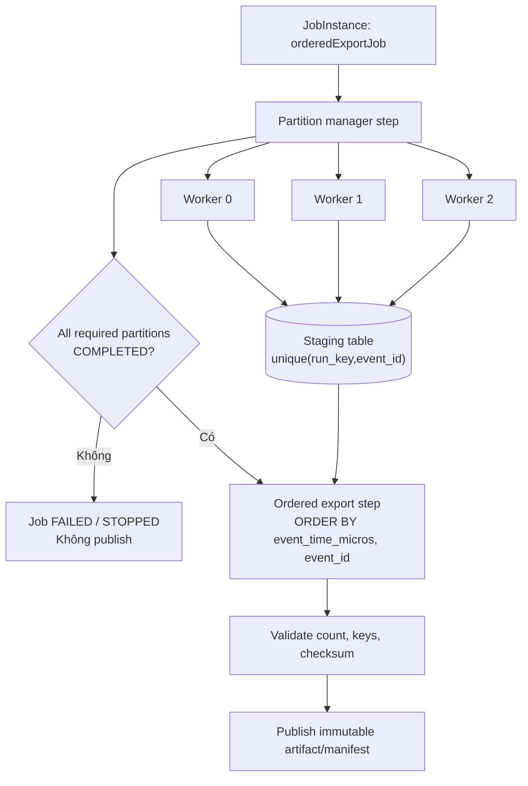
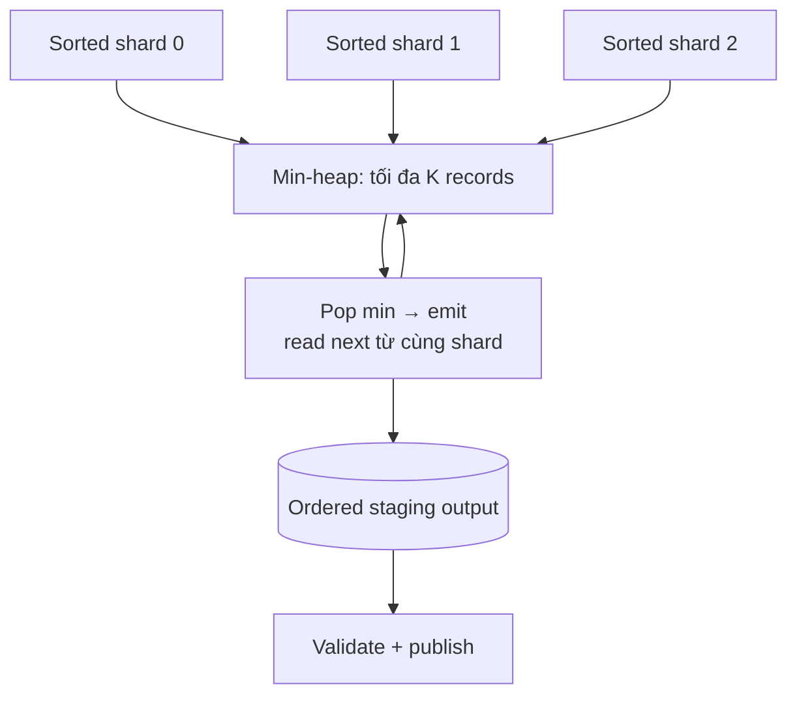
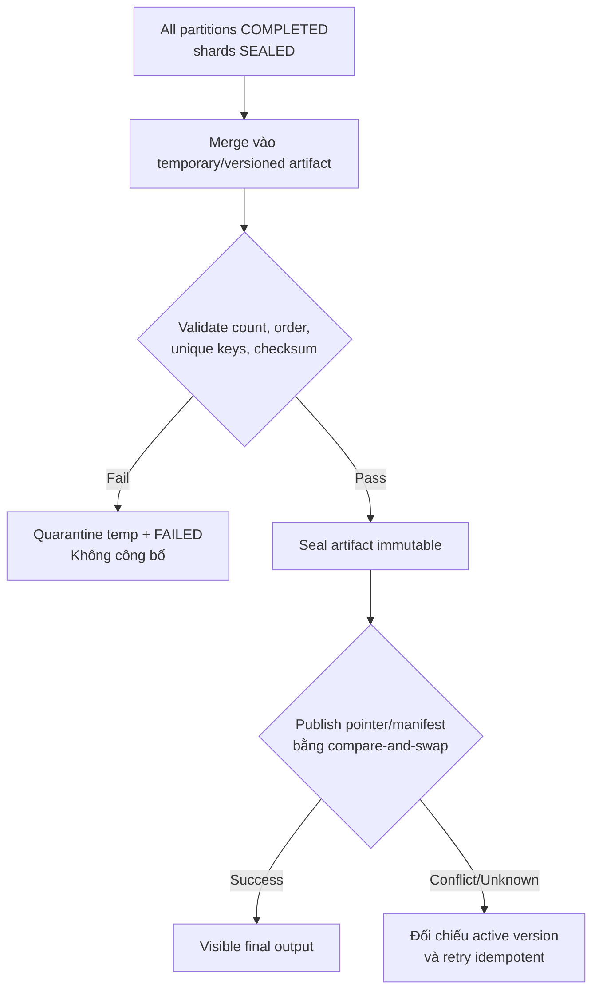

# Đảm bảo thứ tự khi merge output trong Spring Batch

## 1. Bài toán và mục tiêu

Trong chương **Ordering** thuộc module **SPRING_BATCH_SCALING_OPERATIONS**, chúng ta học cách mở rộng Spring Batch để xử lý dữ liệu lớn qua multi-threaded step, parallel steps, partitioning và worker phân tán. Tăng concurrency có thể rút ngắn thời gian xử lý, nhưng một hệ quả quan trọng là **thứ tự hoàn thành không còn trùng với thứ tự đọc ban đầu**.

Ví dụ, hệ thống nhận một triệu sự kiện giao dịch và cần xuất **một file kết quả theo thứ tự `eventTime, eventId` tăng dần**. Khi chia làm 16 partition:

- Partition số 12 có thể hoàn thành trước partition số 0.
- Hai chunk của cùng step có thể commit không theo thứ tự item được đọc nếu step xử lý đa luồng.
- Broker có thể redeliver hoặc gửi reply của chunk đến trễ.
- Một worker đã `COMPLETED` có thể vẫn có file output cũ trong khi worker khác `FAILED` cần restart.
- Nếu chỉ nối output theo **thứ tự file xuất hiện/thứ tự worker xong**, kết quả cuối không đáp ứng yêu cầu sắp xếp.

**Mục tiêu bài học:** Xác định một **hợp đồng thứ tự kiểm chứng được**, tạo và merge output đúng thứ tự trên toàn JobInstance, kiểm soát bộ nhớ khi dữ liệu lớn, và giữ tính đúng khi retry/restart.

Sau bài này, bạn có thể:

1. Phân biệt **thứ tự input**, **thứ tự process**, **thứ tự commit**, **thứ tự message delivery** và **thứ tự output đã publish**.
2. Phân biệt **global total order**, **per-key order**, **per-partition order** và trường hợp chỉ cần một tập kết quả, không cần thứ tự.
3. Thiết kế **sort key xác định và duy nhất**, gồm khóa phụ để phá hòa khi hai sự kiện có cùng timestamp.
4. Chọn giữa **staging database + `ORDER BY`**, **concatenate sorted non-overlapping ranges**, **k-way merge** hoặc **external sort**.
5. Dùng **barrier hoàn tất tất cả partitions** trước khi công bố file cuối.
6. Tính memory, file-descriptor budget và độ phức tạp của thuật toán merge.
7. Thiết kế **manifest, checksum, atomic publish, unique business key và idempotency** để chịu được lỗi giữa ghi file và cập nhật JobRepository.
8. Giải thích vì sao sort trong mỗi partition, `ORDER BY` ở reader hoặc Kafka partition order **không tự tạo global output order**.
9. Kiểm thử thứ tự, độ đầy đủ, duplicate, data skew, late reply, restart và publish failure.
10. Chọn cấu trúc phù hợp với yêu cầu nghiệp vụ và tài nguyên thực tế.

> **Phiên bản minh họa:** Java 17+, Spring Batch **5.2.x**, Spring Framework 6 và PostgreSQL. Code là các thành phần tham khảo cho một ứng dụng có `JobRepository`, transaction manager, schema, input snapshot và cấu hình bean; chưa phải một project độc lập được thực thi. `SPECIAL_NOTE` của bài không có yêu cầu bổ sung.

## 2. Phải nói rõ “thứ tự” là thứ tự của cái gì

Giả sử ba giao dịch có khóa sắp xếp:

| Event | `eventTimeMicros` | `eventId` | Khóa sắp xếp |
| --- | ---: | ---: | --- |
| A | 100 | 21 | (100, 21) |
| B | 100 | 22 | (100, 22) |
| C | 101 | 10 | (101, 10) |

Thứ tự mong muốn là `A → B → C`. Nhưng khi xử lý song song:

```mermaid
sequenceDiagram
    participant P0 as Partition 0
    participant P1 as Partition 1
    participant DB as Business DB
    participant O as Output collector
    Note over P0,P1: A,B ở P0; C ở P1
    P0->>P0: process A (chậm)
    P1->>DB: commit C
    P1->>O: gửi C trước
    P0->>DB: commit A,B
    P0->>O: gửi A,B sau
    Note over O: Arrival order: C,A,B — sai global order
```

Các loại thứ tự khác nhau:

| Khái niệm | Đảm bảo ở đâu? | Có đủ cho global merge không? |
| --- | --- | --- |
| **Source order** | File hoặc query đầu vào đã sort | Không, khi worker xử lý song song |
| **Within-partition order** | Reader/writer mỗi worker giữ thứ tự riêng | Chưa đủ nếu ranges đan xen |
| **Process completion order** | Item nào xong trước | Không ổn định theo CPU/I/O |
| **Transaction commit order** | Transaction nào commit trước | Không phải business sort key |
| **Broker delivery/reply order** | Message nào được giao/ack trước | Không đồng nghĩa thứ tự đã commit |
| **Global output order** | Artifact cuối được sắp theo khóa đã định | Đây mới là yêu cầu của bài |
| **Per-key order** | Các sự kiện của một account/customer đúng thứ tự | Có thể đủ cho một số nghiệp vụ, không cần global |

**Điều cần chốt trước khi viết code:** Hệ thống cần **global total order** hay chỉ cần **per-account order**? Việc áp đặt global order khi nghiệp vụ không cần có thể tăng I/O, memory, synchronization và độ trễ xuất bản không cần thiết.

## 3. Một định nghĩa thứ tự không mơ hồ

Với sự kiện `e`, ta chọn khóa:

```text
sortKey(e) = (eventTimeMicros, eventId)

So sánh theo thứ tự từ trái sang phải:
  1. eventTimeMicros tăng dần
  2. Nếu trùng thời gian, eventId tăng dần
```

`eventId` phải là **duy nhất** trong tập output của một run để tạo thứ tự toàn phần. Nếu hai bản ghi cùng `eventTimeMicros` và `eventId` nhưng vẫn là hai kết quả riêng, phải bổ sung một tie-breaker bất biến nữa, ví dụ `sourceShardId` và `sourceRecordId`.

### Vì sao chỉ `ORDER BY event_time` chưa đủ?

Nếu 5.000 records có cùng timestamp, SQL không bảo đảm thứ tự ổn định giữa chúng trừ khi có khóa phụ trong `ORDER BY`. Hai executions có thể xuất cùng nội dung nhưng thứ tự các records đồng thời khác nhau.

```sql
-- Chưa đủ để bảo đảm deterministic total order nếu timestamp trùng.
ORDER BY event_time_micros

-- Tốt hơn nếu event_id unique trong run.
ORDER BY event_time_micros ASC, event_id ASC
```

### Hợp đồng nên ghi rõ

- Cột nào tham gia sort; thứ tự ưu tiên; `ASC/DESC`.
- `NULLS FIRST` hay `NULLS LAST` hoặc cấm null.
- Timezone và cách chuẩn hóa timestamp (ví dụ UTC microseconds).
- Kiểu numeric/string/collation: `"100"` so từ điển khác `100` số học.
- Tie-breaker bất biến khi retry/restart.
- Cách xử lý duplicate keys: **fail**, deduplicate, aggregate hay chọn version nào.
- Khi nào được phép publish: **mọi partition bắt buộc hoàn tất và dữ liệu được đối soát**.
- Nếu cần streaming, chính sách **late events/watermark**.

**Không dùng `System.currentTimeMillis()` tại thời điểm worker hoàn thành làm sort key** nếu mục tiêu là thứ tự sự kiện gốc. Giá trị đó thay đổi khi retry và đo thời gian xử lý thay vì business event time.

## 4. Anti-pattern: merge theo thứ tự worker trả kết quả

Một triển khai tưởng đơn giản:

```java
// Sai nếu nghiệp vụ yêu cầu total order.
List<Future<Path>> futures = submitAllPartitions();

for (Future<Path> future : futures) {
    Path shardOutput = future.get();
    Files.copy(shardOutput, finalOutputStream);
}
```

**Ngay cả khi duyệt futures theo thứ tự submit**, phép nối cũng chỉ đúng nếu thứ tự **phạm vi khóa của các shard** tương ứng với thứ tự khóa toàn cục, và **mỗi shard đã sorted**. Nếu shard chia theo `hash(account_id)`, các khóa từ các shard có thể đan xen, nên `concat` vẫn sai.

Cách nguy hiểm hơn:

```java
// Không được append vào cùng file từ nhiều worker để kỳ vọng đúng thứ tự.
synchronized (sharedOutputStream) {
    writeProcessedItem(item);
}
```

`synchronized` chỉ ngăn bytes của hai calls interleave trong một JVM; thứ tự gọi lock vẫn do scheduler quyết định. Nó **không** biến kết quả thành sort theo `eventTimeMicros`, và không bảo vệ được nhiều worker process ở host khác.

### Vì sao thread-safe writer chưa đủ?

Thread safety là thuộc tính **không corrupt shared state**. Ordering là thuộc tính **xuất dữ liệu theo một quan hệ trước–sau xác định**. Một writer có thể thread-safe và vẫn ghi `C,A,B` trong ví dụ trước.

## 5. Lựa chọn kiến trúc theo yêu cầu

| Yêu cầu | Thiết kế phù hợp | Đổi lại |
| --- | --- | --- |
| Chỉ cần tập kết quả, không cần order | Ghi song song vào sink theo unique key | Khả năng throughput cao nhất |
| Thứ tự trong từng business key | Route cùng key về một partition/consumer, serialize theo key | Phải chống skew và giữ ordering khi retry |
| Global order sau khi job hoàn tất | **Staging → globally ordered export** | Thêm một bước đọc/sort/export |
| Global order, shards có **range khóa liền nhau** | **Sort từng shard → concatenate theo range** | Cần chứng minh ranges không overlap và complete |
| Global order, shards có khóa xen kẽ | **Sort từng shard → k-way merge** | Heap, file handles và validation |
| Quá nhiều shards/file quá lớn | **Hierarchical external merge** hoặc DB sort | Nhiều lượt I/O |
| Streaming output trước khi tất cả input tới | Watermark/reordering với chính sách late data | Không thể có exact global order khi lateness vô hạn |
| Output theo Kafka | Đảm bảo per-partition/per-key, hoặc một sequencer nếu cần global | Global sequencer giới hạn throughput |

**Gợi ý ưu tiên:** Nếu dữ liệu đã nằm trong DB staging và cần xuất một file ordered duy nhất, `ORDER BY` được index hỗ trợ thường là thiết kế dễ audit hơn. Nếu job xử lý file shards và không muốn materialize ở database, chọn k-way merge hoặc concat theo range sau barrier.

## 6. Chiến lược A: staging database rồi xuất theo `ORDER BY`

Các worker xử lý độc lập và **không cố ghi output cuối theo thứ tự commit**. Thay vào đó, chúng đưa kết quả vào bảng staging có unique business key. Sau khi toàn bộ partitions hoàn tất, một step xuất dữ liệu theo thứ tự toàn cục.



**Điểm mạnh:** Thứ tự commit của workers không còn liên quan đến thứ tự của artifact cuối; database quyết định sort thông qua **một query có `ORDER BY` rõ ràng**.

### 6.1. Schema staging minh họa PostgreSQL

```sql
CREATE TABLE ordered_payment_stage (
    run_key           varchar(160) NOT NULL,
    event_id          bigint NOT NULL,
    event_time_micros bigint NOT NULL,
    rule_version      varchar(40) NOT NULL,
    net_amount        numeric(20,2) NOT NULL,
    payload_hash      varchar(64) NOT NULL,
    PRIMARY KEY (run_key, event_id)
);

CREATE INDEX idx_stage_run_order
    ON ordered_payment_stage
        (run_key, event_time_micros, event_id);
```

`PRIMARY KEY (run_key,event_id)` tạo unique index phục vụ idempotency. Index `(run_key,event_time_micros,event_id)` phục vụ equality `run_key` rồi thứ tự của ordered export; chi phí lưu trữ/ghi của index bổ sung phải được benchmark.

**Không** tự tạo một index trùng với PK. Nếu writer throughput là bottleneck, index thứ hai có thể gây write amplification; lúc đó cân nhắc external sort sau khi staging đã hoàn tất hoặc tạo index tại một thời điểm phù hợp.

### 6.2. Worker ghi staging, không tự quyết thứ tự global

```sql
INSERT INTO ordered_payment_stage (
    run_key, event_id, event_time_micros,
    rule_version, net_amount, payload_hash
)
VALUES (
    :runKey, :eventId, :eventTimeMicros,
    :ruleVersion, :netAmount, :payloadHash
)
ON CONFLICT (run_key, event_id) DO NOTHING;
```

`DO NOTHING` ngăn hai hàng có cùng key nhưng **có thể che payload mismatch**. Production phải kiểm tra conflict có cùng `event_time_micros`, `rule_version`, `net_amount` và `payload_hash`, hoặc từ chối nếu khác; chỉ sử dụng first-write-wins khi đã có chính sách rõ.

Nếu duplicate hợp lệ (ví dụ cùng payment có nhiều phiên biến đổi), đưa `ruleVersion`/business version vào khóa dữ liệu và xác định lại sort key tương ứng. **Không dùng `JobExecutionId` làm dedupe key** vì ID thay đổi khi restart.

### 6.3. Query xuất chính thức

```sql
SELECT event_time_micros, event_id, net_amount
FROM ordered_payment_stage
WHERE run_key = :runKey
ORDER BY event_time_micros ASC, event_id ASC;
```

Một `ORDER BY` ở query này là **hợp đồng thứ tự của result set**. Dù dữ liệu được insert từ 32 workers theo commit order bất kỳ, query vẫn trả rows theo khóa sort. Chỉ dựa vào clustered physical layout/index scan mà không có `ORDER BY` thì **không bảo đảm thứ tự theo chuẩn SQL**.

Có thể dùng paging reader để tránh nạp cả bảng staging vào heap.

## 7. Java 5.2: reader xuất có sort key duy nhất

Ví dụ DTO:

```java
public record OrderedPayment(
        long eventTimeMicros,
        long eventId,
        BigDecimal netAmount) {}
```

Một `JdbcPagingItemReader` dùng keyset/paging do framework quản lý:

```java
@Bean("orderedStageReader")
@StepScope
JdbcPagingItemReader<OrderedPayment> orderedStageReader(
        DataSource dataSource,
        @Value("#{jobParameters['runKey']}") String runKey) {

    Map<String, Order> sort = new LinkedHashMap<>();
    sort.put("event_time_micros", Order.ASCENDING);
    sort.put("event_id", Order.ASCENDING);

    return new JdbcPagingItemReaderBuilder<OrderedPayment>()
            .name("orderedStageReader")
            .dataSource(dataSource)
            .selectClause("""
                SELECT event_time_micros, event_id, net_amount
                """)
            .fromClause("FROM ordered_payment_stage")
            .whereClause("WHERE run_key = :runKey")
            .parameterValues(Map.of("runKey", runKey))
            .sortKeys(sort)
            .pageSize(1000)
            .rowMapper((rs, rowNum) -> new OrderedPayment(
                    rs.getLong("event_time_micros"),
                    rs.getLong("event_id"),
                    rs.getBigDecimal("net_amount")))
            .saveState(true)
            .build();
}
```

**Cần kiểm chứng với version/driver đang chạy:**

- `event_id` unique trong phạm vi `run_key`, nên bộ khóa `(event_time_micros,event_id)` xác định thứ tự toàn phần.
- `LinkedHashMap` thể hiện rõ thứ tự ưu tiên. Nếu framework/provider dùng comparator khác, hãy kiểm tra SQL thực tế phát sinh thay vì giả định chỉ dựa trên map.
- `pageSize(1000)` là số items trên page, **không phải** chunk transaction size.
- `@StepScope` tạo reader cho StepExecution tương ứng. **Không** dùng reader stateful này chung cho nhiều chunk threads nếu không có kiểm thử thread safety/checkpoint.
- `saveState(true)` giúp restart theo state; giữ input staging **bất biến sau barrier**.
- `JdbcPagingItemReader` có thể generate câu SQL khác với query minh họa; xem query log và `EXPLAIN (ANALYZE, BUFFERS)`.
- Nếu staging có rows được thêm/sửa trong khi export, một restart có thể quan sát tập dữ liệu khác. Barrier và freeze snapshot là điều kiện tiên quyết.

### 7.1. Viết một file output ordered từ một step

Một worker export tuần tự ghi sang **file staging**, không trực tiếp ghi ra public destination. Giả sử `stagingOutputPath` đã được kiểm soát bởi work order, không lấy một path tùy ý từ request:

```java
@Bean("orderedFileWriter")
@StepScope
FlatFileItemWriter<OrderedPayment> orderedFileWriter(
        @Value("#{jobParameters['stagingOutputPath']}")
        String stagingOutputPath) {

    return new FlatFileItemWriterBuilder<OrderedPayment>()
            .name("orderedFileWriter")
            .resource(new FileSystemResource(stagingOutputPath))
            .lineAggregator(row ->
                    row.eventTimeMicros() + "\t"
                    + row.eventId() + "\t"
                    + row.netAmount().toPlainString())
            .saveState(true)
            .build();
}
```

Ví dụ dùng TSV không chứa chuỗi tự do nên việc biểu diễn từng record thành **một dòng vật lý** đơn giản; nếu có chuỗi chứa tab/newline phải escape/quote hoặc dùng format chuẩn.

**Cảnh báo về restart và publication:**

- `FlatFileItemWriter` có cơ chế `ItemStream` và state cho restart, nhưng **file system không tự tham gia transaction của JobRepository/database**. Phải kiểm thử crash ở ranh giới flush/commit/update context.
- Đầu ra staging phải **chỉ do một writer step sở hữu**; không cho partition workers cùng append vào file này.
- Không expose file chưa hoàn tất cho downstream. Một StepExecution FAILED có thể để lại file dở dang.
- Nếu dùng object storage không hỗ trợ random truncate/seek theo cách writer cần, thiết kế multipart/staging mới thay vì gắn `FileSystemResource` giả lên object.
- Giữ output path/format/version cố định khi restart; việc đổi resource giữa attempts có thể phá checkpoint.
- Cần xác thực file path nằm trong thư mục cho phép và có đủ dung lượng/disk quota.

### 7.2. Step sequential cho ordered export

```java
@Bean("orderedExportStep")
Step orderedExportStep(
        JobRepository repository,
        PlatformTransactionManager transactionManager,
        @Qualifier("orderedStageReader")
        ItemStreamReader<OrderedPayment> reader,
        @Qualifier("orderedFileWriter")
        ItemStreamWriter<OrderedPayment> writer) {

    return new StepBuilder("orderedExportStep", repository)
            .<OrderedPayment, OrderedPayment>
                    chunk(1000, transactionManager)
            .reader(reader)
            .writer(writer)
            .build();
}
```

Không có processor nếu chỉ xuất; có thể thêm processor stateless nếu phải format/validate. **Đừng gắn `TaskExecutor` trực tiếp vào ordered export step** chỉ để xuất nhanh hơn: chunk completions có thể không bảo toàn total order trong file đích.

Nếu ordered export trở thành bottleneck, tối ưu disk/write format/buffering hoặc dùng **sorted shard files + merge** thay vì cho nhiều threads ghi cùng một file.

## 8. Barrier trước khi merge: không publish khi còn partition FAILED

Manager partition step chỉ thành công theo chính sách đã cấu hình khi các worker bắt buộc đã hoàn tất. Đặt ordered export/publish **sau** manager trong luồng job:

```java
@Bean("orderedPaymentsJob")
Job orderedPaymentsJob(
        JobRepository repository,
        @Qualifier("partitionManagerStep") Step manager,
        @Qualifier("orderedExportStep") Step export,
        @Qualifier("publishStep") Step publish) {

    return new JobBuilder("orderedPaymentsJob", repository)
            .start(manager)
            .next(export)
            .next(publish)
            .build();
}
```

`partitionManagerStep` và `publishStep` là beans cần triển khai. Đây là ví dụ **sequential job flow**: khi manager FAILED, export và publish **không được đi tiếp theo luồng thông thường**; khi export FAILED, publish cũng không chạy.

**Không nhầm `allowStartIfComplete` với publish readiness.** Nếu một partition đã COMPLETED trong attempt trước, nó thường không chạy lại khi restart cùng JobInstance; điều đó chỉ an toàn khi dữ liệu staging/manifest của partition vẫn tồn tại và đã qua xác minh.

### Ranh giới đúng của barrier

- “Tất cả futures returned” **không đủ** nếu một future FAILED nhưng exception bị swallow.
- “Broker request queue ready=0” **không đủ** vì unacked/in-flight/retries có thể còn.
- “Manager nhận đủ replies” **không đủ** nếu chưa kiểm tra replies có status thất bại hoặc duplicate.
- “Mọi worker `COMPLETED` trong JobRepository” cần đi kèm **business output reconciliation** khi có side effects ngoài transaction.
- “Đã ghi đủ file shards” phải đi kèm checksum, count và manifest trạng thái `SEALED`, không chỉ kiểm tra `Files.exists`.

Một publication barrier là **điều kiện nghiệp vụ và kỹ thuật**, không chỉ một lệnh `join()`.

## 9. Phương án B: mỗi partition sinh file riêng rồi merge

Khi input là các file shards hoặc output dạng file lớn, có thể cho worker ghi riêng vào các file **ổn định theo partition**:

```text
work/
  run-2026-11-25-v1/
    partition-000.tsv
    partition-001.tsv
    partition-002.tsv
    ...
    partition-015.tsv
    manifest.json   // chỉ được SEAL sau khi kiểm tra
```

Mỗi worker `StepExecution` sở hữu đúng một logical shard output, không chia sẻ writer. Worker có checkpoint, output file state và version ổn định qua restart.

**Trước khi merge** phải có:

1. Danh sách shard từ **immutable partition plan**, không phải kết quả glob tùy ý.
2. Tên partition ổn định: `partition-000` vẫn chỉ cùng input range khi restart.
3. Mỗi shard đã `COMPLETED` và file output **đã đóng**.
4. File content được xác minh checksum, row count, min/max sort key và schema version.
5. Mỗi file sorted theo cùng comparator, hoặc sẽ được sorted trước khi merge.
6. Không còn worker cũ có quyền ghi/chèn/overwrite file shard đang được merge.
7. Tập shard đủ coverage; duplicates/overlap được phát hiện theo policy.

### Vì sao không ghi cùng một file trực tiếp từ nhiều workers?

Multi-process append vào cùng file có thể gây interleaving/partial writes. Ngay cả khi có distributed lock, **thứ tự nhận lock không bằng business order**. Một writer duy nhất là cách dễ bảo đảm output final ordered hơn; nếu muốn parallelism, song song hóa công đoạn **tạo sorted shards** rồi merge ở cuối.

## 10. Khi nào chỉ concatenate là đúng?

Giả sử phân chia **theo chính sort key** thành các ranges không chồng lấn:

```text
Partition 0: eventTimeMicros ∈ [100, 200)
Partition 1: eventTimeMicros ∈ [200, 300)
Partition 2: eventTimeMicros ∈ [300, 400)
```

Nếu mỗi partition xuất **các records tăng dần theo (eventTimeMicros,eventId)**, tất cả records của partition 0 đều đứng trước records của partition 1, và 1 trước 2. Khi đó:

```text
global_output =
  content(partition-0)
  + content(partition-1)
  + content(partition-2)
```

thỏa global order. Đây là **ordered range concatenation**, không phải k-way merge.

### Điều kiện phải chứng minh

Với các shard `S_i` không rỗng và comparator `≤`:

```text
A) Sort(S_i) đúng, với mọi shard i.

B) maxKey(S_i) < minKey(S_{i+1})
   nếu tổng khóa là unique và policy cấm duplicate.

C) Danh sách shard theo đúng thứ tự range.

D) Shards không thiếu input và không có duplicate ngoài ý muốn.

E) Chỉ publish sau khi mọi shard SEALED.
```

Nếu chia theo timestamp range nhưng các bản ghi đồng thời tại ranh giới bị đưa vào **hai partitions**, có thể trùng. Dùng quy ước `[lower, upper)` hoặc có **composite range boundary** trên cả `(timestamp,eventId)`, và xác minh overlap/coverage.

### Khi range theo `eventId` nhưng sort theo `eventTime`

Không được tự động concatenate. Event ID 100 có thể có timestamp 500, còn event ID 900 có timestamp 200. Các dải event ID không bảo đảm các dải thời gian không chồng lên nhau. **Khóa partition phải có quan hệ thứ tự tương thích với sort key** nếu muốn concat.

## 11. Khi nào cần k-way merge?

Giả sử partition theo `hash(accountId)`. Mỗi worker đã tự sắp xếp output theo `(eventTimeMicros,eventId)`, nhưng các shards có khóa xen kẽ:

```text
S0: (100,1), (130,8), (180,3)
S1: (101,7), (120,5), (200,2)
S2: (100,4), (150,6), (190,9)

Desired global:
(100,1), (100,4), (101,7), (120,5), (130,8),
(150,6), (180,3), (190,9), (200,2)
```

Dùng **k-way merge** với min-heap:

1. Mở một reader cho mỗi sorted shard.
2. Đọc tối đa **một record đầu** từ mỗi shard và đưa vào heap theo comparator.
3. Lấy record nhỏ nhất, ghi ra output.
4. Đọc record kế tiếp **chỉ từ shard vừa lấy**, đưa lại vào heap.
5. Lặp đến khi tất cả shards hết dữ liệu.
6. Kiểm tra tổng số records, duplicate keys, thứ tự output, checksums rồi mới publish.



### Độ phức tạp

Với `N` records tổng, `K` shards:

```text
Time:    O(N log K)
Memory:  O(K × record_footprint) + I/O buffers
FDs:     O(K) open input files
```

Nếu `K` quá lớn (ví dụ 100.000 shard files), không thể mở tất cả cùng lúc. Dùng **hierarchical external merge** với fan-in giới hạn, hoặc DB staging + sort.

Không tính độ phức tạp merge là toàn bộ thời gian job: parsing, network file reads, disk writes, checksum, compression và database inserts vẫn có thể chiếm phần lớn wall time.

## 12. Java: comparator xác định và parse record an toàn

Để tránh tranh luận về CSV multiline/escaping, ví dụ dùng **TSV ba cột numeric**:

```text
event_time_micros<TAB>event_id<TAB>net_amount
```

Không có header trong các shard minh họa; mỗi record là **một dòng vật lý**, giá trị số không chứa tab/newline.

DTO và comparator:

```java
public record OrderedRow(
        long eventTimeMicros,
        long eventId,
        BigDecimal netAmount) {}

public final class RowOrder {

    private RowOrder() {}

    public static final Comparator<OrderedRow> COMPARATOR =
            Comparator.comparingLong(OrderedRow::eventTimeMicros)
                    .thenComparingLong(OrderedRow::eventId);

    public static OrderedRow parse(String line) {
        String[] columns = line.split("\t", -1);
        if (columns.length != 3) {
            throw new IllegalArgumentException("Invalid TSV columns");
        }

        return new OrderedRow(
                Long.parseLong(columns[0]),
                Long.parseLong(columns[1]),
                new BigDecimal(columns[2]));
    }

    public static String format(OrderedRow row) {
        return row.eventTimeMicros() + "\t"
                + row.eventId() + "\t"
                + row.netAmount().toPlainString();
    }
}
```

**Không dùng comparator theo `netAmount` hoặc `toString()` nếu nghiệp vụ yêu cầu thời gian và event ID**. Nếu sort key là timestamp dạng chuỗi, chuẩn hóa timezone và định dạng trước khi so; string sorting chỉ đáng tin khi encoding/collation/format bảo đảm cùng quan hệ thứ tự.

## 13. Java: k-way merge streaming, kiểm tra sort từng shard

Bộ trộn dưới đây không giữ tất cả records trong RAM. Nó chủ động **từ chối shard không sorted và duplicate global key**.

```java
public final class OrderedShardMerger {

    private record Node(int shardIndex, OrderedRow row) {}

    public static long merge(
            List<Path> orderedShardPaths,
            BufferedWriter destination) throws IOException {

        List<BufferedReader> readers = new ArrayList<>();
        OrderedRow[] previousPerShard =
                new OrderedRow[orderedShardPaths.size()];

        PriorityQueue<Node> heap = new PriorityQueue<>(
                Comparator.comparing(
                        Node::row, RowOrder.COMPARATOR));

        try {
            // Chỉ dùng danh sách từ immutable manifest đã được validate.
            for (Path path : orderedShardPaths) {
                readers.add(Files.newBufferedReader(
                        path, StandardCharsets.UTF_8));
            }

            for (int i = 0; i < readers.size(); i++) {
                OrderedRow first = readNextChecked(
                        readers.get(i), i, previousPerShard);

                if (first != null) {
                    heap.add(new Node(i, first));
                }
            }

            long written = 0;
            OrderedRow lastEmitted = null;

            while (!heap.isEmpty()) {
                Node current = heap.remove();
                OrderedRow row = current.row();

                if (lastEmitted != null
                        && RowOrder.COMPARATOR.compare(
                                lastEmitted, row) >= 0) {
                    throw new IllegalStateException(
                            "Duplicate or non-monotonic global sort key");
                }

                destination.write(RowOrder.format(row));
                destination.newLine();
                lastEmitted = row;
                written++;

                int source = current.shardIndex();
                OrderedRow next = readNextChecked(
                        readers.get(source),
                        source,
                        previousPerShard);

                if (next != null) {
                    heap.add(new Node(source, next));
                }
            }

            destination.flush();
            return written;

        } finally {
            IOException closeError = null;

            for (BufferedReader reader : readers) {
                try {
                    reader.close();
                } catch (IOException ex) {
                    if (closeError == null) {
                        closeError = ex;
                    } else {
                        closeError.addSuppressed(ex);
                    }
                }
            }

            if (closeError != null) {
                throw closeError;
            }
        }
    }

    private static OrderedRow readNextChecked(
            BufferedReader reader,
            int shardIndex,
            OrderedRow[] previousPerShard) throws IOException {

        String line = reader.readLine();
        if (line == null) {
            return null;
        }

        OrderedRow row = RowOrder.parse(line);
        OrderedRow previous = previousPerShard[shardIndex];

        if (previous != null
                && RowOrder.COMPARATOR.compare(previous, row) >= 0) {
            throw new IllegalStateException(
                    "Shard " + shardIndex
                    + " is not strictly increasing");
        }

        previousPerShard[shardIndex] = row;
        return row;
    }
}
```

**Giới hạn có chủ đích:**

- `merge(...)` nhận `BufferedWriter` do caller sở hữu, **không chịu trách nhiệm atomic publish**. Caller phải ghi ra temp/staging artifact rồi validate trước khi expose.
- Bộ đọc đếm một logical record/dòng; **không áp dụng trực tiếp cho quoted multiline CSV**.
- `previousPerShard` kiểm tra mỗi shard tăng nghiêm ngặt; `lastEmitted` kiểm tra total order/duplicate across shards.
- Kiểm tra checksum, file sizes, expected record counts và schema version phải xảy ra **trước hoặc quanh** merge; comparator không chứng minh source có đủ records.
- Việc `finally` ném exception khi close có thể che exception chính xảy ra trong merge. Production nên dùng quản lý resource chuẩn để giữ lỗi gốc và attach close failures, nhưng code minh họa vẫn thể hiện yêu cầu đóng toàn bộ readers.
- Nếu phép merge ghi hàng tỷ dòng, `long written` vẫn có giới hạn; cần giám sát và thiết kế số lượng tương ứng.
- Không cho worker ghi thêm vào file shard trong lúc merge. Manifest phải được SEALED và worker ownership đã kết thúc.

### Vì sao bộ nhớ không tăng theo N?

Heap chứa tối đa một record từ mỗi shard; sau mỗi lần ghi, chỉ đọc một record kế tiếp từ shard tương ứng. Bộ nhớ tăng theo `K` (số streams mở) và buffers, không theo tổng số records `N`.

Tuy nhiên, `Files.newBufferedReader` không phù hợp khi hàng chục nghìn shards vì file-descriptor limit; dùng merge nhiều vòng.

## 14. Java: kiểm thử k-way merge và các trường hợp lỗi

Ví dụ JUnit 5 dùng `@TempDir`:

```java
@Test
void mergesInterleavedSortedShardsIntoGlobalOrder(
        @TempDir Path dir) throws Exception {

    Path s0 = dir.resolve("s0.tsv");
    Path s1 = dir.resolve("s1.tsv");

    Files.writeString(s0, """
            100\t21\t10.00
            102\t25\t20.00
            """);

    Files.writeString(s1, """
            100\t22\t30.00
            101\t23\t40.00
            """);

    Path merged = dir.resolve("merged.tsv");

    long count;
    try (BufferedWriter out = Files.newBufferedWriter(
            merged, StandardCharsets.UTF_8)) {
        count = OrderedShardMerger.merge(
                List.of(s0, s1), out);
    }

    assertEquals(4L, count);
    assertEquals(List.of(
            "100\t21\t10.00",
            "100\t22\t30.00",
            "101\t23\t40.00",
            "102\t25\t20.00"),
            Files.readAllLines(merged, StandardCharsets.UTF_8));
}
```

`Files.readAllLines` trong **test fixture rất nhỏ** là phù hợp; trong production với file hàng chục GB không nên dùng để load toàn bộ output.

### Test shard không sorted

```java
@Test
void rejectsNonMonotonicShard(@TempDir Path dir)
        throws Exception {

    Path bad = dir.resolve("bad.tsv");

    Files.writeString(bad, """
            200\t1\t1.00
            100\t2\t2.00
            """);

    Path output = dir.resolve("scratch.tsv");

    assertThrows(IllegalStateException.class, () -> {
        try (BufferedWriter writer =
                     Files.newBufferedWriter(output)) {
            OrderedShardMerger.merge(List.of(bad), writer);
        }
    });
}
```

### Test duplicate global key

```java
@Test
void rejectsDuplicateSortKeyAcrossShards(@TempDir Path dir)
        throws Exception {

    Path a = dir.resolve("a.tsv");
    Path b = dir.resolve("b.tsv");

    Files.writeString(a, "100\t21\t1.00\n");
    Files.writeString(b, "100\t21\t1.00\n");

    assertThrows(IllegalStateException.class, () -> {
        try (BufferedWriter out =
                     Files.newBufferedWriter(dir.resolve("out.tsv"))) {
            OrderedShardMerger.merge(List.of(a, b), out);
        }
    });
}
```

**Quan trọng:** Một error sau khi ghi một phần vào `scratch.tsv` phải khiến file **không được publish**. Test integration cần xác minh final artifact/manifest vẫn không tồn tại và temp được cleanup/quarantine.

## 15. Nhiều shards hơn giới hạn file descriptors: hierarchical merge

K-way merge với `K=10.000` có thể vượt giới hạn open files. Hãy chọn **fan-in** `F`, ví dụ 32 hoặc 64, theo memory/FD budget:

```text
Round 1:
  10.000 shards -> merge từng nhóm tối đa 32
  -> khoảng 313 intermediate sorted files

Round 2:
  313 files -> merge từng nhóm tối đa 32
  -> khoảng 10 intermediate files

Round 3:
  10 files -> 1 final sorted file
```

Ưu điểm: tối đa `F` readers cùng lúc, memory có thể kiểm soát. Đổi lại: mỗi vòng ghi/đọc thêm bytes, cần disk space và policy cleanup. Intermediate files phải có:

- Version/round/group IDs bất biến trong một attempt.
- Checksums, record count và sorted invariant.
- Trạng thái `TEMP/SEALED` rõ.
- Garbage-collection policy cho các attempts lỗi, **không xóa intermediate đang được sử dụng**.

Nếu database staging đã có index hỗ trợ `ORDER BY`, việc đọc ordered từ DB có thể đơn giản hơn nhiều so với xây file merge nhiều vòng. Hãy benchmark toàn pipeline.

## 16. Merge output phải đi sau một bước “seal” và validation

Mỗi shard cần một manifest entry:

```json
{
  "runKey": "settlement-2026-11-25-v1",
  "sortContract": "event_time_micros_asc,event_id_asc",
  "schemaVersion": "ordered-payment-tsv-v1",
  "shards": [
    {
      "partition": "part-000",
      "uri": "file:/staging/part-000.tsv",
      "recordCount": 200000,
      "minKey": [100, 1],
      "maxKey": [500, 90],
      "checksumSha256": "example-hex-from-verified-file",
      "state": "SEALED"
    }
  ]
}
```

JSON là ví dụ **hợp đồng ứng dụng**, không phải schema mặc định Spring Batch. Chuỗi checksum là placeholder minh họa; production phải tính SHA-256 thật từ bytes và lưu trong immutable manifest. Manifest cũng cần tổng số partitions, expected input coverage và version của transform.

**Không dùng `Files.exists` để suy shard đã hoàn tất**. File có thể tồn tại sau JVM crash dù writer chưa flush/close hoặc StepExecution đang FAILED. “SEALED” chỉ được xác lập sau khi:

1. Worker StepExecution hợp lệ đã COMPLETED.
2. File writer đã close, dữ liệu durable theo storage contract.
3. Count/min/max/checksum xác minh.
4. Không còn worker cũ có quyền ghi lên path đó.
5. Metadata/manifest được lưu theo protocol có điều kiện, không lẫn attempt cũ.

### Thứ tự của manifest khác thứ tự file trên disk

`Files.list(dir)`, `glob`, broker reply order, `HashMap` iteration hoặc thứ tự completion **không phải định nghĩa thứ tự merge**. Với concat sorted ranges, sắp theo **range lower bound**. Với k-way merge, comparator trên mỗi record điều khiển output; thứ tự shards chỉ ảnh hưởng lựa chọn tie nếu comparator không total — mà đó chính là vấn đề cần sửa.

## 17. Publish kết quả cuối an toàn: temp → validate → atomic visibility

Khi merge xuất một file lớn, downstream không được thấy bản kết quả mới **chưa hoàn tất**.

Workflow khuyến nghị:



### Local filesystem

Trên cùng filesystem và hệ điều hành hỗ trợ, atomic rename/move có thể đổi visibility của một file đã hoàn thành. Tuy nhiên **atomic rename không tự cung cấp no-overwrite, fsync durability hoặc distributed lock trên mọi provider**. Với Java `Files.move(..., ATOMIC_MOVE)`, hành vi nếu đích đã tồn tại là provider-specific; không dựa vào việc bỏ `REPLACE_EXISTING` để bảo đảm không overwrite trên mọi implementation.

Một production protocol nên có **exclusive run/version ownership**, đích mới chưa tồn tại hoặc một bảng/manifest publication CAS, và quy trình fsync/quản lý durable storage theo yêu cầu.

### Object storage

Object storage thường không có rename nguyên tử giống filesystem. Cách phổ biến:

1. Upload artifact sang **object key có version bất biến**.
2. Verify bytes/size/checksum và trạng thái upload hoàn tất.
3. Ghi một manifest/pointer active trỏ tới key đó bằng **conditional update/compare-and-swap** hoặc transaction ở metadata store.
4. Reader chỉ sử dụng artifact được manifest active tham chiếu.
5. Trên retry, nếu active pointer đã trỏ đúng checksum/version, coi publish là **idempotent success**.

**Không** coi upload API trả success là toàn bộ transaction business đã được commit, nếu downstream cần nhiều object hoặc cập nhật database pointer kèm theo.

### Crash sau publish nhưng trước JobRepository status

`publishStep` có thể crash **sau khi pointer đã đổi sang artifact mới** nhưng trước khi `StepExecution` được đánh dấu COMPLETED. Lần restart có thể chạy lại publish step. Nó phải:

- Tra trạng thái active pointer/runKey/version/checksum.
- Nếu đã publish đúng artifact và checksum, trả idempotent success.
- Nếu chưa, thử publish có điều kiện.
- Nếu active version khác, **fail và yêu cầu điều tra**, không overwrite vô điều kiện.

Đây là lý do publication phải được thiết kế idempotent; chỉ dựa vào `BatchStatus.COMPLETED` không đủ bảo đảm exactly-once side effects.

## 18. Restart: partition nào được chạy lại, merge nào được giữ?

Giả sử:

```text
JobInstance: orderedPaymentsJob + identifying(runKey=snapshot-v1)

Execution 1:
  part-000 COMPLETED -> shard-000 SEALED
  part-001 COMPLETED -> shard-001 SEALED
  part-002 FAILED    -> shard-002 TEMP/partial
  part-003 COMPLETED -> shard-003 SEALED
  manager FAILED
  merge/publish NOT STARTED

Execution 2 (restart cùng JobInstance):
  completed workers được tái sử dụng/skip theo policy mặc định
  part-002 tiếp tục/retry theo checkpoint
  validate mọi shard SEALED
  manager COMPLETED -> merge ordered -> publish
```

**Điều kiện then chốt:**

- `runKey`/identifying JobParameters giữ nguyên.
- `Partitioner` tái tạo **cùng partition names và bounds**. Không đổi shard mapping khi restart.
- Input snapshot/schema/rules version bất biến.
- Worker đã COMPLETED phải còn output hoặc staging rows đã commit.
- Partial file của worker FAILED được reader/writer state phục hồi đúng hoặc được tái tạo bằng một workflow có kiểm chứng.
- Không còn remote worker cũ in-flight có thể sửa shard đã seal.
- Merge bắt đầu lại từ một temp artifact mới hoặc checkpoint tương thích với input immutable; không append mù vào final file cũ.

### Thay `JobExecutionId` thành tên file là một anti-pattern

Nếu output shard đặt tên `part-002-execution-100.tsv` ở lần đầu và `part-002-execution-101.tsv` lúc restart, hoàn toàn có thể tồn tại **hai files cho cùng logical partition**. Manifest phải xác định version và chọn đúng file SEALED; tốt hơn là dùng stable logical shard ID và attempt-specific temp paths, chỉ publish/commit một version cuối đã validate.

Không dùng timestamp, UUID hoặc `run.id` **identifying mới** để “restart” vì điều đó có thể tạo JobInstance khác và không dùng lại checkpoints cũ.

## 19. Phân biệt sort/stable key với ordering khi broker redelivery

Trong remote chunking:

- Manager đọc chunk theo source order.
- Worker A có thể xử lý chunk 5 trước worker B xử lý chunk 4.
- Worker B có thể commit chunk 4 nhưng reply đến trễ.
- Broker có thể redeliver chunk 4 dù nó đã commit.

Không dùng `ChunkResponse` arrival order để append global output. Thay vào đó:

1. Worker ghi result vào staging theo stable business key/chunk correlation.
2. Manager chỉ xác nhận tiến độ theo protocol khi completion hợp lệ.
3. Trước final export, đối soát all required items/chunks.
4. Ordered export chọn records theo **sort key nghiệp vụ**.
5. Publish một artifact versioned immutable.

Nếu có yêu cầu **exact source sequence** (không phải event-time sort), lưu `sourceOrdinal` bất biến được gán lúc staging input, rồi sắp theo `sourceOrdinal`. Đừng dùng thứ tự time/commit làm proxy cho source ordinal.

### Với remote partitioning

Remote partitioning giao worker `StepExecution`, mỗi worker thường tự đọc vùng input. Nếu các vùng khóa đan xen, mỗi worker `COMPLETED` không tạo global order. Vẫn cần staging+ORDER BY hoặc sorted shard merge.

**Transport có thể bảo đảm ordering cục bộ, nhưng không bảo đảm global ordering khi nhiều workers hoặc nhiều partitions đồng thời.**

## 20. Ordering trong Kafka: per-partition không phải global

Kafka lưu thứ tự records theo offset **bên trong một topic partition**. Với nhiều partitions:

```text
Kafka partition 0: A1 -> A2 -> A3
Kafka partition 1: B1 -> B2 -> B3

Không có thứ tự global mặc định giữa A2 và B1.
```

Nếu nghiệp vụ yêu cầu thứ tự **theo account ID**, route mọi events của cùng account tới cùng Kafka partition/key và bảo đảm consumer processing/commit không làm reorder per-key khi xử lý async nội bộ. Còn nếu yêu cầu một global ordered file cho toàn bộ accounts, phải có bước merge/sequencer cuối.

### Không dùng Kafka offsets từ các partitions khác nhau để so global

Offset 15 của partition 0 **không** nhất thiết trước offset 3 của partition 1. Offset chỉ định nghĩa thứ tự trong cùng partition. Consumer lag và rebalance cũng không cho biết event-time sort.

Nếu cần global sequencer online, đó là một **điểm tuần tự hóa** phải đánh giá throughput và failure mode. Trong batch finite snapshot, **post-processing ordered export** thường đơn giản hơn.

## 21. Thứ tự event-time với dữ liệu đến muộn: watermark

Nếu không có **finite sealed snapshot**, bạn không thể đảm bảo output cuối luôn đúng thứ tự event-time khi sự kiện quá khứ có thể đến bất kỳ lúc nào.

Ví dụ worker đã publish event có timestamp 200, nhưng sau đó nhận event timestamp 100. Không thể chèn record 100 trước 200 trong một stream append-only đã phát ra trừ khi:

- Chờ một watermark đủ mạnh trước khi publish.
- Hỗ trợ retract/correction/versioned replay.
- Hoặc thay đổi hợp đồng thành per-key order/eventual ordering.

### Watermark là hợp đồng với nguồn

```text
watermark = 150

Hệ thống chỉ phát output đã đủ chắc chắn
cho eventTime <= 150 theo chính sách lateness đã định.
```

Một watermark **không tự chứng minh** sẽ không bao giờ có sự kiện muộn hơn chính sách. Nếu sự kiện timestamp 100 đến sau khi watermark vượt 150, cần policy: reject/quarantine, correction log hoặc reprocess version mới.

**Trong Spring Batch** xử lý file/snapshot đã chốt, hướng đơn giản hơn thường là **không publish trước khi snapshot SEALED và mọi partitions hoàn tất**. Watermark chủ yếu liên quan đến ingestion/streaming liên tục hoặc micro-batch.

## 22. Bounded reorder buffer và backpressure

Nếu cố stream output theo thứ tự trong khi workers xử lý bất đồng bộ, có thể giữ một reorder buffer keyed theo `sourceOrdinal`:

```text
nextExpectedOrdinal = 100

Nhận:
  101 -> buffer
  103 -> buffer
  102 -> buffer
  100 -> emit 100,101,102,103

Nếu 100 không đến, buffer cứ tăng.
```

Vì thế reorder buffer phải có:

- **Maximum items và bytes**.
- Deadline/timeout cho gap còn thiếu.
- Durable ownership của work chưa phát.
- Backpressure upstream khi buffer gần đầy.
- Retry/repair workflow cho missing ordinal.
- Quy tắc không emit lớn hơn gap nếu hợp đồng đòi total order.

Không cho buffer vô hạn chỉ để làm output trông ordered; một partition bị kẹt có thể gây memory explosion. Nếu yêu cầu latency không nghiêm ngặt, batch **barrier + merge** tránh việc giữ phần lớn dữ liệu trong RAM.

## 23. Ordering và throughput: chi phí cần đo

### Độ phức tạp tính toán

| Chiến lược | CPU/algorithmic cost | Memory | I/O |
| --- | --- | --- | --- |
| Nối sorted ranges | `O(N)` copy | Bounded buffers | Mỗi byte đọc/ghi một lượt |
| K-way merge sorted shards | `O(N log K)` | `O(K)` records + buffers | Mỗi byte đọc/ghi một lượt |
| External hierarchical merge | `O(N log K)` tính so sánh, thêm merge rounds | Bounded theo fan-in | Có nhiều lượt đọc/ghi |
| DB `ORDER BY` với index phù hợp | Phụ thuộc index/plan và predicates | Controlled database buffers | Index/heap reads; có thể tránh sort riêng |
| DB external sort không index | Thường `O(N log N)` comparison | DB work_mem bounded | Spill ra temp disk khi dataset lớn |
| Online global sequencer | Ít sort nếu có ordinal, nhưng serialization | Reorder window | Có thể nghẽn tại một node |

**Không lấy Big-O làm benchmark thực tế.** Trên file lớn, disk/network throughput, compression/decompression, JVM allocation, checksum và number of open files có thể quyết định thời gian hơn số phép so sánh.

### Chunk size và output order

Tăng chunk size có thể giảm transaction overhead, nhưng **không tự đảm bảo global order**. Trong multi-threaded step, chunk 10 có thể commit trước chunk 9. Khi có merger cuối, chunk size là thông số hiệu năng, còn sort contract được thực hiện ở bước staging/merge.

## 24. Test sort key: trùng timestamp và kiểu dữ liệu

Một test comparator:

```java
@Test
void usesEventIdToBreakEqualTimestampTies() {
    List<OrderedRow> rows = new ArrayList<>(List.of(
            new OrderedRow(101, 1, new BigDecimal("10.00")),
            new OrderedRow(100, 22, new BigDecimal("20.00")),
            new OrderedRow(100, 21, new BigDecimal("30.00"))
    ));

    rows.sort(RowOrder.COMPARATOR);

    assertEquals(List.of(21L, 22L, 1L),
            rows.stream().map(OrderedRow::eventId).toList());
}
```

Test này chứng minh timestamp trùng được xử lý bằng event ID. Nhưng **sort chính xác vẫn phụ thuộc dữ liệu đầu vào và tính unique của key**: nếu có hai rows với cặp `(timestamp,id)` bằng nhau mà policy cấm duplicate, cần kiểm tra và fail.

### Numeric vs string sort

```text
Lexicographic:
"100" < "20"  // true theo thứ tự chuỗi

Numeric:
100 > 20
```

Không sort raw text `event_id` nếu business key là integer. Nếu xuất file có zero-padded fixed-width strings nhằm giữ lexicographic order, vẫn cần quy tắc format và version rõ để tránh dữ liệu mới phá thứ tự.

## 25. Integration test: partitions hoàn thành khác thứ tự

Kịch bản kiểm thử với ba partitions:

```text
P0: records (100,1), (103,4)
P1: records (101,2), (104,5)
P2: records (102,3), (105,6)

Execution order:
  P2 COMPLETED trước
  P1 COMPLETED tiếp theo
  P0 COMPLETED cuối

Global expected:
  (100,1), (101,2), (102,3), (103,4), (104,5), (105,6)
```

Test nên dùng `CountDownLatch` hoặc test executor để **ép workers hoàn tất out of order**. Sau đó xác minh final artifact vẫn đúng global key order.

Các assertions quan trọng:

- Mỗi partition ghi đúng subset/shard hoặc staging rows.
- Không có output final visible trước barrier.
- Thứ tự keys final bằng dãy expected.
- Count và set business keys bằng snapshot expected.
- Duplicate key không được silently chấp nhận khi business contract cấm.
- Worker arrival order không ảnh hưởng checksum của final artifact.
- Hành vi giống nhau khi thay số worker, thời gian process hoặc chunk size.

### JUnit skeleton logic

```java
@Test
void mergedOutputIndependentOfPartitionCompletionOrder()
        throws Exception {

    // Fixture: ba sorted shards đã SEALED,
    // tạo theo thời gian completion P2, P1, P0.
    List<Path> manifestOrder = List.of(shard0, shard1, shard2);

    Path result = tempDir.resolve("merged.tsv");
    long count;

    try (BufferedWriter out = Files.newBufferedWriter(result)) {
        count = OrderedShardMerger.merge(
                manifestOrder, out);
    }

    assertEquals(6L, count);
    assertEquals(expectedOrderedLines,
            Files.readAllLines(result));
}
```

Đây là **skeleton**: cần fixture `shard0/1/2`, `tempDir` và `expectedOrderedLines`. Để kiểm chứng Spring Batch end-to-end, thêm `@SpringBatchTest`, `JobLauncherTestUtils`, JobRepository, partition manager, staging/publish steps và fail-once writer.

## 26. Fault injection: rollback và restart khi merge chưa xong

Giả sử partitions đã COMPLETED và merge đã xuất 60% temp file thì process crash.

**Không** coi temp file 60% là final artifact. Sau restart:

- Có thể **xóa/quarantine temp cũ** và merge lại từ immutable SEALED shards.
- Hoặc dùng checkpoint riêng cho merge nếu hỗ trợ chính xác **state của tất cả input cursors + writer offset**. Với k-way merge custom, việc này phức tạp hơn restart một reader tuần tự vì phải lưu trạng thái heap/position của K shards tương thích với transaction output.
- Tuyệt đối không đơn giản `append=true` vào temp cũ rồi chạy lại từ đầu các shards; sẽ tạo duplicate và sai order.
- Nếu JobRepository báo merge StepExecution `COMPLETED` nhưng publish chưa xong, restart chỉ nên tiếp tục publish theo flow, không merge lại trừ policy có chủ đích.
- Nếu final đã được publish nhưng step status chưa commit, publish step **phải idempotent** như phần 17.

### Khi shard input đã biến mất

Nếu `part-000` COMPLETED từ lần trước nhưng file output không còn, việc skip worker theo metadata rồi merge thiếu shard là lỗi nghiêm trọng. Không đánh dấu SUCCESS; phải truy manifest, storage retention, source snapshot và có kế hoạch regenerate/reprocess an toàn.

**Không tự sửa `BATCH_STEP_EXECUTION.STATUS` thành FAILED để ép worker chạy lại.** Thay đổi metadata SQL tùy ý có thể phá checkpoint và tái chạy cùng partition không kiểm soát.

## 27. SQL: kiểm tra set, count và ordering trong staging

### 27.1. Đếm rows committed

```sql
SELECT COUNT(*) AS committed_rows
FROM ordered_payment_stage
WHERE run_key = :runKey;
```

Con số phải khớp **expected valid business rows** của snapshot nếu policy không filter/skip. Nhưng `COUNT(*)` không chứng minh đúng **tập event IDs** hay đúng transformation result.

### 27.2. Tìm business keys bị thiếu

Giả sử có bảng nguồn `payment_snapshot` với `(snapshot_id,event_id)`:

```sql
SELECT s.event_id
FROM payment_snapshot s
LEFT JOIN ordered_payment_stage t
  ON t.run_key = :runKey
 AND t.event_id = s.event_id
WHERE s.snapshot_id = :snapshotId
  AND t.event_id IS NULL;
```

Nếu tất cả source rows hợp lệ đều bắt buộc có output, query phải trả **0 rows**. Nếu processor filter/skip hợp lệ, đối soát theo tập expected sau business rule/quarantine.

### 27.3. Tìm outputs thừa

```sql
SELECT t.event_id
FROM ordered_payment_stage t
LEFT JOIN payment_snapshot s
  ON s.snapshot_id = :snapshotId
 AND s.event_id = t.event_id
WHERE t.run_key = :runKey
  AND s.event_id IS NULL;
```

### 27.4. Kiểm tra thứ tự của file sau xuất

Trong DB, `ORDER BY` bảo đảm thứ tự rows trong result set, **không giữ một thuộc tính “sorted physical table”**. Sau khi xuất TSV/CSV, cần kiểm tra **các cặp khóa liền kề** trong file:

```text
for each pair (previous, current):
    assert compare(previous.sortKey, current.sortKey) < 0

assert recordCount == expectedCount
assert keys and values match business snapshot
```

Validator nên streaming để không load cả file 80 GB vào RAM. Đừng chỉ nhìn hàng đầu/cuối vì hai hàng giữa vẫn có thể bị đảo.

## 28. Data skew và độ trễ của barrier

Khi một partition xử lý 90% dữ liệu, 15 partitions khác có thể COMPLETED từ sớm nhưng global merge vẫn phải chờ partition lớn nhất:

```text
P0...P14: finish ~2 phút
P15:      finish ~40 phút

Barrier unlock ~40 phút, không phải ~2 phút.
```

Cần đo:

- Records/bytes theo partition.
- Elapsed time từng worker, min/p50/p95/max.
- Slowest partition và remaining work estimate.
- CPU/DB lock wait, storage read/parse time.
- Input distribution và partition-range skew.
- Thời gian merge so với tổng job; xem merger có thành bottleneck mới không.

Nếu shard plan cần đổi để cân bằng tải, **đừng thay partition names/bounds trong restart của JobInstance chưa hoàn tất**. Tạo kế hoạch có version cho run mới hoặc migration có quy trình tương thích checkpoint.

### Có thể song song hóa merger không?

Có, nếu chia **global key space** thành các ranges độc lập và publish một ordered manifest/concatenate theo range. Nếu cuối cùng phải xuất một file bytes tuần tự, vẫn cần bước xác định **thứ tự các ranges** và phương thức publication. Song song hóa merger mà các ranges đan xen sẽ lại cần k-way merge tầng trên.

## 29. Benchmark so sánh các chiến lược merge

Chạy cùng immutable snapshot, cùng expected output và cùng workers, rồi đo:

| Phương án | Partition input | Output strategy | Quan sát |
| --- | --- | --- | --- |
| B0 | 1 worker | Export sorted trực tiếp | Baseline correctness và time |
| B1 | 4 workers theo event key ranges | Concat sorted shards | Giảm sort overhead nếu ranges tương thích |
| B2 | 8 workers hash theo account | K-way merge | Heap/FD/CPU compare cost |
| B3 | 8 workers → DB staging | `ORDER BY` indexed export | Staging index và DB query throughput |
| B4 | 128 workers → 128 sorted shards | Hierarchical merge fan-in 16 | Temp disk và merge rounds |
| B5 | 8 workers remote | Staging + ordered publish | Broker, late replies, crash/restart |

### Metric cần ghi

```text
job_duration_seconds
partition_max_duration_seconds
stage_insert_items_per_second
stage_writer_commit_p95_seconds
merge_items_per_second
merge_read_bytes / merge_written_bytes
merge_cpu_seconds
merge_peak_heap_bytes
merge_open_file_descriptors
merge_temp_disk_bytes
publish_latency_seconds
output_rows
output_monotonicity_violations
duplicate_keys
missing_keys
checksum_mismatch_count
restart_time_to_success_seconds
```

**Không chọn cấu hình chỉ dựa trên throughput** nếu output sai thứ tự hoặc thiếu records. Correctness, idempotency và recovery là điều kiện PASS trước khi so sánh tốc độ.

## 30. Runbook khi final output sai thứ tự hoặc merge thất bại

1. **Dừng publish/revoke active pointer** theo policy an toàn nếu artifact có nguy cơ sai; không xóa source/shards đang cần điều tra.
2. **Xác định hợp đồng sort**: columns, ASC/DESC, null, timezone/collation, tie-breaker, version.
3. **Chốt JobInstance**: job name + identifying parameters, `runKey`, snapshot, partition plan và artifact version.
4. **Đọc JobRepository**: manager/worker StepExecutions, trạng thái gần nhất, COMPLETED/FAILED/UNKNOWN và executions cũ.
5. **Kiểm tra worker in-flight**: broker pending/unacked, DB transaction, output file handles và late replies.
6. **Xác minh manifest**: đủ shards, names ổn định, checksum/count/min/max và state SEALED.
7. **Chạy validator riêng từng shard**: kiểm tra monotonic comparator và duplicate keys.
8. **Kiểm tra ranh giới ranges**: nếu concat, cần maxKey(shard i) nhỏ hơn minKey(shard i+1); nếu không, dùng k-way merge hoặc sort lại đúng.
9. **So tập business keys** với snapshot expected; không chỉ so count.
10. **Khoanh lỗi publish**: temp file partial, final artifact tồn tại, pointer update đã thành công hay chưa?
11. **Khôi phục đúng mức**: restart cùng JobInstance khi đủ điều kiện; merge lại từ immutable sealed shards hoặc export lại từ staging.
12. **Không phá JobRepository** bằng manual UPDATE status/ExecutionContext hay tạo random identifying run ID để bypass COMPLETED.
13. **Đối soát final**: sort monotonic, row count, key set, payload/version, checksum/size và downstream visibility.
14. **Publish có điều kiện**: versioned immutable artifact + CAS active pointer hoặc cơ chế filesystem tương đương.
15. **Ghi audit/postmortem**: root cause, affected partitions, bytes/records, retry attempts, downtime và test cần bổ sung.

## 31. Những sai lầm phổ biến

| Sai lầm | Hậu quả | Cách xử lý |
| --- | --- | --- |
| Sort từng partition rồi concat bất kỳ | Global order sai khi ranges xen kẽ | K-way merge hoặc order-compatible ranges |
| Append output theo reply completion | Worker nhanh ghi trước worker chậm | Staging/barrier/ordered export |
| `synchronized` writer chung | Không interleave bytes nhưng không có business order | Writer riêng theo shard + merge |
| Chỉ sort theo timestamp không unique | Output ties nondeterministic | Tie-breaker bất biến |
| Dùng JobExecutionId trong sort/business key | Restart thay thứ tự/khóa | Stable business key/source ordinal |
| Dùng lexicographic sort cho ID số | "100" trước "20" | Typed comparator |
| Đổi timezone/collation giữa attempts | Comparator thay đổi | Versioned sort contract |
| Concat shards chia theo event ID nhưng sort theo event time | Ranges không tương thích | K-way merge/DB sort |
| Publish trước tất cả partitions COMPLETED | Thiếu shard hoặc output dở | Barrier và SEALED manifest |
| Tin `Files.exists` là shard sẵn sàng | Partial file sau crash | Checksum/count/close + state |
| Đọc list files theo glob không sort | Nondeterministic concat | Immutable ordered manifest |
| K-way merge nhưng không kiểm tra local sort | Thuật toán cho output sai | Per-shard monotonic validation |
| Heap mở 100.000 files | Vượt FD/memory | Hierarchical merge |
| Restart merge rồi append vào temp cũ từ đầu | Duplicate/vi phạm order | Fresh temp hoặc checkpoint tương thích |
| Ghi final file trực tiếp vào public path | Downstream thấy dữ liệu partial | Temp → validate → publish |
| `Files.move(ATOMIC_MOVE)` được coi là no-overwrite CAS mọi FS | Overwrite/race trên provider | Ownership/conditional publish |
| Worker đã commit nhưng mất reply | Replay/duplicate output | Idempotency & reconciliation |
| Tin Kafka offsets các partitions tạo global order | Thứ tự không xác định liên partition | Per-key route hoặc final merge |
| Không giới hạn reorder buffer | Missing ordinal gây OOM | Bounded buffer/backpressure |
| Stage table đang biến đổi trong khi export | Paging/restart bỏ sót/trùng | Seal immutable snapshot |
| Chỉ kiểm tra output count | Thiếu key được bù bằng key thừa | Set difference + value/hash + monotonicity |

## 32. Checklist production

- [ ] Có hợp đồng ordering: sort keys, ASC/DESC, null, timezone, collation, tie-breaker và schema version.
- [ ] Phân biệt yêu cầu **global total order**, **per-key order** và **unordered result**.
- [ ] Sort key đủ unique/deterministic qua retry/restart; duplicate handling rõ.
- [ ] Không suy global order từ source read order, process order, commit order hoặc broker reply order.
- [ ] Chỉ concat khi mỗi shard sorted và key ranges **disjoint + order-compatible**.
- [ ] Khi ranges xen kẽ, dùng k-way merge hoặc database ORDER BY.
- [ ] K-way merge có kiểm tra local sortedness, global monotonicity, duplicates và count.
- [ ] Có fan-in/FD/memory/temporary disk budget cho nhiều shards.
- [ ] Staging có unique business key và chiến lược detect payload mismatch khi UPSERT/replay.
- [ ] Query export có `ORDER BY` rõ và index phù hợp hoặc external sort được benchmark.
- [ ] Partition plan và input snapshot cố định theo JobInstance.
- [ ] Worker StepExecution riêng cho từng partition; writer không share mutable file handle không an toàn.
- [ ] Job flow có barrier trước merge/publish; không expose final khi manager/worker FAILED.
- [ ] Manifest liệt kê shards theo logical identity, checksum, count, min/max và trạng thái SEALED.
- [ ] Có cơ chế chống worker cũ in-flight sửa shard đã seal.
- [ ] File temp/output staging không được downstream coi là final.
- [ ] Publication dùng immutable artifact + conditional pointer/CAS hoặc filesystem ownership contract.
- [ ] Publish step idempotent khi crash sau side effect nhưng trước JobRepository checkpoint.
- [ ] Có test out-of-order worker completion và cùng kết quả output deterministically.
- [ ] Có test duplicate keys, equal timestamps, shuffled shards, empty shards và corrupt shard.
- [ ] Có test fail giữa merge, partial output và restart cùng JobInstance.
- [ ] Với remote chunking, quản lý late reply/redelivery và business key dedupe.
- [ ] Với Kafka, hiểu chỉ có ordering theo partition; không so offsets khác partition như total order.
- [ ] Với streaming event-time, có watermark/late-event policy hoặc không hứa global exact order vô hạn.
- [ ] Có monitoring partition skew, merger throughput, disk/FD, temporary bytes và publish latency.
- [ ] Final được kiểm tra **sorted + complete + unique + correct values**, không chỉ BatchStatus.
- [ ] Có runbook recovery và kiểm soát publish/version khi output sai thứ tự.

## 33. Câu hỏi tự kiểm tra

**1. Vì sao bốn worker cùng đọc dữ liệu đã sorted vẫn có thể xuất output sai thứ tự?** Vì thời gian xử lý/commit/reply giữa workers không bị ràng buộc bởi global sort key.

**2. `synchronized` quanh writer chung có bảo đảm ordered output không?** Không. Nó tránh một số race khi ghi bytes, không quyết định thread nào lấy lock trước theo khóa nghiệp vụ.

**3. Có thể concat hai file mỗi file đã sorted không?** Chỉ khi mọi khóa trong file trước **đứng trước** mọi khóa trong file sau theo comparator và không có overlap/duplicate ngoài policy.

**4. Khi partitions chia theo hash của account, thường chọn merge nào để có global event-time order?** K-way merge của các sorted shards hoặc staging database + ORDER BY.

**5. Vì sao `ORDER BY event_time` có thể không deterministic?** Vì nhiều rows cùng timestamp không có tie-breaker; phải thêm khóa ổn định/unique.

**6. K-way merge K shards có memory phụ thuộc N records không?** Không trực tiếp; giữ khoảng một record/reader cho mỗi shard cùng buffers, tức O(K), trong khi xử lý N records với O(N log K).

**7. Nếu có 100.000 shard files, có nên mở tất cả cho một heap không?** Không. Dùng hierarchical merge fan-in giới hạn hoặc chuyển sang DB/external-sort engine.

**8. Worker đã COMPLETED nhưng shard file bị xóa trước restart, có thể tiếp tục publish?** Không. Phải khôi phục/đối soát shard bền vững; không coi status là bằng chứng file tồn tại.

**9. JobStatus COMPLETED sau publish có đủ chứng minh đúng thứ tự không?** Không. Cần validate monotonic sort key, coverage, duplicates và values.

**10. Vì sao writer idempotent cần thiết dù chỉ merge cuối?** Worker có thể commit rồi crash trước reply/checkpoint; retry/redelivery có thể ghi lại cùng business keys vào staging.

**11. Nếu publish pointer thành công nhưng JVM crash trước khi ghi StepExecution COMPLETED, restart nên làm gì?** Kiểm tra active pointer/checksum/version; nếu đã đúng, trả idempotent success, không overwrite mù.

**12. Kafka bảo đảm total order giữa tất cả partitions không?** Không. Chỉ có thứ tự record theo offset trong từng partition.

**13. Làm sao xử lý late event có timestamp nhỏ hơn record đã publish trong append-only stream?** Cần watermark với late-data policy, correction/retraction hoặc versioned reprocess; không thể sửa quá khứ của stream append-only một cách vô hình.

**14. Tăng số threads xuất trực tiếp vào một file có cải thiện order không?** Không. Nó có thể tăng tranh chấp và phá order; tối ưu format/I/O hoặc song song tạo shards rồi merge có kiểm chứng.

**15. Vì sao không dùng `run.id` mới khi một partition của JobInstance cũ FAILED?** Vì identifying parameter mới có thể tạo JobInstance khác, không tận dụng checkpoint/worker history của instance bị lỗi.

## Tài liệu tham khảo

- [Spring Batch 5.2 — Scaling and Parallel Processing](https://docs.spring.io/spring-batch/reference/5.2/scalability.html): multi-threaded steps, parallel steps, remote chunking và partitioning.
- [Spring Batch 5.2 — Chunk-oriented Processing](https://docs.spring.io/spring-batch/reference/5.2/step/chunk-oriented-processing.html): reader, processor, writer, chunk transaction.
- [Spring Batch 5.2 — Configuring a Job](https://docs.spring.io/spring-batch/reference/5.2/job/configuring.html): `JobBuilder`, step transitions, flow/barriers.
- [Spring Batch 5.2 — Database Readers and Writers](https://docs.spring.io/spring-batch/reference/5.2/readers-and-writers/database.html): `JdbcPagingItemReader` và sort keys.
- [Spring Batch 5.2 — Flat File Item Writer](https://docs.spring.io/spring-batch/reference/5.2/readers-and-writers/flat-files/file-item-writer.html): file output, state và writer configuration.
- [Spring Batch 5.2 — ItemStream](https://docs.spring.io/spring-batch/reference/5.2/readers-and-writers/item-stream.html): `open/update/close` và checkpoint.
- [Spring Batch 5.2 — Restart](https://docs.spring.io/spring-batch/reference/5.2/step/chunk-oriented-processing/restart.html): restart, `StepExecutionContext` và completed steps.
- [Spring Batch 5.2 — Testing](https://docs.spring.io/spring-batch/reference/5.2/testing.html): `@SpringBatchTest` và integration tests.
- [Java SE 17 — PriorityQueue](https://docs.oracle.com/en/java/javase/17/docs/api/java.base/java/util/PriorityQueue.html): heap dùng cho k-way merge.
- [Java SE 17 — Files.move](https://docs.oracle.com/en/java/javase/17/docs/api/java.base/java/nio/file/Files.html#move(java.nio.file.Path,java.nio.file.Path,java.nio.file.CopyOption...)): `ATOMIC_MOVE` và giới hạn filesystem provider.
- [PostgreSQL — Indexes and ORDER BY](https://www.postgresql.org/docs/current/indexes-ordering.html): index có thể hỗ trợ sort.
- [PostgreSQL — Using EXPLAIN](https://www.postgresql.org/docs/current/using-explain.html): sort/index plans, I/O và estimates.
- [Apache Kafka — Introduction: Topics and Partitions](https://kafka.apache.org/documentation/#intro_topics): ordering và offsets trong topic partition.

**Điều cần nhớ:** **Song song hóa giúp tăng throughput nhưng không tự bảo đảm global output order.** Hãy xác định **total sort key** và scope của yêu cầu; cho workers chạy song song vào staging hoặc sorted shards, **chờ tất cả partitions hợp lệ hoàn tất**, rồi export với `ORDER BY`, concatenate các ranges tương thích hoặc k-way merge. Chỉ publish khi artifact được xác minh **sorted, complete, unique và correct**, với manifest/checksum và cơ chế publish idempotent. Retry/restart, late replies và producer/consumer ordering phải được xử lý bằng checkpoint, stable business keys và đối soát — **không** bằng cách dựa vào thứ tự thread, commit hay message arrival.
