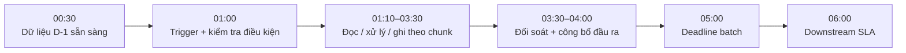
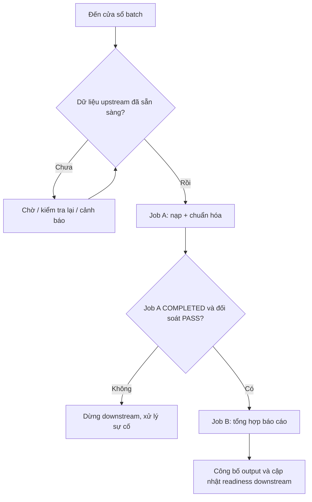

# Lịch chạy Job theo cửa sổ batch

## 1. Bối cảnh và mục tiêu

Một hệ thống có thể xử lý hàng triệu bản ghi trong thời gian ngắn nhưng vẫn thất bại về mặt vận hành nếu **job bắt đầu sai thời điểm**, **chạy vượt thời hạn**, **chồng lên lần chạy trước** hoặc **đọc dữ liệu đầu vào chưa hoàn tất**. Trong hệ thống dữ liệu lớn, lên lịch là một phần của thiết kế hiệu năng và độ tin cậy, không chỉ là đặt một biểu thức cron.

Bài học thuộc chương **Scheduling** của module **SPRING_BATCH_SCALING_OPERATIONS**. Module tập trung mở rộng Spring Batch qua multi-threaded step, parallel steps, partitioning và mô hình xử lý phân tán, đồng thời đo nút thắt, bảo đảm thread safety, retry/restart và lựa chọn kiến trúc theo tài nguyên thực tế. Chủ đề ở đây là cách bố trí **lịch chạy job theo cửa sổ batch** để những cơ chế mở rộng đó hoạt động an toàn, đúng hạn và có thể khôi phục.

Kết thúc bài này, bạn cần có khả năng:

- Xác định cửa sổ batch bằng mốc bắt đầu, thời hạn hoàn thành, ngày nghiệp vụ, độ sẵn sàng dữ liệu và giới hạn tài nguyên.
- Phân biệt **bộ kích hoạt lịch** với `JobLauncher`, `JobRepository` và tiến trình thực thi job trong Spring Batch.
- Thiết kế quy tắc không chạy chồng lấn, xử lý lịch bị lỡ, retry/restart và backfill mà không ghi trùng.
- Ước tính khả năng hoàn thành trong cửa sổ batch dựa trên khối lượng, throughput, thời gian chuẩn bị và dư địa khi có sự cố.
- Chọn `@Scheduled`, Quartz, Kubernetes CronJob hoặc một orchestrator bên ngoài theo cách triển khai thực tế.

## 2. “Cửa sổ batch” là gì?

**Cửa sổ batch (batch window)** là khoảng thời gian được phép hoặc được kỳ vọng dùng để thực thi một hay nhiều công việc batch, thường khi dữ liệu nguồn đã sẵn sàng và hệ thống trực tuyến ít tải. Nó có thể do SLA, thời điểm chốt dữ liệu hoặc quy định vận hành quyết định.

Ví dụ một hệ thống xử lý đơn hàng ngày D-1:

| Mốc | Ý nghĩa |
| --- | --- |
| 00:30 | Nguồn dữ liệu xác nhận đã chốt ngày D-1 |
| 01:00 | Bắt đầu cửa sổ và kích hoạt job đối soát |
| 04:30 | Hạn bắt đầu muộn nhất theo chính sách dự phòng, nếu job đủ ngắn |
| 05:00 | Hạn hoàn thành batch |
| 06:00 | Báo cáo phải sẵn sàng cho hệ thống downstream |

Hai thời điểm cần được phân biệt:

- **Start window**: thời điểm job có thể bắt đầu nếu đã đáp ứng các điều kiện tiền đề.
- **Completion deadline**: thời điểm đầu ra phải hoàn thành và được xác nhận. Một job khởi chạy trong cửa sổ vẫn có thể vi phạm SLA nếu kết thúc sau deadline.

Có thể áp dụng thêm **latest safe start**: thời điểm muộn nhất còn đủ thời gian dự kiến để hoàn thành, kèm khoảng đệm. Không nên cho job nặng bắt đầu lúc 04:59 chỉ vì “vẫn nằm trong cửa sổ 01:00–05:00”.

### 2.1. Cửa sổ thời gian chưa đủ

Một lịch vận hành tốt có ít nhất năm điều kiện:

1. **Thời gian**: lịch theo múi giờ rõ ràng, có xử lý ranh giới đầu/cuối.
2. **Dữ liệu sẵn sàng**: nguồn đã chốt, đủ partition/file, hoặc đã phát tín hiệu/watermark thích hợp.
3. **Phụ thuộc**: upstream đã thành công; downstream chỉ bắt đầu khi dữ liệu thực sự sẵn sàng.
4. **Tài nguyên**: còn CPU, I/O, heap, database connections và quota để chạy trong SLA.
5. **Trạng thái job**: không có lần chạy xung đột; chính sách với job đã hoàn thành, thất bại hoặc đang chạy được xác định.

Đặt cron ở 01:00 **không tự bảo đảm** nguồn đã chốt hoặc job sẽ hoàn thành trước 05:00.

### 2.2. Minh họa một đêm batch



Các mốc chỉ là **ví dụ thiết kế**. Job có thể hoàn thành nhanh hơn hoặc trễ hơn tùy dữ liệu, và thời gian xử lý phải được đo từ hệ thống thật.

## 3. Spring Batch chịu trách nhiệm phần nào?

Spring Batch là framework **thực thi và quản lý trạng thái batch**, không phải một dịch vụ lập lịch phân tán đầy đủ. Khi cần chạy lúc 01:00 mỗi ngày, hệ thống phải có một **scheduler hoặc orchestrator** phát lệnh kích hoạt.

| Thành phần | Trách nhiệm | Không tự giải quyết |
| --- | --- | --- |
| Scheduler: `@Scheduled`, Quartz, CronJob… | Xác định khi nào cần phát trigger | Không mặc nhiên xác nhận dữ liệu đúng hay writer an toàn |
| `JobLauncher` | Nhận `Job` và `JobParameters` để khởi chạy execution | Không tự thiết kế lịch định kỳ |
| `JobRepository` | Lưu `JobInstance`, `JobExecution`, `StepExecution`, `ExecutionContext` | Không thay thế durable scheduler hay quy tắc business window |
| `Job` / `Step` | Điều phối logic đọc, xử lý, ghi, commit và restart | Không quyết định một lịch cron đúng với SLA |
| Orchestrator / điều phối nghiệp vụ | Quản lý dependency, backfill, recovery, cảnh báo | Không tự bảo đảm transaction cho các tài nguyên của job |

**JobInstance** được nhận diện bằng tên job và **các job parameter có tính identifying**. Với lịch chạy hằng ngày, sử dụng ngày nghiệp vụ (`businessDate`) làm identifying parameter giúp tách lần chạy ngày D-1 khỏi các ngày khác.

**JobExecution** là một lần thực thi cụ thể của JobInstance. Một JobInstance thất bại có thể có thêm JobExecution khi restart hợp lệ; một JobInstance đã `COMPLETED` thường không thể chạy lại với cùng tập identifying parameters. `JobRepository` hỗ trợ kiểm soát trạng thái và chống khởi chạy đồng thời không hợp lệ cho cùng JobInstance, nhưng không thay thế khóa điều phối ở cấp cụm hoặc chính sách chống hai job *khác* tranh chấp cùng dữ liệu.

### Ví dụ phân biệt lịch và execution

- Lịch: “Mỗi ngày lúc 01:00, xử lý ngày nghiệp vụ hôm trước”.
- JobInstance: `dailySettlementJob + businessDate=2026-11-25`.
- Execution lần 1: bắt đầu lúc 01:00, thất bại vì deadlock.
- Execution lần 2: khởi chạy lại cùng JobInstance theo cơ chế restart sau khi nguyên nhân được xử lý.
- Ngày hôm sau: tạo JobInstance mới với `businessDate=2026-11-26`.

**Không thêm `run.id` hoặc timestamp identifying ngẫu nhiên vào mỗi trigger** chỉ để có thể chạy lại liên tục; cách đó tạo JobInstance khác và làm yếu cơ chế tránh chạy trùng theo ngày nghiệp vụ.

## 4. Chọn mô hình kích hoạt lịch

### 4.1. `@Scheduled` trong Spring Framework

Phù hợp với một ứng dụng chạy thường trực, ít job, lịch đơn giản và có kiểm soát số instance scheduler.

Ưu điểm: cấu hình gọn, tích hợp Spring, dễ thử nghiệm. Giới hạn: trigger do tiến trình ứng dụng quản lý; nếu ứng dụng dừng đúng giờ kích hoạt, `@Scheduled` thông thường **không lưu trigger bị lỡ để tự phát lại**. Khi nhiều replica cùng chạy cấu hình này, mỗi replica có thể kích hoạt job.

### 4.2. Quartz với persistent job store

Phù hợp khi cần quản lý trigger lâu dài, misfire policies, lịch phức tạp và có thể triển khai chế độ clustered đúng cách. Quartz cần cấu hình database/job store, khóa và recovery thích hợp; bản thân Quartz không thay cho logic idempotent của Spring Batch.

Cần định nghĩa rõ việc thực thi nếu trigger bị lỡ: chạy bù một lần, bỏ qua, hoặc chạy ở lần kế tiếp. Tùy chính sách Quartz mà kết quả khác nhau; không được mặc định mọi misfire sẽ được chạy đầy đủ.

### 4.3. Kubernetes CronJob

Phù hợp khi mỗi lần batch cần một container/pod riêng, có giới hạn CPU/RAM và vòng đời tách biệt khỏi ứng dụng trực tuyến.

Kubernetes CronJob dùng biểu thức cron **năm trường** (phút, giờ, ngày trong tháng, tháng, thứ trong tuần), khác cú pháp cron sáu trường của Spring `@Scheduled`. Trên các phiên bản Kubernetes hỗ trợ, `spec.timeZone` giúp đặt múi giờ lịch. `concurrencyPolicy: Forbid` ngăn các Job được tạo bởi **cùng CronJob** chạy chồng lấn theo chính sách của controller; nó không đồng bộ hóa các CronJob khác hay lần chạy thủ công. Controller có thể phát trễ hoặc có các tình huống phát nhiều lần, vì vậy batch vẫn cần idempotency.

### 4.4. Workflow orchestrator

Dùng Airflow, Argo Workflows hoặc hệ thống điều phối tương đương khi có nhiều job phụ thuộc nhau, lịch backfill nhiều ngày, dữ liệu tới chậm và yêu cầu giám sát theo DAG. Orchestrator đảm nhận trigger/dependency; Spring Batch tiếp tục chịu trách nhiệm xử lý chunk, transaction, trạng thái execution và restart.

| Phương án | Nên dùng khi | Lưu ý chủ đạo |
| --- | --- | --- |
| `@Scheduled` | Một ứng dụng thường trực, ít job, lịch đơn giản | Missed trigger và nhiều replica phải xử lý riêng |
| Quartz persistent | Trigger có trạng thái bền vững, misfire và cluster scheduling | Cần vận hành Quartz store, misfire policy và locking |
| Kubernetes CronJob | Job ngắn hoặc vừa, khởi tạo pod theo từng lịch | Startup time, pod resource, timezone, concurrency policy |
| Workflow orchestrator | Nhiều pipeline liên quan, dependency/backfill phức tạp | Đồng bộ trạng thái orchestrator với Spring Batch |

Không có công cụ “tốt nhất” cho mọi dự án. Chọn theo nhu cầu lưu lịch khi downtime, số job, số instance, độ phức tạp dependency và chi phí vận hành.

## 5. Ví dụ: chạy job lúc 01:00 theo múi giờ Việt Nam

Giả sử ứng dụng Spring Boot 3.x / Spring Batch 5.x có bean `Job` tên `dailySettlementJob`. Job phải xử lý dữ liệu của **ngày nghiệp vụ hôm trước**, và cửa sổ cho phép bắt đầu từ 01:00 đến trước 05:00 theo `Asia/Ho_Chi_Minh`.

### 5.1. Tránh tự động chạy job khi ứng dụng khởi động

Nếu ứng dụng tự điều phối bằng `@Scheduled`, thường cần tắt cơ chế tự khởi chạy các Job bean lúc Spring Boot startup:

```yaml
spring:
  batch:
    job:
      enabled: false
```

Cấu hình trên liên quan tới **auto-run của Spring Boot**, không tắt `JobLauncher` hay những lệnh run chủ động.

### 5.2. Cấu hình scheduler

```java
import java.time.LocalDate;
import java.time.LocalTime;
import java.time.ZoneId;
import java.time.ZonedDateTime;

import org.slf4j.Logger;
import org.slf4j.LoggerFactory;
import org.springframework.batch.core.Job;
import org.springframework.batch.core.JobExecution;
import org.springframework.batch.core.JobParameters;
import org.springframework.batch.core.JobParametersBuilder;
import org.springframework.batch.core.JobExecutionException;
import org.springframework.batch.core.launch.JobLauncher;
import org.springframework.beans.factory.annotation.Qualifier;
import org.springframework.context.annotation.Configuration;
import org.springframework.scheduling.annotation.EnableScheduling;
import org.springframework.scheduling.annotation.Scheduled;

@Configuration
@EnableScheduling
public class DailySettlementSchedule {

    private static final Logger log =
            LoggerFactory.getLogger(DailySettlementSchedule.class);
    private static final ZoneId ZONE = ZoneId.of("Asia/Ho_Chi_Minh");
    private static final LocalTime WINDOW_START = LocalTime.of(1, 0);
    private static final LocalTime WINDOW_END = LocalTime.of(5, 0);

    private final JobLauncher jobLauncher;
    private final Job dailySettlementJob;

    public DailySettlementSchedule(
            JobLauncher jobLauncher,
            @Qualifier("dailySettlementJob") Job dailySettlementJob) {
        this.jobLauncher = jobLauncher;
        this.dailySettlementJob = dailySettlementJob;
    }

    // Spring cron: giây phút giờ ngày-trong-tháng tháng thứ-trong-tuần
    @Scheduled(cron = "0 0 1 * * *", zone = "Asia/Ho_Chi_Minh")
    public void launchYesterday() {
        ZonedDateTime now = ZonedDateTime.now(ZONE);
        LocalTime time = now.toLocalTime();
        if (time.isBefore(WINDOW_START) || !time.isBefore(WINDOW_END)) {
            log.warn("Skip launch outside batch window: {}", now);
            return;
        }

        LocalDate businessDate = now.toLocalDate().minusDays(1);
        JobParameters params = new JobParametersBuilder()
                .addString("businessDate", businessDate.toString(), true)
                .toJobParameters();

        try {
            JobExecution execution = jobLauncher.run(dailySettlementJob, params);
            log.info("Triggered businessDate={}, executionId={}, status={}",
                    businessDate, execution.getId(), execution.getStatus());
        } catch (JobExecutionException ex) {
            log.error("Cannot start dailySettlementJob for {}", businessDate, ex);
            // Kết nối hệ thống cảnh báo/recovery ở đây.
        }
    }
}
```

Giải thích:

- `0 0 1 * * *` nghĩa là 01:00 mỗi ngày với cú pháp **sáu trường của Spring**. `zone` chỉ định múi giờ của lịch.
- `businessDate` là identifying parameter, tạo đúng một JobInstance logic cho mỗi ngày nghiệp vụ. Cùng tên job và identifying parameter đã `COMPLETED` sẽ không được chạy như một lần mới thông thường.
- Phép kiểm tra cửa sổ là hàng rào thời gian phụ trợ. Trigger chỉ chạy một lần lúc 01:00, nên nếu ứng dụng dừng thời điểm đó, đoạn code **không tự bắt kịp lịch** khi ứng dụng trở lại lúc 02:00.
- `jobLauncher.run` có thể khởi chạy đồng bộ hoặc bất đồng bộ tùy cấu hình launcher. `execution.getStatus()` ngay lúc return không nhất thiết là trạng thái cuối của job; cần quan sát `JobRepository` / listener / hệ thống giám sát.
- Bắt `JobExecutionException` giúp ghi nhận các tình trạng không thể start, gồm execution đang chạy, instance đã hoàn thành, không thể restart hoặc parameter không hợp lệ. Trong hệ thống thực, phân loại các lỗi này để alert hoặc bỏ qua có chủ đích.

Ví dụ này là **một lịch khởi động**, chưa đủ để bảo đảm ready signal, distributed lock, deadline cứng hay phục hồi trigger bị lỡ. Khi triển khai, có thể inject `Clock` để kiểm thử ranh giới thời gian mà không phụ thuộc đồng hồ máy.

## 6. Thiết kế cửa sổ batch thành chính sách có thể kiểm chứng

Thay vì chỉ ghi “chạy từ 01:00 đến 05:00”, hãy định nghĩa quy tắc ra quyết định.

| Điều kiện | Ví dụ | Hành động |
| --- | --- | --- |
| Chưa tới giờ | 00:55 | Không khởi chạy |
| Đến giờ nhưng thiếu dữ liệu | 01:00, upstream chưa chốt | Chờ tín hiệu; kiểm tra lại theo chính sách |
| Đủ dữ liệu và còn thời gian | 01:15, job chưa chạy | Khởi chạy nếu không trùng/chồng lấn |
| Đã có execution đang chạy | 01:30, cùng `businessDate` | Không khởi chạy thêm; giám sát execution cũ |
| Đã hoàn thành | 02:00, trạng thái `COMPLETED` | Không xử lý lại ngày đó |
| Đã thất bại | 02:15, `FAILED` | Xác định lỗi, restart cùng parameters khi an toàn |
| Quá latest safe start | 04:40, job ước tính 90 phút | Không khởi chạy tùy tiện; cảnh báo và kích hoạt quy trình ngoại lệ |
| Đã vượt deadline | Sau 05:00, job vẫn chạy | Cảnh báo SLA, áp dụng chính sách stop/tiếp tục theo nghiệp vụ |

**Phân biệt hai loại cửa sổ:**

- **Cửa sổ được phép bắt đầu**: kiểm tra trước khi gọi `JobLauncher`.
- **Cửa sổ được phép chiếm tài nguyên**: cần cơ chế kiểm tra tiến độ, cảnh báo và dừng mềm nếu có deadline. Bản thân điều kiện `if (now < end)` lúc launch không giới hạn tổng thời gian job.

Nếu bắt buộc dừng ở 05:00, cần thiết kế job có thể dừng an toàn, quan sát `JobExecution` và dùng cơ chế stop phù hợp (chẳng hạn `JobOperator.stop(executionId)` qua công cụ vận hành). Stop thông thường có tính **hợp tác** và không đảm bảo ngắt lập tức mọi thao tác I/O; chunk đã commit vẫn còn. Không dùng kill tiến trình như cơ chế rollback nghiệp vụ.

### Cửa sổ qua nửa đêm

Với khoảng 22:00–02:00, điều kiện khác ví dụ 01:00–05:00:

```java
static boolean isWithinWindow(LocalTime t, LocalTime start, LocalTime end) {
    if (start.equals(end)) {
        return false; // quy ước: khoảng rỗng; định nghĩa khác nếu cần 24 giờ
    }
    if (start.isBefore(end)) {
        return !t.isBefore(start) && t.isBefore(end);
    }
    return !t.isBefore(start) || t.isBefore(end);
}
```

Mốc **bắt đầu được tính, mốc kết thúc không được tính**. Khi đi qua ngày mới, phải định nghĩa `businessDate` theo phiên batch bắt đầu lúc 22:00 (hoặc cutoff nghiệp vụ), không máy móc lấy ngày máy chủ hiện tại.

## 7. Phòng tránh job chạy chồng lấn

Chạy chồng lấn xảy ra khi lịch ngày D bắt đầu trước khi job ngày D-1 kết thúc, hoặc nhiều replica cùng phát trigger.

### 7.1. Ba cấp độ trùng lặp khác nhau

| Trường hợp | Tại sao nguy hiểm? | Biện pháp |
| --- | --- | --- |
| Hai trigger của **cùng JobInstance** | Hai execution cùng sửa một tập dữ liệu | Dùng identifying parameters nhất quán; tôn trọng kiểm tra concurrency của `JobRepository` |
| Hai JobInstance **khác ngày** nhưng truy cập cùng tài nguyên | Khóa DB, race condition, sai dữ liệu snapshot | Chính sách skip/queue/serialize, tách partition/key, giới hạn tài nguyên |
| Hai replica scheduler cùng kích hoạt | Gửi nhiều yêu cầu launch, tranh chấp metadata, tăng tải | Chỉ một leader/scheduler owner, distributed lock, Quartz cluster hoặc orchestrator quản lý duy nhất |

`JobRepository` cung cấp trạng thái và các ràng buộc khởi chạy nhất định cho **cùng JobInstance**, nhưng không phải cơ chế chống chồng lấn tổng quát cho hai ngày nghiệp vụ khác nhau hay các job tên khác nhau. Database unique constraint và idempotent writer vẫn cần để bảo vệ tính đúng dữ liệu.

### 7.2. Các chính sách overlap thường dùng

- **Skip:** Bỏ trigger mới nếu job đang chạy; chỉ hợp lý khi được phép không xử lý kỳ đó hoặc có cơ chế chạy bù rõ ràng.
- **Queue:** Xếp các business date cần chạy, sau đó chạy tuần tự. Cần hàng đợi bền vững và giới hạn backlog.
- **Coalesce:** Gộp nhiều trigger vào một lần xử lý khi nghiệp vụ cho phép, chẳng hạn tính lại toàn bộ snapshot thay vì chạy từng delta.
- **Parallel with isolation:** Chạy đồng thời nếu dữ liệu và khóa nghiệp vụ tách biệt, reader/writer an toàn, DB đủ capacity.

Ví dụ xử lý D-1 mất 6 giờ, trong khi cửa sổ mỗi ngày chỉ 4 giờ. Bỏ trigger ngày D mà không ghi nhận backlog sẽ làm mất cả một ngày nghiệp vụ. Đây là lỗi điều phối, không chỉ là lỗi hiệu năng.

## 8. Retry, restart, lịch bị lỡ và backfill

### 8.1. Retry trong step khác retry từ scheduler

**Retry trong step:** Với lỗi tạm thời (ví dụ DB deadlock), Spring Batch có thể retry item hoặc chunk theo cấu hình fault tolerance. Nó liên quan tới transaction, retry policy và idempotency của component.

**Retry/khởi động lại từ scheduler:** Scheduler quyết định thử launch sau khi một lần chạy thất bại hoặc khi launch không thành công. Nếu muốn **restart cùng JobInstance**, cần dùng lại các identifying job parameters và tuân theo trạng thái trong `JobRepository`.

Không tạo timestamp identifying mới chỉ để “thử lại” vì điều đó có thể đọc/ghi lại toàn bộ dữ liệu như một JobInstance mới.

### 8.2. Lịch bị lỡ khi hệ thống tắt

Giả sử ứng dụng dùng `@Scheduled` bị dừng 00:50–02:20 và lịch là 01:00. Sau khi mở lại:

- Trigger 01:00 đã trôi qua; `@Scheduled` mặc định không tự bù lần đó.
- Phải có một cơ chế **reconciliation**: định kỳ so sánh những business date cần xử lý với metadata/đầu ra thực tế.
- Nếu còn trong cửa sổ và job đủ điều kiện, thực hiện catch-up có kiểm soát; nếu đã vượt giới hạn, cảnh báo hoặc lên lịch bù theo chính sách.
- Nếu scheduler bền vững như Quartz, cần cấu hình misfire policy và kiểm tra hệ quả khi nhiều trigger dồn sau downtime.

Một bảng điều phối nhỏ có thể ghi `business_date`, `readiness`, `desired_state`, `last_execution_id` và thời điểm deadline. Bảng đó phục vụ quan sát/điều phối; `JobRepository` vẫn quản lý trạng thái execution của Spring Batch.

### 8.3. Backfill nhiều ngày

Khi cần nạp lại dữ liệu các ngày D-5 đến D-1:

1. Xác định các business date bị thiếu/sai, thứ tự phụ thuộc và khối lượng dự kiến.
2. Chọn giờ chạy bù ngoài giờ cao điểm hoặc khi tài nguyên cho phép; không để backfill làm nghẽn lịch batch chính.
3. Gắn `businessDate` identifying rõ ràng cho từng lần chạy, kiểm tra JobInstance đã hoàn thành hay chưa.
4. Nếu cần **tính lại một ngày đã COMPLETED**, thiết kế chế độ reprocessing có version/đầu ra cô lập hoặc một job sửa dữ liệu rõ ràng; tránh tự ý sinh `run.id` rồi ghi đè ngoài kiểm soát.
5. Đối soát số lượng, business key, checksum và tín hiệu downstream sau khi bù.

**Kịch bản restart:** Job ngày D-1 commit 50 chunk rồi lỗi ở chunk 51. Khởi chạy lại cùng identifying parameters có thể tiếp tục từ trạng thái hợp lệ, nhưng reader/checkpoint phải đúng và writer cần idempotent. Nếu writer gửi API hoặc message không cùng transaction DB, side effect có thể đã xảy ra dù chunk rollback; dùng outbox/idempotency key và đối soát.

## 9. Thiết kế lịch theo dependency và trạng thái dữ liệu

Tránh xếp lịch kiểu “Job A lúc 01:00, Job B lúc 02:00” nếu Job A có thể chạy dài hơn dự kiến. Khi đó Job B có thể đọc dữ liệu chưa đủ hoặc một snapshot chưa được công bố.

**Cách đúng theo trạng thái:** Job B chỉ được khởi chạy sau khi Job A thành công **và** dữ liệu đầu ra vượt qua bước đối soát.



Với một pipeline gọn có thể dùng flow của Spring Batch, còn DAG phức tạp hoặc chạy nhiều ứng dụng có thể dùng orchestrator. Dù chọn phương án nào, thời điểm `COMPLETED` cần được diễn giải cùng yêu cầu nghiệp vụ: nếu job cho phép skip item lỗi, completed về kỹ thuật có thể chưa đạt chất lượng đầu ra.

### Nguồn dữ liệu đến muộn

Một nguồn event stream có thể tiếp tục gửi sự kiện D-1 sau 00:30. Cần chính sách **watermark/late arrival** hoặc dữ liệu snapshot chốt để biết khi nào được coi là “đủ”.

Các lựa chọn có thể gồm:

- Chờ tín hiệu “source final” hoặc manifest số file/checksum.
- Chạy bản sơ bộ rồi tạo correction cho late data.
- Chốt cutoff và đưa dữ liệu đến muộn vào kỳ sau, nếu nghiệp vụ cho phép.

Không thể giải quyết thiếu dữ liệu đầu vào bằng cách tăng thread hoặc partition count.

## 10. Tính dung lượng để hoàn thành trong cửa sổ batch

Lịch khả thi cần dựa trên throughput thực tế, không chỉ một phép chia lý thuyết.

Ước lượng ban đầu:

```text
processing_time_seconds ≈ total_items / sustained_throughput_items_per_second

required_window ≈ startup + source_readiness_wait
                  + processing_time + validation/publish + safety_margin
```

**Ví dụ:** Một job phải xử lý 2,4 triệu item, đo được throughput ổn định khoảng 500 item/giây:

- Thời gian xử lý lý tưởng: `2.400.000 / 500 = 4.800 giây = 80 phút`.
- Startup/chốt nguồn/đối soát và công bố kết quả: dự phòng tổng 20 phút.
- Thời gian dự kiến: khoảng 100 phút.
- Cửa sổ 01:00–05:00 có 240 phút, còn khoảng 140 phút cho dao động và sự cố.

Đây là ví dụ số học, không phải cam kết hiệu năng. Với workload thực tế, hãy dùng số đo gần **p95/p99** hoặc tình huống peak, đồng thời cân nhắc sự cố retry, tắc nghẽn DB và các công việc cạnh tranh tài nguyên.

Nếu cùng workload tăng lên 6 triệu item với throughput không đổi, chỉ riêng xử lý đã là `6.000.000 / 500 = 12.000 giây = 200 phút`. Cộng 20 phút overhead và buffer, cửa sổ 240 phút gần như hết dư địa. Cần đo lại, tối ưu truy vấn/batch write, điều chỉnh chunk size hoặc triển khai parallel steps/partitioning nếu dữ liệu có thể chia tách an toàn.

### 10.1. Concurrency budget chung cho toàn cửa sổ

Không chỉ tính số worker của một step. Khi chạy đồng thời nhiều job, cần xem **tổng áp lực** lên tài nguyên chung:

| Tài nguyên | Điều cần đo | Hành động khi chạm giới hạn |
| --- | --- | --- |
| CPU | Mức sử dụng và thời gian processor | Tối ưu xử lý, tránh tăng thread gây context switching |
| Heap/GC | Peak heap, allocation, GC pauses | Điều chỉnh chunk size, workers, queue, buffer |
| JDBC connection pool | Active/waiting connections, timeout | Giảm job song song, điều chỉnh pool theo khả năng DB |
| DB locks/I/O | Lock wait, deadlocks, query/write latency | Sắp lịch lệch nhau, chia dải dữ liệu, tối ưu index |
| Broker/API quota | Rate limit, timeout, queue depth | Giới hạn request concurrency, retry with backoff |
| Network/storage | Throughput, IOPS, read/write saturation | Giảm giao thoa giữa các job I/O nặng |

Ví dụ nếu hai job chạy đồng thời với 6 và 4 worker DB-bound, pool chỉ có 8 connection có thể khiến luồng chờ connection kéo dài. Vẫn còn các kết nối metadata, giám sát và tác vụ khác; không suy ra pool phải đúng 10 vì số connection thực tế tùy cách truy cập tài nguyên.

### 10.2. Tăng concurrency không giải quyết mọi vi phạm SLA

Multi-threaded step yêu cầu reader/processor/writer thread-safe; partitioning cho phép tách dải dữ liệu và checkpoint; remote workers giúp mở rộng nhiều JVM nhưng thêm chi phí điều phối và network. Khi scheduling một job đã partition, cân nhắc cả **grid size**, số worker, số chunk đang chạy và tải DB.

Nếu bottleneck nằm ở reader tuần tự, DB lock, một API rate-limited hoặc upstream tới trễ, thêm 20 worker có thể làm **job chậm hơn**, kéo dài cửa sổ và tăng retry.

## 11. Múi giờ, lịch ngày và DST

Lịch theo ngày nghiệp vụ phải có quy ước duy nhất:

- **Scheduler timezone:** ví dụ `Asia/Ho_Chi_Minh`, sử dụng ở cron và logic xác định cửa sổ.
- **Business timezone:** múi giờ xác định ngày D-1, cutoff và dữ liệu báo cáo; có thể khác scheduler timezone nếu tổ chức hoạt động xuyên quốc gia.
- **Timestamp lưu trữ:** nên dùng instant/UTC cho thời điểm kỹ thuật, kèm offset hoặc zone khi cần hiển thị cho vận hành.
- **Window boundary:** thống nhất tính đầu mút bao gồm bắt đầu và không bao gồm kết thúc.

Việt Nam hiện không áp dụng daylight saving time (DST), nhưng những múi giờ khác có thể **khuyết một giờ hoặc lặp lại một giờ** vào ngày đổi DST. Cron ở một giờ không tồn tại có thể không chạy; giờ lặp lại có thể tạo hai thời điểm cục bộ có cùng giờ-phút. Cần mô phỏng những ngày chuyển giờ của múi giờ thực tế và dựa vào `businessDate`/idempotency để chống trùng.

Không lấy `LocalDate.now()` trên server để xác định ngày nghiệp vụ nếu server đặt UTC nhưng lịch chạy ở múi giờ khác. Dùng `ZonedDateTime.now(ZoneId.of(...))` hoặc `Clock` inject vào ứng dụng và thử tại ranh giới ngày.

## 12. Vận hành: quan sát, cảnh báo và runbook

### 12.1. Metrics theo mỗi kỳ batch

| Nhóm | Metrics/cảnh báo nên có |
| --- | --- |
| Trigger | Expected vs actual trigger, missed runs, launch delay |
| Ready | Upstream ready time, số nguồn chưa tới, thời gian chờ dữ liệu |
| Execution | JobInstance/Execution ID, status, start/end time, restart count |
| SLA | Deadline, predicted finish, còn bao nhiêu phút trước breach |
| Dữ liệu | Read/write/filter/skip counts, record reconciliation, checksum |
| Transaction | Commit/rollback counts, retry, skip, exception types |
| Hiệu năng | Throughput, p95/p99 thời gian chunk, CPU/heap, connection wait, DB lock |
| Backfill | Số business date còn thiếu, queue age, backlog và tài nguyên sử dụng |

Nên có **hai kiểu cảnh báo độc lập**: (1) job không được kích hoạt đúng thời gian và (2) job đã kích hoạt nhưng đang chạy quá lâu hoặc thất bại. Chỉ dựa trên `FAILED` trong `JobRepository` sẽ bỏ sót trường hợp **không hề có JobExecution** vì scheduler bị tắt.

### 12.2. Runbook khi job trễ

1. Kiểm tra mốc thời gian, business date, readiness và execution gần nhất; xác định job chưa trigger hay đã trigger nhưng đang chạy.
2. Kiểm tra dependency và dung lượng: connection wait, DB locks, CPU, GC, queue, worker availability.
3. Xác định trạng thái `STARTED`, `FAILED`, `STOPPED` hoặc `COMPLETED` và những chunk đã commit.
4. Nếu restart, sử dụng **cùng identifying parameters** khi thích hợp, xác minh reader checkpoint và writer idempotency.
5. Nếu có nguy cơ vượt deadline, quyết định tiếp tục, stop an toàn, chạy bù hoặc công bố dữ liệu với trạng thái “chưa hoàn tất” theo yêu cầu nghiệp vụ.
6. Đối soát dữ liệu sau recovery; cập nhật downstream readiness và ghi nhận nguyên nhân để cải thiện capacity/lịch.

**Không xử lý sự cố chỉ bằng cách chạy lại job với timestamp mới.** Lựa chọn này có thể tạo JobInstance khác và ghi đè hoặc nhân đôi dữ liệu đã commit.

## 13. Case study: pipeline sao kê cuối ngày

Hệ thống cần tổng hợp 8 triệu giao dịch từ nhiều nguồn và xuất sao kê trước 06:00. Nguồn dữ liệu chốt lúc 00:45, cửa sổ batch 01:00–05:00. Job có ba giai đoạn: đọc/chuẩn hóa, tổng hợp, kiểm tra và công bố.

**Phương án thử nghiệm:**

1. Scheduler phát trigger 01:00 theo `Asia/Ho_Chi_Minh`, nhưng chỉ launch khi manifest các nguồn đã sẵn sàng và chưa có job trùng ngày nghiệp vụ.
2. Job nhận identifying parameter `businessDate`, thống nhất cùng ngày ở reader, writer, tên file đầu ra và metadata đối soát.
3. Benchmark bản tuần tự, sau đó tăng concurrency bằng partitioning theo dải giao dịch hoặc nguồn dữ liệu nếu tập khóa có thể chia an toàn. Chọn số partition dựa trên workload, DB pool và SLA, không mặc định tăng càng nhiều càng tốt.
4. Ghi kết quả vào vùng staging theo ngày/phiên xử lý, xác minh count/checksum và công bố đầu ra sau khi validation PASS.
5. Khi lỗi giữa chừng, khởi chạy lại bằng cùng parameters theo khả năng restart; phần output đã công bố hoặc các API bên ngoài cần cơ chế chống công bố trùng.
6. Cảnh báo lúc 03:30 nếu dự báo hoàn thành sau 05:00; nếu vẫn chưa xong ở deadline, giữ trạng thái đầu ra rõ ràng và kích hoạt quy trình ngoại lệ.

Giả sử job mất 3 giờ 10 phút ở dữ liệu trung bình. Khoảng 50 phút còn lại của cửa sổ bốn giờ chưa chắc đủ ở ngày cao điểm. Cần xem p95/p99, dữ liệu lớn nhất có thể đến, thời gian upstream trễ và chi phí retry để xác định có đủ headroom hay cần thay đổi kiến trúc.

## 14. Những lỗi thiết kế thường gặp

**Lỗi 1: Cron chạy đúng nên batch chắc chắn đúng.** Cron chỉ phát trigger; chất lượng dữ liệu, deadline, dependency và trạng thái execution là những kiểm tra khác.

**Lỗi 2: Thêm `run.id` vào mọi lần thử lại.** Mỗi trigger có thể thành JobInstance mới, vô hiệu hóa dự kiến restart theo ngày và tăng nguy cơ ghi trùng.

**Lỗi 3: Hai replica cùng dùng `@Scheduled` nhưng không điều phối.** Mỗi replica có lịch riêng; cần một chủ sở hữu scheduler hoặc cơ chế khóa cụm và writer idempotent.

**Lỗi 4: Chạy Job B lúc 02:00 vì “Job A thường chạy 40 phút”.** Ngày cao điểm A có thể mất 2 giờ. B phải phụ thuộc vào trạng thái và đối soát đầu ra của A.

**Lỗi 5: Nếu job vẫn chạy lúc 05:00 thì kill process.** Các chunk đã commit vẫn tồn tại; có thể còn side effect bên ngoài DB. Dừng có kiểm soát và kế hoạch restart sẽ đáng tin cậy hơn.

**Lỗi 6: Đo thông lượng của một job rồi cộng tuyến tính khi chạy nhiều job.** Những job cùng dùng DB, CPU, disk và network có thể tranh chấp, làm throughput thực tế thấp hơn tổng lý thuyết.

**Lỗi 7: Quên lịch bị lỡ.** `@Scheduled` đơn giản không bảo đảm phát lại trigger của đêm ứng dụng downtime. Cần quan sát và chính sách catch-up/backfill.

## 15. Checklist trước khi đưa lịch vào production

- [ ] Xác định múi giờ lịch, business date, cutoff, cửa sổ bắt đầu, latest safe start, deadline và downstream SLA.
- [ ] Có ready signal từ upstream thay cho việc chỉ dựa vào đồng hồ.
- [ ] Job parameters định danh một kỳ nghiệp vụ; chính sách duplicate, restart và reprocessing được viết rõ.
- [ ] Xác định hành vi khi scheduler downtime, trigger bị lỡ hoặc nhiều replica cùng hoạt động.
- [ ] Có chính sách với overlapping runs: skip, queue, serialize hay parallel với dữ liệu cách ly.
- [ ] Benchmark ở dữ liệu peak; có đủ thời gian đệm và tài nguyên cho retry, kiểm tra, công bố.
- [ ] Reader, processor, writer, checkpoint và side effect an toàn khi concurrency/restart.
- [ ] Dashboard và alert phát hiện job **không được trigger**, job chạy chậm, thất bại, rollback tăng và dữ liệu lệch.
- [ ] Có runbook cho failed/stopped/restart, missed run, backfill, SLA breach và đối soát sau recovery.

## 16. Câu hỏi tự kiểm tra

1. Vì sao chỉ đặt `@Scheduled(cron = "0 0 1 * * *")` chưa đủ để bảo đảm dữ liệu báo cáo lúc 06:00 là đúng và đầy đủ?
2. Nếu ứng dụng tắt từ 00:50 đến 02:00, điều gì xảy ra với một `@Scheduled` trigger lúc 01:00, và cách khôi phục thích hợp là gì?
3. Tại sao dùng `businessDate` làm identifying JobParameter tốt hơn việc thêm timestamp identifying vào mọi lần khởi chạy?
4. Hai job chạy khác ngày nhưng ghi chung bảng. `JobRepository` có bảo đảm chúng không tranh chấp nhau không?
5. Một job cần 150 phút để xử lý nhưng chỉ còn 60 phút trước deadline. Hệ thống nên quyết định theo chính sách nào thay vì khởi chạy vô điều kiện?
6. Khi nào nên chuyển từ scheduler trong ứng dụng sang Quartz, Kubernetes CronJob hoặc workflow orchestrator?

**Gợi ý câu 4:** Spring Batch có cơ chế kiểm soát trạng thái execution cho một JobInstance, nhưng hai business date thường là hai JobInstance khác nhau. Để tránh race condition và quá tải DB, cần thiết kế overlap policy, khóa nghiệp vụ, khả năng ghi idempotent và capacity budget ở cấp hệ thống.

## 17. Ghi nhớ cốt lõi

- **Scheduling** quyết định *khi nào nên chạy*; **Spring Batch** quản lý *cách job xử lý, commit, lưu trạng thái và restart*.
- Cửa sổ batch cần cả start time, deadline, readiness, dependency, nguồn lực và chính sách khi chạy chậm.
- `businessDate` định danh kỳ nghiệp vụ; tránh tạo JobInstance mới vô ý khi retry hoặc restart.
- Lịch chạy trong nhiều replica, missed trigger và overlapping runs phải được xử lý ở cấp orchestration, cùng với idempotency và trạng thái `JobRepository`.
- Throughput, thread/partition count và chunk size phải được đo trong **toàn bộ cửa sổ tải thực tế**, không chỉ benchmark một job riêng lẻ.
- Job được báo `COMPLETED` và job đạt **SLA/chất lượng đầu ra** là hai điều cần kiểm chứng riêng.
