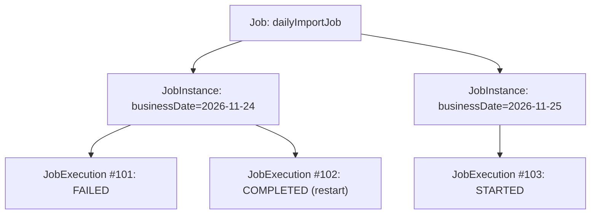
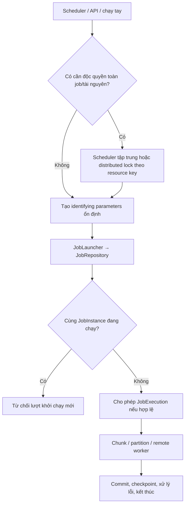
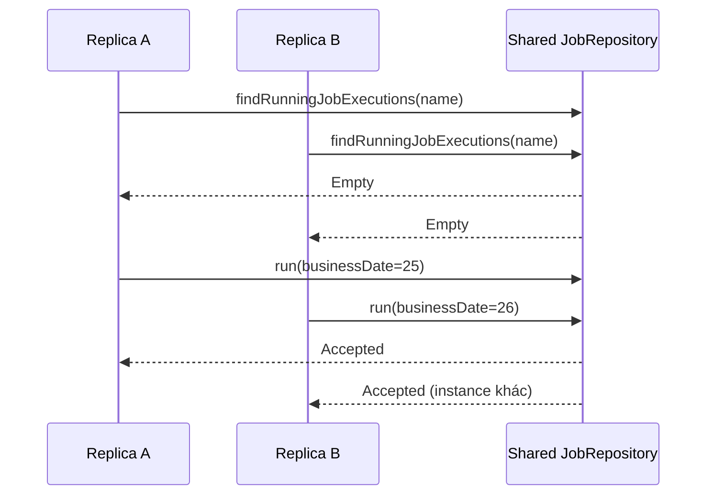

# Không chồng lấn hai `JobExecution` trong Spring Batch

## Mục tiêu học tập

Sau bài này, bạn có thể:

- Xác định chính xác **đơn vị không được phép chồng lấn**: cùng một `JobInstance`, cùng tên `Job`, cùng khoảng dữ liệu nghiệp vụ hay cùng nhóm tài nguyên.
- Phân biệt `Job`, `JobInstance`, `JobExecution` và vai trò của **identifying `JobParameters`** trong cơ chế chặn khởi chạy trùng của Spring Batch.
- Cấu hình lịch `@Scheduled` với tham số nghiệp vụ ổn định để hai scheduler không tạo đồng thời hai execution cho một instance.
- Nhận biết lúc nào cần khóa phân tán hoặc cơ chế điều phối tập trung để chặn **hai `JobInstance` khác nhau** chạy cùng lúc.
- Thiết kế an toàn cho multi-instance deployment, restart sau lỗi, lịch bị bỏ qua, chạy bù và workload dữ liệu lớn.

## 1. Bài toán: đến giờ chạy mới nhưng job cũ chưa xong

Giả sử hệ thống nhập một triệu đơn hàng mỗi đêm, được hẹn chạy lúc **01:00 theo giờ Việt Nam**. Bình thường job chạy 25 phút; hôm nay cơ sở dữ liệu chậm khiến job kéo dài 26 giờ. Đến 01:00 ngày hôm sau, scheduler lại kích hoạt một lượt nhập dữ liệu. Nếu hai lượt cùng cập nhật bảng tổng hợp, đọc chung hàng đợi, ghi chung file xuất hoặc tranh chấp tài nguyên DB, dữ liệu có thể bị ghi trùng, sai thứ tự hoặc tăng mạnh lock contention.

Trong module **SPRING_BATCH_SCALING_OPERATIONS**, tối ưu multi-threaded step, parallel steps, partitioning hay remote processing chỉ có ý nghĩa khi ta kiểm soát được số lượng **job cấp cao** đang tranh chấp tài nguyên. Một job đã dùng nhiều worker bên trong còn có thể khiến hệ thống quá tải nếu scheduler khởi chạy thêm một job thứ hai.

Cần tách hai yêu cầu thường bị gọi chung là “không chạy trùng”:

1. **Không chạy đồng thời hai `JobExecution` thuộc cùng một `JobInstance`.** Spring Batch hỗ trợ kiểm soát thông qua `JobRepository`, với điều kiện tên job, tham số định danh và kho metadata được cấu hình thống nhất.
2. **Không chạy đồng thời hai `JobExecution` của cùng một job nghiệp vụ, dù thuộc hai `JobInstance` khác nhau.** Cần chính sách điều phối hoặc khóa ở phạm vi rộng hơn, vì Spring Batch không mặc định cấm trường hợp này.

Ngoài ra, có hệ thống chỉ cần chặn hai lần ghi vào **cùng khoảng dữ liệu** (ví dụ business date), trong khi vẫn cho phép hai ngày độc lập xử lý đồng thời. Vì vậy, hãy viết rõ invariant trước khi chọn giải pháp.

| Yêu cầu nghiệp vụ | Khóa logic cần bảo vệ | Hướng giải quyết |
| --- | --- | --- |
| Không nhập lại ngày `2026-11-25` khi đang nhập ngày đó | `(jobName, businessDate)` | Identifying parameters ổn định + `JobRepository` |
| Chỉ được có **một** lượt `dailyImportJob` hoạt động trong toàn hệ thống | `dailyImportJob` | Distributed scheduler/lock giữ suốt vòng đời execution |
| Cho phép ngày khác chạy song song, nhưng không cùng tenant và ngày | `(jobName, tenantId, businessDate)` | Khóa theo business key + partition/instance phù hợp |
| Nhiều job khác tên cùng dùng bảng tổng hợp độc quyền | `aggregate-table` hoặc tên tài nguyên | Khóa theo tài nguyên, không chỉ theo job name |

## 2. Hiểu đúng `JobInstance` và `JobExecution`

Một `Job` là định nghĩa xử lý; `JobInstance` là một **lần chạy logic** của job đó; `JobExecution` là **một nỗ lực thực thi** instance (lần đầu hoặc restart).



Với cùng tên job và **cùng tập tham số định danh**, Spring Batch xem đó là cùng `JobInstance`. Nếu instance đang chạy, yêu cầu tạo execution tiếp theo sẽ bị từ chối bằng `JobExecutionAlreadyRunningException` (hoặc lỗi tương ứng khi cạnh tranh transaction). Nếu instance đã hoàn thành, chạy lại cùng tham số thường nhận `JobInstanceAlreadyCompleteException`. Nếu instance thất bại và job cho phép restart, có thể tạo một `JobExecution` mới **cho chính instance cũ** sau khi execution trước không còn chạy.

Ví dụ:

| Lần gọi | Identifying `JobParameters` | `JobInstance` | Chồng lấn có thể xảy ra? |
| --- | --- | --- | --- |
| A | `businessDate=2026-11-25` | Instance ngày 25 | A bắt đầu |
| B, trong lúc A đang chạy | `businessDate=2026-11-25` | **Cùng** instance với A | B bị từ chối nếu repository hoạt động đúng |
| C, trong lúc A đang chạy | `businessDate=2026-11-26` | Instance ngày 26 | **Có thể chạy song song với A** |
| D, trong lúc A đang chạy | `businessDate=2026-11-25, run.id=2` (cả hai định danh) | Instance khác A | **Có thể chạy song song với A** |
| E, sau khi A hoàn tất | `businessDate=2026-11-25` | Instance ngày 25 | Không khởi chạy mới; instance đã `COMPLETED` |

**Bẫy phổ biến:** thêm `System.currentTimeMillis()`, `UUID`, timestamp hoặc `run.id` **làm identifying parameter** cho mọi lần scheduler kích hoạt. Mỗi yêu cầu sẽ tạo một `JobInstance` mới; nhờ vậy cơ chế chống trùng **trên cùng instance** không còn giúp chặn các lần chạy vốn xử lý cùng dữ liệu. `RunIdIncrementer` hữu ích khi cố ý tạo lần chạy logic mới; nó không phải cơ chế chống chồng lấn.

Nếu tham số `requestId` chỉ để truy vết, có thể đánh dấu **non-identifying**. Tuy nhiên, mọi `JobParameter` của cùng một `JobInstance` phải được diễn giải nhất quán; không nên thay đổi các giá trị ảnh hưởng nội dung đọc/ghi giữa những lần restart.

### `JobRepository` bảo vệ được đến đâu?

`JobRepository.createJobExecution(jobName, jobParameters)` là điểm tạo và kiểm tra execution, phối hợp giao dịch/metadata để ngăn hai execution cùng một instance chạy đồng thời. Khả năng chống race phụ thuộc repository **dùng chung**, ràng buộc dữ liệu và isolation giao dịch phù hợp (mức isolation cho thao tác *create* là một phần cấu hình `JobRepository`).

Hai bản triển khai dùng **hai JobRepository riêng**, hoặc repository in-memory/resourceless tách biệt, không tạo ra cơ chế đồng bộ toàn cluster. Cũng không thể kết luận an toàn nếu dùng repository tùy biến không tuân thủ contract giao dịch. Trong triển khai nhiều replica, cần chung một repository bền vững được cấu hình đúng và kiểm tra race trên DB thực tế.

> Việc “query xem có execution đang chạy rồi mới `jobLauncher.run(...)`” không thay thế được kiểm tra nguyên tử ở `JobRepository`: hai tiến trình có thể cùng nhìn thấy kết quả “chưa có” trước khi cả hai cố khởi chạy.

## 3. Ba tầng kiểm soát chồng lấn



- **Tầng 1 – định danh nghiệp vụ:** xác định đúng `businessDate`, `tenantId`, `windowId`… để một lịch chạy và một lần retry cùng trỏ tới cùng công việc logic.
- **Tầng 2 – repository và trạng thái:** sử dụng một `JobRepository` bền vững để Spring Batch điều phối lifecycle, restart và phát hiện execution đang chạy trên **cùng instance**.
- **Tầng 3 – chính sách scheduler/khóa:** dùng khi cần độc quyền **khác instance**, khác tên job hoặc toàn tài nguyên; đây là trách nhiệm riêng của điều phối hệ thống.

Tầng 3 **không thay thế** tầng 2. Khi scheduler hoặc máy chủ lỗi, một lần chạy có thể được kích hoạt lại; Spring Batch vẫn cần metadata và writer idempotent để phục hồi dữ liệu đúng.

## 4. Ví dụ Spring Batch 5.x: `@Scheduled` với business date ổn định

Ví dụ ứng dụng chạy lịch `dailyImportJob` lúc 01:00 sáng và luôn xử lý **ngày nghiệp vụ hôm trước**. Ta dùng `businessDate` làm identifying parameter và **không thêm run ID thay đổi theo từng lần gọi**.

Giả sử Spring Batch đã cấu hình một `Job` tên `dailyImportJob` cùng `JobRepository` JDBC dùng chung giữa các replica. Ví dụ dùng API phổ biến của Spring Batch **5.x**; với phiên bản khác cần đối chiếu package/API đúng release. Cấu hình `@EnableScheduling` có thể nằm trong lớp configuration chung của ứng dụng.

```java
import java.time.Clock;
import java.time.LocalDate;
import java.time.ZoneId;

import org.springframework.batch.core.Job;
import org.springframework.batch.core.JobExecution;
import org.springframework.batch.core.JobParameters;
import org.springframework.batch.core.JobParametersBuilder;
import org.springframework.batch.core.JobParametersInvalidException;
import org.springframework.batch.core.launch.JobLauncher;
import org.springframework.batch.core.repository.JobExecutionAlreadyRunningException;
import org.springframework.batch.core.repository.JobInstanceAlreadyCompleteException;
import org.springframework.batch.core.repository.JobRestartException;
import org.springframework.beans.factory.annotation.Qualifier;
import org.springframework.context.annotation.Bean;
import org.springframework.context.annotation.Configuration;
import org.springframework.scheduling.annotation.EnableScheduling;
import org.springframework.scheduling.annotation.Scheduled;
import org.springframework.stereotype.Component;

import org.slf4j.Logger;
import org.slf4j.LoggerFactory;

@Configuration
@EnableScheduling
class BatchSchedulingConfiguration {
    @Bean
    Clock businessClock() {
        return Clock.system(ZoneId.of("Asia/Ho_Chi_Minh"));
    }
}

@Component
class DailyImportScheduler {
    private static final Logger log =
            LoggerFactory.getLogger(DailyImportScheduler.class);

    private final JobLauncher jobLauncher;
    private final Job dailyImportJob;
    private final Clock businessClock;

    DailyImportScheduler(
            JobLauncher jobLauncher,
            @Qualifier("dailyImportJob") Job dailyImportJob,
            Clock businessClock) {
        this.jobLauncher = jobLauncher;
        this.dailyImportJob = dailyImportJob;
        this.businessClock = businessClock;
    }

    @Scheduled(cron = "0 0 1 * * *", zone = "Asia/Ho_Chi_Minh")
    public void launchYesterday() {
        // Ví dụ: chạy lúc 01:00 ngày 26 thì nạp ngày 25.
        LocalDate businessDate = LocalDate.now(businessClock).minusDays(1);

        JobParameters params = new JobParametersBuilder()
                .addString("businessDate", businessDate.toString(), true)
                .toJobParameters();

        try {
            JobExecution execution = jobLauncher.run(dailyImportJob, params);
            log.info("dailyImportJob accepted: businessDate={}, executionId={}, status={}",
                    businessDate, execution.getId(), execution.getStatus());

        } catch (JobExecutionAlreadyRunningException e) {
            // Cùng JobInstance đã có execution hoạt động.
            log.info("Skip launch: {} is already running", businessDate);

        } catch (JobInstanceAlreadyCompleteException e) {
            // Cùng JobInstance đã thành công: không tạo bản sao.
            log.info("Skip launch: {} was already completed", businessDate);

        } catch (JobRestartException | JobParametersInvalidException e) {
            // Cần cảnh báo/vận hành: không được coi như thành công.
            throw new IllegalStateException(
                    "Cannot launch dailyImportJob for " + businessDate, e);
        }
    }
}
```

**Điều ví dụ bảo đảm:** nếu hai node cùng chạy lịch lúc 01:00, cả hai xác định cùng `businessDate`, dùng cùng tên job, cùng identifying parameters và chung `JobRepository`, repository sẽ chỉ cho phép execution hợp lệ của **một `JobInstance`** hoạt động tại một thời điểm. Đây là phép bảo vệ mạnh hơn cờ `boolean running` trong bộ nhớ JVM.

**Điều ví dụ chưa bảo đảm:** nếu job xử lý ngày 25 kéo dài qua 01:00 ngày 27, lịch ngày 27 sẽ xây dựng `businessDate=2026-11-26`, tức một `JobInstance` khác. Nó **vẫn có thể chạy đồng thời** với job ngày 25. Nếu yêu cầu “bất kỳ lúc nào chỉ một `dailyImportJob` hoạt động”, phải dùng điều phối/khóa phạm vi toàn job ở mục 5.

### Đồng bộ và bất đồng bộ của `JobLauncher`

Lời gọi `jobLauncher.run(...)` có thể chạy **đồng bộ** hoặc trả về khi execution vẫn đang xử lý, tùy `JobLauncher`/executor. Nếu đồng bộ, lời gọi chỉ kết thúc sau khi job kết thúc. Nếu bất đồng bộ, nó có thể trả về rất sớm với trạng thái `STARTING` hoặc `STARTED`.

Vì vậy, dù dùng `@Scheduled(fixedDelay = ...)` hay đặt lock quanh phương thức `launchYesterday()`, **không suy ra lock được giữ suốt thời gian job**. Khi `JobLauncher` bất đồng bộ, phương thức scheduler trả về trước khi các chunk/partition kết thúc; lock chỉ bảo vệ thao tác *gửi yêu cầu chạy* và có thể được giải phóng quá sớm.

Nếu cần lock bao trùm toàn job, hãy dùng cơ chế điều phối có thể gắn lock với **trạng thái kết thúc thật của `JobExecution`**, hoặc giữ job launch đồng bộ trong phạm vi lock có cơ chế phục hồi/timeout phù hợp. Với distributed lock có lease, cần gia hạn trong lúc job chạy và xử lý tình huống owner chết hoặc lease hết hạn.

### Còn `@Scheduled` và thread pool mặc định?

Spring `@Scheduled` định nghĩa **thời điểm gọi phương thức**, không phải một giao thức khóa phân tán. Nó cũng có thể được khai báo nhiều lần trên cùng method, và mỗi replica tạo scheduler riêng. `fixedDelay` đo từ lúc **method return**; nếu method chỉ async-submit job thì không đợi xử lý thực hoàn thành. Do đó, không dùng `fixedDelay`, `synchronized`, `AtomicBoolean` hoặc single-thread scheduler làm bằng chứng chặn chồng lấn toàn cluster.

## 5. Khi phải cấm hai `JobInstance` bất kỳ chạy đồng thời

Giả sử có hai instance:

```text
dailyImportJob(businessDate=2026-11-25) -> STARTED, chạy 26 giờ
dailyImportJob(businessDate=2026-11-26) -> lịch mới đến hạn
```

Spring Batch xem đây là **hai công việc logic khác nhau**; dù chúng ghi chung bảng, repository không có lý do để cấm instance ngày 26. Muốn chỉ một import đang hoạt động, cần chính sách cho yêu cầu thứ hai: **skip**, **queue/chờ**, **coalesce** (gộp nhiều trigger) hay **reject để người vận hành xử lý**. Không nên “skip là xong” nếu dữ liệu ngày hôm sau vẫn bắt buộc được nhập.

### 5.1. Khóa phân tán theo `resource key`

Một distributed lock có thể dùng key `dailyImportJob` hoặc key tài nguyên dùng chung `order-aggregate-table`. Tất cả đường khởi chạy (cron, API, thao tác tay, backfill và restart) phải đi qua cùng cơ chế nếu cần ràng buộc toàn hệ thống.

Chu trình chuẩn:

1. Scheduler yêu cầu lock với key xác định; thao tác **acquire phải nguyên tử** trên hạ tầng chung (ví dụ JDBC/Redis/coordination service có contract thích hợp).
2. Nếu không lấy được lock, hệ thống áp dụng chính sách queue/skip và lưu dấu yêu cầu xử lý còn tồn đọng.
3. Nếu lấy được, khởi chạy job và giữ quyền sở hữu **trong suốt vòng đời thực tế** của execution.
4. Owner gia hạn lease khi job còn chạy; khi execution kết thúc mới giải phóng lock bằng **đúng owner token**.
5. Nếu owner chết, lock được thu hồi theo cơ chế an toàn; job cũ được xác minh trạng thái và phục hồi phù hợp trước khi cho phép worker mới cùng thao tác dữ liệu.

Các thư viện hỗ trợ locking cho lịch chạy (ví dụ ShedLock dùng storage chung) có thể hữu ích, nhưng phải cấu hình thời hạn lock theo thời gian job thực tế. **Lease hết hạn không có nghĩa worker cũ đã dừng ghi.** Với yêu cầu độc quyền nghiêm ngặt, cần cơ chế *fencing* hoặc kiểm tra phiên bản quyền sở hữu tại nơi ghi: worker cũ mất lock phải bị từ chối các thao tác ghi dù process vẫn sống. Có thể cần giao thức dừng/cancel worker và kiểm tra trạng thái dữ liệu trước khi takeover.

Một câu `SELECT ... WHERE status = 'STARTED'` rồi `INSERT lock` không an toàn nếu không có ràng buộc/transaction nguyên tử. Tương tự, lock chỉ nằm trong map hoặc `ReentrantLock` bảo vệ được một JVM, không bảo vệ hai pod.

### 5.2. Dùng scheduler có quy tắc chống chồng lấn

| Công cụ | Cơ chế hữu ích | Giới hạn cần nhớ |
| --- | --- | --- |
| **Spring `@Scheduled`** | Nhẹ, tích hợp đơn giản; phù hợp để phát lệnh chạy | Không phân phối/khóa chung giữa replica; bản thân lịch không biết execution async đã kết thúc |
| **Quartz** | `@DisallowConcurrentExecution` chặn chạy đồng thời cho **cùng `JobDetail`/`JobKey`**; với clustered JDBC JobStore có thể điều phối nhiều scheduler | Hai `JobKey` khác nhau không cùng khóa; nếu Quartz job chỉ async-launch Batch rồi return, lock Quartz kết thúc sớm |
| **Kubernetes `CronJob`** | `concurrencyPolicy: Forbid` không cho hai Kubernetes Job do **cùng CronJob** tạo ra cùng chạy | Có thể bỏ qua lượt đến hạn; không bao trùm CronJob khác, API launch thủ công hoặc job chạy ngoài Kubernetes Job tương ứng |
| **Scheduler chuyên dụng/queue** | Có thể lưu bền vững yêu cầu, giới hạn concurrency và chạy bù theo thứ tự | Phải định nghĩa rõ ack, retry, crash recovery và bảo đảm chỉ một owner xử lý từng business key |
| **DB/distributed lock riêng** | Khóa theo tên job hoặc tài nguyên bất kể nguồn trigger | Cần acquire nguyên tử, lease/renewal, fencing và giám sát; dễ sai nếu tự xây không đủ |

Với **Quartz**, annotation sau chỉ áp dụng cho execution của **cùng một job key**, không phải khóa toàn bộ các `JobDetail` dùng chung class:

```java
import org.quartz.DisallowConcurrentExecution;
import org.quartz.Job;
import org.quartz.JobExecutionContext;
import org.quartz.JobExecutionException;

@DisallowConcurrentExecution
public class DailyImportQuartzJob implements Job {
    @Override
    public void execute(JobExecutionContext context)
            throws JobExecutionException {
        // Chỉ trả về khi công việc mà Quartz cần bảo vệ thực sự hoàn thành.
        // Nếu chỉ submit JobLauncher bất đồng bộ rồi return,
        // cơ chế không chồng lấn của Quartz KHÔNG giữ đến cuối Batch job.
    }
}
```

Với **Kubernetes CronJob**, phần YAML quan trọng là:

```yaml
apiVersion: batch/v1
kind: CronJob
metadata:
  name: daily-import
spec:
  schedule: "0 1 * * *"
  timeZone: "Asia/Ho_Chi_Minh"
  concurrencyPolicy: Forbid
  startingDeadlineSeconds: 1800
  jobTemplate:
    spec:
      backoffLimit: 1
      template:
        spec:
          restartPolicy: Never
          containers:
            - name: batch
              image: registry.example.com/order-batch:1.0.0
              command: ["java", "-jar", "/app/batch.jar"]
              args: ["--spring.profiles.active=batch-once"]
```

Ví dụ giả định profile `batch-once` **chạy đúng một lượt Spring Batch rồi thoát process**; hành vi này phải được ứng dụng triển khai. Tránh chạy một scheduler `@Scheduled` dài hạn trong container one-shot của CronJob. Kubernetes đặt `Forbid` ở mức các Kubernetes Job do **một CronJob** tạo ra: nếu Job cũ chưa hoàn thành, trigger mới có thể bị bỏ qua. Nó không chứng minh một thao tác nghiệp vụ chỉ được ghi một lần; tài liệu Kubernetes cũng yêu cầu workload idempotent vì controller có thể tạo Job không chính xác một lần trong mọi tình huống.

Tuyệt đối không dùng `Replace` chỉ để “giải phóng slot” nếu chưa có quy trình dừng worker an toàn: xóa/thay Kubernetes Job không bảo đảm transaction hay side effect ngoài DB được hoàn tác.

## 6. Race condition: tại sao `findRunning...` rồi `run()` chưa đủ?

Mẫu code hấp dẫn nhưng **không bảo đảm atomicity**:

```java
// Minh họa anti-pattern: không dùng làm khóa chống chồng lấn.
if (jobExplorer.findRunningJobExecutions("dailyImportJob").isEmpty()) {
    jobLauncher.run(dailyImportJob, params);
}
```

Hai replica có thể cùng gọi `findRunningJobExecutions(...)` và đều thấy kết quả rỗng:



Ngay cả khi hai replica dùng cùng `businessDate` và repository từ chối một lần chạy nhờ bảo vệ cùng `JobInstance`, **phép kiểm tra trước đó vẫn không phải là lock**. Nếu business date khác, cả hai execution vẫn có thể được chấp nhận.

`JobExplorer.findRunningJobExecutions(jobName)` hữu ích cho **quan sát, cảnh báo và hỗ trợ vận hành**, nhưng “check rồi làm” không tạo bất biến không chồng lấn. Muốn khóa toàn job, phải có một **thao tác cấp quyền chạy mang tính nguyên tử** theo key chung.

## 7. Xử lý lịch bị trễ, bị bỏ qua và chạy bù

Chặn overlap chỉ giải quyết **mức độ đồng thời**. Doanh nghiệp còn phải quyết định xử lý những ngày chưa chạy.

Ví dụ ngày 25 đang xử lý, ngày 26 đến hạn nhưng bị `Forbid`:

| Chính sách | Ứng xử khi trigger ngày 26 đến lúc ngày 25 đang chạy | Phù hợp khi |
| --- | --- | --- |
| **Skip** | Bỏ lần kích hoạt này, có cảnh báo | Dữ liệu được tái tính định kỳ và việc bỏ một lịch là chấp nhận được |
| **Queue** | Lưu `businessDate=26` vào hàng đợi bền vững, chạy khi slot rảnh | Mỗi ngày bắt buộc xử lý đủ và đúng một lần logic |
| **Coalesce** | Gộp nhiều trigger thành một yêu cầu tính lại khoảng tích lũy | Job tái tính tổng hợp, kết quả không phụ thuộc từng cửa sổ riêng |
| **Reject + alert** | Không chạy, phát cảnh báo và có bước vận hành quyết định | Workload rủi ro cao, không được tự động xử lý bù |

Với **queue**, key duy nhất có thể là `(jobName, businessDate)`; hệ thống đưa request vào DB/broker và chuyển trạng thái `PENDING → CLAIMED → RUNNING → COMPLETED/FAILED` qua thao tác nguyên tử. Khi worker chết, cần quy tắc thu hồi claim và retry; khi chuyển sang Spring Batch vẫn dùng identifying `JobParameters` ổn định để khớp checkpoint/restart.

Không nên luôn lấy `LocalDate.now().minusDays(1)` trong worker xử lý yêu cầu **bị trễ**. Nếu lịch ngày 26 không chạy được đến ngày 28, công việc cần giữ nguyên `businessDate=25` hoặc `26` đã ghi trong yêu cầu gốc (tùy định nghĩa lịch), không tính lại theo ngày hiện tại. Đặt `timeZone` rõ ràng, quản lý giờ mùa hè ở các múi giờ có DST và xác định cutoff/snapshot nguồn để việc chạy bù đọc đúng tập dữ liệu.

## 8. Crash, stale `JobExecution`, restart và khóa còn treo

Mỗi cơ chế chống chồng lấn có thể gặp tình huống crash khác nhau:

| Tình huống | Hành vi có thể thấy | Xử lý |
| --- | --- | --- |
| App chết giữa `STARTED` | `JobExecution` trong repository có thể vẫn là `STARTED` vì không kịp ghi trạng thái cuối | Điều tra process/pod/worker thực, bảo đảm không còn ghi rồi mới thực hiện thủ tục phục hồi metadata |
| Khóa lease hết hạn nhưng worker vẫn chạy | Owner mới có thể được nhận lock trong khi owner cũ chưa ngừng | Gia hạn lease, fencing, cơ chế cancel/stop an toàn |
| Scheduler chết sau khi gửi launch async | Job có thể đang chạy nhưng scheduler không còn giữ lock | Gắn trạng thái lock với lifecycle job và reconciliation của coordinator |
| Job đã `COMPLETED`, trigger trùng cùng params | Repository báo instance đã hoàn thành | Log `SKIPPED_ALREADY_COMPLETED`; không tự đổi `run.id` để ép chạy lại |
| Job `FAILED` và lần sau gọi cùng params | Có thể tạo execution restart cùng instance nếu job restartable | Kiểm tra checkpoint, state của reader/writer, giới hạn retry và lỗi gốc |
| CronJob `Forbid` bỏ qua trigger | Không có batch execution mới cho business window bị skip | Duy trì backlog/reconciliation và chạy bù có kiểm soát |

Đừng sửa trạng thái `STARTED → FAILED` chỉ vì “đã chạy quá lâu” nếu chưa xác nhận worker thực sự chết. Một partition từ xa hoặc thread cũ vẫn có thể xử lý ghi khi metadata bị sửa, tạo ra race với execution mới. Cũng không được xóa thẳng bảng `BATCH_JOB_EXECUTION` hay `BATCH_JOB_INSTANCE` để “mở khóa”: có thể phá hỏng quan hệ checkpoint, restart và lịch sử kiểm toán.

Khi cần dừng job đang chạy, ưu tiên cơ chế `JobOperator`/tác vụ vận hành hỗ trợ graceful stop, xác minh tất cả worker không còn ghi, rồi xử lý trạng thái và restart theo tài liệu phiên bản. Việc stop có thể không tức thời khi application code chưa trả điều khiển về framework.

### Retry là một execution hay một instance mới?

- **Retry chunk** là chính sách khôi phục lỗi trong step, thường vẫn thuộc `JobExecution` đang chạy.
- **Restart sau thất bại** tạo `JobExecution` mới cho **cùng `JobInstance`**, nếu được phép, tận dụng checkpoint.
- **Bắt đầu instance mới** bằng tham số định danh khác là công việc logic khác; không tự động kế thừa trạng thái đọc của instance cũ.

Chọn sai loại restart dễ biến lỗi tạm thời thành xử lý trùng toàn bộ dữ liệu. Writer cần idempotent hoặc các ràng buộc nghiệp vụ chống duplicate, nhất là khi remote partitioning/chunking hoặc hệ thống ngoài DB có semantics at-least-once.

## 9. Không chồng lấn không đồng nghĩa xử lý nhanh hơn

Cấm overlap có thể bảo vệ tài nguyên, nhưng cũng tạo backlog nếu job ngày nào cũng chạy lâu hơn một ngày. Cần đo và tối ưu nguyên nhân chậm:

| Chỉ số | Câu hỏi cần trả lời |
| --- | --- |
| `job_duration` theo p50/p95/p99 | Job có nguy cơ vượt cửa sổ lịch bao nhiêu lần? |
| `running_job_executions` theo key | Có vi phạm invariant một job/tài nguyên một execution không? |
| `scheduled_vs_started_delay` | Trigger bị chờ bao lâu trước khi có slot? |
| `pending_business_windows` | Có bao nhiêu ngày/tenant đang bị bỏ lỡ, cần chạy bù? |
| `lock_acquire_failures`, `lease_renew_failures` | Cơ chế đồng bộ có đang tranh chấp hoặc mất quyền sở hữu? |
| Chunk throughput và commit/rollback count | Bottleneck ở read, processor, writer hay retry? |
| DB connection wait/lock wait/deadlock | Độ song song trong một job có đang vượt khả năng DB? |

Một job đã partition thành tám worker, mỗi worker giữ cursor và transaction riêng, có thể cần nhiều hơn tám connection cho DB nghiệp vụ và metadata. Nếu scheduler khởi chạy thêm hai `JobInstance`, tải đồng thời có thể nhân lên và làm job **chậm hơn**, deadlock hoặc vượt timeout. Đo CPU, I/O, network, pool và kích thước chunk trước khi tăng `gridSize` hoặc số replica.

Khi các cửa sổ dữ liệu độc lập, chạy song song nhiều `JobInstance` có thể là lựa chọn tốt hơn **nếu** reader/writer/DB và yêu cầu nghiệp vụ cho phép. “Không chồng lấn” nên được hiểu như một ràng buộc có lý do; đừng áp dụng khóa toàn cục máy móc khiến throughput thấp mà không cải thiện tính đúng đắn.

## 10. Bài thực hành xác minh chống chồng lấn

Để kiểm chứng một cấu hình trong staging, dùng job thử có bước kéo dài đủ lâu để hai scheduler cùng kích hoạt và có cơ chế ghi vết từng execution. Tránh dựa vào log “skip” của một JVM để tuyên bố hệ thống đã an toàn trên cluster.

1. **Cùng params, hai launcher:** khởi chạy đồng thời cùng `jobName` và `businessDate` từ hai process dùng chung JDBC `JobRepository`. Xác minh tối đa một execution của instance hoạt động; lượt còn lại bị từ chối đúng cách.
2. **Thêm identifying `run.id`:** lặp lại với hai giá trị `run.id` khác nhau. Quan sát rằng hai `JobInstance` có thể chạy đồng thời; ghi rõ đây là điều giải pháp tầng 2 không ngăn.
3. **Khóa toàn job:** cấu hình distributed scheduler/lock theo `jobName`; kích hoạt hai business date khác nhau. Xác minh lượt thứ hai được xếp hàng hoặc bỏ qua đúng chính sách, kể cả qua hai node.
4. **Launcher bất đồng bộ:** cố tình cho `jobLauncher.run()` trả về trước khi job hoàn tất. Xác minh lock có còn giữ suốt `JobExecution` hay bị giải phóng lúc phương thức scheduler return.
5. **Crash và lease:** kill worker sau khi đã commit một vài chunk. Kiểm tra trạng thái repository, owner/lease, cơ chế tránh worker cũ tiếp tục ghi và kết quả restart. Không dùng test này trên dữ liệu sản xuất.
6. **Lịch bị bỏ qua:** giữ job A chạy quá lần kích hoạt kế tiếp. Xác minh yêu cầu B có xuất hiện trong backlog và được chạy bù theo đúng business date gốc, nếu nghiệp vụ yêu cầu.
7. **Load test:** thử một job với nhiều partition và so sánh với hai job đồng thời. Ghi p95 job duration, DB connection wait, lock wait, throughput và số bản ghi ghi trùng/mất.

Điều kiện chấp nhận cuối cùng phải có cả **kiểm chứng concurrency** (không có hai owner hợp lệ cùng thời điểm) lẫn **kiểm chứng dữ liệu** (mỗi business window cần xử lý không bị mất, kết quả cuối đúng khi retry/restart).

## 11. Chọn giải pháp theo môi trường vận hành

| Môi trường / mục tiêu | Lựa chọn thực tế |
| --- | --- |
| Một ứng dụng chạy cron, cùng business date không được chạy hai lần | Identifying parameters bất biến + JDBC JobRepository |
| Nhiều replica có cùng `@Scheduled`, chỉ cần chống trùng **cùng business date** | Chung JobRepository, cùng naming/params, kiểm thử race thực tế |
| Nhiều replica, chỉ cho một `dailyImportJob` hoạt động dù khác ngày | Distributed lock/coordinator theo `dailyImportJob`; giữ đến cuối execution, có recovery |
| Quartz cluster, cùng JobKey cần chạy tuần tự | Clustered JDBC JobStore + `@DisallowConcurrentExecution` và lời gọi đồng bộ đủ vòng đời |
| Kubernetes CronJob one-shot | `concurrencyPolicy: Forbid` và thiết kế idempotent/backfill; nhớ giới hạn theo từng CronJob |
| Nhiều tenant, cùng tenant không overlap nhưng tenant khác được chạy song song | Khóa theo `(jobName, tenantId)`, queue/backpressure theo tenant |
| Remote partitioning với nhiều worker | Bảo vệ job cấp cao và partition lifecycle; đồng bộ khóa không thay thế retry/idempotency ở worker |

## Tài liệu tham khảo

- [Spring Batch – JobRepository API (5.2.x)](https://docs.spring.io/spring-batch/docs/current/api/org/springframework/batch/core/repository/JobRepository.html): contract tạo execution và các ngoại lệ khi instance đang chạy/đã hoàn thành.
- [Spring Batch – Configuring a JobRepository](https://docs.spring.io/spring-batch/reference/job/configuring-repository.html): persistence và isolation khi tạo JobExecution.
- [Spring Batch – Advanced Metadata Usage](https://docs.spring.io/spring-batch/reference/5.2/job/advanced-meta-data.html): JobParametersIncrementer, tạo instance mới và vận hành metadata.
- [Spring Framework – Task Execution and Scheduling](https://docs.spring.io/spring-framework/reference/integration/scheduling.html): cách dùng `@Scheduled`, `fixedDelay`, cron, timezone và các trigger độc lập.
- [Quartz – `@DisallowConcurrentExecution`](https://www.quartz-scheduler.org/api/2.3.0/org/quartz/DisallowConcurrentExecution.html): chống concurrency theo JobKey.
- [Kubernetes – CronJob](https://kubernetes.io/docs/concepts/workloads/controllers/cron-jobs/): `concurrencyPolicy: Forbid`, lịch trễ và giới hạn của CronJob controller.

## Ghi nhớ

**Spring Batch ngăn hai `JobExecution` chạy đồng thời cho cùng một `JobInstance`, nhưng không mặc định ngăn hai `JobInstance` khác nhau chạy cùng lúc.** Muốn bảo vệ một business window, dùng identifying parameters ổn định và chung `JobRepository`; muốn bảo vệ toàn job/tài nguyên, cần scheduler hoặc distributed lock giữ đến lúc execution thực sự kết thúc. Kết hợp ràng buộc concurrency với kế hoạch queue/chạy bù, restart, writer idempotent và giám sát tài nguyên để mở rộng workload lớn mà không mất dữ liệu.
