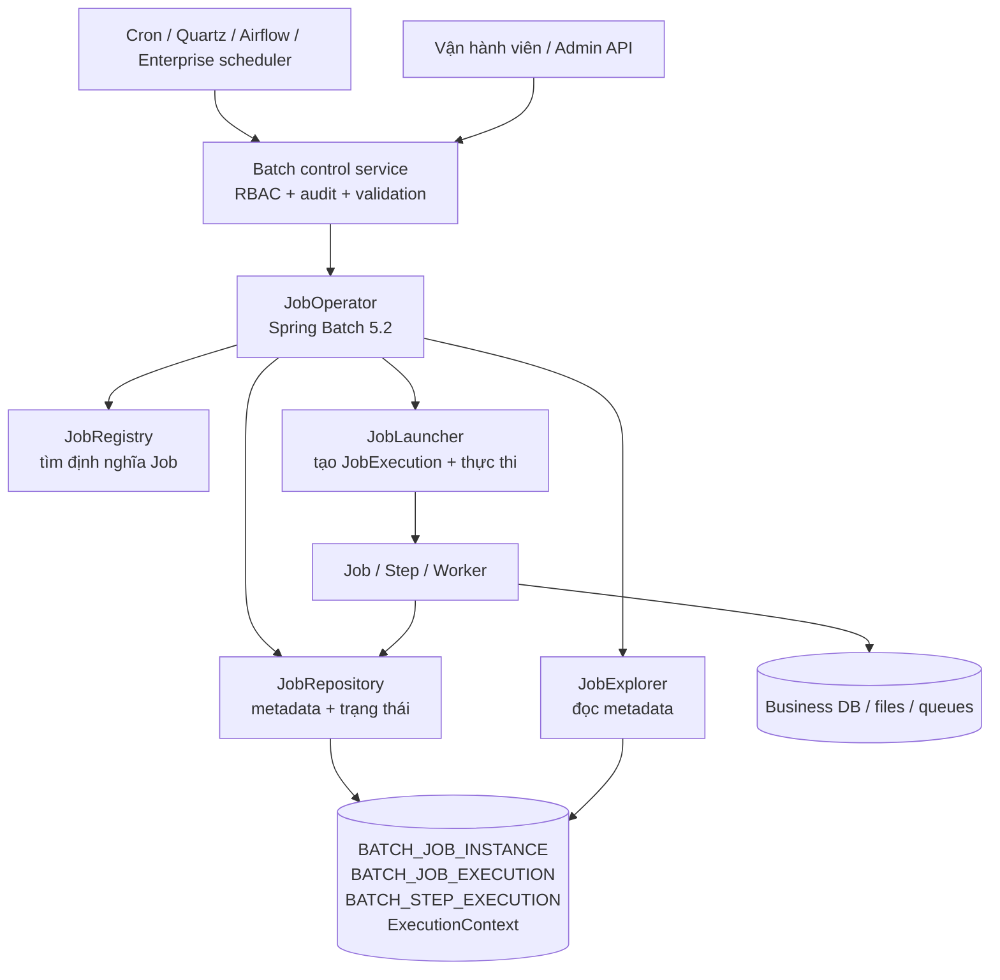
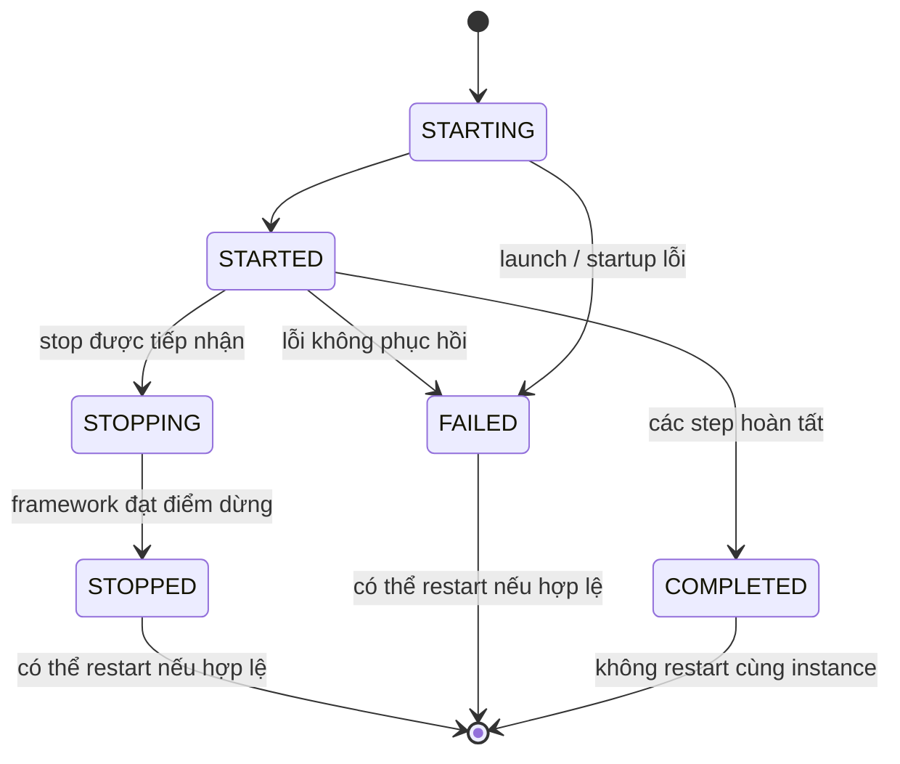
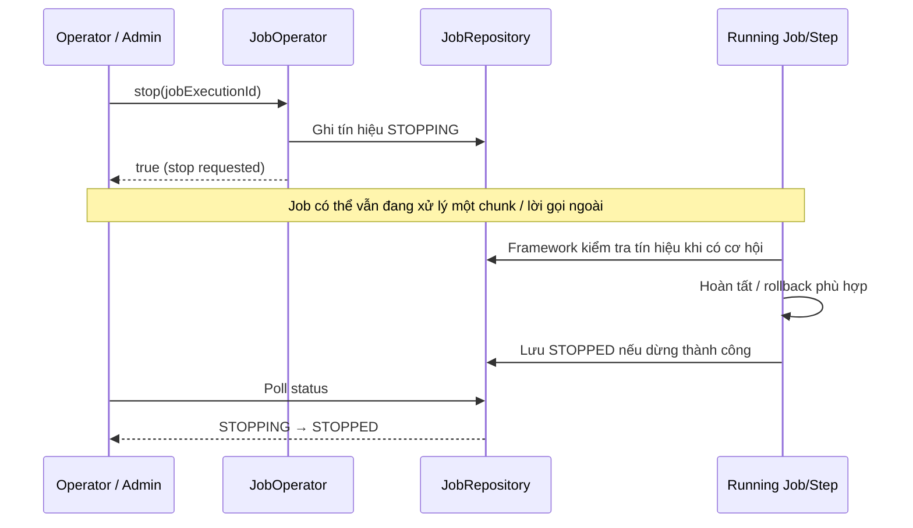
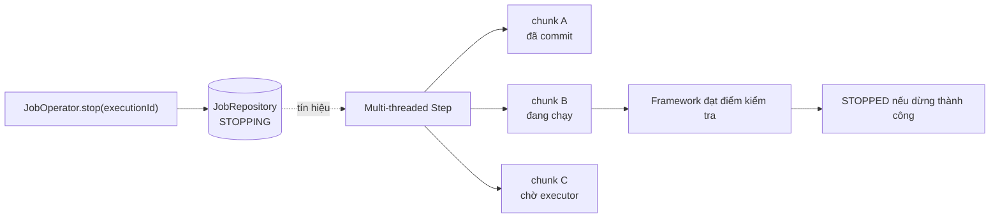
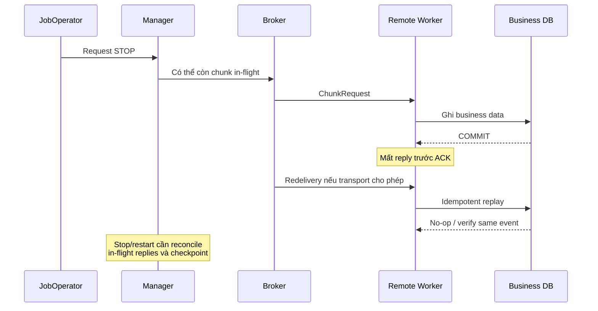

# JobOperator và điều khiển runtime trong Spring Batch

> **Chương:** Scheduling  
> **Mục tiêu:** Dùng `JobOperator` để khởi chạy, quan sát, yêu cầu dừng, restart và đánh dấu abandon một batch job một cách **có kiểm soát**. Biết phân biệt `JobInstance` với `JobExecution`, hiểu trạng thái runtime, xây lớp điều phối scheduler/API an toàn cho workload lớn, nhiều thread, partition và remote workers; thực hành xử lý job treo, lịch chạy trùng, mất kết nối và phục hồi theo checkpoint. Bài sử dụng **Spring Batch 5.2.x**, Java 17 và hạ tầng JDBC JobRepository.

## 1. Vì sao hệ thống batch cần một cơ chế điều khiển runtime?

Một ứng dụng ETL xử lý 30 triệu dòng dữ liệu mỗi đêm. Scheduler phát lệnh chạy lúc 02:15, một số partition chạy hàng giờ, API downstream có thể tạm thời quá tải, và đội vận hành cần trả lời:

- Job nào đang chạy? `JobExecution` và `StepExecution` nào đang giữ tài nguyên?
- Có thể **yêu cầu dừng** một job trước khi quá tải DB không?
- Khi job `FAILED` hoặc `STOPPED`, làm sao **restart từ checkpoint** thay vì nhập lại từ đầu?
- Khi job đã `COMPLETED`, làm sao tạo lượt chạy mới cho ngày tiếp theo?
- Nếu worker JVM chết nhưng metadata vẫn là `STARTED`, có thể an toàn phục hồi bằng cách nào?
- Nếu scheduler chạy trên ba pod, làm sao tránh khởi chạy cùng ngày ba lần?
- Làm sao phát hành API vận hành mà không cho người dùng tùy ý sửa `BATCH_JOB_EXECUTION`?

`JobLauncher` phù hợp để khởi chạy job qua API lập trình, nhưng không gom toàn bộ tác vụ điều hành. `JobExplorer` phù hợp để **đọc** metadata. Spring Batch cung cấp **`JobOperator`** để tập hợp các thao tác điều hành thường gặp: `start`, `restart`, `stop`, `abandon`, `startNextInstance` và truy vấn các lần thực thi.

**Ý tưởng chính:** `JobOperator` là **bề mặt điều khiển (control plane)** của Spring Batch, không phải một hệ scheduler phân tán, không phải cơ chế “kill” thread tức thì và không thay thế transaction, idempotency hay checkpoint của worker.

## 2. Kiến trúc: Scheduler phát lệnh, JobOperator điều phối



Trong Spring Batch 5.2:

- **`JobOperator`:** API điều hành và tra cứu. Implementation phổ biến là `SimpleJobOperator`.
- **`JobRegistry`:** Tra cứu định nghĩa `Job` theo tên, khác với bảng lưu execution. Một job có metadata trong DB nhưng định nghĩa không còn được đăng ký vẫn có thể **không restart được**.
- **`JobLauncher`:** Tạo/khởi chạy một lượt thực thi; có thể dùng executor đồng bộ hoặc bất đồng bộ.
- **`JobRepository`:** Lưu `JobInstance`, `JobExecution`, `StepExecution`, `ExecutionContext`, status/counters/checkpoint.
- **`JobExplorer`:** Đọc metadata bằng object domain để giám sát mà không sửa snapshot.
- **Scheduler:** Quyết định *khi nào* phát yêu cầu; Spring Batch không tự cung cấp lịch cron chỉ bằng cách tạo `JobOperator`.

Một request HTTP được API tiếp nhận **không đồng nghĩa** job đã xử lý xong. Tương tự, `stop()` trả `true` chỉ nói **tín hiệu dừng đã được gửi**, chưa chứng minh worker đã ngừng.

## 3. Phân biệt Job, JobInstance, JobExecution và StepExecution

Đây là nền tảng quan trọng nhất trước khi gọi các method điều hành.

| Đối tượng | Ý nghĩa | Có thay đổi khi restart không? |
| --- | --- | --- |
| **`Job`** | Định nghĩa luồng xử lý, ví dụ `dailySettlementJob` | Có thể thay đổi code/config giữa các deploy, cần quản lý tương thích |
| **`JobInstance`** | Một công việc logic, xác định bởi **job name + identifying JobParameters** | **Không** nếu restart đúng cùng logical job |
| **`JobExecution`** | Một lần cố gắng chạy của JobInstance | **Có**; restart hợp lệ tạo `JobExecution ID` mới |
| **`StepExecution`** | Một lần thực thi step/partition | Có thể khác theo lần chạy hoặc retry/restart |
| **`ExecutionContext`** | Checkpoint/state phục vụ restart của job/step | Được framework cập nhật và sử dụng lại theo vòng đời |

Ví dụ:

```text
Job name: dailySettlementJob
Identifying params:
    businessDate = 2026-11-25
    inputSnapshot = settlement-2026-11-25-v1

JobInstance ID 501
    JobExecution ID 9001 → STARTED → FAILED
    JobExecution ID 9002 → STARTED → STOPPED
    JobExecution ID 9003 → STARTED → COMPLETED

Ngày kế tiếp hoặc snapshot có identity khác:
JobInstance ID 502
    JobExecution ID 9004 → STARTED → COMPLETED
```

Các ID chỉ minh họa. `restart(9001)` khi hợp lệ tạo một execution **mới** cho **cùng `JobInstance 501`**, không phải sửa `JobExecution 9001` thành “chạy lại”. Khi `JobInstance 501` đã `COMPLETED`, cố restart thông thường bị từ chối.

### Identifying JobParameters: Đừng vô tình tạo việc mới

`run.id=System.currentTimeMillis()` hoặc UUID mới **cho mỗi attempt** có thể biến cùng một input thành **JobInstance mới**, khiến job nhập lại toàn bộ dữ liệu thay vì restart.

Ngược lại, dùng **một bộ identifying parameters y hệt cho hai ngày dữ liệu khác nhau** có thể khiến lượt chạy thứ hai bị coi là trùng logical job.

**Khuyến nghị:** Với lịch EOD, dùng `businessDate` và định danh `inputSnapshot` hoặc manifest bất biến làm identity phù hợp nghiệp vụ. Các tham số như `requestedBy` hoặc `traceId` chỉ nên là non-identifying nếu không ảnh hưởng danh tính logic và policy đã thống nhất.

## 4. Bảng API JobOperator chính trong Spring Batch 5.2

Giao diện `org.springframework.batch.core.launch.JobOperator` của Spring Batch **5.2.x** cung cấp:

| API | Đầu vào | Kết quả | Ý nghĩa |
| --- | --- | --- | --- |
| `start(String, Properties)` | Job name + tham số | `Long` execution ID | Bắt đầu **JobInstance mới** theo identifying parameters |
| `restart(long)` | **JobExecution ID** đã fail/stop | `Long` execution ID mới | Restart **cùng JobInstance** nếu được phép |
| `stop(long)` | JobExecution ID đang chạy | `boolean` | Gửi **yêu cầu dừng**, không đợi job dừng hẳn |
| `abandon(long)` | JobExecution ID đã được xác minh không chạy | `JobExecution` | Đánh dấu `ABANDONED`; không dùng như stop tức thì |
| `startNextInstance(String)` | Job name | `Long` execution ID | Tạo instance mới bằng `JobParametersIncrementer` |
| `getJobNames()` | — | `Set<String>` | Các job đã đăng ký để điều khiển |
| `getRunningExecutions(String)` | Job name | `Set<Long>` | ID các execution đang được repository xem là chạy |
| `getJobInstances(String,int,int)` | Job name, offset, count | `List<Long>` | Trang lịch sử JobInstance ID |
| `getExecutions(long)` | **JobInstance ID** | `List<Long>` | Lịch sử JobExecution ID của một instance |
| `getParameters(long)` | JobExecution ID | `String` | Hiển thị JobParameters dạng text |
| `getSummary(long)` | JobExecution ID | `String` | Mô tả tóm tắt trạng thái execution |
| `getStepExecutionSummaries(long)` | JobExecution ID | `Map<Long,String>` | Tóm tắt các step executions |

**Hai nhóm ID rất dễ nhầm:** `getExecutions(instanceId)` nhận **JobInstance ID**, trong khi `getSummary(executionId)`, `stop(executionId)` và `restart(executionId)` nhận **JobExecution ID**.

Các phương thức `getSummary`/`getParameters` trả về **chuỗi để hiển thị**, không phải JSON schema được đảm bảo ổn định cho hệ thống máy đọc. Để xây API có cấu trúc, dùng `JobExplorer` và mapping sang DTO riêng.

### Phân biệt start, restart và startNextInstance

| Ý định người vận hành | Thao tác | Đặc điểm |
| --- | --- | --- |
| Chạy ngày/snapshot chưa chạy | `start(jobName, parameters)` | Tạo logical instance theo identifying params |
| Phục hồi một job `FAILED` hoặc `STOPPED` | `restart(executionId)` | Giữ identity và checkpoint |
| Tạo kỳ chạy **mới** theo sequence | `startNextInstance(jobName)` | Cần incrementer; **không** phải restart |
| Dừng có kiểm soát một lượt đang chạy | `stop(executionId)` | Trạng thái dừng hoàn tất là bất đồng bộ |
| Không cho phép phục hồi execution đã xác minh không chạy | `abandon(executionId)` | Quyết định có hậu quả, cần audit/phê duyệt |

**Không** dùng `startNextInstance` để “vượt” lỗi `JobInstanceAlreadyCompleteException` rồi reprocess cùng dữ liệu mà chưa xác định business impact.

## 5. Trạng thái runtime: STARTED khác STOPPING và STOPPED

Một vòng đời đơn giản:



Ngoài các trạng thái chính, còn `ABANDONED` và `UNKNOWN` cần xử lý rất thận trọng. Sơ đồ minh họa đường thông dụng, **không biểu diễn tất cả chuyển trạng thái hoặc error path** mà framework có thể gặp.

| BatchStatus | Diễn giải vận hành | Hành động thường gặp |
| --- | --- | --- |
| `STARTING` | Đã tạo execution, bắt đầu khởi động | Theo dõi khởi chạy |
| `STARTED` | Framework đang xem execution là hoạt động | Giám sát, có thể yêu cầu stop |
| `STOPPING` | Đã yêu cầu dừng, chưa chứng minh đã dừng | Poll và đợi checkpoint/step kết thúc |
| `STOPPED` | Dừng có kiểm soát, metadata đã phản ánh | Có thể đánh giá restart |
| `FAILED` | Thất bại | Điều tra, sửa nguyên nhân, restart nếu an toàn |
| `COMPLETED` | Job hoàn tất theo flow | Đối soát business quality trước publish |
| `ABANDONED` | Đã chủ ý đánh dấu bỏ execution | Không dùng restart thông thường cho execution này |
| `UNKNOWN` | Trạng thái không rõ/không đáng tin | Reconcile, không tự quyết định restart |

**`ExitStatus` khác `BatchStatus`.** Một job có thể có exit code tùy biến để scheduler đọc, nhưng không nên giả định mọi exit code “OK” là `BatchStatus.COMPLETED` hoặc mọi StepExecution có status giống JobExecution.

### Tính cuối cùng của trạng thái

Một status ở database là **ảnh chụp tại thời điểm đọc**. Nó không thể tự chứng minh tiến trình JVM tương ứng còn sống. Nếu worker bị `kill -9`, JobRepository có thể còn `STARTED` trong khi process thực tế đã chết.

Không dùng riêng `LAST_UPDATED` lâu không đổi như bằng chứng quyết định “worker đã chết”: có step chạy rất lâu trong custom tasklet hoặc một cuộc gọi HTTP đang treo mà chưa về lại checkpoint. Cần kết hợp process/lease/orchestrator evidence và business side effects.

## 6. Cấu hình hạ tầng JobOperator trong Spring Batch 5.2

Nếu dùng Spring Batch 5.2 với `@EnableBatchProcessing`, hạ tầng cơ bản có thể cung cấp các bean:

```text
jobRepository
jobExplorer
jobRegistry
jobOperator
jobLauncher
stepScope / jobScope
```

Một cấu hình tối thiểu để minh họa nơi đặt định nghĩa job:

```java
package com.example.batch.scheduling;

import org.springframework.batch.core.Job;
import org.springframework.batch.core.Step;
import org.springframework.batch.core.configuration.annotation.EnableBatchProcessing;
import org.springframework.batch.core.job.builder.JobBuilder;
import org.springframework.batch.core.repository.JobRepository;
import org.springframework.context.annotation.Bean;
import org.springframework.context.annotation.Configuration;

@Configuration(proxyBeanMethods = false)
@EnableBatchProcessing
public class BatchJobsConfig {

    @Bean
    Job dailySettlementJob(
            JobRepository repository,
            Step settleInvoicesStep) {

        return new JobBuilder("dailySettlementJob", repository)
                .start(settleInvoicesStep)
                .build();
    }
}
```

Bean `settleInvoicesStep` do ứng dụng cung cấp; cần `DataSource`, `PlatformTransactionManager`, DB schema cho JobRepository và các thành phần reader/processor/writer. Đây **không** phải project runnable nếu thiếu những phần ấy.

**Lưu ý Spring Boot:** Nếu ứng dụng đang dựa vào Spring Boot auto-configuration của Batch, thêm `@EnableBatchProcessing` tùy tiện có thể thay đổi hoặc làm Boot back off một phần auto-configuration. Hãy chọn **một mô hình cấu hình hạ tầng rõ ràng** theo Spring Boot/Spring Batch version dự án, không copy annotation vào mọi class.

### Vai trò JobRegistry

`JobOperator.start("dailySettlementJob", ...)` dựa vào tên job và `JobRegistry` để tìm bean `Job`. Nếu job metadata còn trong DB nhưng job definition đã bị đổi tên hoặc gỡ khỏi deployment, `restart(executionId)` có thể báo `NoSuchJobException`.

Từ Spring Batch 5.2, `JobRegistrySmartInitializingSingleton` là cơ chế đăng ký job singleton được khuyến nghị hơn `JobRegistryBeanPostProcessor` đã deprecated. Cần kiểm tra registration trong ứng dụng multi-context; **`getJobNames()`** là một bước preflight hữu ích.

JobRegistry là registry **định nghĩa**, không phải distributed lock hay nguồn chân lý runtime status.

## 7. Ví dụ JobOperator.start với Properties và identifying parameters

`JobOperator.start(String, Properties)` nhận tham số qua `Properties`, được chuyển thành `JobParameters` bởi converter tương ứng. Với converter mặc định của Spring Batch 5.2, dạng thường gặp là:

```text
parameterName=value,fully.qualified.JavaType,identifying
```

Ví dụ: `businessDate=2026-11-25,java.time.LocalDate,true`.

Đoạn service khởi chạy một snapshot cụ thể:

```java
package com.example.batch.scheduling;

import java.time.LocalDate;
import java.util.Properties;

import org.springframework.batch.core.launch.JobOperator;
import org.springframework.stereotype.Service;

@Service
public class SettlementLaunchService {

    private static final String JOB_NAME = "dailySettlementJob";
    private final JobOperator jobOperator;

    public SettlementLaunchService(JobOperator jobOperator) {
        this.jobOperator = jobOperator;
    }

    public long startForSnapshot(
            LocalDate businessDate,
            String immutableSnapshotId,
            String requester) throws Exception {

        if (businessDate == null
                || immutableSnapshotId == null
                || !immutableSnapshotId.matches("[a-zA-Z0-9._-]{1,120}")) {
            throw new IllegalArgumentException(
                    "Missing date or invalid snapshot ID");
        }

        Properties p = new Properties();
        p.setProperty("businessDate",
                businessDate + ",java.time.LocalDate,true");
        p.setProperty("inputSnapshot",
                immutableSnapshotId + ",java.lang.String,true");
        p.setProperty("requestedBy",
                requester + ",java.lang.String,false");

        // start tạo một JobInstance mới theo các identifying params.
        return jobOperator.start(JOB_NAME, p);
    }
}
```

**Những giả định quan trọng:**

1. `businessDate` và `inputSnapshot` là **identifying**. Cùng hai giá trị nghĩa là cùng logical job; không tạo ngày giờ ngẫu nhiên để lách kiểm tra trùng.
2. `requestedBy` là non-identifying, không được dùng để phân biệt một batch run mới. `requester` cần được validation/normalization trước khi đặt vào Properties; ví dụ rút gọn và chưa xử lý mọi ký tự phân tách của converter.
3. `inputSnapshot` phải tồn tại và **bất biến** trong quá trình chạy/restart. Chỉ truyền một ID tự đặt mà file nguồn thay đổi theo thời gian sẽ phá reproducibility.
4. Việc truyền string parameters qua `Properties` có ngữ nghĩa converter; phải kiểm chứng format trong hạ tầng thực tế nếu có `JobParametersConverter` tùy chỉnh.
5. `start(...)` có thể ném `NoSuchJobException`, `JobInstanceAlreadyExistsException`, `JobParametersInvalidException` hoặc lỗi runtime/DB khác. Đừng bắt `Exception` rồi tự sinh run.id mới để retry vô điều kiện.
6. `start(...)` trả **JobExecution ID** của lượt được khởi chạy; đó **không phải chứng nhận job đã COMPLETED**. Với JobLauncher đồng bộ, lời gọi có thể block tới lúc job xong; với bất đồng bộ, nó có thể trả về khi execution vừa được nhận.
7. Không đặt password, API token hoặc thông tin nhạy cảm trong `JobParameters`: chúng được lưu vào metadata và có thể xuất hiện khi operator gọi `getParameters`.

**Nếu đã dùng `JobLauncher` trực tiếp**, có thể tạo parameters dạng type-safe bằng `JobParametersBuilder.addLocalDate(..., true)` và `addString(...)`. Với `JobOperator.start(...)`, interface 5.2 nhận `Properties`; hai cách **không dùng cùng chữ ký**.

## 8. Scheduling theo business date, không theo thời điểm ngẫu nhiên

Spring `@Scheduled` là một cách phát lệnh khởi chạy. Với EOD, lịch chạy lúc 02:15 ngày N thường xử lý **businessDate N−1**, cần thống nhất timezone nghiệp vụ.

```java
package com.example.batch.scheduling;

import java.time.LocalDate;
import java.time.ZoneId;

import org.slf4j.Logger;
import org.slf4j.LoggerFactory;
import org.springframework.scheduling.annotation.Scheduled;
import org.springframework.stereotype.Component;

@Component
public class SettlementSchedule {

    private static final Logger log =
            LoggerFactory.getLogger(SettlementSchedule.class);

    private static final ZoneId BUSINESS_ZONE =
            ZoneId.of("Asia/Ho_Chi_Minh");

    private final SettlementLaunchService launcher;
    private final ImmutableManifestService manifestService;

    public SettlementSchedule(
            SettlementLaunchService launcher,
            ImmutableManifestService manifestService) {
        this.launcher = launcher;
        this.manifestService = manifestService;
    }

    @Scheduled(cron = "0 15 2 * * *", zone = "Asia/Ho_Chi_Minh")
    public void schedulePreviousBusinessDay() {
        LocalDate businessDate =
                LocalDate.now(BUSINESS_ZONE).minusDays(1);

        // Business service tự đảm bảo snapshot đã sẵn sàng,
        // checksum/manifest cố định và có thể tra cứu qua restart.
        String snapshotId =
                manifestService.requirePublishedSnapshot(businessDate);

        try {
            long executionId = launcher.startForSnapshot(
                    businessDate, snapshotId, "nightly-scheduler");

            log.info("Scheduled dailySettlementJob businessDate={} " +
                            "snapshot={} executionId={}",
                    businessDate, snapshotId, executionId);
        } catch (Exception ex) {
            // Production: phân loại duplicate vs lỗi hạ tầng,
            // ghi audit và phát alert; không lẳng lặng bỏ qua.
            log.error("Cannot launch dailySettlementJob for " +
                            "businessDate={} snapshot={}",
                    businessDate, snapshotId, ex);
            throw new IllegalStateException("Scheduled launch failed", ex);
        }
    }

    // Interface minh họa: cần hiện thực bằng manifest service thật.
    public interface ImmutableManifestService {
        String requirePublishedSnapshot(LocalDate businessDate);
    }
}
```

Đoạn code cần `@EnableScheduling` ở cấu hình ứng dụng tương ứng, nếu scheduling chưa được bật; `ImmutableManifestService` là contract giả lập. Hơn nữa:

- **Cron 6 field** của Spring: second, minute, hour, day-of-month, month, day-of-week.
- `zone="Asia/Ho_Chi_Minh"` giúp gắn thời điểm trigger với timezone nghiệp vụ. Hệ thống nhiều vùng giờ hoặc DST phải có policy rõ cho ngày chuyển giờ; không suy ra mọi timezone đều không có DST.
- Nếu deploy trên ba pod có cùng `@Scheduled`, **cả ba pod đều có thể fire**. `@Scheduled` tự thân **không tạo distributed leader election**.
- Scheduler cần biết cách **bù kỳ chạy bị lỡ** sau downtime. Cron in-memory không đảm bảo tự catch up mọi ngày; có thể dùng Quartz persistent/enterprise scheduler hoặc một bảng control schedule có ledger.
- `requirePublishedSnapshot` có thể fail khi nguồn chưa sẵn sàng; cần chính sách retry **ở tầng scheduling/orchestration** có giới hạn, không tự tạo snapshot ID khác cho cùng ngày.
- Với JobLauncher đồng bộ, lời gọi start có thể block thread scheduler. Với job dài nên cấu hình launcher bất đồng bộ hoặc để scheduler gọi một process/queue điều phối riêng.

**Không dùng `LocalDate.now()` không timezone để làm business date** nếu yêu cầu phải nhất quán trên các server có default timezone khác nhau.

## 9. Tránh scheduler overlap và kích hoạt trùng ở nhiều JVM

Có hai dạng “trùng” khác nhau:

1. **Cùng JobInstance**: Hai scheduler cùng cố chạy `dailySettlementJob` với cùng `businessDate` và `inputSnapshot`.
2. **Hai JobInstance khác nhau nhưng tranh cùng tài nguyên**: Job ngày N chưa kết thúc thì lịch ngày N+1 bắt đầu; cả hai ghi chung bảng/dịch vụ.

Ở dạng 1, `JobRepository` JDBC cùng DB và các unique constraint/transaction isolation giúp chặn race tạo cùng logical instance. Nhưng **không** coi `getRunningExecutions(...)` rồi `start(...)` là một distributed lock nguyên tử:

```text
Pod A: getRunningExecutions(job) → rỗng
Pod B: getRunningExecutions(job) → rỗng
Pod A: start(params N)
Pod B: start(params N) → race / already exists / DB error
```

**Mô hình an toàn hơn:**

- Dùng một nguồn lịch đáng tin cậy hoặc **leader/distributed lock** nếu cần chỉ một scheduler phát lệnh.
- Dùng identifying parameters **tất định** theo kỳ và snapshot, để JobRepository phân xử duplicate logical instance.
- Xử lý duplicate launch/constraint exceptions như kết quả của một race cần điều tra/log, không tự tạo parameters mới để “đảm bảo có job chạy”.
- Nếu scheduler có thể mất ACK sau khi start, tra cứu **JobInstance theo business parameters**/metadata trước khi phát lại.
- Dùng giới hạn **max in-flight jobs** và workflow queue nếu các JobInstance khác nhau không được chạy đồng thời.
- Nếu nhiều instance phải chạy song song, bảo đảm partition/business key không chồng chéo, DB pool và downstream rate limits đủ.

### Một businessDate không đủ khi input snapshot thay đổi

Nếu dữ liệu của ngày N được sửa **sau** khi lần chạy trước `COMPLETED`, cần quyết định:

- Giữ nguyên snapshot cũ và không rerun cùng business date;
- tạo **version/correction** có identity rõ;
- hay xây một job bù trừ/correction job riêng.

Đừng thêm `run.id` ngẫu nhiên chỉ để nhập lại dữ liệu ngày cũ. Điều đó có thể nhân đôi output ở hệ thống đích.

## 10. stop(executionId) là yêu cầu dừng, không phải kill

`JobOperator.stop(long executionId)` gửi yêu cầu dừng một execution được xem là đang chạy. Theo Javadoc Spring Batch 5.2, **`true` chỉ nghĩa là tín hiệu đã được gửi thành công**, không có nghĩa job đã dừng.



### Stop là cooperative

Spring Batch không có cơ chế an toàn để cưỡng ép mọi business method dừng ngay, nhất là khi worker đang:

- Chờ JDBC query/network timeout dài.
- Thực thi custom `Tasklet.execute` kéo dài mà không trả quyền điều khiển về framework.
- Ghi file lớn hoặc gọi external API không hỗ trợ cancellation.
- Chạy remote worker không đọc stop signal của manager.
- Đang ở transaction không thể tùy ý hủy nếu không làm hỏng dữ liệu.

Framework thường phản ứng khi về được các điểm kiểm tra trong lifecycle/chunk. Vì thế `STOPPING` có thể kéo dài. Không nên tự `Thread.stop()` hoặc kill container chỉ vì `stop()` trả `true` mà chưa thấy `STOPPED`.

### Ví dụ vận hành

```java
import org.springframework.batch.core.launch.JobOperator;

boolean accepted = jobOperator.stop(9001L);
if (!accepted) {
    throw new IllegalStateException(
            "Stop request was not accepted for execution 9001");
}

// Sau đó poll JobExplorer / getSummary để chờ STOPPED.
// Không đánh dấu dừng thành công chỉ từ boolean accepted.
```

Khi đã `STOPPED`, chỉ restart nếu dữ liệu/side effects và checkpoint được đối soát. Dừng có kiểm soát **không** đồng nghĩa rollback toàn bộ các chunk đã commit trước đó.

## 11. Poll trạng thái bằng JobExplorer thay vì parse chuỗi

`JobOperator.getSummary(id)` trả `String`, tiện cho CLI và dashboard đơn giản:

```java
String summary = jobOperator.getSummary(9001L);
Map<Long, String> steps =
        jobOperator.getStepExecutionSummaries(9001L);
```

Nhưng API HTTP phục vụ client thường nên trả DTO rõ kiểu. `JobExplorer` cho phép đọc object `JobExecution`:

```java
package com.example.batch.scheduling;

import org.springframework.batch.core.BatchStatus;
import org.springframework.batch.core.JobExecution;
import org.springframework.batch.core.explore.JobExplorer;
import org.springframework.stereotype.Service;

@Service
public class ExecutionStatusService {

    private final JobExplorer jobExplorer;

    public ExecutionStatusService(JobExplorer jobExplorer) {
        this.jobExplorer = jobExplorer;
    }

    public record ExecutionStatus(
            long executionId,
            long instanceId,
            String jobName,
            BatchStatus status,
            String exitCode,
            String exitDescription) {
    }

    public ExecutionStatus get(long executionId) {
        JobExecution e = jobExplorer.getJobExecution(executionId);

        if (e == null) {
            throw new IllegalArgumentException(
                    "Unknown jobExecutionId: " + executionId);
        }

        return new ExecutionStatus(
                e.getId(),
                e.getJobInstance().getId(),
                e.getJobInstance().getJobName(),
                e.getStatus(),
                e.getExitStatus().getExitCode(),
                e.getExitStatus().getExitDescription());
    }
}
```

`ExecutionStatus` là **ảnh chụp**, không phải luồng push real-time. Nếu expose qua REST, cần:

- Không trả `exitDescription` nguyên văn nếu có stack trace chứa token/PII.
- Chuẩn hóa error mapping (`404` khi ID không tồn tại, `409` khi thao tác không hợp lệ).
- Phân quyền theo job/tenant/môi trường.
- Cân nhắc polling interval để tránh dashboard tạo tải lớn lên JobRepository.
- Không cho phép client sửa/ghi ngược một `JobExecution` được đọc qua `JobExplorer`.

### Chờ dừng thế nào cho đúng?

```text
POST /ops/batch/executions/9001/stop → 202 Accepted
GET  /ops/batch/executions/9001      → STOPPING
GET  /ops/batch/executions/9001      → STOPPING
GET  /ops/batch/executions/9001      → STOPPED
```

Nếu bị kẹt ở `STOPPING`, đưa ra cảnh báo và điều tra worker; không “xóa status” hay ép `STOPPED` theo phản xạ.

## 12. Restart: Tạo JobExecution mới cho cùng JobInstance

Khi một execution `FAILED` hoặc `STOPPED` và cấu hình cho phép restart:

```java
long previousExecutionId = 9001L;

// Spring Batch tạo JobExecution ID mới cho cùng JobInstance.
long newExecutionId =
        jobOperator.restart(previousExecutionId);
```

Thông thường:

- **JobInstance ID giữ nguyên**, các identifying JobParameters giữ nguyên.
- **JobExecution ID thay đổi**.
- Những step đã hoàn thành có thể được bỏ qua theo flow/restart semantics; step chưa hoàn thành được xử lý lại từ checkpoint phù hợp.
- `ItemStream`/`ExecutionContext` phải được thiết kế để khôi phục reader đúng dữ liệu.
- Những chunk/partition đã commit trước khi failure **không được rollback bởi restart**.
- Nếu job `COMPLETED`, gọi restart không phải đường mở một lượt chạy mới; có thể bị từ chối.
- Nếu job khai báo không restartable hoặc metadata/định nghĩa job không tương thích, `JobRestartException` hoặc exception khác có thể xuất hiện.

### Cùng JobInstance không có nghĩa cùng tập dữ liệu nếu nguồn không bất biến

Phản ví dụ: JobParameters chỉ có `businessDate=2026-11-25`, nhưng reader mở đường dẫn `/latest/invoices.csv`. Sau failure, đối tác thay file. Restart đọc dữ liệu khác trên cùng logical instance, làm checkpoint sai.

Thiết kế đúng cần `inputSnapshot`/checksum/manifest bất biến và các partition keys ổn định.

### Không dùng restart để “xóa vết” lỗi nghiệp vụ

Trước restart cần biết:

1. Lỗi đã hết chưa (DB outage, schema migration, file missing)?
2. Có side effect ngoài transaction chưa được xác nhận không?
3. Reader checkpoint có còn hợp lệ với snapshot không?
4. Writer có idempotent với replay sau rollback/mất reply không?
5. Job definition mới có tương thích metadata/ExecutionContext cũ không?
6. Các worker cũ có chắc đã ngừng chưa?

**Restart sai thời điểm** có thể tạo hai worker xử lý cùng partition, hoặc phát lại payment/notification đã thực hiện.

## 13. startNextInstance và RunIdIncrementer: Khác hoàn toàn restart

`JobOperator.startNextInstance(jobName)` dựa vào `JobParametersIncrementer` gắn trên `Job` để tạo bộ parameters cho **JobInstance mới**.

Ví dụ:

```java
import org.springframework.batch.core.Job;
import org.springframework.batch.core.Step;
import org.springframework.batch.core.job.builder.JobBuilder;
import org.springframework.batch.core.launch.support.RunIdIncrementer;
import org.springframework.batch.core.repository.JobRepository;
import org.springframework.context.annotation.Bean;

@Bean
Job demoIncrementedJob(
        JobRepository repository, Step demoStep) {

    return new JobBuilder("demoIncrementedJob", repository)
            .incrementer(new RunIdIncrementer())
            .start(demoStep)
            .build();
}
```

Sau đó:

```java
long firstOrNextExecutionId =
        jobOperator.startNextInstance("demoIncrementedJob");
```

Đặc điểm:

- `RunIdIncrementer` thường bổ sung/tăng `run.id` để tạo bộ parameters khác.
- `startNextInstance` vẫn có thể khởi tạo **JobInstance mới** dù lần trước `FAILED`; đó **không** phải recovery từ checkpoint cũ.
- Với dữ liệu được chọn theo business date, một incrementer ngẫu nhiên có thể làm cùng input được xử lý lại từ đầu. Đây là rủi ro lớn với writer không idempotent.
- Tạo các instance khác nhau **không** bảo đảm những instance ấy không chạy song song hay không tranh DB.
- Nếu nhiều scheduler cùng gọi `startNextInstance`, có thể phát sinh race trên bộ parameters tiếp theo; dùng điều phối/leader phù hợp và xử lý exception.

**Quy tắc thực hành:** `restart` phục hồi **công việc cũ**; `startNextInstance` tạo **công việc logic mới**. Nếu bạn cần “chạy lại ngày N có sửa dữ liệu”, hãy định nghĩa identity và chính sách correction rõ ràng trước khi quyết định thao tác.

## 14. abandon: Từ bỏ execution không phải dừng worker

`JobOperator.abandon(jobExecutionId)` đánh dấu một `JobExecution` là `ABANDONED`. Đây là thao tác có hậu quả vận hành:

- Được sử dụng khi một execution **không còn hoạt động**, và tổ chức quyết định không tiếp tục restart execution ấy theo đường thông thường.
- Theo Javadoc 5.2, gọi `abandon` cho execution vẫn **đang chạy** có thể ném `JobExecutionAlreadyRunningException`.
- `ABANDONED` **không** là kết quả bình thường của `stop`. Nó thể hiện quyết định từ bỏ, không phải hoàn tất thành công.
- Đừng coi `ABANDONED` như `FAILED`: trạng thái `FAILED` có thể restart nếu job cho phép; abandoned không phải target restart hợp lệ theo hợp đồng framework.
- `StepExecution` cũng có trạng thái abandoned với ý nghĩa đặc biệt trong restart flow; không tùy tiện sửa step status trực tiếp.

### Vì sao abandon nguy hiểm?

Một vận hành viên thấy job `STARTED` từ 2 giờ trước và nghĩ process đã chết. Họ tự ý force metadata rồi gọi `abandon` trong khi worker ở máy khác **vẫn đang ghi dữ liệu**. Hậu quả có thể là:

- Metadata không còn phản ánh tiến trình thật.
- Worker cũ vẫn thực hiện side effect sau khi control plane coi execution đã từ bỏ.
- Lần chạy mới phát sinh duplicate hoặc cạnh tranh business key.
- Đội vận hành đánh mất thông tin cần cho recovery/reconciliation.

**Chỉ dùng abandon sau khi chứng minh execution không còn thực thi**, kiểm tra side effects và thực hiện runbook có thẩm quyền. Không mở một nút “abandon mọi STARTED job” trên dashboard.

## 15. Job treo STARTED sau kill -9 hoặc mất node: Xử lý thế nào?

Một tình huống đặc biệt nguy hiểm:

```text
02:15 JobExecution 9001 STARTED
03:05 Worker JVM bị kill -9 hoặc node chết
03:10 DB metadata vẫn STARTED
03:15 Scheduler muốn restart
      → JobRepository có thể xem JobInstance đang chạy
```

**Không có bằng chứng chắc chắn chỉ từ cột `STATUS` rằng worker còn sống.** Core JobRepository không tự trở thành distributed process supervisor và không tự suy “process chết → execution FAILED”.

Một quy trình xử lý sự cố:

1. **Xác minh process/lease:** Kiểm tra pod/VM/process, orchestrator events, hostname/worker ID, deployment rollout, queue consumer sessions và heartbeats do ứng dụng thiết kế.
2. **Ngăn split-brain:** Không để worker cũ bất ngờ trở lại trong khi job mới bắt đầu; nếu có remote worker cần lease/fencing/ownership.
3. **Đối soát side effect:** Kiểm tra business DB, outbox, file output, message ACK, DLQ và các giao dịch commit gần thời điểm crash.
4. **Đọc checkpoint:** Xem `JobExplorer`, `ExecutionContext`, StepExecution counters, trạng thái partition.
5. **Quyết định khôi phục:** Nếu dữ liệu checkpoint hợp lệ và có thể restart, cần đưa metadata về trạng thái **cho phép restart** bằng quy trình recovery **được hỗ trợ/kiểm soát**. Nếu không thể restart hoặc phải từ bỏ, cân nhắc abandoned theo runbook.
6. **Ghi audit:** Ai xác nhận worker đã chết? Bằng chứng nào? Business data đã đối soát ra sao?
7. **Thử ở môi trường test:** Cùng failure window và worker topology trước khi áp quy trình khẩn cấp.

### Giới hạn JobOperator 5.2

`JobOperator` trong **Spring Batch 5.2** có `stop` và `abandon`, nhưng **không cung cấp một API `recover(JobExecution)` như các phiên bản mới hơn**. `stop` là cooperative và không thể buộc một process đã chết xử lý tín hiệu. `abandon` có kiểm tra điều kiện “đang chạy” và không phải lệnh biến mọi `STARTED` thành `FAILED`.

Vì vậy **không hứa “chỉ cần gọi JobOperator.stop/restart là hồi phục job kẹt STARTED”**. Với metadata kẹt do crash, cần runbook recovery phù hợp phiên bản, quyền vận hành, backup và xác minh trạng thái — không tự update `BATCH_JOB_EXECUTION.STATUS`/`VERSION` bằng SQL vô kiểm soát. Lưu ý API recovery có thay đổi trong Spring Batch 6; không copy cách gọi mới sang dự án 5.2.

## 16. Điều khiển runtime khi dùng multi-threaded step

Trong multi-threaded step, nhiều chunk của cùng `StepExecution` có thể chạy trên `TaskExecutor`. Nếu operator yêu cầu stop:

- Không phải mọi worker thread dừng tức thì.
- Những chunk đã commit trước tín hiệu stop vẫn tồn tại ở business DB.
- Một số chunk đang chạy có thể hoàn thành/rollback trước khi framework phản ứng.
- `StepExecution` vẫn là metadata của step, không có một `StepExecution` riêng cho mỗi thread.
- Reader/processor/writer dùng chung phải thread-safe; `stop()` không sửa concurrency bug.
- Khi restart, một số item có thể được đọc lại theo checkpoint và chunk commit ordering. Writer nên idempotent, đặc biệt khi reader state không an toàn với xử lý out-of-order.



Cần **timeout và quan sát executor**: queue depth, active threads, DB pool pending, chunk duration và worker health. Một `stop()` được gửi vào lúc writer đang block ở HTTP timeout 5 phút có thể không hoàn tất ngay.

## 17. Parallel steps, local partitioning và remote partitioning

### Parallel steps

Một job có nhiều flow chạy song song. `JobOperator.stop(jobExecutionId)` áp dụng lên **job execution**, nhưng các flow có thể đang trong những transaction độc lập. Trạng thái tổng chỉ ổn định sau khi framework kết thúc/ghi nhận từng flow theo policy.

### Local partitioning

Mỗi partition có `StepExecution` riêng và có thể commit độc lập. Khi manager nhận stop:

- Một số partition có thể đã `COMPLETED`.
- Partition đang chạy cần phản hồi điểm dừng/checkpoint của worker.
- Restart cần partition name và input range/manifest ổn định.
- Không dùng một `stop()` như rollback toàn bộ partitions.

### Remote partitioning

Manager và worker ở các JVM khác nhau. `JobOperator` nhìn thấy metadata repository, **không tự điều khiển hệ điều hành hoặc kill mọi worker remote**.

Khi manager/worker timeout:

1. Xác định worker cũ còn sống không.
2. Ngăn hai workers cùng xử lý một `StepExecution`/business range.
3. Kiểm tra lease/fencing/dedup của dispatcher, broker và transaction boundaries.
4. Chỉ sau đó mới đưa job/partition vào recovery/restart đúng lifecycle.

Một lỗi `OptimisticLockingFailureException` metadata có thể báo hai updater cạnh tranh cùng `StepExecution`; đừng “sửa” bằng cách tăng `VERSION` thủ công hoặc restart liên tục.

## 18. Remote chunking: Stop và restart không ngăn duplicate messages

Remote chunking gồm manager phát `ChunkRequest`, worker xử lý và trả `ChunkResponse` qua middleware.



Trong sơ đồ, thứ tự ACK/response chỉ là mô hình khái niệm; cấu hình JMS/AMQP cụ thể có thể khác.

**Những giới hạn cần nhớ:**

- `stop()` không xóa các messages đã được giao hay đảm bảo broker dừng tức thì.
- Worker có thể commit DB nhưng manager chưa nhận reply, nên restart/redelivery có thể xử lý lại cùng item.
- `JobOperator` không thay thế request correlation, reply timeout, DLQ, redelivery backoff hoặc idempotency.
- Business unique key/processed marker phải dựa vào **event ID ổn định**, không dựa vào `JobExecution ID` hoặc `chunkSequence` có thể thay đổi khi restart.
- Nếu worker remote có transaction riêng, không giả định nó dùng chung transaction với manager/JobRepository.
- Nếu cần stop đáng tin cậy, triển khai cơ chế shutdown/drain/cancel hợp tác ở middleware/worker tương ứng, không chỉ thay status tại manager.

**Exactly-once ở output không tự xuất hiện chỉ vì JobOperator cho phép stop và restart.**

## 19. JobLauncher đồng bộ và bất đồng bộ: Ảnh hưởng đến API vận hành

`JobOperator` dùng `JobLauncher` để bắt đầu thực thi. Trong Spring Batch 5.2, `TaskExecutorJobLauncher` có thể dùng `TaskExecutor` thích hợp để khởi chạy job.

| Launcher mode | Hành vi tương đối | Phù hợp với |
| --- | --- | --- |
| Đồng bộ | Caller có thể chờ job kết thúc | CLI nhỏ, thử nghiệm hoặc tác vụ ngắn |
| Bất đồng bộ | Caller sớm nhận execution ID, job chạy ở executor | HTTP control API hoặc scheduler không muốn block |
| Remote orchestration | Caller chuyển yêu cầu đến service/worker khác | Cụm nhiều JVM, cần transport/health/correlation |

**Một skeleton cấu hình có kiểm soát** (chỉ dùng khi quyết định tự sở hữu bean `jobLauncher` thay vì Boot/Spring Batch auto-config):

```java
import org.springframework.batch.core.launch.JobLauncher;
import org.springframework.batch.core.launch.support.TaskExecutorJobLauncher;
import org.springframework.batch.core.repository.JobRepository;
import org.springframework.context.annotation.Bean;
import org.springframework.context.annotation.Configuration;
import org.springframework.core.task.TaskExecutor;
import org.springframework.scheduling.concurrent.ThreadPoolTaskExecutor;

@Configuration(proxyBeanMethods = false)
public class AsyncBatchLaunchConfig {

    @Bean
    ThreadPoolTaskExecutor batchLaunchExecutor() {
        ThreadPoolTaskExecutor executor = new ThreadPoolTaskExecutor();
        executor.setCorePoolSize(2);
        executor.setMaxPoolSize(4);
        executor.setQueueCapacity(20);
        executor.setThreadNamePrefix("batch-job-launch-");
        return executor;
    }

    @Bean(name = "jobLauncher")
    JobLauncher jobLauncher(
            JobRepository repository,
            ThreadPoolTaskExecutor batchLaunchExecutor) throws Exception {

        TaskExecutorJobLauncher launcher =
                new TaskExecutorJobLauncher();
        launcher.setJobRepository(repository);
        launcher.setTaskExecutor(batchLaunchExecutor);
        launcher.afterPropertiesSet();
        return launcher;
    }
}
```

**Cảnh báo cấu hình thực tế:**

- Chỉ nên tự định nghĩa `jobLauncher` khi hiểu cách `JobOperator` hiện tại được wiring; nếu operator vẫn dùng một launcher khác, thay bean ở ví dụ có thể **không làm API trở thành async**.
- Spring Boot và `@EnableBatchProcessing` có thể tự cung cấp launcher; tránh tạo bean trùng, kiểm tra auto-configuration conditions.
- `ThreadPoolTaskExecutor` có queue/concurrency hữu hạn; cần policy cho queue full/rejection. Không ngầm dùng executor không giới hạn trong production.
- Việc method `start(...)` trả execution ID **không nói job đã hoàn tất**; UI phải poll và xử lý trạng thái terminal.
- Một hệ HTTP trả `202 Accepted` nên trả ID và URL trạng thái, không giữ connection đến khi batch job chạy xong.
- Việc executor nhận task **không** phải durability guarantee cho một deployment nhiều node; JobRepository metadata, queue/scheduler và restart/recovery phải được thiết kế riêng.

## 20. Xây Admin API an toàn với RBAC và audit

Một endpoint điều hành job có quyền lớn: có thể dừng xử lý tiền, tạo JobInstance mới hoặc làm thay đổi dữ liệu sau restart. Không expose `JobOperator` trực tiếp cho mọi caller.

Ví dụ REST endpoint **chỉ gửi yêu cầu stop**, không cho client tự sửa metadata:

```java
package com.example.batch.scheduling;

import java.util.Map;

import org.springframework.batch.core.launch.JobOperator;
import org.springframework.http.ResponseEntity;
import org.springframework.security.access.prepost.PreAuthorize;
import org.springframework.web.bind.annotation.PathVariable;
import org.springframework.web.bind.annotation.PostMapping;
import org.springframework.web.bind.annotation.RequestMapping;
import org.springframework.web.bind.annotation.RestController;

@RestController
@RequestMapping("/internal/batch")
public class BatchStopController {

    private final JobOperator operator;

    public BatchStopController(JobOperator operator) {
        this.operator = operator;
    }

    @PreAuthorize("hasAuthority('BATCH_STOP')")
    @PostMapping("/executions/{executionId}/stop")
    public ResponseEntity<Map<String, Object>> requestStop(
            @PathVariable long executionId) throws Exception {

        boolean accepted = operator.stop(executionId);

        return ResponseEntity.accepted().body(Map.of(
                "executionId", executionId,
                "stopRequested", accepted,
                "message", "Poll execution status; not yet STOPPED"));
    }
}
```

Mẫu này đòi hỏi Spring Web + Spring Security, `@EnableMethodSecurity` và cấu hình xác thực/ủy quyền hoạt động **thật**. Để production-ready còn cần:

1. **RBAC theo môi trường/job/tenant:** `BATCH_STOP` là một quyền tối thiểu, không tự thay thế kiểm tra đối tượng cụ thể.
2. **Audit:** Ghi người yêu cầu, thời điểm, reason, execution ID, job name, previous status, request correlation và kết quả.
3. **Idempotent command handling:** Hai lần stop gần nhau có thể gây `JobExecutionNotRunningException`; API cần mapping trạng thái rõ ràng, không gọi vô hạn.
4. **CSRF/transport protection:** TLS, mạng nội bộ, token, CSRF tùy cơ chế authentication và nguy cơ browser.
5. **Rate limit:** Tránh hàng loạt start/stop/restart gây metadata contention.
6. **Separation of duties:** Quyền `abandon` thường cần phê duyệt cao hơn quyền `stop` hoặc quyền xem trạng thái.
7. **Safe responses:** Không expose stack trace, connection string, secrets trong `JobParameters`/`ExitStatus`.
8. **Không dùng GET để thay đổi trạng thái:** Start/stop/restart cần endpoint có semantics command (thường POST) và audit.

Một `abandon` endpoint nên có workflow xác nhận process đã chết, reconciliation và phê duyệt; **không** cho phép client gọi trực tiếp dựa chỉ vào một checkbox “stale”.

## 21. Lỗi thường gặp khi điều khiển runtime

| Triệu chứng | Nguyên nhân thường gặp | Hướng xử lý |
| --- | --- | --- |
| `NoSuchJobException` khi start | Job name không có trong JobRegistry/deploy này | Kiểm tra `getJobNames()`, job registration/config |
| Metadata có job nhưng không restart được | Định nghĩa job đã đổi tên/gỡ bỏ | Khôi phục version/config tương thích trước restart |
| Start cùng ngày bị từ chối | Identifying parameters trùng instance đã tồn tại | Xác định cần no-op, restart hay correction job |
| Scheduler mỗi pod tạo một request | `@Scheduled` chạy trên nhiều instance | Leader/distributed lock + deterministic parameters |
| `startNextInstance` tạo output trùng | Incrementer tạo logical instance mới cho cùng input | Không dùng để lách restart; dùng business identity |
| `stop()` trả true nhưng job vẫn STARTED/STOPPING | Stop cooperative, worker đang block | Poll, quan sát thread/DB, điều tra timeout và in-flight |
| `restart` bị từ chối vì COMPLETE | Cùng JobInstance đã hoàn tất | Tạo kỳ mới đúng identity nếu nghiệp vụ cần |
| `restart` bị từ chối vì đang chạy | Metadata `STARTED` hoặc worker cũ còn hoạt động | Xác minh process và recovery runbook |
| `abandon` ném JobExecutionAlreadyRunningException | Execution vẫn được xem là running | Không ép; xác minh trạng thái/ownership |
| Job STARTED sau kill -9 | Repository không biết process đã chết | Runbook controlled recovery; không SQL status mù |
| Dashboard không thấy job | Đang kết nối sai datasource/schema/table prefix | Kiểm tra JobExplorer/JobRepository cùng DB |
| `getSummary` parse hỏng sau update | Dùng string human-readable như machine API | Dùng JobExplorer và DTO riêng |
| Job async từ API nhưng client tưởng completed | 202 Accepted bị diễn giải là success cuối | Poll terminal status + quality gate |
| Job restart xử lý file khác | Reader dùng “latest” thay vì snapshot | Immutable manifest, checksum và input identity |
| Remote worker vẫn ghi sau stop | Stop manager không cancel worker tức thì | Drain/lease/fencing/idempotency |
| `OptimisticLockingFailureException` khi scale | Hai updater/worker cạnh tranh StepExecution | Sửa ownership; không chỉnh VERSION thủ công |
| Job `COMPLETED` nhưng output thiếu | Skip/retry hoặc quality gate không được kiểm soát | Đối soát business rows, skip quota, checksum |
| DB metadata chậm khi nhiều dashboard poll | Poll quá dày hoặc connection pool bị chia nhỏ | Poll interval, cache/sampling, index và sizing |
| Job không chạy vào ngày bị mất lịch | Cron scheduler không bù missed trigger | Persistent scheduler + backfill controller |

## 22. Vận hành, SLO và quan sát hệ thống

JobOperator hữu ích khi kết hợp với logs/metrics, không phải thay thế observability.

### Trường log nên có

```text
timestamp=2026-11-26T02:15:00+07:00
event=BATCH_START_REQUESTED
jobName=dailySettlementJob
businessDate=2026-11-25
inputSnapshot=settlement-2026-11-25-v1
jobInstanceId=501
jobExecutionId=9004
requestedBy=nightly-scheduler
result=ACCEPTED
```

Ví dụ khác:

```text
event=BATCH_STOP_REQUESTED
jobExecutionId=9004
reason=downstream-overloaded
actor=oncall
statusBefore=STARTED
stopSignalAccepted=true
finalStatus=NOT_YET_CONFIRMED
```

Không log access token, password, raw account number hoặc payload nhạy cảm. Với đa tenant, kiểm tra quyền trước khi cho người vận hành xem JobParameters.

### Metrics nên theo dõi

| Metric | Mục đích |
| --- | --- |
| `batch_job_active` theo job | Có bao nhiêu job thực sự đang chạy |
| `batch_job_duration_seconds` | Thời gian chạy p50/p95/p99 |
| `batch_job_terminal_total` theo status | Tỷ lệ COMPLETED/FAILED/STOPPED |
| `batch_job_stop_request_total` | Số stop requests |
| `batch_job_stopping_duration_seconds` | Dừng mất bao lâu |
| `batch_job_restart_total` | Tần suất phục hồi |
| `batch_step_skipped_total`, `rollbackCount` | Dữ liệu bị skip/chi phí rollback |
| `batch_partition_active`/failed | Phân bố worker/partition |
| `db_pool_pending`, `db_lock_wait_seconds` | Bottleneck DB/metadata |
| `broker_redelivery_total`, `dlq_depth` | Khôi phục remote chunking |
| `schedule_missed_period_total` | Kỳ lịch chưa được chạy hoặc hoàn tất |
| `business_reconciliation_mismatch_total` | Sai lệch output nguồn–đích |

**Không đưa `jobExecutionId`, `stepExecutionId`, business event ID hoặc inputSnapshot ID có cardinality lớn vào Prometheus metric labels.** Những ID này phù hợp với structured logs/traces; metric labels nên giới hạn ở job name, step name, status, exception family và environment.

### Các cảnh báo quan trọng

- Job `STARTED` lâu hơn SLO nhưng `LAST_UPDATED` không đổi: *cảnh báo để điều tra*, không tự kill.
- `STOPPING` quá lâu: rà soát custom tasklet, HTTP timeout, worker health.
- Job `FAILED` liên tiếp nhiều ngày hoặc nhiều partition cùng fail.
- Duplicate launch/restart attempts tăng sau khi scale scheduler.
- Có kỳ lịch chưa có JobInstance hoặc chưa có kết quả business quality gate.
- Đã `COMPLETED` nhưng số row được đối soát sai.

## 23. Runbook: Chọn thao tác nào cho từng sự cố?

| Tình huống | Nên làm | Không nên làm |
| --- | --- | --- |
| Muốn dừng job đang xử lý để bảo vệ DB | `stop(id)`, poll STOPPING/STOPPED, kiểm tra checkpoint | Kill -9 ngay lập tức |
| Job FAILED do network/database outage đã khôi phục | Đối soát side effects, sau đó `restart(failedExecutionId)` | `startNextInstance` để lách metadata |
| Job STOPPED có input bất biến | Restart cùng JobInstance khi worker cũ đã dừng | Tạo random run.id |
| Job COMPLETED và đến kỳ dữ liệu mới | `start(...)` với businessDate/snapshot mới | Restart instance hoàn tất |
| Muốn chạy lại cùng dữ liệu để sửa sai | Thiết kế correction/reprocess theo business identity | Tạo JobInstance mới không kiểm tra output |
| Lịch trùng trên hai pod | Giải quyết leader/dedup, dùng identifying params | Chỉ pre-check getRunningExecutions |
| Stale STARTED sau crash | Xác minh process chết, audit, controlled recovery, reconcile | Ép VERSION/STATUS bằng SQL tùy ý |
| Remote worker còn in-flight khi manager stop | Drain/ownership/fencing và idempotency | Coi stop=true là đã dừng mọi worker |
| API payment response mất | Idempotency key + lookup/reconcile | Retry POST với ID mới |
| Không còn muốn restart execution đã thực sự chết | Cân nhắc `abandon` với runbook/phê duyệt | Gọi abandon khi đang chạy |
| `UNKNOWN` metadata sau sự cố DB | Backup, đối soát, điều tra hạ tầng | Tự gán COMPLETED |
| Dashboard cần trạng thái typed | `JobExplorer` + DTO, poll hạn chế | Parse `getSummary` thành protocol cứng |

### Quy trình trước khi restart

1. Định vị **JobInstance ID**, **JobExecution ID**, identifying parameters và snapshot.
2. Kiểm tra worker cũ đã dừng và không có duplicate remote execution.
3. Xác định nguyên nhân failure đã được sửa.
4. Đọc `StepExecution`/`ExecutionContext`, đối chiếu input manifest/checksum.
5. Kiểm tra output business, side effects đã commit, outbox/DLQ và potential duplicates.
6. Xác nhận writer idempotent, không có payment/email side effect không kiểm soát.
7. Gọi `JobOperator.restart(executionId)` đúng execution còn restartable.
8. Theo dõi ID execution **mới** tới trạng thái terminal.
9. Chạy quality gate và đối soát dữ liệu, không chỉ nhìn `COMPLETED`.
10. Ghi audit quyết định và bài học vận hành.

## 24. Bài thực hành và fault injection

**Bài A — Liệt kê và tra cứu.** Tạo hai Job bean, tiêm `JobOperator`. Gọi `getJobNames()`, `getJobInstances(name, 0, 10)`, `getExecutions(instanceId)` và `getSummary(executionId)`. Phân biệt ID của instance với execution và xác minh khi chưa có dữ liệu.

**Bài B — Đúng identity.** Chạy `dailySettlementJob` với `businessDate` + `inputSnapshot` cố định. Cố start lần hai bằng cùng identifying parameters, quan sát chính sách từ chối trùng; không tự đổi run.id. Sau đó tạo ngày mới với snapshot mới.

**Bài C — Restart.** Làm một step fail có kiểm soát sau khi vài chunk đã commit. Gọi `restart(failedExecutionId)`. Xác nhận `JobInstance ID` giữ nguyên, `JobExecution ID` mới và output không trùng.

**Bài D — stop cooperative.** Tạo chunk step đọc 1000 item với writer chậm; gọi `stop(executionId)` khi đang chạy. Ghi thời điểm operator trả true, thời điểm status chuyển STOPPING/STOPPED và số chunk đã commit.

**Bài E — Custom tasklet bị block.** Tạo tasklet có lời gọi HTTP timeout dài. Gửi stop, đo thời gian phản ứng. Sửa tasklet để có timeout hợp lý và điểm kiểm tra dừng, không dùng `Thread.stop()`.

**Bài F — Phân biệt startNextInstance.** Thêm `RunIdIncrementer` vào demo job. So sánh `restart(failedId)` với `startNextInstance("demoIncrementedJob")` về JobInstance ID, run.id và dữ liệu được xử lý lại.

**Bài G — Scheduler multi-node.** Cho hai scheduler test cố start cùng `businessDate/snapshot` trong hai JVM, dùng chung JDBC JobRepository. Xác nhận không tạo hai JobInstances có cùng identifying params; ghi lại exception/response thực tế.

**Bài H — Overlap hai kỳ chạy.** Cho ngày N chạy lâu hơn lịch ngày N+1. Kiểm tra có bị chồng DB reads/writes không; áp dụng max-concurrent jobs hoặc distributed lock theo business rule.

**Bài I — Crash và stale STARTED.** Kill worker process ngay khi step đang chạy ở test environment. Quan sát JobRepository có thể giữ STARTED; xây runbook chứng minh worker đã chết và đối soát effects. **Không dùng SQL sửa metadata trên production trong bài tập.**

**Bài J — Partitioning.** Tạo bốn partitions, dừng job giữa chừng. Ghi StepExecution status từng partition, restart và kiểm tra chỉ các phần cần chạy lại được xử lý theo đúng input snapshot.

**Bài K — Remote chunking.** Giả lập worker commit DB rồi chết trước reply/ACK; phát lại message theo broker policy. Kiểm tra writer idempotent và JobOperator không tự loại bỏ messages in-flight.

**Bài L — API control.** Tạo endpoint status và stop với Spring Security RBAC. Xác nhận user không có `BATCH_STOP` nhận 403; stop trả 202 Accepted, còn client phải poll status mới biết job dừng.

**Bài M — JobRegistry chưa đăng ký.** Gỡ/đổi tên một Job bean nhưng giữ metadata test. Gọi `restart(id)` để quan sát lỗi không tìm thấy định nghĩa job; sửa bằng deployment/config tương thích.

**Bài N — Async launcher.** Chạy job kéo dài 20 giây với launcher đồng bộ và bất đồng bộ, đo thời gian HTTP response, queue depth, status polling và hành vi khi executor từ chối task.

**Bài O — Quality gate.** Tạo job hoàn thành với skipCount tăng. Đối soát tổng source rows, output rows và quarantine; từ chối publish nếu sai SLA dù `BatchStatus.COMPLETED`.

### Checklist trước production

- [ ] Nắm rõ `JobInstance` vs `JobExecution` và identifying parameters.
- [ ] JobOperator cùng DB/schema/JobRegistry với hệ worker dự định điều khiển.
- [ ] Có scheduler ownership/leader hoặc idempotent triggering cho nhiều pod.
- [ ] Business date, timezone, manifest và input snapshot được định nghĩa nhất quán.
- [ ] Hiểu `start`, `restart`, `startNextInstance`, `stop`, `abandon` không thay thế nhau.
- [ ] `stop()` chỉ gửi yêu cầu; hệ thống phải poll tới trạng thái terminal.
- [ ] Không dùng `abandon` để kill process; có runbook và phê duyệt.
- [ ] Có đường xử lý stale `STARTED` sau crash phù hợp Spring Batch **5.2**.
- [ ] Worker/reader/writer bảo đảm thread safety, checkpoint và idempotency.
- [ ] Remote worker, broker ACK/reply, partition ownership được xử lý riêng.
- [ ] API điều hành có RBAC, audit, rate limiting và endpoint statuses rõ ràng.
- [ ] Có cảnh báo stuck STARTING/STARTED/STOPPING và missed schedules.
- [ ] Đã test duplicate scheduler, retry/restart, kill/recover và quality gate.

## 25. Tài liệu tham khảo chính thức

- [Spring Batch 5.2 — Advanced Meta-Data Usage: JobExplorer và JobOperator](https://docs.spring.io/spring-batch/reference/5.2/job/advanced-meta-data.html)
- [Spring Batch 5.2.6 — JobOperator Javadoc](https://docs.spring.io/spring-batch/docs/5.2.6/api/org/springframework/batch/core/launch/JobOperator.html)
- [Spring Batch 5.2.6 — SimpleJobOperator Javadoc](https://docs.spring.io/spring-batch/docs/5.2.6/api/org/springframework/batch/core/launch/support/SimpleJobOperator.html)
- [Spring Batch 5.2 — Java Configuration](https://docs.spring.io/spring-batch/reference/5.2/job/java-config.html)
- [Spring Batch 5.2 — Running a Job](https://docs.spring.io/spring-batch/reference/5.2/job/running.html)
- [Spring Batch 5.2 — Configuring a JobRepository](https://docs.spring.io/spring-batch/reference/5.2/job/configuring-repository.html)
- [Spring Batch 5.2 — Configuring a Step for Restart](https://docs.spring.io/spring-batch/reference/5.2/step/chunk-oriented-processing/restart.html)
- [Spring Batch 5.2 — Scaling and Parallel Processing](https://docs.spring.io/spring-batch/reference/5.2/scalability.html)
- [Spring Batch 5.2 — Spring Batch Integration](https://docs.spring.io/spring-batch/reference/5.2/spring-batch-integration.html)
- [Spring Batch 5.2 — JobParametersBuilder Javadoc](https://docs.spring.io/spring-batch/docs/5.2.6/api/org/springframework/batch/core/JobParametersBuilder.html)
- [Spring Framework — Annotation-based Scheduling](https://docs.spring.io/spring-framework/reference/integration/scheduling.html)
- [Spring Framework — TaskExecutor và ThreadPoolTaskExecutor](https://docs.spring.io/spring-framework/reference/integration/scheduling.html#scheduling-task-executor)
- [Spring Security — Method Security](https://docs.spring.io/spring-security/reference/servlet/authorization/method-security.html)
- [Spring Batch 6 — JobOperator API để đối chiếu khi nâng cấp](https://docs.spring.io/spring-batch/reference/api/org/springframework/batch/core/launch/JobOperator.html)

> **Giới hạn phiên bản:** Bài dùng **Spring Batch 5.2.x** với `org.springframework.batch.core.launch.JobOperator`, `SimpleJobOperator` và các phương thức dựa trên `long executionId` / `Properties`. Spring Batch 6 có thay đổi quan trọng ở API/lifecycle và bổ sung các phương án recovery khác: **không copy API `recover(...)` hay chữ ký mới về một dự án 5.2**. Các ví dụ scheduler, REST và launcher là các mảnh cấu hình minh họa, cần tích hợp với Spring Boot, database, job registry, security và transaction manager đang dùng. Không giả định một lệnh JobOperator tương đương thao tác điều hành cụm worker của hệ thống orchestration ngoài Spring Batch.

**Ghi nhớ:** `JobOperator` cung cấp API **điều khiển runtime** của Spring Batch, nhưng tính đúng đắn phụ thuộc vào **JobInstance identity, JobExecution status, checkpoint, transaction, job registry và idempotency**. `stop()` là yêu cầu dừng **có tính hợp tác**, `restart()` tạo execution mới cho **cùng instance**, `startNextInstance()` tạo **instance mới**, còn `abandon()` là quyết định từ bỏ có hậu quả. Trong hệ nhiều scheduler/worker, hãy kết hợp điều phối truy cập, audit, quan sát, phục hồi có chứng cứ và đối soát dữ liệu sau từng thao tác.
