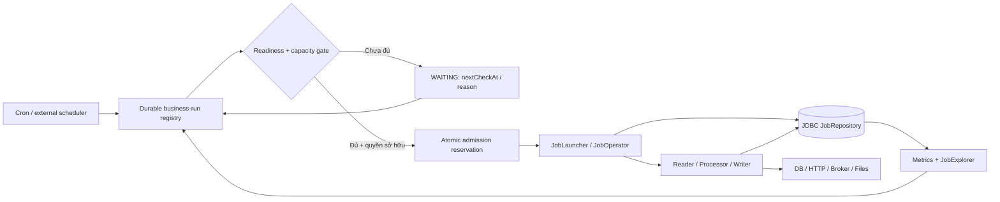
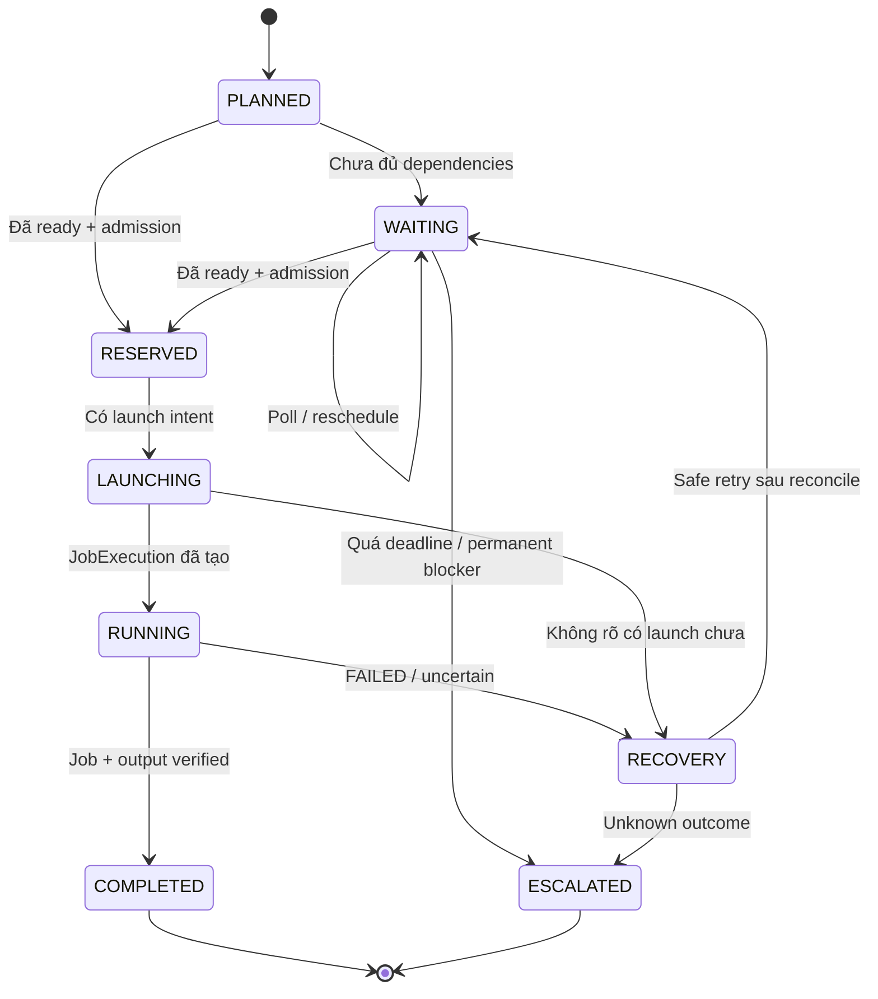

# Chờ resource sẵn sàng trước khi chạy: thiết kế scheduling an toàn cho Spring Batch

Một job nhập dữ liệu dự kiến bắt đầu lúc 01:00, nhưng đến 01:00 file đầu vào mới tải được 80%, database báo thiếu connection và API đối tác đang trả HTTP `429`. Nếu scheduler cứ gọi `JobLauncher.run(...)` theo giờ cố định, job có thể thất bại trước khi xử lý item đầu tiên, rồi những lần retry càng làm hệ thống ngoài quá tải. Nếu chờ bằng một vòng `while (!ready) Thread.sleep(...)` vô hạn, batch lại có thể kẹt qua cửa sổ SLA mà không ai biết.

**Chờ resource sẵn sàng trước khi chạy** là cơ chế *readiness gate* hoặc *admission control*: scheduler chỉ cho một logical business run được bắt đầu khi các điều kiện bắt buộc đã thỏa, còn đủ ngân sách tài nguyên và không có execution trùng đang sở hữu công việc. Việc chờ phải **có giới hạn, quan sát được, có backoff và phục hồi sau scheduler restart**.

Bài thuộc chương **Scheduling**, module **SPRING_BATCH_SCALING_OPERATIONS**: mở rộng Spring Batch cho workload dữ liệu lớn bằng multi-threaded step, parallel steps, partitioning và xử lý phân tán, đồng thời bảo đảm thread safety, retry/restart và vận hành theo khả năng CPU, database, broker, API thực tế. Ví dụ sử dụng tư duy Spring Batch 5.x / Spring Boot 3.x; các điểm phụ thuộc thư viện, broker hoặc orchestrator phải được xác minh trên phiên bản đang chạy.

> **Mục tiêu:** Một business run chỉ được *admit* khi đủ điều kiện; khi chưa sẵn sàng, scheduler không bỏ dữ liệu, không tạo vô hạn JobExecutions và không dùng `run.id` mới để né duplicate. Khi quá hạn, job phải có trạng thái chờ/escalation rõ ràng để người vận hành ra quyết định.

## 1. Vì sao giờ chạy không đồng nghĩa “được phép chạy”?

Một cron expression chỉ nói **khi nào đánh thức scheduler**, không chứng minh dependencies đã sẵn sàng. Trong batch data platform, một cửa sổ xử lý có thể phụ thuộc:

- File đầu vào hoàn tất upload, có manifest và checksum đúng.
- Bảng nguồn đã chốt snapshot/watermark để pagination không đổi giữa chừng.
- Database nguồn/đích đã sẵn sàng **đọc/ghi theo quyền thực của job**.
- Connection pool có chỗ cho workload sau khi launch.
- External HTTP API phục hồi, có quota và không còn circuit breaker mở.
- Broker exchange/topic/consumer group đã được cấu hình, đủ capacity tiếp nhận.
- Upstream batch đã tạo dữ liệu và hoàn tất thật, không chỉ báo “request đã gửi”.
- Không có JobExecution khác đang thực hiện cùng business run.
- Còn đủ thời gian trước deadline để đạt SLA.

**Sẵn sàng để nhận job ≠ chắc chắn job sẽ thành công.** Gate chỉ giảm nguy cơ khởi chạy sai thời điểm. Dependency vẫn có thể hỏng vài giây sau lần kiểm tra; worker còn cần timeout, backpressure, idempotency và retry/restart.

## 2. Phân biệt readiness, liveness, capacity và completeness

| Loại kiểm tra | Câu hỏi | Ví dụ đúng | Bẫy cần tránh |
| --- | --- | --- | --- |
| **Liveness** | Process/service còn sống? | HTTP health trả 200, container running | Sống chưa có nghĩa xử lý được workload |
| **Readiness** | Đường phục vụ cần thiết hiện hoạt động? | Query bằng account thật, endpoint nghiệp vụ đáp ứng | Ping TCP không chứng minh quyền, schema hoặc capacity |
| **Capacity** | Có headroom đủ để thêm một job? | DB connection budget, pending pool thấp, API quota còn | Một snapshot 0 pending không bảo đảm cho 24 worker |
| **Data completeness** | Input đã hoàn chỉnh và bất biến chưa? | Manifest FINALIZED, checksum, expected count | File tồn tại không nghĩa upload xong |
| **Ownership** | Có quyền duy nhất chạy business identity này? | Atomic reservation + kiểm tra JobRepository | Một boolean local trên mỗi pod không chặn chạy trùng |
| **Business deadline** | Chờ thêm còn hợp SLA? | ETA từ throughput an toàn nhỏ hơn thời gian còn lại | Chờ đến hết ngày rồi vẫn nói “tạm thời pending” |

Một hệ thống tốt không chỉ trả Boolean `ready/not ready`. Nó cần **reason code**, thời điểm kiểm tra, độ mới của kết quả và hành động tiếp theo.

Ví dụ phản hồi logic:

```json
{
  "businessRunKey": "inventory-import/2026-11-26",
  "ready": false,
  "checkedAt": "2026-11-26T01:05:00Z",
  "reasons": [
    {"code": "INPUT_NOT_FINALIZED", "retryable": true},
    {"code": "SOURCE_DB_CAPACITY_LOW", "retryable": true}
  ],
  "nextCheckAt": "2026-11-26T01:07:00Z",
  "deadlineAt": "2026-11-26T02:00:00Z"
}
```

Đây là schema **do hệ thống điều phối thiết kế**, không phải đối tượng mặc định của Spring Batch.

## 3. Ba mốc thời gian phải đo riêng

Khi một run được lên lịch vào 01:00 nhưng bắt đầu xử lý lúc 01:20:

1. **Scheduled time:** 01:00 — thời điểm nghiệp vụ muốn job bắt đầu.
2. **Admission/start time:** 01:20 — dependency được phép nhận tải và job đã được launch.
3. **Finish time:** 02:05 — JobExecution kết thúc, kết quả được đối soát.

**Waiting latency** từ scheduled đến launch là khoảng 20 phút. **Processing latency** từ launch đến hoàn tất là 45 phút. **End-to-end time** là 65 phút. Nếu SLA yêu cầu hoàn tất lúc 02:00, job trượt SLA **dù thời gian xử lý nội bộ không đổi**.

\[
T_{\mathrm{endToEnd}} =
T_{\mathrm{waitForReady}} + T_{\mathrm{execution}} + T_{\mathrm{validation}}
\]

Đây là phân rã vận hành; nếu có các giai đoạn chồng nhau hoặc job asynchronous, phải định nghĩa chính xác boundary để không cộng lặp thời gian.

**Không lấy `JobExecution.START_TIME` làm thời điểm scheduler bắt đầu chờ**: repository chỉ theo dõi lifecycle job đã được tạo/launch, không biết mọi quyết định WAITING trước đó của scheduler.

## 4. Readiness gate nằm ở đâu trong kiến trúc?



Vai trò:

- **Scheduler** phát hiện business run đến hạn, không nhất thiết trực tiếp gọi JobLauncher.
- **Run registry/coordinator** lưu WAITING, lý do, deadline, reservation và thông tin execution, tồn tại qua restart.
- **Readiness probes** kiểm tra dependencies bằng truy vấn nhỏ, deadline hữu hạn.
- **Admission** bảo đảm chỉ có một coordinator được quyền launch cùng run key.
- **JobRepository** xử lý lifecycle Spring Batch, restart metadata và chống trùng JobInstance theo identifying parameters.
- **Workers** tiếp tục xử lý lỗi runtime; gate không bảo đảm dependency luôn khỏe.

Có thể dùng orchestration như Airflow, Control-M hoặc Kubernetes Jobs để giữ registry/scheduling; nếu chọn scheduler tự viết, phải chịu trách nhiệm tương đương về durability, concurrency và audit.

## 5. Định nghĩa hợp đồng readiness trước khi viết code

Với mỗi resource, ghi rõ:

| Trường hợp | Điều kiện “đủ” cụ thể | Khi thất bại |
| --- | --- | --- |
| Source PostgreSQL | Login đúng quyền, snapshot manifest READY, query nhỏ đáp ứng | WAITING, ghi `SOURCE_DB_UNAVAILABLE` hoặc `SNAPSHOT_MISSING` |
| Target database | Connection còn ngân sách, schema/version phù hợp, thao tác health không phá dữ liệu | WAITING hoặc BLOCKED nếu cấu hình sai |
| External API | Endpoint có xác thực, latency/429 đáp ứng quota contract | WAITING, tôn trọng Retry-After, không gửi request nghiệp vụ để probe |
| SFTP | Directory/manifest hoàn tất, checksum hợp lệ | WAITING, không mở file upload dở |
| Broker | Topic/queue/binding sẵn sàng, producer/consumer path khỏe, lag có thể xử lý | WAITING hoặc DEGRADED |
| Upstream job | Output manifest/chốt watermark, producer job hoàn tất theo business contract | WAITING, không chỉ nhìn trạng thái STARTED/COMPLETED thiếu output |
| Metadata DB | JobRepository DB có schema, credentials và capacity launch/checkpoint | BLOCKED hoặc WAITING tùy lỗi |
| Downstream capacity | Có số connections/permits/quota cho concurrency tối thiểu | DEFER hoặc chạy nhỏ hơn nếu kiến trúc cho phép |

Một **probe trả Boolean** dễ che lý do failure: thiếu file là lỗi business, còn timeout kết nối là lỗi hạ tầng. Nên ghi **loại lỗi, retryability, timestamp và evidence** để quyết định backoff/escalation.

## 6. Readiness của database: không chỉ SELECT 1

`SELECT 1` là phép kiểm tra connectivity rẻ, nhưng chưa chứng minh rằng bảng nguồn đã sẵn sàng hoặc user có quyền đọc đúng dữ liệu.

Một chiến lược hợp lý gồm hai lớp:

1. **Infrastructure readiness:** Kết nối thành công, query nhỏ có timeout.
2. **Data readiness:** Dataset/snapshot manifest đã ở trạng thái `FINALIZED` với business date, expected record count và checksum/version.

Ví dụ schema **nghiệp vụ do ứng dụng định nghĩa**, không nằm trong các bảng `BATCH_*`:

```sql
SELECT
    snapshot_version,
    expected_count,
    checksum_sha256,
    finalized_at
FROM import_manifest
WHERE business_date = :businessDate
  AND state = 'FINALIZED';
```

Cần xác minh snapshot thực sự **bất biến** trong suốt job, không chỉ row manifest đã cập nhật. Nếu pipeline sử dụng file object storage, manifest cũng nên chỉ tới version/file checksum tương ứng.

**Không thực hiện UPDATE để “thử DB có ghi được không” tại mỗi phút polling**. Nếu cần kiểm tra quyền ghi, dùng readiness endpoint/cơ chế được vận hành phê duyệt, hoặc một test transaction hoàn toàn độc lập, an toàn và có giới hạn — không được ghi vào bảng business thật tùy tiện.

**Nếu query mất 30 giây vì pool cạn**, probe phải có timeout và không chiếm toàn bộ scheduler/executor. Một probe hỏng không được biến thành chuỗi transaction dài giữ khóa.

## 7. Readiness của API và quota: 200 OK chưa đủ

Một endpoint `/health` trả 200 chỉ chứng minh endpoint ấy trả 200. Nó không nói request `POST /settlements` sẽ thành công với credential của batch, quota có còn hay không, hoặc payload/schema đúng phiên bản.

Có thể kiểm tra:

- DNS/TLS/authentication trên đúng route và account dùng khi chạy.
- Endpoint readiness được upstream thiết kế để **không gây side effect**.
- Service degradation indicator, quota/rate remaining, circuit breaker state.
- P95/P99 hoặc tỷ lệ 429/503 trong cửa sổ gần đây.
- Bulkhead availability, HTTP pool pending, số active calls toàn cluster.
- Thời điểm `Retry-After` nếu upstream yêu cầu tạm dừng.

**Đừng gửi POST thật để làm readiness probe**, vì một scheduler chạy mỗi phút có thể tạo dữ liệu ngoài ý muốn. Nếu upstream không có health/quota API, dùng SLI của traffic gần đây và connection path check nhỏ, rồi đánh giá mức độ chắc chắn thay vì giả định ready tuyệt đối.

Một gate có thể báo `API_UNKNOWN` khi không thể kiểm tra. Nếu API gây side effect nghiêm trọng, nên **fail closed** và escalate; với upstream không bắt buộc, policy có thể cho chế độ degraded nếu business contract đồng ý.

## 8. Readiness của broker: TCP connect không bảo đảm xử lý được message

Broker sẵn sàng có nghĩa nhiều hơn socket mở:

- Topic/exchange/queue/binding tồn tại đúng tên/version và quyền publish/consume.
- Consumer group/channels hoạt động với concurrency hợp lệ.
- Durable retention hoặc DLQ được cấu hình đúng.
- Broker lag, unacked messages hoặc oldest message age không vượt budget.
- Reply route và correlation path hoạt động nếu remote chunking/partitioning cần phản hồi.
- Không có broker outage đang khiến manager phát request nhưng worker không nhận.
- Message serializer/schema version tương thích manager và workers.

Với Kafka, `AdminClient` có thể xác nhận metadata/topic/partitions trong timeout hữu hạn, nhưng không chứng minh consumer business logic đang khỏe. Với RabbitMQ, management API và queue stats có thể phản ánh backlog/unacked, nhưng không khẳng định writer downstream đã commit.

**Không dùng một “ping broker” để khẳng định end-to-end readiness**. Với job cần reply, phải kiểm chứng topology request/reply tương thích và có cách theo dõi reply timeout.

## 9. File readiness: sentinel, manifest, checksum và atomic publish

Kiểm tra `Files.exists(path)` đơn thuần rất nguy hiểm khi producer đang stream một file vài gigabyte: file đã tồn tại từ phút đầu tiên, nhưng chưa hoàn chỉnh.

Một giao ước an toàn hơn:

1. Producer upload vào tên tạm hoặc object key chưa công bố.
2. Producer đóng hoàn toàn stream, xác nhận flush/storage durability theo platform.
3. Producer tạo manifest có version, expected size/count, checksum và business date.
4. Producer publish manifest hoặc atomically rename/mark FINALIZED theo khả năng storage.
5. Consumer chỉ đọc **version được manifest chốt**, không scan toàn thư mục.
6. Restart dùng lại cùng version/checksum, không đổi source giữa chừng.

```text
incoming/2026-11-26/items.csv.uploading
incoming/2026-11-26/items.csv
incoming/2026-11-26/manifest.json  (FINALIZED)
```

Nếu object store không có atomic rename theo ý muốn, dùng **manifest object được publish cuối cùng** và version IDs; không giả định filesystem POSIX semantics áp dụng cho S3/GCS/Blob storage.

**Tình huống TOCTOU:** Gate thấy manifest READY ở 01:03 nhưng producer sửa file trước khi worker đọc 01:05. Vì vậy cần immutable file version/ETag/checksum và worker **xác minh lại** thứ nó đọc, không chỉ tin vào một check thoáng qua.

## 10. Nhiều dependencies: AND, OR, quorum và mức degraded

Với một job cần đủ ba nguồn A, B, C, cách biểu diễn đơn giản:

\[
\mathrm{READY}=
A_{\mathrm{ready}}\land
B_{\mathrm{ready}}\land
C_{\mathrm{ready}}\land
\mathrm{capacityOK}\land
\mathrm{ownershipOK}
\]

Không được biến điều kiện AND thành OR vì muốn chạy sớm hơn, trừ khi business contract cho phép xử lý thiếu nguồn.

Một số patterns:

| Pattern | Khi phù hợp | Điều phải ghi rõ |
| --- | --- | --- |
| **All mandatory** (AND) | Đối soát cần đủ mọi dòng dữ liệu | Đúng phiên bản/mốc cutoff cho tất cả |
| **Any replica** (OR) | Hai replica tương đương dữ liệu và consistency | Replication lag, data correctness |
| **Quorum** | Distributed store có semantics quorum | Không tự thiết kế quorum trên file sources không tương đương |
| **Partial/degraded** | Báo cáo tạm hoặc một enrichment tùy chọn | Output có flag thiếu dữ liệu và bước bổ sung |
| **Stage-based** | Step A có thể chạy, Step B cần nguồn khác | Ranh giới restart/partial outputs rõ |

Một readiness check cần trả **reason theo resource**, không chỉ một chuỗi message tổng hợp. Điều này hỗ trợ metrics và playbook.

## 11. State machine của business run: WAITING khác Spring Batch STARTED

Trạng thái chờ trước JobLauncher nên tồn tại ở **run registry/orchestrator riêng**:



`WAITING`, `RESERVED`, `LAUNCHING`, `RECOVERY` ở đây là **trạng thái tự thiết kế** của orchestration, **không phải `BatchStatus` mới được Spring Batch hỗ trợ**. Đừng sửa `BATCH_JOB_EXECUTION.STATUS` thành WAITING rồi mong framework hiểu.

**Tại sao cần durable state?** Scheduler có thể restart khi job đang WAITING hoặc khi vừa gọi JobLauncher nhưng chưa ghi nhận ID. Một bảng trạng thái bền vững giúp phục hồi quyết định, audit và tránh “mỗi pod cùng chờ rồi cùng launch”.

## 12. Readiness check có độ trễ: tránh kiểm tra kiểu busy-loop

Một vòng lặp liên tục:

```java
// PHẢN VÍ DỤ: busy wait, giữ thread, không deadline và không audit.
while (!dependenciesReady()) {
    Thread.sleep(100);
}
jobLauncher.run(job, parameters);
```

Các vấn đề:

- Một scheduler thread bị chiếm rất lâu, không điều phối được các run khác.
- Poll mỗi 100 ms gây load lên DB/API/broker dù upstream chưa sẵn sàng.
- Không có deadline, escalation hoặc trạng thái durable qua restart.
- Khi 20 pods cùng chạy, tạo **thundering herd** tới dependencies.
- Nếu được gọi bên trong transaction, có thể giữ connection/lock trong lúc chờ.
- Không giải quyết duplicate launch khi nhiều scheduler cùng thấy READY.

**Tốt hơn:** Lưu `nextCheckAt` và retry count trong registry. Scheduler poll những run đã đến hạn; khi chưa sẵn sàng, cập nhật nextCheck theo backoff và trả quyền điều khiển. Nếu framework có event/webhook đáng tin, dùng event làm trigger, nhưng vẫn giữ periodic reconciliation vì event có thể mất.

## 13. Backoff, jitter và deadline của lần chờ

Một chính sách polling minh họa:

\[
d_n=\min(d_{\max},d_0 2^n)
\]

Sau đó cộng/trừ jitter có giới hạn, đồng thời không vượt thời điểm business deadline. Ví dụ:

| Số lần kiểm tra lỗi | Delay danh nghĩa | Hành động |
| --- | --- | --- |
| 0 | 30 giây | Tái kiểm tra một lần sớm khi vừa thiếu resource |
| 1 | 60 giây | Theo dõi upstream |
| 2 | 120 giây | Tăng backoff |
| 3 | 240 giây | Giảm áp lực polling |
| 4+ | Tối đa 5 phút | Duy trì giám sát, escalate khi gần deadline |

Không dùng một thời gian duy nhất cho tất cả lỗi:

- Input file chưa finalize có thể poll 1–2 phút hoặc đợi event.
- API 429 nên tôn trọng `Retry-After` nếu có.
- Database credential sai là lỗi **configuration/permanent**: không polling 10 lần/giây đến hết ngày.
- Pool saturation có thể cần giảm concurrency trước khi probe lại.
- Job đã RUNNING không cần scheduler “thử launch lại” mỗi phút.

**Deadline:** Một run đã đợi quá `latestStartAt` nên chuyển ESCALATED hoặc áp dụng phương án nghiệp vụ khác. Không tự chạy lúc 11 giờ khi input chỉ có giá trị trong window 01–03 giờ.

## 14. Java: @Scheduled chỉ đánh thức coordinator, không chờ bên trong

Ví dụ Spring Boot 3 / Spring Batch 5. Có một `BatchLaunchCoordinator` chịu trách nhiệm state/lock/readiness, scheduler chỉ gọi hàm ngắn rồi trở về:

```java
import java.time.LocalDate;
import java.time.ZoneOffset;
import org.springframework.scheduling.annotation.Scheduled;
import org.springframework.stereotype.Component;

@Component
public final class InventoryImportSchedule {

    private final BatchLaunchCoordinator coordinator;

    public InventoryImportSchedule(BatchLaunchCoordinator coordinator) {
        this.coordinator = coordinator;
    }

    @Scheduled(cron = "0 */2 * * * *", zone = "UTC")
    public void checkDueRun() {
        // Ví dụ: ngày nghiệp vụ đã khép lại theo UTC.
        LocalDate businessDate = LocalDate.now(ZoneOffset.UTC)
                .minusDays(1);

        coordinator.considerRun("inventoryImport", businessDate);
    }
}
```

Để Spring `@Scheduled` hoạt động phải bật `@EnableScheduling` hoặc scheduling auto-configuration tương ứng. Với ứng dụng có nhiều pods, method này **có thể chạy trên mỗi pod**; coordinator phải có **cluster-safe admission**, không dựa vào synchronized local hoặc một field `boolean jobRunning`.

**Lưu ý:** Công thức “hôm qua theo UTC” chỉ là giả định để minh họa. Với business calendar, cutoff, ngày nghỉ, timezone địa phương, backfill và missed schedules phải xác định đúng ngày kinh doanh từ registry, không luôn tính `now().minusDays(1)`.

Khi scheduler nắm quyền launch, cần kiểm tra Spring Boot batch auto-launch và thường cấu hình `spring.batch.job.enabled=false` để không vô tình chạy job khi ứng dụng khởi động.

## 15. Java: contract của readiness probe và coordinator

Một contract nhỏ, tách kiểm tra read-only với quyết định launch:

```java
import java.time.LocalDate;
import java.time.Instant;
import java.util.List;

public record ReadinessReport(
        boolean ready,
        Instant checkedAt,
        List<String> reasonCodes) {
}

public interface DependencyReadiness {
    ReadinessReport check(LocalDate businessDate);
}

public interface BatchLaunchCoordinator {
    // Kiểm tra due run; khi không ready phải reschedule bền vững.
    // Khi ready phải atomic reserve + launch/reconcile.
    void considerRun(String jobName, LocalDate businessDate);
}
```

Ứng dụng thật cần thêm `snapshotVersion`, deadline, environment, tenant, ready-evidence validity và triage category. `reasonCodes` nên là tập giá trị hữu hạn như `INPUT_NOT_FINALIZED`, `SOURCE_DB_UNAVAILABLE`, `API_QUOTA_LOW`, `BROKER_NOT_READY`, `METADATA_POOL_BUSY`, `ALREADY_RUNNING` và `PERMANENT_CONFIG_ERROR`.

**Một nguyên tắc quan trọng:** Probe phải có **timeout hữu hạn và không gây side effect**. Không gọi `@Transactional` kéo dài bao trùm cả HTTP check, chờ broker và JobLauncher. Việc giữ resource trong lúc chờ chỉ tạo thêm overload.

## 16. Java: gọi JobLauncher với identity ổn định

Một hàm launch trong coordinator, được gọi **chỉ sau khi có admission reservation**:

```java
import java.time.LocalDate;
import org.springframework.batch.core.Job;
import org.springframework.batch.core.JobExecution;
import org.springframework.batch.core.JobParameters;
import org.springframework.batch.core.JobParametersBuilder;
import org.springframework.batch.core.launch.JobLauncher;

public final class GuardedJobStarter {
    private final JobLauncher launcher;
    private final Job job;

    public GuardedJobStarter(JobLauncher launcher, Job job) {
        this.launcher = launcher;
        this.job = job;
    }

    public JobExecution launchAfterReservation(LocalDate businessDate)
            throws Exception {

        JobParameters parameters = new JobParametersBuilder()
                // Định danh business run, không thay bằng run.id tùy tiện.
                .addString("businessDate",
                        businessDate.toString(), true)
                .toJobParameters();

        return launcher.run(job, parameters);
    }
}
```

**Mẫu này cố ý không tự cấp reservation**. Điều kiện trước lời gọi là coordinator đã kiểm tra readiness, giữ quyền launch duy nhất và có khả năng reconcile trạng thái khi crash. Cần đánh giá `JobExecutionAlreadyRunningException`, `JobInstanceAlreadyCompleteException`, `JobRestartException` và lỗi metadata DB; **không tự tạo identifying parameter mới để tránh lỗi**.

`JobLauncher.run(...)` có thể chạy synchronous hoặc trả về khi job còn hoạt động tùy cấu hình `TaskExecutorJobLauncher`. Không được hiểu “method đã return” đồng nghĩa job đã `COMPLETED`; theo dõi `JobExecution` qua repository và đối soát output.

Nếu snapshot version **xác định business identity**, nó cũng cần được giữ cố định trong parameters/registry khi restart. Nếu là execution-specific diagnostic, tránh biến nó thành identifying parameter không kiểm soát.

## 17. Admission phân tán: reserve một business run bằng atomic DB operation

Nhiều pods có thể cùng kiểm tra thấy READY. Để chặn duplicate launch, lưu run key trong registry có **unique constraint** và dùng atomic compare-and-set/lease.

Bảng minh họa riêng của scheduler (không phải bảng Spring Batch):

```sql
CREATE TABLE batch_launch_gate (
    run_key VARCHAR(180) PRIMARY KEY,
    state VARCHAR(32) NOT NULL,
    owner_id VARCHAR(120),
    generation BIGINT NOT NULL DEFAULT 0,
    lease_until TIMESTAMPTZ,
    job_execution_id BIGINT,
    updated_at TIMESTAMPTZ NOT NULL DEFAULT NOW()
);
```

Khi một business run mới được phát hiện:

```sql
INSERT INTO batch_launch_gate (run_key, state)
VALUES (:runKey, 'WAITING')
ON CONFLICT (run_key) DO NOTHING;
```

Nếu prerequisites đã ready, coordinator **có thể** reserve:

```sql
UPDATE batch_launch_gate
SET state = 'RESERVED',
    owner_id = :ownerId,
    generation = generation + 1,
    lease_until = NOW() + INTERVAL '2 minutes',
    updated_at = NOW()
WHERE run_key = :runKey
  AND state IN ('WAITING', 'RETRY_PENDING')
  AND (lease_until IS NULL OR lease_until < NOW())
RETURNING run_key, generation;
```

Một row RETURNING chứng minh **coordinator này đã giành được reservation** theo SQL transaction; không có row thì không được launch. Tuy nhiên, đây mới là **một phần** của orchestration:

- `generation` là token dùng cho compare-and-set/fencing tại registry; khi update state chỉ owner/generation hiện tại được quyền ghi.
- Không tự coi lease hết hạn nghĩa là job đã dừng. Nó có thể đã được launch và còn chạy trong JobRepository.
- Nếu coordinator chết **sau khi gọi JobLauncher nhưng trước khi lưu job_execution_id**, trạng thái có thể bị kẹt ở LAUNCHING; cần tra JobExplorer theo identity để reconcile trước khi cấp quyền lại.
- Nếu DB registry và JobRepository thuộc hai transaction độc lập, không có atomic commit tự động giữa reservation và createJobExecution.
- Nếu business writer có nguy cơ double side effect, cần fencing/idempotency **ở write path**, không chỉ locking ở scheduler.
- Đặt owner heartbeat/lease renewal và expiration theo thiết kế, không để cùng run giữ trạng thái RESERVED vĩnh viễn.

Không copy các SQL này thành hệ thống leader election production khi chưa có state transitions, optimistic CAS, reconciliation và fault tests hoàn chỉnh.

## 18. Những khoảng lỗi giữa reserve và launch

Một reservation ở registry riêng không làm thao tác JobLauncher trở thành atomic với scheduler. Các **failure windows** cần được xử lý chủ động:

| Điểm hỏng | Registry có thể chứa | JobRepository có thể chứa | Recovery đúng |
| --- | --- | --- | --- |
| Trước khi reserve | WAITING | Chưa có JobExecution | Poll lại, reserve khi ready |
| Sau reserve, trước gọi JobLauncher | RESERVED | Chưa có execution | Reconcile, cho reserve lại sau xác nhận owner hết hiệu lực |
| Trong lúc `JobLauncher.run` tạo metadata | LAUNCHING hoặc RESERVED | Có thể đã tạo JobExecution | Query JobExplorer theo identity, không suy đã/ chưa launch từ timeout |
| Sau JobLauncher trả về, trước ghi execution ID | LAUNCHING | Execution đã tồn tại | Liên kết execution hiện có; không tạo run.id mới |
| Khi job đang RUNNING | RUNNING hoặc registry stale | STARTED/STARTING | Không relaunch, theo dõi lifecycle + worker |
| Job COMPLETED, registry chưa cập nhật | RUNNING/LAUNCHING | COMPLETED | Reconcile status và output trước đóng run |
| Job FAILED sau side effect | RECOVERY/FAILED | FAILED | Xác định restartability + idempotent replay |

Có một điểm dễ bỏ qua: **lease hết hạn không đồng nghĩa JobExecution hết chạy**. Khi lease của coordinator hết hạn, một pod khác có thể được phép *kiểm tra và điều phối*, nhưng không được tự động phát một job gây side effect trùng.

Nếu hai pods cùng gọi `JobLauncher.run` với **identifying parameters giống hệt nhau**, JDBC JobRepository có các cơ chế bảo vệ lifecycle, isolation và ràng buộc schema. Nhưng chúng **không thay thế** distributed ownership của các hệ thống ngoài JobRepository, ví dụ hai JobInstances vô tình dùng tham số khác nhau mà cùng đọc một business date.

## 19. Reconciliation sau khi coordinator bị crash

Một worker điều phối khôi phục nên thực hiện:

1. Tìm run registry record có trạng thái `RESERVED/LAUNCHING/RUNNING` quá hạn.
2. Tìm đúng `JobInstance` theo job name và **identifying JobParameters** trong JobExplorer/JobRepository.
3. Liệt kê các `JobExecution` đã tồn tại, statuses và event timestamps.
4. Xác minh có worker/remote partition cũ còn tạo tác dụng phụ hay không.
5. Nếu có JobExecution đang chạy, liên kết registry với nó và tiếp tục giám sát — **không launch mới**.
6. Nếu execution FAILED/STOPPED, kiểm tra restartability, checkpoint, business output và current resource readiness trước khi quyết định restart.
7. Nếu COMPLETED, xác nhận expected output và đánh dấu logical business run đã hoàn tất.
8. Nếu không có execution, chỉ được reserve/launch lại sau khi xác minh không có launch đang in-flight và quyền sở hữu hợp lệ.
9. Nếu outcome không xác định, giữ trạng thái `RECOVERY/ESCALATED`, không “đoán” bằng heartbeat cũ.

**Idempotency key của business write phải tồn tại qua mọi JobExecution**, thường dựa vào business date + record ID/version. Không dùng JobExecution ID làm khóa duy nhất cho side effect cần giữ ổn định sau restart.

## 20. Kubernetes CronJob không thay thế business readiness

Một Kubernetes CronJob có thể tạo một Job pod đúng lịch:

```yaml
apiVersion: batch/v1
kind: CronJob
metadata:
  name: inventory-import-scheduler
spec:
  schedule: "0 1 * * *"
  timeZone: "Etc/UTC"
  concurrencyPolicy: Forbid
  startingDeadlineSeconds: 1800
  jobTemplate:
    spec:
      backoffLimit: 1
      template:
        spec:
          restartPolicy: Never
          containers:
            - name: coordinator
              image: example.invalid/batch-coordinator:1.0
              command: ["java"]
              args:
                - "-jar"
                - "/app/app.jar"
                - "--spring.batch.job.enabled=false"
                - "--batch.launch.mode=coordinator"
```

**Lưu ý quan trọng:**

- `--batch.launch.mode=coordinator` là **cấu hình custom**: phải có code ứng dụng biến nó thành một lần reconcile/gate/launch phù hợp. Không có code đó thì container không tự chạy JobLauncher.
- `concurrencyPolicy: Forbid` chỉ hạn chế các Jobs do **chính CronJob này** tạo chồng lên nhau; nó không bảo đảm một JobInstance không bị chạy từ CronJob khác, pod chạy tay hoặc ứng dụng scheduler khác.
- `startingDeadlineSeconds` giới hạn việc controller bắt lại lịch bị lỡ, **không phải** deadline business run trong registry.
- Pod/job có thể bị retry hoặc redeploy; phải giữ run identity ổn định, không sinh run.id khác theo pod UID.
- Nếu coordinator chỉ kiểm tra một lần rồi thoát khi chưa ready, một cron chạy **mỗi ngày** có thể không kiểm tra lại ngày đó. Phải có cơ chế poll/reschedule durable hoặc controller chuyên dụng.
- K8s readinessProbe/livenessProbe của pod khác với readiness của **dataset và quota** để nhận một batch run. Không dùng một HTTP health của container làm bằng chứng manifest đã FINALIZED.

Với Kubernetes CronJob, các resource requests/limits cũng quan trọng: thiếu CPU/memory có thể khiến coordinator/worker bị throttle/OOM, nhưng chúng không làm tăng quota database/API.

## 21. Event-driven scheduling và polling: chọn cách kết hợp

Có thể kích hoạt readiness check khi nhận event như `INPUT_FINALIZED`, `UPSTREAM_JOB_COMPLETED` hoặc `BROKER_RECOVERED` thay vì chờ vòng poll.

| Chiến lược | Lợi ích | Rủi ro |
| --- | --- | --- |
| Poll mỗi 2 phút | Dễ vận hành, tự phục hồi nếu event mất | Tăng load, trễ tối đa gần chu kỳ poll |
| Event-driven | Bắt đầu gần khi resource sẵn sàng | Event mất/duplicate/out-of-order |
| Event + periodic reconciliation | Phản ứng nhanh và phát hiện event bị bỏ lỡ | Cần registry/identity và logic dedup |
| Scheduler có dependency DAG | Hiển thị phụ thuộc/rerun trực quan | Không thay thế side-effect safety |
| External orchestrator | Có dashboard, backfill, retries, lineage | Phải kiểm chứng semantics giữa orchestrator và JobRepository |

Mẫu ổn định là **event thức dậy để đánh giá readiness**, còn **database registry mới là nguồn trạng thái durable**. Một event `FILE_READY` có thể gửi hai lần; hai triggers phải cùng tìm một run key và đi qua atomic admission.

Không để event consumer xử lý blocking readiness check hàng chục phút rồi giữ broker message unacked. Lưu intent, ACK theo contract, và cho scheduler worker kiểm tra với deadline riêng.

## 22. Upstream batch dependency và DAG phải dựa trên dữ liệu thật

Nếu job B phụ thuộc kết quả job A, chỉ kiểm tra A có JobExecution `COMPLETED` vẫn có thể thiếu thông tin:

- A completed nhưng output file upload/publish chưa xong nếu publish chạy async.
- A completed cho business date khác B.
- A completed với filter/skip không được business chấp nhận.
- A đã hoàn tất nhưng schema/version output không tương thích B.
- A completed vào một môi trường hoặc tenant khác.

Một contract tốt hơn:

```text
producerJob = loadDailyOrders
businessDate = 2026-11-26
datasetVersion = orders-v17
state = FINALIZED
expectedRows = 7_200_000
checksum = sha256(...)
schemaVersion = 4
completedAt = ...
```

Bài toán DAG yêu cầu điều kiện **dataset identity + completeness + version**. Scheduler B kiểm tra manifest và deadline, không chỉ tra status của A. Nếu có nhiều producers, dùng snapshot cutoff thống nhất để không ghép dữ liệu giữa các ngày.

**Run-specific identity:** `businessDate` nên là identifying parameter hoặc một business run key ổn định. Việc thay đổi version input có thể đòi **một business run mới được phê duyệt** hoặc quy trình correction; không âm thầm tạo JobInstance thứ hai cùng ngày để lách restart.

## 23. Capacity readiness: connection pool rảnh chưa chắc đủ chạy

Nếu sắp mở 20 workers mỗi worker có JDBC pool 8 connections, trần lý thuyết là 160 connections. Database có thể chỉ cho 180 connections trên toàn instance, nhưng còn dashboard, ứng dụng online và admin sessions.

\[
P_{\mathrm{cluster,max}}=
\sum_i\mathrm{replicas}_i
\times\mathrm{poolMax}_i
\]

Trước admission, phải tính:

- Tổng connection budget của database nguồn, đích và JobRepository; có thể là cùng physical server.
- HTTP pool connections, in-flight calls và requests/s quota **toàn API key**.
- Broker consumer capacity, unacked messages, backlog và reply path.
- Số active partitions/threads hiện tại và throughput committed.
- Kế hoạch HPA/rolling deployment làm tăng replicas tạm thời.
- Thời gian còn lại trong SLA, mức tải còn chịu được.

**Không đòi tất cả pools phải idle hoàn toàn**. Một database đang hoạt động bình thường luôn có active connections. Chỉ cần headroom đủ cho **concurrency mới được đề xuất**, có cơ chế từ chối/giảm tải khi vượt ngưỡng.

Nếu job có thể chạy với 4 workers thay vì 20 mà vẫn trong SLA, coordinator có thể chọn **profile concurrency được phép** theo policy. Nếu bắt buộc cần 20 nhưng hiện chỉ còn 4 slots, nên WAITING/ESCALATED thay vì launch gây deadlock/pool exhaustion.

## 24. TOCTOU: resource có thể hỏng sau khi gate trả READY

TOCTOU (*time of check to time of use*) có nghĩa:

1. 01:10:00 gate kiểm tra PostgreSQL và thấy sẵn sàng.
2. 01:10:01 JobLauncher tạo JobExecution.
3. 01:10:03 database failover hoặc API trả 503.
4. 01:10:04 worker bắt đầu đọc/ghi và gặp lỗi.

Gate **không tạo được cam kết resource sẽ khỏe trong suốt job**. Vì thế cần:

- Reader/writer có retry/rollback đúng scope và deadline hữu hạn.
- External POST idempotent hoặc reconciliation khi timeout sau commit.
- Connection pool/bulkhead/rate limit bảo vệ từ thời điểm gọi thật.
- Recheck input snapshot/file version ngay khi mở reader.
- Có thể dùng **preflight step** ngắn để kiểm tra điều kiện còn đúng sau launch, nhưng nó đã là một StepExecution có thể fail/restart — không phải WAITING trước launch.
- Không giữ một DB transaction/lock dài chỉ để “khóa resource” xuyên toàn batch run.
- Nếu dependency là độc quyền (một dataset chỉ một consumer), dùng **resource lease/fencing tại write/read path**, không chỉ Boolean readiness.

Một availability probe **không thể thay thế business isolation**. Hãy thiết kế fail-safe trong step ngay cả khi mọi preflight đều báo xanh.

## 25. Khi nào nên để scheduler chờ, khi nào cho job FAIL?

| Tình huống | Hướng thường thích hợp | Tại sao |
| --- | --- | --- |
| Input manifest chưa có, producer vẫn đúng SLA | **WAITING ngoài JobRepository** | Không tạo hàng loạt JobExecutions FAILED vô ích |
| API 429 ngắn, có Retry-After | WAITING và đặt nextCheckAt | Giảm tải, tránh retry storm |
| Database credentials sai, schema thiếu | BLOCKED/ESCALATED | Lỗi cấu hình không tự hết khi chờ |
| Capacity không đủ ở 20 workers nhưng đủ ở 4 | Chọn lower concurrency nếu policy cho phép | Dùng headroom mà không vượt quota |
| Quá latestStartAt, không thể đạt deadline | ESCALATED | Cần quyết định SLA/window, không chờ vô hạn |
| Resource hỏng **sau khi job đã chạy** | Retry có giới hạn hoặc FAIL có kiểm soát | Runtime failure, checkpoint/restart cần nhất quán |
| Input đổi version khi reader đang chạy | FAIL/quarantine và đối soát | Không trộn hai snapshots |
| Cùng JobInstance đang RUNNING | Không launch nữa; monitor | Ngăn duplicate business work |
| Job FAILED sau partial output | Restart đúng JobInstance khi an toàn | Giữ checkpoint và idempotency |

Nếu cần ghi lại từng lần từ chối launch để kiểm toán, dùng **run registry/audit table**, không tạo một JobExecution FAILED cho mỗi lần poll trừ khi business workflow cố ý coi đó là một lần chạy thực.

## 26. Retry scheduling khác retry một item

**Scheduler retry** đánh giá lại điều kiện được nhận job. Nó không được thực hiện business side effect.

**Job restart** tạo JobExecution mới cho cùng JobInstance theo lifecycle Spring Batch, tiếp tục từ checkpoint khi cấu hình phù hợp.

**Item retry** có thể xảy ra trong chunk step với `.faultTolerant().retry(...).retryLimit(...)`, được áp dụng cho đường read/process/write theo semantics framework.

| Scope | Điều được thử lại | Nguy cơ nếu nhầm |
| --- | --- | --- |
| Readiness poll | Query manifest, quota, DB readiness | Chạy các query quá dày hoặc chờ vô hạn |
| Launch/admission | Tạo JobExecution của logical run | Duplicate launcher và JobInstance identity sai |
| Step restart | Chạy lại phần chưa hoàn tất theo checkpoint | Business side effect có thể đã commit trước checkpoint |
| Item retry | Một thao tác read/process/write transient | Retry storm, trùng POST |
| Broker redelivery | Một chunk/partition message | At-least-once, lost reply sau commit |

Một lỗi không lấy được connection ở **readiness probe** chỉ cần reschedule gate. Nó **không bắt buộc** phải tạo một JobExecution để thất bại rồi restart. Ngược lại, khi job đã chạy và DB chết, scheduler không thể “xóa trạng thái cũ rồi bắt đầu từ đầu” một cách an toàn.

## 27. Multi-threaded step, parallel steps và distributed workers

Mỗi mô hình tạo áp lực tài nguyên khác nhau:

| Mô hình | Cần readiness cho | Điều không được quên |
| --- | --- | --- |
| Chunk step đơn | Source/target resource, đủ transaction/connections | Chunk commit, checkpoint và restart |
| Multi-threaded step | Tổng active chunks, reader/writer thread safety, pool budget | Một StepExecution, có shared mutable state |
| Parallel steps | Tổng nhu cầu các flow cùng chạy | Flow A và B có thể tranh một DB/API |
| Local partitioning | Số partitions active và executor queue | `gridSize` không nhất thiết bằng concurrency |
| Remote partitioning | Worker replicas, shared JobRepository, broker và external quota | Per-JVM pools nhân lên thành cluster budget |
| Remote chunking | Manager reader, worker capacity, broker request/reply | In-flight chunks/redelivery và output idempotency |

Đặc biệt với remote partitioning: nếu gate lúc launch thấy 8 workers khỏe, nhưng scheduler/HPA sau đó scale thành 20, **quota có thể vượt ngân sách**. Phải có limiter/admission guard ở worker/cluster, không chỉ một phép kiểm tra trước JobLauncher.

Với remote chunking: broker ready không chứng minh worker đủ capacity; cần xét pending/in-flight chunks, manager dispatch và downstream writer. Manager có thể là nút thắt đọc dữ liệu, trong khi tăng worker chỉ tạo thêm consumers không có việc.

**Không launch song song hai business runs cùng tranh một upstream chỉ vì mỗi run riêng lẻ vượt qua gate**. Admission cần tính **tổng tài nguyên đã đặt trước của các runs đang hoạt động**.

## 28. Deadline, SLA và quyết định “không launch”

Giả sử job phải xử lý `N` item trước `deadlineAt`. Khi gate mở, còn `T_remaining` giây cho launch, processing, retries và validation.

\[
R_{\mathrm{required}}=
\frac{N_{\mathrm{remaining}}}{T_{\mathrm{remaining}}}
\]

Nếu throughput committed an toàn thực tế là `R_safe`, điều kiện khả thi sơ bộ:

\[
R_{\mathrm{safe}}\times T_{\mathrm{remaining}}
\ge N_{\mathrm{remaining}}
\]

**Không được dùng `readCount` thay cho committed business output** khi có rollback/filter/side effect ở hệ ngoài. Đừng chỉ dùng throughput lý tưởng CPU nếu API quota hoặc DB write capacity thấp hơn.

Một quyết định “không launch” là đúng về mặt vận hành nếu job đã không thể hoàn tất trong window và việc khởi chạy sẽ gây rủi ro: báo ESCALATED với lý do `INSUFFICIENT_SLA_HEADROOM` và cho chủ sở hữu lựa chọn kéo dài window, giảm scope có phê duyệt hoặc tăng quota/capacity.

**Không chờ vô thời hạn:** Mỗi logical run cần `latestStartAt`, `deadlineAt`, escalation owner và policy xử lý run quá hạn.

## 29. Quan sát: readiness wait phải hiện lên dashboard

Một dashboard cho scheduling/resource gate nên có:

| Metric/thuộc tính | Loại | Mục đích |
| --- | --- | --- |
| `batch.launch.pending.runs` | Gauge theo job type | Có bao nhiêu business runs đang WAITING |
| `batch.launch.wait.duration` | Timer/histogram | Scheduled-to-admitted delay P50/P95/P99 |
| `batch.launch.ready.probe.duration` | Timer theo resource type | Probe nào chậm hoặc timeout |
| `batch.launch.ready.failures` | Counter theo reason code | Vì sao không chạy được |
| `batch.launch.attempts` | Counter | Số lần coordinator yêu cầu launch |
| `batch.launch.reservation.conflicts` | Counter | Bao nhiêu pod tranh cùng run |
| `batch.launch.deadline.missed` | Counter | Runs vượt latestStartAt/deadline |
| `batch.job.active.executions` | Gauge | Jobs thực tế đang active |
| DB/Hikari pending + HTTP 429 | Infrastructure metrics | Capacity làm gate chặn run có hợp lý? |
| `committed items/s` | Business metric | Sau launch có đạt throughput cần thiết? |

Đây là **tên metrics minh họa do application thiết kế**, không phải những series mặc định Spring Batch phát ra.

Tags nên giới hạn vào `job_type`, `resource_type`, `reason_code` và `outcome`. **Không gắn business date/run ID, raw URL, token hoặc exception message vào mọi time series** vì high cardinality và rò rỉ dữ liệu; dùng structured logs và trace/correlation cho một run cụ thể.

### Structured log khi chưa sẵn sàng

```json
{
  "event": "BATCH_LAUNCH_DEFERRED",
  "jobType": "inventoryImport",
  "businessRunKey": "inventory-import/2026-11-26",
  "reason": "INPUT_NOT_FINALIZED",
  "checkedAt": "2026-11-26T01:05:00Z",
  "nextCheckAt": "2026-11-26T01:07:00Z",
  "deadlineAt": "2026-11-26T03:00:00Z"
}
```

Log chứa businessRunKey phục vụ điều tra, nhưng metric labels không nên chứa mỗi giá trị runKey riêng.

## 30. SQL cho đội vận hành: xem run đang chờ và execution tương ứng

Với registry minh họa ở mục 17, query read-only:

```sql
SELECT
    run_key,
    state,
    owner_id,
    generation,
    lease_until,
    job_execution_id,
    updated_at
FROM batch_launch_gate
WHERE state IN ('WAITING','RESERVED','LAUNCHING','RECOVERY')
ORDER BY updated_at ASC
LIMIT 100;
```

Nếu `RESERVED/LAUNCHING` lâu, trước hết tra JobRepository. Không đổi state thành WAITING chỉ vì `lease_until` đã qua. Một launch đã có thể được tạo.

Tra JobExecutions theo job name:

```sql
SELECT
    ji.JOB_NAME,
    ji.JOB_INSTANCE_ID,
    ji.JOB_KEY,
    je.JOB_EXECUTION_ID,
    je.STATUS,
    je.START_TIME,
    je.END_TIME,
    je.LAST_UPDATED
FROM BATCH_JOB_INSTANCE AS ji
JOIN BATCH_JOB_EXECUTION AS je
  ON je.JOB_INSTANCE_ID = ji.JOB_INSTANCE_ID
WHERE ji.JOB_NAME = :jobName
ORDER BY je.JOB_EXECUTION_ID DESC
LIMIT 50;
```

Các câu trên **không cung cấp đầy đủ JobParameters**; để đối chiếu cùng business identity cần tra parameters theo schema/version hoặc dùng `JobExplorer` với identifying parameters, không suy chỉ dựa trên job name.

Nếu metadata DB không truy cập được, không thể kết luận job chưa từng launch. Khôi phục DB trước khi quyết định tiếp tục.

## 31. Kiểm thử cần có: không chỉ happy path READY

Để xác nhận readiness gate hoạt động đúng, phải kiểm thử cả state machine, concurrency và failure windows:

| Kịch bản | Điều tạo trong test | Tiêu chí đạt |
| --- | --- | --- |
| File chưa FINALIZED | File tồn tại nhưng manifest thiếu | Không launch, reason rõ ràng |
| Source DB tạm lỗi | Query nhỏ timeout | WAITING/backoff, không block scheduler vô hạn |
| Credentials/schema sai | Auth error/table missing | BLOCKED/ESCALATED, không retry dày |
| API 429 + Retry-After | Stub trả 429 tạm thời | Deferred đúng, không phát business POST |
| Broker up nhưng reply route sai | Broker TCP khỏe, queue binding lỗi | Không launch remote chunking |
| Resources lần lượt sẵn sàng | Snapshot ready, API ready sau 5 phút | Launch một lần khi tất cả mandatory pass |
| Two scheduler pods | Hai threads/pods cùng evaluate READY | Chỉ một reservation/launch hợp lệ |
| Crash sau reserve | Kill coordinator trước JobLauncher | Recovery không mất run, eventual launch an toàn |
| Crash sau JobLauncher | Kill trước khi registry ghi executionId | Reconcile JobExplorer, không tạo run.id mới |
| Lease hết hạn khi job RUNNING | Force registry lease expiry | Không launch lại cùng business run |
| Job COMPLETED nhưng registry stale | Lỗi update registry | Reconcile và đóng run đúng |
| Input đổi sau readiness | Producer đổi object version | Reader fail/stop có kiểm soát, không trộn snapshots |
| Pool bão hòa sau launch | DB pending, HTTP 503 | Worker retry/restart an toàn |
| Deadline không còn đủ | T_required lớn hơn window | ESCALATED, không launch gây overload |
| Rolling deploy 4 → 12 pods | Concurrency tăng khi poll | Không vượt upstream budget |
| Outage rồi event duplicate | Gửi nhiều READY events | Dedup identity, không launch trùng |

Cần test trên PostgreSQL/broker tương đương production, dùng latch/barrier cho concurrency race và fault-injection hooks cho crash giữa các bước state. Đừng gây outage/tranh khóa nhân tạo trên production để xác minh.

**Đồng thời đối soát business output** sau retry/restart: metadata COMPLETED không đủ nếu writer có side effect ngoài transaction hoặc skip không theo business rule.

## 32. Case study: chờ dữ liệu giúp tránh launch sai nhưng làm thiếu SLA

Một job enrich **7.200.000 item** được lên lịch lúc **01:00**, deadline **03:00**. Nó cần dữ liệu ngày đã chốt, một PostgreSQL nguồn, HTTP Partner API và broker cho remote chunking.

**Dữ liệu minh họa:**

| Resource | Đến lúc nào mới sẵn sàng? | Bằng chứng |
| --- | --- | --- |
| Metadata DB | 01:00 | Repository có schema/connection |
| Source PostgreSQL | 01:03 | Kết nối, snapshot/version xác nhận |
| Input manifest | 01:22 | `FINALIZED`, expected 7,2 triệu, checksum đúng |
| Broker request/reply | 01:08 | Queue/binding, consumers, reply route khỏe |
| Partner API | 01:32 | 503/429 ngừng tăng, quota phục hồi |
| Readiness admission | 01:34 | Tất cả mandatory pass và reservation hợp lệ |

Từ 01:34 đến 03:00 còn **86 phút**, tức 5.160 giây. Throughput business tối thiểu:

\[
R_{\mathrm{required}}=
\frac{7.200.000}{5.160}
\approx1.395,35\text{ items/s}
\]

Nhưng API contract giới hạn **1.400 requests/s**, mỗi item cần một request và xác suất transient failure là 5% mỗi attempt (giả định độc lập), tối đa 3 attempts. Số attempts kỳ vọng/item:

\[
E[\mathrm{attempts}]=1+0,05+0,05^2=1,0525
\]

Công suất business tối đa do quota:

\[
R_{\mathrm{business,max}}\approx
\frac{1.400}{1,0525}
\approx1.330,17\text{ items/s}
\]

Thời gian payload lý tưởng là:

\[
T_{\mathrm{payload}}\gtrsim
\frac{7.200.000}{1.330,17}
\approx5.413\text{ s}
\approx90,2\text{ phút}
\]

Vậy **đã quá 86 phút còn lại**, ngay cả khi bỏ qua startup, checkpoint, queue và validation. **Gate phải báo nguy cơ SLA không khả thi**, không nên cứ tăng workers hoặc retryLimit khi API quota là nút thắt.

### Quyết định của đội vận hành

1. Giữ run ở `WAITING/ESCALATED` với reason `INSUFFICIENT_SLA_HEADROOM` và alert người phụ trách.
2. Đề nghị tăng quota có kiểm soát (ví dụ thêm 15%) hoặc giảm số requests/item bằng bulk endpoint/cache đúng business version.
3. Nếu quota tăng lên 1.610 requests/s, công suất lý tưởng khoảng `1.610 / 1,0525 ≈ 1.529,7 item/s`, cần khoảng **78,4 phút** cho payload — có khoảng 7,6 phút headroom nhưng vẫn phải load-test.
4. Nếu không thể tăng capacity, đề xuất window muộn hơn hoặc giảm scope có phê duyệt; không âm thầm bỏ item.
5. Khi được phê duyệt, launch cùng business identity, giới hạn remote consumers/rate và đối soát 7,2 triệu expected keys.

**Bài học:** Chờ đến khi resource sẵn sàng là cần thiết nhưng **chưa đủ**; còn phải kiểm tra khi nào bắt đầu vẫn có thể đáp ứng SLA và tính đúng dữ liệu.

## 33. Runbook khi job “đến giờ nhưng chưa chạy”

**Bước 1 — Xác định logical run.** Ghi job name, identifying JobParameters, business date, latestStartAt và deadlineAt. Không tạo run.id mới.

**Bước 2 — Xem registry.** Trạng thái WAITING/RESERVED/LAUNCHING/RECOVERY, owner, lease, lastChecked, nextCheckAt và reason code.

**Bước 3 — Kiểm tra dependencies.** Manifest/snapshot, DB query/pool, API quota/429, broker request/reply, upstream job output.

**Bước 4 — Kiểm tra quyền chạy.** Có JobExecution nào cùng identity đang STARTED/STOPPING hoặc worker cũ còn active không? Nếu không rõ, reconcile trước.

**Bước 5 — Xem polling/backoff.** Probe có timeout, nextCheckAt có nằm tương lai, event có bị mất hay duplicate không? Nếu scheduler chết có cơ chế resume durable không?

**Bước 6 — Kiểm tra resource capacity.** Tính toàn cluster: replicas × pool/concurrency, DB headroom, broker backlog, HPA/canary.

**Bước 7 — Tính SLA.** Dùng committed throughput đã benchmark và remaining window. Nếu không khả thi, escalate với lựa chọn rõ ràng.

**Bước 8 — Quyết định.** WAITING tiếp, BLOCKED vì lỗi vĩnh viễn, ESCALATED quá hạn, hoặc reserve/launch hợp lệ.

**Bước 9 — Theo dõi sau launch.** JobExecution status, StepExecution, worker concurrency, retries, resource metrics, broker in-flight và data correctness.

**Bước 10 — Đóng run.** Chỉ khi metadata lifecycle phù hợp và business outputs đã được đối soát; lưu audit timeline, lý do chờ và kết quả SLA.

**Không xóa bảng `BATCH_*` hoặc sửa `STATUS/VERSION`** để giải phóng scheduler. Khi state registry và JobRepository lệch nhau, phải reconciliation có bằng chứng, không ghi đè một bên bằng SQL tùy tiện.

## 34. Những anti-pattern thường gặp

1. **Đồng nhất cron trigger với dependency ready**, launch khi file còn upload.
2. **Kiểm tra mỗi `Files.exists()`** rồi đọc dữ liệu chưa FINALIZED.
3. **Ping DB bằng SELECT 1** rồi kết luận schema, business snapshot và quota đã ổn.
4. **Dùng /health 200** để chứng minh API có thể xử lý hàng triệu POST.
5. **Đợi bằng while/sleep vô hạn** trên scheduler thread hoặc trong transaction.
6. **Polling nhiều pod mỗi 100 ms**, tạo thundering herd vào database.
7. **Không lưu WAITING state bền vững**, scheduler restart làm mất run.
8. **Tạo JobExecution FAILED mỗi lần resource chưa sẵn sàng**, gây nhiễu metadata.
9. **Mỗi scheduler pod dùng synchronized riêng** và tưởng có distributed lock.
10. **Lease hết hạn → launch ngay**, dù worker/job cũ vẫn đang ghi.
11. **Sinh run.id mới sau JobExecutionAlreadyRunningException**, làm trùng business run.
12. **Tin JobLauncher.run return là Job COMPLETED**, trong khi launcher có thể async.
13. **Giữ DB transaction mở khi gọi HTTP readiness**, tăng lock/connection hold.
14. **Gửi HTTP POST thật để probe**, gây side effect từ kiểm tra.
15. **Đánh đồng Kubernetes readinessProbe với batch data readiness**.
16. **Cho rằng concurrencyPolicy Forbid bảo vệ mọi CronJobs/pods**, sai scope.
17. **Chỉ kiểm tra readiness một lần ở 01:00**, không có reschedule cho input đến muộn.
18. **Không có latestStartAt/deadline**, job chạy vào ngày hôm sau với dữ liệu cũ.
19. **Bỏ qua clock/timezone/DST**, xác định nhầm business date.
20. **Tăng workers khi API quota là bottleneck**, làm 429 và retry storm tăng.
21. **Không tính pool max toàn cluster**, autoscale vượt ngân sách DB.
22. **Chỉ dựa vào upstream JobExecution COMPLETED**, không xác minh data manifest.
23. **Không xác minh lại version nguồn khi reader mở**, mắc TOCTOU.
24. **Sửa StepExecution trạng thái thủ công khi scheduler thấy stale**, phá restart.
25. **Không phân biệt scheduler retry và item retry**, replay side effect không idempotent.
26. **Chỉ tối ưu startup latency**, quên committed throughput và job SLA.
27. **Không load-test crash giữa reservation và launch**, tạo run mồ côi.
28. **Dùng raw run ID làm metric label**, làm monitoring high-cardinality.

## 35. Checklist production readiness

- [ ] Mỗi scheduled run có business identity và identifying JobParameters ổn định.
- [ ] Có data contract cho file/snapshot/manifest, version, checksum và expected rows.
- [ ] Có readiness rõ cho source DB, target DB, metadata DB, external APIs và broker.
- [ ] Phân biệt liveness, readiness, capacity và data completeness.
- [ ] Mọi probe read-only, deadline hữu hạn, không gây side effect.
- [ ] WAITING/nextCheckAt/reason/deadline được lưu bền vững ngoài JobRepository.
- [ ] Có backoff/jitter và không dùng busy loop hoặc transaction chờ kéo dài.
- [ ] Có latestStartAt, SLA deadline và escalation khi không còn đủ thời gian.
- [ ] Multi-pod scheduling có atomic admission/owner/fencing và cơ chế reconciliation.
- [ ] Reservation hết hạn không trực tiếp cho phép duplicate launch.
- [ ] Coordinator crash sau JobLauncher được giải quyết bằng JobExplorer identity.
- [ ] Không tăng run.id để tránh AlreadyRunning/AlreadyComplete.
- [ ] Biết synchronous/asynchronous JobLauncher semantics và theo dõi execution lifecycle.
- [ ] Đã tắt/điều chỉnh Spring Boot auto-launch khi scheduler tự điều phối jobs.
- [ ] Với Kubernetes, hiểu concurrencyPolicy chỉ áp trong một CronJob.
- [ ] Có event-driven trigger nếu cần và periodic reconciliation khi event mất.
- [ ] Có guardrails pool/HTTP quota toàn cluster, bao gồm HPA/rolling pods.
- [ ] Với parallel steps/partitioning/remote chunking, tính tổng resource demand.
- [ ] Worker revalidate immutable input versions và chịu được resource outage sau READY.
- [ ] Writer idempotent hoặc reconciliation khi remote write commit rồi mất reply.
- [ ] Có metric waiting duration, failure reasons, reservation conflicts và missed SLA.
- [ ] Có structured logs với run key/correlation nhưng không high-cardinality metrics.
- [ ] Đã test two-pod race, timeout, broker outage, API 429, snapshot drift và crash windows.
- [ ] Đã thử job restart với same JobInstance và business output đầy đủ/không trùng.
- [ ] Có runbook và escalation owner cho resource chưa sẵn sàng hoặc quá hạn.
- [ ] Không UPDATE `BATCH_*` để lách lifecycle hoặc xóa metadata khi run bị chờ.

## 36. Tài liệu tham khảo

- [Spring Batch Reference — Domain Language](https://docs.spring.io/spring-batch/reference/domain.html): JobInstance, identifying JobParameters và JobExecution.
- [Spring Batch Reference — Configuring a JobRepository](https://docs.spring.io/spring-batch/reference/job/configuring-repository.html): JDBC repository, transactions và launch semantics.
- [Spring Batch Reference — Configuring a JobLauncher](https://docs.spring.io/spring-batch/reference/job/configuring-launcher.html): JobLauncher, task executor và synchronous/asynchronous behavior.
- [Spring Batch Reference — Scaling and Parallel Processing](https://docs.spring.io/spring-batch/reference/scalability.html): multi-threaded steps, parallel steps, partitioning và remote chunking.
- [Spring Batch Reference — Monitoring and Metrics](https://docs.spring.io/spring-batch/reference/monitoring-and-metrics.html): quan sát Job/Step và metrics.
- [Spring Batch Reference — Meta-Data Schema](https://docs.spring.io/spring-batch/reference/schema-appendix.html): các bảng `BATCH_*` và execution metadata.
- [Spring Batch 5.2 API — JobExplorer](https://docs.spring.io/spring-batch/docs/5.2.x/api/org/springframework/batch/core/explore/JobExplorer.html): read-only lookup để reconcile execution.
- [Spring Batch 5.2 API — JobOperator](https://docs.spring.io/spring-batch/docs/5.2.x/api/org/springframework/batch/core/launch/JobOperator.html): restart/stop lifecycle.
- [Spring Framework — Scheduling](https://docs.spring.io/spring-framework/reference/integration/scheduling.html): `@Scheduled`, cron, TaskScheduler và executor.
- [Spring Boot — Batch](https://docs.spring.io/spring-boot/reference/io/spring-batch.html): job auto-run, runner configuration và bootstrap.
- [Kubernetes — CronJob](https://kubernetes.io/docs/concepts/workloads/controllers/cron-jobs/): concurrencyPolicy, schedule, missed starts và lifecycle.
- [PostgreSQL — Explicit Locking](https://www.postgresql.org/docs/current/explicit-locking.html): locks, concurrent reservations và transactions.
- [PostgreSQL — Monitoring Database Activity](https://www.postgresql.org/docs/current/monitoring-stats.html): sessions, DB headroom và transaction pressure.
- [HikariCP — About Pool Sizing](https://github.com/brettwooldridge/HikariCP/wiki/About-Pool-Sizing): tại sao tăng pool không phải luôn giúp.
- [Micrometer — Timers](https://docs.micrometer.io/micrometer/reference/concepts/timers.html): latency histograms và low-cardinality metrics.

> **Ghi nhớ:** **Chờ resource sẵn sàng trước khi chạy** phải là một quy trình scheduling có **state bền vững, kiểm tra có giới hạn, admission phân tán và deadline rõ ràng**, không phải vòng `sleep` chặn thread. Thẩm định **input completeness, database/API/broker readiness, capacity toàn cluster và JobInstance ownership** trước khi launch; nhưng vẫn cần worker retry/restart vì resource có thể hỏng ngay sau READY. Không sinh JobInstances mới để né duplicate, không nhầm lẫn pod health với business readiness và không chờ vô hạn qua SLA. Một job chỉ thực sự thành công khi **được khởi chạy đúng lúc, xử lý đúng dữ liệu, checkpoint nhất quán và committed throughput đáp ứng batch window**.
