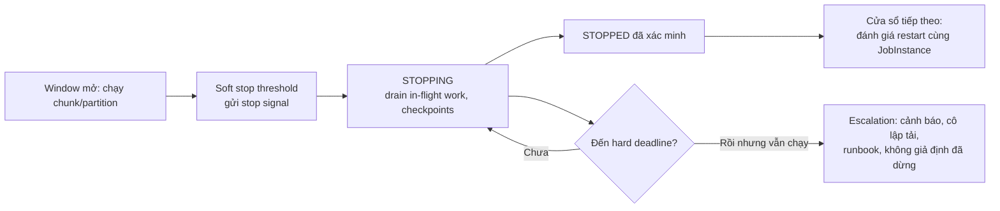
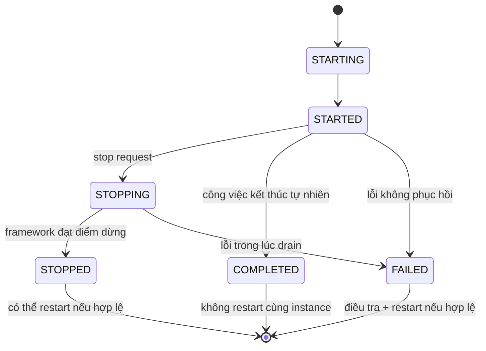
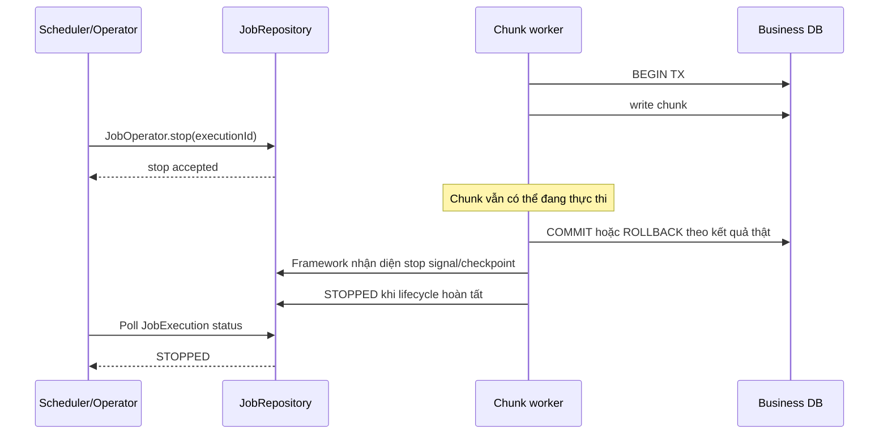
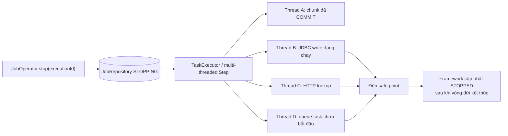
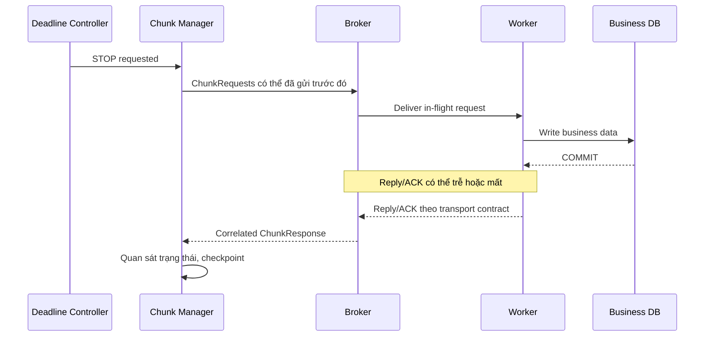

# Graceful stop trước thời hạn trong Spring Batch

> **Chương:** Scheduling  
> **Mục tiêu:** Thiết kế cơ chế **yêu cầu dừng sớm trước khi cửa sổ vận hành kết thúc**, bảo toàn chunk đã commit và checkpoint để restart; phân biệt `STOPPING` và `STOPPED`; xử lý tasklet, multi-threaded step, parallel flows, partitioning, remote workers và các side effect bên ngoài transaction. Ví dụ dùng **Spring Batch 5.2.x**, Java 17, Spring JDBC và một control service dành cho lịch chạy job dữ liệu lớn.

## 1. Vấn đề: Dừng lúc hết hạn thường là quá muộn

Giả sử hệ thống ETL được cấp cửa sổ hoạt động từ 01:00 đến **06:00**. Đến 06:00, máy chủ phải nhường tài nguyên cho hệ thống giao dịch trực tuyến, không được tạo thêm tải ghi lớn. Job còn 10 triệu bản ghi, đang dùng 12 partition và mỗi chunk mất 40 giây ở p99.

Nếu scheduler đúng **06:00** mới gọi `JobOperator.stop(...)`, nhiều worker có thể vẫn:

- thực thi `ItemWriter.write(...)` trong một chunk hiện tại;
- chờ database lock hoặc HTTP response;
- xử lý các request đã gửi tới remote workers;
- chờ reply/ACK qua broker;
- cập nhật checkpoint hoặc trạng thái `StepExecution`;
- giữ kết nối/transaction cho tới khi thread trở về điểm kiểm tra của framework.

Kết quả là job **không dừng đúng 06:00**, dù `stop(...)` đã trả `true`. Lệnh này là **yêu cầu dừng có tính hợp tác**, không phải thao tác kill process tức thì.

**Giải pháp:** Chia cửa sổ thành hai mốc:

1. **Soft-stop threshold** — thời điểm bắt đầu gửi tín hiệu dừng để worker có thời gian hoàn tất hoặc rollback tại điểm an toàn.
2. **Hard operational deadline** — hạn cuối mà tổ chức cần xác minh công việc đã dừng và tài nguyên đã được giải phóng.

Đặt thời điểm yêu cầu dừng đủ sớm, có **drain budget**, dùng `JobOperator` + polling metadata và quy trình escalation nếu vẫn chưa dừng.

## 2. Graceful stop thực sự có nghĩa gì?

Trong Spring Batch, graceful stop nên được hiểu là:

- **Không phát sinh chunk hoặc đơn vị công việc mới** sau khi stop signal đã được nhận tại điểm kiểm tra hợp lệ.
- **Để transaction đang thực hiện kết thúc an toàn** theo semantics của step: commit hoặc rollback tùy trường hợp.
- **Lưu trạng thái `StepExecution`, `ExecutionContext` và checkpoint** theo lifecycle framework khi có thể.
- **Không xóa hoặc ghi đè các output đã commit trước đó** chỉ để nhìn thấy job dừng.
- **Không tạo duplicate business effects** khi worker được restart hoặc message được giao lại.
- **Cho phép quan sát và kiểm chứng `STOPPED`**, thay vì coi request stop thành công là đã dừng.

Graceful stop **không** có nghĩa toàn job rollback về trạng thái trước khi chạy. Chunk-oriented job đã commit hàng nghìn chunk thì các chunk đó vẫn là kết quả đã áp dụng.

### Ba loại “dừng” dễ bị nhầm

| Loại | Cơ chế | Kết quả mong đợi |
| --- | --- | --- |
| **Cooperative runtime stop** | `JobOperator.stop(jobExecutionId)` | Job được yêu cầu dừng; framework xử lý ở điểm an toàn, trạng thái sau cùng có thể `STOPPED` |
| **Flow stop** | Điều khiển luồng bằng `stopAndRestart(...)` | Job dừng có chủ đích tại một điểm của flow; không phải external signal giữa chunk |
| **Process termination** | Orchestrator SIGTERM/SIGKILL, JVM stop | Process kết thúc; metadata/checkpoint có thể chưa cập nhật, cần recovery |

`JobOperator.abandon(...)` cũng **không phải một cách dừng mềm**. Nó đánh dấu execution không được restart theo đường thông thường; dùng không đúng lúc có thể phá recovery.

## 3. Sơ đồ hai mốc dừng và khoảng thời gian drain



Đặt:

- `T_hard`: hạn cuối không được còn công việc có side effect.
- `B_drain`: thời gian dự phòng để phản ứng stop và giải phóng in-flight work.
- `T_stop`: thời điểm gửi stop signal.

\[
T_{\mathrm{stop}} = T_{\mathrm{hard}} - B_{\mathrm{drain}}
\]

Một cách ước lượng drain budget:

\[
B_{\mathrm{drain}} \ge
T_{\mathrm{chunk,p99}}
+T_{\mathrm{remote/reply,p99}}
+T_{\mathrm{checkpoint,p99}}
+T_{\mathrm{schedule/poll}}
+T_{\mathrm{safety}}
\]

Đây là **công thức lập kế hoạch**, không phải giới hạn chắc chắn: network bị treo, JVM pause hoặc DB lock không bounded có thể làm stop kéo dài tùy ý.

### Ví dụ lập kế hoạch

```text
Hard deadline                06:00:00
P99 một chunk                45 giây
Remote reply/ACK             35 giây
Checkpoint/metadata update   20 giây
Polling/scheduler delay      20 giây
Safety margin                4 phút
------------------------------------
Drain budget                 6 phút
Soft-stop threshold          05:54:00
```

Các số trên là **giả định của ví dụ**, không phải benchmark Spring Batch. Nếu p99 chunk thực tế là 7 phút và cửa sổ drain 6 phút, cần giảm chunk duration, thêm khả năng hủy I/O có kiểm soát, hoặc bắt đầu dừng sớm hơn.

## 4. JobOperator.stop trong Spring Batch 5.2

API:

```java
boolean stop(long executionId)
        throws NoSuchJobExecutionException,
               JobExecutionNotRunningException;
```

`executionId` là **JobExecution ID**, không phải JobInstance ID, StepExecution ID hay tên job.

Đặc điểm đã được nêu trong Javadoc Spring Batch 5.2:

- `true` chỉ xác nhận **stop signal được gửi thành công**.
- **Không** bảo đảm job đã ngừng hoặc mọi thread/worker đã kết thúc.
- Cần **poll JobExecution status** để biết kết quả.
- Nếu execution không tồn tại hoặc không chạy, API có thể ném exception tương ứng.
- Tín hiệu chỉ có hiệu lực khi ứng dụng/worker còn có thể quan sát nó theo lifecycle hợp lệ.

Ví dụ:

```java
import org.springframework.batch.core.launch.JobOperator;

boolean accepted = jobOperator.stop(9001L);
if (accepted) {
    // Đúng: ghi nhận STOP_REQUESTED.
    // Sai: phát sự kiện JOB_STOPPED ngay tại đây.
}
```

Một control service có thể trả HTTP **202 Accepted** cho stop request; sau đó dashboard tiếp tục polling tới `STOPPED`. Đừng trả “200 OK, job đã dừng” chỉ vì boolean accepted.

## 5. BatchStatus: STARTED → STOPPING → STOPPED



Đây là **sơ đồ các luồng thường gặp**, không thể hiện tất cả internal transitions hoặc biến thể của job flow.

| Trạng thái | Ý nghĩa vận hành | Hành động |
| --- | --- | --- |
| `STARTING` | JobExecution được tạo, đang khởi động | Theo dõi; phân loại nếu request stop tới rất sớm |
| `STARTED` | Job được xem là đang thực thi | Có thể gửi stop nếu trong cửa sổ dừng |
| `STOPPING` | Stop request đã được ghi nhận, còn công việc in-flight | Poll; đo thời gian drain, không start job trùng |
| `STOPPED` | Framework đã hoàn tất dừng có kiểm soát | Kiểm tra checkpoint, output, eligibility để restart |
| `COMPLETED` | Công việc hoàn tất theo flow | Quality gate và đối soát output |
| `FAILED` | Execution thất bại | Điều tra lỗi, transaction outcome và restart |
| `ABANDONED` | Bị đánh dấu không restart theo lifecycle thông thường | Không dùng để thay stop |
| `UNKNOWN` | Trạng thái không đáng tin | Reconciliation/manual recovery |

Trong tình huống stop và job hoàn tất tự nhiên cùng lúc, trạng thái cuối cùng có thể khác kỳ vọng của caller tại thời điểm stop. **Phải đọc metadata sau cùng**, không suy từ status cũ hay kết quả boolean.

### Stop có thể phải đợi business method trả về

Spring Batch không thể bảo đảm cưỡng chế dừng ngay lúc custom `Tasklet.execute` đang chạy trong logic người dùng hoặc khi writer bị block trong JDBC/HTTP. Framework chỉ có thể phản ứng đúng khi tiến trình trả về điểm điều khiển thích hợp; xem tài liệu [Advanced Metadata Usage — Stopping a Job](https://docs.spring.io/spring-batch/reference/5.2/job/advanced-meta-data.html).

## 6. Safe point trong chunk-oriented Step

Chunk step thường xử lý:

```text
BEGIN chunk transaction
    read đến commit interval
    process từng item
    write chunk
    cập nhật metadata/checkpoint phù hợp
COMMIT chunk transaction

Framework quay về điểm điều khiển:
    nếu có stop request → dừng, cập nhật trạng thái
    nếu chưa có → tiếp tục chunk tiếp theo
```

Đây là **mô hình khái niệm**, không phải cam kết chính xác điểm kiểm tra trong tất cả implementations. Spring Batch có buffering và fault tolerance; transaction có thể rollback và replay nếu lỗi.

### Điều gì xảy ra nếu dừng khi đang write?



- Một chunk đã commit trước lúc dừng không bị tự động undo.
- Chunk đang chạy có thể hoàn tất hoặc rollback theo điều kiện transaction; không được hứa “mọi write tại thời điểm stop đều bị rollback”.
- Chunk cuối đang chờ external API có thể mất nhiều giây/phút nếu không có timeout.
- `ItemStream` checkpoint phục vụ restart cần gắn với **phần dữ liệu đã commit**.
- Nếu reader là shared mutable singleton không thread-safe, graceful stop không sửa được checkpoint race.
- Nếu writer dùng `REQUIRES_NEW` hoặc HTTP side effect ngoài chunk TX, rollback chunk không bảo đảm hoàn tác output.

**Thiết kế tốt:** Chunk đủ nhỏ để thời gian cuối chunk được đo và bounded, writer idempotent, transaction manager đúng datasource, và stop có đủ ngân sách để step về điểm an toàn.

## 7. Tuning chunk size để phản ứng dừng

Một lựa chọn chunk size cần cân bằng:

| Chunk size | Ưu điểm | Rủi ro cho graceful stop |
| --- | --- | --- |
| 20–50 items | Thường quay về điểm điều khiển nhanh | Overhead transaction/commit cao |
| 100–500 items | Cân bằng cho nhiều workload | Cần đo p99 writer latency |
| 2.000+ items | Giảm overhead nếu writer bulk hiệu quả | Chunk có thể giữ TX/lock lâu, khó dừng đúng hạn |
| Dynamic chunk policy | Có thể thích nghi với workload | Phải test checkpoint/correctness khi đổi policy |

Đây không phải khuyến nghị chunk size mặc định cho mọi hệ thống. Số item không dự báo chính xác thời gian vì item có kích thước/chi phí xử lý khác nhau. Với file lớn hoặc API đa dạng, một chunk có 20 items vẫn có thể bị block 10 phút.

### Nên đo những gì?

- `chunk_duration_seconds` p50/p95/p99.
- `read/process/write` latency.
- DB lock wait và connection pending.
- Số chunks đang hoạt động tại soft-stop threshold.
- `stop_requested_at → stopped_at`.
- Timeout/rollback/retry count.
- Remote request in-flight/reply latency.
- Thời gian cập nhật metadata `JobRepository`.

**Đừng chỉ lấy average chunk duration nhân số workers.** Khi draining, thời gian thường bị quyết định bởi **chunk chậm nhất đang chạy** và những request không hủy được.

## 8. Poll trạng thái qua JobExplorer, không parse summary String

`JobOperator.getSummary(executionId)` hữu ích cho CLI, nhưng trả chuỗi mô tả. API machine-readable nên dùng `JobExplorer`:

```java
package com.example.batch.scheduling;

import org.springframework.batch.core.BatchStatus;
import org.springframework.batch.core.JobExecution;
import org.springframework.batch.core.explore.JobExplorer;
import org.springframework.stereotype.Service;

@Service
public class BatchExecutionStatusReader {

    private final JobExplorer jobExplorer;

    public BatchExecutionStatusReader(JobExplorer jobExplorer) {
        this.jobExplorer = jobExplorer;
    }

    public record Snapshot(
            long jobExecutionId,
            long jobInstanceId,
            String jobName,
            BatchStatus status,
            String exitCode) {}

    public Snapshot get(long id) {
        JobExecution e = jobExplorer.getJobExecution(id);
        if (e == null) {
            throw new IllegalArgumentException(
                    "Unknown JobExecution ID: " + id);
        }
        return new Snapshot(
                e.getId(),
                e.getJobInstance().getId(),
                e.getJobInstance().getJobName(),
                e.getStatus(),
                e.getExitStatus().getExitCode());
    }
}
```

Đây là **snapshot metadata**, không chứng minh mọi remote worker thực tế đã dừng. Với broker và phân tán, thêm worker heartbeat/lease, in-flight counts, output transaction confirmation và correlation.

### Polling interval

Nếu cần dừng trước 06:00, có thể poll `JobExplorer` mỗi 5–15 giây trong quá trình STOPPING, tùy SLO và DB capacity. Không đưa mỗi dashboard instance vào loop 100 ms trên JDBC JobRepository khi có hàng nghìn partitions.

## 9. DeadlineStopService: Gửi stop một lần theo soft threshold

Ví dụ Java 17 tập trung vào **ra quyết định**, không dùng `Thread.sleep` chặn scheduler.

```java
package com.example.batch.scheduling;

import java.time.Clock;
import java.time.Instant;

import org.springframework.batch.core.BatchStatus;
import org.springframework.batch.core.JobExecution;
import org.springframework.batch.core.explore.JobExplorer;
import org.springframework.batch.core.launch.JobOperator;
import org.springframework.batch.core.launch.JobExecutionNotRunningException;
import org.springframework.stereotype.Service;

@Service
public class DeadlineStopService {

    private final JobExplorer explorer;
    private final JobOperator operator;
    private final Clock clock;

    public enum Decision {
        TOO_EARLY, REQUESTED, REQUEST_NOT_ACCEPTED,
        ALREADY_STOPPING, TERMINAL, NOT_STARTED,
        UNKNOWN_EXECUTION, CONCURRENT_STATE_CHANGE
    }

    public DeadlineStopService(
            JobExplorer explorer, JobOperator operator, Clock clock) {
        this.explorer = explorer;
        this.operator = operator;
        this.clock = clock;
    }

    public Decision requestStopIfDue(
            long executionId, Instant softStopAt) throws Exception {

        if (clock.instant().isBefore(softStopAt)) {
            return Decision.TOO_EARLY;
        }

        JobExecution execution =
                explorer.getJobExecution(executionId);
        if (execution == null) {
            return Decision.UNKNOWN_EXECUTION;
        }

        BatchStatus status = execution.getStatus();
        if (status == BatchStatus.STOPPING) {
            return Decision.ALREADY_STOPPING;
        }
        if (status == BatchStatus.STOPPED
                || status == BatchStatus.COMPLETED
                || status == BatchStatus.FAILED
                || status == BatchStatus.ABANDONED
                || status == BatchStatus.UNKNOWN) {
            return Decision.TERMINAL;
        }
        if (status != BatchStatus.STARTED) {
            return Decision.NOT_STARTED;
        }

        try {
            boolean accepted = operator.stop(executionId);
            return accepted
                    ? Decision.REQUESTED
                    : Decision.REQUEST_NOT_ACCEPTED;
        } catch (JobExecutionNotRunningException ex) {
            // Có thể race với việc job vừa kết thúc.
            // Caller nên đọc lại trạng thái.
            return Decision.CONCURRENT_STATE_CHANGE;
        }
    }
}
```

Các giả định/giới hạn:

1. Cần một bean `Clock` được tạo rõ ràng, ví dụ `Clock.systemUTC()`. Dùng `Instant` để so mốc thời gian, tránh nhầm timezone local.
2. `softStopAt` phải được lấy từ **durable job control record** hoặc luật scheduling đáng tin cậy, **không tạo ngẫu nhiên lại trên mỗi lần poll**.
3. Code cố ý chỉ gọi `stop` khi status đang `STARTED`; khi `STARTING`, cần policy riêng (đợi rồi kiểm tra lại, hoặc điều phối launch theo ngưỡng).
4. Nếu có hai scheduler cùng gửi stop, một caller có thể nhận trạng thái đã dừng hoặc exception vì race. Không coi đó là lý do tự khởi tạo execution mới.
5. `Decision.REQUESTED` chỉ nghĩa tín hiệu được chấp nhận. **Không** có `Decision.STOPPED` trong hàm này; muốn biết đã dừng phải gọi `JobExplorer` lần nữa.
6. Các lỗi DB/metadata khác vẫn được ném cho tầng orchestration để alert/retry có kiểm soát. Không nuốt mọi exception rồi trả `TOO_EARLY` hoặc `TERMINAL`.
7. Hạn chót vận hành **không** được mã hóa cứng vào StepExecution; control service phải biết kỳ lịch/manifest mà execution thuộc về.

## 10. Tích hợp scheduler với durable control table

Không bắt đầu bằng một cron callback giữ bản đồ job IDs trong `HashMap`, vì khi application restart, toàn bộ thông tin lịch dừng sẽ mất.

Bảng control minh họa:

```sql
CREATE TABLE batch_runtime_window (
    window_id VARCHAR(120) PRIMARY KEY,
    job_execution_id BIGINT NOT NULL UNIQUE,
    soft_stop_at TIMESTAMPTZ NOT NULL,
    hard_deadline_at TIMESTAMPTZ NOT NULL,
    stop_requested_at TIMESTAMPTZ,
    stopped_observed_at TIMESTAMPTZ,
    control_status VARCHAR(24) NOT NULL,
    updated_at TIMESTAMPTZ NOT NULL DEFAULT CURRENT_TIMESTAMP,
    CHECK (soft_stop_at < hard_deadline_at)
);
```

Workflow:

```text
Job launch:
    tạo JobExecution + control window record theo transaction/protocol phù hợp
    persist softStopAt và hardDeadlineAt

Periodic control loop:
    đọc control windows chưa kết thúc
    nếu now >= softStopAt:
        gửi stop qua JobOperator nếu cần
        lưu stopRequestedAt/audit
    nếu status STOPPING:
        poll JobExplorer, kiểm tra worker/in-flight
    nếu STOPPED:
        lưu stoppedObservedAt và close window
    nếu now >= hardDeadlineAt mà chưa chứng minh đã dừng:
        alert/escalation, không báo STOPPED giả
```

**Rủi ro lúc launch:** JobExecution có thể được tạo xong nhưng control record chưa được lưu nếu hai hệ không commit nguyên tử. Phải có reconciliation job/control scan để tìm execution thiếu window hoặc record tham chiếu execution không tồn tại.

Nếu có nhiều control pods, nên có leader/lease/row claim tại control table, nhưng **không** dùng `SELECT pending → UPDATE pending` thiếu điều kiện nguyên tử. Để JobRepository và control record phản ánh đúng, phải kiểm tra race giữa stop request, completion tự nhiên và job restart.

### Khi scheduler bị downtime qua mốc soft-stop

Nếu control service tắt từ 05:50 đến 05:58, nó phải quét các windows **đã quá `soft_stop_at`** sau khi lên lại, gửi stop ngay nếu job còn chạy và đánh dấu nguy cơ trễ. Không đợi cron 05:54 của ngày hôm sau.

## 11. Mốc thời gian: Business timezone khác clock của server

Nếu doanh nghiệp yêu cầu “job dừng trước 06:00 theo giờ Việt Nam”, lưu `hardDeadlineAt` dưới dạng `Instant`/`TIMESTAMPTZ` sau khi quy đổi từ business timezone.

```java
import java.time.Instant;
import java.time.LocalDate;
import java.time.LocalTime;
import java.time.ZoneId;
import java.time.ZonedDateTime;

ZoneId zone = ZoneId.of("Asia/Ho_Chi_Minh");
LocalDate processingDate = LocalDate.of(2026, 11, 26);

ZonedDateTime localDeadline =
        ZonedDateTime.of(processingDate,
                LocalTime.of(6, 0), zone);
Instant hardDeadlineAt = localDeadline.toInstant();

Instant softStopAt = hardDeadlineAt.minusSeconds(6 * 60);
```

- Không dùng `LocalDateTime.now()` trên các JVM có timezone mặc định khác nhau.
- Với khu vực có DST, một local time có thể không tồn tại hoặc xảy ra hai lần; quy tắc scheduler phải xử lý `ZoneRules` tương ứng.
- Đồng hồ của host có thể lệch; dùng NTP/clock monitoring và log thời gian nguồn. Với nhiều pods, lấy threshold từ control record chung.
- `softStopAt` không nên tính lại từ “thời điểm job bắt đầu + 5 giờ” nếu SLA thực tế dựa trên **cửa sổ cố định của ngày**.
- Hạn chế dùng `JobParameters` để chứa dữ liệu điều khiển thay đổi liên tục; JobParameters identifying/non-identifying phải có semantics rõ. Có thể lưu window ID rồi tra control record.

## 12. StoppableTasklet: Hợp tác với stop request bên trong code dài

Với custom tasklet có vòng lặp dài, Spring Batch 5.2 cung cấp `StoppableTasklet`. Theo [Javadoc StoppableTasklet 5.2](https://docs.spring.io/spring-batch/docs/5.2.x/api/org/springframework/batch/core/step/tasklet/StoppableTasklet.html), `JobOperator.stop(...)` **cố gắng** gọi `StoppableTasklet.stop()` khi tasklet đang chạy; cuộc gọi đến `stop()` diễn ra **trên thread khác** với `Tasklet.execute(...)`. Vì vậy cần thread safety và memory visibility.

Mẫu implementation:

```java
package com.example.batch.scheduling;

import java.util.concurrent.atomic.AtomicBoolean;

import org.springframework.batch.core.StepContribution;
import org.springframework.batch.core.scope.context.ChunkContext;
import org.springframework.batch.core.step.tasklet.StoppableTasklet;
import org.springframework.batch.repeat.RepeatStatus;

public final class CooperativeImportTasklet
        implements StoppableTasklet {

    private final AtomicBoolean stopRequested =
            new AtomicBoolean(false);

    private final BoundedWorkUnitService work;

    public CooperativeImportTasklet(BoundedWorkUnitService work) {
        this.work = work;
    }

    @Override
    public void stop() {
        // Được framework gọi từ thread khác khi có stop signal.
        stopRequested.set(true);
    }

    @Override
    public RepeatStatus execute(
            StepContribution contribution,
            ChunkContext context) throws Exception {

        if (stopRequested.get()) {
            contribution.getStepExecution().setTerminateOnly();
            return RepeatStatus.FINISHED;
        }

        // Mỗi lần execute phải làm một đơn vị công việc bounded.
        // TaskletStep quản lý transaction theo cấu hình step.
        boolean processed = work.processOneUnit();

        if (stopRequested.get()) {
            contribution.getStepExecution().setTerminateOnly();
            return RepeatStatus.FINISHED;
        }

        return processed
                ? RepeatStatus.CONTINUABLE
                : RepeatStatus.FINISHED;
    }

    public interface BoundedWorkUnitService {
        // true nếu vừa xử lý một unit; false nếu hết input.
        boolean processOneUnit() throws Exception;
    }
}
```

**Điểm cần kiểm chứng khi dùng mẫu này:**

1. `AtomicBoolean` bảo đảm `stop()` từ thread khác được `execute()` nhìn thấy. Dùng boolean không đồng bộ có thể gây memory visibility issue.
2. `setTerminateOnly()` phát tín hiệu muốn thoát cho môi trường step; code không tự `setStatus(COMPLETED)` hoặc `setStatus(STOPPED)`.
3. Đơn vị `processOneUnit()` phải **bounded**. Nếu nó block 30 phút, AtomicBoolean không cứu được deadline.
4. Phải cấu hình TaskletStep, transaction manager và Step/Job bean đúng phiên bản; skeleton không tự có durable checkpoint/reader.
5. `StoppableTasklet` không bảo đảm kill external process hoặc hủy một JDBC/HTTP call đang chờ. Phải cấu hình timeout/cancellation riêng.
6. Nếu `stopRequested` bị giữ trên singleton bean qua nhiều JobExecutions, lần chạy sau có thể đọc lại `true`. Mỗi execution cần instance/state đúng scope hoặc reset có kiểm soát. Không dùng shared mutable flag cho nhiều jobs.
7. Gọi `RepeatStatus.FINISHED` mà **không** báo termination có thể làm tasklet được coi đã hoàn thành tự nhiên; mẫu dùng `setTerminateOnly()` để truyền rõ ý định ngắt.
8. Không tự chạy `StoppableTasklet.stop()` ở bất kỳ thread nào rồi suy nó tương đương `JobOperator.stop` — framework còn cần cập nhật metadata/lifecycle.


## 13. Scheduled control loop: Đừng chặn thread scheduler để đợi

Một ứng dụng có thể dùng Spring scheduling để kiểm tra các windows chưa kết thúc. Scheduler **phát yêu cầu và lưu quan sát**, không ngồi trong một vòng `while` gọi `Thread.sleep` cho đến khi mọi worker dừng.

Skeleton ứng dụng:

```java
package com.example.batch.scheduling;

import java.time.Clock;
import java.time.Instant;
import java.util.List;

import org.slf4j.Logger;
import org.slf4j.LoggerFactory;
import org.springframework.scheduling.annotation.Scheduled;
import org.springframework.stereotype.Component;

@Component
public class DeadlineWindowMonitor {

    private static final Logger log =
            LoggerFactory.getLogger(DeadlineWindowMonitor.class);

    private final Clock clock;
    private final WindowStore windows;
    private final DeadlineStopService stopper;
    private final BatchExecutionStatusReader reader;

    public DeadlineWindowMonitor(
            Clock clock, WindowStore windows,
            DeadlineStopService stopper,
            BatchExecutionStatusReader reader) {
        this.clock = clock;
        this.windows = windows;
        this.stopper = stopper;
        this.reader = reader;
    }

    @Scheduled(fixedDelay = 15_000L)
    public void inspect() {
        Instant now = clock.instant();

        for (Window window : windows.findOpenWindows()) {
            try {
                var snapshot = reader.get(window.jobExecutionId());

                if (snapshot.status()
                        == org.springframework.batch.core.BatchStatus.STOPPED) {
                    windows.recordStopped(
                            window.windowId(), now);
                    continue;
                }

                if (!now.isBefore(window.hardDeadlineAt())
                        && snapshot.status()
                            != org.springframework.batch.core.BatchStatus.COMPLETED) {
                    windows.alertDeadlineRisk(
                            window.windowId(), snapshot.status().name());
                    // Escalate, KHÔNG tự ghi status=STOPPED.
                }

                var decision = stopper.requestStopIfDue(
                        window.jobExecutionId(), window.softStopAt());
                windows.recordDecision(
                        window.windowId(), decision.name(), now);

            } catch (Exception ex) {
                // Một record lỗi không nên che mất tất cả windows.
                log.error("Deadline control failed for window={}",
                        window.windowId(), ex);
                windows.alertControlFailure(
                        window.windowId(), ex.getClass().getSimpleName());
            }
        }
    }

    public record Window(
            String windowId,
            long jobExecutionId,
            Instant softStopAt,
            Instant hardDeadlineAt) {}

    public interface WindowStore {
        List<Window> findOpenWindows();
        void recordDecision(String id, String decision, Instant observedAt);
        void recordStopped(String id, Instant observedAt);
        void alertDeadlineRisk(String id, String observedStatus);
        void alertControlFailure(String id, String exceptionType);
    }
}
```

**Đây là ví dụ ghép nối, không phải production-ready controller:**

- `WindowStore` là interface minh họa, phải có implementation lưu bền vững và **atomic update/lease** khi nhiều control pods cùng chạy.
- Cần `@EnableScheduling` nếu ứng dụng chưa bật scheduling; `Clock` phải là bean phù hợp.
- Logic record trạng thái phải nhận cả `FAILED`/`ABANDONED`/`UNKNOWN`, không quét mãi mà không đóng hoặc escalation. Mẫu trên giữ nhiệm vụ này cho implementation/control workflow thực.
- Không tạo alert mới mỗi 15 giây cho cùng sự cố; có dedup/cooldown.
- Mỗi controller gọi API có thể race với worker vừa hoàn thành; đọc lại trạng thái sau mọi `CONCURRENT_STATE_CHANGE`.
- Dùng JobExecution ID của **đúng instance đang vận hành**, không dừng nhầm job cùng tên thuộc businessDate khác.
- Hệ có nhiều nghìn windows cần paging/lock và batching; `findOpenWindows()` không nên scan toàn bảng vô hạn.
- Việc gọi `stop()` xong nhưng ghi `recordDecision` thất bại sẽ dẫn đến khả năng phát lại stop request. Controller phải **idempotent** trước tình huống này.

Một endpoint vận hành cũng có thể gọi `DeadlineStopService` bằng quyền quản trị, nhưng vẫn phải audit reason, requester, window ID, JobExecution ID và kết quả cuối được quan sát.

## 14. Network, JDBC và external process: Timeout phải bounded

Spring Batch không thể nhận biết stop khi một đoạn code vẫn bị block bên trong:

- HTTP client chờ response không timeout;
- JDBC query chờ lock/connection vô hạn;
- subprocess không dừng sau SIGTERM hoặc stdio pipe bị block;
- NFS/object storage read bị treo;
- consumer chờ message lâu mà không kiểm tra điều kiện stop.

### Timeout ở các tầng

| Tầng | Cấu hình hoặc bảo vệ | Tác dụng |
| --- | --- | --- |
| HTTP connect | Connection timeout | Không treo vô hạn khi thiết lập kết nối |
| HTTP request/read | Request timeout và cancellation protocol | Giảm thời gian worker giữ request |
| JDBC pool | Connection acquisition timeout | Không chờ connection vô hạn |
| JDBC query | `Statement.setQueryTimeout` / driver setting / DB statement timeout | Bounded query, kiểm tra transaction state |
| DB lock | Lock timeout theo database | Tránh giữ transaction chờ khóa quá lâu |
| Transaction | Timeout do PlatformTransactionManager hỗ trợ | Giới hạn thời gian transaction, **không tự bảo đảm I/O được interrupt tức thì** |
| Queue consumer | Receive timeout/poll interval | Có cơ hội kiểm tra stop/drain |
| External command | Process timeout, graceful termination và kill policy sau escalation | Không treo vô hạn vì child process |

**Timeout không phải bằng chứng side effect chưa xảy ra.** Một HTTP POST payment có thể đã commit ở server, chỉ response mất. Khi dừng/restart, bắt buộc có stable idempotency key/status lookup/reconciliation. Không hủy request rồi lập tức gửi lại POST với ID mới.

### Một ví dụ Java HttpClient

```java
import java.net.http.HttpClient;
import java.net.http.HttpRequest;
import java.time.Duration;

// Ví dụ fragment dùng cho một GET read-only.
HttpClient client = HttpClient.newBuilder()
        .connectTimeout(Duration.ofSeconds(2))
        .build();

HttpRequest request = HttpRequest.newBuilder()
        .uri(java.net.URI.create(
                "https://rates.example.invalid/snapshots/2026-11-25"))
        .timeout(Duration.ofSeconds(3))
        .GET()
        .build();
```

`rates.example.invalid` là placeholder, không gọi mạng thật. Timeout 2/3 giây chỉ là minh họa. Với nhiều workers và SLA dừng, cần tối ưu đồng thời request timeout, retryLimit, backoff, circuit breaker và tổng deadline.

### Tránh giữ chunk transaction khi ngủ backoff

Nếu processor đang chờ HTTP dài trong khi chunk transaction đã mở, connection/lock có thể bị giữ lâu. Backoff trong cùng transaction còn làm tăng thời gian chiếm tài nguyên. Cần đối chiếu transaction boundary thực tế và cân nhắc:

- Enrichment GET qua snapshot/cached data trước giai đoạn ghi.
- Tách external side effect thành outbox.
- Retry hữu hạn, backoff có jitter và deadline.
- Giảm số worker concurrent khi downstream quá tải.

## 15. Graceful stop trong multi-threaded step

Với `TaskExecutor`, nhiều chunks của **một `StepExecution`** có thể chạy đồng thời. Stop request ở cấp `JobExecution` không khiến tất cả worker threads biến mất ngay.



Những điểm cần kiểm tra:

1. **In-flight chunks:** Các chunk đang xử lý có thể commit/rollback trước khi dừng. Không kỳ vọng tất cả rollback.
2. **Pending tasks:** Executor queue có thể chứa công việc chưa bắt đầu; quy tắc không tiếp tục nhận task sau soft-stop phải được xác minh.
3. **Reader thread safety:** Một step-scoped reader không tự thành per-thread reader trong multi-threaded step; checkpoint phải đúng khi xử lý out-of-order.
4. **Writer thread safety:** Không dùng mutable shared buffer không khóa đúng.
5. **Shared StepExecution:** Có thể nhiều chunks cùng cập nhật counters/context; dùng hạ tầng Batch và extension point đúng, không tự ghi metadata từ thread khác.
6. **Stop latency:** Thường bị giới hạn bởi tail latency của chunk chậm nhất hoặc I/O bị block.
7. **Pool sizing:** DB pool ít hơn worker concurrency làm stop chậm vì chờ connection; phải đo pool pending.

Nếu cần checkpoint độc lập theo dải dữ liệu và stop theo worker rõ ràng hơn, cân nhắc **partitioning** thay vì tăng worker count của một step có shared reader/context.

## 16. Parallel steps và partitioning: Một job, nhiều giao dịch độc lập

### Parallel flows

Một job có `split()` cho nhiều steps chạy đồng thời. Mỗi step/flow có transaction và trạng thái riêng. Khi yêu cầu stop:

- Flow A có thể đã `COMPLETED`.
- Flow B có thể đang commit chunk.
- Flow C có thể đang retry database deadlock.
- Job tổng hợp trạng thái cuối theo flow lifecycle, không phải bằng cách rollback mọi flow đã hoàn thành.

**Không** tự set `JobExecution.status=STOPPED` từ một listener của flow A khi các flow khác còn chạy.

### Local partitioning

Manager chia dữ liệu thành partitions. Mỗi worker partition có **StepExecution và ExecutionContext riêng**.

```text
fileManager
    fileWorker:partition0000 → COMPLETED
    fileWorker:partition0001 → STARTED
    fileWorker:partition0002 → STARTED
    fileWorker:partition0003 → COMPLETED
```

Khi stop được yêu cầu, manager/handler cần quan sát các workers và tổng hợp kết quả. Những partitions đã commit không bị undo chỉ vì một partition khác chưa tới checkpoint.

- Partition name/file range phải ổn định qua restart.
- Không đổi `gridSize` rồi tái gán checkpoint cũ sang dải dữ liệu mới.
- Một worker có thể cần dừng giữa file; `FlatFileItemReader`, `ItemStream` và `ExecutionContext` phải lưu đúng offset.
- Writer phải idempotent vì worker có thể replay một số item sau stop/restart.
- `DefaultStepExecutionAggregator` có thể tổng hợp counters của workers lên manager; dashboard không được cộng cả manager và workers thành hai lần throughput.

### Remote partitioning

Manager gửi quyền thực thi partition sang JVM khác. `JobOperator.stop(...)` ở manager **không tự kill process remote** và không thay thế cơ chế heartbeat/lease/worker cancellation.

Nếu remote worker chưa nhận tín hiệu stop, nó có thể tiếp tục ghi output sau soft-stop. Cần protocol **drain/stop** ở worker, quyền sở hữu partition, fencing và telemetry xác nhận không còn in-flight business effects.

## 17. Remote chunking: Stop phải xét cả queue, reply và ACK

Remote chunking có manager đọc/chia chunks, phát `ChunkRequest` và chờ `ChunkResponse` từ workers qua messaging.



Đây là sơ đồ nguyên lý; thứ tự ACK/reply thực tế phụ thuộc JMS/AMQP adapter, transaction và listener container.

**Graceful stop phân tán cần ít nhất:**

1. Ngừng nhận/phân phối **công việc mới** khi đến soft threshold theo cơ chế manager/dispatcher thật.
2. Đếm/quan sát `inFlightChunkRequests`, queue depth, replies chưa nhận.
3. Chờ hoặc xử lý hợp lệ requests đã phát trước stop.
4. Không ACK sớm trước khi business commit/reply protocol thỏa điều kiện.
5. Có idempotent writer để broker redelivery không gây duplicate.
6. Giới hạn timeouts và áp DLQ/quarantine khi poison messages.
7. Không đánh dấu `STOPPED` về mặt vận hành chỉ vì manager status đổi nếu worker cũ vẫn có khả năng tạo side effect.

`retryLimit` của Spring Batch Step **không** giới hạn broker redelivery; muốn hạn chế tổng thời gian drain, phải biết retry/redelivery policy của cả middleware.

### Worker cũ đã commit nhưng mất reply

Sau stop hoặc restart, broker có thể gửi lại cùng chunk. Unique business key/processed-event ledger và reconciliation phải ngăn ghi trùng. Không dùng `JobExecution ID` làm business idempotency key, vì restart tạo execution ID mới.

## 18. SIGTERM, Kubernetes terminationGracePeriod và graceful stop

Khi Kubernetes/VM yêu cầu dừng process, thứ tự thường là:

```text
Orchestrator yêu cầu stop/drain
→ Service ngừng nhận công việc mới
→ Batch controller gửi JobOperator.stop(...)
→ Framework đạt safe point, lưu checkpoint, STOPPED
→ Service có thể hoàn tất shutdown
→ Nếu quá termination grace period, orchestrator có thể cưỡng chế kill
```

Đây là **mô hình quy trình chủ động**, không phải kết quả tự xuất hiện khi cấu hình termination grace period.

### Không dựa vào shutdown hook để gửi stop rồi chờ vô hạn

Một JVM shutdown hook có thời gian và khả năng I/O không chắc chắn, đặc biệt khi process bị `kill -9`, OOM, node mất nguồn hoặc connection pool đã bắt đầu đóng.

Hướng tốt hơn:

- Dùng **external control plane** yêu cầu stop **trước** khi rollout/maintenance.
- Chuyển readiness sang trạng thái không nhận launch mới.
- Có thời gian drain được tính từ p99 chunks/remote calls.
- Gửi stop, poll `STOPPING→STOPPED`.
- Chỉ sau khi dừng có chứng cứ mới chủ động terminate process.
- Nếu vượt hard deadline, escalation theo runbook, không tạo dữ liệu sai bằng cách ép metadata.

**`terminationGracePeriodSeconds`** phải lớn hơn expected drain latency nếu ứng dụng cần cơ hội checkpoint. Nhưng một timeout vô hạn hoặc process hung không bảo đảm sẽ dừng. Cần kế hoạch trường hợp mất node.

### JobRepository có biết worker đã chết không?

Không phải lúc nào. Khi JVM bị kill trước khi metadata được cập nhật, JobRepository có thể giữ status `STARTED` dù process đã biến mất. **Đừng gọi lại `stop()` nhiều lần rồi giả định sẽ thành `STOPPED`.** Cần xác minh process thật đã chết, không còn in-flight worker, đối soát side effects và xử lý recovery theo chính sách vận hành/phiên bản đang dùng.

## 19. stopAndRestart trong flow khác JobOperator.stop giữa runtime

Spring Batch 5.2 cũng có API `stopAndRestart(nextStep)` trên job flow builder:

```java
import org.springframework.batch.core.Job;
import org.springframework.batch.core.Step;
import org.springframework.batch.core.job.builder.JobBuilder;
import org.springframework.batch.core.repository.JobRepository;

// Ví dụ minh họa điểm dừng THIẾT KẾ trong flow.
@Bean
Job twoWindowJob(
        JobRepository repository,
        Step prepareSnapshot,
        Step publishSnapshot) {

    return new JobBuilder("twoWindowJob", repository)
            .start(prepareSnapshot).on("COMPLETED")
                .stopAndRestart(publishSnapshot)
            .end()
            .build();
}
```

Ý nghĩa:

- Khi `prepareSnapshot` hoàn tất với ExitStatus thích hợp, Job **dừng theo nhánh flow đã định nghĩa**.
- Khi restart JobInstance, flow tiếp tục từ `publishSnapshot` theo contract.
- Đây là lựa chọn hữu ích nếu công việc có **ranh giới giai đoạn** cố định, ví dụ import dữ liệu thô đêm nay và publish sáng mai.
- Nó **không** có nghĩa dừng đúng lúc trong `prepareSnapshot` đang xử lý chunk.
- Nó không cần external `JobOperator.stop` để đánh dấu dừng tại flow boundary.

**Phân biệt:** `JobOperator.stop(executionId)` là lệnh runtime cho một JobExecution; `stopAndRestart` là quy tắc điều khiển luồng **ở lúc chuyển step**. Nếu cần dừng trước hard deadline giữa step rất dài, phải có runtime stop/drain và bounded work units.

## 20. Restart sau graceful stop: Không chạy lại từ đầu một cách mù quáng

Sau khi JobExecution chuyển `STOPPED`:

```java
long stoppedExecutionId = 9001L;

// Chỉ sau khi đã xác minh worker dừng và checkpoint hợp lệ.
long restartedExecutionId =
        jobOperator.restart(stoppedExecutionId);
```

Thông thường, Spring Batch tạo **JobExecution mới trên cùng JobInstance** (cùng identifying JobParameters) khi restart hợp lệ.

```text
JobInstance = dailyImport(businessDate, immutableManifest)
    JobExecution 9001 → STARTED → STOPPING → STOPPED
    JobExecution 9002 → STARTED → COMPLETED
```

Các điều kiện phải kiểm tra trước restart:

1. Định nghĩa Job vẫn còn được đăng ký trong `JobRegistry` và tương thích metadata.
2. Reader/snapshot/manifest **bất biến**, resource order ổn định.
3. `ExecutionContext`/checkpoint đã được persist đúng cho phần đã commit.
4. Worker cũ không còn chạy, không còn message in-flight có khả năng tạo output không được fencing.
5. Writer idempotent với chunks có thể replay.
6. Nếu còn payment/email/API side effect không rõ outcome, phải reconcile trước khi phát lại.
7. Job/step restartable theo flow, không bị `COMPLETED` hoặc `ABANDONED` theo cách chặn restart.
8. Cửa sổ xử lý tiếp theo có deadline mới, nhưng **không** tự tạo JobInstance mới bằng random `run.id`.

### Khi đã COMMITTED nhưng chưa ghi checkpoint

Nếu business output ở database khác JobRepository, process có thể chết sau khi business rows commit nhưng trước metadata checkpoint. Restart có thể đọc lại cùng input. Đó là lý do writer cần business unique key và đối soát, không chỉ tin vào `writeCount` hoặc trạng thái STOPPED.

### Không dùng REQUIRES_NEW để “bảo vệ checkpoint”

Một writer tự mở `REQUIRES_NEW` trên từng item có thể commit output ngoài chunk transaction, khiến restart phát lại dữ liệu đã commit. Giữ transaction boundaries rõ ràng; dùng outbox/idempotency cho side effects bên ngoài DB.

## 21. Deadline-aware scheduling cần giới hạn việc bắt đầu mới

Ngoài yêu cầu dừng job đang chạy, hệ thống phải **từ chối launch mới** khi không đủ thời gian để chạy hoặc dừng an toàn trước hard deadline.

Ví dụ:

```text
Business window       01:00 → 06:00
Observed p95 run time  2h 10m
Expected drain budget  6m

05:40 có request chạy job mới:
  Không thể giả định hoàn thành trước 06:00.
  Nên từ chối/defer hoặc dùng policy xử lý tiếp kỳ sau.
```

Một điều kiện admission control có thể là:

\[
T_{\mathrm{now}} + T_{\mathrm{minimum\_useful\_work}}
  + B_{\mathrm{drain}} \le T_{\mathrm{hard}}
\]

Nhưng **minimum useful work** không phải thời gian toàn job; tùy kiến trúc, một job dài có thể được phép chạy 10 phút rồi dừng với checkpoint để restart kỳ sau. Phải định nghĩa trước:

- Có cho phép execution dở dang qua nhiều cửa sổ vận hành không?
- Mỗi cửa sổ cần xử lý tối thiểu bao nhiêu item/file?
- Có yêu cầu Step/Job COMPELETED trước business deadline không, hay chỉ cần **không còn side effect**?
- Có chống scheduler overlap với một JobInstance đang STOPPING không?
- Ai duy trì backlog và catch-up của kỳ lịch bị bỏ lỡ?

Đừng để control plane tự sinh JobInstance mới cho cùng snapshot chỉ vì job trước chưa hoàn tất.

## 22. Quan sát: Biết đã dừng, hay chỉ đã yêu cầu dừng?

Một hệ vận hành cần theo dõi **hai chuỗi thời gian khác nhau**:

- `stop_requested_at → stopped_observed_at`: độ trễ phản ứng/dừng của framework.
- `soft_stop_at → hard_deadline_at`: ngân sách drain mà lịch vận hành dành cho job.

Một ví dụ log:

```text
event=BATCH_STOP_REQUESTED
jobName=dailyImport jobExecutionId=9001
windowId=import-2026-11-26
softStopAt=2026-11-26T05:54:00+07:00
hardDeadlineAt=2026-11-26T06:00:00+07:00
signalAccepted=true
statusAfterRequest=STOPPING

event=BATCH_STOP_CONFIRMED
jobExecutionId=9001
status=STOPPED
stopLatencyMs=112000
unfinishedPartitions=0
workerInFlightConfirmed=0
```

Các trường là **mẫu structured logging**; Spring Batch không tự phát đúng event schema trên. Các số như `unfinishedPartitions=0` cần lấy từ hệ worker/orchestrator thực tế, không suy từ `JobRepository` khi remote workers chưa hợp tác.

### Metrics hữu ích

| Metric đề xuất | Ý nghĩa |
| --- | --- |
| `batch_stop_request_total` | Số stop signal đã gửi/nhận |
| `batch_stop_request_failure_total` | Lỗi DB/control API hoặc request không hợp lệ |
| `batch_stop_latency_seconds` | Thời gian từ request tới STOPPED |
| `batch_deadline_miss_total` | Vượt hard deadline khi chưa có chứng cứ dừng |
| `batch_stopping_active` | Số executions trong STOPPING |
| `batch_inflight_chunks` | Chunks đang chạy ở local workers |
| `batch_remote_inflight_requests` | Remote chunks chưa có reply cuối |
| `batch_checkpoint_age_seconds` | Tuổi checkpoint đã persisted |
| `batch_transaction_rollback_total` | Rollback do lỗi/stop recovery |
| `batch_worker_stop_ack_total` | ACK stop/drain từ worker nếu protocol có |
| `batch_job_restart_total` | Số lần phục hồi sau stop/fail |
| `business_reconciliation_mismatch_total` | Sai lệch source/output sau recovery |

Không dùng `jobExecutionId`, `stepExecutionId`, `eventId` làm nhãn Prometheus cardinality cao. Lưu chúng trong logs/traces; metrics chỉ gắn labels ổn định như jobName, stepName, status, workerRole và outcome.

### Một alert có ích hơn stopLatency đơn lẻ

- Đã qua `softStopAt`, Job vẫn `STARTED` và chưa có stop request.
- `STOPPING` kéo dài hơn drain budget.
- Qua `hardDeadlineAt` mà worker vẫn ghi output.
- Remote reply in-flight không giảm, queue tiếp tục nhận chunk mới.
- Job đã STOPPED nhưng checkpoint/output reconciliation chưa đạt.
- Process chết, metadata stale `STARTED` và restart bị từ chối.
- Nhiều control pods gửi stop request trùng mà không có audit/dedup.

## 23. Runbook khi job không dừng kịp

| Tình huống | Bước kiểm tra | Hành động an toàn |
| --- | --- | --- |
| `stop()` trả true, status vẫn STARTED | DB metadata, worker health, JobOperator wiring | Poll + alert; kiểm tra framework còn xử lý |
| `STOPPING` > drain budget | Chunk duration, JDBC/HTTP timeout, active workers | Hạn chế nhận công việc mới, điều tra blocker |
| Worker bị kẹt HTTP | Request timeout, request type, side effect state | Cancel theo API contract; reconcile POST outcome |
| DB lock wait kéo dài | Lock holder, query timeout, pool saturation | Điều tra/giảm contention, không tự chỉnh metadata |
| Remote partition không nhận stop | Worker heartbeat, broker delivery/lease | Drain/fencing hoặc cô lập worker theo runbook |
| Broker tiếp tục redeliver chunk | ACK policy, retry/backoff, DLQ | Idempotency và kiểm soát transport |
| Job `COMPLETED` đúng lúc stop | Lệnh stop race với completion | Đọc terminal status, không ép STOPPED |
| Job `FAILED` trong lúc STOPPING | Exception/rollback/retry exhausted | Reconcile và cân nhắc restart |
| Process bị kill, status còn STARTED | Process thực tế, JobRepository, side effects | Controlled recovery, không đoán metadata |
| Deadline đã vượt nhưng DB đang commit | Business transaction state, connection owner | Escalation theo SLO; tránh kill mù nếu tạo uncertain outcome |
| Trùng JobExecution khi mở cửa sổ mới | Identifying params/overlap | Không tự thêm run.id; chọn restart hoặc defer |
| Sau STOPPED dữ liệu thiếu | Reader checkpoint, pending remote chunks, skip | Quality gate/recovery trước publish |

### Quy trình đề xuất

1. **Xác định đúng JobExecution ID**, business window, job/step/partition và mốc soft/hard.
2. Đọc `JobExplorer`, logs/metrics và control table: request đã được gửi, accepted chưa, status hiện tại là gì?
3. Xem worker/chunk nào đang chạy, transaction và external I/O nào block.
4. Kiểm tra stop signal có đi tới đúng JobOperator/JobRepository/schema không.
5. Ngừng launch/inject công việc mới ở tầng scheduler và dispatcher.
6. Đợi checkpoint/transaction hoàn tất trong giới hạn đã định, theo dõi bằng số liệu thực.
7. Nếu quá hạn, escalation tới on-call; lựa chọn kill, fencing, hoặc tạm nới maintenance window cần **đánh giá correctness/availability**.
8. Nếu process bị kill/crash, xác minh không còn owner cũ, kiểm tra metadata stale và business effects đã commit.
9. Khôi phục theo chính sách phiên bản/ownership; không sửa `BATCH_JOB_EXECUTION.STATUS/VERSION` hoặc `BATCH_STEP_EXECUTION` bằng SQL tùy ý.
10. Chỉ restart đúng JobInstance khi snapshot/checkpoint hợp lệ, writer idempotent và business reconciliation đạt.
11. Cập nhật runbook với nguyên nhân stop latency và kế hoạch giảm p99 chunk/HTTP/DB waits.

**Không xem hard deadline là lý do hợp lệ để bỏ qua idempotency hoặc ép JobRepository thành COMPLETED.**

## 24. Các lỗi thiết kế thường gặp

| Anti-pattern | Hậu quả | Sửa thế nào? |
| --- | --- | --- |
| Đến đúng 06:00 mới gọi stop | Không có drain budget | Gửi stop sớm theo p99 + safety |
| Stop accepted = đã dừng | Báo cáo SLO sai, worker vẫn chạy | Poll STOPPED + worker in-flight |
| `Thread.stop()` hoặc kill ngay | Checkpoint/transaction không nhất quán | Cooperative stop và escalation có quy trình |
| Custom tasklet chạy một vòng 40 phút | Không có safe point thường xuyên | Chia bounded work units, `StoppableTasklet` |
| Boolean flag không synchronized/volatile | Stop signal không visible giữa threads | `AtomicBoolean` hoặc cơ chế thread-safe |
| Tasklet singleton giữ stop flag giữa executions | Run sau dừng ngay/nhận nhầm stop | Scope hoặc lifecycle reset đúng |
| `@StepScope` được hiểu là mỗi thread | Reader shared không thread-safe | Partitioning hoặc reader thread safety |
| Worker GET timeout 30 phút | Stop latency không bounded | Request timeout, cancellation |
| POST timeout rồi gửi lại ID mới | Duplicate external side effect | Stable idempotency key/reconcile |
| Batch STOPPED là rollback toàn job | Sai hiểu các chunks đã commit | Checkpoint và business reconciliation |
| Controller tạo `run.id` mới sau stop | Tạo JobInstance mới xử lý từ đầu | `restart(stoppedExecutionId)` khi hợp lệ |
| Poll `getSummary` như JSON schema | Dễ vỡ khi update | `JobExplorer` + DTO typed |
| Stop manager nghĩa là stop remote worker | Worker vẫn có request in-flight | Drain protocol, lease/fencing, ACK |
| Scheduler nhiều pods đều gọi stop | Race, log và alert nhiễu | Leader/atomic control decision |
| Skip errors để job kịp deadline | Output thiếu nhưng báo COMPLETED | Quality gate/stop theo lifecycle |
| `abandon()` khi job còn sống | Không còn đường restart thông thường | Chỉ abandon qua runbook có kiểm chứng |
| Sửa metadata để “dừng ngay” | Xung đột optimistic lock/restart | Không sửa thô; recovery theo phiên bản |
| Dùng `rollbackCount` thay stop latency | Không đo được in-flight drain | Instrument thời điểm request và STOPPED |

## 25. Bài thực hành và fault injection

**Bài A — Xác minh `stop()` bất đồng bộ.** Tạo một chunk step với writer chậm có kiểm soát. Gọi `JobOperator.stop(id)` khi đang chạy; ghi thời điểm phương thức trả `true` và thời điểm `JobExplorer` thấy `STOPPED`. So sánh độ trễ.

**Bài B — Lập lịch hai mốc.** Đặt hard deadline 06:00, chunk p99 30 s, remote reply p99 40 s, checkpoint p99 20 s, polling 15 s, margin 3 phút. Tính `T_stop` và giải thích vì sao phải bổ sung tail-risk margin.

**Bài C — Tuning chunk size.** So sánh `chunk(50)`, `chunk(200)` và `chunk(1000)` với nguồn/băng thông giống nhau; đo throughput, p99 chunk duration và stop latency. Chọn dựa trên SLO chứ không chỉ tốc độ cao nhất.

**Bài D — `StoppableTasklet`.** Implement tasklet lặp 1.000 bounded work units, cờ `AtomicBoolean`. Gửi stop giữa vòng lặp; xác nhận worker nhận cờ, phát `setTerminateOnly` và không phát unit mới sau safe point.

**Bài E — Singleton stop flag.** Cố dùng tasklet singleton giữ cờ `true` qua nhiều executions; thấy execution thứ hai dừng ngoài ý muốn. Đổi sang lifecycle/scope đúng rồi kiểm thử restart.

**Bài F — HTTP timeout.** Tạo mock HTTP GET có response delay 30 giây; quan sát `STOPPING`. Đặt request timeout hữu hạn và đo thời gian phản ứng; không ngầm áp cấu hình GET cho POST payment.

**Bài G — Commit gần mốc stop.** Gửi stop trong khi writer đang commit chunk. Kiểm tra transaction outcome, `writeCount`, `commitCount`, output thật và checkpoint. Không giả định mọi item trong chunk bị rollback.

**Bài H — Multi-threaded Step.** Dùng pool bốn threads, trong đó một chunk bị block ở DB. Gửi stop; đo độ trễ của chunk chậm nhất và xử lý pending executor tasks, kiểm tra reader thread safety.

**Bài I — Local partitioning.** Bốn partitions, hai đã `COMPLETED`, hai đang chạy. Gửi stop, đối chiếu status/counters từng `StepExecution`, sau đó restart cùng JobInstance với manifest cố định.

**Bài J — Remote partitioning.** Manager gửi stop nhưng một worker tiếp tục chạy vì không có cancel protocol. Thiết kế worker lease/drain/fencing và chứng minh output không còn effect từ stale worker.

**Bài K — Remote chunking lost reply.** Worker commit DB nhưng reply/ACK mất. Stop/restart manager, cho broker redeliver. Writer idempotent và manager reconciliation phải tạo đúng business output một lần.

**Bài L — Scheduler downtime.** Tắt control service ngay trước `T_stop` rồi mở lại sau đó. Nó phải quét **quá hạn mềm**, gửi request và alert nguy cơ quá hard deadline; không đợi cron kỳ tiếp theo.

**Bài M — Multiple control pods.** Hai pods cùng tìm thấy JobExecution cần dừng. Chạy race và kiểm tra `JobExecutionNotRunningException` được diễn giải là state changed, không trigger restart.

**Bài N — Restart qua cửa sổ mới.** Job STOPPED lúc 05:57; 01:00 ngày sau gọi `restart(stoppedExecutionId)`. Kiểm tra JobInstance ID không đổi, JobExecution ID mới, source snapshot không đổi và output không trùng.

**Bài O — Crash trước checkpoint.** Kill worker sau business commit nhưng trước metadata update trong môi trường test. Reconcile by business event key và restart có idempotency.

**Bài P — Grace period.** Mô phỏng shutdown orchestration: thời gian cho SIGTERM ngắn hơn p99 chunk duration. Quan sát metadata stale STARTED; điều chỉnh quy trình stop **trước deployment** và grace budget.

**Bài Q — stopAndRestart.** Tạo flow gồm `prepare` và `publish` với `stopAndRestart(publish)`. So sánh dừng tại flow boundary với `JobOperator.stop` giữa một step còn chạy.

**Bài R — Alarm SLA.** Xây dashboard hiển thị `stop_requested_at`, `stopped_observed_at`, outstanding workers và deadline miss. Tạo cảnh báo khi `STOPPING` vượt budget.

**Bài S — On-call runbook.** Nhận tình huống job `STARTED` sau kill -9 và business output đã commit 80%. Viết thứ tự kiểm tra evidence, ownership, metadata, checkpoint, idempotency và quyết định restart.

**Bài T — Quality gate.** Job STOPPED với một số partitions còn in-flight. Đảm bảo hệ publish không coi output “sẵn sàng” chỉ vì đã tới 06:00; chỉ publish khi job/flow hoàn thành và business reconciliation đạt.

### Checklist nghiệm thu production

- [ ] Có soft-stop threshold **trước** hard deadline và drain budget dựa trên tail latency thật.
- [ ] `JobOperator.stop` được gọi đúng **JobExecution ID**, không nhầm JobInstance/StepExecution.
- [ ] Không coi boolean `true` là xác nhận job `STOPPED`.
- [ ] Có polling `JobExplorer` và trạng thái control record bền vững.
- [ ] Job chỉ bắt đầu mới khi phù hợp processing window/admission policy.
- [ ] Chunk/tasklet có bounded work units và I/O timeouts.
- [ ] `StoppableTasklet.stop()` dùng cờ thread-safe, không giữ stale state qua executions.
- [ ] Reader/processor/writer an toàn khi dừng và restart, không có checkpoint drift.
- [ ] Multi-threaded step, parallel flows, partitions được quan sát theo đúng granularity.
- [ ] Remote workers/broker có drain, ACK/reply và idempotency/reconciliation riêng.
- [ ] Không dùng kill/SIGTERM như thay thế mặc định cho cooperative stop.
- [ ] Job stopped không đồng nghĩa business output đã sẵn sàng publish.
- [ ] Đã test hard deadline miss, crash, stale STARTED và split-brain worker.
- [ ] Có metrics stop latency, in-flight work, checkpoint age và quality gate.
- [ ] Không sửa thủ công metadata để tạo trạng thái STOPPED giả.

## 26. Tài liệu tham khảo chính thức

- [Spring Batch 5.2 — Advanced Meta-Data Usage / Stopping a Job](https://docs.spring.io/spring-batch/reference/5.2/job/advanced-meta-data.html)
- [Spring Batch 5.2.6 — JobOperator Javadoc](https://docs.spring.io/spring-batch/docs/5.2.x/api/org/springframework/batch/core/launch/JobOperator.html)
- [Spring Batch 5.2.6 — StoppableTasklet Javadoc](https://docs.spring.io/spring-batch/docs/5.2.x/api/org/springframework/batch/core/step/tasklet/StoppableTasklet.html)
- [Spring Batch 5.2.6 — StepExecution Javadoc](https://docs.spring.io/spring-batch/docs/5.2.x/api/org/springframework/batch/core/StepExecution.html)
- [Spring Batch 5.2.6 — JobExplorer Javadoc](https://docs.spring.io/spring-batch/docs/5.2.x/api/org/springframework/batch/core/explore/JobExplorer.html)
- [Spring Batch 5.2 — Controlling Step Flow / stopAndRestart](https://docs.spring.io/spring-batch/reference/5.2/step/controlling-flow.html)
- [Spring Batch 5.2 — Chunk-Oriented Processing](https://docs.spring.io/spring-batch/reference/5.2/step/chunk-oriented-processing.html)
- [Spring Batch 5.2 — Configuring Step Restart](https://docs.spring.io/spring-batch/reference/5.2/step/chunk-oriented-processing/restart.html)
- [Spring Batch 5.2 — Scaling and Parallel Processing](https://docs.spring.io/spring-batch/reference/5.2/scalability.html)
- [Spring Batch 5.2 — Spring Batch Integration](https://docs.spring.io/spring-batch/reference/5.2/spring-batch-integration.html)
- [Spring Framework — Task Execution and Scheduling](https://docs.spring.io/spring-framework/reference/integration/scheduling.html)
- [Spring Framework — Transaction Management](https://docs.spring.io/spring-framework/reference/data-access/transaction.html)
- [Java 17 — HttpClient and HttpRequest timeouts](https://docs.oracle.com/en/java/javase/17/docs/api/java.net.http/java/net/http/HttpRequest.Builder.html)
- [Kubernetes — Pod Lifecycle and Termination](https://kubernetes.io/docs/concepts/workloads/pods/pod-lifecycle/)

> **Phạm vi phiên bản và kiểm chứng:** Các chữ ký `JobOperator.stop(long)`, `JobExplorer.getJobExecution(Long)`, `StoppableTasklet.stop()`, `StepExecution.setTerminateOnly()` và `stopAndRestart(...)` được giải thích theo **Spring Batch 5.2.x**. Spring Batch 6 có những thay đổi API, không copy các ví dụ này sang bản khác nếu chưa đối chiếu Javadoc. Ví dụ Java và SQL là skeleton thiết kế: còn cần định nghĩa Job/Step, control repository, transaction manager, metadata schema, RBAC, scheduling ownership, broker protocol và integration tests. Những duration/timeout trong bài là **giả định**, không phải benchmark đo trên production.

**Ghi nhớ:** **Graceful stop trước thời hạn** là chủ động gửi `JobOperator.stop` **trước hard deadline** đủ lâu để chunk, tasklet và remote workers về điểm dừng an toàn. `stop()` được chấp nhận **không có nghĩa job đã dừng**: phải poll tới `STOPPED` và đối chiếu in-flight effects. Chỉ dùng checkpoint/restart cùng JobInstance với nguồn dữ liệu bất biến và writer idempotent; khi có nhiều threads, partitions và remote messaging, còn phải kiểm soát queue/worker ownership, timeout và nghiệp vụ đã commit. Một cơ chế dừng tốt không cố “dừng ngay bằng mọi giá”, mà **dừng có chứng cứ, không mất hoặc nhân đôi dữ liệu và đủ thời gian để khôi phục**.
