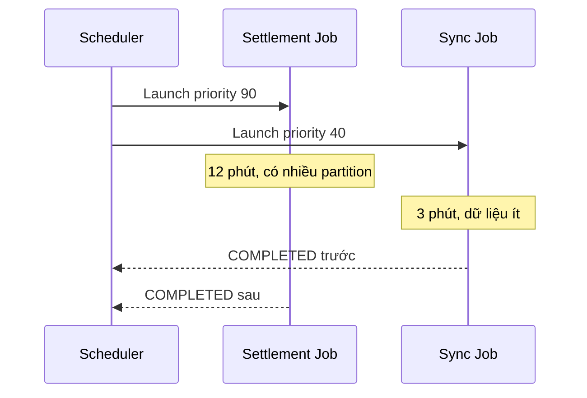
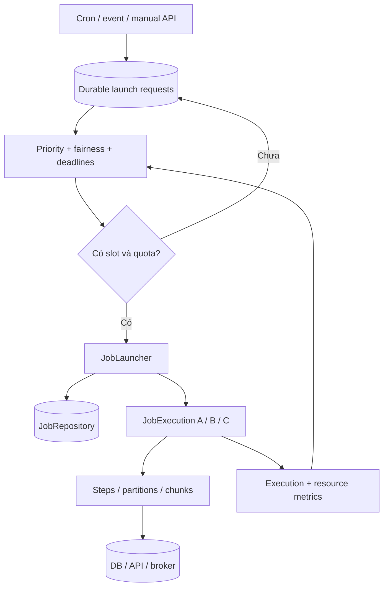
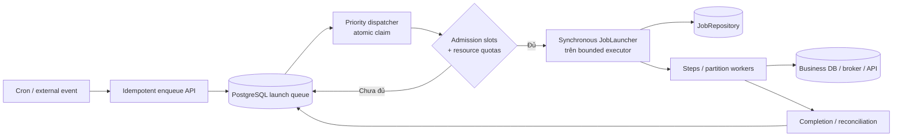
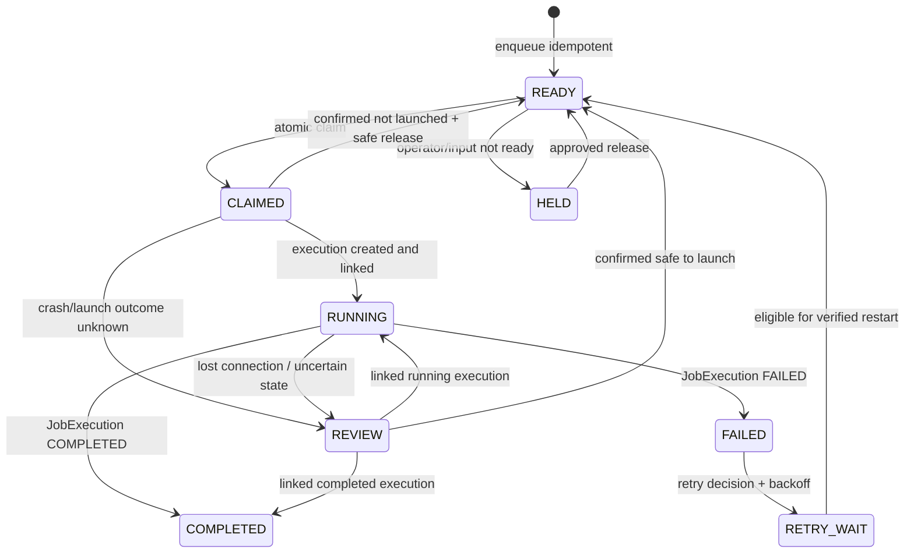
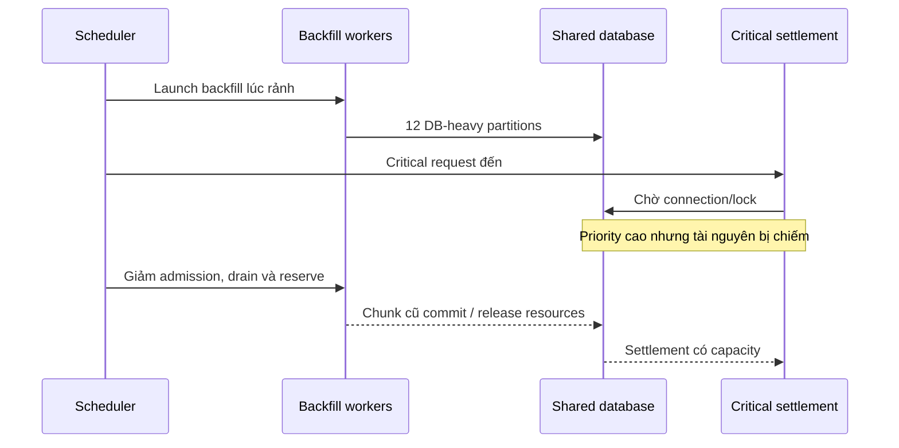
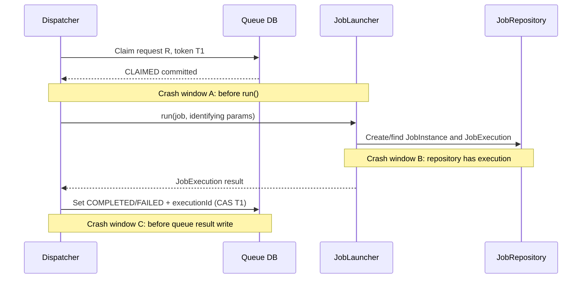

# Priority giữa nhiều Job

## 1. Bài toán: nhiều Job cùng muốn sử dụng một hệ thống hữu hạn

Trong chương **Scheduling** của module **SPRING_BATCH_SCALING_OPERATIONS**, chúng ta nghiên cứu cách mở rộng Spring Batch cho dữ liệu lớn bằng *multi-threaded step*, *parallel steps*, *partitioning* và các kiến trúc xử lý phân tán, đồng thời đo nút thắt, bảo đảm thread safety, retry/restart và chọn cách vận hành phù hợp tài nguyên thực tế.

Một hệ thống có thể có hàng chục `Job` khác nhau: tổng kết giao dịch trong ngày, phát hành báo cáo thanh toán, đồng bộ dữ liệu khách hàng, tính lại lịch sử và chạy backfill. Các Job này không có độ khẩn cấp giống nhau, nhưng thường cùng tranh **CPU, memory, database connections, I/O, broker slots và quota API**.

Giả sử lúc 01:00 có ba yêu cầu:

| Job | Nhu cầu nghiệp vụ | Thời gian dự kiến | Tài nguyên dùng chung |
| --- | --- | --- | --- |
| `settlementCloseJob` | Phải xong trước 02:00 để chốt sổ | 12 phút | DB write, API đối soát |
| `customerSyncJob` | Cần trước 08:00 | 25 phút | DB read, network |
| `historyBackfillJob` | Không có deadline trong đêm | 4 giờ | DB/CPU rất lớn |

Nếu scheduler chọn Job theo thứ tự nhận yêu cầu, `historyBackfillJob` có thể chiếm hết worker slots khiến chốt sổ phải đợi hàng giờ. Nếu đơn giản ưu tiên tuyệt đối `settlementCloseJob`, các backfill có thể bị bỏ đói mãi (*starvation*). Nếu khởi động cả ba không có giới hạn, database lại có thể quá tải và cả ba đều trễ.

**Priority giữa nhiều Job** là chính sách quyết định **Job nào được cấp tài nguyên để khởi chạy trước, bao nhiêu Job được chạy đồng thời, và phải bảo vệ tính đúng đắn của một Job đang thực thi ra sao khi mức ưu tiên thay đổi**.

> **Ý chính:** Spring Batch quản lý vòng đời và checkpoint của `JobExecution`; nó **không tự trở thành một scheduler toàn hệ thống có hàng đợi ưu tiên, fairness, quota và preemption** chỉ vì các Job được khai báo trong cùng ứng dụng. Chính sách admission/priority phải được thiết kế tại tầng scheduler/orchestrator hoặc một bộ điều phối có trạng thái bền vững.

### Mục tiêu học tập

Sau bài này, bạn có thể:

1. Phân biệt `Job`, `JobInstance`, `JobExecution`, lịch trigger và **yêu cầu khởi chạy (launch request)**.
2. Hiểu sự khác nhau giữa *priority để vào hàng đợi*, *priority khi dispatch*, *OS thread priority* và *tài nguyên khi Job đang chạy*.
3. Thiết kế chính sách ưu tiên theo SLA, deadline, mức rủi ro, tenant và nhu cầu tài nguyên.
4. Kết hợp ưu tiên với concurrency cap, fairness, aging, backpressure và quota theo resource pool.
5. Xây dựng **durable priority queue** với PostgreSQL, claim nguyên tử và chống hai scheduler cùng nhận một yêu cầu.
6. Liên kết request với `JobLauncher`, identifying `JobParameters` và `JobRepository` trong Spring Batch 5.x.
7. Xử lý crash giữa claim, launch, ghi nhận `JobExecutionId` và hoàn thành mà không tạo JobInstance trùng.
8. Hiểu vì sao đổi ưu tiên không tự dừng hoặc di chuyển Job đã chạy; preemption cần protocol an toàn.
9. Kiểm thử starvation, priority inversion, deadline miss, quota saturation và distributed failover.
10. Đo queue wait, scheduling lag, useful throughput, resource contention và độ trễ phục hồi.

## 2. Phân biệt các khái niệm trước khi thiết kế

| Khái niệm | Định nghĩa | Ví dụ | Điểm cần nhớ |
| --- | --- | --- | --- |
| **Job definition** | Đồ thị step + cấu hình Spring Batch | `settlementCloseJob` | Một định nghĩa có thể có nhiều instances |
| **JobInstance** | Công việc logic: tên Job + identifying `JobParameters` | Chốt sổ ngày 2026-11-26 | Không phải mỗi lần scheduler thử chạy |
| **JobExecution** | Một lần thực thi của JobInstance | Lần chạy đầu thất bại, lần restart thành công | Có execution ID/status riêng |
| **Launch request** | Ý định yêu cầu một JobInstance được chạy | “Đóng sổ ngày X, mức ưu tiên 90” | Cần durable ID/claim/status của scheduler |
| **Trigger** | Thời điểm hoặc sự kiện làm request đủ điều kiện | Cron 01:00, file input sẵn sàng | Không đồng nghĩa tài nguyên đã sẵn |
| **Admission** | Quyết định cấp một execution slot | Cho phép tối đa hai Job nặng | Có thể trì hoãn request ưu tiên thấp |
| **Dispatch** | Chọn Job đủ điều kiện để bắt đầu | Priority 90 trước priority 30 | Không quyết định thứ tự các step hoàn tất |
| **Preemption** | Thu hồi tài nguyên của Job đang chạy | Tạm dừng backfill để chốt sổ | Không phải thao tác miễn phí/an toàn tự động |
| **Backpressure** | Làm nguồn phát giảm khi không đủ capacity | Không launch backfill mới | Khác xóa message hoặc bỏ dữ liệu |

### 2.1. Job priority không phải Java thread priority

Gọi `Thread.setPriority(10)` không làm hệ thống có **scheduler SLA-aware**: JVM/OS có thể diễn giải thread priority khác nhau; database và network vẫn là tài nguyên chung. Một batch Job có thể chứa hàng chục step workers hoặc remote processes, nên “thread của Job” cũng không đại diện toàn bộ tài nguyên của Job.

### 2.2. Thứ tự launch khác thứ tự finish



Nếu yêu cầu “Job A **phải hoàn tất trước** Job B” là ràng buộc nghiệp vụ, hãy biểu diễn **dependency/flow gate**, không chỉ dùng điểm priority. Priority chủ yếu điều chỉnh **cơ hội được bắt đầu**, không ép thứ tự hoàn tất khi cả hai được chạy đồng thời.

### 2.3. Priority khác độ khẩn cấp dựa trên deadline

Job được gắn `priority=100` nhưng deadline còn bảy ngày có thể ít khẩn cấp hơn Job `priority=70` phải xong sau 15 phút. Cần tách:

- **Business class:** critical, standard, backfill.
- **Deadline:** thời điểm hoàn tất mục tiêu.
- **Work size / estimated remaining duration:** mức độ có thể đáp ứng deadline.
- **Resource demand:** CPU, DB connections, API quota, memory.
- **Waiting time:** hạn chế starvation.

Một policy có thể dùng priority class làm **ranh giới bắt buộc**, sau đó deadline/aging/fairness để chọn trong class; hoặc chấm điểm tổng hợp có cap. Không có một công thức duy nhất đúng cho mọi doanh nghiệp.

## 3. Các tầng scheduling trong kiến trúc Spring Batch



| Tầng | Câu hỏi nó trả lời | Không nên nhầm |
| --- | --- | --- |
| Cron / external trigger | Khi nào yêu cầu chạy được tạo? | Không quyết định ngay lập tức có slot |
| Durable request queue | Yêu cầu nào đang chờ? | Không phải `BATCH_JOB_EXECUTION` |
| Priority policy | Chọn request nào trước trong tập *eligible*? | Không thay vòng đời JobRepository |
| Admission/resource cap | Có đủ quota để khởi chạy? | Không tự đảm bảo các steps không vượt DB quota |
| JobLauncher/JobRepository | Tạo/restart JobExecution theo JobInstance | Không phải distributed priority scheduler mặc định |
| Step/partition workers | Chạy dữ liệu và checkpoint | `gridSize` không phải global Job priority |
| Completion/recovery | Job đã thực thi thế nào? | Một reply trễ không chứng minh Job vẫn chạy hoặc đã thất bại |

### 3.1. Cái gì có sẵn trong Spring Batch?

Spring Batch cung cấp `JobLauncher` để khởi chạy Job, `JobRepository` để lưu metadata, `JobExplorer` để đọc lịch sử/trạng thái, `JobOperator` cho thao tác vận hành và mô hình `JobInstance/JobExecution/StepExecution` cho restart. Spring Framework có `@Scheduled`; tích hợp bên ngoài có thể dùng Quartz hoặc scheduler/orchestrator khác.

**Nhưng:** `@Scheduled(cron=...)` chỉ quyết định **khi nào method được gọi**. Nó không tự tạo durable priority queue, không áp tenant fairness và không biết API quota của mọi worker trong cluster. Quartz có khái niệm trigger priority, nhưng việc chọn trigger/worker theo lịch **không tự bảo đảm** CPU/DB scheduling của những Job Spring Batch đã chạy.

### 3.2. Vì sao không gọi `JobLauncher.run(...)` trực tiếp trong mọi callback?

```java
@Scheduled(cron = "0 0 1 * * *")
void launchEverythingNow() {
    jobLauncher.run(settlementJob, params);
    jobLauncher.run(syncJob, params);
    jobLauncher.run(backfillJob, params);
}
```

Đây chỉ là **mã mô phỏng vấn đề**, chưa phải snippet cấu hình có đủ imports, xử lý exceptions và params. Với `JobLauncher` chạy đồng bộ, Job đầu có thể chặn hai Job sau. Với launcher bất đồng bộ, cả ba có thể cùng bắt đầu và tranh tài nguyên. Trong cả hai trường hợp, **thứ tự dòng code không tạo một scheduler priority + resource-aware**.

Thay vì tạo execution rồi để nó bị treo trong executor queue vô hạn, nên có **admission gate trước launch** và một nơi lưu yêu cầu bền vững.

## 4. Chọn chính sách ưu tiên có thể giải thích và đo được

Một chính sách có thể bắt đầu bằng ba nhóm:

| Class | Priority cơ bản | SLA | Chính sách |
| --- | ---: | --- | --- |
| Critical | 90 | Chốt sổ hoặc nghĩa vụ cần đúng hạn | Có reserved capacity, deadline alert |
| Standard | 50 | Dữ liệu định kỳ trong ngày | Được xử lý khi có quota và fairness |
| Backfill | 10 | Không khẩn cấp | Dùng spare capacity, không lấn critical |

Giá trị 90/50/10 chỉ là **ví dụ**. Lưu class, owner/tenant, lý do và deadline để operator hiểu vì sao một Job được chạy trước; không để client bất kỳ tự đặt `priority=999999` để vượt quota.

### 4.1. Các đầu vào policy

- **Eligibility:** `notBefore <= now`, input ready, dependencies đã hoàn thành, đúng business window.
- **Business importance:** settlement trước analytics/backfill.
- **Deadline/slack:** thời gian còn lại trừ estimated run time.
- **Age:** đã đợi bao lâu, tránh Job ưu tiên thấp không bao giờ có lượt.
- **Tenant/project quota:** một bên không chiếm hết worker slots.
- **Resource footprint:** Job DB-heavy không thể chia sẻ vô hạn với Job DB-heavy khác.
- **Retries/history:** Job thất bại liên tục không được tự ngồi đầu queue với retry tức thì.
- **Operational overrides:** hold/release/manual priority change có audit.

### 4.2. Priority không nên là một con số duy nhất không có ràng buộc

Hai Job cùng `priority=90` nhưng một cần 2 DB connections, một cần 40 connections: scheduler có thể **chạy Job nhỏ hợp lệ** trong khi Job lớn chờ tài nguyên. Đó là *backfilling* hay *resource-aware admission*, không nhất thiết vi phạm priority, **nếu policy được công bố trước**.

Ngược lại, nếu ưu tiên cao phải luôn được phục vụ trước trong cùng tài nguyên, bỏ qua Job nhỏ ưu tiên thấp dù đang có tài nguyên nhàn rỗi có thể là một đánh đổi có chủ đích.

## 5. Starvation, aging và fairness

**Starvation:** nhiều Job critical xuất hiện liên tục khiến backfill không bao giờ được dispatch. Một hàng đợi priority tuyệt đối `ORDER BY priority DESC` rất dễ gặp vấn đề này.

### 5.1. Aging: tăng dần điểm cho request đợi lâu

Ví dụ một heuristic:

\[
P_{\text{effective}}
=\min\left(P_{\max},\ P_{\text{base}}+
\min\left(B_{\text{age}},\left\lfloor\frac{t_{\text{wait}}}{\tau}\right\rfloor\right)\right).
\]

Ở đây:

- `P_base` là priority được cấp lúc tạo request.
- `t_wait` là thời gian chờ tính từ lúc request eligible.
- `τ` là chu kỳ tăng một điểm, ví dụ 5 phút.
- `B_age` giới hạn điểm được cộng, tránh một request cũ tăng vô hạn.
- `P_max` là trần điểm tổng.

Giả sử backfill có base 10, cứ 5 phút tăng một điểm và tối đa cộng 20: sau 100 phút nó đạt effective priority 30. Nếu critical luôn có priority 90, **aging bị cap kiểu này không bảo đảm backfill được chạy**; để chống starvation thực sự, cần **reserved low-priority share, fair queue hoặc explicit maximum wait policy**.

### 5.2. Fairness khác strict priority

| Chính sách | Ưu điểm | Rủi ro |
| --- | --- | --- |
| Strict priority | Critical gần như luôn nhận slot trước | Starvation của backfill |
| Priority + aging | Request lâu chờ được nâng điểm | Phải chọn cap và reset age đúng |
| Weighted fair scheduling | Mỗi class/tenant có tỷ trọng tài nguyên | Critical không luôn đi trước tuyệt đối |
| Reserved slots | Đảm bảo critical có capacity tối thiểu | Có thể lãng phí slot nếu không cho mượn |
| Earliest deadline first | Phù hợp khi duration estimate đáng tin | Job lớn có thể trễ; SLA không tự được bảo đảm |
| Hybrid priority + quota | Cân bằng deadline và fairness | Policy/giám sát phức tạp hơn |

### 5.3. Priority inversion

Một backfill được launch khi hệ thống rảnh, bắt đầu giữ gần hết DB connections. Sau đó settlement critical đến nhưng phải chờ DB pool, dù scheduler đã cấp “slot cao nhất” cho settlement. Đây là **priority inversion ở tài nguyên thực tế**, không phải lỗi sắp xếp queue.

Giải pháp có thể gồm:

- Quota riêng cho pool/operation quan trọng.
- Giới hạn chunk/write concurrency của backfill.
- Dedicated API/DB connection pools có sizing và fairness.
- Admission không cho bắt đầu Job nặng nếu làm mất headroom critical.
- Nếu cần preemption, dùng **controlled stop tại boundary**, không kill tùy tiện transaction.

## 6. Priority không thể thay capacity planning

Giả sử có 8 worker slots. Một Job dùng 8 partitions đang hoạt động, mỗi partition gọi API và ghi DB. Scheduler ưu tiên cao mới đến có thể chỉ còn **0 effective capacity**.

Phải phân biệt:

1. **Slot cho JobExecution:** Job được phép active.
2. **Slot cho worker StepExecution:** số partitions/chunks thực thi cùng lúc.
3. **HTTP in-flight limit:** calls đang đợi API.
4. **DB concurrency/connection budget:** active transactions và lock contention.
5. **Broker outstanding:** remote work chưa resolve.

Một Job priority cao dùng một slot nhưng có 100 remote partitions có thể tiêu thụ nhiều hơn mười Job nhỏ. Vì thế ngân sách phải tính theo **tài nguyên thực** chứ không chỉ số Job đang chạy.

### 6.1. Quota minh họa

```text
Cluster:
  maxActiveJobExecutions = 4
  DB-heavy worker slots  = 12
  CPU-heavy worker slots = 16
  riskAPI quota          = 200 req/s
  riskAPI inFlight       = 24

Reserved:
  settlement            = at least 2 DB-heavy worker slots
  standard              = at least 2 slots when eligible
  backfill              = opportunistic; cap 4 slots
```

Các con số phải được đo và tune. **Concurrent JobExecutions không tương đương concurrent StepExecutions**; còn HTTP RPS không tương đương in-flight. Nếu quản lý bằng nhiều JVM, local semaphore mỗi JVM chưa bảo đảm global quota.

### 6.2. Ưu tiên ở tầng admission có giới hạn của nó

Một controller có thể không launch backfill mới nhưng những backfill **đã chạy** vẫn tiếp tục. Priority không tự thay đổi `gridSize`, số threads của remote workers hay tốc độ HTTP calls. Muốn ưu tiên áp dụng lên công việc đang thực thi, cần **resource-aware runtime control**: per-job/tenant rate limit, adaptive concurrency, cooperative pause hoặc controlled stop/restart theo lifecycle.

## 7. Kiến trúc đề xuất: durable priority queue trước JobLauncher

Thay vì để mỗi Cron/API callback tự gọi `JobLauncher`, tạo một lớp **launch-request inbox** bền vững:



Các thành phần:

1. **Producer:** chỉ tạo yêu cầu khi điều kiện đầu vào sẵn sàng và ghi vào inbox theo một logical business key.
2. **Queue:** lưu priority, eligibility, tenant, snapshot, deadline, trạng thái và thông tin claim. Không dựa vào RAM của một instance.
3. **Dispatcher:** chọn request **đủ điều kiện** theo policy; nhiều instances dùng atomic claim để không nhận cùng row.
4. **Admission controller:** kiểm tra số Job active và quota tài nguyên trước khi launch.
5. **JobLauncher:** gọi Spring Batch bằng identifying parameters ổn định.
6. **JobRepository:** quản lý JobInstance/JobExecution/StepExecution; **không bị thay thế** bằng queue.
7. **Reconciler:** nối metadata batch với queue, giải quyết những tình huống outcome chưa rõ sau crash.
8. **Operations:** cho phép hold, reprioritize, quan sát latency/deadline và retry có kiểm soát.

### 7.1. Vì sao cần cả queue và JobRepository?

`JobRepository` biết execution đã được tạo và trạng thái nào, nhưng không tự cung cấp một **hàng đợi yêu cầu Job chưa được phép chạy**, weighted fair scheduler hoặc reservation theo tenant. Queue lưu *ý định* và quyền dispatch; JobRepository lưu *thực thi*.

Không cho scheduler “đặt JobExecution ở trạng thái `QUEUED`” bằng cách tự thêm trạng thái vào bảng `BATCH_JOB_EXECUTION` hoặc sửa `VERSION`. Đây là metadata có lifecycle riêng. Sử dụng bảng ứng dụng `batch_launch_request` để mô hình queue.

### 7.2. Vòng đời của launch request



`READY`, `CLAIMED`, `REVIEW` là các **trạng thái của queue ứng dụng**, không phải enum `BatchStatus` của Spring Batch. `RUNNING` có nghĩa queue đã liên kết được execution tương ứng; khi metadata chưa cập nhật do crash, cần `REVIEW`.

**Không đặt `claim_until < now` rồi auto chuyển mọi `CLAIMED/RUNNING` về `READY`**. Job có thể vẫn đang chạy trong JVM khác hoặc đã hoàn thành business effect nhưng queue chưa nhận kết quả. Claim hết hạn là tín hiệu **cần reconciliation**, không phải chứng minh có quyền chạy lại.

## 8. PostgreSQL schema cho durable launch requests

Ví dụ PostgreSQL 15+ (schema **của ứng dụng**, không phải `BATCH_*`):

```sql
CREATE TABLE batch_launch_request (
    request_id          UUID PRIMARY KEY,
    job_name            VARCHAR(120) NOT NULL,
    tenant_id           VARCHAR(80) NOT NULL,
    business_key        VARCHAR(160) NOT NULL,
    snapshot_version    VARCHAR(160) NOT NULL,
    input_fingerprint   CHAR(64) NOT NULL,

    priority            INTEGER NOT NULL
                        CHECK (priority BETWEEN 0 AND 100),
    requested_at        TIMESTAMPTZ NOT NULL DEFAULT CURRENT_TIMESTAMP,
    available_at        TIMESTAMPTZ NOT NULL DEFAULT CURRENT_TIMESTAMP,
    deadline_at         TIMESTAMPTZ,
    estimated_seconds   INTEGER
                        CHECK (estimated_seconds IS NULL
                               OR estimated_seconds > 0),

    state               VARCHAR(24) NOT NULL DEFAULT 'READY'
                        CHECK (state IN (
                            'READY', 'CLAIMED', 'RUNNING',
                            'COMPLETED', 'FAILED', 'RETRY_WAIT',
                            'HELD', 'REVIEW'
                        )),
    claim_owner         VARCHAR(120),
    claim_token         UUID,
    claim_until         TIMESTAMPTZ,
    last_execution_id   BIGINT,
    launch_attempts     INTEGER NOT NULL DEFAULT 0,
    updated_at          TIMESTAMPTZ NOT NULL DEFAULT CURRENT_TIMESTAMP,
    last_error_summary  TEXT,

    CONSTRAINT uq_launch_business_key
        UNIQUE (job_name, tenant_id,
                business_key, snapshot_version)
);

CREATE INDEX idx_launch_ready
    ON batch_launch_request(priority DESC, requested_at)
    WHERE state = 'READY';

CREATE INDEX idx_launch_claimed
    ON batch_launch_request(claim_until)
    WHERE state IN ('CLAIMED', 'RUNNING', 'REVIEW');
```

Các giá trị `estimated_seconds` và `deadline_at` là metadata điều phối, không thay đổi input snapshot hoặc JobInstance. `input_fingerprint` nhằm phát hiện hai yêu cầu cùng logical identity nhưng mang dữ liệu khác. Hạn chế `last_error_summary` chứa PII/secrets; lưu stack trace đầy đủ trong hệ thống log được phân quyền.

### 8.1. Chống enqueue trùng

```sql
INSERT INTO batch_launch_request (
    request_id, job_name, tenant_id,
    business_key, snapshot_version,
    input_fingerprint, priority,
    requested_at, available_at, deadline_at
) VALUES (
    :requestId, :jobName, :tenantId,
    :businessKey, :snapshotVersion,
    :inputFingerprint, :priority,
    CURRENT_TIMESTAMP, :availableAt, :deadlineAt
)
ON CONFLICT (
    job_name, tenant_id, business_key, snapshot_version
)
DO NOTHING;
```

Nếu `DO NOTHING` trả 0 rows affected, ứng dụng **phải đọc row đã tồn tại và kiểm tra `input_fingerprint`, job type/params và quyền request**. Cùng key nhưng nội dung khác phải được đánh dấu **conflict**, không trả “đã enqueue thành công” im lặng. Một logical request có thể đến hai lần do Cron overlap hoặc API retry; dedup ở queue bảo vệ việc tạo **nhiều dispatch requests cho cùng một công việc logic**.

**Nhưng:** dedup queue vẫn chưa thay thế unique business effect key tại `ItemWriter`. Nếu crash sau DB commit trước queue/completion update, Job có thể replay một phần công việc khi restart.

### 8.2. Có nên đặt priority vào identifying JobParameters?

Thường **không nên**: cùng báo cáo ngày X được nâng priority từ 50 lên 90 vẫn phải là cùng `JobInstance`. Nếu priority là identifying parameter, mỗi lần reprioritize có thể tạo JobInstance mới và replay input.

Những identifying parameters phải đại diện cho *đơn vị công việc logic*: tenant, business date/key, immutable snapshot/version, operation type khi cần. Những tham số scheduling như priority, queue wait và dispatcher ID nên **non-identifying** hoặc chỉ nằm trong queue metadata.

## 9. PostgreSQL atomic claim: nhiều scheduler không chọn cùng request

Trong một cluster có 2–3 scheduler instances, đoạn code `SELECT top request` rồi `UPDATE state` riêng biệt có thể gây race: cả hai scheduler đều đọc cùng request trước khi kịp cập nhật.

### 9.1. Dùng một statement có `FOR UPDATE SKIP LOCKED`

Ví dụ claim một request, có aging cap:

```sql
WITH selected AS (
    SELECT request_id
    FROM batch_launch_request
    WHERE state = 'READY'
      AND available_at <= CURRENT_TIMESTAMP
    ORDER BY
        LEAST(
            100,
            priority + LEAST(
                20,
                GREATEST(
                    0,
                    FLOOR(
                        EXTRACT(EPOCH FROM (
                            CURRENT_TIMESTAMP - requested_at
                        )) / 300
                    )::INTEGER
                )
            )
        ) DESC,
        deadline_at ASC NULLS LAST,
        requested_at ASC,
        request_id ASC
    FOR UPDATE SKIP LOCKED
    LIMIT 1
)
UPDATE batch_launch_request AS q
SET state = 'CLAIMED',
    claim_owner = :schedulerId,
    claim_token = :claimToken,
    claim_until = CURRENT_TIMESTAMP + INTERVAL '60 seconds',
    launch_attempts = launch_attempts + 1,
    updated_at = CURRENT_TIMESTAMP
FROM selected
WHERE q.request_id = selected.request_id
RETURNING
    q.request_id, q.job_name, q.tenant_id,
    q.business_key, q.snapshot_version,
    q.priority, q.claim_token, q.input_fingerprint;
```

`FOR UPDATE SKIP LOCKED` giúp các scheduler transactions cạnh tranh **bỏ qua row đang bị khóa**. Nó hữu ích cho queue workers nhưng có những giới hạn:

- **Không cam kết strict priority tuyệt đối trên mọi transaction:** một row ưu tiên cao đang bị khóa có thể bị bỏ qua để claim row ưu tiên thấp hơn.
- `ORDER BY` tính aging theo thời gian; index `(priority, requested_at)` không bảo đảm luôn loại bỏ sort; cần đo `EXPLAIN` và queue size.
- Claim transaction phải **ngắn**, commit trước khi gọi `JobLauncher.run(...)`; không giữ row lock suốt thời gian Job chạy.
- `claimToken` phải là giá trị duy nhất cho lần claim. Mọi completion/release update phải kiểm tra token, tránh dispatcher cũ ghi đè quyền mới.
- `claim_until` chỉ giới hạn quyền claim/recovery workflow, không tự xác định Job đã kết thúc hay owner cũ đã chết.

### 9.2. Thời gian bắt đầu eligible quan trọng với aging

Ở SQL trên, `requested_at` tính thời gian chờ kể từ lúc enqueue. Nếu request được enqueue trước nhưng `available_at` ở ngày mai, aging có thể khiến nó ngay khi eligible đã có điểm cộng rất lớn. Nếu policy yêu cầu aging **chỉ từ lúc eligible**, thêm `eligible_since` hoặc dùng `GREATEST(requested_at, available_at)` để tính tuổi. Đây là lựa chọn nghiệp vụ cần ghi vào policy.

### 9.3. Claim chưa phải launch thành công

Trình tự thực tế có ít nhất bốn ranh giới:

```text
T1: PostgreSQL claim committed
T2: JobLauncher.run invoked
T3: JobRepository created/identified JobExecution
T4: queue row linked to JobExecutionId and final state
```

Crash có thể xảy ra ở mọi khoảng. **Không có một transaction JDBC duy nhất tự bao trùm toàn bộ T1–T4 và toàn bộ thời gian Job chạy.** Một request trạng thái `CLAIMED` nhưng hết hạn phải được reconciler kiểm tra `JobRepository`/identifying params trước khi cho phép dispatch lại.

## 10. State transitions và fencing theo claim token

Giả sử scheduler A claim request với token `T1`, sau đó bị mất mạng. Scheduler B chỉ được phục hồi request sau một reconciliation hợp lệ và dùng token `T2`. Nếu A quay trở lại, nó **không được ghi kết quả của T1 đè lên T2**.

### 10.1. Cập nhật có điều kiện

```sql
-- Cập nhật kết quả sau khi một launch đã có
-- JobExecution terminal được xác minh.
UPDATE batch_launch_request
SET state = :newState,
    last_execution_id = :jobExecutionId,
    claim_owner = NULL,
    claim_token = NULL,
    claim_until = NULL,
    updated_at = CURRENT_TIMESTAMP
WHERE request_id = :requestId
  AND claim_token = :claimToken
  AND state IN ('CLAIMED', 'RUNNING');
```

Assert affected row count = 1. Nếu bằng 0, có thể request đã đổi owner/state; **không retry UPDATE không điều kiện** hoặc kết luận Job chưa hoàn thành. Reconciler phải đọc lại row và giải thích xung đột.

### 10.2. Khi claim expires

Không sử dụng query kiểu:

```sql
-- SAI nếu dùng tự động mà không đối soát:
UPDATE batch_launch_request
SET state = 'READY'
WHERE claim_until < CURRENT_TIMESTAMP;
```

Nó có thể đưa một Job **đang xử lý remote partitions** trở lại queue và tạo một execution cạnh tranh. Thay vào đó:

1. Chuyển/đánh dấu `REVIEW` có claim generation/audit.
2. Tra `JobExplorer`/`JobRepository` theo đúng job name + identifying params, bao gồm JobExecution đang `STARTED`, `STOPPING` hoặc `UNKNOWN`.
3. Kiểm tra liveness/lease của worker và broker pending replies nếu xử lý remote.
4. Nếu execution đã `COMPLETED`, hoàn tất queue row; không relaunch.
5. Nếu `FAILED`/`STOPPED`, áp restart policy và deadline.
6. Nếu **không tìm thấy execution**, vẫn phải đánh giá cửa sổ crash trong launch. Chỉ release claim khi xác nhận an toàn, có protocol owner token/generation.
7. Nếu không thể kết luận, giữ `REVIEW` và alert, đừng chọn “retry mù”.

### 10.3. Queue token không thay thế business fencing

CAS theo `claim_token` bảo vệ **metadata hàng đợi**, không tự ngăn một worker cũ ghi vào DB hoặc HTTP API. Với remote failover, cần worker ownership/fencing tại ranh giới side effect (hoặc idempotency key và giao thức chống concurrent non-idempotent operations).

## 11. Java 17 + Spring Batch 5.x: dispatcher với bounded execution slots

Mục này xây dựng một mẫu **scheduler service tối giản**, có các giới hạn được công khai để không bị nhầm thành distributed scheduler production hoàn chỉnh:

- Một JVM có tối đa bốn `JobExecution` được chạy đồng thời bởi executor riêng.
- Queue claim được thực hiện atomically bằng SQL như mục 9.
- `JobLauncher` chạy **đồng bộ** trong từng executor worker để permit được giữ đến khi Job kết thúc.
- Identifying `JobParameters` ổn định; priority là **non-identifying**.
- Nếu launch outcome không rõ, chuyển sang **REVIEW**, không tự tạo JobInstance mới.
- Global resource quota/fairness/cluster admission cần một lớp điều phối bổ sung ở mục 13–14.

### 11.1. Contract request

```java
import java.util.UUID;

public record LaunchRequest(
    UUID requestId,
    String jobName,
    String tenantId,
    String businessKey,
    String snapshotVersion,
    int priority,
    UUID claimToken
) {}
```

`requestId` là identity của **request queue**. Nó không nhất thiết phải là identifying JobParameter, vì nghiệp vụ có thể gửi lại một yêu cầu cùng business key nhưng producer mang request ID khác; dedup queue phải gom đúng logical work.

### 11.2. Interface truy cập queue

```java
import java.util.Optional;
import java.util.UUID;
import org.springframework.batch.core.BatchStatus;

public interface PriorityLaunchStore {
    Optional<LaunchRequest> claimNext(
        String schedulerId, UUID claimToken);

    // Chỉ release nếu chưa có JobExecution nào được tạo
    // và claim token vẫn thuộc owner hiện tại.
    void releaseUnstartedClaim(LaunchRequest request);

    // Called after a synchronous JobLauncher returned.
    void recordTerminalExecution(
        LaunchRequest request,
        long jobExecutionId,
        BatchStatus batchStatus);

    // Không automatically retry khi không rõ có launch hay chưa.
    void markForReconciliation(
        LaunchRequest request, String explanation);
}
```

Trong implementation thực, mọi transition cần `WHERE request_id=? AND claim_token=?`, assert affected-row count, lưu audit và retry *database transaction* có giới hạn khi deadlock. Không bao `JobLauncher.run()` trong transaction giữ row lock của queue.

### 11.3. Synchronous JobLauncher có cấu hình tường minh

Ví dụ Spring Batch 5.x:

```java
import org.springframework.batch.core.launch.JobLauncher;
import org.springframework.batch.core.launch.support.TaskExecutorJobLauncher;
import org.springframework.batch.core.repository.JobRepository;
import org.springframework.context.annotation.Bean;
import org.springframework.core.task.SyncTaskExecutor;

@Bean("priorityJobLauncher")
JobLauncher priorityJobLauncher(JobRepository repository)
        throws Exception {
    TaskExecutorJobLauncher launcher = new TaskExecutorJobLauncher();
    launcher.setJobRepository(repository);
    launcher.setTaskExecutor(new SyncTaskExecutor());
    launcher.afterPropertiesSet();
    return launcher;
}
```

**Vì sao quan trọng?** `JobLauncher.run(...)` có thể thực hiện đồng bộ hoặc trả về sớm theo cấu hình `TaskExecutor`. Nếu dùng launcher bất đồng bộ nhưng trả permit ngay sau `run()`, một scheduler nghĩ “Job đã xong” trong khi nó vẫn chạy, khiến active executions vượt giới hạn. Mẫu dùng `SyncTaskExecutor` để `run()` chỉ trở về sau khi job flow hoàn tất trong thread executor của **dispatcher**.

### 11.4. Bounded executor và semaphore

```java
import java.util.concurrent.ExecutorService;
import java.util.concurrent.Executors;
import java.util.concurrent.Semaphore;

import org.springframework.context.annotation.Bean;

@Bean(destroyMethod = "shutdown")
ExecutorService launchWorkerExecutor() {
    return Executors.newFixedThreadPool(4);
}

@Bean
Semaphore activeLaunchSlots() {
    return new Semaphore(4);
}
```

Fixed thread pool ở trên có **unbounded internal queue** của executor, nhưng dispatcher sắp được viết chỉ submit sau khi đã giữ một trong bốn semaphore slots. Vì vậy số tasks mà **dispatcher này** tạo đang running + queued không thể vượt bốn. Đây không phải bảo vệ nếu **một caller khác** submit trực tiếp vào executor, và `Semaphore(4)` chỉ local cho JVM.

Nếu cần hard reject ở executor, dùng `ThreadPoolExecutor` với bounded queue/`AbortPolicy`, xử lý `RejectedExecutionException` và khôi phục claim bằng CAS; không để request bị rơi hoặc bị claim mãi.

### 11.5. Whitelist Job và parameters

```java
import java.util.Map;
import org.springframework.batch.core.Job;
import org.springframework.batch.core.JobParameters;
import org.springframework.batch.core.JobParametersBuilder;

final class PriorityJobCatalog {
    private final Map<String, Job> allowedJobs;

    PriorityJobCatalog(Map<String, Job> allowedJobs) {
        this.allowedJobs = Map.copyOf(allowedJobs);
    }

    Job resolve(String jobName) {
        Job job = allowedJobs.get(jobName);
        if (job == null) {
            throw new IllegalArgumentException(
                "Job is not allowed: " + jobName);
        }
        return job;
    }

    JobParameters parameters(LaunchRequest request) {
        return new JobParametersBuilder()
            .addString("tenantId", request.tenantId(), true)
            .addString("businessKey", request.businessKey(), true)
            .addString(
                "snapshotVersion", request.snapshotVersion(), true)
            .addString(
                "requestId", request.requestId().toString(), false)
            .addLong(
                "launchPriority", (long) request.priority(), false)
            .toJobParameters();
    }
}
```

Ở đây `tenantId`, `businessKey` và `snapshotVersion` là **identifying**; `requestId` và `launchPriority` là **non-identifying**. Nếu cùng Job cần tham số định danh khác (business date, report type, operation version...), thêm theo đúng business contract. **Không thêm random `run.id` hoặc timestamp identifying chỉ để bypass “already running”**.

`Map<String, Job>` trong ví dụ được cấu hình từ các Job beans đã được phép chạy; không nhận class name tùy ý từ request, không reflection/load arbitrary user-supplied Job.

### 11.6. Dispatcher giữ slot đến khi Job kết thúc

```java
import java.util.Optional;
import java.util.UUID;
import java.util.concurrent.ExecutorService;
import java.util.concurrent.RejectedExecutionException;
import java.util.concurrent.Semaphore;

import org.springframework.batch.core.Job;
import org.springframework.batch.core.JobExecution;
import org.springframework.batch.core.launch.JobLauncher;
import org.springframework.beans.factory.annotation.Qualifier;
import org.springframework.scheduling.annotation.Scheduled;
import org.springframework.stereotype.Component;

@Component
public final class PriorityJobDispatcher {
    private final String schedulerId = UUID.randomUUID().toString();
    private final PriorityLaunchStore store;
    private final PriorityJobCatalog jobs;
    private final JobLauncher launcher;
    private final ExecutorService workers;
    private final Semaphore slots;

    public PriorityJobDispatcher(
            PriorityLaunchStore store,
            PriorityJobCatalog jobs,
            @Qualifier("priorityJobLauncher") JobLauncher launcher,
            ExecutorService launchWorkerExecutor,
            Semaphore activeLaunchSlots) {
        this.store = store;
        this.jobs = jobs;
        this.launcher = launcher;
        this.workers = launchWorkerExecutor;
        this.slots = activeLaunchSlots;
    }

    @Scheduled(fixedDelay = 1000)
    public void poll() {
        // Mỗi lần tick tối đa 4 request. Không chặn scheduler
        // thread để đợi slot khi toàn bộ Job đang chạy.
        for (int i = 0; i < 4; i++) {
            if (!slots.tryAcquire()) {
                return;
            }

            Optional<LaunchRequest> selected;
            try {
                selected = store.claimNext(
                    schedulerId, UUID.randomUUID());
            } catch (RuntimeException databaseFailure) {
                slots.release();
                throw databaseFailure;
            }
            if (selected.isEmpty()) {
                slots.release();
                return;
            }

            LaunchRequest request = selected.get();
            try {
                workers.execute(() -> {
                    try {
                        executeRequest(request);
                    } finally {
                        slots.release();
                    }
                });
            } catch (RejectedExecutionException rejected) {
                // Chỉ release claim nếu chưa khởi chạy.
                try {
                    store.releaseUnstartedClaim(request);
                } finally {
                    slots.release();
                }
                throw rejected;
            }
        }
    }

    private void executeRequest(LaunchRequest request) {
        try {
            Job job = jobs.resolve(request.jobName());
            JobExecution execution = launcher.run(
                job, jobs.parameters(request));

            // Synchronous launcher đã hoàn tất job.
            store.recordTerminalExecution(
                request, execution.getId(), execution.getStatus());
        } catch (Exception launchOrMetadataFailure) {
            // Outcome có thể chưa rõ (đặc biệt nếu DB/network lỗi
            // trong khoảng tạo execution). Không auto-requeue mù.
            store.markForReconciliation(
                request,
                launchOrMetadataFailure.getClass().getSimpleName());
        }
    }
}
```

**Phải bật `@EnableScheduling`** trong Spring configuration để `@Scheduled` chạy. `PriorityJobCatalog` và `PriorityLaunchStore` cũng cần beans/implementation được đăng ký. Đoạn code mô tả orchestration ở cấp ứng dụng, chưa bao gồm global admission, structured logging, retry của queue writes, leader failover hoặc shutdown drain.

Những giới hạn thực tế cần hiểu:

- Khi `store.recordTerminalExecution` bị lỗi, Job có thể đã **COMPLETED** nhưng queue vẫn `CLAIMED/REVIEW`. Reconciler phải tra metadata thật; đừng launch lần nữa.
- Khi `launcher.run` ném `JobExecutionAlreadyRunningException` hoặc `JobInstanceAlreadyCompleteException`, đó **không** có nghĩa cứ đổi `run.id` rồi chạy lại; cần xác minh JobInstance.
- Nếu `launchWorkerExecutor` bị stop, `RejectedExecutionException` trước submit phải **release claim có CAS** hoặc đưa row vào REVIEW. Nếu `releaseUnstartedClaim` lỗi, người vận hành cần thấy claim mồ côi và reconciler.
- Controller giữ semaphore trong suốt `launcher.run` **chỉ nhờ launcher đồng bộ**. Nếu team thay thành async launcher, phải đổi logic tracking theo `JobExecution` lifecycle, không release slot ngay.
- `BatchStatus.FAILED/STOPPED/UNKNOWN` không được tự động map thành `READY`. Store nên lưu trạng thái terminal và policy retry riêng, hoặc REVIEW nếu outcome còn mơ hồ.
- Một poller instance không tự bảo đảm Job concurrency của **cả cluster**; nếu chạy ba instances, mỗi instance có bốn slots, có thể có đến 12 Jobs được nhận nếu không có global capacity guard.

### 11.7. Vì sao không gọi dispatcher đồng bộ trên scheduler thread?

Nếu `@Scheduled` thread gọi thẳng `JobLauncher.run(...)` đồng bộ cho một Job chạy bốn giờ, những lần polling khác có thể bị trì hoãn. Mẫu ở trên dùng executor riêng để **scheduler tick ngắn** và semaphore giới hạn số Job active. Cũng không nên tạo một thread Java mới không giới hạn cho mỗi trigger.

## 12. Implementation store: claim, release, completion đều cần CAS

Để nối ví dụ Java với PostgreSQL, store có thể dùng `NamedParameterJdbcTemplate`. Chỉ cần một statement `UPDATE ... FROM selected ... RETURNING` như mục 9 để claim; tiếp theo map row kết quả thành `LaunchRequest`.

### 12.1. Claim sample trong Spring JDBC

```java
import java.util.List;
import java.util.Map;
import java.util.Optional;
import java.util.UUID;

import org.springframework.batch.core.BatchStatus;
import org.springframework.jdbc.core.namedparam.MapSqlParameterSource;
import org.springframework.jdbc.core.namedparam.NamedParameterJdbcTemplate;

final class JdbcPriorityLaunchStore implements PriorityLaunchStore {
    private final NamedParameterJdbcTemplate jdbc;

    JdbcPriorityLaunchStore(NamedParameterJdbcTemplate jdbc) {
        this.jdbc = jdbc;
    }

    @Override
    public Optional<LaunchRequest> claimNext(
            String schedulerId, UUID token) {

        String sql = """
            WITH selected AS (
                SELECT request_id
                FROM batch_launch_request
                WHERE state = 'READY'
                  AND available_at <= CURRENT_TIMESTAMP
                ORDER BY priority DESC,
                         deadline_at ASC NULLS LAST,
                         requested_at ASC,
                         request_id ASC
                FOR UPDATE SKIP LOCKED
                LIMIT 1
            )
            UPDATE batch_launch_request q
            SET state = 'CLAIMED',
                claim_owner = :schedulerId,
                claim_token = :token,
                claim_until = CURRENT_TIMESTAMP
                              + INTERVAL '60 seconds',
                launch_attempts = launch_attempts + 1,
                updated_at = CURRENT_TIMESTAMP
            FROM selected
            WHERE q.request_id = selected.request_id
            RETURNING q.request_id, q.job_name, q.tenant_id,
                q.business_key, q.snapshot_version,
                q.priority, q.claim_token
            """;
        var params = new MapSqlParameterSource()
            .addValue("schedulerId", schedulerId)
            .addValue("token", token);

        List<LaunchRequest> claims = jdbc.query(sql, params,
            (rs, rowNum) -> new LaunchRequest(
                rs.getObject("request_id", UUID.class),
                rs.getString("job_name"),
                rs.getString("tenant_id"),
                rs.getString("business_key"),
                rs.getString("snapshot_version"),
                rs.getInt("priority"),
                rs.getObject("claim_token", UUID.class)));

        return claims.stream().findFirst();
    }

    private MapSqlParameterSource ownerParams(LaunchRequest request) {
        return new MapSqlParameterSource()
            .addValue("requestId", request.requestId())
            .addValue("token", request.claimToken());
    }

    @Override
    public void releaseUnstartedClaim(LaunchRequest request) {
        int affected = jdbc.update("""
            UPDATE batch_launch_request
            SET state = 'READY',
                claim_owner = NULL,
                claim_token = NULL,
                claim_until = NULL,
                updated_at = CURRENT_TIMESTAMP
            WHERE request_id = :requestId
              AND claim_token = :token
              AND state = 'CLAIMED'
            """, ownerParams(request));
        if (affected != 1) {
            throw new IllegalStateException(
                "Claim changed; cannot release safely");
        }
    }

    @Override
    public void recordTerminalExecution(
            LaunchRequest request,
            long jobExecutionId,
            BatchStatus status) {

        String queueState = switch (status) {
            case COMPLETED -> "COMPLETED";
            case FAILED, STOPPED, ABANDONED -> "FAILED";
            default -> "REVIEW";
        };

        var params = ownerParams(request)
            .addValue("state", queueState)
            .addValue("jobExecutionId", jobExecutionId);
        int affected = jdbc.update("""
            UPDATE batch_launch_request
            SET state = :state,
                last_execution_id = :jobExecutionId,
                claim_owner = NULL,
                claim_token = NULL,
                claim_until = NULL,
                updated_at = CURRENT_TIMESTAMP
            WHERE request_id = :requestId
              AND claim_token = :token
              AND state IN ('CLAIMED', 'RUNNING')
            """, params);
        if (affected != 1) {
            throw new IllegalStateException(
                "Claim changed; requires JobRepository reconciliation");
        }
    }

    @Override
    public void markForReconciliation(
            LaunchRequest request, String explanation) {
        var params = ownerParams(request)
            .addValue("summary", explanation);
        int affected = jdbc.update("""
            UPDATE batch_launch_request
            SET state = 'REVIEW',
                last_error_summary = :summary,
                updated_at = CURRENT_TIMESTAMP
            WHERE request_id = :requestId
              AND claim_token = :token
              AND state IN ('CLAIMED', 'RUNNING')
            """, params);
        if (affected != 1) {
            throw new IllegalStateException(
                "Claim changed before reconciliation mark");
        }
    }
}
```

Lớp này minh họa **claim và những CAS transitions chính** của interface. Nó chưa phải một implementation production hoàn chỉnh vì chưa có **reconciler, audit trail, transaction retry policy, global quota, polling metrics, Spring `@Bean` wiring, permission checks và startup recovery**. Với `STOPPED`, mẫu map queue thành `FAILED` để policy riêng quyết định restart; đây là **queue state**, không thay đổi `BatchStatus.STOPPED` trong repository. Cần áp business quality gate trước khi coi queue `COMPLETED` là đủ điều kiện publish.

**Khác biệt có chủ đích:** Query claim này dùng **strict base priority** đơn giản để dễ đọc; mục 9 có SQL aging đầy đủ. Chọn **một policy duy nhất** cho production, không để một scheduler dùng aging còn scheduler khác dùng base priority.

### 12.2. Release claim an toàn

```sql
UPDATE batch_launch_request
SET state = 'READY',
    claim_owner = NULL,
    claim_token = NULL,
    claim_until = NULL,
    updated_at = CURRENT_TIMESTAMP
WHERE request_id = :requestId
  AND state = 'CLAIMED'
  AND claim_token = :claimToken;
```

Chỉ gọi khi **chắc chắn `JobLauncher.run` chưa được gọi** (ví dụ executor reject trước submit). Nếu job đã bắt đầu, release về READY có thể gây duplicate dispatch. Kiểm tra affected row count và có audit.

### 12.3. Hoàn tất queue theo trạng thái của JobExecution

```sql
UPDATE batch_launch_request
SET state = :terminalQueueState,
    last_execution_id = :jobExecutionId,
    claim_owner = NULL,
    claim_token = NULL,
    claim_until = NULL,
    updated_at = CURRENT_TIMESTAMP
WHERE request_id = :requestId
  AND state = 'CLAIMED'
  AND claim_token = :claimToken;
```

`terminalQueueState` có thể là `COMPLETED` hoặc `FAILED` sau khi mapping rõ `BatchStatus`. `BatchStatus.COMPLETED` tương ứng Job đã hoàn tất ở tầng Batch; **business quality gate có thể vẫn chưa cho publish**, nên không dùng trạng thái queue này để ngầm bypass reconciliation. `BatchStatus.UNKNOWN` hay metadata bất nhất phải xử lý `REVIEW`.

### 12.4. Quan hệ queue/repository không thể xem là một transaction dài

Khi `JobLauncher` sử dụng `JobRepository` JDBC và queue dùng cùng DB, **không nên giữ một transaction queue mở trong toàn thời gian job**. Job có nhiều step/chunk transactions và có thể chạy hàng giờ; giữ row lock vài giờ là gây bottleneck. Thay vào đó dùng:

- Transaction ngắn cho claim.
- JobRepository transactions theo framework.
- Token-scoped terminal update sau khi Job kết thúc.
- Reconciler để lấp khoảng trống giữa hai trạng thái.

## 13. Multi-resource admission: chọn Job theo tài nguyên thật

Một scheduler chỉ giới hạn bốn Job đồng thời sẽ không bảo đảm database an toàn nếu một Job dùng 32 remote partitions, còn một Job chỉ dùng 1 step. Nên phân loại **resource pools** và mức tiêu thụ dự kiến/giới hạn:

```text
Capacity pool:
    total active jobs        = 4
    DB-heavy worker permits  = 12
    API in-flight permits    = 24
    CPU stage worker permits = 16

Requested resources:
  settlementCloseJob:    job=1, DB=4, API=2, CPU=2
  customerSyncJob:       job=1, DB=2, API=6, CPU=2
  historyBackfillJob:    job=1, DB=8, API=0, CPU=8
```

Nếu settlement và backfill cùng hoạt động, DB budget đã tiêu thụ tối đa 12 permits; một `customerSyncJob` khác cần 2 DB permits không nên được launch ngay nếu quota là hard cap. Đó là **resource-aware admission**, không phụ thuộc duy nhất vào `priority DESC`.

### 13.1. Soft estimate và hard bound

| Giá trị | Vai trò | Bảo đảm? |
| --- | --- | --- |
| `estimatedSeconds` | Dự báo deadline/slack | Không bảo đảm thời gian thật |
| `estimatedDbConnections` | Giúp chọn Job vừa quota | Nếu không có gate trong workers, chỉ là dự báo |
| `maxActivePartitions` | Trần hoạt động của Job | Cần enforcement tại `PartitionHandler`/worker pool |
| `globalHttpRate` | Quota toàn cluster | Phải có rate limiter chung |
| `activeJobSlots` | Số Job đang chạy | Không đo trực tiếp CPU/DB load |
| `reservedCriticalSlots` | Bảo lưu capacity | Cần policy borrowing/preemption rõ |

**Không tự coi estimated resource units như quota cứng.** Nếu `historyBackfillJob` khai báo DB=8 nhưng thực tế worker tự tạo 40 connections, scheduler vẫn có thể làm DB cạn. Enforcement phải đặt ở thread/partition pools, JDBC pool, API gateway hoặc distributed permit store.

### 13.2. Job priority có thể kết hợp multi-dimensional fit

Ví dụ sắp hàng:

1. Lấy các requests `READY`, đủ thời điểm, dependency và input snapshot.
2. Tính priority hiệu lực, aging và deadline risk.
3. Kiểm tra tenant/class quota, active reservations và **từng loại tài nguyên**.
4. Nếu candidate đầu không “fit”, có thể scan một số candidate khác mà vẫn giữ fairness: đừng bỏ qua Job lớn hàng nghìn lần mà không ghi nhận.
5. Claim/admit với một transaction/lease reservation có nghĩa, rồi launch.
6. Khi hoàn tất hoặc cancel an toàn, release reservations có CAS/token.

**Tranh chấp quan trọng:** Nếu scheduler A kiểm tra “còn 4 DB permits” cùng lúc scheduler B cũng thấy “còn 4” rồi cả hai cùng launch Job cần 4 permits, hệ thống đã **overbook**. Quota/reservation phải cập nhật nguyên tử tại nơi nhiều schedulers chia sẻ; local semaphore không đủ.

### 13.3. Reservation record là nguồn sự thật riêng

Một bảng `resource_reservation` có thể lưu:

```text
reservationId
launchRequestId
resourcePool ("DB_HEAVY", "HTTP_RISK", ...)
amount
ownerToken / epoch
leaseUntil
state (RESERVED, ACTIVE, RELEASED, REVIEW)
```

Khi controller cho phép borrowing hoặc điều chỉnh quota, reservation cần có **generation và audit**. Nếu owner chết, chỉ reclaim sau khi xác minh resource work cũ không tiếp tục dùng permit trái hợp đồng. Với process external, lease expiry chưa chứng minh worker đã dừng; muốn hard protection có thể cần fencing tại sink.

## 14. Ưu tiên có áp dụng cho Job đã chạy không?

Giả sử backfill priority 10 đã chạy được 50% và đang sử dụng 8 DB-heavy worker permits. Một settlement priority 90 vừa đến. Có ba lựa chọn chiến lược:

### 14.1. Non-preemptive scheduling

**Không dừng backfill đang chạy.** Chỉ ngừng khởi chạy các backfill mới, đợi slot/tài nguyên được giải phóng. Đây là lựa chọn **đơn giản và an toàn restart nhất**, phù hợp nếu Job duration ngắn hoặc có reserved headroom.

Đánh đổi: settlement có thể chờ một partition rất dài nếu backfill đã chiếm hết tài nguyên. Cần capacity planning và alert theo SLA.

### 14.2. Cooperative throttling

Để backfill tiếp tục nhưng giảm **HTTP permits, DB writer concurrency hoặc số partitions được admission mới**, nhường headroom cho settlement.

Ví dụ:

```text
Before settlement request:
    backfill DB active cap = 8
    settlement DB cap      = 0

After settlement becomes eligible:
    backfill admission cap = 4 (drain, không kill chunk)
    settlement reserved    = 4
```

Điều này chỉ hoạt động nếu workers/manager thật sự hỗ trợ dynamic admission. Thay `gridSize` của một JobInstance đang chạy **không phải** cách có sẵn để “di chuyển” partitions hoặc giảm concurrency an toàn; cần limiter/partition dispatch control phù hợp architecture.

### 14.3. Controlled stop và restart

Trong tình huống buộc phải thu hồi tài nguyên nhanh, operator có thể yêu cầu stop một execution (chẳng hạn qua `JobOperator.stop(jobExecutionId)`) **nếu policy và version hỗ trợ**. Khi đó:

- Đây thường là **stop hợp tác**, không tức thời. Một chunk đang block HTTP hoặc worker remote bị mất mạng có thể chưa phản hồi.
- Chỉ khi execution/worker state đã rõ, mới cho scheduler nhường slot.
- Khi restart, dùng **cùng JobInstance** và identifying params, kiểm tra checkpoint/input snapshot.
- Đảm bảo reader/writer có `ItemStream`/idempotency phù hợp.
- Không đánh dấu `BATCH_JOB_EXECUTION`/`BATCH_STEP_EXECUTION` là `STOPPED` bằng SQL tùy tiện để giải phóng slot trên dashboard.
- Nếu đã publish side effect ngoài DB, cần idempotency/outbox trước khi replay.

### 14.4. Hard preemption là giải pháp rủi ro cao

Kill JVM/Kubernetes pod không cam kết:

- Chunk transaction đã rollback hết chưa?
- Remote worker đã ngừng ghi business DB chưa?
- Message đã ACK hay chưa?
- `JobRepository` có còn `STARTED` sau mất process không?
- Output file đã được publish/đóng đúng cách chưa?

Nếu không có fencing và recovery protocol đã kiểm chứng, **không coi kill process là phương thức scheduling ưu tiên mặc định**.

### 14.5. Priority inversion khi có Step/partition parallelism



Sơ đồ chỉ minh họa điều phối tài nguyên. Trong triển khai thật, việc giảm `backfill admission` phải được thực thi tại worker/manager/gateway; scheduler queue không tự kiểm soát các JDBC connections đã được cấp.

## 15. Dependency scheduling: priority không thay thứ tự nghiệp vụ

Một pipeline có thể có các Job:

```text
ingestPaymentsJob
       |
       v
validatePaymentsJob
       |
       v
settlementCloseJob
       |
       v
publishSettlementJob
```

Nếu `publishSettlementJob` priority 100 nhưng `settlementCloseJob` chưa COMPLETED, **không được launch publish**. Priority chỉ dùng trong tập yêu cầu **eligible** đã thỏa dependency.

### 15.1. Dùng dependency gate bền vững

Một yêu cầu chỉ eligible khi:

1. Dữ liệu input snapshot/manifest đã sealed và xác minh.
2. Các JobInstances upstream đúng business date/version đã đạt trạng thái yêu cầu.
3. Business quality gates đạt, không chỉ dựa vào Job status nếu có skip/quarantine.
4. Không còn một execution cùng logical identity đang active.
5. Không bị operator hold, cancellation hoặc compliance restriction.

Nếu chỉ quan sát một flag `upstreamJobCompleted=true` trong RAM, scheduler crash có thể làm mất dependency state. Nên lưu event/manifest state bền vững và có reconciler.

### 15.2. Dependency có thể khác cùng một Job flow

Với một pipeline đơn giản, nhiều bước có ranh giới restart giống nhau có thể ghép thành **một Spring Batch Job** có các `Step` tuần tự, `split` hoặc conditional transitions.

Tách thành **nhiều Job** khi có lý do: cadence khác, ownership, SLA, dữ liệu trung gian sealed, có thể rerun riêng, hoặc scale resource pools khác. Khi tách, cần **durable dependency orchestration**.

### 15.3. Kết hợp deadline với critical path

Một Job priority 90 có deadline 02:00 nhưng phụ thuộc một Job khác dự kiến còn 45 phút, hiện là 01:30. Chỉ tăng priority cho Job cuối **không thể làm dependency hoàn thành ngay**. Scheduler cần ước lượng **critical path**, phát cảnh báo sớm và ưu tiên cả các upstream jobs/capacity đúng dependency chain.

Không tự chuyển `deadline_at` thành một hứa hẹn chắc chắn: estimate có sai số lớn khi partition skew, I/O, backpressure và downstream outage.

## 16. Nhiều loại lịch trigger: Cron, event và manual

| Trigger | Cách tạo request | Rủi ro |
| --- | --- | --- |
| Cron cố định | 01:00 mỗi ngày | Overlap khi kỳ trước chạy lâu |
| File/object arrival | Khi manifest input hoàn tất | Partial upload/repeated event |
| API/manual | Người vận hành yêu cầu chạy | Nhấn nút nhiều lần hoặc quyền ưu tiên |
| Upstream completion | Job A hoàn tất và quality gate đạt | Duplicate completion events |
| Scheduler recovery | Reconcile những request chưa chắc kết quả | Retry sai cùng JobInstance |

### 16.1. Cron chỉ là nguồn phát ý định

Ví dụ với Spring scheduling:

```java
import java.time.LocalDate;
import org.springframework.scheduling.annotation.Scheduled;
import org.springframework.stereotype.Component;

@Component
final class SettlementRequestProducer {
    private final LaunchRequestService requests;

    SettlementRequestProducer(LaunchRequestService requests) {
        this.requests = requests;
    }

    @Scheduled(
        cron = "0 0 1 * * *",
        zone = "Asia/Ho_Chi_Minh")
    public void enqueueDailySettlement() {
        LocalDate businessDate = businessCalendarDate();
        requests.enqueueIfAbsent(
            "settlementCloseJob",
            "default-tenant",
            businessDate.toString(),
            "snapshot-" + businessDate,
            90);
    }

    private LocalDate businessCalendarDate() {
        // Phải được xác định theo business calendar/closing window
        // của ứng dụng, không lấy LocalDate.now() một cách mù.
        throw new UnsupportedOperationException(
            "Inject business calendar service");
    }
}
```

`LaunchRequestService` là interface/service do ứng dụng triển khai với unique key, input validation và enqueue transaction của mục 8. Hàm `businessCalendarDate()` được cố ý để như một **điểm tích hợp chưa có implementation**, vì nhiều doanh nghiệp chốt sổ cho **ngày trước đó**, ngày làm việc cuối cùng hoặc theo timezone/cutoff phức tạp. Đừng copy snippet này và coi nó đã xác định đúng business date.

Nếu có nhiều scheduler instances cùng chạy `@Scheduled`, cả hai có thể enqueue; **database unique constraint + payload check** phải bảo vệ. Không cố giả định `@Scheduled` tự là distributed leader election.

### 16.2. Không thêm identifying `run.id` ngẫu nhiên để tránh overlap

Nếu ngày 2026-11-26 đã `COMPLETED`, Cron trùng lặp sau đó **không nên** tự tạo một instance mới chỉ vì `run.id=timestamp`. Nếu cần rerun có chủ đích do dữ liệu sửa, tạo **snapshotVersion/operationVersion mới** hoặc một correction Job rõ business semantics. Queue unique key và `JobRepository` phải nhất quán với điều đó.

### 16.3. Hold, deadline và time window

Nếu settlement chỉ được chạy sau `inputReadyAt=01:15`, request có thể được tạo lúc 01:00 nhưng đặt `available_at=01:15` và dependency gate. Khi hết hạn SLA, hệ thống không được âm thầm xóa request; cần đánh dấu **deadline miss**, báo operator và có policy chạy tiếp/quarantine tùy nghiệp vụ.

## 17. Retry, restart và retry budget của scheduler

Một Job có thể thất bại vì dữ liệu, DB deadlock, HTTP 503, broker timeout, process crash hoặc deploy. Tầng scheduler không nên coi mọi failure đều có thể sửa bằng `retry now`.

### 17.1. Ba loại retry không đồng nghĩa

| Retry | Đơn vị | Ai quản lý | Điều cần giữ ổn định |
| --- | --- | --- | --- |
| **Item/chunk retry** | Read/process/write trong một step | Spring Batch fault tolerance | Business item key, transaction boundary |
| **Broker redelivery** | Message/ChunkRequest/StepExecutionRequest | Broker/consumer protocol | Correlation, ACK và business effect identity |
| **Scheduler Job retry/restart** | Toàn JobInstance/JobExecution | Orchestrator + JobLauncher/Operator | Identifying params, snapshot, recovery state |

Nếu HTTP client tự retry 3 lần, Spring Batch thử lại thêm 3 lần và scheduler restart Job thêm 4 lần, physical HTTP calls có thể bị khuếch đại rất lớn, chưa tính broker redelivery. Với remote chunking, replay một chunk có thể chứa hàng trăm item.

**Đặt retry budget xuyên tầng**: số attempts, elapsed time, backoff có jitter, quota API, retry per resource và thứ tự escalation. Với lỗi validation vĩnh viễn, giữ queue `FAILED/HELD` để sửa input, không tự launch lại 100 lần.

### 17.2. Bảng quyết định restart

| Trạng thái thực tế | Quyết định điều phối |
| --- | --- |
| JobInstance chưa từng có execution | Có thể launch nếu request READY và đủ quota |
| Execution `COMPLETED` | Đánh dấu queue hoàn tất; không restart cùng identifying params |
| Execution `FAILED` | Kiểm tra restartable, input snapshot, backoff, retry budget |
| Execution `STOPPED` | Có thể restart theo lifecycle/policy sau khi stop xác nhận |
| Execution `STARTED/STARTING/STOPPING` | Không launch cạnh tranh; xác minh liveness và repository |
| Execution `UNKNOWN` | Quarantine/REVIEW; không tự kết luận đã rollback |
| Repository metadata không đọc được | Không đoán status; tạm dừng launch/reconcile |
| Queue `CLAIMED` nhưng không thấy execution | Kiểm tra cửa sổ crash T1–T3 và owner token trước khi release |
| Job `COMPLETED` nhưng business publish chưa đạt | Chạy/điều tra publish quality gate, không tự replay toàn Job |

### 17.3. Scheduler retry backoff riêng

Ví dụ:

```text
Job: customerSyncJob
max scheduler retries: 3 restarts sau initial failure
retry delay: 5m, 15m, 45m có jitter
deadline: 08:00 local business time
retryable causes: downstream transient outage
not retryable: invalid schema, permission, business conflict
action on exhaustion: FAILED + alert + operator review
```

Một `retry_wait` không nên chiếm JobExecution slot trong khi ngủ. Lưu `available_at` cho lần retry sau và giải phóng **admission slot** sau khi execution terminal đã được xác minh. Nếu Job vẫn active nhưng scheduler chỉ mất reply, **không được release/requeue mù**.

### 17.4. Retry cùng JobInstance

`JobInstance` = tên Job + **identifying JobParameters**. Khi restart legitimate, vẫn dùng tenant/businessKey/snapshotVersion xác định cùng một logical job. Tránh:

```java
new JobParametersBuilder()
    .addLong("run.id", System.currentTimeMillis()) // identifying mặc định
    .toJobParameters();
```

Nếu dùng snippet này để “restart” một Job thất bại, thực tế nó thường tạo **JobInstance mới**, có thể đọc/ghi lại toàn bộ input. Khi cần một business rerun mới, phải biểu diễn rõ **snapshot hoặc operation version mới**, idempotency/outbox và audit.

### 17.5. Không sửa Spring Batch metadata để ép Job chạy

Không chạy:

```sql
-- ANTI-PATTERN: không sửa bảng Batch metadata để bypass lifecycle
UPDATE BATCH_JOB_EXECUTION
SET STATUS = 'FAILED'
WHERE STATUS = 'STARTED';
```

Sau một process crash, metadata có thể còn `STARTED` dù JVM đã chết. Cần **recovery procedure an toàn được kiểm chứng**: xác minh owner/process/remote workers, trạng thái transaction/output và dùng API/vòng đời phù hợp phiên bản thay vì sửa `STATUS` hoặc `VERSION` tùy tiện.

## 18. Scheduling khi Job dùng remote partitioning hoặc remote chunking

Ưu tiên Job ở queue không tự giải quyết được scheduler resource contention của các **worker processes**.

### 18.1. Remote partitioning

Manager `PartitionStep` phát `StepExecutionRequest` để nhiều remote workers thực thi từng partition. Khi Job ưu tiên thấp đã launch với 100 partitions:

- Broker có thể tồn tại hàng trăm requests `READY`.
- Một Job critical mới launch có thể phải chờ worker pool hoàn thành các partitions dài.
- `JobRepository` được dùng để theo dõi worker `StepExecution` và restart.
- Priority của queue Job **không tự đặt broker priority cho `StepExecutionRequest`**, cũng không thu hồi worker cũ.

Để áp resource fairness, cân nhắc:

1. Worker pools/channels riêng theo service class nếu cost hợp lý.
2. Weighted admission/queue caps cho partitions của mỗi Job.
3. Bounded `TaskExecutorPartitionHandler` hoặc remote handler capacity theo pool.
4. Reserved worker slots cho critical, backfill dùng spare capacity.
5. Fencing/claim của partition nếu có nguy cơ owner A và B cùng chạy sau timeout.

### 18.2. Remote chunking

Manager giữ reader và gửi `ChunkRequest` qua middleware; workers xử lý và gửi `ChunkResponse`. Nếu manager của một backfill publish quá nhiều chunks:

```text
Backfill manager publishes 10,000 chunks
Broker queue has 9,500 pending
Settlement job arrives, priority 90
Settlement chunks share the same worker queue
=> có thể đợi hàng nghìn chunks cũ
```

Đây là **head-of-line blocking**. Chỉ ưu tiên launch settlement không đủ. Cần:

- Giới hạn số **outstanding chunks** của mỗi Job.
- Bounded broker prefetch/consumer concurrency.
- Per-class queue hoặc fair worker dispatcher theo business SLA.
- Không làm manager đọc/gửi vô hạn trước khi workers có capacity.
- Giữ correlation/ACK/reply protocol và idempotency trên mỗi effect.

### 18.3. Broker message priority có đủ không?

Một số broker/middleware có message priority hoặc routing khác nhau, nhưng:

- Priority tại queue **không preempt** message đã được consumer prefetch hoặc đang xử lý.
- Nhiều consumer có thể commit/reply không theo thứ tự dispatch.
- Broker priority không tự biết dependency, tenant quota, JobInstance, checkpoint hay SLA.
- Khi retry/redelivery, message properties có thể thay đổi theo adapter/policy.
- Nếu broker implementation/queue không hỗ trợ priority semantics mà code ngầm giả định có, test có thể thất bại hoặc starvation kéo dài.

Vì vậy xem broker priority là **công cụ bổ trợ**; giữ scheduler-level resource budget và end-to-end business guarantees.

### 18.4. Quản lý worker sống sót sau manager crash

Manager JVM có thể crash trong khi remote workers vẫn đang commit. Khi scheduler nhìn thấy manager chưa trả completion:

1. Không kết luận worker đã dừng.
2. Tra `JobRepository` và worker process/lease/correlation.
3. Ngăn JobInstance mới do scheduler retry không đúng identity.
4. Nếu cần assign owner mới, có fencing/idempotency và stop/recovery hợp lệ.
5. Không đếm reply đến muộn là hai completions.
6. Chỉ giải phóng quota khi ownership/active work đủ chắc chắn.

**Một “Job slot đã giải phóng” trong queue không nhất thiết đồng nghĩa downstream không còn traffic**. Khi remote worker hoạt động độc lập, quota phải tính cả active remote work và lease/fencing state.

## 19. Chọn công cụ điều phối phù hợp: tự viết hay dùng scheduler?

| Mô hình | Phù hợp khi | Điều vẫn phải tự định nghĩa |
| --- | --- | --- |
| Spring `@Scheduled` + JobLauncher | Ít Job, lịch đơn giản, một JVM | Idempotency/overlap, priority, resource budget |
| Durable queue + dispatcher của ứng dụng | Có business priority/fairness và control tinh chỉnh | HA, reconciliation, metrics, ownership |
| Quartz Scheduler | Cron, trigger persistence, misfire policy, clustered scheduling | Job-level business quota, Spring Batch lifecycle, preemption |
| Kubernetes CronJob / external workflow | Container hóa, lịch và giới hạn process | Business JobInstance identity, restart, Job priority/fairness |
| Airflow/Argo/enterprise orchestrator | Nhiều dependencies/pipelines/các team | Resource-level enforcement, idempotent effect, compatibility |
| Central capacity/admission gateway | Nhiều JVM/JOBs chia downstream quota | Ownership, failure mode, rate vs concurrency |

**Không trộn thuật ngữ:** Quartz *trigger priority* có thể ảnh hưởng trigger nào được scheduler chọn trước khi thread pool giới hạn, nhưng không tự biến mọi Spring Batch partitions thành preemptive workloads. Kubernetes Pod priority/preemption cũng không thay Spring Batch checkpoint hoặc bảo đảm database side effects đúng khi pod bị evict.

### 19.1. Khi nào không cần một priority scheduler phức tạp?

Nếu chỉ có hai Jobs độc lập, mỗi Job chạy ít phút, DB/API luôn còn headroom và business chấp nhận chờ, một `@Scheduled` được bảo vệ overlap và monitoring có thể đủ. Một distributed queue/leader election/lease/reconciliation có chi phí phát triển đáng kể.

Chỉ nâng cấp khi **có bằng chứng**: nhiều jobs cùng đụng nhau, SLA miss, starvation, resource contention, yêu cầu audit/tenant fairness hoặc cần failover giữa scheduler instances.

### 19.2. Đừng để hai orchestration layers cùng “làm chủ”

Nếu Airflow, Quartz và custom dispatcher cùng tự restart một JobInstance khi timeout, có thể có:

- Hai launch attempts cùng identifying params, một bị repository từ chối.
- Một orchestrator đổi `run.id` để bypass, tạo duplicate JobInstance.
- Một bên coi Job FAILED, bên kia coi RUNNING.
- Một bên stop Job, bên kia lập tức launch lại.

Thiết kế rõ **một source of truth cho yêu cầu và quyền quyết định launch/restart**, còn các lớp khác gửi signal hoặc truy vấn trạng thái. Ranh giới trách nhiệm nên được ghi thành runbook.

## 20. Monitoring: ưu tiên có thực sự cải thiện SLA?

Đặt điểm priority không đủ; phải quan sát scheduler **đã thay đổi thời gian chờ và kết quả cuối** như thế nào.

### 20.1. Các metric cốt lõi

| Metric | Đơn vị/phân nhóm | Ý nghĩa |
| --- | --- | --- |
| `launch_requests_total` | jobClass/tenantTier/result | Số yêu cầu enqueue, duplicate, invalid |
| `launch_queue_depth` | class/state | Bao nhiêu requests đang chờ |
| `launch_queue_age_seconds` | P50/P95/P99 | Job đợi quá lâu không |
| `launch_dispatch_delay_seconds` | requested → claim/launch | SLA khởi chạy |
| `launch_attempts_total` | jobClass/reason | Retry/dispatcher attempts |
| `active_job_executions` | jobClass/tenantTier | Bao nhiêu Job active |
| `active_worker_partitions` | Job pool | Active partitions thực tế |
| `resource_permits_used` | DB/API/CPU pool | Headroom có đủ cho critical? |
| `priority_inversion_seconds` | resource/class | Critical bị block do low-priority work |
| `starvation_alerts_total` | class | Bao nhiêu request vượt max-wait |
| `deadline_miss_total` | jobClass | Missed SLA |
| `job_duration_seconds` | P50/P95/P99 | Runtime thực tế theo Job |
| `job_queue_reconciliation_total` | outcome | Số queue rows cần đối soát sau crash |
| `job_restart_attempts_total` | job/reason | Retry có bão không |
| `broker_oldest_message_age` | worker pool | Priority launch có bị broker backlog che mất? |
| `db_pool_pending_connections` | pool | DB bottleneck |
| `useful_business_effects_total` | operation | Công việc thật đã commit, không đếm redeliver |

**Chú ý:** `jobClass` và `tenantTier` nên là nhóm có cardinality hữu hạn; không dùng `requestId`, `JobExecutionId` hay `businessKey` làm Prometheus labels. ID chi tiết phù hợp với structured logs/traces/audit table hơn.

### 20.2. Queue wait khác Job execution duration

```text
requested_at = 01:00
available_at = 01:15  (dependency/input)
claimed_at   = 01:17
started_at   = 01:18
completed_at = 01:32

Time since request:      32 phút
Eligible queue wait:      2 phút
Claim-to-start lag:       1 phút
Job execution duration:  14 phút
```

Không nên nói “scheduler làm Job chậm 32 phút” khi 15 phút đầu đang đợi input nghiệp vụ. Dashboard cần phân biệt:

- **Not-ready time** trước `available_at` hoặc dependency gate.
- **Eligible queue wait** do scheduler/admission.
- **Dispatch lag** từ claim tới JobExecution thật.
- **Execution time** gồm steps/partition work.
- **Publish/reconciliation time** nếu SLA tính tới dữ liệu được công bố.

### 20.3. SQL quan sát queue backlog

```sql
SELECT
    state,
    CASE
        WHEN priority >= 80 THEN 'critical'
        WHEN priority >= 40 THEN 'standard'
        ELSE 'backfill'
    END AS priority_class,
    COUNT(*) AS request_count,
    MIN(requested_at) AS oldest_request,
    MAX(EXTRACT(EPOCH FROM (
        CURRENT_TIMESTAMP - requested_at
    ))) AS oldest_age_seconds
FROM batch_launch_request
GROUP BY state, priority_class
ORDER BY state, priority_class;
```

Đây là bảng queue do ứng dụng tạo ở mục 8. `oldest_age_seconds` đo tuổi từ enqueue, **không nhất thiết** là thời gian đã eligible; khi có available_at trong tương lai nên tính thêm eligible age riêng.

### 20.4. Top eligible requests theo priority

```sql
SELECT
    request_id,
    job_name,
    tenant_id,
    business_key,
    priority,
    requested_at,
    available_at,
    deadline_at,
    CURRENT_TIMESTAMP - available_at AS eligible_age
FROM batch_launch_request
WHERE state = 'READY'
  AND available_at <= CURRENT_TIMESTAMP
ORDER BY
    priority DESC,
    deadline_at ASC NULLS LAST,
    requested_at ASC,
    request_id ASC
LIMIT 50;
```

Query này dùng **base priority**. Nếu scheduler production dùng aging/weighted fair share, dashboard nên hiển thị **cùng effective policy** thay vì một thứ tự SQL không khớp với dispatcher thực.

### 20.5. Tìm claim cần đối soát

```sql
SELECT
    request_id,
    job_name,
    state,
    claim_owner,
    claim_token,
    claim_until,
    last_execution_id,
    launch_attempts
FROM batch_launch_request
WHERE state IN ('CLAIMED', 'RUNNING', 'REVIEW')
  AND (
      claim_until < CURRENT_TIMESTAMP
      OR state = 'REVIEW'
  )
ORDER BY claim_until ASC NULLS LAST;
```

Kết quả query chỉ là **danh sách nghi vấn**. Không tự động `UPDATE state='READY'` cho tất cả vì remote JobExecution có thể vẫn đang hoạt động.

### 20.6. Đối chiếu JobRepository

```sql
SELECT
    je.JOB_EXECUTION_ID,
    ji.JOB_NAME,
    je.STATUS,
    je.CREATE_TIME,
    je.START_TIME,
    je.END_TIME,
    je.LAST_UPDATED,
    je.EXIT_CODE
FROM BATCH_JOB_EXECUTION je
JOIN BATCH_JOB_INSTANCE ji
  ON ji.JOB_INSTANCE_ID = je.JOB_INSTANCE_ID
WHERE ji.JOB_NAME IN (
    'settlementCloseJob',
    'customerSyncJob',
    'historyBackfillJob'
)
ORDER BY je.CREATE_TIME DESC;
```

Để map **chính xác một launch request** sang JobInstance, cần sử dụng API `JobExplorer`/repository và tập **identifying JobParameters** phù hợp; chỉ join theo `JOB_NAME` là chưa đủ vì có nhiều business dates/snapshots.

**Lưu ý:** `BATCH_JOB_EXECUTION` không phải một bảng queue priority chuẩn. Nó không có các cột `priority`, `claimToken` hoặc resource quota của ứng dụng. Không đưa business scheduling policy bằng cách tự thêm/sửa cột `BATCH_*` mà không tuân thủ framework.

### 20.7. Query StepExecution để đo chi phí partitioning

```sql
SELECT
    STEP_EXECUTION_ID,
    JOB_EXECUTION_ID,
    STEP_NAME,
    STATUS,
    READ_COUNT,
    WRITE_COUNT,
    COMMIT_COUNT,
    ROLLBACK_COUNT,
    START_TIME,
    END_TIME,
    LAST_UPDATED
FROM BATCH_STEP_EXECUTION
WHERE JOB_EXECUTION_ID = :jobExecutionId
ORDER BY STEP_EXECUTION_ID;
```

Manager `StepExecution` trong partitioning có thể tổng hợp counters workers; không cộng manager và workers một lần nữa để suy số item duy nhất. Job priority cao nhưng worker `ROLLBACK_COUNT` tăng vì database contention có thể cho thấy scheduler đã **over-admit** thay vì giúp SLA.

## 21. Kiểm thử quy tắc priority trước khi nối JobLauncher

Phần **policy thuần** nên test độc lập với broker, JobRepository và database. Mục tiêu là có thứ tự ổn định, giải thích được và không thay đổi khi scheduler instances khác ngôn ngữ/JVM.

### 21.1. Java 17: comparator deterministic

Một model tối giản dành cho test policy:

```java
import java.time.Instant;
import java.util.Comparator;
import java.util.UUID;

record EligibleLaunch(
    UUID requestId,
    int priority,
    Instant requestedAt,
    Instant deadlineAt
) {}

final class LaunchOrder {
    static final Comparator<EligibleLaunch> BASE_PRIORITY =
        Comparator.comparingInt(EligibleLaunch::priority).reversed()
            .thenComparing(
                EligibleLaunch::deadlineAt,
                Comparator.nullsLast(Comparator.naturalOrder()))
            .thenComparing(EligibleLaunch::requestedAt)
            .thenComparing(EligibleLaunch::requestId);
}
```

Comparator này mô phỏng `priority DESC, deadline_at ASC NULLS LAST, requested_at ASC, request_id ASC` của SQL ở mục 12. Nó không áp dụng aging và quota; nếu áp dụng aging, cần truyền **thời điểm quyết định cố định `now`** vào hàm tính effective priority để test deterministic, không gọi `Instant.now()` riêng cho từng candidate.

### 21.2. JUnit 5: higher priority và tie-breakers

```java
import java.time.Instant;
import java.util.List;
import java.util.UUID;
import org.junit.jupiter.api.Test;

import static org.junit.jupiter.api.Assertions.*;

class LaunchOrderTest {
    @Test
    void priorityWinsWithinEligibleRequests() {
        Instant now = Instant.parse("2026-11-26T01:00:00Z");
        EligibleLaunch low = new EligibleLaunch(
            UUID.fromString("00000000-0000-0000-0000-000000000001"),
            10, now.minusSeconds(3600), null);
        EligibleLaunch high = new EligibleLaunch(
            UUID.fromString("00000000-0000-0000-0000-000000000002"),
            90, now, now.plusSeconds(900));

        List<EligibleLaunch> sorted = new java.util.ArrayList<>(
            List.of(low, high));
        sorted.sort(LaunchOrder.BASE_PRIORITY);

        assertEquals(high.requestId(), sorted.get(0).requestId());
    }

    @Test
    void deadlineWinsWhenBasePriorityTies() {
        Instant now = Instant.parse("2026-11-26T01:00:00Z");
        EligibleLaunch later = new EligibleLaunch(
            UUID.fromString("00000000-0000-0000-0000-000000000003"),
            50, now, now.plusSeconds(3600));
        EligibleLaunch sooner = new EligibleLaunch(
            UUID.fromString("00000000-0000-0000-0000-000000000004"),
            50, now, now.plusSeconds(600));

        List<EligibleLaunch> sorted = new java.util.ArrayList<>(
            List.of(later, sooner));
        sorted.sort(LaunchOrder.BASE_PRIORITY);

        assertEquals(sooner.requestId(), sorted.get(0).requestId());
    }
}
```

Test `priorityWins...` chỉ chứng minh **policy ordering**, không chứng minh scheduler thật không overbook hoặc Spring Batch đã hoàn thành trước deadline.

### 21.3. Test aging

Tạo 100 requests: 5 critical, 50 standard, 45 backfill; cho critical đến liên tục trong hàng giờ. Kiểm tra:

- Effective priority có bounded cap đúng thiết kế.
- Backfill có nhận được lượt trong `maxWait` mong muốn không.
- Nếu aging cap không cho backfill vượt critical, test phải xác nhận **reserved share/fairness policy** chứ không giả định aging tự chống starvation.
- Priority override được audit và không thay identifying JobParameters.
- Comparator ổn định khi hai requests có cùng priority, deadline và requestedAt nhờ UUID tie-breaker.

### 21.4. Test resource-fit

Giả sử DB pool có 12 units, active backfill dùng 8. Một settlement cần 4 units, một standard cần 6:

```text
available = 4 DB permits
settlement priority=90 requires=4 -> ADMIT
standard   priority=50 requires=6 -> WAIT
```

Nếu settlement đã chiếm 4 units, standard không được vượt quota vì có queue age cao. Khi Job hoàn tất, reservation release phải theo token/generation và được một reconciler phục hồi nếu controller crash.

Một **concurrent resource test** phải để hai schedulers cùng kiểm tra/quyết định trên đúng shared quota store để bắt overbooking; test một thread không chứng minh atomicity.

## 22. Fault-injection: kiểm thử scheduler trong hệ thống phân tán

Chính sách priority có thể đúng trong unit test nhưng vẫn sai khi **process crash, network partition, broker redelivery, lock contention hoặc multiple JVM schedulers**.

### 22.1. Ma trận tối thiểu

| Test | Cách tạo tình huống | Invariant cần bảo đảm |
| --- | --- | --- |
| S01 | Ba Job eligible cùng lúc, priority khác nhau | Dispatcher chọn theo policy đã công bố |
| S02 | Hai Job cùng priority, deadline khác nhau | Tie-breaker deterministic |
| S03 | Job backfill chờ liên tục khi critical đến mãi | Fairness/max-wait policy hoạt động |
| S04 | Hai schedulers claim cùng row | Chỉ một token/owner thắng claim |
| S05 | Dispatcher crash **sau claim, trước launch** | Không mất request; reconcile rồi release an toàn |
| S06 | Crash **sau JobExecution tạo, trước queue update** | Tìm execution theo identifying params, không launch trùng |
| S07 | Job đã COMMITTED/COMPLETED, completion event mất | Reconcile queue từ repository, không phát lại toàn Job |
| S08 | Executor reject sau claim | Token-scoped release hoặc REVIEW, không kẹt vĩnh viễn |
| S09 | Job execution bị stop do operator | Stop được xác minh, restart đúng JobInstance |
| S10 | Backfill chiếm mọi DB permits, critical đến | Reservation/headroom hoặc controlled throttling |
| S11 | Cùng Job được enqueue bởi hai Cron instances | Unique queue key + fingerprint guard |
| S12 | Retry request cùng key nhưng payload khác | Conflict, không cho overwriting âm thầm |
| S13 | Low-priority Job chạy 4 giờ | Priority cao không auto-kill remote worker tùy tiện |
| S14 | Job không đủ resource units, Job nhỏ phía sau đủ | Policy backfilling/fairness được áp dụng đúng |
| S15 | Global reservation coordinator mất mạng | Fallback rõ, không overbook quota |
| S16 | Worker A hết lease nhưng vẫn ghi DB | Fencing/side-effect guard từ chối stale owner |
| S17 | Remote chunk reply trễ/đảo thứ tự | Manager dùng correlation, không coi thứ tự reply là priority completion |
| S18 | Cron trigger trễ do process downtime | Misfire/recovery không tạo backlog “launch storm” |
| S19 | Business deadline đã qua khi queue còn READY | Missed deadline được báo, không mất request |
| S20 | Job dependency chưa complete nhưng priority 100 | Dependency gate ngăn launch |
| S21 | Two Jobs cùng identifying params từ đường khác nhau | Repository/queue policy không sinh hai execution cạnh tranh |
| S22 | Worker crash sau business commit trước broker ACK | Item idempotency chống double business effect |
| S23 | Hàng nghìn requests READY, aging ORDER BY | Queue claim latency/index/sort đạt SLO |
| S24 | Scheduler đổi từ strict priority sang weighted fairness | Policy version/audit bảo đảm rollback và giải thích |

### 22.2. S04: thử atomic claim với PostgreSQL thật

Không mô phỏng `SKIP LOCKED` bằng H2/in-memory rồi coi như đã bảo đảm concurrency của PostgreSQL production. Dùng test database PostgreSQL và hai transaction thực:

```text
Given:
  one eligible READY row, request R

Scheduler A:
  BEGIN
  claim SQL với owner=A token=T1
  giữ transaction ở test barrier trước COMMIT

Scheduler B:
  BEGIN
  chạy claim SQL với owner=B token=T2
  FOR UPDATE SKIP LOCKED bỏ qua row R
  nhận empty result hoặc claim row khác
  COMMIT

Scheduler A:
  COMMIT

Assert:
  row R state=CLAIMED
  owner=A, claimToken=T1
  exactly one claim for R
```

Sau đó thử kịch bản ngược thứ tự hai transactions. Nếu B nhận row khác có priority thấp hơn, đó có thể là semantics hợp lệ của `SKIP LOCKED`; **không khẳng định strict highest priority được giữ bất kể row lock**.

### 22.3. S05/S06: ranh giới khó nhất là claim và launch



**Test A:** kill dispatcher ngay sau claim. Reconciler chỉ cho enqueue lại khi xác minh chưa có execution, token owner đã mất quyền và resource reservations được giải phóng đúng.

**Test B:** kill dispatcher sau khi JobRepository đã tạo execution, trước khi queue lưu `lastExecutionId`. Khi hồi phục, reconciler tra JobInstance từ **identifying params**, không tự tạo JobInstance mới bằng `run.id`.

**Test C:** Job hoàn thành nhưng queue vẫn `CLAIMED`. Reconciler đánh dấu queue completed nếu repository và quality gate phù hợp; không launch lại “vì chưa nhận completion”.

### 22.4. Test Job restart sau một step thất bại

```text
JobInstance: settlementCloseJob
  tenantId=tenant-A
  businessKey=2026-11-26
  snapshotVersion=S1

Execution 101: FAILED after 7 committed chunks
Scheduler policy: retry after 10 minutes
Execution 102: restart SAME JobInstance
Expected:
  checkpoint compatible with same input snapshot
  no duplicate business side effects
  only one active execution of same JobInstance
  no new identifying random run.id
```

Test còn phải bảo đảm `StepExecution` metadata, remote worker ownership và output hợp lệ sau restart. Nếu `Execution 101` vẫn ở `STARTED` sau kill, không ép restart bằng sửa SQL metadata không kiểm soát.

### 22.5. Test scheduler load/priority inversion

Đầu vào giả lập:

```text
01:00: 100 backfill requests priority=10
01:01:   4 standard requests priority=50
01:02:   2 settlement requests priority=90

Capacity:
  active jobs = 4
  DB permits  = 12

Backfill:
  each job uses 4 DB permits, runs 30 minutes

Settlement:
  each job needs 4 DB permits, deadline 01:20
```

Nếu ba backfill đã chiếm 12 DB permits khi settlement đến, dù settlement có thể được chọn đầu queue, nó **không thể lập tức sử dụng DB**. Test cần chứng minh reserved headroom hoặc cooperative throttling/stop đã được thiết kế sao cho SLA có cơ hội đạt. Nếu workload không thể preempt và không có headroom, báo **SLA at risk** thay vì hứa priority 90 luôn giải quyết được.

### 22.6. Test starvation bằng luồng critical vô hạn

Chạy simulation với incoming critical rate cao hơn available capacity trong thời gian dài. Strict priority thuần sẽ có thể khiến backfill **không bao giờ được dispatch**. Nếu sản phẩm yêu cầu `backfill starts within 12 hours`, phải test **weighted fair/reserved capacity**, không chỉ aging score thấp hơn mọi critical request.

### 22.7. Test với broker và remote JVM thật

Một Job critical đang remote partitioning hoặc remote chunking:

- Worker A commit trước nhưng reply mất.
- Broker redeliver request, worker B nhận.
- Manager timeout và scheduler nghĩ critical Job đã thất bại.
- Nếu scheduler launch Job mới vô điều kiện, có thể tranh chấp owner/checkpoint.

Kết quả chấp nhận: không tạo duplicate business effect, không có hai owners không được fencing, queue/repository được reconciled, status cuối được ghi đúng. Test phải quan sát **broker redelivery thực**, không chỉ mock hai lần gọi handler.

## 23. Runbook vận hành ưu tiên nhiều Job

### 23.1. Khi một Job critical sắp miss deadline

1. Xác định **critical path** của Job: dependency chưa ready, queue admission, worker execution, API/DB latency hay publish.
2. Kiểm tra `deadline_at`, eligible queue wait, expected remaining runtime và dữ liệu snapshot đã sẵn sàng chưa.
3. Xem resource reservations: low-priority work đang giữ DB/HTTP slots nào?
4. Nếu có reserved capacity, xác minh nó thực sự được enforce tại worker/partition/gateway.
5. Nếu cần thay đổi priority, dùng API/operator override có audit; **không đổi identifying JobParameters**.
6. Tránh launch critical Job thứ hai “để chắc ăn” cùng business key.

### 23.2. Khi muốn nhường tài nguyên của backfill

7. Dừng nhận **backfill mới** vào queue dispatch.
8. Giảm admission/concurrency của backfill theo protocol, để chunks đang chạy hoàn tất.
9. Nếu buộc stop execution, dùng `JobOperator`/lifecycle hợp lệ, đợi trạng thái và xác minh remote workers.
10. Không kill worker tùy tiện khi không biết business effects đã commit chưa.
11. Không giải phóng resource reservation trước khi quota thực được thu hồi; cần fencing/timeout/reconciliation.

### 23.3. Khi scheduler crash/restart

12. Tạm khóa automatic redispatch của các rows `CLAIMED/RUNNING/REVIEW` chưa rõ trạng thái.
13. Đọc `JobExplorer`, `JobRepository` và identifying params để tìm executions thực.
14. Đối chiếu process liveness, broker pending replies và remote ownership.
15. Với Job đã `COMPLETED`, cập nhật queue theo token/epoch và quality gate.
16. Với Job `FAILED/STOPPED`, áp retry budget và backoff, dùng cùng JobInstance.
17. Với outcome `UNKNOWN`, giữ REVIEW, không tạo một JobInstance mới.
18. Mở lại dispatch dần từng resource class, theo dõi queue age và DB/API saturation.

### 23.4. Khi Job ưu tiên thấp bị starvation

19. Kiểm tra class quotas và aging cap có thực sự cho low-priority job một phần capacity không.
20. Xem các requests priority cao có bị enqueue trùng hoặc retry storm tạo tải ảo không.
21. Cân nhắc reserved minimum share, weighted fair queue hoặc off-peak backfill windows.
22. Không “sửa” starvation bằng cách cho backfill bỏ qua dependency hoặc vượt global quota.

### 23.5. Khi số Job active tăng nhưng throughput giảm

23. Đối chiếu Job slots với actual worker partitions, DB pool waits, transaction duration và HTTP 429/503.
24. Hạ admission hoặc concurrency ở resource pool đang bão hòa, không vội tăng thread pool.
25. Kiểm tra Job priority cao đang mở quá nhiều partitions làm Job khác bị starve.
26. Đo **useful committed records/s**, không chỉ số Job launched hay số messages delivered.
27. Ghi lại rule version/override, so baseline trước/sau để giải thích quyết định.

**Mục tiêu runbook:** Khôi phục SLA **mà không tạo duplicate JobInstance, không mất dữ liệu, không sửa Batch metadata trái lifecycle và không gây retry storm**.

## 24. Những ngộ nhận và lỗi triển khai phổ biến

| Ngộ nhận | Vì sao sai | Cách thiết kế đúng |
| --- | --- | --- |
| “Spring Batch tự ưu tiên Job có `priority=100`.” | Không có global priority scheduler mặc định | Tách durable queue/admission policy |
| “Cron 01:00 nghĩa Job phải bắt đầu đúng 01:00.” | Trigger không đồng nghĩa có tài nguyên | Đo eligible wait, quota và deadline |
| “`@Scheduled` chỉ chạy trên một node.” | Nhiều JVM có thể cùng trigger | Enqueue idempotent, distributed claim |
| “`JobLauncher.run` luôn đồng bộ.” | Launcher có thể dùng async executor | Cấu hình launcher và tracking rõ |
| “Trả semaphore slot ngay sau `run` là an toàn.” | Async launcher có thể còn running | Giữ tới terminal execution hoặc sync launcher |
| “`JobRepository` là durable priority queue.” | Nó lưu execution lifecycle, không lưu requested priority | Bảng queue ứng dụng và reconciler |
| “`JobExecutionId` là business identity.” | Restart tạo execution ID mới | Tên Job + identifying params |
| “Đổi priority phải thêm identifying parameter.” | Có thể tạo JobInstance khác | Priority non-identifying/queue-only |
| “`run.id=now()` là cách restart Job FAILED.” | Tạo JobInstance mới, nguy cơ replay trùng | Restart cùng identifying params |
| “Job ưu tiên cao chắc chắn hoàn tất trước.” | Launch order khác finish order | Dependencies và SLA-aware capacity |
| “Tăng `gridSize` sẽ giúp critical Job chen lên.” | Grid hint/partition plan không phải global priority | Worker admission/resource reservations |
| “Job count = 4 bảo đảm DB an toàn.” | Một Job có thể mở hàng chục partitions | Multi-resource quota enforcement |
| “Local semaphore 4 nghĩa cả cluster có 4 Jobs.” | Nhiều schedulers cộng dồn | Global reservations/leases |
| “Query SELECT rồi UPDATE là claim an toàn.” | Hai schedulers có thể đọc cùng row | Atomic claim CAS/`SKIP LOCKED` |
| “`SKIP LOCKED` luôn giữ strict highest priority.” | Row ưu tiên cao đang lock có thể bị skip | Document queue semantics và test |
| “Claim TTL hết nghĩa Job đã chết.” | Remote worker/execution có thể vẫn active | REVIEW + JobRepository reconciliation |
| “Priority tăng có thể preempt chunk bất kỳ.” | Force cancel có thể phá transaction | Cooperative stop/drain/fencing |
| “ACK mất nghĩa worker chưa commit.” | Commit và ACK có ranh giới khác | Business idempotency + correlation |
| “Aging cap nhỏ luôn chống starvation.” | Critical cao vẫn có thể chiếm mọi slot | Fair share/reserved capacity/max-wait |
| “Deadline gần là chắc chắn sẽ kịp.” | Duration estimate, dependencies và downstream thay đổi | Slack/critical-path alerts |
| “Broker priority đã xử lý end-to-end SLA.” | Prefetch, redelivery và worker state khác | Queue + worker + resource scheduling |
| “Job `COMPLETED` nghĩa output đầy đủ và đã publish.” | Có thể filter/skip/publish riêng | Reconciliation/quality gate |
| “Trên CI chỉ cần test comparator priority.” | Không test PostgreSQL race/crash/recovery | Integration + fault-injection |
| “Sửa `BATCH_JOB_EXECUTION.STATUS` để mở slot.” | Phá lifecycle/optimistic locking | Recovery theo API/protocol được hỗ trợ |
| “Mọi Job lỗi nên restart ngay.” | Retry storm/poison input/quota | Error taxonomy, backoff, max attempts |

## 25. Bài thực hành tổng hợp: scheduling ưu tiên cho 5 Job

**Bối cảnh:** Một nền tảng xử lý dữ liệu lớn có năm Spring Batch Jobs:

| Job | Priority | SLA | Parallelism tối đa | Resource class |
| --- | ---: | --- | --- | --- |
| `settlementCloseJob` | 95 | Phải publish trước 02:00 | 4 partitions | DB+API |
| `fraudScreeningJob` | 85 | Hoàn thành trong 45 phút | 8 partitions | API-heavy |
| `customerSyncJob` | 55 | Xong trước 08:00 | 6 partitions | DB+network |
| `analyticsSnapshotJob` | 35 | Hoàn thành trong ngày | 8 partitions | DB+CPU |
| `historyBackfillJob` | 10 | Best effort | 16 partitions | DB+CPU |

Tổng capacity: 4 active Job slots, 12 DB-heavy worker permits, 20 API in-flight requests và 200 API requests/s. Có hai scheduler JVM chạy cùng lúc để bảo đảm HA; remote workers có thể sống sót khi manager crash.

### Phần A — Định nghĩa identity, priority và SLA

1. Định nghĩa identifying `JobParameters` cho từng Job: tenant, business date/key, immutable snapshot/operation version.
2. Định nghĩa trường nào là **queue-only hoặc non-identifying**: priority, createdAt, deadline, schedulerId, requestId.
3. Tạo policy class critical/standard/backfill và giới hạn ai được quyền tăng priority.
4. Ghi rõ `available_at` khác `deadline_at` và điều kiện input/dependency eligible.
5. Quy định max-wait/fairness cho backfill; giải thích vì sao chỉ aging cap 20 điểm chưa đủ nếu critical luôn 95.
6. Tính resource reservation dự kiến cho cả năm Jobs; ghi rõ hard cap nào được enforcement tại worker/API.

### Phần B — Durable queue và dispatcher

7. Tạo bảng `batch_launch_request` cùng unique constraint như mục 8.
8. Viết API enqueue idempotent: gọi hai lần cùng logical business key chỉ sinh một request.
9. Thử cùng key nhưng `input_fingerprint` khác; request phải bị báo conflict.
10. Viết claim bằng `FOR UPDATE SKIP LOCKED` và token CAS; dùng PostgreSQL thật để test cạnh tranh.
11. Cấu hình `JobLauncher` đồng bộ trên executor riêng, tối đa 4 active Jobs trong một JVM test.
12. Thêm global admission/lease registry cho 2 JVM nếu muốn hard cluster cap là 4, không dùng hai local semaphores độc lập rồi tuyên bố tổng là 4.
13. Mapping Job từ whitelist; không cho API chọn bất kỳ class Java nào.
14. Tạo execution bằng identifying params ổn định và ghi metadata về queue sau khi hoàn tất.

### Phần C — Dependency, fairness, resource fit

15. Thêm dependency `analyticsSnapshotJob` chỉ chạy sau khi `customerSyncJob` có snapshot hợp lệ.
16. Enqueue settlement priority 95 khi backfill đang dùng 8 DB permits; kiểm tra headroom/throttling policy.
17. Enqueue 100 backfill và critical liên tục; đo max queue wait và fairness.
18. Đo tình huống resource fit: Job lớn priority 50 không đủ DB permits, Job nhỏ priority 35 có thể chạy nếu policy cho backfilling.
19. Thêm deadline/slack alert khi Job ước tính hoàn tất sau deadline; không nhầm alert với tự động pass SLA.
20. Giảm nguồn phát remote chunks nếu queue broker dài; không chỉ tăng priority khi backlog đã tích tụ.

### Phần D — Fault-injection và recovery

21. Chạy 2 scheduler JVM claim cùng một row; assert chỉ một claim token thắng.
22. Kill scheduler sau claim trước `JobLauncher.run`, cho reconciler xác minh và release an toàn.
23. Kill scheduler sau repository tạo execution trước queue update; tìm JobInstance theo identifying params.
24. Làm Job FAILED sau ba chunks đã commit; restart cùng JobInstance, đối soát business rows không thiếu/trùng.
25. Làm manager mất reply trong khi remote worker còn chạy; không tự launch duplicate work.
26. Thử operator stop backfill hợp tác khi critical đến; kiểm tra DB transaction, checkpoint, worker liveness.
27. Cố tình fail update terminal queue sau Job `COMPLETED`; reconciler phải cập nhật queue, không chạy lại Job.
28. Tạo outage API 503 trong 20 phút; thử retry budget, deadline alert, circuit breaker và backpressure.
29. Simulate network partition giữa scheduler và quota coordinator, kiểm tra global hard cap/fallback.
30. Tạo Cron duplicate và trigger bị trễ sau outage; chứng minh dedup, misfire policy và không có startup launch storm.

### Phần E — Báo cáo vận hành

31. Vẽ timeline `requested → eligible → claim → start → end → publish` cho từng Job.
32. Trên cùng dashboard, đặt `queue age`, `active jobs`, `worker partitions`, `DB pending`, `HTTP 429/503`, `useful commits/s` và deadline misses.
33. So sánh strict priority, priority+aging và weighted fair scheduling dưới cùng workload.
34. Ghi nguyên nhân từng Job bị trì hoãn: dependency, unavailable input, quota, priority, hold hay recovery.
35. Viết runbook failover scheduler, unknown outcome, critical SLA miss và low-priority starvation.
36. Kết luận policy phù hợp dựa trên **SLA, fairness, resource saturation và business correctness**, không chỉ số Job được launch.

### Câu hỏi tự kiểm tra

1. `JobDefinition`, `JobInstance`, `JobExecution` và `LaunchRequest` khác nhau ra sao?
2. Tại sao `@Scheduled` không tương đương durable priority scheduler?
3. Priority có bảo đảm Job ưu tiên cao hoàn thành trước Job ưu tiên thấp không?
4. Khi Job A phụ thuộc Job B, priority cao của A có thể bỏ qua dependency không?
5. Vì sao nên đặt priority trong queue hoặc non-identifying parameter?
6. Thêm random `run.id` khi restart có nguy cơ gì?
7. Strict priority và weighted fairness đánh đổi điều gì?
8. Tại sao aging có trần không tự bảo đảm hết starvation?
9. Priority inversion ở DB connections là gì?
10. Khi nào cần multi-resource admission thay vì chỉ max active jobs?
11. Vì sao local `Semaphore(4)` trên ba JVM không tạo global cap 4?
12. `FOR UPDATE SKIP LOCKED` bảo vệ điều gì và không bảo đảm strict priority trong hoàn cảnh nào?
13. Vì sao phải commit claim transaction trước `JobLauncher.run`?
14. Tại sao cần claim token trong completion update?
15. Claim TTL hết hạn có chứng minh Job đã chết không?
16. Khi crash sau repository tạo execution trước queue update, reconciler phải làm gì?
17. Tại sao phải biết launcher chạy sync hay async khi giữ execution permit?
18. Nếu worker remote còn sống sau manager crash, auto-reassign có an toàn không?
19. Queue `COMPLETED` và Job `COMPLETED` có tự chứng minh business output đúng không?
20. Trong remote chunking, broker FIFO/prefetch có thể che lấp priority Job thế nào?
21. Preemption khác cooperative throttling ở điểm nào?
22. Vì sao `JobOperator.stop` không phải lệnh kill JVM tức thời?
23. `STOPPED`, `FAILED` và `UNKNOWN` có cùng chính sách retry không?
24. Vì sao không chỉnh trực tiếp `BATCH_JOB_EXECUTION.STATUS` cho Job bị crash?
25. Eligible wait khác tổng tuổi của request như thế nào?
26. Muốn so sánh priority policies công bằng cần giữ những điều kiện workload nào cố định?
27. Những signals nào chứng minh Job đã được ưu tiên **trên resource thật**, không chỉ trong queue?
28. Khi deadline đã quá, có nên tự xóa request chưa chạy không?
29. Vì sao retry tầng scheduler có thể khuếch đại retry ở chunk/broker?
30. Khi nào nên chọn Quartz/external orchestrator thay vì tự xây durable queue?

## 26. Tài liệu tham khảo

- [Spring Batch 5.2 — Job](https://docs.spring.io/spring-batch/reference/5.2/job.html).
- [Spring Batch 5.2 — Configuring JobLauncher](https://docs.spring.io/spring-batch/reference/5.2/job/configuring-launcher.html).
- [Spring Batch 5.2 — Configuring JobRepository](https://docs.spring.io/spring-batch/reference/5.2/job/configuring-repository.html).
- [Spring Batch 5.2 — JobParameters / JobInstance](https://docs.spring.io/spring-batch/reference/5.2/domain.html).
- [Spring Batch 5.2 — JobOperator and Monitoring](https://docs.spring.io/spring-batch/reference/5.2/job/advanced-meta-data.html).
- [Spring Batch 5.2 — Batch Meta-Data Schema](https://docs.spring.io/spring-batch/reference/5.2/schema-appendix.html).
- [Spring Batch 5.2 — Scaling and Parallel Processing](https://docs.spring.io/spring-batch/reference/5.2/scalability.html).
- [Spring Batch 5.2 — Configuring Retry Logic](https://docs.spring.io/spring-batch/reference/5.2/step/chunk-oriented-processing/retry-logic.html).
- [Spring Batch 5.2 — Spring Batch Integration](https://docs.spring.io/spring-batch/reference/5.2/spring-batch-integration.html).
- [Spring Framework — Task Execution and Scheduling](https://docs.spring.io/spring-framework/reference/integration/scheduling.html).
- [Quartz Scheduler — Configuration and Trigger Priority](https://www.quartz-scheduler.org/documentation/).
- [PostgreSQL — SELECT / Locking Clause / SKIP LOCKED](https://www.postgresql.org/docs/current/sql-select.html).
- [PostgreSQL — Explicit Locking](https://www.postgresql.org/docs/current/explicit-locking.html).
- [PostgreSQL — INSERT / ON CONFLICT](https://www.postgresql.org/docs/current/sql-insert.html).
- [Micrometer — Metrics Concepts](https://docs.micrometer.io/micrometer/reference/).

**Ghi nhớ:** Priority giữa nhiều Spring Batch Job không chỉ là sắp xếp một danh sách theo số lớn nhất. Hãy phân biệt **yêu cầu khởi chạy**, **JobInstance**, **JobExecution** và **tài nguyên thực sự**; dùng durable queue + atomic claim cho nhiều scheduler, giữ identifying parameters ổn định, phối hợp priority với dependency, deadline, fairness và resource reservations. Job đang chạy **không bị preempt an toàn chỉ vì một Job khẩn cấp xuất hiện**: cần reserved headroom, cooperative throttling hoặc stop/restart có kiểm soát. Khi scheduler crash, đối soát queue với `JobRepository` và remote workers trước khi dispatch lại. Kết quả đúng là **SLA khả thi, không starvation không kiểm soát, không vượt quota, và business effects đầy đủ/không trùng** — không phải chỉ có Job priority cao được launch sớm.


