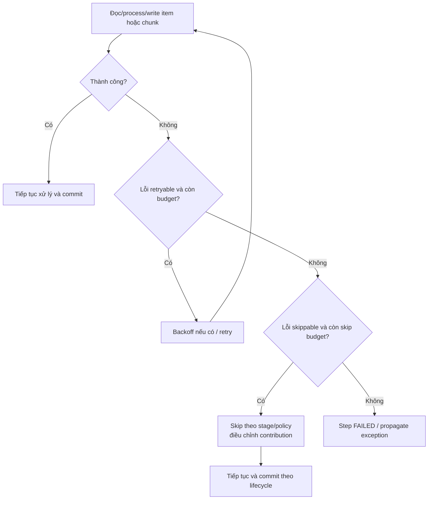
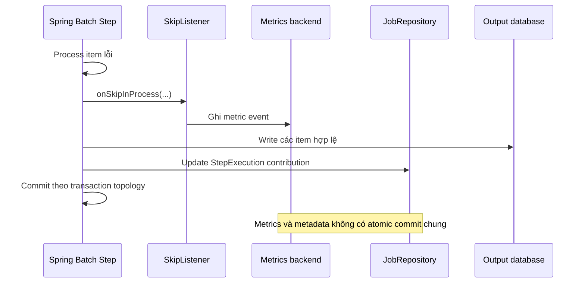
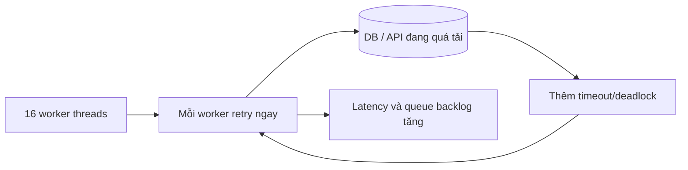
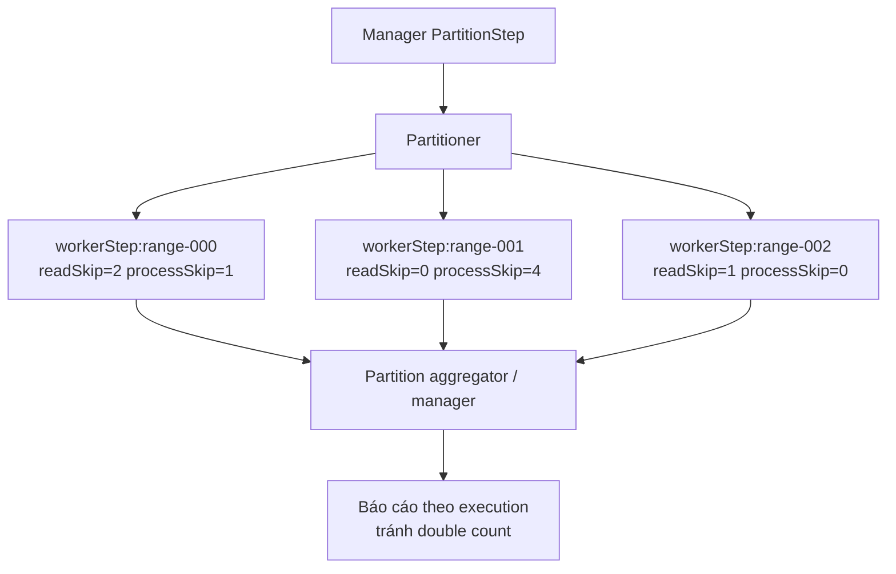
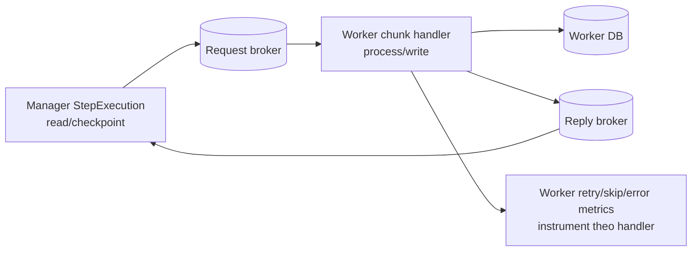

# Skip count và retry count trong Spring Batch: đo lỗi đúng khi scale workload

Một Spring Batch job xử lý 10 triệu đơn hàng có thể kết thúc với `BatchStatus.COMPLETED` dù một số bản ghi đã được **skip** theo chính sách. Ngược lại, job có thể hoàn tất **không skip item nào** nhưng phải **retry** hàng nghìn thao tác vì database deadlock hoặc lỗi kết nối tạm thời. Nếu chỉ giám sát throughput và trạng thái hoàn thành, hai tình huống này rất khó phân biệt.

Chủ đề **“Skip count và retry count”** trong chương **Metrics** thuộc module **SPRING_BATCH_SCALING_OPERATIONS** — mở rộng Spring Batch bằng multi-threaded step, parallel steps, partitioning và các mô hình phân tán, đồng thời đo nút thắt, bảo đảm thread safety, retry/restart và vận hành workload dữ liệu lớn. Bài học tập trung vào **ngữ nghĩa chính xác của các bộ đếm**, cách thu thập/quan sát chúng và cách ra quyết định vận hành mà không làm sai dữ liệu.

**Thông điệp quan trọng nhất:**

> Spring Batch lưu các bộ đếm **read/process/write skip** trong `StepExecution`. Tuy nhiên, **không có một trường `StepExecution.retryCount` chuẩn tương ứng để mặc nhiên đọc số lần retry đã persist**. Muốn có retry count đúng nghĩa, phải xác định rõ *đơn vị đếm*, instrument retry mechanism đang dùng và hiểu giới hạn transaction, restart, message redelivery.

Sau bài học, bạn có thể:

- Phân biệt **skip**, **retry**, **rollback**, **filter**, **failure** và **redelivery**.
- Đọc `readSkipCount`, `processSkipCount`, `writeSkipCount`, `skipCount` và `rollbackCount` của `StepExecution`.
- Thiết kế retry telemetry với `RetryListener`/Micrometer mà không nhầm **failed attempts** với **actual retries**.
- Cấu hình một Step fault-tolerant theo Spring Batch 5.x, giới hạn số lần thử/skip có kiểm soát.
- Xây metric/alert có cardinality thấp cho local chunking, partitioning và remote chunking.
- Viết kiểm thử tạo lỗi transient/permanent, rollback và restart, sau đó đối soát business output.

## 1. Phân biệt sáu sự kiện thường bị trộn vào nhau

| Sự kiện | Bản chất | Ví dụ | Chỉ số cần quan sát |
| --- | --- | --- | --- |
| **Skip** | Bỏ qua item hoặc lỗi read theo chính sách cho phép; job có thể tiếp tục | Bản ghi sai format không thể xử lý | `readSkipCount` / `processSkipCount` / `writeSkipCount` |
| **Retry** | Thử lại thao tác thất bại có khả năng phục hồi | Database deadlock, HTTP 503 tạm thời | Attempt/retry events instrument riêng |
| **Rollback** | Hủy những thay đổi nằm trong transaction hiện tại | Chunk writer ném exception | `rollbackCount` |
| **Filter** | `ItemProcessor` trả `null` theo logic nghiệp vụ bình thường | Bỏ đơn hàng không nằm trong phạm vi | `filterCount`, **không phải skip** |
| **Terminal failure** | Lỗi không retry/skip được hoặc hết giới hạn | Data corruption, DB down kéo dài | `BatchStatus`, `ExitStatus`, exception |
| **Message redelivery** | Broker giao lại message/request có thể đã chạy trước đó | Worker commit DB rồi mất reply/ack | Broker redelivery count + idempotency/reconciliation |

**Điều dễ nhầm nhất:** một lỗi có thể kích hoạt **retry, rollback và sau đó skip**, nhưng các số đếm này không nhất thiết tăng theo tỷ lệ 1:1.

Ví dụ một item bị lỗi xử lý tạm thời hai lần, thành công ở lần thứ ba:

- Số lần gọi xử lý item: 3 trong mô hình thử lại đó.
- Số lỗi attempt: 2.
- Số lần thực sự **thử lại sau lần đầu**: 2.
- Số item skip: **0**.
- Số chunk rollback: phụ thuộc cách Spring Batch bao transaction/retry và cấu hình thực tế; **không suy ra là 2**.

Vì thế, không được định nghĩa `retryCount = rollbackCount` hay `retryCount = processSkipCount`.

## 2. Skip count được Spring Batch lưu ở đâu?

`StepExecution` có các trường/bộ đếm liên quan:

| API `StepExecution` | Ý nghĩa | Mối quan hệ |
| --- | --- | --- |
| `getReadSkipCount()` | Số lần lỗi đọc được quyết định skip | Lỗi xảy ra ở giai đoạn reader |
| `getProcessSkipCount()` | Số item bị skip ở giai đoạn processor | Sau khi áp policy |
| `getWriteSkipCount()` | Số item bị skip ở giai đoạn writer | Sau khi áp policy |
| `getSkipCount()` | Tổng read/process/write skips | Tổng ba nhóm skip ở thời điểm đọc |
| `getFilterCount()` | Số item processor lọc bằng cách trả `null` | **Không cộng vào skip** |
| `getRollbackCount()` | Số transaction rollback Step ghi nhận | **Không phải retry count** |
| `getReadCount()` | Số item được framework ghi nhận đọc thành công theo lifecycle | Không phải luôn là tổng số input vật lý |
| `getWriteCount()` | Số item framework ghi nhận đã ghi qua writer | Không thay đối soát DB hoặc API đích |
| `getCommitCount()` | Số lần commit được Step ghi nhận | Không phải số lượng item đã xử lý |

Trong mô hình chunk Step thông thường, `StepContribution` ghi nhận các bộ đếm của lần xử lý; `StepExecution` nhận và `JobRepository` persist metadata theo lifecycle. Cần đọc **đúng `StepExecution`, đúng thời điểm**; một object đang thay đổi trong RAM chưa tương đương state đã ghi bền vững.

### Công thức tổng skip

\[
S_{\text{total}}
=
S_{\text{read}}
+
S_{\text{process}}
+
S_{\text{write}}
\]

Ví dụ một `StepExecution` sau khi job kết thúc:

```text
readSkipCount    = 2
processSkipCount = 3
writeSkipCount   = 1
skipCount        = 6
filterCount      = 15
rollbackCount    = 4
```

Có **6 skip** và **15 filter**. Không được báo “21 item bị lỗi” vì filter có thể là logic bình thường. Cũng không được báo “4 retries” dựa trên `rollbackCount`.

### Skip count có phải số item nghiệp vụ duy nhất?

Không luôn luôn. Với reader parse error, **chưa có item object hoàn chỉnh** để định danh; `readSkipCount` phản ánh sự kiện skip đọc theo contract của reader. Trong writer, Spring Batch fault-tolerant có thể phải rollback và **thử lại chunk/item để cô lập item lỗi**; callback và retry có thể xuất hiện nhiều lần. Số skip framework là chỉ số xử lý **theo execution và policy**, không mặc nhiên là tập business key duy nhất đã loại bỏ trên toàn bộ các lần restart.

Muốn biết chính xác khóa nào bị bỏ, cần **quarantine/error table** hoặc skip audit với contract ổn định, không chỉ `getSkipCount()`.

## 3. Retry count: vì sao không thể đọc thẳng từ StepExecution?

Spring Batch có cơ chế fault tolerance để thử lại thao tác đọc/xử lý/ghi, thường qua Spring Retry ở các phiên bản tương ứng. Nhưng `StepExecution` **không có getter `getRetryCount()` chuẩn ngang hàng `getReadSkipCount()`**.

`RetryContext` của Spring Retry có thể chứa `getRetryCount()` **trong một phiên retry cụ thể**, nhưng đây không phải số retry tổng hợp bền vững của JobInstance/StepExecution:

- Context retry có vòng đời theo retry operation, không phải field bắt buộc persist trong JobRepository.
- Khi một item được xử lý lại do rollback hoặc chunk được giao lại, nó có thể đi qua **retry operation khác**.
- Khi Job restart, bộ đếm của một retry operation trong RAM thường không được duy trì như checkpoint.
- Khi worker crash, event được gửi ra metrics có thể đã được ghi nhận nhưng metadata chưa commit.
- Khi remote message bị redeliver, có thể có thêm **execution attempts** mà Step retry listener không biết.

Vì vậy trước khi tạo metric, hãy ghi rõ **đang đếm cái gì**:

| Tên metric có thể thiết kế | Đơn vị | Cách hiểu |
| --- | --- | --- |
| `batch_item_attempt_failure_total` | Một callback attempt bị lỗi | Có thể gồm cả lỗi terminal, **không phải retry thật** |
| `batch_item_retry_attempt_total` | Một attempt bổ sung sau attempt đầu tiên | Chỉ chính xác nếu instrument ngay nơi bắt đầu attempt bổ sung |
| `batch_retry_operation_total` | Một logical retry session/operation được mở | Không phản ánh bao nhiêu lần thử |
| `batch_retry_exhausted_total` | Retry operation kết thúc vì hết khả năng thử | Không mặc định bằng skip |
| `batch_broker_redelivery_total` | Một request broker được giao lại | Không phải item-level retry |
| `batch_business_replay_total` | Một business operation được thực hiện lại | Cần business key/dedupe để định nghĩa |

**Đặt tên metric theo sự kiện thực sự quan sát được.** Một `RetryListener.onError(...)` cho phép đếm **failed attempts**, nhưng không nên đặt counter đó tên `retry_attempt_total` rồi nói rằng tất cả là những lần thử lại đã diễn ra.

## 4. Dòng đời khi lỗi xảy ra: retry trước, skip sau nếu được phép



Sơ đồ trình bày **ý tưởng chính sách**, không phải mô hình nội bộ tuyệt đối cho mọi loại lỗi. Trong fault-tolerant chunk Step, read, process và write có các đường retry/skip/rollback khác nhau. Đặc biệt writer có thể phải rollback/replay để xác định item gây lỗi.

### Retry không tự bảo đảm skip

Một exception được đánh dấu retryable nhưng **không skippable** sẽ khiến Step thất bại khi retry hết budget nếu không còn phương án phục hồi khác. Ngược lại, lỗi skippable không nhất thiết phải được retry trước.

### Skip không nhất thiết phát sinh sau retry

Ví dụ dòng CSV không đúng schema có thể được skip trực tiếp theo policy, trong khi lỗi khóa DB deadlock nên retry và thường **không skip dữ liệu bắt buộc**. Đánh dấu mọi `Exception` vừa retryable vừa skippable là một anti-pattern: lỗi infrastructure kéo dài có thể bị “nuốt” thành bỏ dữ liệu.

## 5. Ba loại skip và cách diễn giải

### 5.1. Read skip

Một reader gặp lỗi parse một record; nếu chính sách cho skip, Spring Batch tiếp tục đọc record tiếp theo.

```text
CSV:
  dòng 1 -> hợp lệ
  dòng 2 -> format sai -> read skip
  dòng 3 -> hợp lệ

readSkipCount tăng theo lỗi đọc được skip
```

Không có `ItemProcessor`/`ItemWriter` item object cho dòng 2 nếu reader không tạo được item. Muốn audit input lỗi cần lưu **file, line number/snapshot và mã lỗi** bằng cơ chế an toàn nếu reader/exception cung cấp đủ thông tin.

### 5.2. Process skip

Reader trả item, processor ném lỗi được phân loại skippable (ví dụ business validation). Item đó không đi vào writer.

```text
read -> Order(id=101)
process -> BadOrderException
policy -> skip
processSkipCount tăng
```

**Filter** khác process skip:

```java
@Override
public NormalizedOrder process(RawOrder order) {
    if (!order.isInScope()) {
        return null; // filterCount, KHÔNG phải processSkipCount
    }
    if (order.amount().signum() < 0) {
        throw new InvalidOrderException("Negative amount");
    }
    return normalize(order);
}
```

`RawOrder`/`NormalizedOrder` là model ứng dụng; đoạn này minh họa semantic chứ không phải một project Java hoàn chỉnh.

### 5.3. Write skip

Writer không thể ghi một output item và lỗi được chính sách cho skip. Với chunk gồm nhiều item, framework có thể thử lại và cô lập item lỗi; tùy transaction/reader/writer, nó có thể chạy lại nhiều callback.

```text
Chunk output: [A, B, C]
writer.write(...) lỗi vì B
framework thực hiện đường recovery/scan phù hợp
B được xác định skippable
writeSkipCount tăng theo policy
A và C có thể được commit khi điều kiện cho phép
```

Không giả định **mọi writer** đều hỗ trợ cô lập một item hỏng an toàn. Nếu writer gọi API ngoài transaction hoặc ghi nhiều resource, DML đã commit/HTTP side effect có thể không rollback; cần thiết kế idempotency và kiểm thử DB thật.

## 6. Cấu hình fault-tolerant Step trong Spring Batch 5.x

Ví dụ dùng reader, processor, writer do ứng dụng cung cấp. Hai loại lỗi được tách rõ:

- `TransientDataAccessException`: lỗi dữ liệu tạm thời từ Spring DAO, được retry có giới hạn.
- `InvalidOrderException`: lỗi xác thực nghiệp vụ đã quyết định có thể skip.
- Không skip các lỗi SQL/infrastructure tổng quát chỉ để giữ job chạy.

```java
import org.springframework.batch.core.Step;
import org.springframework.batch.core.repository.JobRepository;
import org.springframework.batch.core.step.builder.StepBuilder;
import org.springframework.batch.item.ItemReader;
import org.springframework.batch.item.ItemProcessor;
import org.springframework.batch.item.ItemWriter;
import org.springframework.batch.core.SkipListener;
import org.springframework.dao.TransientDataAccessException;
import org.springframework.context.annotation.Bean;
import org.springframework.transaction.PlatformTransactionManager;

@Bean
public Step normalizeOrdersStep(
        JobRepository jobRepository,
        PlatformTransactionManager transactionManager,
        ItemReader<RawOrder> reader,
        ItemProcessor<RawOrder, NormalizedOrder> processor,
        ItemWriter<NormalizedOrder> writer,
        SkipListener<RawOrder, NormalizedOrder> skipListener) {

    return new StepBuilder("normalizeOrdersStep", jobRepository)
            .<RawOrder, NormalizedOrder>chunk(200, transactionManager)
            .reader(reader)
            .processor(processor)
            .writer(writer)
            .faultTolerant()
            .retry(TransientDataAccessException.class)
            .retryLimit(3)
            .skip(InvalidOrderException.class)
            .skipLimit(10)
            .listener(skipListener)
            .build();
}
```

`RawOrder`, `NormalizedOrder`, `InvalidOrderException`, reader/processor/writer/listener là các kiểu/bean ứng dụng cần định nghĩa. Mẫu phù hợp để thảo luận chính sách **Spring Batch 5.x**; nên đối chiếu signatures bằng dependency version đang dùng khi chuyển thành project thực.

### Skip limit có ý nghĩa gì?

`skipLimit(10)` cho phép tối đa 10 lần skip theo contract của Step; **lỗi thứ 11** vượt limit và khiến Step fail nếu không có policy đặc biệt khác. Đây là **skip budget của Step**, không phải 10 lần skip **cho mỗi loại read/process/write**. Bộ đếm cộng dồn các nhóm skip để xét ngưỡng.

Một số Step có custom `SkipPolicy`, vậy không thể suy mọi job đều có skip limit cố định.

### Retry limit có ý nghĩa gì?

`retryLimit(3)` đặt giới hạn theo **retry policy của Spring Batch**. Với `SimpleRetryPolicy` thông thường của Spring Retry, **`maxAttempts=3` gồm lần thử ban đầu và tối đa hai lần thử bổ sung**. Nhưng khi có custom `RetryPolicy`, stateful retry, retry ở tầng khác hoặc exception classifier, số callback thực tế có thể khác trực giác. **Phải test với đúng framework/version và loại lỗi**, không suy từ tên `retryLimit` rằng có ba lần chạy lại sau lần đầu.

### Không dùng policy quá rộng

```java
// Anti-pattern: có thể biến lỗi hạ tầng thành mất dữ liệu.
.faultTolerant()
.retry(Exception.class)
.skip(Exception.class)
.skipLimit(100_000)
```

Chỉ skip những lỗi đã có **quyết định nghiệp vụ rõ ràng** về việc chấp nhận bỏ item. Các lỗi mất kết nối, timeout, commit không chắc chắn hoặc schema output hỏng thường phải retry/fail và cảnh báo thay vì âm thầm skip.

## 7. Vì sao rollbackCount không phải retryCount?

Một transaction rollback có thể xuất hiện vì:

- Retry path của process/write.
- Writer fail khi cố cô lập item skippable.
- Lỗi commit, deadlock hoặc transaction timeout.
- Retry/recovery policy yêu cầu rollback.
- Exception không được retry/skip và Step đi tới `FAILED`.

Một retry operation ngược lại có thể thực hiện nhiều attempt **mà không mỗi attempt tương ứng một chunk rollback riêng**, tùy nơi retry được áp dụng.

| Quan sát | Có thể kết luận | Không được kết luận |
| --- | --- | --- |
| `rollbackCount=5` | Step ghi nhận 5 rollback theo lifecycle | Có chính xác 5 item retries |
| `skipCount=0` | Framework không ghi nhận skip trong StepExecution đó | Không hề có lỗi/transient retry |
| `processSkipCount=2` | Hai skip giai đoạn process theo Step policy | Chỉ có hai processor exceptions |
| `writeCount=1000` | Writer contribution ghi nhận theo lifecycle | External API đã commit đúng 1.000 hiệu ứng |
| `retry failure events=20` | Quan sát 20 callback lỗi trong retry mechanism | Đã thực hiện đủ 20 retry attempts sau lỗi |
| `BatchStatus.COMPLETED` | Step/Job hoàn tất theo framework | Dữ liệu nguồn/đích đã đối soát chính xác |

Điều này đặc biệt quan trọng ở database có transaction rollback nhưng writer/API không thực sự nằm trong cùng transaction, hoặc khi nhiều hệ thống commit độc lập.

## 8. Đo skip count bằng StepExecution và StepListener

Dữ liệu tổng hợp theo `StepExecution` phù hợp cho báo cáo cuối Step. Dùng `StepExecutionListener.afterStep` để ghi chỉ số khi Step kết thúc **nếu process vẫn còn hoạt động đến callback đó**.

```java
import org.slf4j.Logger;
import org.slf4j.LoggerFactory;

import org.springframework.batch.core.ExitStatus;
import org.springframework.batch.core.StepExecution;
import org.springframework.batch.core.StepExecutionListener;

public final class StepCountsReporter
        implements StepExecutionListener {

    private static final Logger log =
            LoggerFactory.getLogger(StepCountsReporter.class);

    @Override
    public ExitStatus afterStep(StepExecution step) {
        log.info(
            "event=batch_step_counts step={} stepExecutionId={} "
            + "status={} readSkip={} processSkip={} writeSkip={} "
            + "totalSkip={} filter={} rollback={} commit={} "
            + "read={} write={}",
            step.getStepName(),
            step.getId(),
            step.getStatus(),
            step.getReadSkipCount(),
            step.getProcessSkipCount(),
            step.getWriteSkipCount(),
            step.getSkipCount(),
            step.getFilterCount(),
            step.getRollbackCount(),
            step.getCommitCount(),
            step.getReadCount(),
            step.getWriteCount()
        );

        // null: không thay đổi ExitStatus mà Step đã xác lập.
        return null;
    }
}
```

Cấu hình vào Step builder:

```java
return new StepBuilder("normalizeOrdersStep", jobRepository)
        .<RawOrder, NormalizedOrder>chunk(200, transactionManager)
        .reader(reader)
        .processor(processor)
        .writer(writer)
        .listener(new StepCountsReporter())
        .build();
```

Đoạn cấu hình thứ hai chỉ minh họa cách đăng ký listener, **không thay thế Step fault-tolerant đầy đủ ở mục trước**. Khi triển khai, đưa listener vào builder đó mà giữ các chính sách `faultTolerant`/`retry`/`skip`.

**Giới hạn của afterStep:**

- Nếu JVM bị kill đột ngột, callback có thể không chạy.
- Nếu container chưa flush logs khi crash, log có thể bị mất.
- Step có thể được restart trong một `JobExecution` mới; log theo ID giúp phân biệt execution.
- `afterStep` không chứng minh output đã được commit ở một **external system**.
- Không dùng log này như database counter authoritative khi cần báo cáo bền vững; truy `JobExplorer`/`JobRepository` sau khi metadata ổn định.

## 9. Đọc skip counters bền vững qua JobExplorer

`JobExplorer` cho phép xem `JobExecution` và các `StepExecution` đã được `JobRepository` ghi. Đây là nguồn tốt để điều tra sau restart khi process cũ đã chết.

```java
import java.util.Comparator;
import org.springframework.batch.core.JobExecution;
import org.springframework.batch.core.StepExecution;
import org.springframework.batch.core.explore.JobExplorer;

public final class BatchSkipInspector {
    private final JobExplorer explorer;

    public BatchSkipInspector(JobExplorer explorer) {
        this.explorer = explorer;
    }

    public void inspect(long jobExecutionId) {
        JobExecution job = explorer.getJobExecution(jobExecutionId);
        if (job == null) {
            throw new IllegalArgumentException(
                    "Unknown JobExecution");
        }

        job.getStepExecutions().stream()
            .sorted(Comparator.comparing(StepExecution::getId))
            .forEach(step -> System.out.printf(
                "jobExecution=%d stepExecution=%d step=%s "
                + "readSkip=%d processSkip=%d writeSkip=%d total=%d "
                + "rollback=%d status=%s%n",
                jobExecutionId,
                step.getId(),
                step.getStepName(),
                step.getReadSkipCount(),
                step.getProcessSkipCount(),
                step.getWriteSkipCount(),
                step.getSkipCount(),
                step.getRollbackCount(),
                step.getStatus()
            ));
    }
}
```

**Vì sao cần ID?** Sau restart, StepExecution cũ và mới có thể cùng tên Step nhưng khác `StepExecutionId`; nếu tổng hợp không kiểm soát, rất dễ double count hoặc tính cả những phần việc đã chạy lại.

### Truy vấn SQL metadata minh họa

```sql
SELECT
    je.JOB_EXECUTION_ID,
    se.STEP_EXECUTION_ID,
    se.STEP_NAME,
    se.STATUS,
    se.READ_SKIP_COUNT,
    se.PROCESS_SKIP_COUNT,
    se.WRITE_SKIP_COUNT,
    se.ROLLBACK_COUNT,
    se.READ_COUNT,
    se.WRITE_COUNT
FROM BATCH_JOB_EXECUTION je
JOIN BATCH_STEP_EXECUTION se
  ON se.JOB_EXECUTION_ID = je.JOB_EXECUTION_ID
WHERE je.JOB_EXECUTION_ID = :jobExecutionId
ORDER BY se.STEP_EXECUTION_ID;
```

Đây là truy vấn **read-only** cho schema JDBC JobRepository thường gặp; tên bảng/column prefix và kiểu dữ liệu có thể khác theo database/configuration/version. Không chỉnh trực tiếp các bộ đếm bằng SQL để “giảm skip” hay làm Step nhìn có vẻ `COMPLETED`.

## 10. SkipListener: quan sát stage và ghi audit có kiểm soát

`SkipListener<I,O>` có ba callback liên quan tới skip:

```java
import org.springframework.batch.core.SkipListener;

public final class OrdersSkipListener
        implements SkipListener<RawOrder, NormalizedOrder> {

    @Override
    public void onSkipInRead(Throwable error) {
        // Không có một item object đã parse thành công để lấy ID.
        recordSkip("read", null, error);
    }

    @Override
    public void onSkipInProcess(RawOrder item, Throwable error) {
        recordSkip("process", item.orderId(), error);
    }

    @Override
    public void onSkipInWrite(NormalizedOrder item, Throwable error) {
        recordSkip("write", item.orderId(), error);
    }

    private void recordSkip(
            String phase, Long itemId, Throwable error) {
        // Minh họa: ghi event đã redacted, không log raw item/error message.
        // Không tự gửi email hoặc ghi side effect không idempotent ở đây.
    }
}
```

`RawOrder`/`NormalizedOrder` là model ứng dụng có method `orderId()`, do ứng dụng cần định nghĩa. `recordSkip` là placeholder giải thích trách nhiệm, **không phải lời hứa rằng một audit event đã được ghi bền vững**.

### SkipListener và transaction

Spring Batch đặt các skip callbacks gần thời điểm commit để giúp audit skip đúng ngữ cảnh. Tuy nhiên không có transaction toàn cục tự động giữa **Step DB**, **metrics backend**, **log collector**, **broker** và **API thông báo**.

- Một callback có thể được quan sát rồi transaction cuối cùng thất bại.
- Job restart hoặc message redelivery có thể dẫn tới lặp event ở hệ thống metrics/audit bên ngoài.
- Nếu cần **audit nghiệp vụ chính xác một lần** theo business key, dùng bảng audit/dedup có unique constraint và transaction phù hợp, không chỉ `Counter.increment()`.
- Với `onSkipInRead`, khi chưa parse được item object phải chọn khóa sự kiện dựa trên file+line/snapshot hoặc khóa nguồn mà reader cung cấp; không gán một ID giả.
- Không log nguyên Throwable message nếu nó có thể chứa SQL payload, customer data hoặc token; phân loại lỗi theo nhóm an toàn.

**SkipListener là điểm thu thập event tiện dụng; StepExecution counters là nguồn tổng hợp theo execution.** Hai nguồn có thể khác nhau khi rollback/crash, vì vậy cần chỉ rõ mục đích từng nguồn.

## 11. Phân biệt “skip event observed” và “persisted skip count”

Hệ thống monitoring thường nhận metric qua một thời điểm không trùng với thời điểm commit `JobRepository`.



Hãy đặt tên rõ:

- `batch_item_skip_event_total`: **callback skip được quan sát** tại application.
- `StepExecution.processSkipCount`: **skip count trong metadata của execution**.
- `business_quarantine_count`: **số bản ghi lỗi được lưu trong quarantine table** theo khóa nghiệp vụ.

Ba chỉ số dùng cho ba mục đích: quan sát xu hướng gần thời gian thực, audit tiến độ Spring Batch và đối soát lỗi nghiệp vụ.

### Ví dụ chênh lệch hợp lệ

Một processor lỗi, listener gửi metric, nhưng JVM crash ngay trước khi DB/repository commit. Metrics backend đã tăng 1, còn metadata persisted của StepExecution có thể chưa ghi contribution đó. Khi restart, item chạy lại và callback có thể phát event mới. **Không coi sai lệch đó là lỗi Micrometer**, mà là giới hạn consistency của hai resource.

## 12. RetryListener: đếm được gì chính xác?

Spring Retry cung cấp `RetryListener`, với các callback như `open`, `onError` và `close` theo vòng đời retry operation ở những phiên bản phù hợp.

**Cẩn trọng:** `onError` chạy khi một attempt ném lỗi; bản thân nó **không chứng minh đã thực sự có lần retry tiếp theo**. Nếu retry policy quyết định dừng ngay, lỗi terminal cũng có thể xuất hiện trong callback.

### Ví dụ instrument failed attempts, không gọi nhầm là retry count

```java
import io.micrometer.core.instrument.Counter;
import io.micrometer.core.instrument.MeterRegistry;

import org.springframework.retry.RetryCallback;
import org.springframework.retry.RetryContext;
import org.springframework.retry.RetryListener;

public final class RetryFailureMetricsListener
        implements RetryListener {

    private final Counter transientFailureCounter;
    private final Counter otherFailureCounter;

    public RetryFailureMetricsListener(
            MeterRegistry registry, String logicalStepName) {

        this.transientFailureCounter = Counter.builder(
                    "batch.item.attempt.failure")
                .description("Observed failed attempts in retry operations")
                .tag("step", logicalStepName)
                .tag("error_group", "transient")
                .register(registry);

        this.otherFailureCounter = Counter.builder(
                    "batch.item.attempt.failure")
                .tag("step", logicalStepName)
                .tag("error_group", "other")
                .register(registry);
    }

    @Override
    public <T, E extends Throwable> void onError(
            RetryContext context,
            RetryCallback<T, E> callback,
            Throwable throwable) {

        Counter counter = isTransient(throwable)
                ? transientFailureCounter
                : otherFailureCounter;
        counter.increment();
    }

    private boolean isTransient(Throwable t) {
        return t instanceof org.springframework.dao
                .TransientDataAccessException;
    }
}
```

Ví dụ minh họa trực tiếp `RetryListener` với Micrometer; **cách gắn RetryListener vào fault-tolerant Step cần theo API builder/framework đúng version** đang triển khai, và phải xác nhận listener được gọi trên đường retry mà bạn muốn đo. Không cần tự tạo một `RetryTemplate` thứ hai nếu Step đã có retry engine, vì có thể vô tình **nhân số lần retry**.

### Vì sao đặt metric là attempt failure?

Giả sử một operation:

```text
Attempt #1: ném DeadlockLoserDataAccessException
Attempt #2: ném DeadlockLoserDataAccessException
Attempt #3: thành công

Failed attempts observed = 2
Actual retry attempts   = 2
Skip count              = 0
```

Ở ví dụ này hai số bằng nhau. Nhưng nếu attempt #3 cũng thất bại và policy dừng:

```text
Attempt #1: lỗi
Attempt #2: lỗi
Attempt #3: lỗi, exhausted

Failed attempts observed = 3
Actual retry attempts   = 2
Có skip hay không phụ thuộc SkipPolicy/skipLimit
```

Dùng `onError` để đếm “actual retries” sẽ **thừa một** trong trường hợp exhausted. Tương tự, nếu một operation fail lần đầu rồi bị loại khỏi retry bởi policy, failed attempts = 1, retries = 0.

**Muốn đo retry attempts thực sự**, cần instrument **đúng nơi bắt đầu attempt thứ hai trở đi** hoặc có một retry policy/decorator/callback contract đo số lần callback đã được **thực thi**, rồi phân biệt attempt đầu với attempt bổ sung. Hãy kiểm thử trường hợp success, exhausted, nonretryable và interrupted để chứng minh công thức. Không suy ra retry attempts một cách tổng quát từ `rollbackCount`.

## 13. Định nghĩa bốn counter retry trước khi triển khai

Một bản thiết kế monitoring thực tế có thể chọn bốn counter tách biệt:

| Counter tự định nghĩa | Khi nào tăng | Trường hợp không tăng |
| --- | --- | --- |
| `retry_operation_started_total` | Một logical retry operation bắt đầu | Không tăng cho mỗi item khác nếu nó dùng cùng operation |
| `attempt_failed_total` | Callback trong retry operation ném lỗi | Attempt thành công không tăng |
| `retry_attempt_started_total` | Attempt thứ 2, 3, ... **thực sự bắt đầu** | Không tăng cho lỗi terminal không có attempt tiếp |
| `retry_operation_exhausted_total` | Retry policy kết thúc do hết attempt budget | Retry thành công không tăng |

Nếu muốn đo **success after retry**, có thể thêm `retry_recovered_total` cho operation có ít nhất một thất bại rồi thành công. Metric này trả lời câu hỏi rất hữu ích: “Có bao nhiêu công việc chỉ thành công nhờ retry?”

### Công thức trong mô hình tuần tự đơn giản

Cho một **retry operation cụ thể** với `A` số attempts đã thực sự chạy:

\[
R = \max(0, A - 1)
\]

`R` là số **retry attempts thực tế** của operation. Nó không có nghĩa `getRetryCount()` của mọi implementation lúc nào cũng là `A - 1`; API có thể đếm failures theo policy. Khi đọc số từ `RetryContext`, phải đối chiếu hợp đồng của thư viện/version và đường callback.

**Chọn cấp độ metric:** item, chunk, HTTP request hay message? Nếu một writer chunk được retry ba lần, đó là **hai chunk retry attempts**, không tự tương đương `2 × chunkSize` item-level retries.

## 14. Micrometer: thiết kế tags có cardinality thấp

Micrometer hữu ích để export metrics, nhưng thiết kế tag ảnh hưởng chi phí hệ thống khi chạy nhiều workers.

| Tag | Có nên dùng làm label? | Lý do |
| --- | --- | --- |
| `job_name` | Có, nếu tập job names ổn định | Phân loại workflow |
| `logical_step_name` | Có, nếu được chuẩn hóa | Phân loại phase |
| `phase=read/process/write` | Có | Chỉ ba giá trị chính |
| `outcome=retry/skip/fail` | Có | Tập nhỏ |
| `error_group=validation/transient/io/other` | Có | Nhóm lỗi có kiểm soát |
| `worker_pool` | Có điều kiện | Tập pool hữu hạn |
| `partition_name` | Thường tránh trong metric tổng | Có thể tạo hàng nghìn time series |
| `JobExecutionId`/`StepExecutionId` | Tránh trong mỗi time series | Cardinality tăng theo số lần chạy |
| `itemId`/`correlationId` | **Không** | Cardinality rất cao |
| Exception message, SQL, token | **Không** | Rủi ro bảo mật và cardinality |

**Tên metric tự định nghĩa** như `batch.item.attempt.failure` chỉ là ví dụ; tùy backend export có thể chuyển thành tên khác (Prometheus thường đổi dấu chấm thành dấu gạch dưới, và counter thêm suffix `_total`). Không tự tuyên bố đây là metric mặc định của Spring Batch.

### Đừng mặc định built-in metrics có retry count

Spring Batch cung cấp một số quan sát/timer cho Job/Step/Chunk/Item ở các phiên bản, thường tích hợp Micrometer/Observation khi cấu hình hỗ trợ. **Tên metric và bộ tag built-in thay đổi theo framework/version** và không đồng nghĩa luôn có bộ đếm retry attempts chuẩn. Hãy kiểm tra endpoint `/actuator/metrics` hoặc registry thực tế, đối chiếu semantic trước khi xây Grafana dashboard.

## 15. Ví dụ SkipListener với Micrometer

Đo số callback skip quan sát được theo phase, tag `logicalStep` ổn định:

```java
import io.micrometer.core.instrument.Counter;
import io.micrometer.core.instrument.MeterRegistry;

import org.springframework.batch.core.SkipListener;

public final class SkipEventMetricsListener<I, O>
        implements SkipListener<I, O> {

    private final Counter readSkips;
    private final Counter processSkips;
    private final Counter writeSkips;

    public SkipEventMetricsListener(
            MeterRegistry registry, String logicalStep) {

        this.readSkips = newCounter(
                registry, logicalStep, "read");
        this.processSkips = newCounter(
                registry, logicalStep, "process");
        this.writeSkips = newCounter(
                registry, logicalStep, "write");
    }

    private Counter newCounter(
            MeterRegistry registry,
            String logicalStep,
            String phase) {

        return Counter.builder("batch.item.skip.event")
                .description("Observed Spring Batch skip callbacks")
                .tag("step", logicalStep)
                .tag("phase", phase)
                .register(registry);
    }

    @Override
    public void onSkipInRead(Throwable error) {
        readSkips.increment();
    }

    @Override
    public void onSkipInProcess(I item, Throwable error) {
        processSkips.increment();
    }

    @Override
    public void onSkipInWrite(O item, Throwable error) {
        writeSkips.increment();
    }
}
```

**Đọc đúng semantics:** đây là *event counters* in-process theo skip callbacks, không phải một giao dịch audit bền vững. Nếu exporter mất kết nối hoặc process crash, metrics có thể mất; nếu callback chạy lại trong một lần restart, metrics có thể tăng trùng. Đừng dùng Counter Micrometer thay thế `StepExecution.getSkipCount()` khi cần quyết định skip limit hay báo cáo nghiệp vụ sau job.

### Thận trọng khi chạy partition song song

Truyền `logicalStepName` **ổn định** thay vì gắn trực tiếp tên worker partition `workerStep:range-0042` làm tag nếu có hàng nghìn partitions. Có thể thêm một nhóm `worker_pool` hữu hạn; dùng structured logs để tra cứu partition cụ thể.

## 16. Ví dụ bảng report cuối Step/Job

Một báo cáo vận hành nên tách **metadata chính thức** và **telemetry ứng dụng**.

| Chỉ số | Ví dụ | Nguồn | Ý nghĩa |
| --- | ---: | --- | --- |
| Read skip | 12 | `StepExecution` | Lỗi read đã được skip |
| Process skip | 18 | `StepExecution` | Item bị skip ở processor |
| Write skip | 3 | `StepExecution` | Item bị skip ở writer |
| **Total skip** | **33** | `StepExecution` | Tổng skip theo execution |
| Filter | 200 | `StepExecution` | Item được loại có chủ đích |
| Rollback | 75 | `StepExecution` | Chunk transaction rollbacks |
| Failed attempt events | 120 | RetryListener/Micrometer | Các attempts ném lỗi được quan sát |
| Actual retry attempts | 95 | Attempt instrumentation đã kiểm thử | Các attempts bổ sung thực sự bắt đầu |
| Retry exhausted operations | 6 | Retry policy instrumentation | Không còn attempt khả dụng |
| Broker redeliveries | 14 | Middleware metrics | Messages được giao lại |
| Missing business keys | 0 | SQL reconciliation | Không thiếu output bắt buộc |

Bảng chỉ là **ví dụ giả định**, không phải dữ liệu đo thực hoặc giá trị đảm bảo theo framework. `120 failed attempts` và `95 retry attempts` có thể khác nhau vì một số failures không dẫn tới attempt tiếp theo. `Rollback=75` có thể cao/thấp hơn cả hai tùy kiến trúc.

**Không cộng SkipListener events và StepExecution skip count**: đó là hai quan sát của cùng một lớp sự kiện, không phải hai loại item đã bị loại.

## 17. Tỷ lệ skip và retry nên tính thế nào?

### Skip rate

Một chỉ số nghiệp vụ lý tưởng là:

\[
\text{Skip rate}
=
\frac{\text{số bản ghi logic bị skip}}
{\text{số bản ghi logic được xem xét}}
\]

Khi có **tập input định danh được**, hãy tính tử số/mẫu số bằng business keys hoặc quarantine data đã đối soát. Điều đó rõ ràng hơn khi reader có lỗi parse, retry và filter.

Một công thức proxy thường dùng cho Step:

\[
\text{Approx. skip rate}
=
\frac{S_{\text{read}} + S_{\text{process}} + S_{\text{write}}}
{\max(1,\text{readCount} + S_{\text{read}})}
\]

**Cảnh báo:** đây là proxy, không phải tỷ lệ business records unique được bảo đảm. `readSkipCount` có thể là lỗi đọc không tạo item, các reader khác nhau có semantics khác nhau, skip write/process có thể đi qua retry/rollback, và StepExecution counts có thể chứa hành vi phục hồi theo lifecycle.

### Retry pressure

Với instrumentation thực sự đếm attempts bổ sung:

\[
\text{Retry pressure}
=
\frac{\text{actual retry attempts}}
{\max(1,\text{logical operations completed})}
\]

Nếu một chunk retry nhiều lần, denominator phải là **logical chunk operations** nếu numerator là chunk attempts, không dùng item count nếu chưa chuyển đổi đơn vị.

### Failure rate của retry operations

\[
\text{Exhaustion rate}
=
\frac{\text{retry operations exhausted}}
{\max(1,\text{retry operations started})}
\]

Một attempt failure rate cao nhưng exhaustion rate thấp nghĩa là hệ thống có thể đang “sống nhờ retry” — Job chưa fail nhưng latency/cost tăng. Cần điều tra lock, DB pool, broker timeout hoặc downstream throttling.

## 18. Skip limit và error budget nghiệp vụ

`skipLimit` là một biện pháp **giới hạn tổn thất dữ liệu được cho phép**, không phải đòn tối ưu throughput.

Ví dụ batch nhập 1.000.000 hóa đơn:

- Tối đa 100 record không hợp lệ theo một quy định nghiệp vụ đã được phê duyệt.
- Mỗi item skip phải được ghi audit với nguồn và mã lỗi.
- Bất kỳ lỗi DB/infrastructure nào không được tự chuyển thành skip.
- Báo `COMPLETED` chỉ khi input/output/quarantine được đối soát.

Đừng đơn giản đặt `skipLimit(10_000)` để job “ít fail hơn”. Nếu một lỗi parser mới làm hàng nghìn record bị skip, job có thể `COMPLETED` mà dữ liệu thực tế không đạt yêu cầu.

### Absolute limit hay percentage?

`skipLimit` thường là **ngưỡng tuyệt đối** theo chính sách Step. Một **tỷ lệ** như 0,1% có thể được định nghĩa bổ sung bằng `SkipPolicy` custom hoặc kiểm tra cuối job dựa trên dữ liệu nghiệp vụ, nhưng phải giải quyết mẫu số, concurrency và restart.

Trong partitioning, mỗi worker Step có policy/skip limit riêng; **10 skip cho mỗi partition** không tương đương **10 skip cho toàn Job**. Muốn có global error budget, cần cơ chế điều phối/audit độc lập, không cộng chéo manager và worker rồi tin rằng policy local đã bảo vệ global limit.

## 19. Retry budget, backoff và retry storm

Khi nhiều worker cùng retry database deadlock hoặc HTTP 503, hệ thống có thể tự làm sự cố nghiêm trọng hơn.



Cần cân nhắc:

- **Retry limit** hữu hạn cho mỗi operation.
- **Backoff** có giới hạn và **jitter** nếu thư viện/cấu hình hỗ trợ.
- Phân loại transient/permanent lỗi chính xác.
- Tổng concurrency, connection pool, broker prefetch/inflight và rate limit.
- **Timeout budget** của toàn Job/Step/message, không chỉ timeout từng attempt.
- Circuit breaker/throttle ở tầng thích hợp, tránh nested retry không kiểm soát.

**Ví dụ nested retries:** Spring Batch thử lại writer tối đa 3 attempts, HTTP client bên dưới cũng retry 3 attempts, broker lại redeliver 5 lần. Số lần gọi API thực tế có thể lớn hơn con số retryLimit=3 nếu không có phối hợp chính sách. Vì vậy log/metric phải tách **retry tầng Step**, **retry tầng client** và **broker redelivery**.

### Khi nào không nên retry?

- Lỗi validation nghiệp vụ cố định mà dữ liệu đầu vào không thay đổi.
- Thiếu quyền truy cập cố định (HTTP 403) cho tới khi được sửa config/IAM.
- Query sai cú pháp, schema mismatch hay lỗi serializer.
- API non-idempotent mà không có idempotency contract.
- Lỗi do snapshot/partition mapping không nhất quán.

Retry những lỗi này thường chỉ tăng throughput giả (số attempts) và kéo dài thời gian thất bại.

## 20. Retry, transaction và tính nguyên tử

Với chunk Step thông thường, writer có thể thực hiện DML trong transaction của chunk. Khi một exception làm rollback, các DML **đang tham gia cùng transaction đó** được hoàn tác.

Nhưng:

- API HTTP đã gửi không được JDBC rollback.
- Broker message ack không tự rollback cùng DB.
- JobRepository có thể dùng transaction/resource khác writer.
- Một commit có thể có kết quả không chắc chắn khi connection mất đúng thời điểm.
- SkipListener/RetryListener xuất metric ngoài transaction không được tự rollback.

Do đó, đếm retry thật không bảo đảm dữ liệu đúng. Hãy thiết kế **idempotent writer**, unique business key, outbox hoặc compensation theo hợp đồng nghiệp vụ.

### Ví dụ writer có business key

```sql
CREATE TABLE normalized_orders (
    batch_id varchar(80) NOT NULL,
    order_id bigint NOT NULL,
    normalized_amount numeric(18,2) NOT NULL,
    PRIMARY KEY (batch_id, order_id)
);

-- PostgreSQL, phù hợp cho trạng thái hiện tại của cùng batch/version:
INSERT INTO normalized_orders
    (batch_id, order_id, normalized_amount)
VALUES (:batchId, :orderId, :amount)
ON CONFLICT (batch_id, order_id)
DO UPDATE SET normalized_amount = EXCLUDED.normalized_amount;
```

Upsert chỉ idempotent về **row state** khi cùng business operation luôn cho cùng output. Nó không tự giải quyết append-only ledger, cập nhật cộng dồn, versioning và side effects ngoài DB. Nếu input có nhiều version, hãy đưa version vào contract và xử lý update ordering.

## 21. Restart: không cộng chỉ số một cách máy móc

Khi một `JobInstance` thất bại rồi restart:

```text
JobInstance #41, batchId=B2026-11

JobExecution #1501 (FAILED)
  StepExecution #7001
  readSkip=3 processSkip=5 writeSkip=1

JobExecution #1510 (COMPLETED sau restart)
  StepExecution #7050
  readSkip=0 processSkip=2 writeSkip=0
```

Không tự kết luận “có 11 business records unique đã bị skip” chỉ bằng cộng `3+5+1+2`. Cùng input có thể đã được xử lý lại, hoặc một số skip đã được ghi nhận/đối soát trong output/quarantine trước đó.

### Cần phân biệt ba loại report

1. **Execution-level:** `StepExecution` thuộc một `JobExecution` cụ thể — phù hợp xem lỗi trong một lần chạy.
2. **JobInstance-level:** nhiều lần JobExecution của cùng JobInstance — cần quy tắc tổng hợp qua restart.
3. **Business batch-level:** tập record logic của một `batchId/snapshotId` — cần dedupe theo business key hoặc audit/quarantine.

Cùng một số skip count ở metadata có thể được cộng vào dashboard vận hành theo **attempts** nhưng không được tự dịch thành số business records unique đã loại.

### Step hoàn tất có thể bị skip khi restart

Một `StepExecution` `COMPLETED` có thể không chạy lại trong JobExecution mới. Khi tổng hợp, đừng giả định mỗi Step trong job đều có một row mới ở mọi lần restart. Nếu Step được phép chạy lại bằng `allowStartIfComplete(true)`, cần kiểm tra writer/idempotency và cách report unique counts.

## 22. Multi-threaded Step: đếm theo StepExecution, không theo thread

Một Step chạy nhiều chunk threads thường chia sẻ **một `StepExecution` và context liên quan**. Listener có thể được gọi đồng thời.

### Những vấn đề thường gặp

- Dùng `int retryCount` field trong singleton listener rồi `retryCount++` là **race condition**.
- Dùng một `HashMap<Exception, Integer>` mutable không synchronized để thống kê stage có thể mất cập nhật.
- `ThreadLocal` không được dọn có thể làm thread pool tái sử dụng nhầm trạng thái giữa item/chunk.
- Lấy thread name làm business identity để dedupe có thể sai khi retry/migration.
- Shared stateful reader có thể cho checkpoint sai khi các chunk commit đảo thứ tự.

### Chọn công cụ theo mục đích

- `StepExecution` counters: dùng framework làm nguồn tổng hợp theo execution.
- Micrometer `Counter`: thread-safe cho **event observations** theo implementation registry.
- Nếu cần histogram/detail theo partition/item: lưu **event/audit bền vững** bằng business key và transaction phù hợp, không dùng biến toàn cục/ThreadLocal thay kho dữ liệu.
- Không ghi toàn bộ list lỗi vào `ExecutionContext`: state lớn, tranh chấp, tốn serialize mỗi checkpoint.

**SkipListener và RetryListener cũng có thể được gọi từ nhiều worker threads** khi được dùng với Step đa luồng. Implementation phải stateless hoặc bảo vệ mutable state đúng; `MeterRegistry` quản lý counters tốt hơn một bộ đếm `long` tự tăng không đồng bộ.

## 23. Local partitioning: đừng double count manager và workers

Trong partitioning, manager tạo nhiều worker `StepExecution`. Mỗi worker thường có skip counters riêng; manager có thể tổng hợp các `StepContribution`/`StepExecution` thông qua partition aggregation.



Nếu report lấy **cả counters của worker StepExecutions** và counters đã **aggregate lên manager**, có thể đếm cùng skip hai lần.

### Chiến lược tổng hợp phù hợp

- Chọn **một nguồn dữ liệu**: báo cáo từ từng worker StepExecution rồi sum, hoặc dùng kết quả aggregate của manager **khi xác nhận nó tương ứng đúng worker set**.
- Gắn `JobInstanceId`, `JobExecutionId`, Step name và partition name trong logs/metadata queries.
- Khi restart, đối chiếu worker StepExecution cũ/mới; không giả định worker retry làm mất event metrics từ lần trước.
- Đối soát quarantine theo business key/snapshot để biết số record unique bị loại.
- Nếu cần global skip budget, đặt ở tầng điều phối có chính sách rõ, không tin skipLimit local của mỗi worker là global threshold.

### Phân biệt gridSize và số worker thật

`gridSize` là một đầu vào/cơ chế của partition splitting, không nhất thiết bằng số thread chạy đồng thời. Tăng `gridSize` có thể tạo nhiều StepExecutions và metric rows, còn throughput chịu giới hạn của thread pool, DB connection pool và data skew. Đặt ngưỡng alert trên tỷ lệ lỗi **theo logical workload** thay vì số partition tùy tiện.

## 24. Remote partitioning: counters thuộc worker Step

Trong remote partitioning, worker JVM có thể chạy một worker StepExecution đầy đủ. Các skip counters được ghi trong worker StepExecution và có thể được manager tổng hợp, tùy kiến trúc JobRepository/response.

Cần xác minh:

1. Manager/worker dùng metadata protocol/JobRepository tương thích.
2. `StepExecutionId` trong request trỏ đúng worker execution.
3. Reply/ack/redelivery không tạo việc chạy lặp sai trên cùng work identity.
4. Metric exporter của worker không biến mất dữ liệu khi worker bị kill.
5. Tổng skip count theo job không cộng cả manager aggregate và các workers.
6. Fault-tolerant policy được áp ở **worker Step** khi processor/writer ở worker.
7. Replay sau restart được đối soát theo input snapshot và business key.

**Không dùng broker message ID làm khóa unique record bị skip.** Một business item có thể xuất hiện trong message khác khi manager republish/restart.

## 25. Remote chunking: metrics của manager và worker khác nhau

Remote chunking thường có **manager reader**, đóng gói `ChunkRequest` và gửi tới remote worker có processor/writer. Worker handler không mặc định có một worker StepExecution độc lập, vì vậy **không được giả định worker `StepExecution.getProcessSkipCount()` luôn tồn tại như trong remote partitioning**.



Cần tách:

- Manager `StepExecution` metrics và các `StepContribution` được framework ghi nhận qua request/reply protocol.
- Worker handler telemetry: số request nhận, process/write attempt failures, retry mechanism nếu đã cấu hình riêng, số callback skip nếu framework có policy phù hợp.
- Broker metrics: redelivery, DLQ, queue lag, reply timeouts.
- Business reconciliation: output đã commit và input chưa được xử lý.

Một broker redelivery có thể khiến worker xử lý lại request đã commit, nhưng không phải `StepExecution.retryCount`. Nếu manager không nhận response, Skip/Retry telemetry phía worker và metadata phía manager có thể **không khớp** dù mỗi bên ghi đúng những gì nhìn thấy.

### Transaction worker là trách nhiệm riêng

Manager transaction không tự đi theo message sang JVM worker. Nếu cần all-or-none write cho mỗi request, worker phải được cấu hình transaction phù hợp; và nếu handler **trả failed response mà không ném exception**, cần quyết định rollback policy rõ. Tất cả điều này ảnh hưởng tới việc **đếm thành công/skip/retry**.

## 26. Metric naming cho dashboard ở quy mô lớn

Một dashboard thực tế có thể chia bốn vùng:

| Nhóm dashboard | Chỉ số | Câu hỏi điều tra |
| --- | --- | --- |
| **Result quality** | Read/process/write skips, skip rate, quarantine count | Bao nhiêu input bị loại? Có vượt policy không? |
| **Resilience** | Failed attempts, actual retries, exhaustion, rollback | Hệ thống đang phục hồi hay bão hòa? |
| **Throughput** | Committed output items/s, chunk duration, DB commit latency | Tăng worker có thật sự tăng throughput? |
| **Distributed delivery** | Queue lag, redelivery, duplicate reply, DLQ | Có message bị gửi lại/mất response không? |

Đừng chọn metric lớn nhất làm KPI duy nhất. **Tỷ lệ retry cao nhưng throughput vẫn đạt** có thể báo sớm DB contention sắp gây sự cố. **Skip cao nhưng job COMPLETED** có thể nghĩa là mất dữ liệu nghiệp vụ. **Rollback cao nhưng retry thấp** có thể do writer transaction lỗi chưa được classify.

### Một số truy vấn PromQL minh họa

Nếu application đã export các counters tự định nghĩa ở dạng Prometheus:

```promql
# Số skip callbacks/s trong 5 phút, tổng các worker,
# theo step logic và phase.
sum by (step, phase) (
  rate(batch_item_skip_event_total[5m])
)
```

```promql
# Số failed attempt events/s, KHÔNG phải retry attempts/s.
sum by (step, error_group) (
  rate(batch_item_attempt_failure_total[5m])
)
```

```promql
# Chỉ đúng nếu bạn tự instrument actual retry attempts.
sum by (step) (
  rate(batch_item_retry_attempt_total[5m])
)
```

Tên Prometheus ở trên là **ví dụ từ naming convention của ứng dụng**, không phải tên mặc định được Spring Batch bảo đảm. Nếu Micrometer registry/exporter map tên thành mẫu khác, sửa query theo endpoint metrics thực, không tạo dashboard với tên giả.

### Kỹ thuật tránh cảnh báo giả

- Dùng `rate`/`increase` cho counter thay vì lấy giá trị absolute từ pod vừa restart.
- Đánh giá mức tải (logical records processed) để tránh alert skip rate tăng khi chỉ có vài item.
- Nhóm nhiều worker theo Step logic, không tag item IDs.
- Phân loại lỗi transient vs validation vs source-corruption.
- Kết hợp alert latency/queue lag với retry failures để tìm bottleneck.
- Với skip nhiều, kiểm tra downstream quality/reconciliation chứ không chỉ tăng skip limit.

## 27. Alert thresholds theo mục tiêu nghiệp vụ

Một ví dụ chính sách (không phải mặc định Spring Batch):

| Điều kiện | Mức xử lý gợi ý | Vì sao |
| --- | --- | --- |
| Skip validation tăng nhẹ nhưng dưới ngưỡng đã phê duyệt | Cảnh báo theo report | Có thể là data quality issue |
| Skip rate vượt error budget của batch | Dừng/pause/publish gate theo policy | Ngăn hoàn tất dữ liệu không đạt chuẩn |
| Retry attempt failures tăng liên tục | Điều tra transient bottleneck | DB/API contention hoặc mạng yếu |
| Retry exhausted > 0 trong pipeline bắt buộc | Alert ưu tiên cao | Công việc không phục hồi được |
| RollbackCount tăng cùng DB lock waits | Điều chỉnh concurrency/SQL | Tăng worker có thể tệ hơn |
| Remote redelivery tăng sau commit | Điều tra reply/ack và idempotency | Dữ liệu có thể bị xử lý lại |
| Step COMPLETED nhưng quarantine chưa đối soát | Chưa cho downstream publish | Trạng thái framework không đủ xác nhận dữ liệu |

Ngưỡng thực phải dựa trên loại pipeline, hợp đồng dữ liệu và baseline. Không đưa ra “1% skip là bình thường” cho tất cả hệ thống, đặc biệt với dữ liệu thanh toán/tài chính hoặc regulatory jobs.

**Khác biệt giữa alert và policy:** alert là tín hiệu quan sát có thể đến muộn; `skipLimit`/`SkipPolicy` là quy tắc tại runtime Step. Một global error budget giữa nhiều partitions cần điều phối riêng nếu muốn fail đúng thời điểm, không thể chỉ dựa vào Grafana alert.

## 28. Fault injection: chứng minh các counter tăng đúng

Kiểm thử cần dùng **JobRepository bền vững** và writer/transaction gần production. Unit test một listener không chứng minh Step skipCount đã commit đúng.

| Test | Lỗi chủ động | Kết quả cần xác minh |
| --- | --- | --- |
| Read skip | Dòng CSV không parse được; policy cho skip | `readSkipCount` tăng, item tốt vẫn được xử lý |
| Process skip | Processor ném `InvalidOrderException` | `processSkipCount` tăng; output thiếu đúng item đã reject |
| Write skip | Writer ném lỗi item-specific skippable | `writeSkipCount` tăng theo recovery path, không ghi side effect lặp |
| Filter | Processor trả `null` | `filterCount` tăng, skipCount không tăng vì filter |
| Retry thành công | Processor/writer lỗi transient vài lần rồi thành công | Actual attempts > 1, skipCount=0 |
| Retry exhausted | Lỗi transient kéo dài quá budget | Step fail/skip theo policy; event metrics phân biệt terminal attempt |
| SkipLimit vượt ngưỡng | Lỗi skippable nhiều hơn `skipLimit` | Step chuyển fail theo policy |
| DB rollback | Writer ném lỗi sau DML trong chunk | Output cùng transaction rollback; không suy rollback=retry |
| Crash trước metadata commit | Kill JVM giữa chunk | Event metrics có thể lệch persisted Step counters |
| Restart cùng JobInstance | Fail rồi restart cùng identifying params | Report phân biệt StepExecution cũ/mới; output đúng |
| Multi-threaded step | Cho chunk B commit trước A | Counter vẫn quan sát đúng execution, kiểm restart/data loss |
| Partitioning | Worker A/B có skip khác nhau | Sum workers hoặc manager, không đếm đôi |
| Remote chunking | Worker commit rồi reply timeout | Redelivery không nhân đôi business effect |
| Serializer/reader upgrade | Dùng context cũ trên code mới | Không khôi phục sai vị trí rồi làm skip tăng giả |
| Broker poison message | Message lặp lỗi vô hạn | Retry budget/DLQ/alert, không retry storm |

### Một bộ số liệu test dễ kiểm

Giả định pipeline đơn giản, đầu vào bất biến và không có lỗi transaction khác:

```text
Input logical records: 100
Read parse errors:       2 -> read skips
Valid records read:     98
Processor validation:    3 -> process skips
Processor filter:        5 -> filter count
Writer business reject:  1 -> write skip
Expected valid outputs: 89

Total skip count = 2 + 3 + 1 = 6
Total filter count = 5
Retry attempts = tùy lỗi transient được inject (đo riêng)
```

Ở ví dụ này, 98 valid reads − 3 process skips − 5 filters − 1 write skip = **89 outputs**. Nếu test có retry/rollback hoặc parser có các hành vi khác, cần đối chiếu semantics framework thay vì chỉ tính số học.

### Kiểm thử trạng thái trước/sau restart

Chạy job lần đầu đến `FAILED`, lấy `StepExecution` đã persist bằng `JobExplorer`. Sau đó restart cùng `JobInstance`, lấy StepExecution mới và các counters mới. **Đừng cộng cả hai rồi gọi là số record unique bị skip**, trừ khi đã có dedupe/quarantine chứng minh.

## 29. Unit test ngữ nghĩa SkipListener và metrics

Unit test listener giúp xác nhận sự kiện bị gắn đúng phase và không bị mất thread-safe counter updates.

```java
import static org.junit.jupiter.api.Assertions.*;

import io.micrometer.core.instrument.simple.SimpleMeterRegistry;
import org.junit.jupiter.api.Test;

class SkipEventMetricsListenerTest {

    @Test
    void distinguishesReadProcessAndWriteEvents() {
        var registry = new SimpleMeterRegistry();
        var listener = new SkipEventMetricsListener<String, String>(
                registry, "normalizeOrdersStep");

        listener.onSkipInRead(
                new IllegalArgumentException("bad CSV"));
        listener.onSkipInProcess(
                "bad-order", new InvalidOrderException("invalid"));
        listener.onSkipInWrite(
                "bad-output", new InvalidOrderException("invalid"));

        assertEquals(1.0, registry.get("batch.item.skip.event")
                .tag("step", "normalizeOrdersStep")
                .tag("phase", "read")
                .counter().count());
        assertEquals(1.0, registry.get("batch.item.skip.event")
                .tag("step", "normalizeOrdersStep")
                .tag("phase", "process")
                .counter().count());
        assertEquals(1.0, registry.get("batch.item.skip.event")
                .tag("step", "normalizeOrdersStep")
                .tag("phase", "write")
                .counter().count());
    }
}
```

`InvalidOrderException` là exception nghiệp vụ do ứng dụng định nghĩa. Test trên chỉ kiểm listener/Micrometer **trong RAM**; không chứng minh Spring Batch quyết định skip các lỗi này, không kiểm `skipLimit`, không kiểm `JobRepository` persist counters hoặc rollback.

### Test thực tế cho retry count

Một unit test đúng nên instrument **số lần thực thi callback**:

```text
Case A: fail -> success
  callback invocations = 2
  failed attempts     = 1
  actual retries      = 1

Case B: fail -> fail -> success
  callback invocations = 3
  failed attempts     = 2
  actual retries      = 2

Case C: fail -> fail -> fail (policy exhausted)
  callback invocations = 3
  failed attempts     = 3
  actual retries      = 2

Case D: nonretryable fails immediately
  callback invocations = 1
  failed attempts     = 1
  actual retries      = 0
```

Cần test ở **cùng retry engine được Step sử dụng**, không thay bằng một `RetryTemplate` riêng rồi coi semantics tương đồng nếu chưa có bằng chứng.

## 30. Quarantine/audit cho item bị skip

Để biết những bản ghi nào đã bị bỏ qua (thay vì chỉ tổng skip), có thể lưu audit vào bảng có khóa bền vững.

```sql
CREATE TABLE batch_skipped_items (
    batch_id varchar(80) NOT NULL,
    item_key varchar(160) NOT NULL,
    phase varchar(16) NOT NULL,
    reason_code varchar(64) NOT NULL,
    snapshot_id varchar(120) NOT NULL,
    first_seen_at timestamp NOT NULL DEFAULT CURRENT_TIMESTAMP,
    PRIMARY KEY (batch_id, item_key, phase, reason_code)
);
```

Ví dụ PostgreSQL:

```sql
INSERT INTO batch_skipped_items
    (batch_id, item_key, phase, reason_code, snapshot_id)
VALUES
    (:batchId, :itemKey, :phase, :reasonCode, :snapshotId)
ON CONFLICT (batch_id, item_key, phase, reason_code)
DO NOTHING;
```

**Thiết kế này chỉ là ví dụ**: khóa unique phải phản ánh đúng ý nghĩa “cùng skip” theo nghiệp vụ và phiên bản. Nếu cùng item có thể bị skip vì nhiều lỗi khác nhau trong các lần thử, xác định rõ có muốn lưu từng lý do hay chỉ trạng thái cuối.

- Với read skip, cần file+line/record locator ổn định nếu chưa có business key.
- Nếu bảng audit và output cùng DB transaction, có thể đưa audit vào transaction để nhất quán khi commit.
- Nếu audit nằm ở broker/API/DB khác, không tự có atomicity; cân nhắc outbox và dedupe.
- Không lưu nguyên raw input, credential hoặc exception message nhạy cảm.
- Có retention và quyền truy cập phù hợp; quarantine không phải metadata `ExecutionContext`.

Một truy vấn số bản ghi lỗi unique theo policy:

```sql
SELECT phase, COUNT(*) AS unique_skipped_records
FROM batch_skipped_items
WHERE batch_id = :batchId
GROUP BY phase;
```

Đây là **business audit count**, không nhất thiết bằng StepExecution skipCount qua mọi lần retry/restart. Hai chỉ số trả lời câu hỏi khác nhau.

## 31. Đối soát business output sau skip/retry

Giả sử input và output có business key `(batch_id, order_id)`. Kiểm tra thiếu/thừa:

```sql
-- Input thiếu output: cần loại trừ các khóa skip/filter
-- theo chính sách nghiệp vụ để biết thiếu bất thường.
SELECT s.id
FROM staging_orders s
LEFT JOIN normalized_orders o
  ON o.batch_id = s.batch_id
 AND o.order_id = s.id
WHERE s.batch_id = :batchId
  AND o.order_id IS NULL;

-- Output không thuộc input snapshot.
SELECT o.order_id
FROM normalized_orders o
LEFT JOIN staging_orders s
  ON s.batch_id = o.batch_id
 AND s.id = o.order_id
WHERE o.batch_id = :batchId
  AND s.id IS NULL;

-- Tổng số và tổng tiền đã ghi.
SELECT COUNT(*) AS output_count,
       SUM(normalized_amount) AS amount_sum
FROM normalized_orders
WHERE batch_id = :batchId;
```

Nếu processor filter 5 item, skip 6 item, phải so sánh output với **input expected sau filter/skip policy**, không chỉ số input ban đầu. Nếu snapshot thay đổi, phép đối soát trên bảng hiện tại có thể sai; cần dùng cùng snapshot/version đã chốt.

Cần làm rõ external side effects: nếu mỗi item gửi email/HTTP request, số `writeCount` hoặc `skipCount` không cho biết bên nhận đã nhận mấy lần. Dùng business idempotency keys hoặc outbox/acknowledgement contract.

## 32. Runbook: skip tăng đột biến hoặc retry storm

1. **Xác định JobInstance/JobExecution/StepExecution** và Step logic, trạng thái hiện tại, tỷ lệ thành công.
2. **Đọc `JobExplorer`** để lấy skip counts theo read/process/write và rollback/commit, không dựa một biểu đồ Counter tổng.
3. **So sánh retry telemetry**: failed attempts, actual retries, exhausted ops, cùng broker redelivery nếu phân tán.
4. **Phân loại lỗi**: validation/data quality, parse/encoding, DB deadlock, connection, HTTP throttling, serializer/context hay logic regression.
5. **Xác minh thời điểm và snapshot**: lỗi bắt đầu sau deploy/version input thay đổi hay sau tăng concurrency?
6. **Rà soát fault-tolerant policy**: skipLimit/retryLimit/skipable/retryable, có classifier quá rộng không?
7. **Đánh giá tải hạ tầng**: DB lock wait, connection pool pending, CPU, heap/GC, queue lag, downstream rate limit.
8. **Không tăng vô hạn retry/skip limit** khi nguyên nhân chưa rõ. Giảm concurrency/throttle nếu đang tạo retry storm.
9. **Kiểm tra output đã commit** và tập item bị skip/quarantine. Đặc biệt cảnh giác HTTP side effects và commit không chắc chắn.
10. **Khắc phục nguyên nhân**: sửa dữ liệu/validator/SQL/index/timeout/backoff/partition plan, dùng rollback/migration theo runbook.
11. **Restart/replay có kiểm soát** cùng JobInstance khi thích hợp; writer phải idempotent.
12. **Đối soát cuối** theo business key/checksum và chỉ publish downstream khi chất lượng dữ liệu được phê duyệt.

### Phân biệt hai tình huống phổ biến

**A. Skip tăng, retry thấp:** thường gợi ý dữ liệu đầu vào lỗi định dạng/nghiệp vụ hoặc policy skip không đúng. Ưu tiên kiểm tra parser, validation và quality gate.

**B. Retry/rollback tăng, skip thấp:** thường gợi ý hạ tầng tạm thời, contention/timeout, downstream overload. Ưu tiên đo transaction latency, DB pool/lock và broker, không tăng skip limit.

Đây chỉ là **tín hiệu điều tra**, không phải chẩn đoán chắc chắn; một lỗi duy nhất có thể kích hoạt cả hai tùy policy.

## 33. Anti-pattern và cách sửa

| Anti-pattern | Vì sao sai | Cách phù hợp |
| --- | --- | --- |
| `retryCount = rollbackCount` | Rollback có nhiều nguyên nhân | Instrument retry engine riêng |
| `retryCount = onError callbacks` | Terminal failure không có retry tiếp | Đặt tên attempt failures hoặc đo actual retry start |
| `skipCount = filterCount + skipCount` | Filter không phải lỗi skip | Báo riêng filter |
| Đọc skip count từ pod Counter sau restart | Counter in-memory reset/không cùng metadata | JobExplorer + business audit |
| Cộng manager aggregate và worker counters | Double count partition skips | Chọn một nguồn report |
| Cộng các execution rồi gọi là unique records | Retry/restart có thể xử lý lại cùng key | Dedupe theo business key |
| `skip(Exception.class)` | Lỗi DB có thể bị bỏ như lỗi dữ liệu | Classify cụ thể, hạn chế |
| `retry(Exception.class)` không giới hạn | Poison items, retry storm | Budget/backoff/exhaustion alert |
| Không xét stage của skip | Không biết parser, processor hay writer lỗi | Phân tích read/process/write riêng |
| Gắn item ID vào Micrometer tags | High cardinality và rò thông tin | Log/audit có kiểm soát |
| Ghi danh sách lỗi lớn trong ExecutionContext | Metadata phình, restart chậm | Quarantine table/object store |
| Tin `StepExecution.COMPLETED` là dữ liệu đúng | Skip có thể được phép, side effect sai | Business reconciliation |
| Coi broker redelivery là item retry | Khác đơn vị và lifecycle | Metrics separate + idempotency |
| Tin SkipListener external metric atomic với DB | Crash/rollback có thể làm lệch | Audit transaction/dedupe |
| Dùng counter `long++` trong singleton listener | Race ở multi-threaded Step | MeterRegistry/atomic counter đúng mục đích |
| Bỏ qua writer rollback khi test skip | Có thể ghi partial output | Integration transaction fault injection |
| Tăng worker khi DB đã deadlock | Retry storm lớn hơn | Tuning workload, index/locks/pool |
| Đổi skipLimit rồi restart không audit | Có thể làm mất business records | Quality gate và runbook |

## 34. Checklist production: Skip count và retry count

- [ ] Đã phân biệt skip, retry, rollback, filter, terminal failure và broker redelivery.
- [ ] `readSkipCount`, `processSkipCount`, `writeSkipCount` và `skipCount` được lấy từ `StepExecution` đúng execution.
- [ ] Không coi `rollbackCount` hoặc `filterCount` là retry/skip count tương ứng.
- [ ] Retry metrics có tên/đơn vị rõ: failed attempts, actual retry attempts, exhausted operations.
- [ ] Không đặt `RetryListener.onError` counter là actual retries khi chưa kiểm thử semantics.
- [ ] Policy `retryLimit`/`skipLimit` được kiểm thử trên framework version đang chạy.
- [ ] Lỗi skippable được xác định theo **quyết định nghiệp vụ**, không dùng `skip(Exception.class)` bừa bãi.
- [ ] Lỗi transient được retry hữu hạn với backoff/jitter/throttle khi phù hợp.
- [ ] Không có nested retries vượt kiểm soát giữa Batch/client/broker.
- [ ] StepExecutionListener/SkipListener được cấu hình và không log dữ liệu nhạy cảm.
- [ ] Micrometer counters có low-cardinality tags, không tag JobExecutionId/itemId/exception message.
- [ ] Đã phân biệt StepExecution metadata và event metrics không transactionally atomic.
- [ ] Nếu cần audit business record unique đã skip, có quarantine/dedupe bền vững.
- [ ] Retry metrics không bị trộn với broker redelivery hoặc Job restart.
- [ ] Multi-threaded Step listener thread-safe, không dùng mutable singleton counters không bảo vệ.
- [ ] Partitioning report tránh double count manager aggregate và worker StepExecutions.
- [ ] Remote partition worker Step counters được quan sát đúng JobRepository/Step identity.
- [ ] Remote chunking phân biệt manager counters với worker handler telemetry.
- [ ] JobInstance/JobExecution/StepExecution IDs được theo dõi riêng khi restart.
- [ ] Input snapshot, partition mapping và business keys ổn định khi replay.
- [ ] Writer idempotent hoặc có dedupe/compensation cho side effects.
- [ ] Có test read/process/write skip, filter và retry success/exhaustion.
- [ ] Có test rollback, crash, restart, multi-thread commit đảo thứ tự và redelivery.
- [ ] Có dashboard skip quality, retry pressure, throughput đã commit và broker metrics.
- [ ] Có alert error budget/exhaustion, runbook và business reconciliation trước publish.

## 35. Câu hỏi và bài tập tự kiểm tra

1. `StepExecution.getSkipCount()` được tính từ những bộ đếm nào?
2. Vì sao `filterCount` không được cộng vào số lỗi skip?
3. Nếu `retryLimit(3)` chạy dưới một `SimpleRetryPolicy` với 3 max attempts, có tối đa bao nhiêu retry attempts sau lần đầu?
4. Một item fail hai lần rồi thành công lần ba: số failed attempts, actual retries và skips là bao nhiêu?
5. Một item fail cả ba attempts rồi policy exhausted: vì sao `RetryListener.onError` count có thể lớn hơn actual retry attempts?
6. Vì sao `rollbackCount` không bằng tổng retry attempts?
7. Một lỗi `InvalidOrderException` có thể vừa retry vừa skip không? Policy nào quyết định?
8. Vì sao `skipLimit(10)` không nghĩa là mỗi stage được skip 10 item?
9. Một Step filter 100 records bằng `processor.return null`, có được coi là 100 process skip không?
10. Trong read skip, khi reader không parse được item, dùng gì để tạo audit key ổn định?
11. Nếu SkipListener gửi metric rồi JVM crash trước commit, có thể lệch với `StepExecution.skipCount` không? Vì sao?
12. Khi manager aggregate `skipCount=12` và 3 partition workers tổng skip cũng là 12, dashboard nên cộng thành 24 không?
13. Một JobInstance restart tạo JobExecution mới và xử lý lại item. Làm sao xác định **số business records unique** bị skip?
14. Remote chunking worker có mặc định một worker StepExecution với `getProcessSkipCount()` để đọc không?
15. Retry count của HTTP client có thể nhân với retry của Spring Batch theo cách nào?
16. Trong pipeline 100 input, 2 read skip, 3 process skip, 5 filter và 1 write skip, vì sao output kỳ vọng là 89 nếu mỗi input hợp lệ sinh một output?
17. Thiết kế một integration test retry exhausted, rồi xác nhận Step failure, JobRepository counters và dữ liệu đích.
18. Một Step `COMPLETED` nhưng total skip=500, bạn sẽ xét những điều kiện nào trước khi publish downstream?
19. Vì sao không nên đặt `orderId` hoặc `correlationId` làm tag cho từng Counter Micrometer?
20. Khi retry pressure tăng nhưng committed throughput giảm, nên kiểm tra những bottleneck nào trước khi tăng concurrency?

## Kết luận

**Skip count phản ánh những lỗi được Spring Batch cho phép bỏ qua; retry count phản ánh các thao tác được thử lại theo cơ chế và đơn vị quan sát do hệ thống định nghĩa.** `StepExecution` đã có `readSkipCount`, `processSkipCount`, `writeSkipCount` và tổng `skipCount`, nhưng không có một trường retryCount bền vững tương đương để mặc nhiên đọc. `RollbackCount`, `filterCount` và broker redelivery đều **khác retry attempts**.

Muốn vận hành Spring Batch ở quy mô lớn, hãy đo **các stage skip riêng**, instrument retry đúng nghĩa, giới hạn skip/retry budget, tránh tag có cardinality cao và phân biệt metadata của manager/worker qua restart. Cuối cùng, **đừng dùng chỉ số lỗi thay cho chứng minh dữ liệu đúng**: kết hợp `JobExplorer`, instrumentation có kiểm thử, fault injection, quarantine/idempotent writer và business reconciliation để bảo đảm công việc hoàn tất mà không mất hoặc nhân đôi hiệu ứng nghiệp vụ.
