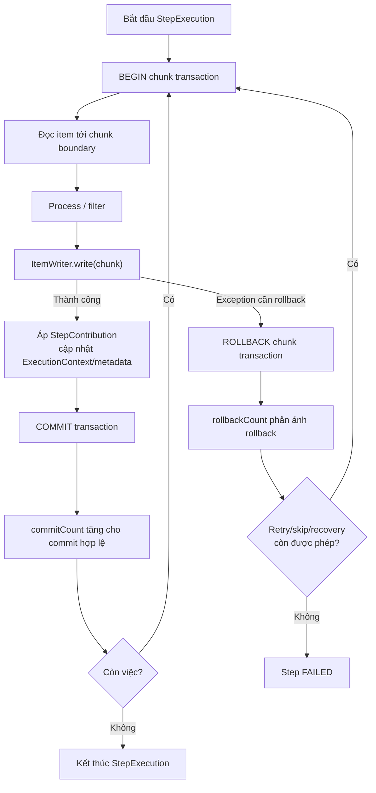
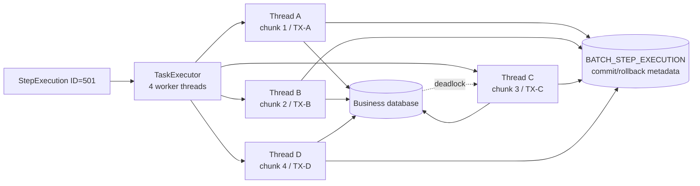
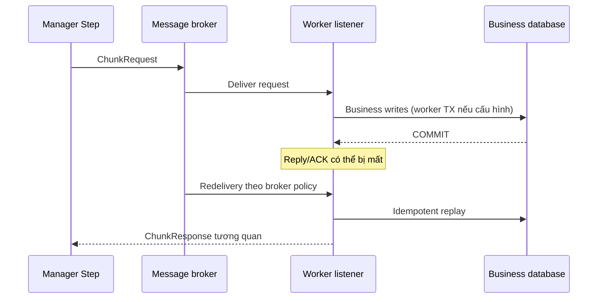

# Commit count và rollback count trong Spring Batch: Đọc đúng metrics giao dịch khi scale

> **Chương:** Metrics  
> **Phạm vi:** Đo, giải thích và vận hành hai bộ đếm `commitCount` và `rollbackCount` của `StepExecution` khi Spring Batch chạy chunk-oriented step, retry/skip, multi-threaded step, parallel steps, partitioning và remote processing. Ví dụ sử dụng **Spring Batch 5.2.x**, Java 17, Spring JDBC, PostgreSQL và Micrometer.  
> **Mục tiêu thực hành:** Không nhầm transaction count với item count, tìm được bottleneck do rollback/retry, truy vấn metadata an toàn và xây dashboard không đếm đôi.

## 1. Tình huống: Throughput giảm nhưng số item không thay đổi

Một job nhập 2 triệu bản ghi qua bốn partition ghi PostgreSQL. Sau khi tăng số worker từ 4 lên 12, thời gian chạy **tăng**, dù CPU chưa quá tải. Dashboard cho biết:

```text
Run A: 4 worker threads
  writeCount    = 2.000.000
  commitCount   = 10.100
  rollbackCount = 30
  elapsed       = 18 phút

Run B: 12 worker threads
  writeCount    = 2.000.000
  commitCount   = 10.320
  rollbackCount = 2.200
  elapsed       = 26 phút
```

Đây là **số liệu giả định để học cách đọc metrics**, không phải benchmark thật. Việc `rollbackCount` tăng mạnh khiến ta nghi ngờ DB lock contention, deadlock, lỗi ghi hoặc cơ chế retry/skip phải xử lý lại nhiều lần. Đồng thời, `commitCount` cũng có thể thay đổi do kích thước chunk, recovery scan hoặc cấu trúc partition.

Nếu chỉ nhìn `writeCount`, cả hai run đều xử lý cùng số lượng item nên có vẻ tương đương. Nếu chỉ nhìn số thread, run B có vẻ phải nhanh hơn. Hai counters transaction giúp trả lời câu hỏi khác: **Hệ thống đã phải mở và kết thúc các giao dịch thành công/thất bại bao nhiêu lần để xử lý số item ấy?**

**Điểm quan trọng:** Commit/rollback count là **counters metadata của Spring Batch**, không phải bộ đếm transaction toàn database, cũng không phải số item được ghi, lỗi, retry hay dead-letter messages.

## 2. Chính xác commitCount và rollbackCount nghĩa là gì?

Theo mô hình miền của Spring Batch 5.2:

| Thuộc tính `StepExecution` | Ý nghĩa | Không có nghĩa |
| --- | --- | --- |
| `getCommitCount()` | Số transaction do step quản lý đã được commit trong execution đó | Số row insert, số item thành công, số lần gọi writer |
| `getRollbackCount()` | Số lần business transaction do step quản lý bị rollback trong execution đó | Số item bị skip, số retry attempts chính xác, số transaction rollback của toàn ứng dụng |
| `getReadCount()` | Số item được đọc thành công theo semantics Batch | Số DB row đích đã commit |
| `getWriteCount()` | Số item được ghi thành công theo contract Batch | Số physical INSERT mới khi writer idempotent no-op |
| `getFilterCount()` | Số item processor lọc bằng cách trả `null` | Số skip do exception |
| `getReadSkipCount()` | Số item bị skip trong read | Số read retry |
| `getProcessSkipCount()` | Số item bị skip trong process | Số processor invocation thất bại |
| `getWriteSkipCount()` | Số item bị skip trong write | Số transaction rollback của writer |

Trong mã Java 5.2, đọc hai counters bằng:

```java
long commits = stepExecution.getCommitCount();
long rollbacks = stepExecution.getRollbackCount();
```

Cả hai gắn với **một `StepExecution` cụ thể**, được lưu ở metadata. Khi job restart, một `JobExecution` mới thường tạo `StepExecution` mới cho các step cần chạy lại. Không coi counter của lần chạy mới là phần tăng tiếp theo của **cùng ID execution cũ**.

### Vì sao commitCount không bằng writeCount?

Một chunk có thể ghi **200 item** rồi commit **một transaction**. Khi đó phần công việc tương ứng có thể tăng `writeCount` thêm 200, nhưng `commitCount` thường chỉ tăng 1. Với writer có `ON CONFLICT DO NOTHING`, cả 200 item được writer tiếp nhận nhưng chỉ 170 row mới được insert. Framework vẫn có thể ghi nhận `writeCount=200` theo số item Batch coi là được ghi thành công.

### Vì sao rollbackCount không bằng retryCount?

Một lỗi ghi có thể làm rollback chunk, sau đó framework retry, quét từng item để xác định lỗi được phép skip, hoặc một lỗi hạ tầng làm step thất bại. Những đường này có thể tạo nhiều rollback cho cùng item/chunk. Ngược lại, một retry thuộc HTTP client riêng có thể không làm một chunk transaction rollback tương ứng.

**Do đó: `rollbackCount` đo áp lực rollback transaction trong step; muốn biết retry attempts chính xác phải instrument retry policy/listener riêng.**

## 3. Vòng đời chunk và nơi counters được cập nhật

Chunk-oriented processing xử lý một tập item trong ranh giới transaction do `TaskletStep`/transaction manager quản lý:



Đây là **sơ đồ khái niệm**, không phải trace chi tiết mọi đường thực thi `TaskletStep`. Spring Batch có buffering, `StepContribution`, các hook listener, write scan và cập nhật repository trong transaction; việc cập nhật counters và phục hồi khi commit fail là một phần nội bộ của framework.

Điều quan trọng:

1. Một chunk thường được xử lý trong **một giao dịch**; khi lỗi cần rollback, các DB writes tham gia transaction ấy được hoàn tác.
2. Commit thành công không nhất thiết chứa **đúng `chunkSize` item**, vì chunk cuối có thể ít item, dữ liệu bị filter/skip, hoặc transaction phục vụ một vòng kiểm tra cuối.
3. Một `TaskletStep` tùy biến có thể dùng transaction cho từng lần lặp tasklet mà **không có read/write item count**.
4. Một worker `StepExecution` có thể chứa nhiều chunk transactions. Trong multi-threaded step, nhiều chunk của cùng execution có thể hoạt động đồng thời.
5. Nếu dùng datasource/transaction manager khác nhau cho metadata và output, không suy rằng mọi counter tuyệt đối khớp những side effects đã commit ở nơi khác.
6. Khi commit gặp lỗi hoặc kết quả commit không rõ, metadata cũng có thể cần recovery; không suy đoán trạng thái giao dịch từ con số vừa nhìn thấy trong bộ nhớ.

## 4. Tại sao chunkSize không quyết định chính xác commitCount?

Giả sử có 1.000 item và `chunk(100)`. Người học có thể tính:

\[
\left\lceil \frac{1000}{100} \right\rceil = 10
\]

và kết luận `commitCount` **phải bằng 10**. Đây là **ước lượng số nhóm item đầy**, không phải invariant của Spring Batch.

Một `TaskletStep` có thể thực hiện thêm một lần lặp/transaction để phát hiện reader đã hết dữ liệu; chunk cuối có thể rỗng hoặc nhỏ hơn commit interval; callback/reader/filter/skip ảnh hưởng đến diễn tiến. Vì vậy số commit thực tế có thể **không bằng** phép chia trần ở trên.

| Tình huống | Vì sao commitCount thay đổi? |
| --- | --- |
| Chunk cuối còn 37 item | Cần transaction cho chunk cuối |
| Reader cần một lần đọc để xác nhận hết nguồn | Có thể có vòng transaction khác không ghi item |
| Có filter từ processor | Số item thực sự đưa cho writer khác readCount |
| Writer gặp lỗi có skip recovery | Framework có thể cô lập item, thực hiện nhiều transaction nhỏ |
| Có retry sau rollback | Các attempt thất bại làm tăng rollbackCount, thành công sau retry đóng góp commit |
| Tasklet lặp nhiều lần | Mỗi lượt tasklet có transaction, không phụ thuộc item count |
| Một phần input đã được commit trước restart | Execution mới chỉ chạy phần còn lại |
| Nhiều partition | Mỗi worker step có counters riêng; manager có thể aggregate |

**Cách kiểm tra:** Đừng assert `commitCount == ceil(writeCount/chunkSize)` trong test production. Kiểm tra tính đúng dữ liệu cuối, giới hạn mức biến động kỳ vọng và trace transaction thực tế.

## 5. Rollback có thể là bước phục hồi bình thường, không đồng nghĩa Step FAILED

Một chunk chứa các item `[A, B, C, D]`:

```text
BEGIN TX #1
  write A
  write B
  write C → deadlock
ROLLBACK TX #1

Áp retryLimit/backoff theo policy

BEGIN TX #2
  write A, B, C, D (hoặc đường xử lý phù hợp của framework)
COMMIT TX #2
```

Ở cuối, step hoàn toàn có thể có:

```text
BatchStatus  = COMPLETED
rollbackCount > 0
commitCount   > 0
```

`rollbackCount > 0` không nhất thiết là báo động nghiêm trọng nếu hệ thống dự kiến có một lượng nhỏ lỗi transient và phục hồi được. Ngược lại, một step `FAILED` do lỗi validation **trước khi transaction chunk bắt đầu** có thể có `rollbackCount = 0`.

**Đừng dùng một điều kiện duy nhất `rollbackCount > 0 → job lỗi`.** Hãy kết hợp trạng thái cuối, exception family, retry exhausted, skip, thời gian chunk và business reconciliation.

### Lỗi PostgreSQL thường cần transaction mới

Ví dụ deadlock hoặc một lỗi SQL khiến transaction PostgreSQL bị đánh dấu aborted. Bắt exception rồi retry SQL trong **cùng transaction hỏng** có thể tạo thêm lỗi. Spring Batch cần rollback transaction chunk và thử lại trong transaction hợp lệ theo retry policy.

`rollbackCount` phản ánh các rollback do step quản lý, nhưng **không tự chứng minh** một lần retry đã diễn ra trong đúng transaction mới; điều này phải được xác minh bằng integration test.

## 6. Mối quan hệ với retryLimit và skipLimit

Hai bộ đếm transaction rất hữu ích để chẩn đoán retry/skip, nhưng **không thay thế** các policy đó:

```java
.faultTolerant()
.retry(CannotAcquireLockException.class)
.retryLimit(3)
.skip(InvalidInvoiceException.class)
.skipLimit(5)
```

Trong Spring Batch 5.2, `retryLimit(3)` là tối đa **ba attempts tính cả lần đầu** cho item theo retry context, không phải ba retries bổ sung. `skipLimit(5)` giới hạn số skip theo `StepExecution`.

Ví dụ bảng tình huống:

| Tình huống | commitCount | rollbackCount | Skip counters | Kết quả có thể |
| --- | --- | --- | --- | --- |
| Không lỗi, các chunks commit | Tăng theo giao dịch | Thường không tăng | 0 | COMPLETED |
| Writer deadlock, retry thành công | Tăng khi có commit | Có thể tăng | 0 | COMPLETED |
| Một item sai ở processor, được skip | Vẫn có transactions commit | Tùy rollback/recovery path | processSkipCount tăng | COMPLETED |
| Writer lỗi gây write scan để skip | Có thể nhiều commit nhỏ | Có thể nhiều rollback | writeSkipCount tăng | COMPLETED |
| Retry exhausted, không skip | Chỉ các transactions trước đó commit | Tăng khi lỗi gây rollback | Có thể 0 | FAILED |
| Lỗi thiếu bảng trước khi step khởi chạy | Có thể 0 | Có thể 0 | 0 | FAILED |
| HTTP client retry GET ba lần bên trong processor | Có thể một chunk TX | Có thể 0 nếu processor không ném lỗi tới Step | 0 | COMPLETED |
| Broker redelivery do mất ACK | Phụ thuộc worker protocol | Không tự phản ánh trong cùng StepExecution | Phụ thuộc processing | Có thể không rõ |

Cột “có thể” là chủ đích: **hành vi phụ thuộc exception phase, transaction boundary, fault-tolerance và phiên bản/runtime**. Không biến bảng này thành công thức cố định về số lượng.

### Write scan làm commitCount “lạ” nhưng có thể đúng

Khi writer nhận một chunk chứa item lỗi có thể skip, Spring Batch fault tolerance có thể chia/scan lại để cô lập item gây lỗi. Các giao dịch nhỏ bổ sung phục vụ recovery có thể làm `commitCount` lớn hơn số chunks tính bằng `chunkSize`.

Không tắt retry/skip chỉ để ép biểu đồ commitCount đẹp hơn. Trước hết phải xem xét nghiệp vụ có cho phép bỏ item, error quarantine, idempotency và cost của transaction không.

## 7. Đọc counters bằng StepExecutionListener

Một cách đơn giản để ghi nhận số cuối step là `StepExecutionListener.afterStep`.

```java
package com.example.batch.metrics;

import org.slf4j.Logger;
import org.slf4j.LoggerFactory;
import org.springframework.batch.core.ExitStatus;
import org.springframework.batch.core.StepExecution;
import org.springframework.batch.core.StepExecutionListener;
import org.springframework.stereotype.Component;

@Component
public class StepTransactionSummaryListener
        implements StepExecutionListener {

    private static final Logger log =
            LoggerFactory.getLogger(StepTransactionSummaryListener.class);

    @Override
    public ExitStatus afterStep(StepExecution stepExecution) {
        long commits = stepExecution.getCommitCount();
        long rollbacks = stepExecution.getRollbackCount();

        log.info(
            "jobExecutionId={} stepExecutionId={} step={} " +
            "status={} commits={} rollbacks={} read={} written={} " +
            "filtered={} readSkip={} processSkip={} writeSkip={}",
            stepExecution.getJobExecutionId(),
            stepExecution.getId(),
            stepExecution.getStepName(),
            stepExecution.getStatus(),
            commits,
            rollbacks,
            stepExecution.getReadCount(),
            stepExecution.getWriteCount(),
            stepExecution.getFilterCount(),
            stepExecution.getReadSkipCount(),
            stepExecution.getProcessSkipCount(),
            stepExecution.getWriteSkipCount());

        // null giữ nguyên ExitStatus hiện tại.
        return null;
    }
}
```

Đăng ký trong step:

```java
@Bean
Step importInvoicesStep(
        JobRepository repository,
        PlatformTransactionManager transactionManager,
        @Qualifier("invoiceReader") ItemReader<Invoice> reader,
        @Qualifier("invoiceWriter") ItemWriter<Invoice> writer,
        StepTransactionSummaryListener listener) {

    return new StepBuilder("importInvoicesStep", repository)
            .<Invoice, Invoice>chunk(200, transactionManager)
            .reader(reader)
            .writer(writer)
            .listener(listener)
            .build();
}
```

Đoạn bean `Step` là **mảnh cấu hình Spring Batch 5.2**: `Invoice`, reader, writer, JobRepository và transaction manager phải được khai báo bởi ứng dụng.

**Những giới hạn cần hiểu:**

1. `afterStep` chạy khi framework kết thúc step bình thường/theo đường lỗi mà process còn sống; nếu JVM bị `kill -9`, listener có thể không chạy và log cuối không tồn tại.
2. Đây là **đọc snapshot counters**, không phải increment metrics hoặc sửa lifecycle.
3. `StepExecutionListener.afterStep` không nên sửa `commitCount`/`rollbackCount` chỉ để dashboard trông đúng; framework sở hữu counters.
4. `afterStep` được gọi gần cuối vòng đời step, và việc lưu metadata cuối cùng phụ thuộc lifecycle repository. Đừng dùng log `afterStep` như bằng chứng DB business output đã được đối soát.
5. Gọi listener ở manager partition có thể thấy **số đã aggregate**, khác với listener ở từng worker partition.

## 8. Quan sát từng chunk bằng ChunkListener

`ChunkListener` trong Spring Batch 5.2 có các callback:

- `beforeChunk(ChunkContext)`: trước xử lý chunk, **bên trong transaction**.
- `afterChunk(ChunkContext)`: sau chunk, **bên ngoài transaction**, khi đường thành công.
- `afterChunkError(ChunkContext)`: trên đường chunk rollback; theo Javadoc, callback xảy ra sau rollback nhưng resource gắn transaction có thể vẫn còn active.

Đây là vị trí hữu ích để quan sát trạng thái, nhưng không phải lý do để tự viết metadata.

```java
package com.example.batch.metrics;

import org.slf4j.Logger;
import org.slf4j.LoggerFactory;
import org.springframework.batch.core.ChunkListener;
import org.springframework.batch.core.StepExecution;
import org.springframework.batch.core.scope.context.ChunkContext;
import org.springframework.stereotype.Component;

@Component
public class ChunkTransactionLogListener implements ChunkListener {

    private static final Logger log =
            LoggerFactory.getLogger(ChunkTransactionLogListener.class);

    @Override
    public void afterChunk(ChunkContext context) {
        logCounts("AFTER_CHUNK", context);
    }

    @Override
    public void afterChunkError(ChunkContext context) {
        logCounts("AFTER_CHUNK_ERROR", context);
    }

    private void logCounts(String phase, ChunkContext context) {
        StepExecution step =
                context.getStepContext().getStepExecution();

        log.debug(
            "phase={} jobExecutionId={} stepExecutionId={} " +
            "step={} commits={} rollbacks={} read={} write={}",
            phase, step.getJobExecutionId(), step.getId(),
            step.getStepName(),
            step.getCommitCount(), step.getRollbackCount(),
            step.getReadCount(), step.getWriteCount());
    }
}
```

Đăng ký listener:

```java
new StepBuilder("importInvoicesStep", repository)
        .<Invoice, Invoice>chunk(200, transactionManager)
        .reader(reader)
        .writer(writer)
        .listener(chunkTransactionLogListener)
        .build();
```

**Không đặt business write trong `afterChunkError`** chỉ để “ghi log lỗi xuống cùng DB”: transaction cũ có thể đã rollback/ở trạng thái không hợp lệ. Nếu cần audit độc lập bền vững, phải dùng transaction riêng có semantics rõ, **không ghi marker “thành công” trước khi chunk commit**. Với logging/metrics thông thường, dùng hệ logging hoặc telemetry ngoài transaction.

### Logging per chunk có đắt không?

Với 100 triệu items và chunk size 100, có thể có xấp xỉ **1 triệu** chunk callbacks, chưa tính recovery. Ghi một log INFO cho mỗi chunk có thể tạo chi phí IO lớn.

Thường nên:

- Log DEBUG/SAMPLED theo chunk.
- Log INFO summary theo StepExecution.
- Đưa các số liệu thời gian/tải vào Micrometer.
- Lưu chi tiết nguyên nhân lỗi trong structured log riêng khi retry/rollback tăng bất thường.

**Cảnh báo:** `afterChunkError` không phải “một item lỗi”. Nó có thể được gọi trong các đường rollback/recovery; số callback không luôn bằng `rollbackCount` trong mọi cấu hình.

## 9. Đọc metadata bằng JobExplorer khi job đang chạy

Nếu muốn dashboard hoặc runbook đọc trạng thái đã lưu, dùng `JobExplorer` thay vì truy cập object `StepExecution` đang được một worker sửa trực tiếp.

```java
package com.example.batch.metrics;

import org.springframework.batch.core.StepExecution;
import org.springframework.batch.core.explore.JobExplorer;
import org.springframework.stereotype.Service;

@Service
public class StepCountersQueryService {

    private final JobExplorer jobExplorer;

    public StepCountersQueryService(JobExplorer jobExplorer) {
        this.jobExplorer = jobExplorer;
    }

    public record StepCounters(
            long jobExecutionId,
            long stepExecutionId,
            String stepName,
            String status,
            long commits,
            long rollbacks,
            long read,
            long written,
            long skipped) {}

    public StepCounters find(
            long jobExecutionId,
            long stepExecutionId) {

        StepExecution step =
                jobExplorer.getStepExecution(
                        jobExecutionId, stepExecutionId);

        if (step == null) {
            throw new IllegalArgumentException(
                    "StepExecution not found or not in JobExecution");
        }

        return new StepCounters(
                jobExecutionId,
                stepExecutionId,
                step.getStepName(),
                step.getStatus().name(),
                step.getCommitCount(),
                step.getRollbackCount(),
                step.getReadCount(),
                step.getWriteCount(),
                step.getSkipCount());
    }
}
```

Ưu điểm:

- Đọc metadata qua API Spring Batch, không phải tự suy từ SQL.
- Trả DTO typed để monitor hoặc REST API.
- Không sửa `JobRepository` và không động vào checkpoint.
- Có thể dùng cho step đã kết thúc khi tiến trình worker không còn sống.

**Giới hạn:** Dữ liệu `JobExplorer` là **ảnh chụp đã được persist**, có thể trễ so với memory counters hoặc hệ thống business DB. Trong multi-threaded step, metadata có thể được cập nhật theo các mốc commit; không bảo đảm mọi thay đổi hiện ra tức thì. Nếu worker crash giữa lúc transaction/metadata update, phải đối soát trạng thái và input/output, không chỉ tin vào snapshot cuối.

**Đừng poll quá dày** khi có hàng nghìn partitions: đọc JobRepository nhiều lần/giây từ dashboard có thể góp phần làm cạn DB pool của chính batch workload.

## 10. Truy vấn read-only bảng BATCH_STEP_EXECUTION

Spring Batch lưu transaction counts trong bảng metadata `BATCH_STEP_EXECUTION` (khi dùng JDBC JobRepository và schema/table prefix mặc định).

Ví dụ PostgreSQL/SQL read-only:

```sql
SELECT
    s.STEP_EXECUTION_ID,
    s.JOB_EXECUTION_ID,
    s.STEP_NAME,
    s.STATUS,
    s.COMMIT_COUNT,
    s.ROLLBACK_COUNT,
    s.READ_COUNT,
    s.WRITE_COUNT,
    s.FILTER_COUNT,
    s.READ_SKIP_COUNT,
    s.PROCESS_SKIP_COUNT,
    s.WRITE_SKIP_COUNT,
    s.START_TIME,
    s.END_TIME,
    s.LAST_UPDATED
FROM BATCH_STEP_EXECUTION AS s
WHERE s.JOB_EXECUTION_ID = ?
ORDER BY s.STEP_EXECUTION_ID;
```

Dấu `?` là bind parameter kiểu `PreparedStatement`, **không** chèn execution ID từ REST request trực tiếp bằng string concatenation.

Ví dụ SQL đối chiếu job name:

```sql
SELECT
    i.JOB_NAME,
    e.JOB_EXECUTION_ID,
    e.STATUS AS JOB_STATUS,
    s.STEP_EXECUTION_ID,
    s.STEP_NAME,
    s.STATUS AS STEP_STATUS,
    COALESCE(s.COMMIT_COUNT, 0) AS COMMIT_COUNT,
    COALESCE(s.ROLLBACK_COUNT, 0) AS ROLLBACK_COUNT
FROM BATCH_JOB_INSTANCE AS i
JOIN BATCH_JOB_EXECUTION AS e
  ON e.JOB_INSTANCE_ID = i.JOB_INSTANCE_ID
JOIN BATCH_STEP_EXECUTION AS s
  ON s.JOB_EXECUTION_ID = e.JOB_EXECUTION_ID
WHERE e.JOB_EXECUTION_ID = ?
ORDER BY s.STEP_NAME, s.STEP_EXECUTION_ID;
```

**Chỉ SELECT.** Không sửa trực tiếp `COMMIT_COUNT`, `ROLLBACK_COUNT`, `VERSION`, `STATUS` hay `LAST_UPDATED` để làm đẹp số liệu; có thể làm JobRepository optimistic locking và restart sai.

### Chỉ số theo lần chạy, không phải tích lũy tự động qua các lần restart

`BATCH_JOB_EXECUTION` có thể có nhiều rows cho cùng `JobInstance` khi restart. Mỗi row `BATCH_STEP_EXECUTION` thuộc một `JOB_EXECUTION_ID` cụ thể. Nếu muốn biết **tổng công việc đã thử** qua các lần restart, phải xác định rõ có cộng các executions hay không và loại bỏ manager aggregates/duplicate work.

Với business throughput, hãy đối soát output thật theo business event key. Tổng `writeCount` của tất cả JobExecutions có thể **đếm lại** item được replay, ngay cả khi output chỉ giữ một row do idempotency.

## 11. Một ví dụ tính toán có ghi rõ giới hạn

Giả sử một `StepExecution` cuối cùng có:

```text
readCount     = 200.000
writeCount    = 190.000
filterCount   =  10.000
commitCount   =     970
rollbackCount =      30
status        = COMPLETED
elapsed       = 600 giây
chunkSize     = 200
```

Từ hai counters, có thể tính một vài **chỉ số chẩn đoán**, nhưng không gán nghĩa “tỷ lệ lỗi item”.

### 11.1. Tỷ lệ áp lực rollback theo transaction outcomes

\[
p_{\text{rollback}} =
\frac{\text{rollbackCount}}
{\text{commitCount}+\text{rollbackCount}}
\]

Với dữ liệu minh họa:

\[
p_{\text{rollback}} = \frac{30}{970+30} = 0.03 = 3\%
\]

**Đây là proxy vận hành**, không phải “3% item hỏng”, không phải xác suất một item thất bại và không phải error rate của toàn DB. Các attempts, commit/rollback nội bộ hay callbacks được tính có semantics khác nhau giữa step types/configurations.

Khi mẫu số bằng 0, chỉ số **không xác định**; không tự báo 0% để che job chưa chạy.

### 11.2. Số item writer thành công trên mỗi commit (xấp xỉ)

\[
a = \frac{\text{writeCount}}{\text{commitCount}}
= \frac{190000}{970} \approx 195.9
\]

Giá trị này **không phải actual chunk size**: commit có thể phục vụ lượt đọc cuối không có item, filter/skip hoặc recovery; writer còn có thể no-op duplicate. Nó chỉ giúp nhận ra dấu hiệu rất bất thường, ví dụ `a` giảm mạnh khi chunk size không đổi.

### 11.3. Throughput theo số item Batch ghi nhận

\[
q_{\text{batch}} =
\frac{\text{writeCount}}{\text{elapsed seconds}}
= \frac{190000}{600}
\approx 316.7\ \text{items/s}
\]

Đây là throughput **theo metadata writeCount**, không nhất thiết là số business rows mới được insert. Nếu writer dùng `ON CONFLICT DO NOTHING` hoặc API ngoài DB, phải đo `newlyApplied`/business outcomes riêng.

### 11.4. Rollbacks trên 1.000 commits

\[
r_{1000} =
1000 \times \frac{\text{rollbackCount}}
{\max(1,\text{commitCount})}
\]

Ở đây: `1000 × 30 / 970 ≈ 30,93` rollbacks/1.000 commits. Chỉ số này dùng so sánh các run **cùng cấu hình**, không phải xác suất thất bại.

**Không có một công thức duy nhất từ commitCount + rollbackCount suy ra số row bị thất lạc.**

## 12. Những công thức dễ sai khi dựng dashboard

| Công thức / kết luận sai | Vì sao sai? | Cách diễn giải đúng |
| --- | --- | --- |
| `commitCount = writeCount` | Một commit có thể ghi nhiều item | Hai counters thuộc hai đơn vị khác nhau |
| `commitCount = ceil(readCount/chunkSize)` | Có final/empty iteration, skip/recovery/tasklet | Chỉ là phép ước lượng workload |
| `rollbackCount = retry attempts` | Retry có thể diễn ra ở processor/client/broker, recovery tạo rollback | Instrument retry riêng |
| `rollbackCount = skipped items` | Skip có thể xảy ra sau các rollback khác nhau | Dùng skip counters và quarantine |
| `commitCount - rollbackCount = total success` | Hai counters không phải success/failure item | Đọc status, writeCount và business outcomes |
| `rollbackCount > 0 → BatchStatus.FAILED` | Retry/skip có thể phục hồi | Kết hợp status và error family |
| `rollbackCount = 0 → không có lỗi` | Lỗi có thể xảy ra trước TX, bên ngoài Step hoặc bị xử lý trong client | Theo dõi exceptions/health riêng |
| `writeCount = rows inserted` | Writer có thể no-op duplicate, upsert, ghi nhiều bảng | Đối soát DB business key |
| `sum(all step rows) = job totals` | Manager partition có thể đã aggregate worker totals | Chọn một cấp tổng hợp |
| `commitCount tăng = mọi DB side effect đều commit` | Có external resource/multi-transaction/uncertain outcome | Idempotency và reconcile |

**Đừng dùng transaction counters như tiêu chí chất lượng dữ liệu duy nhất.** Một job `COMPLETED` với `rollbackCount=0` vẫn có thể có sai sót upstream, duplicate bị che, sai mapping hoặc mất item nếu reader/checkpoint thiết kế lỗi.

## 13. Multi-threaded step: Một StepExecution, nhiều chunk transactions

Với `TaskExecutor`, một chunk-oriented step có thể chạy nhiều chunk **trong cùng `StepExecution`**. Từng chunk có transaction riêng nhưng counters được tổng hợp vào cùng object/row metadata của step.



**Ý nghĩa khi đọc counters:**

- `rollbackCount` có thể tăng vì một chunk của thread C, trong khi A/B/D tiếp tục commit.
- Nếu `commitCount` tăng, không kết luận tất cả threads đã hoàn thành.
- Với đa luồng, thứ tự commit có thể khác thứ tự item được đọc.
- Một `StepExecution` không tự cấp một checkpoint riêng cho từng thread; reader/state phải thread-safe và restart-safe.
- `JobRepository` có thể chịu tranh chấp metadata nếu cập nhật `StepExecution` không được điều phối đúng.
- `TaskletStep` và Spring Batch có cơ chế đồng bộ nhất định, nhưng **không làm mọi custom reader/processor/writer trở nên thread-safe**.

### Đo nút thắt đúng

Nếu tăng workers từ 4 lên 16 và `rollbackCount` tăng mạnh, hãy đo đồng thời:

1. DB lock waits/deadlocks, connection pool pending.
2. Queue depth/active threads của executor.
3. Chunk duration p50/p95/p99.
4. Retry attempts và loại exception.
5. Item throughput và business rows mới thực sự áp dụng.
6. CPU, memory, disk I/O và mức skew theo business key.

Không tăng retryLimit để che contention liên tục nếu nguyên nhân là **hot row** hoặc lock order không ổn định.

## 14. Partitioning: Bẫy cộng đôi manager và worker

Trong partitioning, `PartitionStep` đóng vai trò **manager**; mỗi partition có `StepExecution` riêng cho worker.

Ví dụ:

```text
loadManager             : commitCount=40, rollbackCount=4
loadWorker:partition0   : commitCount=10, rollbackCount=1
loadWorker:partition1   : commitCount=10, rollbackCount=0
loadWorker:partition2   : commitCount=10, rollbackCount=2
loadWorker:partition3   : commitCount=10, rollbackCount=1
```

Ở đây giả định `loadManager` dùng `DefaultStepExecutionAggregator` để tổng hợp các child counters. Manager có thể có **40 commits và 4 rollbacks đúng bằng tổng workers**.

Nếu dashboard làm:

```sql
SELECT
    SUM(COMMIT_COUNT) AS commits,
    SUM(ROLLBACK_COUNT) AS rollbacks
FROM BATCH_STEP_EXECUTION
WHERE JOB_EXECUTION_ID = ?;
```

thì kết quả sẽ là **80 commits và 8 rollbacks** — **đếm đôi** dữ liệu workers + manager, không phải có thêm 40 business transactions thật.

Spring Batch 5.2 có `DefaultStepExecutionAggregator`; Javadoc xác nhận `commitCount`, `rollbackCount` và các counters tương tự được tổng hợp **bằng phép cộng** từ child executions vào manager `StepExecution`.

### Quy tắc aggregate

Chọn **một** trong hai phạm vi để báo cáo:

- **Manager aggregate:** Dùng manager `StepExecution` như bản tổng hợp công việc partition nếu implementation và thời điểm aggregate đã được xác minh.
- **Worker leaves:** Cộng **chỉ các child `StepExecution`** đã tham gia, hữu ích để tìm partition nào có rollback cao.

Không cộng cả hai. Không trộn StepExecution từ **JobExecution lần trước** vào execution mới trừ khi dashboard chủ đích hiển thị tổng retries/restarts.

Ví dụ SQL lấy từng worker partition theo quy ước step name của ứng dụng:

```sql
SELECT STEP_EXECUTION_ID, STEP_NAME, STATUS,
       COMMIT_COUNT, ROLLBACK_COUNT,
       READ_COUNT, WRITE_COUNT
FROM BATCH_STEP_EXECUTION
WHERE JOB_EXECUTION_ID = ?
  AND STEP_NAME LIKE 'loadWorker:partition%'
ORDER BY STEP_NAME;
```

Mệnh đề `LIKE` là **ví dụ dựa trên convention của bài**. Nếu đặt tên partition khác hoặc có các flow khác, phải lọc theo topology thực và metadata, không suy rằng tên nào cũng kết thúc bằng `:partitionN`.

### Data skew

Nếu partition0 có `rollbackCount=250` còn các partition khác đều 0, vấn đề có thể là:

- Dải khóa partition0 có nhiều event trùng/hotspot.
- DB contention với một flow khác.
- Một file shard có lỗi dữ liệu hoặc dữ liệu không đều.
- Writer của partition0 dùng connection/transaction riêng sai cấu hình.

Dùng bảng per-partition để khoanh vùng; không chỉ nhìn manager aggregate làm mất ngữ cảnh.

## 15. Parallel steps và remote chunking: Phải biết counter thuộc về ai

### Parallel steps

Hai flow độc lập có `StepExecution` riêng. Không có một step manager aggregate bắt buộc như `PartitionStep`, nhưng việc cộng mọi counters vẫn cần xác định:

- Hai flow có thực hiện **cùng business event** không?
- Step đầu đọc/ghi staging, step sau publish; mỗi step có transaction riêng.
- “Tổng transaction của job” có nghĩa bao gồm staging và publish hay chỉ output đích?

Nếu cùng record được ghi qua hai stages, `writeCount` tổng hai steps **không** phải số business records duy nhất. Tương tự commit totals mô tả transaction activity ở nhiều phases, không phải business units.

### Remote partitioning

Worker `StepExecution` có thể được thực thi trên JVM khác và báo trạng thái về manager. Nếu cùng repository hoặc giao thức partition handler phù hợp, manager có thể aggregate workers.

Nếu mất kết nối khi worker đã commit nhưng reply chưa đến, có thể có **unknown outcome**; JobRepository/status và business database cần reconciliation. Không kết luận “manager rollbackCount=0” là mọi worker không lỗi.

### Remote chunking

Trong remote chunking, manager gửi `ChunkRequest` và nhận `ChunkResponse`. Worker có thể là Spring Integration listener xử lý `ChunkProcessor` chứ **không mặc định có một `TaskletStep` với `StepExecution` riêng cho từng request**.



**Không đồng nhất:**

- `commitCount` của manager step;
- số transactions vật lý worker đã commit;
- số chunk messages broker giao/ACK;
- số lần remote API đã thực hiện side effect.

Từng hệ có ranh giới transaction và retry riêng. Muốn “số business commits trên workers”, cần telemetry riêng tại worker hoặc DB đích, **không dựa duy nhất vào manager `StepExecution.commitCount`**.

## 16. Micrometer: Những metrics nào có sẵn, metrics nào phải tự bổ sung?

Theo Spring Batch **5.2** reference, framework cung cấp các Micrometer metrics với tên prefix `spring.batch` như:

| Metric | Loại | Ý nghĩa |
| --- | --- | --- |
| `spring.batch.job` | Timer | Thời gian thực thi job |
| `spring.batch.job.active` | Long-task timer | Các job đang hoạt động |
| `spring.batch.step` | Timer | Thời gian thực thi step |
| `spring.batch.step.active` | Long-task timer | Các steps đang hoạt động |
| `spring.batch.item.read` | Timer | Thời gian đọc item |
| `spring.batch.item.process` | Timer | Thời gian xử lý item |
| `spring.batch.chunk.write` | Timer | Thời gian ghi chunk |

**Quan trọng:** Spring Batch 5.2 **không liệt kê `commitCount` và `rollbackCount` như hai Micrometer counters built-in có sẵn** trong bảng metric mặc định. Chúng là **StepExecution metadata**, và muốn biểu đồ transaction outcomes phải lấy metadata hoặc instrument ứng dụng.

### Không tự đếm đôi bằng Micrometer

Anti-pattern:

```java
// PHẢN VÍ DỤ: mỗi lần poll lại cộng toàn bộ giá trị tích lũy.
Counter counter = registry.counter(
        "app.batch.rollback.total", "step", stepName);
counter.increment(stepExecution.getRollbackCount());
```

Nếu `rollbackCount=5` và dashboard poll 10 lần, counter ứng dụng có thể tăng **50** dù thật sự chỉ có 5 rollbacks. Cũng vậy, một `afterStep` log lặp/được tái xử lý bên ngoài có thể làm metrics bị đếm lại nếu dùng cộng tổng không có dedup.

**Cách thiết kế đúng tùy mục tiêu:**

1. **Báo cáo bền vững:** Đọc `JobExplorer` hoặc SQL metadata theo execution ID, tổng hợp ở tầng query theo topology đúng.
2. **Live telemetry:** Instrument transaction/chunk/retry event theo lifecycle với một quy ước rõ, không coi một callback luôn bằng một commit/rollback.
3. **Exporter dạng snapshot:** Nếu cần Prometheus, xây exporter lấy snapshot và công bố gauge/derived metric với labels **cardinality thấp**, hoặc một pipeline dedup/delta đúng cách; không tăng Counter bằng toàn bộ giá trị trên mỗi poll.
4. **Counter theo event:** Chỉ increment khi có **một event giao dịch đã được xác minh**, tránh double count khi listener/recovery/remote reply chạy lại.
5. **Thống kê trong DB:** Ưu tiên metadata bền vững làm nguồn đối chiếu cho reporting thay vì giả định một process-local Micrometer registry còn nguyên qua restart.

### Cẩn thận với metric labels

Không thêm `jobExecutionId`, `stepExecutionId`, `eventId`, `sourceRowId` hoặc `partitionId` có cardinality lớn vào mỗi nhãn Prometheus. Giữ các ID để tra cứu trong logs/traces hoặc dashboard có truy vấn on-demand; metric labels thường dùng `jobName`, `stepName`, `status`, `exceptionFamily` và role worker/manager.

Với partitioning rất lớn, tạo một series cho **từng partition** có thể tăng cardinality nhanh. Chỉ bật per-partition telemetry chi tiết khi đã có cách giới hạn hoặc sampling.

## 17. Bộ metrics nên quan sát cùng commit/rollback

Để kết luận bottleneck, nên đặt transaction counters cạnh những số liệu sau:

| Nhóm | Metric/counter | Tại sao cần? |
| --- | --- | --- |
| Batch progress | `readCount`, `writeCount`, `filterCount` | Hiểu khối lượng work |
| Data quality | `readSkipCount`, `processSkipCount`, `writeSkipCount` | Phân biệt lỗi dữ liệu và recovery |
| Transaction | `commitCount`, `rollbackCount` | Áp lực kết thúc transaction |
| Retry | Số attempts, exhausted, backoff duration | Biết nguyên nhân và chi phí retry |
| Latency | Chunk p50/p95/p99, writer SQL p95 | Tìm bước bị chậm |
| Database | Deadlock, lock wait, active/pending connections | Tìm contention |
| Runtime | Executor active threads, queue depth | Kiểm tra saturation |
| Messaging | Broker redeliveries, DLQ backlog, reply timeout | Tách middleware khỏi Step retry |
| Correctness | Business applied events, duplicate/conflict, reconciliation mismatch | Xác nhận không mất/trùng dữ liệu |
| Lifecycle | Job/step status, duration, restartCount | Biết thành công cuối và recovery |

**Ví dụ cách nhìn phối hợp:**

- `rollbackCount↑` + DB deadlocks↑ + worker threads↑: nghi lock contention, giảm concurrency/đổi lock order.
- `rollbackCount↑` + `writeSkipCount↑` + error validation: nghi data quality/skip recovery.
- `commitCount↑` + `writeCount giữ nguyên` + average items/commit↓: nghi chunk quá nhỏ, recovery scan, hoặc nhiều empty/low-work transactions.
- `commitCount↓` + throughput↓ + DB pool pending↑: có thể thiếu connection, I/O hoặc transaction giữ lock lâu.
- `rollbackCount=0` nhưng remote redelivery↑ và duplicate effects↑: vấn đề nằm ở middleware/idempotency ngoài phạm vi Step transaction counters.

Đây là **giả thuyết chẩn đoán**, không phải các quan hệ nhân quả được chứng minh chỉ bằng một biểu đồ.

## 18. Thiết kế alert có cơ sở, tránh cảnh báo nhiễu

**Không nên** alert `rollbackCount > 0` cho mọi StepExecution. Một lần rollback do deadlock thoáng qua có thể bình thường và phục hồi nhanh.

Có thể thiết kế chỉ báo:

```text
A. rollback pressure theo step/job trong cửa sổ quan sát
B. tăng đột ngột so với baseline cùng workload/chunkSize
C. số retry exhausted hoặc nhiều rollback liên tiếp
D. thời gian chunk/step vượt SLO
E. Job status FAILED, STOPPING quá lâu hoặc quality gate mismatch
```

Ví dụ policy minh họa:

| Chỉ báo | Ngưỡng minh họa, cần hiệu chỉnh | Hành động |
| --- | --- | --- |
| Rollback pressure tăng > 3× baseline trong 5 phút | Chỉ khi đủ volume để tránh nhiễu | Xem deadlock/lock waits/concurrency |
| Retry exhausted > 0 trên một step payment | Phụ thuộc contract dữ liệu | Cảnh báo on-call và reconcile |
| Chuỗi rollback liên tục, không commit | Chặn worker theo deadline/circuit breaker | Giảm retry storm, bảo vệ DB |
| Step FAILED | Cần điều tra | Kiểm tra side effects và restart |
| Partition rollback lệch lớn so với phần còn lại | So sánh volume/size từng partition | Khoanh vùng hot key/data skew |
| `COMPLETED` nhưng business reconciliation mismatch | Ngưỡng thường phải bằng 0 cho dữ liệu bắt buộc | Chặn publish, đối soát |

**Ngưỡng chỉ là ví dụ**, không phải default của Spring Batch. Khi một step mới bắt đầu có `commitCount=0`, đừng chia rollbackCount cho 0 rồi cảnh báo 100%; cần điều kiện đủ transaction sample và thời gian quan sát.

### Khi retry storm xuất hiện

Đừng chỉ tăng `retryLimit`:

1. Hạn chế worker concurrency và queue backlog.
2. Điều chỉnh chunk size và transaction duration dựa trên DB metrics.
3. Dùng backoff/jitter cho lỗi transient đã được phân loại đúng.
4. Tìm hot business key, lock order và missing index.
5. Xem lại connection pool/shared DB JobRepository load.
6. Áp overall deadline/circuit breaker.
7. Khôi phục từ checkpoint với writer idempotent khi cần.

## 19. Tình huống lỗi và phương án khắc phục

| Triệu chứng | Sai lầm thường gặp | Cách xử lý |
| --- | --- | --- |
| Dashboard commit cao hơn 2× so với workers | Cộng manager aggregate và workers | Chọn một cấp tổng hợp |
| `rollbackCount` cao nhưng job COMPLETED | Retry/skip recovery đã xử lý được | Xem nguyên nhân, chất lượng và latency |
| `rollbackCount=0` mà job FAILED | Lỗi trước TX hoặc ngoài chunk | Phân tích stack trace/lifecycle |
| `commitCount` không bằng `readCount/chunkSize` | Giả định mỗi commit chứa đúng một chunk đầy | Kiểm tra final chunk, recovery, tasklet |
| `writeCount` lớn hơn số rows mới | Writer idempotent no-op, upsert hoặc nhiều nguồn | Đo business `newlyApplied` riêng |
| Step restart nhưng counts có vẻ bắt đầu lại | JobExecution/StepExecution mới | Báo cáo theo execution ID và instance |
| Ngày có job chạy lại bị double count | Cộng executions mà không phân biệt replay | Xác định business instance và unique effects |
| Rollback metrics khác event listener count | Callback semantics không 1:1 | Đọc StepExecution + instrument retry/chunk đúng chỗ |
| Đã poll metadata nhưng counter không đổi ngay | Persistence theo commit/repository lifecycle | Dùng interval phù hợp, đừng giả định real-time tuyệt đối |
| DB rollback thật nhưng Batch counter thấp | Có transaction ngoài Step/business DB riêng | Kiểm tra transaction boundaries và DB telemetry |
| Tăng workers làm rollback tăng | Deadlocks/lock contention | Giảm concurrency, sửa thứ tự lock/index |
| Remote worker commit nhưng manager không nhận reply | Lost reply/ACK, redelivery | Idempotency và reconciliation, không dựa rollbackCount |
| Lỗi `OptimisticLockingFailureException` ở metadata | Cạnh tranh cập nhật `StepExecution` | Điều tra ownership/thread safety, không chỉnh `VERSION` |
| Alarm sai vì sample count quá thấp | Tỷ lệ rollback bị chia cho số commit nhỏ | Có volume threshold và baseline |
| Process kill -9 nên không có log `afterStep` | Listener không chạy sau JVM crash | Đọc JobRepository + orchestration logs |
| Metric Counter nhân mỗi lần poll | Dùng increment(total) thay vì delta | Dùng snapshot/dedup/delta chính xác |

## 20. Kiểm thử và fault injection

### Bài A — Baseline theo chunk

Tạo một job đọc 1.000 record bất biến, `chunk(100)`, writer JDBC cùng transaction manager. Đọc `StepExecution` và SQL metadata. Ghi `commitCount` thực tế, đừng ép kết quả chính xác 10; kiểm tra `writeCount` và số row nghiệp vụ.

### Bài B — Tạo một rollback có thể phục hồi

Dùng writer fake ném `CannotAcquireLockException` ở lần thử đầu rồi thành công. Cấu hình `faultTolerant().retry(...).retryLimit(3)`, quan sát `rollbackCount`, `commitCount` và `BatchStatus`. Kiểm chứng output không trùng.

### Bài C — Retry exhausted

Writer luôn ném lỗi transient. Không cấu hình skip tương ứng. Xác nhận StepExecution FAILED, các counters và failure exceptions được lưu/hiển thị phù hợp; không chạy vô hạn.

### Bài D — Skip sau write failure

Trong chunk có một item sai. Cấu hình `skip(InvalidRecordException.class)` và `skipLimit(1)`. Quan sát số rollback/commit khi framework cô lập item lỗi; xác nhận `writeSkipCount=1` và business data hợp lệ đã commit.

### Bài E — Lỗi ở processor

Processor ném `InvalidRecordException` với một item và được skip. So sánh `rollbackCount` với lỗi ở writer; quan sát khác biệt pha xử lý và callback thực tế.

### Bài F — Tasklet không có item count

Tạo `TaskletStep` thực hiện 3 lần lặp tasklet có transaction, không đọc/ghi item qua `ItemReader/ItemWriter`. Quan sát `commitCount` có thể tăng trong khi `readCount/writeCount=0`.

### Bài G — Chunk size 50/200/500

Giữ nguyên source snapshot/worker count, chỉ thay chunk size. Đo `commitCount`, `rollbackCount`, runtime, DB lock duration, JDBC batch IO. Không mặc định chunk lớn luôn tối ưu.

### Bài H — Multi-threaded step

Dùng pool 1/4/8 và JDBC writer; cố tình tạo tranh chấp trên vài business keys. Đo DB deadlocks/lock waits và hai counters. Kiểm tra reader thread safety, commit order và restart.

### Bài I — Partitioning và double count

Tạo manager `loadManager` và 4 partitions. Đọc counters từng worker và manager; xác minh manager aggregate. Dựng hai query và chứng minh cộng cả manager + worker gây double count.

### Bài J — Parallel steps

Tạo hai flow độc lập chạy đồng thời: flow A tạo staging rows, flow B tổng hợp. Đọc per-step commits/rollbacks; xác định khi nào cộng transaction counts có ý nghĩa vận hành và khi nào `writeCount` tổng không phải unique business records.

### Bài K — Remote chunking

Cho worker commit business writes rồi mất reply. Broker redeliver request; kiểm tra output idempotent, messages redelivered, manager counters và DB telemetry. Giải thích vì sao các số đếm khác nhau.

### Bài L — Crash và restart

Kill worker sau khi một vài chunks đã commit trong môi trường test. Đọc JobRepository trước/sau restart, so sánh `JobExecution ID` và `StepExecution ID`; đối soát tổng output theo stable event key.

### Bài M — Micrometer không có built-in transaction counters

Bật Spring Batch Micrometer monitoring, xác nhận các timers `spring.batch.step` và `spring.batch.chunk.write`. Đọc `commitCount/rollbackCount` từ metadata; xây báo cáo typed không tăng `Counter` bằng giá trị tích lũy trên mỗi lần poll.

### Bài N — Dashboard per-partition

Tạo dashboard có overall manager summary và drill-down workers. Mỗi số commit/rollback phải ghi rõ nguồn `StepExecution` nào, phạm vi JobExecution nào, đã aggregate hay chưa.

### Bài O — Throughput và rollback pressure

Từ dataset giả định ở phần 11, tính `writeCount/elapsed`, `rollbackCount/(commitCount+rollbackCount)` và `writeCount/commitCount`. Viết chú thích cho từng chỉ số để không gọi chúng là “error rate của dữ liệu”.

### Bài P — Alert dựa trên nhiều tín hiệu

Mô phỏng hai trường hợp: (1) rollback ít, throughput ổn và job COMPLETED; (2) rollback tăng liên tục, lock wait cao, throughput giảm, retry exhausted. Thiết kế alert phân biệt hai tình huống.

### Checklist nghiệm thu

- [ ] Phân biệt được `commitCount`/`rollbackCount` (transaction) với `readCount`/`writeCount` (item).
- [ ] Biết counters gắn với **StepExecution**, không phải một quota hay tổng tự động toàn job.
- [ ] Không suy `rollbackCount = retryCount` hoặc `commitCount = số chunks đầy`.
- [ ] Có đối soát business rows, duplicate effects và input snapshot.
- [ ] Đã đọc `StepExecution` bằng listener, `JobExplorer` hoặc SQL read-only.
- [ ] Dashboard không cộng hai lần manager aggregate và worker partition.
- [ ] Có metrics cho retry/backoff, latency, DB lock waits, concurrency và data quality.
- [ ] Micrometer exporter không increment tổng counters mỗi lần poll.
- [ ] Có định nghĩa rõ cách tính chỉ số dẫn xuất và xử lý mẫu số bằng 0.
- [ ] Đã test rollback, retry exhausted, skip recovery, concurrency và restart.
- [ ] Không sửa trực tiếp `BATCH_STEP_EXECUTION.VERSION/COMMIT_COUNT/ROLLBACK_COUNT`.
- [ ] Phân biệt transaction của manager, worker, broker và side effects ngoài DB.

## 21. Tài liệu tham khảo chính thức

- [Spring Batch 5.2 — Domain Language: StepExecution counters](https://docs.spring.io/spring-batch/reference/5.2/domain.html)
- [Spring Batch 5.2.5 — StepExecution Javadoc](https://docs.spring.io/spring-batch/docs/5.2.5/api/org/springframework/batch/core/StepExecution.html)
- [Spring Batch 5.2 — Meta-Data Schema](https://docs.spring.io/spring-batch/reference/5.2/schema-appendix.html)
- [Spring Batch 5.2 — Chunk-Oriented Processing](https://docs.spring.io/spring-batch/reference/5.2/step/chunk-oriented-processing.html)
- [Spring Batch 5.2 — Configuring Retry Logic](https://docs.spring.io/spring-batch/reference/5.2/step/chunk-oriented-processing/retry-logic.html)
- [Spring Batch 5.2 — Configuring Skip Logic](https://docs.spring.io/spring-batch/reference/5.2/step/chunk-oriented-processing/configuring-skip.html)
- [Spring Batch 5.2 — Controlling Rollback](https://docs.spring.io/spring-batch/reference/5.2/step/chunk-oriented-processing/controlling-rollback.html)
- [Spring Batch 5.2 — Batch Processing and Transactions](https://docs.spring.io/spring-batch/reference/5.2/transaction-appendix.html)
- [Spring Batch 5.2 — Monitoring and Metrics](https://docs.spring.io/spring-batch/reference/5.2/monitoring-and-metrics.html)
- [Spring Batch 5.2 — Scaling and Parallel Processing](https://docs.spring.io/spring-batch/reference/5.2/scalability.html)
- [Spring Batch 5.2.6 — ChunkListener Javadoc](https://docs.spring.io/spring-batch/docs/5.2.6/api/org/springframework/batch/core/ChunkListener.html)
- [Spring Batch 5.2.6 — DefaultStepExecutionAggregator Javadoc](https://docs.spring.io/spring-batch/docs/5.2.6/api/org/springframework/batch/core/partition/support/DefaultStepExecutionAggregator.html)
- [Spring Batch 5.2.6 — JobExplorer Javadoc](https://docs.spring.io/spring-batch/docs/5.2.6/api/org/springframework/batch/core/explore/JobExplorer.html)
- [Micrometer — Concepts and Meter Types](https://docs.micrometer.io/micrometer/reference/concepts.html)

> **Giới hạn phiên bản và phương pháp:** Ví dụ hướng **Spring Batch 5.2.x** với `org.springframework.batch.core.StepExecution` và `ChunkListener` của phiên bản 5.2. Spring Batch 6 có thể thay đổi package, builder, listener và metadata API. Các tình huống số học/benchmark trong bài chỉ là **số liệu giả định**; không coi một công thức suy diễn là hợp đồng chính xác về số transaction cho mọi implementation, database driver hay transaction manager. Khi có remote worker hoặc database khác resource với JobRepository, cần bổ sung telemetry và reconciliation end-to-end.

**Ghi nhớ:** `commitCount` cho biết **bao nhiêu transaction của một StepExecution được commit**, còn `rollbackCount` phản ánh **bao nhiêu lần transaction do step quản lý bị rollback**. Cả hai là chỉ báo vận hành hữu ích về retry, contention và chi phí xử lý, nhưng **không thay thế** các item counts, retries, skip counts, business effects và Job/Step statuses. Khi scale Spring Batch, luôn đọc metrics **đúng scope (step, execution, partition, manager/worker)**, đo nguyên nhân lỗi và xác minh output thực tế thay vì suy kết quả nghiệp vụ chỉ từ hai counters.
