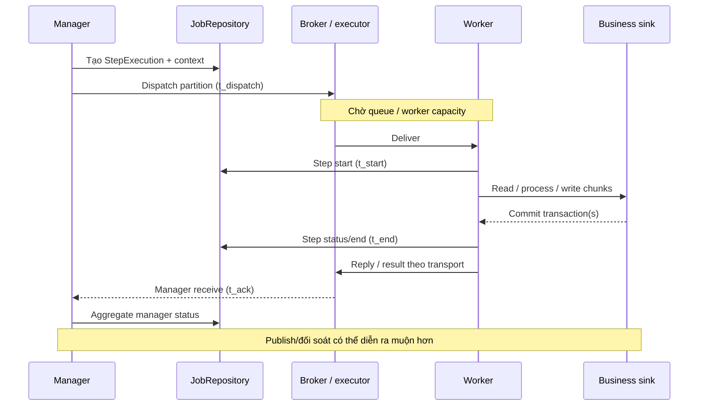
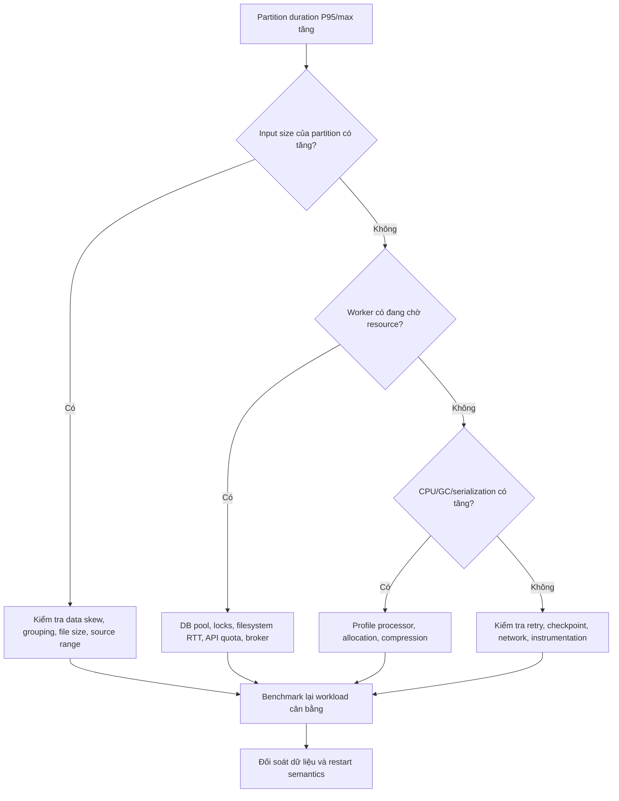

# Partition completion time

## 1. Bài toán: nhiều partition đã xong nhưng cả job vẫn chậm

Một job Spring Batch nhập 24 triệu bản ghi bằng **remote partitioning** trên tám worker. Dashboard báo có 31/32 partitions đã `COMPLETED`; một partition cuối vẫn đang chạy. CPU của bảy worker đã gần như rảnh, nhưng business report chưa được phép công bố vì thiếu dữ liệu. Nhóm vận hành nhìn vào **thời gian trung bình của partition** và thấy mỗi partition chỉ mất 90 giây, trong khi toàn job đã chạy 14 phút.

Vì sao hai con số khác xa nhau? Có thể do:

- Partition cuối chứa nhiều bản ghi hơn (data skew/straggler).
- Partition chờ trong executor hoặc broker trước khi bắt đầu; thời gian **xếp hàng** không hiện trong thời gian worker thực thi.
- Một worker có DB connection chậm, file-system RTT cao, API retry hoặc checkpoint nhiều lần.
- Một partition đã `FAILED`, restart rồi chạy lại nhưng dashboard chỉ tính attempt thành công cuối.
- Manager phải chờ tổng hợp trạng thái hoặc reply muộn sau khi business data đã commit.
- Một số partitions đã hoàn thành ở **JobExecution trước** và không xuất hiện trong danh sách chỉ lấy của lần restart hiện tại.

**Partition completion time** là nhóm phép đo giúp giải thích lúc nào một logical partition thực sự hoàn tất, thời gian xử lý của từng `StepExecution`, ảnh hưởng của hàng đợi và **phần đuôi kéo dài (tail latency)** tới thời gian hoàn thành toàn job.

Bài thuộc chương **Metrics**, module **SPRING_BATCH_SCALING_OPERATIONS**: mở rộng Spring Batch bằng multi-threaded step, parallel steps, partitioning và xử lý phân tán, đồng thời đo nút thắt, thread safety, retry/restart và vận hành workload lớn. Đây là một chủ đề quan sát hiệu năng, **không** chỉ là cách hiển thị elapsed time.

> **Nguyên tắc chính:** thời gian hoàn tất của một worker `StepExecution` **khác** thời gian từ khi partition được tạo/giao việc tới khi manager ghi nhận, và **khác** makespan của cả nhóm partitions. Đừng lấy một timer thay thế ba số đo.

### Mục tiêu học tập

Sau bài này, bạn có thể:

1. Định nghĩa rõ worker execution duration, queue/dispatch wait, end-to-end partition latency, group makespan và recovery latency.
2. Đo thời gian từ `StepExecution.startTime`, `endTime`, JobRepository và telemetry bổ sung.
3. Phân tích P50/P95/P99, max, skew ratio, straggler và throughput trên các partitions so sánh được.
4. Tách local/remote partitioning với multi-threaded step, parallel steps và remote chunking.
5. Dùng Micrometer, `StepExecutionListener`, SQL JobRepository và logs/traces để làm dashboard.
6. Tránh cardinality cao, clock skew, active executions có `endTime=NULL` và đếm trùng attempts sau restart.
7. Thiết kế alert, benchmark/fault injection và runbook giảm tail time mà không mất tính đúng dữ liệu.

## 2. Thế nào là “partition hoàn tất”?

Trong Spring Batch partitioning, manager `PartitionStep` chia một step logic thành những partition được đặt tên, ví dụ:

```text
job: invoiceImportJob
manager step: invoiceManagerStep
worker step:
  invoiceWorkerStep:range-0000
  invoiceWorkerStep:range-0001
  invoiceWorkerStep:range-0002
  invoiceWorkerStep:range-0003
```

Mỗi worker partition có một **StepExecution** và `ExecutionContext` chứa phạm vi nguồn (range, file ID, snapshot ID...). Manager dùng `PartitionHandler` để giao thực thi, rồi tổng hợp kết quả.

Với contract thông thường, logical partition được coi là hoàn thành khi **worker StepExecution có trạng thái `COMPLETED` hợp lệ**, metadata được lưu và manager có thể tổng hợp nó vào kết quả. Nhưng **đã có StepExecution completed** không tự chứng minh side effect ngoài JobRepository đúng hoặc toàn job đã publish dữ liệu; vẫn cần đối soát nghiệp vụ.

### 2.1. Tối thiểu phải phân biệt năm đồng hồ

| Thời gian | Điểm bắt đầu | Điểm kết thúc | Ý nghĩa |
| --- | --- | --- | --- |
| **Worker execution duration** | Worker `StepExecution.startTime` | Worker `StepExecution.endTime` | Thời gian worker step được thực thi, gồm xử lý và những lần chờ bên trong |
| **Dispatch/queue wait** | Manager đưa logical partition vào hàng chờ/gửi request | Worker thực sự bắt đầu step | Thời gian chưa xử lý do pool/broker/scheduler |
| **End-to-end partition latency** | Partition được chấp nhận/giao việc lần đầu | Manager công nhận kết quả cuối | Cả chờ, chạy, vận chuyển reply, retry và recovery |
| **Partition-group makespan** | Bắt đầu dispatch/worker start của nhóm theo contract | Partition cuối cần thiết hoàn thành | Thời gian critical path của nhóm |
| **Job completion/publish latency** | Business window ready / JobExecution started | Kết quả đã đối soát và công bố | Mục tiêu SLA thật của người dùng |

**Một StepExecution không có sẵn toàn bộ năm đồng hồ này.** Nó có `createTime`, `startTime`, `endTime`, `lastUpdated` và trạng thái, nhưng không mặc định lưu **manager dispatch timestamp**, **broker enqueue timestamp**, **reply received timestamp**, **business publish timestamp**. Nếu cần những số đó, phải instrument thêm.

### 2.2. Không nhầm createTime, startTime, endTime, lastUpdated

| Thuộc tính `StepExecution` | Dùng để làm gì? | Điều không nên suy ra |
| --- | --- | --- |
| `createTime` | Lúc đối tượng execution được tạo | Không đồng nghĩa thời điểm manager publish task |
| `startTime` | Lúc step execution bắt đầu thực thi | Không có nghĩa partition được đưa vào queue ở thời điểm này |
| `endTime` | Lúc execution kết thúc, nếu đã được ghi nhận | Có thể `null` nếu đang chạy hoặc process chết đột ngột |
| `lastUpdated` | Lần metadata được cập nhật gần nhất | **Không phải** end time hoặc heartbeat tin cậy mặc định |
| `status` | `STARTING/STARTED/COMPLETED/FAILED/STOPPED`... | `COMPLETED` không chứng minh dữ liệu đúng nghiệp vụ |

Trong Spring Batch 5.x, `StepExecution.getStartTime()` và `getEndTime()` dùng `LocalDateTime`; dữ liệu Java không mang timezone. Dữ liệu SQL mặc định cũng phải được diễn giải theo quy ước hệ thống. Với một worker chạy trên một node, elapsed time đo bằng **monotonic clock** như `System.nanoTime()` phù hợp hơn để đo khoảng thời gian runtime; timestamp wall-clock phù hợp hơn cho audit và đối chiếu sự kiện **nếu đã chuẩn hóa UTC/NTP**.

### 2.3. Công thức đo cho một execution đã kết thúc

```text
workerDurationSeconds =
    endTime - startTime

Chỉ tính khi:
  startTime != NULL
  endTime   != NULL
  endTime >= startTime
  status được phân loại rõ
```

Có thể tính failed attempt duration khi StepExecution kết thúc `FAILED` và có end time. Đừng trộn nó vào phân phối **thời gian hoàn tất thành công** mà không có nhãn outcome.

Đối với execution còn `STARTED`, bạn có thể đo **running age**:

```text
runningAgeNow = now() - startTime
```

Nhưng đây là **tuổi đang chạy**, **không phải completion time**. Với nhiều node, so thời gian từ hai host có thể sai do lệch đồng hồ; dùng metrics active/long-task timer trong process và audit timestamps có chuẩn hóa.

## 3. Timeline một partition qua manager, broker và worker



**Trật tự sơ đồ mang tính minh họa.** Trong một số topology, worker không trực tiếp cập nhật repository ở cùng cách, hoặc manager dùng polling thay vì reply. ACK broker, DB commit, StepExecution status và manager aggregation có thể nằm ở các transaction khác nhau.

Nếu bắt đầu đo bằng `t_start`, bạn bỏ qua thời gian xếp hàng. Nếu đo tới `t_end`, bạn bỏ qua đường trả kết quả. Nếu chỉ nhìn `t_ack`, bạn không biết riêng đoạn nào chậm.

### 3.1. Phân rã một completion latency

```text
T_end_to_end ≈
    T_manifest_and_dispatch_wait
  + T_worker_start_wait
  + T_worker_execution
  + T_reply_or_reconciliation
  + T_retry_recovery_gaps

Các giai đoạn có thể chồng lấn; không cộng các số trùng pha.
```

Với remote partitioning, một phần wait nằm ở broker/transport; với local partitioning, nó có thể nằm trong `TaskExecutor` queue. **Không bắt buộc mọi thành phần phải có cùng timestamp source** nếu ta quan sát theo duration/spans; nhưng khi lấy hiệu hai wall timestamps từ hai node phải có chiến lược đồng bộ clock và điều tra clock skew.

## 4. Ví dụ tính: 6 partitions, 4 workers

Giả sử một manager dispatch sáu partitions cùng lúc. Bốn slots worker chạy song song. Thời gian **worker execution** đã đo (chỉ là ví dụ):

| Partition | Worker start kể từ t=0 | Worker end kể từ t=0 | Worker duration |
| --- | ---: | ---: | ---: |
| `p0` | 0 s | 20 s | 20 s |
| `p1` | 0 s | 23 s | 23 s |
| `p2` | 0 s | 21 s | 21 s |
| `p3` | 0 s | 100 s | 100 s |
| `p4` | 20 s | 40 s | 20 s |
| `p5` | 21 s | 43 s | 22 s |

```mermaid
gantt
    title Minh họa lịch chạy 6 partition trên 4 worker slots
    dateFormat X
    axisFormat %s
    section Slot 1
    p0 :a, 0, 20
    p4 :b, 20, 40
    section Slot 2
    p2 :c, 0, 21
    p5 :d, 21, 43
    section Slot 3
    p1 :e, 0, 23
    section Slot 4
    p3 (straggler) :crit, f, 0, 100
```



Phép tính:

```text
Total worker effort = 20 + 23 + 21 + 100 + 20 + 22 = 206 worker-seconds
Mean worker duration = 206 / 6 ≈ 34,3 giây
Median worker duration = (21 + 22) / 2 = 21,5 giây
Max worker duration = 100 giây
Skew ratio (max / median) ≈ 100 / 21,5 ≈ 4,65
Group makespan (từ worker đầu tới cuối) = 100 giây

Lý tưởng với 4 slots và không ràng buộc khác:
total effort / 4 = 51,5 giây (lower bound theo work)
Thực tế: 100 giây, bị chi phối bởi partition p3.
```

**Không có phép tính nào trong ví dụ xác nhận “P95 = 100s” là chỉ số vận hành ổn định.** Với chỉ sáu observations, percentile cao rất nhạy theo phương pháp nội suy; ưu tiên hiển thị **max, partition ID và timeline**, rồi tích lũy phân phối qua nhiều batch có tính chất so sánh được.

Một thước đo tham khảo:

```text
Worker slot efficiency (ước lượng) =
    sum(worker durations) / (configured parallel slots × makespan)
  = 206 / (4 × 100)
  = 51,5%
```

Đây là **ước lượng sử dụng công việc của slots trong ví dụ**, không phải CPU efficiency hay database utilization. Nếu worker duration bao gồm chờ DB, con số này vẫn có thể cao trong khi CPU nhàn. Nếu scale-out từ 4 lên 8 slots mà `p3` vẫn mất 100 giây, makespan có thể không cải thiện đáng kể.

### 4.1. Vì sao cần duration và start offset?

`p4` mất 20 giây xử lý nhưng bắt đầu sau 20 giây. Với manager dispatch tại `t=0`:

```text
p4 worker duration = 40 - 20 = 20 giây
p4 end-to-end từ dispatch ≈ 40 - 0 = 40 giây
p4 dispatch wait ≈ 20 giây
```

Nếu dashboard chỉ plot worker duration, người xem có thể hiểu sai là `p4` “hoàn tất sau 20 giây”. Để phân tích backlog, cần thêm **queue wait** và **dispatch-to-complete latency** (có cách đo đáng tin).

### 4.2. Straggler là gì?

**Straggler** là partition kéo dài bất thường so với các partitions **có cùng loại công việc/cost**. Không chỉ xem max duration:

- Partition chứa 10 triệu rows mà nhóm khác có 100 nghìn rows: thời gian lớn có thể **do workload size**.
- Partition 100 nghìn rows nhưng mất gấp 10 lần các nhóm cùng size: có thể do network, DB locks, worker GC, API 429 hoặc node CPU throttling.
- Một partition `FAILED` rồi restart mất 15 phút: worker attempt cuối có thể nhanh, nhưng **logical completion latency** dài.
- Một partition xử lý xong sớm nhưng reply thất lạc: **worker duration** ngắn, **manager acknowledgement** dài.

## 5. Đừng đánh đồng một tên metric với nhiều thứ khác nhau

| Metric | Cách định nghĩa | Khi hữu ích |
| --- | --- | --- |
| `partition_worker_duration_seconds` | `StepExecution.end - start` | Hiệu năng xử lý trên worker |
| `partition_queue_wait_seconds` | Worker start − dispatch accepted | Executor/broker backlog; cần instrument |
| `partition_dispatch_to_complete_seconds` | Manager nhận completion − dispatch | Hợp đồng giao việc end-to-end |
| `partition_attempts_total` | Số StepExecutions/attempts của logical partition | Retry/restart amplification |
| `partition_running_age_seconds` | Từ start đến hiện tại của active step | Stalled/straggler alert |
| `partition_group_makespan_seconds` | Đầu→cuối nhóm theo mốc đã chọn | Critical path/SLA partition phase |
| `partition_recovery_latency_seconds` | Từ failure tới final confirmed completion | RTO vận hành |
| `partition_items_per_second` | Unique committed items / worker duration | So sánh cost và hiệu quả |
| `partition_input_bytes_per_second` | Bytes thực đọc / worker duration | I/O bottleneck |
| `partition_completion_status_total` | Số attempts completed/failed/stopped | Health; không thay thế coverage |

**Tên metric trong bảng là đề xuất**, không phải toàn bộ metrics mặc định Spring Batch. Tên chính xác khi export có thể được biến đổi theo Prometheus/OTel/backend, cần đối chiếu thực tế.

### 5.1. Ngưỡng phân phối nên đo ở đâu?

- **P50**: worker duration thông thường.
- **P90/P95**: phần đuôi chậm, hữu ích khi có nhiều partitions tương đồng.
- **P99**: cần đủ samples và time window dài; với vài partitions/job thường không ổn định.
- **Max**: giúp tìm straggler quyết định makespan.
- **P95/P50 hoặc max/median**: đo skew tương đối giữa nhóm tương đồng.
- **Mức tuyệt đối**: 20 phút có vượt SLA không?
- **Kết hợp input volume**: `seconds/1,000 rows`, `MiB/s`, item cost; phân biệt to/nhỏ.

Tách distributions theo **job/worker-step type**, input size class, source type hoặc region nếu đó là nguyên nhân có thể kiểm soát. Không so p95 từ các jobs hoàn toàn khác schema/parser/chunk size rồi kết luận một worker chậm.

### 5.2. Percentile không thay thế expected completion date

Một job cần tất cả 10 partitions, chín cái mất 5 giây và một cái mất 10 phút. P50 thấp không giúp job hoàn tất; **makespan bị quyết định bởi partition chậm nhất**. Với batch close-of-day hoặc publish barrier, ưu tiên nhìn **last incomplete partition + its age + estimated remaining work**.

## 6. Spring Batch metadata: lấy số đo ở đâu?

Spring Batch `JobRepository` JDBC mặc định có:

- `BATCH_JOB_INSTANCE`: một logical job theo tên + identifying parameters.
- `BATCH_JOB_EXECUTION`: mỗi lần chạy/restart.
- `BATCH_STEP_EXECUTION`: từng worker partition execution và manager step; chứa `START_TIME`, `END_TIME`, `STATUS`, `READ_COUNT`, `WRITE_COUNT`, `COMMIT_COUNT`, `ROLLBACK_COUNT`.
- `BATCH_STEP_EXECUTION_CONTEXT`: checkpoint/metadata ứng dụng cần thiết; **không** phải nơi mặc định lưu đầy đủ dispatch/reply telemetry.

Tên bảng có thể dùng prefix/schema khác; cột và API thay đổi theo Spring Batch/database version. Ví dụ SQL bên dưới dùng **schema JDBC mặc định** và PostgreSQL để minh họa; chạy với user read-only vào metadata, không sửa bảng `BATCH_*`.

### 6.1. Query từng worker StepExecution thuộc một JobInstance

```sql
SELECT
    ji.JOB_INSTANCE_ID,
    je.JOB_EXECUTION_ID,
    je.STATUS AS JOB_STATUS,
    se.STEP_EXECUTION_ID,
    se.STEP_NAME,
    se.STATUS AS STEP_STATUS,
    se.START_TIME,
    se.END_TIME,
    se.READ_COUNT,
    se.WRITE_COUNT,
    se.COMMIT_COUNT,
    se.ROLLBACK_COUNT,
    CASE
      WHEN se.START_TIME IS NOT NULL
       AND se.END_TIME IS NOT NULL
       AND se.END_TIME >= se.START_TIME
      THEN EXTRACT(EPOCH FROM (se.END_TIME - se.START_TIME))
      ELSE NULL
    END AS worker_duration_seconds
FROM BATCH_JOB_INSTANCE ji
JOIN BATCH_JOB_EXECUTION je
  ON je.JOB_INSTANCE_ID = ji.JOB_INSTANCE_ID
JOIN BATCH_STEP_EXECUTION se
  ON se.JOB_EXECUTION_ID = je.JOB_EXECUTION_ID
WHERE ji.JOB_INSTANCE_ID = :jobInstanceId
  AND se.STEP_NAME LIKE 'invoiceWorkerStep:%'
ORDER BY se.STEP_NAME, je.JOB_EXECUTION_ID, se.STEP_EXECUTION_ID;
```

Tại sao lọc `invoiceWorkerStep:%`? Vì `invoiceManagerStep` là **manager StepExecution**, không phải worker partition. Nếu dùng cùng timer của manager và worker rồi cộng lại, ta có thể đếm thời gian **lồng nhau** như thể nhiều công việc độc lập.

Tên worker step thực tế cần theo cách `Partitioner` đặt tên, ví dụ `invoiceWorkerStep:range-0007`. Không hardcode prefix trên dashboard nếu ứng dụng có naming convention khác.

### 6.2. Những lỗi phổ biến khi truy vấn

1. Chỉ lấy StepExecutions của **JobExecution mới nhất** sau restart: bỏ qua các partitions đã `COMPLETED` ở lần đầu.
2. Đếm mỗi `STEP_NAME` là một logical partition nhưng không xét các attempts: cộng lặp cùng partition.
3. Bao gồm manager step như một partition: sai count và tổng durations.
4. Dùng `LAST_UPDATED` làm end time: đó chỉ là thời điểm metadata update, không phải hoàn tất.
5. Lấy `END_TIME=NULL` thành 0 giây rồi đưa vào percentile: làm giả số đo cực nhanh.
6. Chỉ tính `COMPLETED` mà không xem số failed attempts: che thời gian recovery và failure rate.
7. Tính `readCount` của nhiều attempts thành **unique records**: replay có thể tăng counts dù business sink dedup.
8. Chưa phân biệt `JobInstance` và `JobExecution`: có thể nhầm rerun thành restart.
9. Quên clock skew hoặc timezone/precision khác giữa các worker nodes.
10. Chạy query full-scan metadata trên primary mỗi giây: có thể **tự tạo bottleneck JobRepository**.

## 7. SQL: tính P50/P95 và straggler trên các partitions đã hoàn tất

Nếu mục tiêu là một số **duration thành công cuối** cho mỗi logical partition thuộc một JobInstance, chọn last successful execution theo `STEP_NAME`.

```sql
WITH successful_worker_attempts AS (
    SELECT
        ji.JOB_INSTANCE_ID,
        se.STEP_NAME,
        se.STEP_EXECUTION_ID,
        EXTRACT(EPOCH FROM
          (se.END_TIME - se.START_TIME))::double precision
            AS duration_seconds,
        se.READ_COUNT,
        se.WRITE_COUNT,
        ROW_NUMBER() OVER (
          PARTITION BY ji.JOB_INSTANCE_ID, se.STEP_NAME
          ORDER BY se.END_TIME DESC, se.STEP_EXECUTION_ID DESC
        ) AS success_rank
    FROM BATCH_JOB_INSTANCE ji
    JOIN BATCH_JOB_EXECUTION je
      ON je.JOB_INSTANCE_ID = ji.JOB_INSTANCE_ID
    JOIN BATCH_STEP_EXECUTION se
      ON se.JOB_EXECUTION_ID = je.JOB_EXECUTION_ID
    WHERE ji.JOB_INSTANCE_ID = :jobInstanceId
      AND se.STEP_NAME LIKE 'invoiceWorkerStep:%'
      AND se.STATUS = 'COMPLETED'
      AND se.START_TIME IS NOT NULL
      AND se.END_TIME IS NOT NULL
      AND se.END_TIME >= se.START_TIME
)
SELECT
    COUNT(*) AS completed_logical_partitions,
    ROUND(AVG(duration_seconds)::numeric, 2) AS mean_seconds,
    ROUND(
      (percentile_cont(0.50) WITHIN GROUP (
          ORDER BY duration_seconds))::numeric, 2
    ) AS p50_seconds,
    ROUND(
      (percentile_cont(0.95) WITHIN GROUP (
          ORDER BY duration_seconds))::numeric, 2
    ) AS p95_seconds,
    ROUND(MAX(duration_seconds)::numeric, 2) AS max_seconds,
    SUM(WRITE_COUNT) AS write_count_of_selected_attempts
FROM successful_worker_attempts
WHERE success_rank = 1;
```

**Giới hạn cần hiểu:**

- PostgreSQL `percentile_cont` dùng nội suy; P95 từ 4–8 partitions khó có ý nghĩa thống kê.
- `write_count_of_selected_attempts` **không** là unique business output; nếu một partition failed đã commit vài chunks và attempt mới replay, phép tổng này có thể bỏ qua commit trước đó.
- Nếu cấu hình `allowStartIfComplete(true)` chủ đích chạy lại completed step, last success không phải là toàn bộ lịch sử. Với audit, phải giữ **mọi attempts**.
- SQL chưa chứng minh tất cả expected partitions đều có completed attempt; cần so với **manifest/partition plan**.
- Nếu dữ liệu có failed attempt sau một completed attempt theo cấu hình đặc biệt, chọn “last successful” không tự đồng nghĩa trạng thái logical partition đã ổn định; hãy kiểm tra workflow.

### 7.1. Tìm partitions chậm nhất

```sql
SELECT
    se.STEP_NAME,
    je.JOB_EXECUTION_ID,
    se.STEP_EXECUTION_ID,
    se.STATUS,
    se.READ_COUNT,
    se.WRITE_COUNT,
    EXTRACT(EPOCH FROM
      (se.END_TIME - se.START_TIME)) AS duration_seconds
FROM BATCH_JOB_EXECUTION je
JOIN BATCH_STEP_EXECUTION se
  ON se.JOB_EXECUTION_ID = je.JOB_EXECUTION_ID
WHERE je.JOB_INSTANCE_ID = :jobInstanceId
  AND se.STEP_NAME LIKE 'invoiceWorkerStep:%'
  AND se.START_TIME IS NOT NULL
  AND se.END_TIME IS NOT NULL
ORDER BY duration_seconds DESC NULLS LAST
LIMIT 20;
```

Query này hiển thị **attempts chậm**, có thể chứa failed attempts; tốt cho điều tra. Đừng lấy trực tiếp danh sách này như bảng xếp hạng logical partitions nếu một partition đã chạy lại nhiều lần.

### 7.2. Đo workers vẫn đang chạy

```sql
SELECT
    se.STEP_EXECUTION_ID,
    se.STEP_NAME,
    se.STATUS,
    se.START_TIME,
    se.LAST_UPDATED,
    EXTRACT(EPOCH FROM (CURRENT_TIMESTAMP - se.START_TIME))
       AS observed_running_age_seconds
FROM BATCH_JOB_EXECUTION je
JOIN BATCH_STEP_EXECUTION se
  ON se.JOB_EXECUTION_ID = je.JOB_EXECUTION_ID
WHERE je.JOB_INSTANCE_ID = :jobInstanceId
  AND se.STEP_NAME LIKE 'invoiceWorkerStep:%'
  AND se.STATUS IN ('STARTED', 'STARTING', 'STOPPING')
  AND se.START_TIME IS NOT NULL
ORDER BY observed_running_age_seconds DESC;
```

**Đặc biệt quan trọng:** một worker bị kill -9 có thể để lại `STARTED` mà không cập nhật thành `FAILED`. Cột age trong SQL không chứng minh worker **còn thực sự chạy**. Cần đối chiếu heartbeat riêng, pod/process ownership, broker request state và data-plane activity.

Nếu DB dùng timestamp without time zone và JVM/nodes dùng timezone khác nhau, phép `CURRENT_TIMESTAMP - START_TIME` có thể không biểu diễn tuổi chính xác; thống nhất policy lưu/tính timestamp. Không dùng query age này làm hành động tự động sửa `BATCH_*`.

## 8. Có nên dùng metrics Micrometer sẵn có?

Spring Batch tích hợp Micrometer để đo job, step, item và chunk durations. Với Spring Batch **5.2.x**, tài liệu liệt kê các metric:

| Metric built-in | Loại | Ý nghĩa | Tags điển hình trong 5.2 |
| --- | --- | --- | --- |
| `spring.batch.job` | `TIMER` | Duration JobExecution | `name`, `status` |
| `spring.batch.job.active` | `LONG_TASK_TIMER` | Job đang chạy | `name` |
| `spring.batch.step` | `TIMER` | Duration StepExecution | `name`, `job.name`, `status` |
| `spring.batch.step.active` | `LONG_TASK_TIMER` | Step đang chạy | `name` |
| `spring.batch.item.read` | `TIMER` | Item read duration | `job.name`, `step.name`, `status` |
| `spring.batch.item.process` | `TIMER` | Item process duration | `job.name`, `step.name`, `status` |
| `spring.batch.chunk.write` | `TIMER` | Chunk write duration | `job.name`, `step.name`, `status` |

Spring Batch **6.x** có tài liệu **Micrometer support/Observability** và API/tag semantics có điểm khác so với 5.2. Phải kiểm tra version thực tế; ví dụ tag `status` ở 5.2 timer thường là `SUCCESS`/`FAILURE`, không được tự assume nó luôn bằng `BatchStatus.COMPLETED`. Tên Prometheus thường được **normalize** (ví dụ `spring_batch_step_seconds_*`) theo registry/exposition.

**Dùng được gì ngay?**

- Worker StepExecution duration nếu worker có meter registry được export và **tag step name** đúng.
- Manager step duration (ở một serie khác): gần với thời gian manager điều phối, nhưng không phải toàn bộ business publish latency.
- Timer của item read/process/chunk write: gợi ý stage gây chậm.
- Active long-task timer: nhìn các steps chưa kết thúc.

**Chưa có gì mặc định từ các timers này?**

- Dispatch accepted → worker started.
- Broker queue wait per logical partition.
- Correctness/expected record count và output reconciliation.
- Per-partition **logical** duration xuyên qua failed attempts + restart.
- Shared source snapshot/version, node generation, broker ACK/reply latency.

### 8.1. Đừng lạm dụng step name như một high-cardinality tag

Trong partitioning, step name có thể là:

```text
invoiceWorkerStep:tenant-00000001
invoiceWorkerStep:tenant-00000002
...
invoiceWorkerStep:tenant-00999999
```

Nếu một metric time series có tag `name` bằng **tên từng logical partition**, nó có thể tạo **hàng triệu time series** theo partition IDs. Đây là rủi ro đặc biệt trong distributed metrics: memory, Prometheus scrape size, query cost và retention đều tăng.

Nên:

- Với metric tổng hợp, dùng `jobName`, **worker step type** (`invoiceWorkerStep`), `outcome` và **size class hữu hạn** (small/medium/large) nếu thực sự cần.
- **Không** dùng `JobExecutionId`, `StepExecutionId`, `partitionName`, `filePath` hoặc `tenantId` số lượng lớn làm labels cho histogram.
- Đặt partition ID trong **structured logs/traces/audit tables**, dùng exemplar nếu observability stack hỗ trợ.
- Thiết lập `MeterFilter`/tag normalization hoặc metrics custom có cardinality kiểm soát; **đừng để built-in step-name tag tự bùng nổ** khi hàng triệu partitions.
- Khi benchmark riêng từng partition, truy vấn **JobRepository theo job instance** thay vì ghi mỗi partition thành một Prometheus series lâu dài.

## 9. Java: đo worker elapsed time bằng StepExecutionListener

Nếu cần tự kiểm soát metric low-cardinality, gắn listener vào **worker step**, không chỉ manager. Spring Batch 5.x có `StepExecutionListener.beforeStep` và `afterStep`. Một listener chia sẻ giữa nhiều StepExecutions phải **thread-safe**.

### 9.1. Mẫu listener không tag partition ID

```java
import io.micrometer.core.instrument.MeterRegistry;
import io.micrometer.core.instrument.Timer;
import org.springframework.batch.core.BatchStatus;
import org.springframework.batch.core.ExitStatus;
import org.springframework.batch.core.StepExecution;
import org.springframework.batch.core.StepExecutionListener;

import java.util.concurrent.ConcurrentHashMap;
import java.util.concurrent.ConcurrentMap;

public final class PartitionDurationListener
        implements StepExecutionListener {

    private final MeterRegistry meterRegistry;
    private final ConcurrentMap<Long, Timer.Sample> samples =
            new ConcurrentHashMap<>();

    public PartitionDurationListener(MeterRegistry meterRegistry) {
        this.meterRegistry = meterRegistry;
    }

    @Override
    public void beforeStep(StepExecution execution) {
        Long id = execution.getId();
        if (id != null) {
            samples.put(id, Timer.start(meterRegistry));
        }
    }

    @Override
    public ExitStatus afterStep(StepExecution execution) {
        Long id = execution.getId();
        Timer.Sample sample =
                id == null ? null : samples.remove(id);

        if (sample == null) {
            return null; // Giữ nguyên exit status của framework.
        }

        String outcome = execution.getStatus() == BatchStatus.COMPLETED
                ? "success" : "non_success";

        String workerStepType = baseStepName(execution.getStepName());

        sample.stop(
            Timer.builder("batch.partition.worker.duration")
                 .description("Worker processing duration")
                 .tags(
                     "job", execution.getJobExecution()
                             .getJobInstance().getJobName(),
                     "worker_step", workerStepType,
                     "outcome", outcome)
                 .publishPercentileHistogram()
                 .register(meterRegistry));

        return null;
    }

    private static String baseStepName(String name) {
        int colon = name.indexOf(':');
        return colon < 0 ? name : name.substring(0, colon);
    }
}
```

Code chỉ dùng `Timer.Sample.stop(...)` để ghi **duration thực**, không giả lập bằng một thời gian hằng số hay ghi hai lần vào hai timers. `Timer.Sample` dùng monotonic elapsed time theo clock của MeterRegistry. Nó đo từ `beforeStep` tới `afterStep`, có thể hơi khác duration `startTime/endTime` do điểm gọi listeners và repository commit. Không dùng sample này để đo queue wait trước khi step bắt đầu.

**Chú ý lifecycle:** nếu worker bị kill cứng, `afterStep` có thể không chạy, sample còn trong process đã chết và không phát duration completed; phải giám sát active/stale executions bằng repository/cluster control plane. Nếu một listener singleton có nhiều worker steps chạy cùng lúc, map `ConcurrentHashMap` tránh đè state; `StepExecutionId` đã được repository cấp trước khi worker chạy trong trường hợp thông thường.

### 9.2. Gắn vào worker Step

```java
@Bean("partitionDurationListener")
PartitionDurationListener partitionDurationListener(
        MeterRegistry registry) {
    return new PartitionDurationListener(registry);
}

@Bean("invoiceWorkerStep")
Step invoiceWorkerStep(
        JobRepository repository,
        PlatformTransactionManager txManager,
        @Qualifier("invoiceReader") ItemStreamReader<InvoiceRow> reader,
        @Qualifier("idempotentInvoiceWriter") ItemWriter<InvoiceRow> writer,
        @Qualifier("partitionDurationListener")
            PartitionDurationListener listener) {

    return new StepBuilder("invoiceWorkerStep", repository)
            .<InvoiceRow, InvoiceRow>chunk(250, txManager)
            .reader(reader)
            .writer(writer)
            .listener(listener)
            .build();
}
```

`InvoiceRow`, `invoiceReader` và `idempotentInvoiceWriter` là dependencies do ứng dụng định nghĩa. Đây là cấu hình **Spring Batch 5.x minh họa**, chưa cung cấp đầy đủ imports, `Job`, `DataSource` hay manager `PartitionHandler`.

Một lưu ý nhỏ: `afterStep` có thể chỉnh `ExitStatus` nếu trả giá trị khác `null`, nên mẫu trả `null` để **không đổi** kết quả step. Listener đo thời gian không nên điều khiển business status hoặc ném exception rồi hy vọng framework fail job: exception trong `afterStep` thường chỉ được log theo contract listener.

### 9.3. Tránh histogram không giới hạn

`publishPercentileHistogram()` tạo buckets phục vụ phân vị tại backend hỗ trợ nhưng cũng làm tăng số series. Với hàng nghìn step types/outcomes, chi phí lớn. Có thể dùng **SLO buckets hữu hạn** và một vài tags ổn định, ví dụ ngưỡng 30 giây, 2 phút, 10 phút; config cần phù hợp Micrometer version và SLA.

Nếu metrics backend chỉ dùng timer `count/sum/max` mà không có histogram, dashboard **không thể** tự tính P95 chính xác từ trung bình. Cần bật histogram/SLO buckets hoặc dùng phân phối từ audit SQL/batch reports.

## 10. Phân biệt Micrometer live metrics và JobRepository audit

| Tiêu chí | Micrometer/Prometheus | JobRepository SQL |
| --- | --- | --- |
| Mục tiêu | Real-time aggregation/alert | Lịch sử từng StepExecution |
| Per-partition detail | Dễ nổ cardinality nếu tag từng partition | Có `STEP_NAME`/`STEP_EXECUTION_ID` |
| Worker chết cứng | Sample cuối có thể không được export | `STARTED` mồ côi vẫn có metadata |
| P95 theo nhiều executions | Histogram thuận tiện nếu configured | SQL percentile theo tập đã chọn |
| Restart history | Không tự hiểu logical attempts | Join JobInstance → JobExecutions → Steps |
| Queue/dispatch latency | Cần custom instrumentation | Không có dispatch timestamp mặc định |
| Business correctness | Không tự biết unique sink rows | Chỉ có counters; cần đối soát sink |
| Retention | Phụ thuộc monitoring backend | Phụ thuộc repository cleanup |
| So theo cluster | Cần scrape/push/gateway architecture | DB tập trung nếu topology phù hợp |

**Kết luận:** dùng Micrometer để **phát hiện nhanh tail time/overload**, dùng JobRepository để **điều tra attempt cụ thể**, và dùng nguồn/sink audit để **chứng minh nghiệp vụ hoàn thành đúng**.

## 11. PromQL minh họa: P95 khi đã có histogram

Nếu custom `Timer` `batch.partition.worker.duration` được export qua Prometheus registry với histogram buckets, và labels đúng như listener:

```promql
histogram_quantile(
  0.95,
  sum by (le, job, worker_step) (
    rate(batch_partition_worker_duration_seconds_bucket{
      outcome="success"
    }[30m])
  )
)
```

**Đây là PromQL minh họa, cần kiểm tra tên metric/labels thực tế ở `/actuator/prometheus` và Micrometer version.** Query chỉ đúng khi bucket series được export. Tần suất partitions thấp hoặc time window quá hẹp sẽ cho percentile nhiễu hoặc không có số.

### 11.1. Số samples mỗi cửa sổ rất quan trọng

Nếu trong 30 phút có **3 successful partitions**, biểu đồ “P99” từ histogram không có ý nghĩa thống kê đáng tin. Nên:

- Dùng window dài hơn hoặc tổng hợp qua nhiều JobInstances cùng workload class.
- Hiển thị **sample count** cạnh percentile.
- Với nhóm một vài partitions, dùng **min/median/max + bảng per-partition**.
- Tách `success` và `failure`; nếu chỉ success, dashboard dễ che thời gian bị mất vì retries.
- Khi đo long-running partitions, thêm active-age metric vì histogram không chứa job **chưa kết thúc**.

### 11.2. Điều tra một partition bằng logs/traces, không phải metric label

Mẫu log event:

```json
{
  "event": "partition-completion",
  "jobName": "invoiceImportJob",
  "jobInstanceId": 77,
  "jobExecutionId": 121,
  "stepExecutionId": 8802,
  "partitionName": "range-0007",
  "workerStepType": "invoiceWorkerStep",
  "workerGeneration": "worker-03-g2",
  "manifestId": "invoice-2026-11-v1",
  "inputRowsPlanned": 180000,
  "readCount": 180000,
  "writeCount": 179995,
  "filterCount": 5,
  "workerDurationSeconds": 311.6,
  "workerStatus": "COMPLETED",
  "dispatchToCompleteSeconds": 328.4
}
```

Đây là **schema log tự thiết kế**, không phải log framework tự sinh. `dispatchToCompleteSeconds` phải được ghi từ instrumentation đáng tin ở manager/worker. Với dữ liệu tài chính, không log PII/full payload/secrets. Gắn correlation ID từ dispatch để nối manager và worker spans.

## 12. Đếm completion theo logical partition qua restart

Đây là điểm khó nhất của metric. Với cùng `JobInstance`:

```text
JobInstance #77, manifest=M-001

JobExecution #120 (lần đầu):
  worker:range-0000   COMPLETED  35s
  worker:range-0001   COMPLETED  41s
  worker:range-0002   FAILED     120s
  worker:range-0003   COMPLETED  38s

JobExecution #121 (restart cùng JobInstance):
  worker:range-0002   COMPLETED  44s

=> Logical partitions completed: 4/4
=> Completed worker attempts: 4
=> Total worker attempts: 5
=> range-0002 có 2 attempts; thời gian hoàn tất logic dài
   hơn chỉ 44 giây attempt cuối.
```

Nếu query chỉ lấy `JobExecution #121`, bạn có thể kết luận sai rằng chỉ hoàn thành **1/4 partitions**. Nếu query đếm **5 StepExecutions** như 5 partitions, lại sai theo cách khác.

### 12.1. Tách attempt duration khỏi logical completion latency

Một partition có:

```text
10:00:00  Dispatch đầu tiên
10:00:10  Worker start attempt #1
10:05:10  Worker attempt #1 FAILED (300 giây)
10:10:00  Được phép restart, manager dispatch lại
10:10:20  Worker start attempt #2
10:12:20  Attempt #2 COMPLETED (120 giây)
10:12:23  Manager xác nhận completion

Worker duration attempt thành công cuối: 120 giây
Tổng worker attempt durations: 420 giây
Recovery gap: 310 giây kể từ fail tới restart start
End-to-end logical completion: 12 phút 23 giây
```

**Cẩn thận:** khoảng `10:05:10 → 10:10:20` là 310 giây; tổng từ `10:00:00 → 10:12:23` là 743 giây, không bằng tổng worker durations vì có queue/restart/reply waits.

Nếu chỉ báo “P95 worker completion time” từ các completed attempts, đợt sự cố có thể **không hiện trên biểu đồ** vì failed duration và recovery gap đã bị loại. Vì vậy cần song song:

- `attempt_duration_seconds` phân tách success/failure.
- `logical_partition_completion_latency_seconds` từ first dispatch tới confirmed success.
- `restart_attempt_count` và `recovery_gap_seconds`.
- `stale_started_count` và lost-reply/timeout counters.

### 12.2. Completed partition không phải cứ restart là chạy lại

Spring Batch partitioning thường **không chạy lại các completed worker partitions** khi restart một JobInstance theo default, nhưng manager vẫn tổng hợp status/counts của chúng từ repository. Cấu hình như `allowStartIfComplete(true)`, custom splitter hoặc quy trình rerun có thể thay đổi hành vi. Không dựng metric completion bằng giả định “mỗi JobExecution đều phải có StepExecution của tất cả partitions”.

### 12.3. Chỉ số “all partitions done” cần manifest

```text
expectedPartitions = tập partition names bất biến trong manifest

completedPartitions =
  tập logical partition names đã có completed execution hợp lệ
  trên mọi JobExecutions của JobInstance, theo policy

Completion coverage =
  |completedPartitions ∩ expectedPartitions| / |expectedPartitions|
```

Nếu một partition không hề được dispatch (thiếu name mapping, bug splitter), JobRepository có thể **không có row** để báo lỗi. Muốn chứng minh 100% coverage, cần đối chiếu tập expected names từ manifest, không chỉ đếm `BATCH_STEP_EXECUTION`.

**Không đổi name→input mapping giữa restart.** Nếu `range-0002` lần đầu trỏ records A nhưng lần sau trỏ records B, cùng step name **không còn đại diện cùng logical partition**.

## 13. Vấn đề khi đo distributed workers: clock skew và missing events

### 13.1. Clock lệch sẽ tạo latency âm

```text
Manager clock: 10:00:05 -> dispatch
Worker clock:  09:59:58 -> start

Naive queueWait = -7 giây  (vô nghĩa)
```

Không “sửa” số âm thành 0 rồi coi đó là queue wait thực. Phải ghi nhận **clock skew anomaly** và chọn nguồn đo khác.

Khuyến nghị:

- Chuẩn hóa UTC/NTP/PTP theo yêu cầu vận hành.
- Đo **duration bên trong cùng process** bằng monotonic clock/`Timer.Sample`.
- Với cross-node spans, dùng distributed tracing và kiểm tra skew; một span không tự chữa đồng hồ lệch.
- Nếu cần queue time từ broker, dùng **broker-side timestamp/age** với semantics đã xác minh.
- Ghi rõ clock source và observation point trong tài liệu metric.
- Kiểm tra timezone và precision khi ghép Java `LocalDateTime`, PostgreSQL `TIMESTAMP`, ISO UTC logs và Unix timestamp.

### 13.2. Worker chết đột ngột

Khi kill -9 hoặc node mất nguồn, worker có thể:

- Chưa gửi `afterStep`/completion metrics.
- Chưa persist `StepExecution.endTime`.
- Đã commit một số chunks/business sink nhưng metadata vẫn `STARTED`.
- Có in-flight request/reply trong broker chưa được manager ghi nhận.

**Không gán thời gian còn thiếu bằng 0 hoặc đánh dấu `COMPLETED` theo timeout.** Đây là **censored/missing observation**; dashboard cần chỉ rõ active/stale/unknown, và runbook recovery phải xác minh worker cũ dừng hay có thể tiếp tục ghi.

### 13.3. Metric scraping ở short-lived workers

Nếu worker container chạy vài giây rồi thoát, Prometheus pull có thể **không scrape kịp** timer cuối. Nếu chỉ dựa vào in-memory metrics, bạn có thể mất toàn bộ các samples nhanh nhất và tạo selection bias.

Tùy topology:

- Giữ worker service lâu dài, export Micrometer endpoint để scrape định kỳ.
- Lưu per-partition audit trong JobRepository (đã có StepExecution).
- Dùng OTLP/collector/exporter theo lifecycle phù hợp, có flush/termination grace period.
- Không dựng một worker Job độc lập rồi push mọi partition ID thành metric label.
- Đặt SLA của observability riêng: missing metrics phải được phát hiện/đối soát.

## 14. Phân biệt các cơ chế scaling khi đọc completion time

| Cơ chế Spring Batch | Có một `StepExecution` riêng cho mỗi đơn vị chạy? | Cách đọc duration |
| --- | --- | --- |
| **Local partitioning** | **Có** cho từng worker partition | Mỗi worker StepExecution start/end |
| **Remote partitioning** | **Có** cho worker partition | Tương tự, cộng dispatch/reply telemetry |
| **Multi-threaded step** | Thường **một** StepExecution cho step có nhiều chunks/threads | Step duration **không** cho duration từng thread/chunk |
| **Parallel steps / split flows** | Có StepExecution cho từng step của flow | Step durations có thể chồng lấn; không cộng thành job wall time |
| **Remote chunking** | Worker xử lý **chunk requests**, không có một StepExecution riêng cho mỗi chunk theo mô hình partitioning | Đo chunk request/reply, worker processing và manager StepExecution riêng |
| **Remote step** (các phiên bản mới hỗ trợ) | Step metadata tùy mô hình remote step cụ thể | Kiểm tra API/version và transport semantics |

Trong **remote chunking**, gọi `ChunkRequest.sequence` hoặc broker message ID là “partition ID” sẽ làm dashboard sai. Muốn đo chunk completion, instrument request/reply correlation và business sink commit, **không** giả định StepExecution riêng cho từng chunk.

### 14.1. Parallel steps: tổng duration không bằng wall time

Giả sử hai flows chạy cùng lúc:

```text
Flow A step duration = 4 phút
Flow B step duration = 6 phút

Tổng duration: 10 worker-step-minutes
Job makespan: khoảng 6 phút + overhead, không phải 10 phút
```

Điều tương tự xảy ra khi nhiều partition workers chạy song song. Vì vậy muốn đánh giá lợi ích scale, phải đo **job wall time + stage makespan + resource utilization** thay vì chỉ cộng StepExecution durations.

### 14.2. Remote partitioning có một “wait” khác

Worker có thể đã `COMPLETED` trên repository, nhưng manager vẫn chờ reply/aggregation. Khi đó:

- Worker duration không đổi.
- Manager step duration tăng.
- End-to-end completion latency tăng.
- Dashboard có thể hiện **completed 100% nhưng job chưa finalized**.

Phải theo dõi manager liveness, reply queue/timeout/correlation và JobRepository state; không gán lỗi đó cho reader/processor/writer nếu chúng đã hoàn tất đúng.

## 15. Kết hợp duration với input cost và throughput

Nếu partition `A` xử lý 20.000 records trong 40 giây, partition `B` xử lý 2 triệu records trong 160 giây:

```text
A throughput ≈ 20.000 / 40 = 500 records/s
B throughput ≈ 2.000.000 / 160 = 12.500 records/s
```

Partition B chậm hơn về absolute completion time nhưng **hiệu quả xử lý theo record cao hơn**. Điều quan trọng là cả **load balancing** lẫn **processing efficiency**.

### 15.1. Các normalized metrics hữu ích

| Metric | Công thức gần đúng | Lưu ý |
| --- | --- | --- |
| `records_per_worker_second` | committed unique items / worker duration | Cần unique sink count, không chỉ readCount |
| `seconds_per_1000_items` | duration × 1000 / processed items | Khi items ≈ 0 cần bỏ/flag |
| `MiB_per_second` | bytes read/written / duration | Phân biệt bytes uncompressed/compressed |
| `time_per_file` | worker duration / files in partition | File size/phức tạp khác nhau |
| `commits_per_second` | commitCount / duration | Đếm commits, không đo lượng dữ liệu |
| `p95_db_wait_seconds` | tracing/timer connection wait | Phân biệt processing và chờ resource |
| `partition_size_skew` | max input size / median size | Giải thích duration skew trước khi tối ưu code |

**Không so normalized metrics xuyên các loại item khác nhau** mà bỏ qua chi phí nghiệp vụ; parse một JSON 10 MB khác với xử lý một ID 20 bytes.

### 15.2. Một partition có readCount=0 vẫn có duration

Một worker mở file không tồn tại, chờ connection 60 giây rồi bị fail có thể có `readCount=0`. Nếu chỉ tính `duration/readCount`, dashboard chia cho 0; nếu loại hoàn toàn partitions không có records, bạn che một lỗi quan trọng.

Nên phân loại `empty/zero-work`, `failed-before-read` và `no-input-expected` riêng. Nếu business quy định một partition trống là lỗi, dùng listener/policy để fail theo contract, không “đẹp hóa” metrics.

## 16. Phân tích nguyên nhân partition chậm

### 16.1. Cây quyết định



### 16.2. Dấu hiệu theo stage

| Triệu chứng | Khả năng | Đo thêm |
| --- | --- | --- |
| `readCount` ít nhưng worker duration cao | Chờ mở file, DB reader query hoặc API | File open P95, SQL query latency |
| `readCount` nhiều, CPU cao | CPU-bound parse/transform | CPU profiling, allocations, item process timer |
| `writeCount` ít, `commitCount` nhiều | Chunk quá nhỏ hoặc filter/skip | Chunk size, write latency và business rules |
| Worker idle giữa chunks | DB/API contention, downstream throttling | Pool pending, 429, retry backoff |
| Chỉ một worker node chậm | Node CPU throttling, memory/GC, network RTT | Pod metrics, GC pause, disk/network |
| Nhiều partitions đều chậm đồng thời | Shared DB/storage bị saturation | DB wait events, WAL/IOPS, broker lag |
| Worker duration ngắn, dispatch latency dài | Executor queue/broker wait | Queue depth/age, active threads |
| Worker `COMPLETED`, manager vẫn chờ | Reply/aggregation issue | Correlation, missing replies, DLQ |
| Failed attempts dài, final success nhanh | Recovery gap/timeout | Attempt history + JobOperator logs |
| Partition count rất lớn, mỗi partition nhỏ | Dispatch/metadata overhead | JobRepository write rate, StepExecution count |
| P95 tăng sau scale-out | Oversubscription DB/API | Connection budget toàn cluster |

**Tăng worker chỉ đúng khi bottleneck còn parallelizable.** Nếu một partition xử lý một file không splittable 500 GB, thêm 20 pods không làm partition đó tự chia thành 20; nếu DB đã bão hòa, thêm workers còn làm chậm tất cả.

## 17. Thiết kế alerts: đừng đợi JobExecution FAILED

Một chiến lược theo dõi nên có ba lớp:

1. **SLA:** partition-group makespan và end-to-end batch publish phải hoàn thành trước deadline.
2. **Performance:** max/P95 durations, queue age, normalized throughput và resource saturation.
3. **Correctness:** expected partitions, business unique records, totals và output versions.

### 17.1. Ví dụ rule vận hành

| Tín hiệu | Điều kiện minh họa | Ưu tiên |
| --- | --- | --- |
| No progress | Completed partition count không tăng 10 phút, còn active work | High |
| Straggler | Một active partition age > 3× P50 của nhóm tương đồng | Medium/High tùy SLA |
| Completion tail | Max completed duration > 10 phút ở job vốn < 2 phút | Medium |
| Queue wait | P95 dispatch wait > 120 giây | High với near-deadline |
| Recovery | Một logical partition đã retry 3 lần | High |
| Stale StepExecution | `STARTED` cũ, không có worker alive tương ứng | High; cần manual verification |
| Manager waiting | Worker success nhưng manager vẫn chưa aggregate sau timeout | High |
| Capacity | DB pending connections/429 tăng cùng duration P95 | High |
| Reconciliation | Expected vs actual business records không khớp | Critical |
| Observability missing | Hàng loạt worker không export metrics nhưng có repository metadata | Medium |

Các ngưỡng **chỉ minh họa**, không phải khuyến nghị chung. Đặt theo **baseline cùng workload class, deadline nghiệp vụ và sample count**. Alerts nên tránh phân biệt theo từng partition ID thành hàng trăm nghìn alert riêng; một alert job-level có danh sách top slow partitions kèm link logs thường hữu ích hơn.

### 17.2. Không tự kill worker theo threshold duration đơn giản

Một partition có thời gian 15 phút có thể đang xử lý file lớn hợp lệ. Kill nó vì vượt 10 phút rồi retry sẽ làm tăng tải và lùi checkpoint. Trước khi stop:

- Kiểm tra `readCount/writeCount` có tiến triển hay không.
- Xem input size và estimated remaining work.
- So resource wait, CPU và retry activity.
- Kiểm tra worker vẫn alive hay metadata stale.
- Xác nhận có phương án idempotency/restart trước khi kill.

## 18. Benchmark: tăng worker count có thực giảm makespan?

Giả sử một job có **64 partition groups**, cùng input snapshot và phần lớn groups tương đương. Bảng **hoàn toàn giả định**:

| Concurrent worker slots | Group makespan | P50 worker duration | Max worker duration | Quan sát |
| ---: | ---: | ---: | ---: | --- |
| 1 | 128 phút | 2,0 phút | 3,2 phút | Baseline |
| 2 | 68 phút | 2,0 phút | 3,5 phút | Tăng gần tuyến tính |
| 4 | 36 phút | 2,1 phút | 4,0 phút | Còn headroom |
| 8 | 21 phút | 2,2 phút | 5,5 phút | Shared DB bắt đầu chậm |
| 16 | 18 phút | 2,9 phút | 8,0 phút | Diminishing returns |
| 32 | 23 phút | 4,5 phút | 10,2 phút | DB contention/429 tăng |

Từ 8 lên 16 workers, makespan giảm 21 → 18 phút nhưng mỗi partition trung bình **chậm hơn**. Nếu tăng tiếp lên 32 và makespan trở lại 23 phút, đó là dấu hiệu scale-out đang bão hòa downstream.

### 18.1. Những yếu tố cần giữ cố định

- **Cùng snapshot/manifest và partition mapping** giữa các lượt benchmark.
- Cùng application build, business logic, DB schema và writer semantics.
- Cùng dataset size distribution; không so một lần input có một file cực lớn với lần khác toàn file nhỏ.
- Chunk size giữ cố định khi so worker count; sau đó tune riêng.
- Cold/warm cache và storage/network location được ghi rõ.
- DB connection pool, broker prefetch, autoscaling, retry policy được kiểm soát.
- Mọi run có timeout, reconciliation và error count.
- Đo **worker durations, queue waits, makespan, JobExecution runtime và business publish time**.
- Lặp đủ số lần cho P95/P99 có ý nghĩa, tránh kết luận từ một run.

### 18.2. Tính speedup và hiệu suất song song

```text
speedup(N) = makespan_at_1_worker / makespan_at_N_workers

parallel_efficiency(N) = speedup(N) / N
```

Theo bảng giả định, với 8 workers:

```text
speedup(8) = 128 / 21 ≈ 6,10
parallel_efficiency(8) ≈ 6,10 / 8 ≈ 76,2%
```

Số này đo hiệu quả tổng thể của benchmark dưới các giả định tương đương, **không** chứng minh từng node sử dụng 76% CPU. Nếu có retry hoặc thay đổi partition size giữa các runs, công thức vẫn tính được nhưng so sánh hiệu quả không còn cùng baseline.

## 19. Failure injection: đo completion khi restart

Một bảng đo chỉ chứa successful StepExecution durations sẽ bỏ qua khoảng thời gian quan trọng nhất của hệ thống phân tán: **recover sau sự cố**.

### 19.1. Kịch bản kiểm thử tối thiểu

| Test ID | Lỗi / tải | Kỳ vọng metrics và dữ liệu |
| --- | --- | --- |
| T01 | Không lỗi, 16 partitions đồng đều | Duration gần nhau, makespan sát lower bound |
| T02 | Một partition input gấp 10 lần | Max duration/skew phản ánh straggler |
| T03 | Pool 4 threads, 100 logical partitions | Queue/dispatch wait đo được, không mất StepExecutions |
| T04 | DB pool bị giảm capacity | Worker durations tăng cùng DB wait |
| T05 | Worker throw exception trước commit | Failed attempt duration/status riêng |
| T06 | Worker crash cứng | `STARTED` stale hoặc missing end; không ghi 0 giây |
| T07 | Worker commit rồi mất reply | Manager wait tăng, sink dedup/reconcile đúng |
| T08 | Manager crash khi workers còn chạy | Quiesce/fence trước restart, history đúng |
| T09 | Restart same JobInstance | Completed partitions trước đó vẫn được tính coverage |
| T10 | Cố tạo JobInstance mới bằng `run.id` | Dashboard phân biệt rerun, không ghép attempts nhầm |
| T11 | Broker queue backlog | Queue wait tăng nhưng worker processing có thể không tăng |
| T12 | Một worker node CPU throttled | Slow partitions correlate node metrics |
| T13 | Missing Micrometer scrape | JobRepository audit vẫn còn |
| T14 | Clocks lệch giữa nodes | Không hiển thị negative queue waits như dữ liệu thật |
| T15 | Input file/manifest đổi giữa restart | Fail mismatch, không gắn duration vào input khác |
| T16 | Side effect duplicate sau retry | Reconciliation FAIL dù status COMPLETED |

### 19.2. Tách thời gian lỗi trước và sau commit

- Throw exception **trong `ItemWriter.write`** thường dẫn tới rollback chunk transaction.
- Để tạo lỗi **sau DB COMMIT nhưng trước reply**, cần instrument broker/network hoặc fault hook **sau khi đã chứng minh commit**, rồi drop reply/kill worker.
- Tình huống sau commit có thể làm manager chờ lâu, restart và replay, trong khi worker attempt đầu đã xử lý dữ liệu. Duration và correctness phải được kiểm tra cùng nhau.

### 19.3. Báo cáo test mẫu

```text
Scenario: T07 post-commit reply loss
JobInstance: 77
Manifest: invoice-2026-11-v1
Expected logical partitions: 16
Completed logical partitions after restart: 16
Total worker StepExecution attempts: 17
Failed/unknown worker attempts: 1
Completed worker duration P50: 48s
Longest completed worker duration: 91s
Longest logical partition completion latency: 9m20s
Manager dispatch-to-finalize: 12m30s
Business output unique IDs: expected == actual
Duplicate external effects: 0
Clock-skew anomalies: 0
Outcome: PASS
```

Số trong báo cáo **chỉ minh họa**, không phải kết quả chạy thực. Nếu không thể chứng minh source coverage hoặc không xác định worker cũ còn chạy, ghi `BLOCKED/INCONCLUSIVE` thay vì PASS.

## 20. Case study: 50 triệu bản ghi, một partition kéo dài

Một tổ chức nhập **50 triệu records** từ 100 file CSV vào database. 16 worker pods thực thi 100 logical partitions. Job thường xong trong 35 phút, nhưng một ngày có 99 partitions completed sau 30 phút và partition cuối chạy thêm 50 phút.

### 20.1. Dữ liệu quan sát

- `p0..p98`: median worker duration 4 phút; input 300–600 nghìn records/partition.
- `p99`: 5 triệu records, file có quoted newline, parse chậm và output writer gặp DB lock waits.
- `p99` bắt đầu trễ 6 phút vì broker request được dispatch sau đợt cao điểm.
- Một failed attempt của `p99` dài 22 phút, sau đó restart và completed attempt kéo dài 18 phút.
- Dashboard cũ chỉ lấy completed attempt cuối và hiển thị **18 phút**, không phản ánh dispatch wait/recovery.

### 20.2. Điều tra theo các đồng hồ

1. **JobRepository SQL**: lấy mọi StepExecutions của cùng JobInstance; xác nhận `p99` có hai attempts.
2. **Manager dispatch logs**: xác định thời gian queue wait và reply acknowledgement.
3. **Per-partition cost**: so input rows, file bytes, data complexity, expected processing time.
4. **Worker telemetry**: xem CPU, GC, file-open latency, DB lock wait, retry/backoff.
5. **Source correctness**: manifest không đổi giữa restart, `p99` vẫn cùng file/range.
6. **Sink reconciliation**: duplicate key conflicts, unique record count và business totals.
7. **Makespan**: phân biệt nhóm chậm vì straggler với nhóm chậm vì toàn bộ workers cùng bão hòa.

### 20.3. Hướng tối ưu

- Nếu file lớn **có thể split an toàn theo record boundary**, chia trước khi tạo manifest của JobInstance **mới**; không đổi mapping của job đang restart.
- Nếu file không splittable, cân nhắc upstream sharding hoặc định dạng cột/row-group có thể chia.
- Nếu DB lock wait chi phối, tối ưu writer/bulk update, transaction/chunk size và ownership keys.
- Giảm contention bằng admission/connection budget thay vì chỉ tăng worker.
- Đưa vào dashboard **max active age, logical completion latency, failed attempt count, queue wait** chứ không chỉ P50 successful worker duration.
- Kiểm thử lại dưới cùng workload class, cùng data snapshot, và đối soát business output.

**Một thay đổi tối ưu đúng** làm giảm makespan và tỷ lệ lỗi **mà không làm sai tính đúng dữ liệu**. Nếu p95 nhỏ hơn chỉ vì bỏ đo failed partitions hoặc đổi input grouping không tương đương, đó không phải cải thiện đã chứng minh.

## 21. Runbook khi partition completion time vượt SLA

### Bước 1 — Xác định phiên chạy

Ghi `jobName`, `JobInstanceId`, `JobExecutionId` hiện tại, identifying parameters và `manifestId`. Có restart trước đó không? Nếu có, đừng chỉ nhìn execution mới nhất.

### Bước 2 — Đếm đúng logical partitions

Lấy expected names từ immutable manifest. Join JobRepository để biết completed/failed/running/missing, cả lịch sử JobExecutions. Đừng lấy `BATCH_STEP_EXECUTION` row count làm expected partition count.

### Bước 3 — Phân loại latency

Đang chậm do **worker processing**, **dispatch wait**, **manager reply/aggregation**, **recovery gap** hay **business publish**? Không có dispatch instrumentation thì báo **UNKNOWN**, không tự suy từ `startTime-createTime`.

### Bước 4 — Tìm critical path

Xem top max duration, active age và input sizes. Phân biệt straggler do volume lớn với worker chậm bất thường.

### Bước 5 — Đối chiếu resource saturation

CPU/GC, DB pool pending, locks, network/storage RTT, API 429, broker queue depth/unacked, JobRepository latency và worker pod generation.

### Bước 6 — Kiểm tra progress thật

`READ_COUNT`/`WRITE_COUNT` có tăng? Có thể chỉ tăng mỗi chunk commit. Kết hợp business sink progress và telemetry; không coi `LAST_UPDATED` là heartbeat hoàn hảo.

### Bước 7 — Quyết định can thiệp

Nếu worker đang xử lý hợp lệ và sắp hoàn tất, không kill chỉ vì duration lớn. Nếu worker không còn sống và metadata stale, quiesce/fence tiến trình cũ, đối soát sink và dùng recovery path được hỗ trợ theo Spring Batch version. Không sửa `BATCH_*` trực tiếp như thao tác mặc định.

### Bước 8 — Restart có kiểm soát

Giữ manifest, partition names, source version và identifying parameters; không tăng `run.id` để giả làm restart. Writer phải idempotent vì chunk/partition có thể replay sau crash.

### Bước 9 — Đối soát và công bố

Kiểm tra expected vs actual unique business rows, totals/checksum, side effects, all partitions completed và publish marker. Metrics duration chỉ đo hiệu năng, **không thay kiểm tra correctness**.

### Bước 10 — Ghi kết quả benchmark

Lưu p50/p95/max, makespan, worker counts, queue waits, DB/API capacity, failed attempts và action đã giúp thật. Phân biệt improvement do cache/warm-up hoặc khác input với improvement do code/config.

## 22. Các hiểu lầm thường gặp

| Nhận định | Thực tế |
| --- | --- |
| “Thời gian một worker StepExecution bằng latency cả partition từ khi được giao.” | Queue/dispatch/reply/recovery chưa chắc đã nằm trong duration đó. |
| “Lấy `lastUpdated-startTime` là completion time.” | `lastUpdated` không phải end time. |
| “`endTime=NULL` nghĩa partition chạy 0 giây.” | Nó có thể đang chạy hoặc crash mồ côi. |
| “Cộng duration của 16 partitions là thời gian JobExecution.” | Partitions chạy song song; cần makespan. |
| “P50 tốt nghĩa job chắc chắn xong sớm.” | Một straggler có thể quyết định cả nhóm. |
| “P99 từ 4 partitions là số đo rất đáng tin.” | Cỡ mẫu quá nhỏ; nên hiện max và bảng chi tiết. |
| “Chỉ cần đo successful attempts.” | Failed durations và recovery gaps cũng tiêu SLA. |
| “Restart tạo JobInstance mới.” | Restart hợp lệ tạo JobExecution mới cho cùng JobInstance. |
| “JobExecution sau restart phải có đủ mọi completed partitions cũ.” | Completed partitions thường được giữ từ lần trước. |
| “Đếm `STEP_EXECUTION_ID` = số partitions.” | Một partition có thể có nhiều attempts. |
| “Manager step duration chính là một worker partition duration.” | Manager điều phối và chờ nhiều workers. |
| “Remote chunking có StepExecution riêng cho từng chunk.” | Không theo mô hình remote partitioning; cần chunk-level telemetry. |
| “Nếu queue rỗng thì completion latency bằng 0.” | Có thể còn unacked/in-flight/active straggler. |
| “`readCount / duration` luôn là business throughput.” | Filter/skip/replay hoặc side effects khiến khác unique output. |
| “Tăng worker luôn làm partition nhanh hơn.” | Shared DB/API contention có thể làm duration tăng. |
| “`@StepScope` giúp đo đúng thời gian từng thread.” | Scope theo StepExecution, không phải thread-level duration. |
| “Từng partition ID nên là tag Prometheus.” | Có thể gây cardinality explosion. |
| “Một Micrometer Timer in-memory đủ làm audit khi worker chết.” | Sample có thể không được export khi kill cứng. |
| “Dùng clock giữa hai nodes để trừ timestamps luôn chính xác.” | Clock skew/timezone có thể tạo latency âm. |
| “Partition COMPLETED đồng nghĩa dữ liệu đúng.” | Phải đối soát sink, manifest và business totals. |
| “Đo duration nhanh hơn nhưng input đã đổi thì vẫn là benchmark công bằng.” | Không còn workload tương đương. |
| “Timeout kéo dài thì đánh dấu SUCCESS cho hết dashboard.” | Che lỗi, có thể mất/trùng side effects. |

## 23. Câu hỏi tự kiểm tra

**Câu 1.** Một partition bắt đầu worker lúc 10:02 và kết thúc lúc 10:05, còn manager dispatch lúc 10:00. Worker duration và dispatch-to-worker-end là bao nhiêu?

*Gợi ý:* Worker duration **3 phút**, từ dispatch tới worker end **5 phút** nếu đồng hồ cùng chuẩn. Queue wait xấp xỉ **2 phút**, chưa tính reply.

**Câu 2.** Bốn partitions có worker duration 20s, 21s, 22s và 300s, cùng bắt đầu lúc t=0. Job phase makespan gần bao nhiêu?

*Gợi ý:* Ít nhất **300 giây**; trung bình worker duration khoảng **90,75 giây** không phản ánh critical path.

**Câu 3.** Job restart có 10 partitions; 8 partitions completed ở execution đầu, 2 failed rồi completed ở execution sau. Query chỉ lấy execution sau thấy bao nhiêu partitions?

*Gợi ý:* Chỉ có thể thấy **hai** worker StepExecutions mới. Muốn đếm logical coverage phải lấy mọi attempts của **cùng JobInstance**.

**Câu 4.** Worker bị kill, repository giữ `STARTED` và `END_TIME=NULL`. Có nên đưa duration của partition này vào P95 completed là 0 không?

*Gợi ý:* Không. Đó là active/stale/unknown observation; xác minh process và recovery state riêng.

**Câu 5.** Đã có `spring.batch.step` timer, có biết manager dispatch wait không?

*Gợi ý:* Không mặc định. Worker timer đo step, còn dispatch/queue wait cần bổ sung instrumentation.

**Câu 6.** Vì sao không gắn `partitionName=customer-00000001` lên histogram rồi tạo hàng triệu tags?

*Gợi ý:* Metric cardinality và scrape/retention cost sẽ bùng nổ; dùng tags low-cardinality, truy ID chi tiết qua logs/JobRepository.

**Câu 7.** Worker duration tăng khi nhân worker count 8→32, nhưng CPU vẫn thấp và DB pool pending tăng. Nút thắt khả dĩ là gì?

*Gợi ý:* Database connections/locks hoặc I/O đang bão hòa; tăng workers có thể làm xấu hiệu năng.

**Câu 8.** Vì sao `writeCount/duration` khác unique business throughput sau restart?

*Gợi ý:* Worker có thể xử lý lại items đã commit, skip/filter; sink có idempotent UPSERT và external effects cần đối soát độc lập.

## 24. Checklist production

- [ ] Đã định nghĩa **worker duration**, **dispatch wait**, **end-to-end partition latency**, **makespan**, **publish time** riêng.
- [ ] Dashboard phân biệt StepExecution `createTime/startTime/endTime/lastUpdated` và `status`.
- [ ] Không đưa active/stale executions có `endTime=NULL` vào percentile completed.
- [ ] Có phân phối success/failure, failed attempts và recovery gaps.
- [ ] Đã phân biệt `JobInstance`, `JobExecution` và logical partition names.
- [ ] Đếm completed logical partitions qua **mọi executions của JobInstance**.
- [ ] Expected partition names lấy từ **manifest/split plan ổn định**, không chỉ metadata rows.
- [ ] Không tính manager StepExecution như worker partition.
- [ ] Micrometer/observability đã test với đúng Spring Batch 5.x/6.x version.
- [ ] Worker metrics thực sự export và được thu trên các JVM/pods remote.
- [ ] Metric tags không chứa partition IDs, file paths hay JobExecution IDs có cardinality cao.
- [ ] Histogram/SLO buckets và sample count đủ cho P95/P99, không giả định Timer mặc định có P95.
- [ ] Logs/traces giữ partition ID, StepExecutionId, worker generation và correlation phù hợp.
- [ ] Với distributed timestamps, clock source/timezone được chuẩn hóa, duration cross-node được kiểm chứng.
- [ ] Có latency breakdown cho queue/executor/broker, processing, reply, recovery nếu SLA cần.
- [ ] Đã benchmark worker counts 1–2–4–8–16 dưới cùng snapshot và resource budget.
- [ ] Đã phân loại partition size/input cost để nhận diện skew có ý nghĩa.
- [ ] Worker `@StepScope` reader và transaction semantics phù hợp concurrent execution.
- [ ] Đã đo CPU/GC, DB pool, source I/O, API quotas cùng worker durations.
- [ ] Có monitoring active age/no progress và runbook stale `STARTED`.
- [ ] Đã test manager/worker crash, broker reply lost và restart cùng JobInstance.
- [ ] Không sửa metadata `BATCH_*` thủ công để làm dashboard “đẹp”.
- [ ] Không tuyên bố hoàn thành chỉ bằng `BatchStatus.COMPLETED` mà thiếu business reconciliation.
- [ ] Có alert makespan/deadline, max straggler age, queue wait, attempts và data mismatch.
- [ ] Dashboard ghi rõ đơn vị (ms/s/min), time window, sample count và normalization.
- [ ] Cleanup/retention của JobRepository và metrics backend đủ cho phân tích nhiều lần restart.

## Tài liệu tham khảo

- [Spring Batch 5.2 — Monitoring and Metrics](https://docs.spring.io/spring-batch/reference/5.2/monitoring-and-metrics.html): `spring.batch.step`, `spring.batch.step.active` và built-in tags.
- [Spring Batch 6.x — Micrometer Support](https://docs.spring.io/spring-batch/reference/spring-batch-observability/micrometer.html): metrics/observability của phiên bản mới.
- [Spring Batch — Domain Language of Batch](https://docs.spring.io/spring-batch/reference/domain.html): `JobInstance`, `JobExecution`, `StepExecution` và các timestamps/counters.
- [Spring Batch — Scaling and Parallel Processing](https://docs.spring.io/spring-batch/reference/scalability.html): partitioning, `PartitionHandler`, worker `StepExecution`, restart semantics.
- [Spring Batch 5.2 — Scaling and Parallel Processing](https://docs.spring.io/spring-batch/reference/5.2/scalability.html): Java local partitioning/remote partitioning và resource constraints.
- [Spring Batch — Configuring a JobRepository](https://docs.spring.io/spring-batch/reference/job/configuring-repository.html): metadata persistence và transaction.
- [Spring Batch — Database Schema Appendix](https://docs.spring.io/spring-batch/reference/schema-appendix.html): bảng `BATCH_JOB_INSTANCE`, `BATCH_JOB_EXECUTION` và `BATCH_STEP_EXECUTION`.
- [Spring Batch — StepExecutionListener API](https://docs.spring.io/spring-batch/docs/5.2.x/api/org/springframework/batch/core/StepExecutionListener.html): `beforeStep`, `afterStep` và ExitStatus.
- [Spring Batch — Configuring a Step for Restart](https://docs.spring.io/spring-batch/reference/step/chunk-oriented-processing/restart.html): checkpoints, `ItemStream` và restart.
- [Micrometer — Timers](https://docs.micrometer.io/micrometer/reference/concepts/timers.html): `Timer`, `Timer.Sample`, histograms và SLOs.
- [Micrometer — Histograms and Percentiles](https://docs.micrometer.io/micrometer/reference/concepts/histogram-quantiles.html): percentile distributions và tradeoffs.
- [Prometheus — Histograms and Summaries](https://prometheus.io/docs/practices/histograms/): `histogram_quantile`, bucket aggregation và sample count.
- [PostgreSQL — Aggregate Functions](https://www.postgresql.org/docs/current/functions-aggregate.html): `percentile_cont` ordered-set aggregate.
- [PostgreSQL — Window Functions](https://www.postgresql.org/docs/current/functions-window.html): `ROW_NUMBER()` để chọn attempts.

**Điểm cần nhớ:** **Partition completion time** chỉ có giá trị khi bạn nói rõ **từ mốc nào tới mốc nào**, đối tượng là **worker attempt hay logical partition**, và metric đó có tính cả **queue, reply, restart** hay không. Hãy kết hợp **StepExecution timestamps + low-cardinality Micrometer timers + per-partition audit + business reconciliation**, theo dõi **max/straggler và makespan** bên cạnh P50/P95, rồi tối ưu đúng bottleneck mà không đánh đổi tính đúng của Spring Batch.
