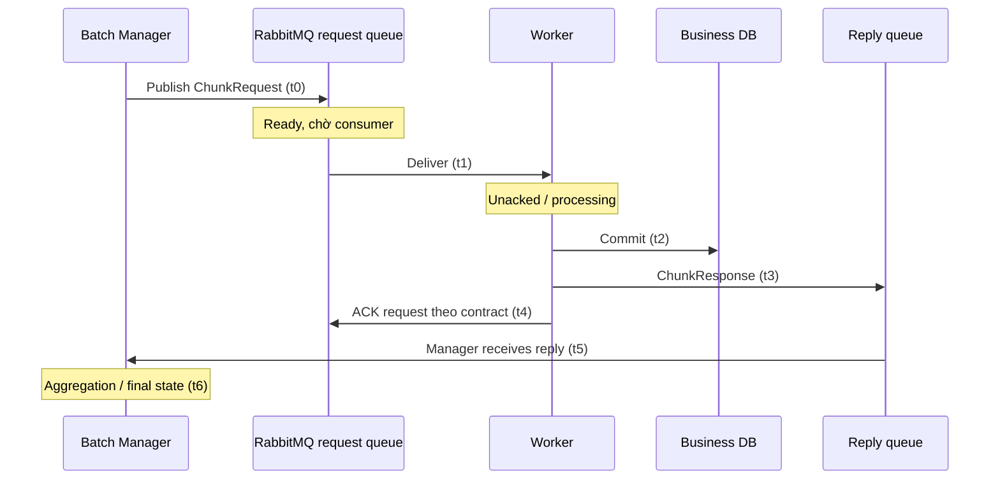
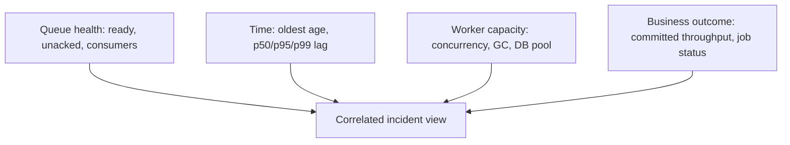
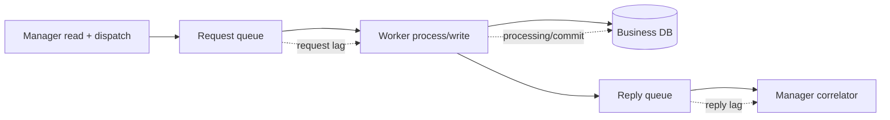

# Queue depth và message lag: đo backlog đúng trong Spring Batch phân tán

Một Spring Batch job dùng **remote chunking** để xử lý 8 triệu giao dịch. Manager gửi đều 250 chunk requests/giây, trong khi worker chỉ xử lý thành công 180 chunk/giây. Dashboard RabbitMQ hiển thị 50.000 messages và tiếp tục tăng; sau vài phút, giao dịch đầu hàng đợi đã chờ quá SLA. Operator tăng số worker nhưng database pool bắt đầu cạn, lượng message `unacked` tăng, còn số item thực sự commit gần như không đổi. Nếu chỉ nhìn một con số “queue depth” thì rất dễ chọn sai giải pháp.

Bài **“Queue depth và message lag”** thuộc chương **Metrics** của module `SPRING_BATCH_SCALING_OPERATIONS`. Mục tiêu là biết đo và giải thích **hàng đợi, độ trễ nhận/xử lý message, throughput đã commit, in-flight requests và năng lực worker** khi mở rộng Spring Batch qua **multi-threaded steps, parallel steps, local/remote partitioning và remote chunking**. Người học sẽ biết cách đặt instrumentation, dashboard, cảnh báo, runbook, thử tải và kiểm tra tính đúng khi retry/restart.

Ví dụ dùng **Spring Batch 5.2.x, Spring Integration 6.2.x, Java 17+, Micrometer/Prometheus, RabbitMQ và PostgreSQL**. Tên metric tùy chỉnh trong bài là **quy ước ứng dụng**, không phải metric Spring Batch tự sinh. Tên metric có sẵn được ghi rõ theo sản phẩm/phiên bản; số liệu và ngưỡng chỉ minh họa, không phải benchmark đã thực hiện. Các phần mở rộng như pending request ledger, message timestamp, reconciliation là trách nhiệm triển khai của ứng dụng.

## 1. Vì sao phải đo cả queue depth lẫn message lag?

**Queue depth** trả lời: *“Có bao nhiêu đơn vị công việc đang nằm ở queue hoặc chờ ACK?”* **Message lag** trả lời: *“Công việc đã chờ bao lâu hoặc đã trễ bao xa so với điểm tiến độ kỳ vọng?”* Hai câu hỏi có thể cho kết quả trái ngược:

| Quan sát | Ý nghĩa có thể có | Phải kiểm tra thêm |
| --- | --- | --- |
| Depth lớn, lag nhỏ | Hệ thống có throughput cao, backlog tạm thời | Arrival/consume rates, burst duration |
| Depth nhỏ, lag lớn | Poison message, một message cũ hoặc slow consumer | Oldest age, retries, unacked |
| Ready=0, unacked rất cao | Broker đã giao, worker chưa ACK | Worker/DB/API latency, prefetch |
| Ready cao, unacked=0 | Consumer không online/không nhận được message | Consumer count, routing, broker health |
| Depth và lag cùng tăng | Quá tải kéo dài, consumer chậm hoặc mất worker | Throughput đã commit, resource pools |
| Depth giảm nhanh | Có thể đã consume/ACK, chuyển DLQ hoặc drop | Business output, ACK/reject/DLQ counters |
| Lag xấp xỉ 0 | Có thể chỉ đo từ lúc dequeue, không gồm business commit | Xác định timestamp bắt đầu/kết thúc |

**Bài học cốt lõi:** Không có metric đơn lẻ nào chứng minh batch job đang tiến triển **đúng và bền vững**. Cần liên kết queue measurements với `JobExecution`, `StepExecution`, broker ACK và **business output đã commit**.

## 2. Định nghĩa queue depth theo từng tầng

Trong RabbitMQ, cần tách ba trạng thái:

```text
ready    = messages chờ broker giao cho consumers
unacked  = messages đã giao, consumer chưa ACK
total    = ready + unacked
```

**Tên gọi dễ gây nhầm:** “Queue length” trong một số RabbitMQ API/`queue.declare-ok.message_count` thường chỉ **ready**; còn HTTP API `messages` và Prometheus `rabbitmq_detailed_queue_messages` biểu diễn **ready + unacked**. Vì vậy mọi dashboard phải **ghi rõ** số đang hiển thị là `ready`, `unacked` hay `total`.

Ở các tầng khác:

- `ThreadPoolTaskExecutor`: **queued Runnable tasks**, không bao gồm tất cả tasks đang chạy.
- Spring Integration `QueueChannel`: số messages đang **nằm trong memory channel**.
- Broker request queue: messages ready/unacked theo broker.
- Manager remote chunking: số **pending `ChunkRequest`** chưa có kết quả xử lý hợp lệ; có thể khác broker depth.
- Reply queue/aggregator: replies đợi manager consume/aggregate.
- Bảng work ledger/outbox: số logical operations `PENDING/CLAIMED` trong database.

Không cộng `queued Runnable tasks` với `rabbitmq_messages_total` như thể cùng một đơn vị: một message chứa 500 items, một task xử lý một chunk, còn một partition có thể chứa hàng triệu records.

## 3. Message lag có nhiều nghĩa, phải chọn rõ

| Metric ứng dụng | Timestamp đầu | Timestamp cuối | Đang đo gì? |
| --- | --- | --- | --- |
| Queue wait/age khi dequeue | Được chấp nhận vào queue | Consumer nhận delivery | **Thời gian đợi giao message** |
| Oldest ready age | Message còn chờ lâu nhất | Thời điểm quan sát | Độ cũ của phần tử đầu/hàng chờ theo quy tắc cụ thể |
| Delivery-to-ACK | Consumer nhận | Broker nhận ACK | Thời gian delivery ở trạng thái unacked |
| End-to-end message latency | Producer ghi intent/chấp nhận request | Business commit + reply hoàn tất | Thời gian hoàn thành một operation |
| Processing latency | Worker bắt đầu xử lý | Kết thúc processor/writer | Service time phía worker |
| Commit lag | Input event creation time | Business state đã commit | Độ trễ dữ liệu có thể sử dụng |
| Watermark/offset lag | Offset/sequence đã publish | Offset/sequence đã xử lý xong | Khoảng cách vị trí, không phải giây |
| Partition progress age | Lần commit/checkpoint hợp lệ cuối | Thời điểm quan sát | Partition không có progress đã bao lâu |

**Không gọi tất cả là `lag`**. Ví dụ `now - producedAt` là **end-to-end age** của message còn đang xử lý, không phải pure queue wait nếu nó đã được deliver 3 phút trước. `now - lastProgressAt` là age của tiến độ partition, không phải age từng message.

Khi dùng Kafka, “consumer lag” thường có nghĩa **offset difference** giữa log end và committed consumer offset; nó không tự bằng **thời gian** nếu record rates thay đổi. Trong bài này, trọng tâm là **RabbitMQ/Spring Integration**; không mặc định áp dụng semantics Kafka cho RabbitMQ.

## 4. Sơ đồ timeline của một chunk request



Các công thức:

```text
queue_wait       = t1 - t0
worker_commit    = t2 - t1
reply_delivery   = t5 - t3
end_to_end       = t6 - t0
```

**Sơ đồ là trình tự minh họa**, không khẳng định mọi Spring Integration AMQP listener luôn ACK sau reply, hay cùng một manager chờ tới `t6` theo đúng cơ chế này. Thứ tự ACK, reply, DB commit phụ thuộc adapter, transaction manager và topology; phải **kiểm chứng trong integration test**. Không dùng timestamp `t4` thay cho `t2` khi đánh giá business correctness.

## 5. Ready, unacked và tổng backlog có thể báo những câu chuyện khác nhau

Giả sử hai lần chụp metrics:

| Thời điểm | Ready | Unacked | Tổng | Committed chunks/s |
| --- | ---: | ---: | ---: | ---: |
| 10:00 | 12.000 | 100 | 12.100 | 190 |
| 10:05 | 31.000 | 800 | 31.800 | 180 |

Chỉ nhìn `ready` ta thấy backlog tăng 19.000; `unacked` tăng 700 cho thấy các consumers đang nhận nhưng giữ nhiều việc chưa ACK. Trong khi committed throughput **giảm**, việc nâng `prefetch` có thể tăng memory mà không tăng output.

Chẩn đoán cần kiểm:

1. Producer publish rate và xu hướng tăng.
2. Consumer count, active worker processes và concurrency.
3. Consumer prefetched/unacked distribution.
4. Worker chunk processing p95/p99 và DB/HTTP pool wait.
5. Error, retry, redelivery và DLQ rates.
6. Business commits/s và `StepExecution` tiến độ thực.

Nếu queue ready tăng mà unacked gần bằng 0, tìm nguyên nhân **không có consumer/routing/lỗi connection**, không ngay lập tức tăng heap.

## 6. Mô hình toán học của backlog

Đặt `λ(t)` là tốc độ tạo **logical requests** vào hàng đợi, `μ(t)` là tốc độ **hoàn tất/ACK** (cùng đơn vị):

```text
Δbacklog ≈ (λ - μ) × Δt

Nếu λ = 250 chunks/s, μ = 180 chunks/s:
backlog tăng ≈ 70 chunks/s
sau 10 phút ≈ 70 × 600 = 42.000 chunks
```

Đây là **mô hình gần đúng**, giả định không có dropped messages, retry/requeue/TTL/DLQ làm thay đổi số messages và không có trễ sampling. Với broker thật, `publish`, `deliver`, `ack` và redelivery có thể không đơn giản là một lần đến/một lần đi; phải tách counters theo lifecycle.

Nếu mỗi chunk chứa 500 items, backlog 42.000 messages đại diện **tối đa danh nghĩa khoảng 21 triệu item-assignments**, không có nghĩa 21 triệu unique business items: retries/duplicates có thể xuất hiện và output thực phải đối soát.

### 6.1. Khi nào backlog tự giảm?

Nếu producer giảm xuống `λ=100` còn consumer vẫn xử lý `μ=180 chunks/s`, backlog giảm danh nghĩa **80 chunks/s**. Với 42.000 chunks:

```text
estimated drain time ≈ 42.000 / (180 - 100) = 525 giây
```

Nếu `λ ≥ μ`, **không tồn tại drain time hữu hạn** dưới giả định tốc độ không đổi. Dashboard hiển thị “ETA to empty” mà không xét arrivals tương lai là dễ gây hiểu lầm.

## 7. Little's Law: backlog và latency quan hệ ra sao?

Ở một hệ thống tương đối ổn định:

```text
L = λ × W
W = L / λ
```

Với `L` là số request trung bình trong phạm vi quan sát, `λ` là **throughput ổn định**, `W` là thời gian trung bình trong chính phạm vi ấy. Nếu chỉ đo **queue ready**, dùng `Lq` và queue-wait `Wq`; nếu đo ready + unacked, dùng total residence tới ACK (không nhất thiết tới business commit).

Ví dụ queue ready trung bình **1.800 chunks**, tốc độ dequeue ổn định **90 chunks/s**:

```text
average queue wait ≈ 1.800 / 90 = 20 giây
```

**Điều kiện:** lượng vào/ra ổn định đủ lâu, cùng đơn vị, không có batch retry/requeue gây double count. Khi backlog đang tăng hoặc giảm rất nhanh, Little's Law không cho **p99 latency**, cũng không cho tuổi của message cũ nhất. Muốn SLO tail latency phải đo **timestamp thực** theo message/operation.

## 8. Queue depth thấp không bảo đảm message lag thấp

Ví dụ request queue có đúng **1 message ready** từ 40 phút trước, vì tất cả consumers đều từ chối payload sai schema. `depth=1` nhìn rất nhỏ; nhưng `oldest_ready_age=40 phút` vi phạm SLA.

Ngược lại queue có 10.000 messages trong hệ thống xử lý **100.000 messages/s** có thể chỉ mang vài trăm mili giây wait nếu mọi thứ ổn định. Do đó:

- Theo dõi **depth** và **oldest ready age** cùng nhau.
- Theo dõi thêm **p95/p99 queue wait ở những messages được tiêu thụ**.
- Kiểm **consumer count/prefetch** và **in-flight age** nếu ready giảm mà unacked tăng.
- Tách metric **completed operations** khỏi metric **delivered/ACKed messages**.

Đặc biệt, một queue hỗ trợ **priority, delayed retry, requeue hoặc TTL** có thể không xử lý theo FIFO thuần. “Head timestamp” của broker không nhất thiết là **oldest logical operation** trong toàn hệ thống; cần định nghĩa semantics của metric dựa trên topology.

## 9. Đừng lấy kích thước broker queue làm số item còn lại của job

Với Spring Batch:

| Kiến trúc | Đơn vị message | Source of truth về tiến độ |
| --- | --- | --- |
| Multi-threaded step | Runnable/chunk trong executor | `StepExecution` và business DB |
| Parallel steps | Task/flow trong process | Mỗi `StepExecution` theo `JobExecution` |
| Local partitioning | Partition StepExecution chạy qua executor | Child `StepExecution`/`ExecutionContext` |
| Remote partitioning | `StepExecutionRequest` cho partition | Shared `JobRepository`; broker chỉ vận chuyển |
| Remote chunking | `ChunkRequest` chứa nhiều items | Manager step/checkpoint, replies và business outcome |

Một `ChunkRequest` có thể chứa 100–10.000 items. Một `StepExecutionRequest` đại diện một partition với hàng triệu items. **Không lấy queue message count nhân một giá trị chunk size cố định nếu data mix, partition skew hoặc retry khác nhau.** Với remote partitioning, child step đã `COMPLETED` nhưng reply mất có thể làm manager vẫn chờ; với remote chunking, request có thể redeliver dù worker đã commit.

Khi báo “đã xử lý 95%” phải chỉ rõ mẫu số: **unique business items**, **partitions**, **chunks**, **byte input** hay **execution attempts**. Đếm messages `ACKed` không tương đương số business operations hoàn thành.

## 10. Các metric RabbitMQ có sẵn

RabbitMQ cung cấp số liệu queue từ **Management HTTP API**, CLI và **Prometheus plugin**. Một số trường đáng lưu ý:

| HTTP API `/api/queues/{vhost}/{qname}` | Ý nghĩa |
| --- | --- |
| `messages_ready` | Số messages còn chờ deliver |
| `messages_unacknowledged` | Số messages đã deliver nhưng chưa ACK |
| `messages` | Tổng ready + unacknowledged |
| `consumers` | Số consumers đang đăng ký |
| `message_stats.publish` | Số publish theo thống kê broker |
| `message_stats.deliver_get` | Số deliveries theo thống kê broker |
| `message_stats.ack` (nếu xuất hiện) | Số ACK deliveries theo phạm vi metric |

Không phải tất cả fields luôn xuất hiện nếu queue ít hoạt động, stats bị vô hiệu hóa hoặc plugin/permissions/phiên bản khác; **không tự thay missing bằng 0**. HTTP API là quan sát trạng thái broker, không thay thế kiểm tra output cuối trên business database.

### 10.1. Xem queue qua HTTP API

Ví dụ vhost mặc định `/` phải được URL-encode thành `%2F`; có quyền management phù hợp:

```bash
curl --fail --silent --show-error \
  -u "monitor:REDACTED" \
  "http://localhost:15672/api/queues/%2F/invoice.requests"
```

Lệnh chỉ là minh họa endpoint, **không đặt credential thực vào shell history**. Với production dùng HTTPS và secret management; đừng đưa quyền quản trị broker vào worker nếu chỉ cần metrics. Nếu có queue rất nhiều, API per-queue có thể gây monitoring overhead; cân nhắc RabbitMQ Prometheus endpoint theo tài liệu.

### 10.2. Xem queue trên CLI RabbitMQ

```bash
rabbitmqctl list_queues \
  name messages_ready messages_unacknowledged messages consumers
```

Đây là một **snapshot**, không đo lag theo thời gian. CLI có thể chạy trên node quản lý broker với quyền truy cập phù hợp; không được gọi `rabbitmqctl` mỗi item/chunk trong processor.

## 11. RabbitMQ Prometheus: hiểu endpoint aggregate vs detailed

RabbitMQ Prometheus plugin có endpoint tổng hợp `/metrics`, per-object `/metrics/per-object` và lọc nhóm `/metrics/detailed`. Với hệ thống nhiều queues, **per-object toàn bộ** có thể rất tốn tài nguyên và tạo nhiều time series. Một cách hợp lý là chỉ scrape những metric families cần:

```text
GET /metrics/detailed?family=queue_coarse_metrics&family=queue_consumer_count
GET /metrics/detailed?family=queue_delivery_metrics
GET /metrics/detailed?family=queue_metrics
```

Ví dụ nhóm `queue_coarse_metrics` cung cấp:

| Metric Prometheus RabbitMQ detailed | Ý nghĩa |
| --- | --- |
| `rabbitmq_detailed_queue_messages_ready` | Messages ready |
| `rabbitmq_detailed_queue_messages_unacked` | Messages chưa ACK |
| `rabbitmq_detailed_queue_messages` | Tổng messages ready+unacked |
| `rabbitmq_detailed_queue_consumers` (nhóm consumer) | Consumer count |

Trong nhóm `queue_delivery_metrics` có thể có:

- `rabbitmq_detailed_queue_messages_delivered_ack_total`: deliveries trong manual ACK mode.
- `rabbitmq_detailed_queue_messages_acked_total`: ACKed deliveries.
- `rabbitmq_detailed_queue_messages_redelivered_total`: redeliveries.

Các metric trên có **prefix `rabbitmq_detailed_`**, khác với metric từ endpoint `/metrics` tổng hợp. **Không đoán tên metric từ dashboard cũ**: kiểm trực tiếp `/metrics/detailed` của broker và version đang dùng, cùng `vhost`/`queue` labels, các metric families đang bật.

### 11.1. Mẫu cấu hình Prometheus scrape

```yaml
scrape_configs:
  - job_name: "rabbitmq-batch-queues"
    scrape_interval: 15s
    metrics_path: /metrics/detailed
    params:
      family:
        - queue_coarse_metrics
        - queue_consumer_count
        - queue_delivery_metrics
    static_configs:
      - targets: ["rabbitmq-monitor.internal:15692"]
```

Đây là **snippet mẫu**, cần sửa host/port, TLS/auth, labels, high availability và version tương ứng. `scrape_interval=15s` không đảm bảo thấy một burst dài 2 giây; sampling có thể bỏ sót peak và counters phải xử lý reset khi broker restart. Trên broker có rất nhiều queues, có thể lọc thêm `vhost`/`queue` ở endpoint phù hợp.

### 11.2. PromQL cho ready/unacked/total

Với per-queue detailed metrics được scrape và queue label `invoice.requests`:

```promql
sum(rabbitmq_detailed_queue_messages_ready{queue="invoice.requests"})
```

```promql
sum(rabbitmq_detailed_queue_messages_unacked{queue="invoice.requests"})
```

```promql
sum(rabbitmq_detailed_queue_messages{queue="invoice.requests"})
```

Trong nhiều vhosts hoặc clusters, **filter đúng `vhost`, `cluster`, `job`** theo labels thực; nếu không, `sum` có thể gộp các queue cùng tên ở các môi trường khác nhau. Cần kiểm topology của metric: một số aggregation/HA exporters có thể đã tổng hợp metrics, **sum thiếu hiểu biết có nguy cơ đếm đôi**.

### 11.3. Rate của ACK và redelivery

```promql
sum(
  rate(rabbitmq_detailed_queue_messages_acked_total{
    queue="invoice.requests"
  }[5m])
)
```

```promql
sum(
  rate(rabbitmq_detailed_queue_messages_redelivered_total{
    queue="invoice.requests"
  }[5m])
)
```

`rate(counter[5m])` xử lý counter resets tốt hơn trừ trực tiếp các raw snapshots. **ACK rate không hoàn toàn là business committed rate**: ACK có thể xảy ra trước/khác business DB commit tùy workflow, message redelivery và ACK mode.

## 12. Đo oldest ready message age có những giới hạn gì?

Các metric `messages_ready`/`messages_unacked` chỉ là **counts**. Chúng không tự cho biết một message đã chờ **3 giây hay 3 giờ**. RabbitMQ Prometheus có metric tùy phiên bản và nhóm `queue_metrics`:

```text
rabbitmq_detailed_queue_head_message_timestamp
```

Đây là **timestamp của message đầu queue nếu tồn tại**, không phải cam kết rằng broker luôn cung cấp **tuổi oldest logical business operation**. Cần kiểm message timestamp property, queue type/priority, requeue/TTL và semantics trong phiên bản thực tế. Queue head có thể thay đổi khi deliveries xảy ra; item cũ hơn đang **unacked** sẽ không nằm ở tập ready, trong khi hệ thống vẫn chưa hoàn thành operation.

**Không đặt alert bắt buộc chỉ dựa vào head timestamp nếu chưa xác minh nó được xuất ổn định và cùng clock semantics.** Với nhiều workloads, đo **enqueue→delivery** bằng metadata ứng dụng và đo **oldest pending business operation** trong DB work ledger đáng tin hơn.

### 12.1. Consumer lag theo vị trí không giống age

RabbitMQ queue `messages_ready` không phải Kafka topic offset. Một queue có priority, TTL hoặc redelivery làm thứ tự thay đổi. Muốn tính **logical sequence lag** cần ứng dụng định nghĩa `eventSequence/commitWatermark` ổn định; không tự gán RabbitMQ delivery tag thành offset nghiệp vụ. Delivery tag còn gắn với **channel**, không phải global increasing business sequence.

## 13. Spring Integration QueueChannel có sẵn depth gauges

Với Spring Integration 6.2, `QueueChannel` có Micrometer gauges:

```text
spring.integration.channel.queue.size
spring.integration.channel.queue.remaining.capacity
```

Gauges có tags như `name` (component) và `type=channel`. Cấu hình một queue hữu hạn:

```java
import org.springframework.context.annotation.Bean;
import org.springframework.context.annotation.Configuration;
import org.springframework.integration.channel.QueueChannel;
import org.springframework.messaging.PollableChannel;

@Configuration
public class BatchChannelConfiguration {

    @Bean("invoiceReplyBuffer")
    PollableChannel invoiceReplyBuffer() {
        return new QueueChannel(128);
    }
}
```

Nếu queue có capacity 128, `size=100` và `remaining.capacity=28` ở cùng một snapshot thì channel gần 78% đầy. Nhưng measurements không atomic, monitoring phải chịu race trong lúc enqueue/dequeue.

**`QueueChannel` mặc định giữ messages trong RAM**. Gauge depth giảm tới 0 khi receiver poll lấy message, **không nói** business transaction hay reply aggregation đã hoàn tất. `DirectChannel` không có backlog queue tương tự; `ExecutorChannel` có thể dồn backlog sang executor queue, phải đo pool tương ứng.

**Lưu ý:** `QueueChannel` không có capacity khai báo thường gần như unbounded; remaining capacity lúc đó rất lớn và tỷ lệ utilization khó có ý nghĩa. Cần thiết kế **bounded queue + timeout + durable handoff**; không chỉ thêm metric rồi giữ queue vô hạn.

## 14. Spring Batch 5.2 có metric gì sẵn?

Spring Batch 5.2 có Micrometer metrics dưới `spring.batch`, trong đó:

| Metric gốc của Spring Batch | Loại | Ý nghĩa |
| --- | --- | --- |
| `spring.batch.job` | Timer | Thời gian job |
| `spring.batch.job.active` | LongTaskTimer | Job đang hoạt động |
| `spring.batch.step` | Timer | Thời gian step |
| `spring.batch.step.active` | LongTaskTimer | Step đang hoạt động |
| `spring.batch.item.read` | Timer | Thời gian đọc item |
| `spring.batch.item.process` | Timer | Thời gian xử lý item |
| `spring.batch.chunk.write` | Timer | Thời gian writer xử lý chunk |

Những metric có sẵn rất hữu ích để xem **worker có chậm ở reader/processor/writer hay không**, nhưng **không tự tạo một histogram “enqueue→delivery lag” cho mỗi broker message**. Muốn đo thời gian chờ queue, phải thêm instrumentation ở producer/consumer hoặc dùng broker telemetry hỗ trợ.

Đừng trộn độ trễ `spring.batch.chunk.write` với **toàn thời gian commit transaction** hoặc queue wait. Một chunk có thể chờ broker 15 giây, xử lý 2 giây và commit DB 3 giây; chỉ timer writer sẽ không phản ánh toàn bộ 20 giây.

### 14.1. StepExecution là metadata, không phải từng message

`StepExecution` có `readCount`, `writeCount`, `filterCount`, `commitCount`, `rollbackCount`, skip counts và `BatchStatus`. Nếu worker còn `STARTED` mà `commitCount` không đổi lâu, có thể slow/stuck hoặc một chunk cực dài; nó không chứng minh worker chết. JobRepository lưu lifecycle/checkpoint theo transaction, **không phải heartbeat message từng giây**.

Không cập nhật trực tiếp bảng `BATCH_STEP_EXECUTION` mỗi giây để tự tạo một queue lag metric: làm vậy dễ gây contention/optimistic-locking/restart bất thường. Giữ telemetry trong Micrometer hoặc application progress store riêng.

## 15. Gắn timestamp có nghĩa rõ ràng vào message

Để đo **producer-to-delivery latency**, ứng dụng có thể thêm một header thời điểm producer tạo request:

```java
import java.time.Clock;

import org.springframework.messaging.Message;
import org.springframework.messaging.MessageChannel;
import org.springframework.messaging.support.MessageBuilder;

public final class TimestampedRequestPublisher {
    private final MessageChannel channel;
    private final Clock clock;

    public TimestampedRequestPublisher(MessageChannel channel, Clock clock) {
        this.channel = channel;
        this.clock = clock;
    }

    public void publish(String payload, String operationId) {
        Message<String> message = MessageBuilder.withPayload(payload)
                .setHeader("producedAtEpochMs", clock.millis())
                .setHeader("operationId", operationId)
                .build();

        boolean accepted = channel.send(message, 2_000);
        if (!accepted) {
            throw new IllegalStateException(
                    "Request channel did not accept message");
        }
    }
}
```

Ví dụ dùng message **do ứng dụng tự tạo**, không phải code cần chèn thẳng vào `ChunkMessageChannelItemWriter`/`StepExecutionRequestHandler` của framework. Nếu cần thêm header vào request của Spring Batch Integration, phải cấu hình transformation/enrichment ở adapter phù hợp và **giữ nguyên correlation, serialization, reply routing**. `operationId` là khóa logic cho tracing/dedupe, không dùng làm metric label.

**Đặt tên thật chính xác:** `producedAtEpochMs` ghi lúc **trước `channel.send()`**, nên khoảng thời gian đo đến consumer bao gồm **thời gian chờ channel, publish/confirm/network và queue residence**. Nó **không phải broker enqueue timestamp thuần túy**. Muốn phân rã, đo riêng thời gian publish confirm (nếu có) và thời gian broker lưu/deliver; không diễn giải một timestamp phía producer như thể broker tự gắn lúc enqueue.

Nếu producer timeout sau khi broker đã nhận message, việc publish lại có thể tạo duplicate. Giữ `operationId` ổn định qua retries và bảo vệ business outcome bằng idempotency.

## 16. Dùng Micrometer Timer đo producer-to-delivery

Một recorder ứng dụng có thể đọc header khi worker **vừa nhận delivery**, trước business processing:

```java
import java.time.Clock;
import java.util.concurrent.TimeUnit;

import io.micrometer.core.instrument.Counter;
import io.micrometer.core.instrument.MeterRegistry;
import io.micrometer.core.instrument.Timer;
import org.springframework.messaging.Message;

public final class MessageQueueLatencyRecorder {

    private static final long MAX_REASONABLE_AGE_MS =
            TimeUnit.DAYS.toMillis(7);

    private final Clock clock;
    private final Timer producerToDeliveryTimer;
    private final Counter invalidTimestampCounter;

    public MessageQueueLatencyRecorder(
            MeterRegistry registry, Clock clock) {
        this.clock = clock;
        this.producerToDeliveryTimer =
                Timer.builder("batch.message.producer.to.delivery")
                        .description("Producer creation to worker delivery")
                        .tag("flow", "invoice")
                        .publishPercentileHistogram()
                        .register(registry);
        this.invalidTimestampCounter =
                Counter.builder("batch.message.timestamp.invalid")
                        .tag("flow", "invoice")
                        .register(registry);
    }

    public void onDelivery(Message<?> incoming) {
        Object raw = incoming.getHeaders().get("producedAtEpochMs");
        if (!(raw instanceof Number)) {
            invalidTimestampCounter.increment();
            return;
        }

        long createdAtMs = ((Number) raw).longValue();
        long elapsedMs = clock.millis() - createdAtMs;
        if (elapsedMs < 0 || elapsedMs > MAX_REASONABLE_AGE_MS) {
            invalidTimestampCounter.increment();
            return;
        }

        producerToDeliveryTimer.record(
                elapsedMs, TimeUnit.MILLISECONDS);
    }
}
```

Đây là **instrumentation minh họa**, giả định adapter đã giữ được header dưới dạng số; nếu serializer chuyển thành chuỗi, phải parse theo schema rõ ràng. Gọi `onDelivery` đúng lúc nhận message chứ không phải sau khi business write, nếu muốn đo producer→delivery. `Clock` được inject để test. Ngưỡng 7 ngày chỉ là ví dụ để phân loại timestamp vô lý, không nên tự loại bỏ những message hợp lệ nằm backlog dài ngày mà không ghi incident.

**Đồng hồ giữa JVMs phải được đồng bộ.** Dùng `System.currentTimeMillis`/`Clock.millis` từ hai host có clock skew sẽ tạo lag âm hoặc quá lớn. Không được `Math.max(0, lag)` để im lặng biến lỗi đồng hồ thành “độ trễ bằng 0”; tăng counter `timestamp.invalid` và điều tra NTP, serialization, malformed/stale headers. Trong **một process**, dùng `System.nanoTime()` khi đo elapsed time mà không cần chuyển qua network.

### 16.1. Không gắn identifiers có cardinality cao vào metrics

Trong code chỉ dùng tag `flow=invoice` cố định. **Không dùng `jobExecutionId`, `stepExecutionId`, `messageId`, `invoiceId` hay UUID vào Timer labels**: hàng triệu labels làm backend metrics tốn RAM/disk và ảnh hưởng runtime. Các ID chi tiết phải nằm trong **structured logs/traces**.

## 17. Đo ACK latency, commit latency và end-to-end latency riêng

Nếu cần biết request đi chậm ở đâu, tối thiểu ba timers ứng dụng:

```text
batch.message.producer.to.delivery  = deliveredAt - producedAt
batch.message.worker.processing     = processingEnd - processingStart
batch.message.end.to.end            = confirmedBusinessOutcome - producedAt
```

Mỗi timer phải có **semantic contract** rõ:

- Producer→delivery đo trước khi worker chạy.
- Worker processing đo work thực sự, có thể bao gồm database commit nếu đặt end sau transaction.
- End-to-end success chỉ quan sát **khi business outcome được xác nhận**, không khi adapter `send()` trả true.

Ví dụ **nếu writer ghi vào DB trong transaction Spring do chunk step quản lý**, có thể phát signal quan sát **sau khi commit thành công**:

```java
import org.springframework.transaction.support.TransactionSynchronization;
import org.springframework.transaction.support.TransactionSynchronizationManager;

public final class CommitObservationHook {

    public static void onSuccessfulCommit(Runnable observation) {
        if (!TransactionSynchronizationManager.isActualTransactionActive()
                || !TransactionSynchronizationManager.isSynchronizationActive()) {
            throw new IllegalStateException(
                    "Expected active Spring-managed transaction");
        }

        TransactionSynchronizationManager.registerSynchronization(
                new TransactionSynchronization() {
                    @Override
                    public void afterCommit() {
                        observation.run();
                    }
                });
    }
}
```

Phương thức này chỉ là **hook minh họa cho local transaction**, không tự biết item nào commit, không đo complete response của remote chunking và không có guarantee exactly-once telemetry (JVM có thể chết **sau commit trước khi metric được gửi**). Nếu cùng logical operation replay và idempotent writer làm no-op, phải định nghĩa có muốn đếm attempt hay unique business completion. Muốn **business committed count chuẩn**, đối chiếu bảng nghiệp vụ/operation log, không lấy một counter trong RAM thay cho nguồn sự thật.

Nếu writer gọi API bên ngoài, `afterCommit` của DB **không chứng minh** API đã áp dụng hoặc chưa áp dụng side effect. Đo end-to-end theo outcome contract của downstream và idempotency/reconciliation.

## 18. Oldest pending business operation trong PostgreSQL

Với ứng dụng có **work ledger** riêng (không phải `BATCH_STEP_EXECUTION`), có thể đo độ tuổi từ DB:

```sql
CREATE TABLE batch_work_ledger (
    operation_key    VARCHAR(180) PRIMARY KEY,
    snapshot_id      VARCHAR(100) NOT NULL,
    state            VARCHAR(20) NOT NULL,
    created_at       TIMESTAMPTZ NOT NULL DEFAULT CURRENT_TIMESTAMP,
    claimed_at       TIMESTAMPTZ,
    completed_at     TIMESTAMPTZ,
    next_attempt_at  TIMESTAMPTZ
);

CREATE INDEX batch_work_pending_age_idx
    ON batch_work_ledger(state, created_at);
```

Query age của **oldest PENDING**:

```sql
SELECT COUNT(*) AS pending_count,
       EXTRACT(EPOCH FROM
               (clock_timestamp() - MIN(created_at))) AS oldest_pending_seconds
FROM batch_work_ledger
WHERE state = 'PENDING'
  AND snapshot_id = :snapshotId;
```

Nếu không có row nào, `MIN(created_at)` là `NULL`; exporter nên xử lý **empty-set** theo thiết kế (ví dụ không xuất age hoặc báo no-pending), không tạo số âm/NaN tùy tiện. `next_attempt_at` là thời điểm **được phép retry**, khác thời gian operation được tạo: backlog pending nhưng chưa tới retry window cần phân nhóm riêng để tránh alarm sai.

Đây là **business-ledger age**, không phải age chính xác trong RabbitMQ queue. Ưu điểm là timestamp dùng đồng hồ DB và có thể đo **tập chưa xử lý cả khi broker empty**; nhược điểm là thêm transaction/index/query load và cần quản lý lifecycle/cleanup. Không chạy `MIN(created_at)` full-scan mỗi 1 giây trên bảng hàng tỷ rows mà không benchmark index/caching.

### 18.1. Pending age không thay thế claimed/in-progress age

Nếu 500 operations đã chuyển `CLAIMED` nhưng worker bị treo, query `WHERE state='PENDING'` trả 0: dashboard có thể báo hết backlog trong khi việc vẫn chưa hoàn tất. Cần thêm `oldest_claimed_age`, `lastProgressAt`, `lease_until` và số operations `COMPLETED` theo business semantics. Timestamps từ claim có thể reset sau reassign; giữ cả `createdAt` gốc để đo age logic xuyên attempts.

## 19. Một bảng metric vocabulary nên thống nhất trước production

Tên **đề xuất do ứng dụng tự định nghĩa** cho metrics:

| Tên metric logic | Kiểu | Đơn vị | Ranh giới đếm |
| --- | --- | --- | --- |
| `batch.message.produced` | Counter | messages | Producer intent/publish attempts, ghi rõ |
| `batch.message.delivered` | Counter | deliveries | Consumer deliveries, có thể trùng |
| `batch.message.committed` | Counter | operations | Outcome được xác nhận theo contract |
| `batch.message.producer.to.delivery` | Timer | seconds | Producer timestamp → delivery |
| `batch.message.worker.processing` | Timer | seconds | Processing start → end |
| `batch.message.end.to.end` | Timer | seconds | Logical creation → committed outcome |
| `batch.message.timestamp.invalid` | Counter | events | Header thiếu/skew/malformed |
| `batch.work.oldest.pending.age` | Gauge | seconds | Oldest work-ledger PENDING |
| `batch.work.oldest.claimed.age` | Gauge | seconds | Oldest claimed/in-progress |
| `batch.manager.pending.requests` | Gauge | chunks | Requests chưa hoàn thành hợp lệ |
| `batch.reply.unmatched` | Counter | replies | Correlation không khớp |
| `batch.reply.stale` | Counter | replies | Reply của execution đã hết hiệu lực |
| `batch.business.duplicate.suppressed` | Counter | operations | Business idempotency đã chặn duplicate |

Với Spring Boot Actuator + Micrometer Prometheus, tên có dấu chấm trong Java thường được **chuẩn hóa thành underscore**, Timer có thể tạo `_seconds_count`/`_seconds_sum`/`_seconds_bucket` nếu bật histogram. Không assume mọi exporter/registry xuất giống hệt; kiểm endpoint `/actuator/prometheus` và labels thực tế.

**Kiểm soát metric cardinality**: tag hợp lý như `application`, `role=manager/worker`, `flow=invoice`, `phase=request/reply`, `status=success/failure`. Tránh tag `jobExecutionId`, `stepExecutionId`, `messageId`, `partitionId` nếu giá trị phát sinh liên tục; lưu trong logs và traces.

### 19.1. Chọn đơn vị nhất quán

Độ trễ dùng **seconds** khi xuất sang Prometheus, capacity là **messages/chunks/items** tùy metric. Đừng vẽ hai đường `chunks/s` và `items/s` cùng trục rồi kết luận worker nhanh/chậm. Khi chunk size khác nhau, cùng 100 messages/s có thể là 10.000 hoặc 100.000 items/s.

## 20. Histogram và p95/p99 message lag

Timer `batch.message.producer.to.delivery` đã bật `publishPercentileHistogram()` ở ví dụ, có thể xuất các classic histogram buckets với Prometheus registry phù hợp. PromQL minh họa p95 trong 5 phút:

```promql
histogram_quantile(
  0.95,
  sum by (le) (
    rate(batch_message_producer_to_delivery_seconds_bucket{
      flow="invoice"
    }[5m])
  )
)
```

Nếu có label queue/role hữu hạn, thêm chúng vào `sum by (le, queue, role)` cho đúng phạm vi muốn so sánh. **Không lấy average của các p95 được tính riêng từ các Pods**: average các quantile thường không có nghĩa thống kê. Phải aggregate buckets/counts rồi tính quantile, hoặc dùng phương pháp phù hợp histogram type/version.

### 20.1. Thiên lệch của “lag khi tiêu thụ”

Histogram chỉ nhận sample **khi có message được deliver**. Nếu consumer chết và không có message nào đến:

```text
Queue depth:               50.000 ready
Consumer deliveries:       0/s
Observed latency samples:  0
P95 lag query:             có thể không có dữ liệu
```

**Không diễn giải không có sample là p95 bằng 0.** Kết hợp với **oldest pending age** và **ready backlog** để phát hiện những message đang bị kẹt chưa bao giờ được quan sát bởi latency timer. Đây là một trong những lỗi quan sát phổ biến nhất khi worker chết hoặc reply consumer bị mất.

### 20.2. Đo lag của message cũ nhất khác histogram

Một histogram 5 phút phản ánh **những message được xử lý trong 5 phút**, không phản ánh một message đang nằm hàng giờ ở đầu DLQ. Oldest pending age là **gauge của tập chưa xong**, và phải có no-data policy. Để điều tra, cần xem cả ba: `oldest age`, `queue depth` và `consumer processing histogram`.

## 21. Dashboard tối thiểu có bốn vùng



**Vùng 1 — Queue state**

- Request queue: ready/unacked/total, consumer count.
- Reply queue: ready/unacked, oldest reply age nếu có.
- Redelivery, dead-letter, publish confirms/nacks và broker disk/memory alarms.
- Queue growth rate và utilization khi có finite capacity.

**Vùng 2 — Time/lag**

- Producer→delivery p50/p95/p99 và số samples.
- Oldest ready age theo nguồn hỗ trợ và semantics xác minh.
- Oldest business PENDING/CLAIMED age.
- Worker processing and DB commit latency, manager reply lag.

**Vùng 3 — Capacity**

- Active worker processes, active chunks/partitions, in-flight window.
- CPU usage/throttling, heap/cgroup memory, GC pauses.
- Executor active/queued/rejected, JDBC/Hikari pending, DB lock waits.
- Broker prefetch và consumer unacked distribution.

**Vùng 4 — Job/business**

- `JobExecution`/`StepExecution` status and commit/read/write/rollback.
- Unique committed business operations/s hoặc rows/s có contract rõ ràng.
- SLA deadline còn lại, expected vs completed IDs.
- Duplicate suppressed, stale/unmatched reply, restart/reconciliation drift.

**Đặt cùng time axis** và phân biệt sources: metric từ broker, manager, worker, business DB. Một dashboard chỉ có queue depth ở broker sẽ không cho biết vì sao worker không commit.

## 22. Đặt cảnh báo dựa trên xu hướng, SLA và tiến độ

Ví dụ các ngưỡng **giả định để luyện tập**:

```text
WARN:
  ready > 10.000 trong 5 phút
  OR oldest PENDING age > 180 giây
  OR producer-to-delivery p95 > 60 giây (nếu đủ samples)

CRITICAL:
  ready tiếp tục tăng và committed throughput < arrival rate
  OR oldest PENDING age > 600 giây
  OR consumers = 0 khi pending work > 0
  OR worker progress age vượt budget theo workload
```

Các ngưỡng phải hiệu chỉnh theo **SLA, input volume, chunk size, worker capacity và thời gian partition có thể kéo dài hợp lệ**. Một queue có 10.000 chunks có thể hoàn thành trong 1 phút trên cụm khỏe, nhưng 100 chunks chứa payload nặng có thể cần 1 giờ.

### 22.1. PromQL alert ví dụ

Giả định `rabbitmq_detailed_queue_messages_ready` đang được scrape và label đã lọc đúng production:

```promql
sum(rabbitmq_detailed_queue_messages_ready{
  queue="invoice.requests"
}) > 10000
```

Rule engine có thể kết hợp `for: 5m` để tránh báo một burst ngắn. Alert **tốc độ backlog tăng** có thể dùng `delta` trên gauge:

```promql
sum(
  delta(rabbitmq_detailed_queue_messages_ready{
    queue="invoice.requests"
  }[10m])
) > 5000
```

`delta` ở đây là biến động **ready gauge** theo cửa sổ, **không phải counter publish rate**; metric reset/recreate/queue migration và scrape gaps có thể làm số sai lệch. Nên kết hợp với arrival/ACK/commit rates và điều kiện có consumer để giảm false positive.

### 22.2. Oldest age alert cần no-data policy

Nếu exporter query DB trả `NULL` khi PENDING rỗng thì không nên ép thành “lag 0” mà không ghi rõ. Mặt khác khi exporter chết, không có series **không nghĩa** backlog rỗng. Tách:

- `no_pending_work`: biết **không có** work cần xử lý.
- `no_metric_samples`: hệ thống monitoring bị mất tín hiệu.
- `oldest_age_seconds > threshold`: có work tồn đọng thật.

Thêm alert `up == 0` hoặc missing-series kiểm tra theo job/target thực; không làm mất cảnh báo vì metric age biến mất sau worker chết.

## 23. Sizing queue capacity theo lag budget

Giả sử cụm xử lý ổn định **100 chunks/s**, SLA cho queue wait trung bình ≤10 giây. Dùng Little's Law như **mốc thiết kế ban đầu**:

```text
Lq ≈ 100 chunks/s × 10 s = 1.000 chunks
```

Nếu còn giới hạn broker/memory 500 MiB và một chunk request serialized ~1 MiB, capacity logic theo memory có thể thấp hơn:

```text
Q_memory ≈ 500 MiB / 1 MiB per message = 500 messages
```

Chọn capacity/backpressure dựa trên **min(memory budget, latency budget)**, rồi đo tail behavior với payload p95/p99 và burst. **Đây không phải công thức định lượng chính xác max queue length broker**: RabbitMQ queue memory footprint, persistence, replication, ACKs và in-flight deliveries cũng chiếm tài nguyên.

Nếu publisher có thể đưa việc vào broker nhanh hơn tốc độ xử lý dài hạn, tăng max-length từ 5.000 lên 500.000 chỉ **trì hoãn** vấn đề. Cần giảm producer, điều tiết manager pending window, scale worker nếu downstream còn capacity, hoặc chia workload ra các windows có SLA hợp lệ.

### 23.1. Đừng dùng queue limit loại message nghiệp vụ mặc định

Một số broker hỗ trợ TTL, reject-publish, drop-head hoặc overflow policies. Với financial/invoice batch, **âm thầm drop message để giảm lag là lỗi dữ liệu**. Nếu publisher bị reject, giữ intent trong durable source/outbox và thử lại có backoff; nếu message vào DLQ, xử lý/quarantine và đối soát, không coi job đã hoàn thành.

## 24. Khi tăng worker mà lag vẫn tăng

Ví dụ remote chunking:

```text
Workers:             4  -> 8
Request ready:       20.000 -> 24.000
Unacked:             80 -> 160
Committed chunks/s:  175 -> 180
DB pool pending:     0 -> 90
```

Giả thuyết ưu tiên là **downstream DB bão hòa**, không phải thiếu consumers. Tăng worker tạo nhiều competing transactions, khiến chunk time dài, unacked tăng; committed throughput gần như không đổi.

Chẩn đoán:

1. So worker CPU, thread pool active và JDBC connection acquisition wait.
2. Xem DB locks, WAL/fsync, max connections, slow queries và CPU I/O.
3. Xem chunk size, partition skew, transaction duration và index contention.
4. Kiểm HTTP upstream quotas nếu processor gọi API.
5. Nếu bottleneck thật nằm ở DB, **giảm concurrency/transaction hold time** và tối ưu queries trước khi scale tiếp.

**Queue depth không phải chỉ số đo thành công của autoscaling.** KPI phải là **committed business throughput, lag, chi phí tài nguyên và correctness**.

## 25. Broker prefetch: ready giảm nhưng lag chưa chắc cải thiện

RabbitMQ `basic.qos`/prefetch giới hạn số deliveries **chưa ACK** gửi tới consumer (theo broker và cấu hình), không giới hạn tổng queue ready. Với manual ACK:

```text
16 consumers × prefetch 20 = tối đa danh nghĩa 320 unacked deliveries
16 consumers × prefetch 2  = tối đa danh nghĩa 32 unacked deliveries
```

Khi tăng prefetch từ 2 lên 20:

- Broker có thể **deliver sớm hơn**, làm `messages_ready` giảm.
- Worker giữ nhiều request lớn trên heap, trong khi chúng chưa thật sự được xử lý.
- `messages_unacked` và **delivery-to-ACK age** có thể tăng.
- Nếu worker crash, nhiều request có thể redeliver sau khi connection đóng.
- Với những partitions nặng, một consumer có thể giữ nhiều deliveries, gây thiếu cân bằng tải.

**RabbitMQ prefetch count 0 nghĩa là không giới hạn**, không phải “không nhận message”. Prefetch là rào chắn **consumer in-flight**, không phải toàn bộ admission control của manager.

**Thước đo sau tuning:** committed items/s, p95 producer→commit, worker memory, queue ready/unacked/age và retry/duplicate counts. Không chọn prefetch lớn chỉ vì biểu đồ ready đẹp hơn.

### 25.1. Thử thay prefetch phải giữ các biến khác

Khi benchmark prefetch 2/5/10/20, cố định:

- Số consumers và worker replicas.
- Chunk size, payload distribution và business input snapshot.
- JDBC/HTTP connection pools, transaction policy và broker topology.
- Metrics scrape interval và time window.

Nếu đổi đồng thời chunk size và worker count, không thể quy kết lag cải thiện do prefetch.

## 26. Remote chunking: ba loại lag quan trọng

Với remote chunking, **manager** vừa là reader/producer vừa là reply consumer. Cần giám sát:

1. **Request lag:** `ChunkRequest` từ manager tới lúc worker nhận; queue ready/unacked.
2. **Worker processing/commit lag:** từ delivery tới khi business output được ghi hợp lệ.
3. **Reply lag:** từ lúc worker phát `ChunkResponse` tới khi manager nhận và ghép đúng correlation.



**Tình huống dễ nhầm:** worker đã `COMMIT` và gửi reply, nhưng manager xử lý replies rất chậm hoặc reply bị định tuyến tới consumer sai. Request queue có thể về 0, business DB đúng, song manager step vẫn chờ và cuối cùng timeout. Khi ấy tăng worker **không giải quyết** nguyên nhân; cần kiểm manager CPU/GC, reply queue, correlation và pending-map cleanup.

Theo Spring Batch Integration 5.2, `RemoteChunkingManagerStepBuilder.throttleLimit(long)` giúp giới hạn số pending chunk-processing requests. Nó là một giới hạn **pending window**, **không** phải số message ready tối đa của broker. `maxWaitTimeouts(int)` liên quan số chu kỳ chờ nhận replies khi còn outstanding requests, phối hợp với receive timeout; **không phải worker-kill timer**.

Khi pending map ở manager tăng không dừng, kiểm **request/reply correlation + timeout/recovery**. Không tự xóa pending message khỏi RAM và đánh dấu item đã hoàn thành chỉ vì nó có tuổi lớn.

### 26.1. Remote chunking không có một child StepExecution mỗi chunk

Manager `StepExecution`/reader checkpoint và pending `ChunkRequest/ChunkResponse` state khác với remote partitioning. **Không dùng queue message lag để suy trực tiếp `StepExecution` của từng chunk** nếu mô hình ấy không tồn tại. Khi restart manager, cùng input có thể phát lại chunk với message ID khác; đo duplicate attempts nhưng dedupe theo **business operation key** ổn định.

## 27. Remote partitioning: lag của partition khác lag một message

Một `StepExecutionRequest` chỉ là lệnh thực thi **một partition**, có thể chứa phạm vi dữ liệu rất lớn trong `ExecutionContext` ở shared `JobRepository`. Worker nhận request trong 100ms nhưng xử lý partition 50 phút:

```text
Request queue wait           = 0.1 s
Partition processing time    = 3.000 s
Last committed chunk age    = 8 s
End-to-end partition age     ≈ 3.000 s
```

Request queue lag nhỏ **không có nghĩa** partition hoàn thành nhanh. Nên đo:

- `partition_dispatch_to_start_seconds`: từ chuẩn bị/publish request tới worker bắt đầu.
- `partition_running_seconds`: khoảng active processing (khi status/callback cho phép).
- `partition_last_progress_age_seconds`: từ checkpoint/commit hợp lệ gần nhất.
- `partition_completion_delay_seconds`: từ finish worker tới manager quan sát.
- `partition_count_by_status` và `partition_skew` theo partition read/write counts.

Các tên trên **là đề xuất metric ứng dụng**, không phải tất cả đều có sẵn. Không gắn từng partition name/id làm Prometheus tag khi một job có hàng trăm nghìn partition identities; cần dùng logs/traces cho per-partition drilldown và metric aggregate theo workload class.

**JobRepository polling khác reply aggregation:** manager có thể dựa vào trạng thái child `StepExecution` thay vì reply queue, nhưng repository polling cũng có lag do poll interval/DB load. `MessageChannelPartitionHandler.setTimeout` trong repository polling không tự chứng minh worker đã chết; monitor riêng worker liveness/progress.

## 28. Lag khi retry, TTL và DLQ: một operation có nhiều attempt

Giả sử một logical request `invoice9107:normalize:v1`:

```text
T0: operation được tạo
T1: publish attempt 1
T2: worker nhận, DB timeout
T3: request NACK/đưa vào retry delay 30s
T4: publish/route attempt 2
T5: worker hoàn thành business commit
```

Tùy câu hỏi:

```text
attempt_2_queue_wait = T5_delivery - T4
logical_end_to_end   = T5_commit - T0
retry_delay          ≈ T4 - T3
```

Nếu lần retry tạo header `producedAtEpochMs` mới, histogram producer→delivery có thể rất thấp dù **logical end-to-end đã bị trễ một phút**. Vì vậy:

- Giữ `logicalCreatedAt` **bất biến** qua mọi attempts.
- Có `attemptEnqueuedAt` riêng cho lần vào queue gần nhất.
- Phân biệt `queue_wait_attempt` với `logical_operation_age`.
- Không reset business SLA sau retry/requeue.
- Theo dõi retry count, DLQ count và số item chưa reconcile.

**TTL làm mất/dịch chuyển messages** theo policy; việc depth giảm sau TTL **không chứng minh work hoàn thành**. Khi message vào DLQ, operation cần được quarantine, sửa payload hoặc replay có kiểm soát. Một poison message có age cao có thể bị loại khỏi hàng đợi chính nhưng business vẫn chưa xong.

### 28.1. ACK, completion và idempotency

Trình tự crash thường gặp:

```text
worker ghi business DB thành công
worker crash trước consumer ACK/reply
broker phát lại message cho worker khác
```

Đây là cửa sổ lỗi hợp lệ của at-least-once delivery. Message count có thể tăng do redelivery, nhưng **business operation phải chỉ có một kết quả cuối hợp lệ**. Instrument metric duplicate suppression theo stable business key và đối soát output; không coi hai ACK hoặc hai responses là hai successful invoices.

## 29. Queue metrics có thể mất tính liên tục sau restart

Các tình huống gây gián đoạn quan sát:

| Sự kiện | Ảnh hưởng lên chart | Cách diễn giải |
| --- | --- | --- |
| Broker restart | Counters có thể reset, metrics tạm mất | Dùng `rate` thích hợp, kiểm `up` và restart events |
| Queue delete/redeclare | Gauge từ queue mới có thể bắt đầu 0 | Không coi dữ liệu cũ đã xử lý |
| Worker restart | App timers/counters reset nếu in-memory | Kết hợp series theo instance; không dùng local count làm truth |
| Autoscaling pod | Labels/pods mới, series cũ biến mất | Aggregate theo service/role; tránh double count |
| Network partition | Broker và worker nhìn khác nhau | Cần timestamp/owner reconciliation |
| Manager JVM crash | Pending reply map trong RAM mất | Đối chiếu JobRepository/broker/business DB |
| Prometheus scrape thất bại | Series stale/no sample | Alert monitoring health riêng |

**Missing data khác zero.** Tạo một dashboard luôn thay series mất thành 0 có thể che sự cố lớn nhất: broker hoặc exporter không còn hoạt động.

### 29.1. Không so timestamp từ nguồn không đồng bộ vô điều kiện

Giả sử producer clock nhanh 20 giây hơn worker, request được nhận sau 1 giây:

```text
workerTime - producerTime ≈ -19 giây
```

Đây không phải “negative queue wait”; đó là tín hiệu skew. Dùng NTP/chrony và theo dõi clock offset; với elapsed time trong cùng một process dùng monotonic `System.nanoTime()`, còn cross-node cần chấp nhận độ bất định hoặc dùng một time source chung khi khả thi. Nếu cần độ chính xác vài mili giây, chỉ `Clock.millis` giữa hai host không đủ làm bằng chứng.

## 30. Không tự biến lag alert thành “worker chết, dispatch lại”

Một request già 10 phút có thể do:

- Worker chết thật và message bị unacked tới khi broker phát hiện connection đóng.
- Worker còn sống nhưng đang chờ DB lock.
- Worker đã commit nhưng reply thất lạc.
- Consumer nhận nhầm payload schema, đưa DLQ rồi retry.
- Manager không consume replies dù workers khỏe.
- Queue đang backlog hợp lệ sau một burst và worker có committed throughput dương.

**Timeout hoặc lag là bằng chứng chưa đạt kỳ vọng về thời gian, không phải bằng chứng work chưa commit.** Trước reassign:

1. Xác minh liveness và ownership của worker cũ.
2. Kiểm ready/unacked, redelivery, DLQ và replies.
3. Tra `JobRepository`/`StepExecution`/`ExecutionContext`.
4. Đối soát business output và external side effects.
5. Chỉ restart/reassign khi framework state hợp lệ và idempotency/fencing ngăn ghi chồng.

Không tự `UPDATE BATCH_JOB_EXECUTION SET STATUS='FAILED'` hoặc republish mọi request có lag cao. Nếu `JobExecution` còn `STARTED` mồ côi sau `SIGKILL`, phải theo runbook xử lý metadata có kiểm soát; `JobOperator.restart` không tự sửa lỗi ownership hay side effect.

## 31. Runbook khi queue depth hoặc lag vượt ngưỡng

### Bước 1 — Định danh đúng job và loại queue

Ghi `jobInstance`, `jobExecutionId`, tên manager/worker step, request/reply queue name/vhost, môi trường và timestamp alarm. Xác định metric là **ready, unacked, total**, hay **age p95/oldest**, đo bằng broker/ứng dụng/DB. Một queue có thể phục vụ nhiều jobs; không tự gán toàn bộ backlog cho job đang báo lỗi.

### Bước 2 — Xác định hướng tăng của backlog

Đặt cùng biểu đồ arrival/publish rate, delivery/ACK rate, **business committed throughput** và queue depth trong cùng khoảng. Nếu `λ > μ` kéo dài, ghi **backlog growth rate**, estimated drain time nếu arrival giảm, và độ tin cậy của sampling.

### Bước 3 — Xem ready và unacked riêng

| Tình huống | Kiểm ngay |
| --- | --- |
| Ready tăng, consumers=0 | Worker deployment, broker binding, queue vhost/permissions |
| Ready cao, unacked thấp, consumers>0 | Prefetch, ACK mode, workers bị idle hoặc connection chập chờn |
| Ready giảm, unacked cao | Worker/DB slow, prefetch quá lớn, blocking transaction |
| Request ready=0, reply ready lớn | Manager reply consumer/routing/CPU |
| Cả request/reply queues nhỏ, job treo | Pending correlation state, JobRepository, external I/O |
| DLQ tăng nhanh | Poison messages, schema version, retry budget |

### Bước 4 — Kiểm worker/manager và nguồn tài nguyên

Thu worker process liveness/progress, thread dump nếu cần, JVM heap/GC, container CPU throttling, JDBC/Hikari pending, database locks/WAL và upstream HTTP 429/503. Một manager bão hòa CPU/GC có thể không kịp nhận replies, tạo lag “ảo” cho worker.

### Bước 5 — Giảm tốc producer ở ranh giới an toàn

Nếu backlog tăng do overload, **pause/throttle admissions** tại nguồn có work intent bền vững, giới hạn remote chunk pending window, executor queue và broker prefetch. Không ACK upstream trước khi đảm bảo handoff/durable state; không kéo dài transaction vô hạn chỉ để chờ queue.

### Bước 6 — Phân biệt chậm với chết trước failover

Kiểm broker delivery/ACK, worker heartbeat, `StepExecution`/checkpoint, partition ownership, external side effects. Nếu worker cũ còn ghi, không dispatch trùng khi chưa fence hoặc reconcile. Nếu request vào DLQ, dùng runbook repair/replay có audit, không thay nó bằng một successful message ACK.

### Bước 7 — Đối soát output rồi đóng incident

Đối soát input vs output business IDs, checksum/số tiền nếu có, unexpected duplicates và `JobExecution` final status. Theo dõi queue drain, lag p95/oldest, errors và memory sau điều chỉnh. Chỉ đóng incident khi **work còn thiếu đã hoàn thành hoặc được phân loại/quarantine có trách nhiệm**, không phải khi queue ready trở về 0.

## 32. Đối soát business throughput với queue metrics

Giả sử hệ thống có output normalized invoices theo `snapshot_id`, `invoice_id` và recorded commit time:

```sql
CREATE TABLE normalized_invoice (
    snapshot_id       VARCHAR(100) NOT NULL,
    invoice_id        BIGINT NOT NULL,
    normalized_amount NUMERIC(18,2) NOT NULL,
    committed_at      TIMESTAMPTZ NOT NULL DEFAULT CURRENT_TIMESTAMP,
    PRIMARY KEY (snapshot_id, invoice_id)
);
```

Query kiểm outcome:

```sql
SELECT COUNT(*) AS unique_committed_invoices,
       SUM(normalized_amount) AS amount_total
FROM normalized_invoice
WHERE snapshot_id = :snapshotId;
```

Query **tốc độ tăng rows theo window** để tham khảo (giả sử `committed_at` đúng semantics lần commit):

```sql
SELECT COUNT(*) AS committed_last_five_minutes
FROM normalized_invoice
WHERE snapshot_id = :snapshotId
  AND committed_at >= clock_timestamp() - INTERVAL '5 minutes';
```

**Giới hạn:** với `ON CONFLICT DO UPDATE` hoặc idempotent replay, `committed_at` có thể thay đổi trên mỗi lần update nếu app làm vậy; nếu không cập nhật, nó phản ánh lần insert đầu. Hãy thiết kế timestamp/operation log phù hợp với khái niệm **unique committed business outcome**, không coi `COUNT(*)` là số lần transaction commit. Query toàn bảng nhiều lần/giây có thể gây tải DB; dùng index/aggregated metrics và chỉ reconciliation định kỳ trong môi trường lớn.

### 32.1. SQL chỉ-đọc với JobRepository

```sql
SELECT JOB_EXECUTION_ID, STATUS, EXIT_CODE,
       START_TIME, END_TIME
FROM BATCH_JOB_EXECUTION
WHERE JOB_EXECUTION_ID = :jobExecutionId;

SELECT STEP_EXECUTION_ID, STEP_NAME, STATUS,
       READ_COUNT, WRITE_COUNT, COMMIT_COUNT,
       ROLLBACK_COUNT, START_TIME, END_TIME
FROM BATCH_STEP_EXECUTION
WHERE JOB_EXECUTION_ID = :jobExecutionId
ORDER BY STEP_EXECUTION_ID;
```

Các bảng này thuộc metadata Spring Batch. `WRITE_COUNT`/`COMMIT_COUNT` giúp quan sát execution, nhưng có thể không khớp external business side effects nếu chúng nằm ngoài local transaction. Metadata sau crash có thể còn `STARTED`; không coi `LAST_UPDATED` như heartbeat 1 giây/lần.

## 33. Quy trình kiểm chứng metrics trước khi dùng để cảnh báo

Một metric trông hợp lý chưa chắc đúng. Cần test cả **semantics**, **đơn vị**, **identity**, **edge cases**:

1. Xác minh scope: cùng queue/vhost/cluster hay đã sum nhiều queues?
2. Xác minh tên, kiểu `Gauge/Counter/Timer` và đơn vị seconds/messages/items.
3. So `messages = messages_ready + messages_unacknowledged` theo snapshot từ cùng nguồn.
4. So `QueueChannel.size` với số messages thực trong test khi send/receive.
5. Kiểm `producedAtEpochMs` có đi qua serializer/broker adapter và giữ kiểu `Number`.
6. Kiểm giờ hệ thống giữa producer/worker, lệch NTP và timestamp missing.
7. Kiểm histogram khi consumer không nhận message: **no samples**, không phải lag=0.
8. Kiểm counter reset sau broker/worker restart, queue redeclare.
9. Kiểm high-cardinality tags trước khi chạy workload lớn.
10. Đối soát cuối bằng business DB và JobRepository, không chỉ metrics.

Nếu dùng exemplar/tracing cho một số message chậm, trace span nên giữ **operation identity** trong trace attributes có chính sách sampling/privacy, còn Prometheus labels cần giới hạn cardinality.

## 34. Failure injection và load test cho queue metrics

Thử trên **môi trường cách ly**, với input snapshot cố định, broker/manager/workers thật và một downstream DB hoặc mock API có latency điều khiển được. Không cố ý phá broker production hoặc gửi payment thật. Định nghĩa expected counts/outputs trước mỗi test.

| # | Kịch bản | Metrics kỳ vọng | Bất biến correctness |
| --- | --- | --- | --- |
| 1 | Producer=250/s, worker=180/s liên tục | Ready tăng theo net arrival | Không tự mất input |
| 2 | Burst 10 giây rồi producer dừng | Depth tăng ngắn, sau đó drain | Output đủ |
| 3 | Stop toàn bộ consumers | Ready tăng; delivery timer mất samples | Không báo lag=0 |
| 4 | Chỉ một worker bị DB lock | Unacked/processing age tăng | Không dispatch trùng do timeout |
| 5 | Worker xử lý rất chậm nhưng còn progress | Worker latency tail tăng | Không false failover |
| 6 | Tăng prefetch 2→20 | Ready có thể giảm, unacked/memory tăng | Commit throughput được đo riêng |
| 7 | Worker crash trước ACK | Redeliveries tăng | Idempotent business outcome |
| 8 | Worker commit xong rồi crash trước ACK | Redelivery và duplicate suppression | Side effects không lặp |
| 9 | Manager mất reply consumer | Reply ready/age tăng, pending map lớn | Không giả worker chết |
| 10 | Late/duplicate `ChunkResponse` | Stale/unmatched counters tăng | Không aggregate hai lần |
| 11 | RabbitMQ restart | Metrics gap/counter reset | Không coi depth drop là work complete |
| 12 | Producer clock nhanh 30 giây | Invalid timestamp counter tăng | Không record lag âm thành 0 |
| 13 | Serialized header thiếu | Missing timestamp counter tăng | Business flow không âm thầm drop |
| 14 | Poison message và DLQ | DLQ tăng, main ready có thể giảm | Chưa hoàn tất phải quarantine |
| 15 | Producer publish bị reject | Publish failure/confirm alert | Durable intent còn để retry |
| 16 | Queue priority/requeue | Head age không luôn oldest logical operation | Business age ledger đúng |
| 17 | Scale workers 2→4→8 với DB bão hòa | ACK/ready không chứng minh commit tăng | Không mất/nhân đôi output |
| 18 | Reset/đổi `JobExecution` và restart | App counters restart, ids đổi | Stable business key/dedupe |
| 19 | Prometheus scrape mất 5 phút | `up=0`/missing series | Không hiểu missing là 0 |
| 20 | Long-run 6 giờ với 2 JobInstances | Lag/queue steady-state hoặc drain | No memory/pending leak |

### 34.1. Bảng kết quả mẫu cần điền số thực

| Case | Ready peak | Unacked peak | Oldest age (s) | p95 delivery lag (s) | Committed items/s | Correctness |
| --- | --- | --- | --- | --- | --- | --- |
| A: baseline | Đo | Đo | Đo | Đo | Đo | PASS/FAIL |
| B: worker down | Đo | Đo | Đo | N/A nếu không samples | Đo | PASS/FAIL |
| C: DB slowdown | Đo | Đo | Đo | Đo | Đo | PASS/FAIL |
| D: retry/DLQ | Đo | Đo | Đo | Đo | Đo | PASS/FAIL |
| E: manager crash | Đo | Đo | Đo | Đo | Đo | PASS/FAIL |

Bảng **không chứa kết quả đã thực hiện**. Thu metrics đủ dài trước–trong–sau sự cố để đo thời gian phát hiện (MTTD), thời gian phục hồi (MTTR), queue drain time và business reconciliation. Không lấy một đồ thị screenshot không có job identity/snapshot/version làm bằng chứng.

## 35. Những ngộ nhận cần tránh

| Ngộ nhận | Vì sao nguy hiểm? | Thay bằng |
| --- | --- | --- |
| “Queue length là ready + unacked ở mọi API” | RabbitMQ `queue.declare-ok.message_count` chỉ ready | Nêu rõ metric/endpoint |
| “Ready=0 tức job xong” | Có thể unacked, DLQ, ACK trước commit | JobRepository + business outcome |
| “Depth lớn tức lag cao” | Throughput có thể rất lớn | Đo timestamps/age |
| “Depth nhỏ tức không có SLA risk” | Một poison message có thể rất cũ | Oldest age/in-flight age |
| “ACK/s là committed items/s” | ACK không đồng nhất business commit | Metric/ledger nghiệp vụ riêng |
| “Queue p95 không có data tức p95=0” | Consumer chết sẽ không có samples | Oldest age + alert exporter health |
| “RabbitMQ head timestamp là oldest business op” | Priority/requeue/clock semantics | Kiểm metric; business ledger |
| “Message timestamp do broker tự đặt theo giờ nhận” | App có thể đặt trước publish | Định nghĩa producer vs broker timestamp |
| “Timestamp âm thì clamp về 0” | Che clock skew/schema bug | Invalid counter và điều tra |
| “Queue ready giảm sau tăng prefetch nghĩa throughput tăng” | Có thể chuyển từ ready sang unacked | Committed throughput/ACK age |
| “Remote partitioning một request bằng một chunk” | Một request có thể là cả partition | Phân biệt units |
| “Chỉ nhìn request queue, bỏ reply queue” | Manager reply lag có thể là bottleneck | Dashboard hai chiều |
| “Tăng workers luôn giảm lag” | Downstream DB/API có thể bão hòa | Resource metrics và committed rate |
| “Có 1 triệu job IDs thì gắn vào Prometheus tags” | Cardinality quá lớn | Logs/traces cho identifiers |
| “Counter reset = message biến mất” | Broker/exporter restart | `rate`/restart timeline |
| “Lag timeout nghĩa worker chết” | Reply/network/DB slow vẫn có commit | Liveness + fencing + reconcile |
| “DLQ là done” | Business operation vẫn thiếu outcome | Repair/quarantine/replay audit |
| “Thêm queue vô hạn là đủ xử lý burst” | Memory/disk/SLA cuối cùng vẫn hữu hạn | Admission control/backpressure |
| “JobStatus COMPLETED chứng minh external side effect đúng một lần” | Side effects ngoài transaction | Business idempotency/checksum |

## 36. Câu hỏi tự kiểm tra

**Câu 1.** RabbitMQ Management API cho `messages_ready=900`, `messages_unacknowledged=100`. `messages` bằng bao nhiêu? Giá trị `queue.declare-ok.message_count` thường gần metric nào?

**Đáp án:** `messages=1.000`; `queue.declare-ok.message_count` thông thường biểu diễn **ready** (900), không phải tổng ready+unacked.

**Câu 2.** Request queue ready bằng 0, nhưng unacked=400. Có thể tuyên bố 400 chunks đã xử lý xong không?

**Đáp án:** Không. Những delivery đó đã được giao nhưng chưa ACK; có thể còn xử lý, kẹt DB, vừa commit xong hoặc connection mất. Cần kiểm worker progress và business output.

**Câu 3.** Producer gửi 300 requests/s, consumer hoàn tất 220 requests/s. Sau 5 phút backlog tăng xấp xỉ bao nhiêu nếu không drop/retry?

**Đáp án:** `(300−220)×300 = 24.000 requests` theo mô hình tốc độ ổn định.

**Câu 4.** Queue ready trung bình 1.000 chunks, consumer dequeue ổn định 100 chunks/s. Little's Law cho queue wait trung bình bao nhiêu?

**Đáp án:** `Lq/λ ≈ 1.000/100 = 10 giây` trong điều kiện steady-state và cùng phạm vi đo. Không suy ra p99 hoặc oldest age từ số này.

**Câu 5.** Queue có chỉ 1 message ready từ 40 phút trước. Vì sao depth alert có thể bỏ sót sự cố?

**Đáp án:** Depth nhỏ, nhưng oldest age 40 phút có thể vi phạm SLA. Cần oldest age và poison-message/DLQ check.

**Câu 6.** Worker chết, không có deliveries trong 10 phút. Tại sao histogram producer→delivery có thể trông “rỗng”?

**Đáp án:** Histogram đo khi message **được nhận**, không có event mới nên không có samples. Không coi absence thành latency 0; dùng ready/oldest pending age và monitoring health.

**Câu 7.** Tăng RabbitMQ prefetch khiến ready giảm và unacked tăng. Có khẳng định workers xử lý nhanh hơn không?

**Đáp án:** Không. Broker có thể giao sớm nhưng worker giữ nhiều messages. Kiểm business committed items/s, processing duration và memory.

**Câu 8.** Header `producedAtEpochMs` gắn trước `channel.send`. `now−producedAt` đo chính xác broker queue waiting time không?

**Đáp án:** Không. Nó bao gồm thời gian trước khi broker chấp nhận message, publish/transport và đợi queue. Gọi đúng là producer-to-delivery latency, cần instrumentation riêng nếu muốn broker residence.

**Câu 9.** Lag đo âm 20 giây khi worker nhận request. Có nên chặn âm về 0?

**Đáp án:** Không. Đây có thể là clock skew, timestamp malformed hoặc serializer bug. Ghi counter invalid và điều tra đồng hồ, không giấu vào histogram như “không lag”.

**Câu 10.** `rabbitmq_detailed_queue_messages_acked_total` và business committed count có luôn bằng nhau không?

**Đáp án:** Không. Một message có thể chứa nhiều items; ACK có thể ở thời điểm khác DB commit; redelivery/duplicate ACKs và external effects làm counts khác nhau.

**Câu 11.** Remote partitioning gửi 12 messages cho 12 partitions. Điều đó nghĩa chỉ có 12 business records không?

**Đáp án:** Không. Mỗi `StepExecutionRequest` đại diện một partition có thể chứa hàng triệu records theo `ExecutionContext`.

**Câu 12.** Worker đã hoàn thành chunk, nhưng reply queue backlog tăng. Cần scale worker hay kiểm manager?

**Đáp án:** Kiểm manager reply consumer, routing/correlation, CPU/GC, pending map và ACK policy trước. Worker thêm có thể khiến reply backlog nặng hơn.

**Câu 13.** Logical operation được retry sau 2 phút. Nếu `attemptEnqueuedAt` reset mỗi attempt, metric nào phải giữ để không che SLA?

**Đáp án:** Giữ `logicalCreatedAt` bất biến và đo logical end-to-end age/latency xuyên retries; attempt queue wait chỉ phản ánh lần chờ hiện tại.

**Câu 14.** Có thể dùng `lastUpdated` trong `BATCH_STEP_EXECUTION` như heartbeat một giây cho từng message không?

**Đáp án:** Không. Đây là batch metadata theo lifecycle/commit; không bảo đảm update từng giây và không nên tự ghi status/timestamp mỗi giây ngoài framework.

**Câu 15.** Vì sao không thêm `jobExecutionId` làm label cho mỗi Prometheus timer?

**Đáp án:** Job executions liên tục phát sinh, tạo cardinality cao. Dùng logs/traces cho IDs; metrics có tags ổn định như flow/role/status.

**Câu 16.** Vì sao không lấy average các p95 tính từ từng worker?

**Đáp án:** Percentiles không cộng hoặc bình quân tuyến tính như averages. Với histogram, aggregate buckets/counts theo phạm vi rồi dùng `histogram_quantile` phù hợp.

**Câu 17.** Broker restart khiến queue messages metric biến mất hoặc reset. Điều đó chứng minh batch input đã hoàn thành không?

**Đáp án:** Không. Phải phân biệt metric gap/counter reset với business processing; tra JobRepository, broker queue state sau restart và output nghiệp vụ.

**Câu 18.** Một alarm oldest age vượt 10 phút xuất hiện. Hành động tự động đầu tiên có nên là republish mọi request có tuổi cao không?

**Đáp án:** Không. Cần phân loại ready/unacked/reply, xác minh worker còn hoạt động, business commit và idempotency. Republish sớm có thể tạo double write.

## 37. Checklist vận hành queue depth và message lag

- [ ] Metric `ready`, `unacked`, `total` được phân biệt rõ trong dashboard.
- [ ] Các queue request, reply, retry và DLQ đều có monitoring thích hợp.
- [ ] Đo arrival/deliver/ACK rates riêng với **committed business throughput**.
- [ ] Xác định queue-age semantics: produced→delivery, broker residence, in-flight hay logical end-to-end.
- [ ] Đo `oldest pending age` kể cả lúc consumer không nhận message.
- [ ] Đo p50/p95/p99 latency với đủ samples, không lấy no-sample làm 0.
- [ ] Clock giữa producer/worker được đồng bộ, missing/negative timestamps được theo dõi.
- [ ] Tên và đơn vị Micrometer/Prometheus đã đối chiếu với endpoint thực.
- [ ] Labels chỉ chứa low-cardinality dimensions; execution IDs vào logs/traces.
- [ ] Prometheus scrape đủ nhanh, có alert missing target/`up==0`.
- [ ] Dashboard dùng cùng time axis cho manager, workers, broker và DB.
- [ ] Queue capacity/prefetch/remote chunk pending window được giới hạn theo workload.
- [ ] Có cảnh báo ready tăng bền vững, oldest age vượt SLA và workers không tiến triển.
- [ ] Có runbook phân biệt worker chết, DB slow và manager reply lag.
- [ ] Retry/DLQ không làm metric depth giảm giả tạo rồi mất business work.
- [ ] Đối soát `JobRepository`, business output, replay/idempotency sau failure.
- [ ] Load test với burst, overload kéo dài, worker/manager crash và broker restart.
- [ ] Quyết định scale/tune dựa trên committed throughput, tail latency và resource headroom.

## 38. Tài liệu tham khảo và nguồn kiểm chứng

- [Spring Batch 5.2 — Monitoring and Metrics](https://docs.spring.io/spring-batch/reference/5.2/monitoring-and-metrics.html): danh sách `spring.batch.job/step/item/chunk` timers.
- [Spring Batch 5.2 — Scaling and Parallel Processing](https://docs.spring.io/spring-batch/reference/5.2/scalability.html): multi-threaded step, local/remote partitioning, remote chunking.
- [Spring Batch 5.2 — Spring Batch Integration](https://docs.spring.io/spring-batch/reference/5.2/spring-batch-integration/sub-elements.html): `ChunkRequest/ChunkResponse`, `StepExecutionRequest` và manager/worker communication.
- [Spring Batch 5.2 — Advanced Metadata Usage](https://docs.spring.io/spring-batch/reference/5.2/job/advanced-meta-data.html): `JobExplorer`, `JobOperator`, execution status.
- [Spring Integration 6.2 — Metrics and Management](https://docs.spring.io/spring-integration/reference/6.2/metrics.html): `QueueChannel` gauges và Micrometer/Observation.
- [Spring Integration 6.2 — Message Channel Implementations](https://docs.spring.io/spring-integration/reference/6.2/channel/implementations.html): `QueueChannel`, `DirectChannel` và queue semantics.
- [RabbitMQ — Monitoring](https://www.rabbitmq.com/docs/monitoring): HTTP API fields `messages_ready`, `messages_unacknowledged`, `messages`.
- [RabbitMQ — Prometheus and Grafana](https://www.rabbitmq.com/docs/prometheus): endpoint `/metrics/detailed`, queue-level metric families và `rabbitmq_detailed_queue_head_message_timestamp`.
- [RabbitMQ — Queues](https://www.rabbitmq.com/docs/queues): ready/unacked state, queue length và backlog behavior.
- [RabbitMQ — Consumer Prefetch](https://www.rabbitmq.com/docs/consumer-prefetch): `basic.qos`/prefetch và unacknowledged deliveries.
- [RabbitMQ — Consumer Acknowledgements and Publisher Confirms](https://www.rabbitmq.com/docs/confirms): ACK vs publisher confirm, redelivery khi consumer crash.
- [Micrometer — Timers](https://docs.micrometer.io/micrometer/reference/concepts/timers.html): timer metrics, recording elapsed time và histograms.
- [Micrometer — Meters](https://docs.micrometer.io/micrometer/reference/concepts/meters.html): `Counter`/`Gauge`/`Timer` và dimensions.
- [Prometheus — Histograms and Summaries](https://prometheus.io/docs/practices/histograms/): quantile aggregation và `histogram_quantile`.
- [PostgreSQL — Aggregate Functions](https://www.postgresql.org/docs/current/functions-aggregate.html): `COUNT`/`MIN`; xử lý empty sets trong query oldest age.

**Ghi nhớ:** **Queue depth cho biết lượng việc đang chờ/đang unacked; message lag cho biết công việc chậm bao lâu theo một ranh giới thời gian xác định.** Chúng cần được đọc cùng **arrival, ACK, consumer count, worker progress, business commit, retry và reply correlation**. Với Spring Batch phân tán, backlog chỉ là **dấu hiệu vận hành**, không thay thế `JobRepository` hoặc đối soát nghiệp vụ. Hệ thống đo tốt phải phát hiện được cả **queue đầy**, **một message cực cũ**, **worker chết khiến timer không còn sample**, **manager mất reply** và **trường hợp queue giảm nhưng output vẫn thiếu**. Từ đó mới có thể điều tiết producer, tăng năng lực worker khi downstream còn headroom và restart/failover an toàn mà không bỏ sót hoặc nhân đôi dữ liệu.
