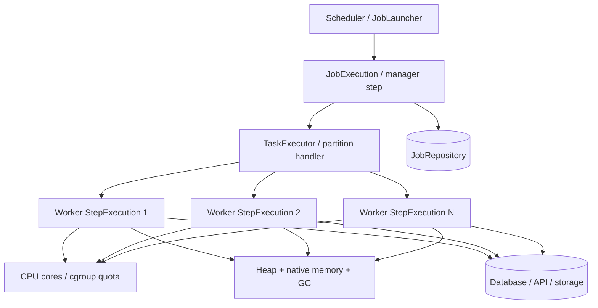
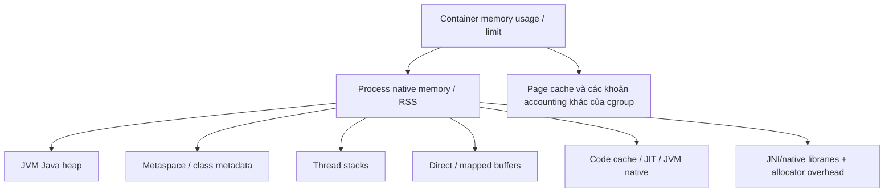
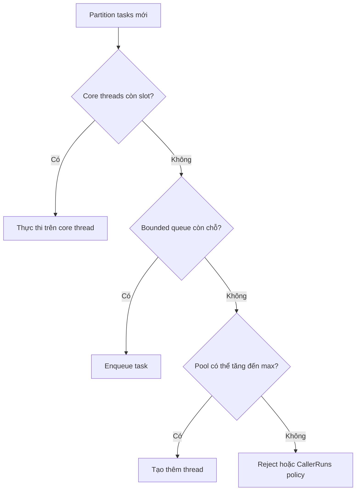
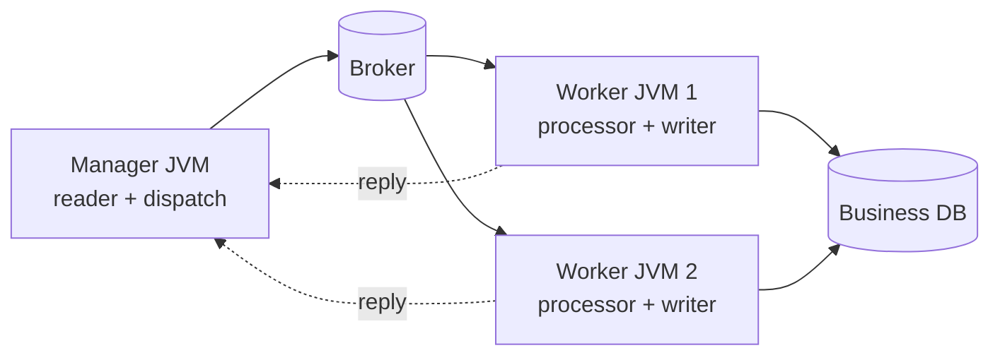

# CPU, memory và thread utilization trong Spring Batch: đo đúng tài nguyên trước khi scale

## 1. Bối cảnh và mục tiêu bài học

Trong chương **Metrics** của module **SPRING_BATCH_SCALING_OPERATIONS**, chúng ta cần đo hiệu năng để mở rộng Spring Batch cho workload dữ liệu lớn bằng **multi-threaded step, parallel steps, partitioning** và các mô hình xử lý phân tán. Đo CPU, bộ nhớ và mức sử dụng thread là bước quan trọng để quyết định tăng concurrency, tối ưu logic, giảm chunk size hay xử lý bottleneck ở database/middleware.

Một job chạy chậm nhưng dashboard cho thấy `CPU = 15%` không nhất thiết có nhiều năng lực xử lý còn dư. Có thể:

- Chỉ một thread chạy CPU-bound trên máy 8 vCPU, nên toàn process đạt khoảng 12,5% CPU chuẩn hóa.
- Hàng chục worker threads đang **WAITING** vì DB connection pool, HTTP timeout hoặc broker reply.
- JVM bị **CPU throttling** bởi container quota dù host CPU rảnh.
- Thread đã vào `RUNNABLE` nhưng thực tế đang ở native blocking I/O, không liên tục tiêu CPU.
- Heap used bình thường nhưng **RSS/container memory** tăng vì direct buffers, thread stacks, mmap hoặc native allocations.
- GC dừng nhiều lần vì chunk size cao và cấp phát object mạnh, làm giảm business throughput.
- Thêm worker chỉ tăng contention ở database, làm `StepExecution` rollback và restart thường xuyên hơn.

**Mục tiêu:** Xây dựng một cách đo **đúng phạm vi và đơn vị**, ghép CPU/memory/thread signals với **committed throughput** và latency để xác định nút thắt, rồi scale có kiểm chứng, không chỉ nhìn một đường biểu đồ.

Sau bài học, bạn có thể:

1. Phân biệt **host CPU**, **container CPU**, **process CPU** và **per-thread CPU time**.
2. Tính CPU cores thực được sử dụng, utilization theo quota, CPU time trên mỗi business item thành công.
3. Phân biệt heap used/committed/max, non-heap, direct/native memory, RSS, container working set và OOMKill.
4. Đọc GC pause, allocation rate và heap-after-GC trend để phân biệt peak bình thường với memory leak.
5. Phân biệt thread `RUNNABLE`, `BLOCKED`, `WAITING`, `TIMED_WAITING` với **CPU đang thực sự bận**.
6. Đo `ThreadPoolTaskExecutor` active/pool/queue/rejection cùng connection pool waiters.
7. Hiểu các metric đó trong sequential chunk, multi-threaded step, parallel steps, local/remote partitioning và remote chunking.
8. Cấu hình Micrometer gauges, đọc Prometheus và dùng JFR/thread dump để xác minh giả thuyết.
9. Thiết kế benchmark, capacity guardrail, retry/restart và kiểm thử tài nguyên dưới tải.
10. Đối soát business output để throughput cải thiện không che mất dữ liệu.

> **Phiên bản và phạm vi:** Ví dụ dùng Java 17+, Spring Batch **5.2.x**, Spring Framework 6, Micrometer, Spring Boot Actuator (nếu ứng dụng dùng Boot), Prometheus và nền tảng container/Kubernetes khi có. Không phải mọi application đều có sẵn Actuator hay tất cả metrics kể dưới đây. Tên series tại Prometheus tùy binder/exporter/version; phải kiểm tra endpoint thực tế. Các code snippet là ví dụ cấu hình tham khảo, chưa phải dự án đầy đủ đã chạy kiểm thử.

## 2. Đặt metrics vào đúng mô hình tài nguyên

Trong một deployment Spring Batch điển hình:



**Ba lớp đo không thay thế nhau:**

| Lớp | Câu hỏi | Ví dụ chỉ số |
| --- | --- | --- |
| **JVM/process** | Process Java tiêu bao nhiêu CPU và bộ nhớ? | `process.cpu.usage`, heap, GC, process RSS |
| **Container/host** | JVM có bị quota, memory limit, scheduler hoặc node pressure hạn chế? | CPU throttling, container usage/limit, OOMKill |
| **Spring Batch/workers** | Những thread nào làm business work, ai đang đợi, throughput có tăng? | Executor active/queue, StepExecution counts, reader/writer latency, committed items/s |

Một process có thể chạy **nhiều JobInstances**, nên process CPU tổng không tự tách được cho riêng một job. Một container cũng có thể có sidecars; container usage không nhất thiết bằng JVM usage. Phải xác định **scope** trước khi quy trách nhiệm bottleneck cho step cụ thể.

## 3. CPU utilization không phải một con số duy nhất

### 3.1. Các khái niệm CPU

| Chỉ số | Ý nghĩa | Lỗi diễn giải thường gặp |
| --- | --- | --- |
| **Host CPU utilization** | Phần năng lực CPU của máy chủ đang sử dụng | Host 20% không chứng minh container không bị throttle |
| **Container CPU usage** | CPU time process group trong cgroup sử dụng theo thời gian | Cần so với CPU quota/cpuset của container |
| **Process CPU load** | Tỷ lệ CPU JVM tiêu thụ theo định nghĩa API/exporter | Có thể chuẩn hóa theo số cores, không phải “số core” |
| **CPU seconds** | Tổng thời gian CPU thực thi qua tất cả threads | Một giây wall-clock có thể tích lũy nhiều CPU-seconds |
| **Per-thread CPU time** | CPU user + system của từng platform thread (nếu supported) | Thread `RUNNABLE` chưa chắc tiêu CPU liên tục |
| **Load average / runnable pressure** | Chỉ báo hệ điều hành về nhu cầu chạy/chờ tài nguyên | Không đồng nghĩa % CPU trong container |

Giả sử JVM chạy trên tài nguyên hiệu dụng 4 logical CPUs, trong một khoảng **10 giây wall-clock** tổng thread CPU time tăng **32 CPU-seconds**:

```text
average_cores_busy = 32 CPU-seconds / 10 seconds = 3,2 cores

CPU utilization theo capacity 4 cores:
  3,2 / 4 × 100% = 80%
```

**Công thức chỉ đúng khi số CPU time được đo phản ánh cùng process/container đang xét, khoảng thời gian và CPU capacity được xác định đúng.**

### 3.2. Một thread bão hòa không phải toàn máy bão hòa

Một processor tuần tự CPU-bound dùng trọn một core trên 8 logical cores:

```text
Busy CPU cores              ≈ 1
Available effective cores   = 8
Normalized CPU utilization  ≈ 1/8 = 12,5%
```

Nếu dashboard hiển thị 12,5%, nhìn “thấp” nhưng **step tuần tự đã dùng tối đa năng lực của một thread**. Tối ưu có thể là partitioning hoặc parallel execution trên các item độc lập, chứ không phải chỉ tăng `-Xmx`.

Ngược lại, một thread đợi DB 900 ms rồi dùng CPU 100 ms có thể có CPU load thấp dù **wall time/item = 1 giây**. Việc tăng CPU allocation không giúp nếu DB vẫn nghẽn.

### 3.3. Con số 100% phụ thuộc nguồn metric

- Một số hệ thống `top` báo **100% CPU của một core**; process nhiều thread có thể vượt 100%.
- Một số `process.cpu.usage` gauges báo fraction **0..1** đã chuẩn hóa theo năng lực CPU nhìn thấy.
- Prometheus CPU seconds rate có đơn vị **cores**: rate ~2,5 nghĩa khoảng 2,5 CPU cores đang chạy, không phải 2,5%.
- Kubernetes HPA CPU utilization thường dựa trên tỷ lệ so với **CPU requests**; không tự tương đương usage/CPU limits hay process.cpu.usage.

**Không so số 80% từ hai dashboards khác nhau nếu chúng không cùng mẫu số.**

## 4. CPU limit, cpuset và throttling trong container

JVM chạy trong Kubernetes có thể có:

```yaml
resources:
  requests:
    cpu: "1000m"
    memory: "2Gi"
  limits:
    cpu: "2000m"
    memory: "4Gi"
```

Đây là một đoạn cấu hình **resources của container** cần đặt dưới `containers[].resources` trong Pod spec, không phải YAML Pod hoàn chỉnh.

- `1000m` request tương đương một CPU cho mục đích scheduling và một số cơ chế autoscaling.
- `2000m` limit tương đương ngân sách CPU khoảng hai cores theo quota scheduling của môi trường.
- Memory limit là trần tiêu thụ cho cgroup/container theo quy tắc runtime.
- Một container có thể bị **CPU throttling** khi tiêu hết quota trong một period, ngay cả khi host còn idle capacity.

### Đừng chỉ nhìn `Runtime.availableProcessors()`

Java có hỗ trợ nhận biết container trong các JDK hiện đại, nhưng giá trị `Runtime.getRuntime().availableProcessors()` không phải nguồn chân lý duy nhất cho mọi tình huống cgroup, cpuset, quota và thay đổi resource động. Khi sizing thread pool, đo:

- Container CPU request/limit/quota và cpuset nếu được gán.
- CPU usage cores, throttled time/periods.
- Host node pressure.
- JVM `availableProcessors()` nhìn thấy tại startup.
- Actual CPU-bound parallel speedup qua benchmark.

Một ước tính về effective parallelism:

```text
effective_cpu_cores ≈ min(
    cores được phép từ affinity/cpuset,
    CPU quota cores nếu có quota
)

Vẫn cần benchmark vì SMT, NUMA và các workloads khác ảnh hưởng.
```

**Cảnh báo:** CPU throttling là tín hiệu quan trọng, nhưng không nên lấy một tỉ lệ throttled periods thô rồi suy ra chính xác mất 30% throughput; metric đo các period có throttling, không phải trực tiếp tỉ lệ công việc bị mất.

## 5. CPU time trên mỗi business item thành công

Một metric hữu ích khi tối ưu code:

```text
cpu_seconds_per_committed_item
    = Delta(process_cpu_seconds_used)
      / Delta(unique_business_items_committed)

cpu_ms_per_item = cpu_seconds_per_item × 1000
```

Ví dụ một process dành **240 CPU-seconds** để hoàn tất **600.000 items hợp lệ**:

```text
240 / 600.000 = 0,0004 CPU-second/item
              = 0,4 CPU-ms/item
```

Giả sử process có budget 4 CPU cores và công việc thật CPU-bound, trần lý thuyết gần:

```text
4 cores × 1000 ms/core/s / 0,4 ms/item
≈ 10.000 items/s
```

**Đây chỉ là upper-bound gần đúng**, chưa gồm contention, I/O wait, GC, locking, file decoding, retries, writer transaction và throughput của database. Nếu tăng worker nhưng CPU-ms/item tăng từ 0,4 lên 1,2 do lock/GC/serialization, hiệu quả song song kém đi.

### Chọn mẫu số đúng

- `readCount` không nhất thiết là item đã commit.
- `writeCount` không nhất thiết là row mới insert khi writer dùng UPSERT/`ON CONFLICT DO NOTHING`.
- Processor có filter/skip/retry khiến process attempts khác unique business items.
- Một process có nhiều jobs làm CPU time trên mỗi item của job không tách bạch.
- Tính CPU cost trên **cùng tập item/snapshot**, cùng output contract và cùng cửa sổ đo.

Ở môi trường nhiều jobs, có thể cần per-job CPU profiling/isolated benchmark thay vì dùng toàn process CPU time để quy cho một JobExecution.

## 6. Bộ nhớ Java có nhiều lớp

Một dashboard chỉ có `heap used` **không đủ** để kết luận an toàn bộ nhớ.



Một số vùng có thể được tính khác nhau giữa `RSS`, cgroup `memory.current`/working set và tooling, không nên coi sơ đồ là một phương trình cộng tuyệt đối.

### 6.1. Heap used, committed và max

| Chỉ số | Diễn giải |
| --- | --- |
| **Heap used** | Dung lượng heap đang chứa objects tại thời điểm đo |
| **Heap committed** | Dung lượng heap JVM đã cấp/commit từ hệ điều hành |
| **Heap max** | Giới hạn heap gần với `-Xmx` hoặc cấu hình container-aware |
| **After-GC heap occupancy** | Lượng dữ liệu sống còn lại sau major/old collection hoặc mốc GC phù hợp |

`used` thường dao động theo cấp phát/GC. Một đỉnh heap 85% ngay trước GC chưa chứng minh memory leak. Nếu **baseline sau GC** tăng đều qua nhiều lần workload giống nhau và không hạ, mới có bằng chứng cần điều tra retained objects/caches.

### 6.2. Non-heap/native/RSS

Bao gồm metaspace, code cache, JNI/native allocations, direct/mapped buffers, thread stacks, allocator arenas và nhiều vùng JVM runtime khác. Khi tăng từ 8 lên 200 worker threads, **thread stacks và context switching** có thể trở thành chi phí đáng kể.

Nếu heap ổn định khoảng 2 GiB nhưng container limit 3 GiB bị OOMKill, kiểm tra **RSS/native/direct buffers/thread count/page-cache accounting** trước khi kết luận chỉ cần tăng `-Xmx`.

### 6.3. OOM khác nhau ở cấp JVM và container

| Tình huống | Triệu chứng điển hình | Ý nghĩa |
| --- | --- | --- |
| `java.lang.OutOfMemoryError: Java heap space` | JVM không cấp phát thêm heap object | Heap limit, leaks/working set/chunk size |
| `OutOfMemoryError: Metaspace` | Class metadata quá lớn | Classloader leak, dynamic classes, metaspace cap |
| `OutOfMemoryError: Direct buffer memory` | Direct memory allocation không đáp ứng | Direct-buffer use, cap, native pressure |
| `unable to create native thread` | Không tạo thêm platform thread | Thread count, native memory, OS/pid limits |
| Container **OOMKilled** | Process bị kernel/runtime kill, không nhất thiết có Java stacktrace | Container memory accounting vượt giới hạn |

**Không** suy từ absence of Java OOME rằng process không gặp vấn đề memory. Với OOMKilled, cần xem container termination reason, memory usage/limit, JVM Native Memory Tracking nếu đã bật và các khoản memory ngoài heap.

## 7. Vì sao chunk size và concurrency làm memory tăng?

Spring Batch chunk-oriented step gom items để reader/process/writer thực thi theo transaction. Chunk size là **commit interval**, không phải số thread hay số byte đọc I/O.

Giả sử:

```text
chunkSize B = 300 items
average parsed input object = 2 KiB/item
average transformed output object = 2 KiB/item
concurrent worker StepExecutions C = 8
```

Phần payload lý thuyết do input+output lists:

```text
B × (2 KiB + 2 KiB) × C
= 300 × 4 KiB × 8
= 9.600 KiB ≈ 9,38 MiB
```

**Không coi 9,38 MiB là tổng heap.** `ArrayList`, object headers, strings/arrays, copies, JDBC buffers, chunk retries, reader page cache, serializers và temporary objects có thể lớn hơn nhiều. Nếu mỗi item lớn 1 MiB thay vì 2 KiB, cùng concurrency sẽ mang đến mức memory pressure khác hẳn.

Một mô hình capacity thô:

```text
estimated_peak_working_set ≈
    concurrent_chunks × peak_chunk_footprint
  + per_worker_reader_state
  + buffers/caches/JDBC/serialization
  + baseline JVM + safety_headroom

Đây là budgeting model, không phải định luật chính xác.
```

### Khác biệt giữa chunk size và `pageSize`

`JdbcPagingItemReader` có thể giữ state/page buffers liên quan đến `pageSize`; `FlatFileItemReader` có line/string buffers. Nếu tăng `chunk(1000)`, `pageSize(5000)` và worker threads cùng lúc, cả ba thành phần có thể tăng working set.

Cần đo **peak heap, allocation rate và GC pause** khi thay đổi từng tham số, không tuning đồng thời mọi thứ rồi không biết nguyên nhân.

## 8. Allocation rate và GC: throughput có thể giảm dù CPU cao

Một pipeline xử lý 500.000 items/s nhưng mỗi item tạo nhiều `String`, `Map`, DTO copies, JSON buffers và boxing có thể cấp phát hàng GB/s.

GC phải thu hồi objects, gây:

- CPU dành cho garbage collection thay vì business processing.
- Stop-the-world pauses hoặc concurrent GC overhead.
- Heap occupancy oscillation và allocation stalls.
- Tail latency của chunk commit/reply.
- Memory pressure khi producers tạo objects nhanh hơn workers hoàn tất.

### Các nhóm metric cần nhìn

| Nhóm | Metric logic | Ý nghĩa |
| --- | --- | --- |
| Heap | used/committed/max, after-GC occupancy | Working set và xu hướng retained data |
| GC | pause count/sum/p95 | Mức ảnh hưởng đến latency |
| Allocation | bytes allocated/s | Tốc độ tạo objects |
| Promotion/old-gen | old-gen occupancy và collections | Dữ liệu sống lâu, nguy cơ pause |
| JVM buffers | direct/mapped buffer count/bytes | Off-heap pressure |
| Container | working set/limit, OOMKill | Ngân sách toàn container |
| Process | RSS/native memory | Khác biệt giữa heap và process footprint |

**Không lấy `jvm_gc_pause_seconds_count` là số item được xử lý**; nó đếm pause events. Không dùng average GC pause để thay p99 business latency.

### GC stress so với leak

Hai trường hợp:

- **High allocation/healthy collection:** Heap tăng lên 80%, giảm còn 25% sau mỗi GC, không có trend after-GC tăng, throughput có thể vẫn tốt dù GC CPU cao.
- **Retained memory leak:** Sau mỗi GC, baseline từ 25% lên 40%, 55%, 70% dưới tải tương đương; cần điều tra object retention/caches/listeners/contexts.

Một nguyên nhân đặc trưng của Spring Batch là lưu item lists/large payload vào singleton beans, `ExecutionContext` hoặc in-memory collector suốt JobExecution. **ExecutionContext nên chứa checkpoint metadata nhỏ**, không phải hàng triệu business records.

## 9. Thread utilization: đếm threads chưa đủ

Các metric khác nhau:

| Chỉ số | Định nghĩa | Không chứng minh điều gì |
| --- | --- | --- |
| **Live threads** | Số JVM threads đang sống | Không chứng minh mọi thread đang chạy |
| **Daemon threads** | Threads daemon trong JVM | Không phải worker capacity |
| **Peak threads** | Mức live-thread cao nhất | Không nêu mức bận hiện tại |
| **Active executor tasks** | `ThreadPoolExecutor` tasks đang thực thi | Có thể đang đợi I/O; không nhất thiết dùng CPU |
| **Executor pool size** | Số worker threads đang tồn tại | Khác `maxPoolSize`/active |
| **Executor queue depth** | Tasks chờ được thread xử lý | Không trực tiếp là business items |
| **Task rejected count** | Tasks bị từ chối theo overload policy | Rejection không có nghĩa đã được retry bền vững |
| **Per-thread CPU time** | CPU seconds theo thread | Cần sampling interval và support |
| **DB pool pending** | Threads đang chờ DB connection | Không phải JVM thread pool queue |

Có thể tính hai tỉ lệ:

```text
active_fraction_of_current_pool = active_threads / pool_size

active_fraction_of_configured_max = active_threads / max_pool_size
```

Ví dụ `active=4, pool_size=4, max=16`:

```text
active/current_pool = 4/4 = 100%
active/configured_max = 4/16 = 25%
```

Hai con số có vẻ mâu thuẫn nhưng đều đúng theo **mẫu số khác nhau**. Không dùng tỉ lệ thứ hai để khẳng định ngay có thể chạy thêm 12 tasks: executor queue policy có thể khiến pool chưa mở rộng, hoặc DB pool có thể đã bão hòa.

## 10. JVM thread states không đồng nghĩa CPU usage

Java `Thread.State` có:

| State | Ý nghĩa điển hình | Cần kiểm chứng thêm |
| --- | --- | --- |
| `NEW` | Chưa start | Không phải worker đang chạy |
| `RUNNABLE` | Có thể chạy ở JVM; có thể đang chạy/native I/O | CPU samples, native stack, profiler |
| `BLOCKED` | Đợi monitor lock để vào `synchronized` | Contended monitor, owner, lock hold time |
| `WAITING` | Chờ vô hạn như `park()`/`wait()`/`join()` | Idle pool, condition queue hay deadlock? |
| `TIMED_WAITING` | Chờ timeout/sleep/park có hạn | DB/network retry, backoff, polling |
| `TERMINATED` | Thread đã kết thúc | Không còn capacity worker |

**Đừng coi `RUNNABLE` là 100% CPU busy.** Ở JVM, thread được đánh dấu RUNNABLE có thể đang trong native socket/file operation. Muốn kết luận CPU-bound cần **CPU time deltas + JFR/CPU profiling**.

**Đừng coi `WAITING` luôn là lỗi.** Một executor pool rảnh thường có workers parked trong WAITING, đó là trạng thái bình thường. Khi queue đang tăng nhưng worker `WAITING`, mới cần xem routing, synchronization hoặc missed notifications.

### Ví dụ thread dump khi nghẽn

Một snapshot có:

```text
4 threads RUNNABLE  trong CPU transform
12 threads WAITING   trên HikariPool.getConnection(...)
6 threads TIMED_WAITING do retry backoff
1 thread BLOCKED     chờ monitor lock của shared writer
```

Không thể kết luận bottleneck bằng tổng số `RUNNABLE`. Trong ví dụ, DB pool/retry/lock contention có thể là nguyên nhân chính. Lấy **nhiều thread dumps theo thời gian** thay vì một snapshot, và đối chiếu CPU profiles/DB metrics.

## 11. `ThreadPoolTaskExecutor`: core, queue, max và rejection

Spring Batch local partitioning thường dùng `TaskExecutorPartitionHandler` hoặc DSL `partitioner(...).step(...).taskExecutor(...)`. Trong một JVM, `ThreadPoolTaskExecutor` là công cụ điều tiết số worker `StepExecution` thực thi đồng thời.



**Hành vi phổ biến của `ThreadPoolExecutor`:** Dùng core threads trước, sau đó enqueue; khi queue đầy mới thử tăng đến max. Do đó:

```text
corePoolSize  = 2
maxPoolSize   = 16
queueCapacity = 1000

Có thể chỉ ~2 threads thực thi trong khi queue chờ dài,
vì queue vẫn đủ chỗ và pool chưa cần tăng tới max.
```

Nếu queueCapacity = 0, có thể dùng handoff kiểu `SynchronousQueue`, không phải “queue depth 0 nghĩa không nghẽn”. Khi tasks không thể được nhận, chúng có thể bị reject hoặc xử lý ở caller theo policy.

### Bounded pool mẫu cho partition worker

```java
@Bean("batchPartitionExecutor")
ThreadPoolTaskExecutor batchPartitionExecutor() {

    ThreadPoolTaskExecutor executor = new ThreadPoolTaskExecutor();
    executor.setThreadNamePrefix("batch-partition-");
    executor.setCorePoolSize(4);
    executor.setMaxPoolSize(4);
    executor.setQueueCapacity(8);
    executor.setRejectedExecutionHandler(
            new ThreadPoolExecutor.AbortPolicy());
    executor.initialize();

    return executor;
}
```

`core=max=4` là baseline dễ phân tích; **không phải giá trị tốt nhất cho mọi workload**. Với local partitioning, phải xét số cores, readers, database pool, connection cho JobRepository và các job khác. Task bị reject **không được silently drop** hoặc đánh dấu StepExecution COMPLETED.

Nếu dùng `CallerRunsPolicy`, thread manager có thể bị chặn xử lý task, tạo backpressure nhưng thay đổi behavior/latency của coordinator. Chỉ áp dụng sau test handler/restart/lifecycle.

## 12. Worker concurrency khác chunk concurrency

Một điểm quan trọng để tránh race:

| Mô hình | Concurrency ở đâu? | Hệ quả với reader/checkpoint |
| --- | --- | --- |
| **Sequential chunk step** | Một chunk pipeline tại một thời điểm | Reader state đơn giản nhất |
| **Multi-threaded step** | Nhiều chunks trong cùng StepExecution | Reader state có thể shared và commit không theo read order |
| **Parallel steps** | Nhiều StepExecutions trong các flows | Reader/state tách theo step nếu beans scoped đúng |
| **Local partitioning** | Nhiều worker StepExecutions trong cùng JVM | `@StepScope` reader riêng cho mỗi worker |
| **Remote partitioning** | Worker StepExecutions trên nhiều processes | Mỗi worker JVM có CPU/memory/pool riêng |
| **Remote chunking** | Manager đọc, remote workers process/write | Phải đo manager và workers/requests riêng |

**`@StepScope` không có nghĩa một reader riêng cho mỗi thread trong multi-threaded step**. Scope là theo `StepExecution`. Nếu nhiều chunk threads truy cập một cursor mutable, tăng threads có thể làm sai checkpoint/ordering/restart, dù throughput tăng.

Với local partitioning, mỗi worker StepExecution nhận riêng `ExecutionContext` và reader state, nên cách này thường dễ phân lập tài nguyên và restart hơn việc cho nhiều chunk threads đọc chung một reader.

## 13. Phân biệt tài nguyên của manager và worker phân tán

Trong remote chunking:



Manager CPU thấp không có nghĩa toàn job rảnh: workers có thể CPU-bound, DB-bound, GC-bound hoặc blocked on API. Queue/broker reply latency có thể khiến manager chờ.

Trong remote partitioning, worker thường tự giữ reader cho partition riêng; manager có thể sử dụng CPU rất ít trong khi worker JVMs xử lý hàng triệu records.

### Bộ metrics phải có ở **mọi process liên quan**

- Manager: CPU, heap/GC, thread pool, read/dispatch latency, pending replies/partitions.
- Worker: CPU, heap/GC, active threads, process/write/commit latency, retries/rollbacks.
- Broker: ready/unacked/in-flight, redeliveries, age.
- Database: connection active/pending, lock wait, query/commit latency.
- JobRepository: StepExecution status, read/write/commit counts, metadata update latency nếu đo được.
- Business sink: unique committed keys/s, duplicate/conflict/mismatch và expected coverage.

**Không** cộng `process_cpu_usage` fractions của nhiều pods rồi gọi là số CPU cores: phải dùng CPU time rate per process/pod, quota và cách chuẩn hóa chính xác.

## 14. Spring Batch metrics và Micrometer: metric nào đã có?

Spring Batch 5.2 có instrumentation cho job, step và các thao tác trong chunk step. Một số tên metric ở tầng Micrometer tham khảo:

| Metric Micrometer | Type | Mục đích |
| --- | --- | --- |
| `spring.batch.job` | Timer | Duration của job execution |
| `spring.batch.job.active` | Long-task timer | Job đang chạy |
| `spring.batch.step` | Timer | Duration của step execution |
| `spring.batch.step.active` | Long-task timer | Step đang chạy |
| `spring.batch.item.read` | Timer | Thời gian đọc item |
| `spring.batch.item.process` | Timer | Thời gian process item |
| `spring.batch.chunk.write` | Timer | Thời gian writer chunk |

Các series thực tế khi export có thể có suffix `_seconds_count`, `_seconds_sum`, `_max` tùy loại meter và naming convention.

**Những metric này không đủ để biết `ThreadPoolTaskExecutor` queue depth hoặc container memory limit.** Cần Micrometer JVM/process binders, Actuator/exporter và custom executor gauges nếu hệ thống chưa cung cấp sẵn.

### Vai trò của các components

- **Micrometer MeterRegistry:** nơi tạo/đăng ký meters của JVM/process/app.
- **Spring Boot Actuator** (nếu dùng): cấu hình metrics endpoint và integration với exporter.
- **Prometheus registry/exporter:** chuyển meters thành time series để scrape/query.
- **Container monitoring:** cho CPU quota/throttling, OOMKill, memory working set.
- **JFR/thread dump/heap dump:** dùng khi cần phân tích nguyên nhân sâu hơn.

Một deployment có Spring Batch thuần **không tự có** `/actuator/prometheus` nếu chưa cài đặt và cấu hình Boot Actuator/Prometheus registry.

## 15. Cấu hình metrics endpoint và quyền truy cập

Ví dụ khi dùng Spring Boot/Actuator và registry tương ứng:

```yaml
management:
  endpoints:
    web:
      exposure:
        include: health, info, prometheus
  metrics:
    tags:
      application: scaling-batch
```

Cấu hình phụ thuộc phiên bản Boot, bảo mật endpoint và package trên classpath. `prometheus` chỉ hiện khi có registry/endpoint thích hợp. Trong production, **không public endpoint metrics ra Internet**; dùng auth, network policy, TLS hoặc cơ chế scrape nội bộ.

Tránh đưa `runKey`, `JobExecutionId`, `paymentId`, `tenantId` có cardinality rất lớn vào mọi series. Labels nên hữu hạn như `application`, `job_name`, `step_name`, `pool`, `role`, `outcome`.

## 16. Java/Micrometer: đo executor active, pool size và queue depth

Đăng ký một `MeterBinder` cho pool có tên cố định:

```java
@Bean
MeterBinder partitionPoolMeters(
        @Qualifier("batchPartitionExecutor")
        ThreadPoolTaskExecutor executor) {

    return registry -> {
        ThreadPoolExecutor delegate =
                executor.getThreadPoolExecutor();

        Tags tags = Tags.of(
                "pool", "batch-partitions",
                "role", "local-worker");

        Gauge.builder(
                "batch.worker.threads.active",
                executor,
                ThreadPoolTaskExecutor::getActiveCount)
                .tags(tags)
                .description("Executor tasks currently active")
                .register(registry);

        Gauge.builder(
                "batch.worker.threads.pool",
                executor,
                ThreadPoolTaskExecutor::getPoolSize)
                .tags(tags)
                .description("Current executor threads")
                .register(registry);

        Gauge.builder(
                "batch.worker.queue.depth",
                delegate,
                pool -> pool.getQueue().size())
                .tags(tags)
                .description("Tasks waiting in executor queue")
                .register(registry);

        Gauge.builder(
                "batch.worker.queue.remaining",
                delegate,
                pool -> pool.getQueue().remainingCapacity())
                .tags(tags)
                .description("Available queue slots")
                .register(registry);

        Gauge.builder(
                "batch.worker.threads.max",
                delegate,
                ThreadPoolExecutor::getMaximumPoolSize)
                .tags(tags)
                .description("Configured max executor threads")
                .register(registry);
    };
}
```

**Đọc đúng ý nghĩa:**

- `active` đếm tasks đang được thread thực thi, **không khẳng định CPU đang bận**.
- `pool` là số threads hiện được tạo, khác `max`.
- `queue.depth` đếm `Runnable tasks`, **không phải items** hoặc chunk records.
- `queue.remaining` đo queue slots và không phải memory còn trống.
- `getThreadPoolExecutor()` yêu cầu executor đã initialize; tránh gọi quá sớm trong lifecycle.
- Nếu pool dùng chung nhiều jobs, gauges không tự tách từng `JobExecution`.
- Micrometer gauges nên tham chiếu object sống lâu (bean singleton) thay vì tạo một object ngắn hạn cho mỗi scrape/JobExecution.
- Trong một số cấu hình Boot có sẵn executor metrics; tránh đăng ký trùng meters bằng tên+tags khác nghĩa.

### Executor sử dụng ở partition manager

```java
@Bean("paymentManager")
Step paymentManager(
        JobRepository repository,
        @Qualifier("paymentWorker") Step worker,
        @Qualifier("paymentPartitioner") Partitioner partitioner,
        @Qualifier("batchPartitionExecutor") TaskExecutor executor) {

    return new StepBuilder("paymentManager", repository)
            .partitioner(worker.getName(), partitioner)
            .step(worker)
            .gridSize(4)
            .taskExecutor(executor)
            .build();
}
```

`paymentWorker`/`paymentPartitioner` là beans ứng dụng phải triển khai, với partition plan và worker `ExecutionContext` ổn định. Ví dụ là **local partitioning**, không phải một remote worker. Không thêm `taskExecutor` vào chunk step của worker nếu reader chưa được audit thread safety.

## 17. JVM/process metrics: dùng binders có sẵn trước khi viết custom

Với Micrometer/Actuator cấu hình phù hợp, có thể quan sát những nhóm metric như:

| Nhóm | Tên Micrometer thường gặp | Prometheus series minh họa |
| --- | --- | --- |
| Process CPU | `process.cpu.usage` | `process_cpu_usage` |
| System CPU | `system.cpu.usage` | `system_cpu_usage` |
| CPU count | `system.cpu.count` | `system_cpu_count` |
| JVM heap | `jvm.memory.used` | `jvm_memory_used_bytes{area="heap"}` |
| JVM heap committed | `jvm.memory.committed` | `jvm_memory_committed_bytes` |
| JVM heap max | `jvm.memory.max` | `jvm_memory_max_bytes` |
| JVM threads | `jvm.threads.live` | `jvm_threads_live_threads` |
| JVM thread states | `jvm.threads.states` | `jvm_threads_states_threads` |
| GC pauses | `jvm.gc.pause` | `jvm_gc_pause_seconds_count/sum` |
| JVM buffers | `jvm.buffer.memory.used` | `jvm_buffer_memory_used_bytes` |

**Đây là nhóm/tên ví dụ điển hình, không phải cam kết series nào cũng xuất hiện.** Một số pools có `max` không xác định, các tags như `area`/`id`/`state` khác nhau tùy binder. Cần inspect `/actuator/metrics` hoặc exporter thực tế trước khi viết PromQL.

### Đừng cộng hết các pool `max` để suy `-Xmx`

Tùy GC và pool reporting, `jvm.memory.max` của một số pools có thể không xác định hoặc không cộng được thành giá trị đáng tin cậy. Để tính heap utilization chuẩn, ưu tiên **heap used và heap max ở cùng phạm vi đã kiểm chứng**, hoặc export một gauge application-level từ `MemoryMXBean.getHeapMemoryUsage()` nếu cần.

## 18. PromQL: CPU đã chuẩn hóa và CPU cores đang dùng

Ví dụ nếu `process_cpu_usage` được export đúng như một gauge chuẩn hóa:

```promql
# Process CPU usage fraction ở từng JVM instance
process_cpu_usage{application="scaling-batch"}

# Process CPU usage dạng %
100 * process_cpu_usage{application="scaling-batch"}

# System CPU usage nếu binder/exporter có
100 * system_cpu_usage{application="scaling-batch"}
```

**Không dùng `process_cpu_usage × số cores host` để tính cores nếu mẫu số của binder đã theo container quota/cpuset khác host**. Muốn cores đang sử dụng từ CPU time counter hãy dùng counter có semantics CPU seconds tương ứng.

Ví dụ nếu exporter của bạn có series `process_cpu_seconds_total`:

```promql
# Trung bình CPU cores JVM đã dùng trong 5 phút.
rate(process_cpu_seconds_total{application="scaling-batch"}[5m])
```

**Series này không mặc định có ở mọi tổ hợp Micrometer/Actuator.** Nếu không thấy, dùng container CPU usage seconds counter do cAdvisor/monitoring cung cấp, hoặc `process_cpu_usage` với hiểu biết rõ denominator. Tránh tự bịa metric names để dashboard hiển thị no data mà không ai biết.

### CPU usage theo container quota

Nếu có metric container CPU counter và metric quota cores đã chuẩn hóa:

```text
effective_utilization =
    observed_cpu_cores_used / effective_cpu_quota_cores
```

Không cần viết PromQL chung cho mọi exporter vì Kubernetes/cAdvisor/Prometheus setups có label và metric name khác nhau. Phải đối chiếu pod/container labels, cpu usage counter và quota metrics **cùng container**, loại sidecars nếu mục tiêu là JVM worker.

## 19. PromQL: heap, GC và native pressure

Các ví dụ dưới giả định time series đã được xuất đúng như tên:

```promql
# Heap used bytes của một JVM (cộng các heap pools).
sum by (instance) (
  jvm_memory_used_bytes{
    application="scaling-batch", area="heap"
  }
)

# Heap committed bytes (khác heap max).
sum by (instance) (
  jvm_memory_committed_bytes{
    application="scaling-batch", area="heap"
  }
)

# Thời gian GC pause / giây theo cửa sổ 5 phút.
sum by (instance) (
  rate(jvm_gc_pause_seconds_sum{
    application="scaling-batch"
  }[5m])
)

# Số GC pause events / giây.
sum by (instance) (
  rate(jvm_gc_pause_seconds_count{
    application="scaling-batch"
  }[5m])
)
```

**Cảnh báo khi diễn giải:**

- `jvm_memory_used_bytes` là gauge, **không dùng `rate()` như counter**.
- `jvm_gc_pause_seconds_sum` là cumulative timer sum, nên dùng `rate()` để xem GC pause time/s.
- Tổng GC pause time không bao gồm mọi CPU overhead của concurrent GC threads.
- Heap used và process RSS không cùng phạm vi; cần container/native metrics để tìm khoảng chênh.
- `max heap` có thể thay đổi theo JVM flags/container heuristics, cần xác minh trước khi tính %.

### Heap utilization ratio

Nếu có một gauge `batch_jvm_heap_max_bytes` được export chắc chắn đúng max heap cho mỗi JVM:

```promql
sum by (instance) (
  jvm_memory_used_bytes{area="heap"}
)
/
on(instance)
batch_jvm_heap_max_bytes
```

Đây là **ví dụ dựa trên metric custom** `batch_jvm_heap_max_bytes`, không phải metric có sẵn mặc định. Khi multi-application dùng cùng instance label, phải giữ thêm labels tương ứng để tránh vector matching lẫn process.

### Khi heap 60% nhưng container gần OOM

Cần đặt cạnh:

```text
JVM heap used
JVM direct/mapped buffer memory
Process RSS
Container working set / memory.current
Container memory limit
Thread count / stack footprint
GC and native allocations
```

**Đừng tăng `-Xmx`** chỉ để cải thiện “heap utilization” trong khi container memory limit cố định. Nếu heap max lớn thêm, native headroom có thể nhỏ hơn và OOMKill xảy ra sớm hơn.

## 20. PromQL: threads và executor saturation

Giả sử custom gauges phần 16 được exporter đổi sang tên Prometheus:

```promql
batch_worker_threads_active{
  pool="batch-partitions",role="local-worker"
}

batch_worker_threads_pool{
  pool="batch-partitions",role="local-worker"
}

batch_worker_queue_depth{
  pool="batch-partitions",role="local-worker"
}
```

Tỉ lệ active so với current pool:

```promql
batch_worker_threads_active{
  pool="batch-partitions",role="local-worker"
}
/
clamp_min(
  batch_worker_threads_pool{
    pool="batch-partitions",role="local-worker"
  },
  1
)
```

Không gọi ratio này là `CPU utilization`. Nếu 4 active threads đều chờ Hikari connection, nó có thể bằng 100% trong khi CPU process chỉ 10%.

Nếu binder có `jvm_threads_states_threads`:

```promql
# Số JVM threads ở BLOCKED (phụ thuộc giá trị label state thực)
sum by (instance) (
  jvm_threads_states_threads{
    application="scaling-batch",state="blocked"
  }
)
```

Giá trị label thực có thể là uppercase/khác format theo exporter; inspect metrics trước khi copy query. JVM-wide thread states gồm cả GC, HTTP, scheduler, broker listeners, không chỉ Spring Batch worker threads.

### Queue depth và throughput phải được vẽ cùng nhau

```text
active threads ≈ max
executor queue tăng
business committed items/s vẫn thấp
DB connection pending tăng

=> khả năng cao downstream/DB-bound hơn là thiếu CPU.
```

Trái lại:

```text
active threads ≈ max
CPU cores used ≈ effective quota
DB pending thấp
process/item CPU p95 cao
queue tăng

=> có cơ sở để điều tra CPU-bound.
```

## 21. Tạo metric committed throughput không làm sai transaction

Để đánh giá scale, metric quan trọng nhất thường là:

```text
business_throughput =
    delta(unique_valid_business_items_committed)
    / delta(wall_time_seconds)
```

Không đồng nhất `readCount`, `writeCount` và số rows đã commit khi có filter/skip/retry/UPSERT.

Ví dụ PostgreSQL sink:

```sql
CREATE TABLE processed_payment (
    run_key       varchar(160) NOT NULL,
    payment_id    bigint NOT NULL,
    net_amount    numeric(20,2) NOT NULL,
    PRIMARY KEY (run_key, payment_id)
);
```

```sql
SELECT COUNT(*) AS committed_unique_payments
FROM processed_payment
WHERE run_key = :runKey;
```

Primary key bảo đảm mỗi `run_key/payment_id` chỉ có một row nhưng **không bảo đảm đúng payload hoặc đầy đủ input**. Đối soát key set và amount/version sau job. Với database writer phát `ON CONFLICT DO NOTHING`, `StepExecution.writeCount` vẫn có thể phản ánh items gửi writer thay vì inserts mới.

### Nếu muốn ghi counter gần thời gian thực

- Xác định hook/callback chỉ được gọi **sau khi transaction đã commit** và có durable evidence.
- Đừng tăng counter duy nhất trong `ItemWriter.write` rồi coi đã committed; transaction có thể rollback.
- Counter trong process có thể reset khi JVM restart; Prometheus `rate` xử lý reset cho counters nhưng không biến nó thành sổ cái business.
- Nếu cần số liệu authoritative, dùng outbox/audit/sink query hay CDC với deduplication.
- Với remote workers, đừng cộng cùng event ở cả manager và worker như hai business completions.

## 22. Phân tích case A: CPU-bound processor

Giả sử baseline:

```text
Worker active                   = 4 / 4
Container effective CPU quota   = 4 cores
Observed CPU cores used         ≈ 3,8
GC pause time/s                 thấp
DB connection pending           thấp
Process latency p95             cao
Business commits/s              thấp hơn arrival/s
```

Chẩn đoán có cơ sở: processor có thể **CPU-bound**. Hành động:

1. Dùng JFR/CPU profiler tìm hotspots: JSON parsing, cryptography, regex, reflection, serialization, algorithm.
2. Giảm allocation và số lần biến đổi object không cần thiết.
3. Nếu item độc lập, phân chia thành nhiều worker StepExecutions/partitions phù hợp.
4. Scale CPUs/instances nếu quota đã bão hòa; không chỉ tăng thread count vượt số cores.
5. Đo CPU-ms per successful item và committed throughput sau tuning.
6. Test ordering, idempotency và restart sau khi thay concurrency.

**Không tự bật multi-threaded reader** nếu reader/`ExecutionContext` chưa thread-safe. Parallelism của processor phải giữ business semantics.

## 23. Case B: CPU thấp, workers active cao, DB pool nghẽn

```text
Process CPU usage                = 15%
Partition executor active        = 8 / 8
Executor queue depth            = 40 tasks
Hikari pool active               = 8 / 8
Hikari pool pending              = 18 waiters
DB lock wait / commit p95        = cao
Business commits/s               = 600, không tăng khi thêm workers
```

Ở đây 8 active workers có thể chủ yếu đang **đợi DB**. Tăng executor lên 16 sẽ khiến nhiều threads tranh connection/locks hơn, thường không giải quyết root cause.

Đường xử lý:

- Đo query plans, indexes phục vụ partition bounds, batch writer size và lock wait.
- Kiểm tra hotspots: nhiều workers cùng update một aggregate row.
- Giảm lock hold time, giảm transaction size khi phù hợp.
- Giới hạn concurrency, kiểm tra JDBC pool sizing tổng cho **JobRepository + business DB + các jobs khác**.
- Dùng staging/upsert idempotent theo business key, aggregate sau barrier nếu cần.
- Kiểm tra DB/server CPU và I/O — CPU của JVM thấp không nói database có rảnh.

**Dấu hiệu quan trọng:** `executor.active/max=100%` không có nghĩa CPU-bound; active task có thể đang đợi I/O.

## 24. Case C: heap/GC-bound vì item hoặc chunk quá lớn

```text
CPU cores used                  cao nhưng throughput giảm
Heap used                       dao động 75-95%
GC pause duration p95           tăng
Allocation rate                 cao
Chunk size                      10.000 items
Concurrent partition workers    12
Business commits/s              thấp hơn cấu hình 4 workers
```

Hướng điều tra:

- Heap allocation/retained-object profile.
- Giảm chunk size hoặc phân tích `ItemProcessor` có tạo nhiều bản sao payload không.
- Kiểm tra retry buffering, `JdbcBatchItemWriter` và reader page size.
- Hạn chế per-item cache/logging, không giữ all items trong singleton.
- Điều chỉnh số active workers theo memory capacity, không theo CPU-only.
- Nếu cần, tối ưu format lưu trữ/streaming input và writer batching.

**Đừng bắt đầu bằng tăng heap lên sát container limit**: cần để headroom cho thread stacks, direct buffers và native memory. Kiểm thử container OOMKill quan trọng không kém Java heap OOME.

## 25. Case D: high thread count, CPU thấp, queue rỗng

```text
JVM live threads                 300
Executor active                  0 / 16
Executor queue depth            0
Process CPU usage                2%
No pending business work         đúng
```

Có thể hoàn toàn bình thường: worker pool đang rảnh, broker listeners/HTTP/JVM service threads vẫn sống. Không nên xem 300 live threads là bottleneck tự thân mà chưa kiểm tra:

- Thread count trend và per-thread memory overhead.
- Có thread leak từ mỗi JobExecution/attempt không?
- Threads có bị tạo mới khi job kết thúc mà không shutdown không?
- Container pid limit và native memory headroom.
- Thread dump cho WAITING/parked states.

Nếu active=0 nhưng broker ready queue tăng, đó lại là tín hiệu **delivery/routing/subscription/queue ownership** chứ không phải “CPU yếu”.

## 26. Case E: host rảnh nhưng container bị CPU throttle

```text
Host CPU                        = 25%
Container CPU quota             = 1 core
Container CPU demand            > 1 core
Throttling periods/time         tăng
JVM process latency             tăng theo burst
Worker threads                  8
```

Thêm worker threads vào cùng container có thể tăng queueing/throttling mà không tạo thêm CPU capacity.

Các lựa chọn:

1. Đo quota/throttled seconds và throughput.
2. Tăng CPU limit/quota hoặc scale thêm pods/processes nếu ngân sách cho phép.
3. Cân bằng workers với quota, giảm concurrency vượt năng lực hiệu dụng.
4. Tối ưu CPU-ms/item trước khi tăng hạ tầng.
5. Nếu có Kafka partitions/remote partition shards, bảo đảm có đủ independent work để scale horizontally.

**Cần phân biệt:** CPU throttling do quota khác với JVM thread `BLOCKED` bởi monitor lock hay `WAITING` vì DB connection.

## 27. Case F: remote worker JVM OOMKilled nhưng manager còn khỏe

Trong remote partitioning hoặc remote chunking, manager process có thể chỉ giữ 500 MiB heap và CPU thấp, nhưng một remote worker xử lý file shard có record lớn và bị OOMKilled.

Nếu chỉ giám sát manager:

- Job có thể chỉ thể hiện timeout/unknown reply.
- Worker JVM stacktrace có thể không tồn tại vì kernel kill.
- Manager queue depth có thể tăng, nhưng root cause là worker memory.
- Restart sớm khi worker/process còn in-flight có thể tạo duplicate side effects.

Vì vậy **mỗi worker process/pod** cần CPU/memory/GC/thread metrics và restart/termination reason. Quan sát correlation `JobInstanceId`/partition name trong logs/traces, nhưng không đưa tất cả ID động vào metrics labels.

Trước khi restart JobInstance, phải xác minh worker cũ đã dừng, kiểm tra JobRepository/StepExecution status và đối soát business sink.

## 28. Thread dump, JFR và profiling đúng lúc

Metrics chỉ cho thấy **triệu chứng**. Khi cần root cause:

### 28.1. Thread dumps

Sử dụng Java diagnostic tools với quyền phù hợp:

```text
jcmd <pid> Thread.print -l
```

Đối chiếu **nhiều snapshots** trong lúc job chậm. Tìm:

- Nhiều threads chờ cùng monitor/lock.
- Hikari pool connection waiters.
- HTTP/RabbitMQ/Kafka receive/poll blocking.
- `ForkJoinPool` starvation hoặc executor tasks bị queue lâu.
- Repeated retry/sleep/backoff stacks.
- Threads còn sống sau JobExecution mà lẽ ra đã shutdown.

**Thread dump không cho biết mỗi stack đã tiêu bao nhiêu CPU**. Kết hợp per-thread CPU samples hoặc JFR.

### 28.2. Java Flight Recorder

Ví dụ lệnh chẩn đoán có kiểm soát:

```text
jcmd <pid> JFR.start name=batch-profile settings=profile
  duration=120s filename=/secure/diagnostics/batch.jfr
```

Đây là minh họa một lệnh `jcmd`; khi thực thi thực tế có thể đặt các option trên **một dòng** theo CLI đang dùng. JFR recording có overhead và có thể chứa thông tin nhạy cảm trong stack/arguments; dùng quy trình quyền truy cập, dung lượng đĩa và retention đã được duyệt.

JFR giúp xem CPU samples, allocations, GC, thread park/monitor contention, I/O và timeline. Đo **khi workload đại diện** đang diễn ra; profile lúc job idle không xác định được processor bottleneck.

### 28.3. Heap và native memory

```text
jcmd <pid> GC.heap_info
jcmd <pid> VM.native_memory summary
```

`VM.native_memory` chỉ hữu ích ở mức độ mong đợi khi **Native Memory Tracking đã được bật** bằng JVM startup flags; không tự bật NMT cho một production JVM đang chạy bằng cách gọi summary. Heap dumps có thể rất lớn và chứa dữ liệu cá nhân/keys; không tạo hoặc tải lên nơi công khai khi không có quy trình bảo mật.

### 28.4. Sampling nên nhẹ trước

Không bật Java profiler dạng deep tracing nặng trên hàng trăm workers mặc định. Bắt đầu với Micrometer/JVM/OS metrics, sau đó JFR sampling giới hạn và targeted dumps. Đo overhead monitoring trước/sau, nhất là custom per-item metrics.

## 29. Thread CPU time bằng `ThreadMXBean`: dùng cho chẩn đoán, không lạm dụng

Java Management API hỗ trợ đọc CPU time của platform threads trên những JVM hỗ trợ:

```java
ThreadMXBean bean =
        ManagementFactory.getThreadMXBean();

if (!bean.isThreadCpuTimeSupported()) {
    throw new UnsupportedOperationException(
            "Thread CPU time not supported");
}

if (!bean.isThreadCpuTimeEnabled()) {
    // Chỉ bật theo chính sách vận hành nếu được phép.
    bean.setThreadCpuTimeEnabled(true);
}

long threadId = Thread.currentThread().getId();
long cpuTimeNs = bean.getThreadCpuTime(threadId);

if (cpuTimeNs >= 0) {
    System.out.println("CPU ns: " + cpuTimeNs);
}
```

Để tính utilization, cần **hai samples**:

```text
thread_cpu_ms_per_wall_s =
    (cpu_ns_t2 - cpu_ns_t1) / 1e6
    / elapsed_wall_seconds

Ví dụ delta CPU 400 ms trong 1 s:
  Thread dùng trung bình 0,4 core.
```

Không cộng dữ liệu hai samples nếu thread đã kết thúc/ID không còn hợp lệ hoặc CPU time disabled. Việc bật thread CPU monitoring có overhead/giới hạn implementation; chỉ dùng để điều tra hoặc sampling chọn lọc, không tạo metric per-thread-ID có cardinality vô hạn.

## 30. Retry, rollback và restart làm metric dễ gây nhầm

Một job có thể đọc/processor cùng item nhiều lần:

```text
JobExecution #1:
  read 1000 items
  write thành công 800
  rollback chunk cuối
  FAILED

JobExecution #2 (restart cùng JobInstance):
  reader phục hồi checkpoint
  xử lý lại một số items
  COMPLETED

Business sink:
  1000 unique committed items
```

Nếu cộng `readCount` và `writeCount` của mọi attempts, bạn có thể thấy con số **lớn hơn 1000**. CPU seconds tăng do replay nhưng denominator unique business items không tăng tương ứng. Đó là **chi phí phục hồi thực**, cần báo cáo rõ chứ không giả là throughput mới.

### Metrics nên chia thành hai lớp

**Execution-level:**

```text
read_attempts/s
process_attempts/s
write_attempts/s
retry_count
rollback_count
step_elapsed_seconds
worker_cpu_seconds
heap/GC/thread/queue metrics
```

**Business-level:**

```text
unique_committed_business_items/s
failed_business_items
quarantined/skipped_business_items
duplicate_conflict_items
expected_vs_committed_coverage
end_to_end_job_duration
```

Tài nguyên đo ở manager không đại diện toàn bộ workers từ xa. Khi cộng business-level metrics, phải dedupe theo stable `runKey/paymentId` hoặc một khóa tương đương.

**Đừng dùng `JobExecutionId` làm business idempotency key**: nó đổi sau restart. Giữ identifying JobParameters/snapshot và partition names/bounds ổn định khi muốn resume.

## 31. Công thức throughput và parallel efficiency

Với một snapshot giống nhau:

```text
business_throughput =
    unique_committed_valid_items / end_to_end_duration_seconds

speedup(N) =
    duration_1_worker / duration_N_workers

parallel_efficiency(N) =
    speedup(N) / N
```

Ví dụ:

```text
1 worker: 80 phút
4 workers: 25 phút

speedup = 80/25 = 3,2
efficiency = 3,2/4 = 80%
```

Đó là số liệu minh họa; efficiency không phải thước đo duy nhất vì CPU quotas, DB capacity và scheduling có thể khác giữa cấu hình.

### Amdahl's Law (cách hiểu thực hành)

Nếu một phần công việc `s` phải chạy tuần tự và phần `1-s` có thể song song:

```text
Theoretical speedup(N) <= 1 / (s + (1 - s)/N)
```

Với `s=0,2` (20% không song song) và `N=8`:

```text
speedup <= 1 / (0,2 + 0,8/8)
        = 1 / 0,3
        ≈ 3,33
```

**Giới hạn:** Định luật đơn giản hóa, chưa tính contention và overhead tăng theo N. Trong Spring Batch, phần “tuần tự” có thể là startup, manager metadata, single writer, final merge hoặc publish barrier. Một job 8 workers chỉ nhanh hơn 3 lần chưa chắc là lỗi thread pool.

## 32. Benchmark tài nguyên phải kiểm tra **cùng business output**

Một kế hoạch benchmark:

| Run | Worker concurrency | Chunk size | Theo dõi |
| --- | ---: | ---: | --- |
| B0 | 1 | 200 | Baseline CPU-ms/item, heap/GC, committed/s |
| B1 | 2 | 200 | CPU cores, pool active, DB wait |
| B2 | 4 | 200 | CPU quota/throttle, GC, per-partition skew |
| B3 | 8 | 200 | Peak RSS, container memory, lock contention |
| B4 | 4 | 1000 | Chunk footprint, GC và commit overhead |
| B5 | 4 | 200 | Fault injection: retry/restart cost |
| B6 | Remote 4 workers | 200 | Per-pod CPU/memory, broker in-flight, overall commit/s |

Mọi run phải giữ cùng snapshot, reader query, processor rules, writer constraints, DB indexes, broker acknowledgments, restart policy và expected outputs. Đo thêm:

- Warm-up và GC trạng thái ban đầu.
- p50/p95/p99 `read/process/write/commit` latency.
- Total CPU seconds và CPU quota throttling.
- Heap after-GC, peak RSS/container working set.
- Max live threads, active/pool, queue wait/reject.
- DB pool active/pending, lock wait, API quota usage.
- Business committed unique keys và checksum/amount.
- Failure/recovery duration, số items replayed.

### Bảng kết quả **giả định**

| Workers | CPU cores used | Peak container memory | GC pause time/s | Committed items/s | DB pending |
| --- | ---: | ---: | ---: | ---: | ---: |
| 1 | 0,8 | 1,1 GiB | 0,01 s/s | 600 | 0 |
| 2 | 1,6 | 1,5 GiB | 0,02 s/s | 1.120 | 0 |
| 4 | 3,2 | 2,2 GiB | 0,04 s/s | 2.000 | 1 |
| 8 | 3,8 | 3,5 GiB | 0,14 s/s | 2.050 | 7 |
| 12 | 3,9 | 4,2 GiB | 0,27 s/s | 1.850 | 15 |

Số liệu không phải benchmark thật. Với CPU quota 4 cores và container memory limit 4 GiB, cấu hình 12 workers có thể vượt memory budget và committed throughput **giảm** dù active thread count tăng. Phương án 4 workers có thể là điểm cân bằng tốt hơn tùy SLA.

### Đừng chạy quá nhiều thí nghiệm đồng thời trên cùng DB

Khi nhiều workers chia sẻ database và các jobs khác, thí nghiệm không còn độc lập. Dùng lịch benchmark có kiểm soát hoặc đánh dấu workload/background load; báo cáo confidence/variance thay vì chỉ một con số.

## 33. JUnit: kiểm tra công thức utilization và CPU cost

Các phép tính deterministic nên được test riêng khỏi đo CPU thực:

```java
public final class CapacityMath {

    private CapacityMath() {}

    public static double busyCores(
            double cpuSeconds, double wallSeconds) {

        if (cpuSeconds < 0 || wallSeconds <= 0) {
            throw new IllegalArgumentException(
                    "Invalid CPU/wall time");
        }
        return cpuSeconds / wallSeconds;
    }

    public static double quotaUtilization(
            double cpuSeconds,
            double wallSeconds,
            double effectiveCores) {

        if (effectiveCores <= 0) {
            throw new IllegalArgumentException(
                    "Invalid core budget");
        }
        return busyCores(cpuSeconds, wallSeconds)
                / effectiveCores;
    }

    public static double cpuMsPerItem(
            double cpuSeconds, long committedItems) {

        if (cpuSeconds < 0 || committedItems <= 0) {
            throw new IllegalArgumentException(
                    "Invalid business sample");
        }
        return (cpuSeconds * 1000) / committedItems;
    }
}
```

JUnit 5:

```java
@Test
void computesCoreUsageAndQuotaRatio() {
    assertEquals(3.2,
            CapacityMath.busyCores(32, 10), 0.00001);

    assertEquals(0.8,
            CapacityMath.quotaUtilization(32, 10, 4),
            0.00001);
}

@Test
void computesCpuTimePerCommittedItem() {
    assertEquals(0.4,
            CapacityMath.cpuMsPerItem(240, 600_000),
            0.00001);
}

@Test
void rejectsZeroCommittedItems() {
    assertThrows(IllegalArgumentException.class,
            () -> CapacityMath.cpuMsPerItem(10, 0));
}
```

Unit test này chỉ xác minh **công thức**. Nó không chứng minh exporter CPU metric đúng scope/units hoặc worker thực có 4 cores. Phải kiểm chứng số liệu đầu vào ngoài thực tế.

## 34. JUnit: quan sát executor bão hòa có kiểm soát

Dùng latch để chắc chắn một task đang chạy, hai tasks chờ:

```java
@Test
void executorQueueDepthMeansWaitingTasks() throws Exception {
    ThreadPoolTaskExecutor executor = new ThreadPoolTaskExecutor();
    executor.setCorePoolSize(1);
    executor.setMaxPoolSize(1);
    executor.setQueueCapacity(2);
    executor.setRejectedExecutionHandler(
            new ThreadPoolExecutor.AbortPolicy());
    executor.initialize();

    CountDownLatch taskStarted = new CountDownLatch(1);
    CountDownLatch release = new CountDownLatch(1);
    CountDownLatch finished = new CountDownLatch(3);

    try {
        executor.execute(() -> {
            taskStarted.countDown();
            try {
                release.await();
            } catch (InterruptedException ex) {
                Thread.currentThread().interrupt();
            } finally {
                finished.countDown();
            }
        });

        assertTrue(taskStarted.await(2, TimeUnit.SECONDS));

        executor.execute(finished::countDown);
        executor.execute(finished::countDown);

        assertEquals(1, executor.getActiveCount());
        assertEquals(1, executor.getPoolSize());
        assertEquals(2,
                executor.getThreadPoolExecutor()
                        .getQueue().size());

    } finally {
        release.countDown();
        assertTrue(finished.await(5, TimeUnit.SECONDS));
        executor.shutdown();
    }
}
```

**Ý nghĩa:** `active=1` không đồng nghĩa CPU sử dụng 100% một core; task đầu đang **WAITING trên CountDownLatch**. Đây là test chống ngộ nhận “active thread = CPU-bound”.

Test fixture có thể phải xử lý interruption/timeout khác nhau trên CI chậm. Không dùng sleep để tạo “CPU benchmark” vì scheduler và quota làm kết quả không deterministic.

## 35. Integration test: metrics đi cùng lỗi và restart

Với `@SpringBatchTest`, PostgreSQL/Testcontainers và một worker fail-once:

1. Tạo input snapshot bất biến, stable identifying `runKey` và partition plan.
2. Chạy JobExecution đầu với 4 worker StepExecutions.
3. Gây lỗi ở writer **sau khi một số chunk đã commit**.
4. Ghi JVM/process CPU/heap/GC metrics và executor queue/active trên cả hai attempts.
5. Xác nhận lần đầu FAILED, restart với cùng JobInstance thành công.
6. Đối soát output unique business keys, payload/version và skips.
7. Tách **attempt throughput** khỏi **committed unique throughput**; CPU dùng để replay là overhead.
8. Với remote workers, test process crash/OOMKill mô phỏng, mất reply và worker còn in-flight trước restart.

**Không xóa JobRepository giữa hai executions** hoặc thêm `run.id` identifying mới trong test restart. Nếu làm vậy, lần hai là JobInstance mới, không chứng minh checkpoint/resume.

### Các kịch bản cần trong test matrix

| Kịch bản | Điều cần xác minh |
| --- | --- |
| CPU-bound processor | Throughput tăng đến gần core quota rồi bão hòa |
| DB connection pool nhỏ | Executor active cao nhưng CPU thấp, pending tăng |
| Chunk size quá lớn | Peak heap/GC/rollback tăng |
| Một partition dữ liệu lệch | Per-partition makespan khác nhau |
| Executor queue đầy | Rejection không làm mất work |
| Worker crashed after commit | Idempotency, no duplicate business data |
| Manager/worker timeout | Không coi worker đã dừng khi status chưa rõ |
| Container CPU throttled | Throughput plateau dù host CPU còn dư |
| Container OOMKilled | Business output vẫn có đường recovery |
| Micrometer exporter restart | Không báo cumulative counters âm như throughput |
| Retry storm | Process attempts/s cao nhưng unique commits/s thấp |
| Long job + heap retention | After-GC baseline không tăng vô hạn do state leak |

**Kết quả test phải là invariant nghiệp vụ**, không chỉ khẳng định CPU dưới 90%. Các con số CPU chịu biến thiên của CI/hardware; performance assertions nên dùng tolerance và môi trường benchmark cô lập.

## 36. Runbook: CPU cao nhưng throughput thấp

1. Chốt JobInstance/runKey/snapshot, JobExecution ID, worker role và thời gian tăng latency.
2. Xác nhận **CPU denominator**: host/container quota/process cores, cgroup throttling và metric unit.
3. Đo unique committed items/s và process attempts/s cùng cửa sổ.
4. Kiểm tra GC pause, allocation rate, heap-after-GC trend.
5. Kiểm tra worker active threads và queue depth, DB pool pending và API latency.
6. Dùng JFR sampling tìm CPU hot methods nếu thực sự CPU-bound.
7. Tìm lock contention/spin/retries làm tiêu CPU nhưng không tăng business commits.
8. Nếu CPU quota bão hòa, giảm CPU cost/item hoặc tăng CPU capacity/horizontal workers có kiểm soát.
9. Nếu GC-bound, giảm chunk/item memory footprint và object allocation, không chỉ thêm threads.
10. Test lại restart/idempotency và business output sau tuning.

## 37. Runbook: CPU thấp, active threads cao, job chậm

1. Xác định active/max/pool, queue depth và rejected tasks của **đúng executor**.
2. Lấy thread dumps nhiều lần, phân biệt WAITING bình thường với blocked/parked vì bottleneck.
3. Xem Hikari pool pending, DB lock wait, external API p95, network/storage I/O.
4. Kiểm tra broker request/reply, worker in-flight, Kafka lag hoặc Rabbit unacked nếu là kiến trúc remote.
5. Nếu source reader đang chờ I/O, tối ưu file/database access hoặc partition plan.
6. Nếu DB là bottleneck, tối ưu query/index/transaction trước khi tăng workers.
7. Giới hạn concurrency/backpressure, tránh queue vô hạn và retry storm.
8. Khi điều chỉnh cấu hình, kiểm thử StepExecution state và restart sau fault injection.

## 38. Runbook: memory tăng hoặc container OOMKilled

1. Xác nhận JVM heap used/committed/max, process RSS và container memory usage/limit.
2. Đọc termination reason: Java OOME hay kernel/container OOMKill?
3. Đối chiếu peak active workers, chunk/page size và kích thước item.
4. Xem GC pause, allocation rate và **after-GC baseline trend**.
5. Kiểm tra thread count/stack, direct/mapped buffers, native libraries, decompression và large file buffers.
6. Khi được phép, dùng JFR/heap dump/NMT để xác định retained memory hoặc native allocations.
7. Giảm concurrency/chunk size, xóa unnecessary per-item caches và streaming output.
8. Kiểm tra connection/broker/client buffers và backpressure; đừng tăng heap sát memory limit.
9. Sau crash, xác minh worker cũ đã dừng và output đã commit; không launch job chồng cùng run key.
10. Restart cùng JobInstance khi đủ điều kiện; đối soát missing/duplicate items.

## 39. Anti-pattern thường gặp

| Sai lầm | Hậu quả | Cách khắc phục |
| --- | --- | --- |
| “Process CPU 12% ⇒ còn 88% khả năng tăng tốc step” | Có thể chỉ một thread bão hòa trên 8 cores | CPU cores used, thread profiling, parallelism limits |
| So host CPU% với container CPU% như một metric | Sai mẫu số/quota | Chuẩn hóa CPU scope và capacity |
| Chỉ nhìn live thread count | Nhầm idle pool với bottleneck | Active/queue/states/CPU deltas |
| “Active=100% ⇒ CPU-bound” | Threads có thể chờ DB/API | DB pending, thread dumps, per-stage latency |
| `maxPoolSize=16` nhưng queue lớn thì chờ pool tự mở tới 16 | Core→queue→max behavior | Chọn core/queue policy có chủ đích |
| Tăng worker khi DB pool đã nghẽn | Lock/timeout/rollback tăng | Tối ưu writer/query và giới hạn concurrency |
| Dùng `@StepScope` làm bằng chứng thread-safe reader | Shared cursor race trong một StepExecution | Partition worker state riêng hoặc audit |
| Heap 40% nên không thể OOM | Native/direct/stacks/container cache còn tiêu memory | RSS/container metrics |
| Tăng `-Xmx` tới sát memory limit | Không đủ native headroom, OOMKill | Budget heap + native + safety margin |
| Heap spike trước GC bị gọi memory leak | Chẩn đoán sai | Theo dõi after-GC retained trend |
| Bật per-item dynamic tags | Monitoring cardinality explosion | Low-cardinality tags + logs/traces |
| Đếm `writeCount` như số DB inserts mới | Sai khi UPSERT/rollback | Business unique committed keys |
| Cộng counters từ nhiều attempts như unique items | Double count retries/restarts | Stable dedupe/runKey, reconcile |
| Lấy một thread dump để kết luận CPU hotspot | Snapshot không đủ | Nhiều dumps + JFR/CPU time |
| “CPU threads RUNNABLE đều đang dùng CPU” | Native blocking I/O có thể là RUNNABLE | Thread CPU time + profiler |
| “WAITING luôn là lỗi” | Idle worker được park là bình thường | Kết hợp queue/age/throughput |
| Đặt pool max theo host cores khi container quota nhỏ | Throttling, context switching | Effective cores/quota benchmark |
| Quên manager/remote worker metrics | Thiếu root cause ở JVM khác | Instrument mọi process/pod |
| Bật JFR/heap dump không quản trị | Overhead, disk/Pll exposure | Sampling có kiểm soát, retention/security |
| Chạy benchmark khác dữ liệu | So throughput sai | Same snapshot + invariants |
| Scale nhanh nhưng output thiếu/trùng | Sản phẩm sai nghiệp vụ | Checkpoint/idempotency/restart tests |

## 40. Checklist triển khai production

- [ ] Ghi rõ CPU metric đang đo host, container, process hay per-thread, với denominator rõ.
- [ ] Biết CPU quota/cpuset và chỉ số throttling của từng worker pod/container.
- [ ] Có process CPU cores used hoặc normalized usage kèm thông tin effective cores.
- [ ] Có CPU-seconds/committed-item khi đo benchmark tách biệt.
- [ ] Có heap used/committed/max, after-GC trend và GC pauses.
- [ ] Có RSS/container memory usage/limit, direct/native/thread-stack budget.
- [ ] Phân biệt Java heap OOME, direct-buffer OOME, native thread OOME và container OOMKill.
- [ ] Chunk/page sizes được kiểm tra memory footprint theo số workers song song.
- [ ] ThreadPoolTaskExecutor metrics có active, pool size, max, queue depth và rejection.
- [ ] Không coi thread `RUNNABLE` là CPU busy hoặc `WAITING` là deadlock ngay.
- [ ] Có thread dumps/JFR runbook để chẩn đoán CPU/lock/GC khi cần.
- [ ] Hiểu core→queue→max scheduling behavior và overload policy.
- [ ] Reader/processor/writer giữ thread safety và `ExecutionContext` checkpoint semantics.
- [ ] Local partitioning có một worker StepExecution/reader state riêng theo partition.
- [ ] Remote partitioning/chunking có CPU/memory/thread metrics ở **mọi** manager/worker JVM.
- [ ] Có database/API/broker pool latency và queue/in-flight metrics để phân biệt chờ I/O với CPU-bound.
- [ ] Có unique business committed items/s, retry/rollback counts và expected output coverage.
- [ ] Metric tags có cardinality giới hạn; metrics endpoint không public bừa bãi.
- [ ] Benchmark mỗi mức concurrency/chunk size với **cùng snapshot, cùng rules**.
- [ ] Tăng concurrency chỉ khi có headroom và throughput cải thiện thực, không tăng lock/OOM risk.
- [ ] Fault injection kiểm tra retry/restart, worker failure, idempotency và in-flight ownership.
- [ ] Không biến JobExecutionId thành business run identity; identifying JobParameters ổn định khi restart.
- [ ] Có kế hoạch memory/CPU guardrails, overload/rejection và backpressure.
- [ ] Có runbook khi CPU cao, CPU thấp/thread active cao và memory/OOMKilled.
- [ ] Mọi quyết định scaling được xét **cùng correctness, throughput, latency và resource cost**.

## 41. Câu hỏi tự kiểm tra

**1. Process CPU là 12,5% trên host 8 cores, có chắc processor chưa bão hòa?** Không. Một thread có thể dùng trọn một core, step tuần tự không thể khai thác cores còn lại nếu không có parallelism.

**2. Vì sao CPU load trên Kubernetes pod và host CPU% có thể khác nhau?** Vì container quota/cpuset và mẫu số khác; pod có thể throttled dù host còn idle.

**3. `executor.active=8` có nghĩa 8 cores đang chạy CPU-bound không?** Không. Tasks có thể WAITING/BLOCKED hoặc chờ DB/network.

**4. Vì sao heap used 50% vẫn có thể bị OOMKilled?** Container memory còn gồm nhiều vùng ngoài Java heap; memory limit cgroup có thể chạm trước heap max.

**5. Khi nào heap sawtooth là bình thường?** Khi heap tăng do allocation rồi giảm mạnh sau GC, baseline sau GC ổn định và pause/throughput đáp ứng SLA.

**6. Với chunk 300, input 2 KiB và output 2 KiB, 8 workers, payload chunk xấp xỉ bao nhiêu?** Khoảng 9.600 KiB ≈ 9,38 MiB, chưa kể framework/object overhead và buffers.

**7. Vì sao `jvm_memory_used_bytes` không nên dùng `rate()` như counter?** Vì đó là gauge đo current usage, có thể tăng/giảm; `rate()` dùng cho cumulative counters.

**8. `WAITING` có chứng minh deadlock không?** Không. Idle pool thường parked; cần thread dumps nhiều lần, lock ownership và progress signals.

**9. Vì sao `corePoolSize=2, maxPoolSize=16` vẫn có thể chỉ chạy hai threads khi queue tăng?** Vì executor thường enqueue tasks khi core threads bận và queue còn chỗ, trước khi tăng đến max.

**10. CPU cao và business commits/s giảm, điều tra điều gì đầu tiên?** CPU profiling/GC/lock spinning/retry, xác định CPU time được dùng cho business processing hay overhead.

**11. CPU thấp, DB connection pending cao và workers active hết pool, nên tăng workers không?** Không nên tự động. Tối ưu DB/query/transaction/concurrency trước vì bottleneck đang là downstream.

**12. Spring Batch `@StepScope` tạo một reader per thread trong multi-threaded step đúng không?** Không. Scope theo StepExecution; nhiều chunk threads của cùng step vẫn có thể dùng shared reader.

**13. Vì sao không thể lấy readCount + writeCount qua hai JobExecutions làm unique items?** Retry, rollback, filter và replay có thể làm counts overlap; authoritative completion phải dựa trên business keys đã commit.

**14. Job manager CPU thấp có nghĩa remote job ít tải không?** Không. Remote workers, broker hoặc database có thể là nơi tiêu CPU/memory thật.

**15. Vì sao tăng `-Xmx` có thể làm OOMKill nặng hơn?** Heap chiếm nhiều hơn trong container limit, chèn ép native memory/thread stacks/direct buffers.

**16. Giá trị CPU-ms/item có đo được đúng nếu process đang chạy ba jobs không?** Process CPU time là tổng; phải có profiling hoặc benchmark cô lập để quy CPU cho job cụ thể.

**17. Một JFR recording cần điều kiện vận hành nào?** Thời điểm có tải đại diện, quyền truy cập, overhead/disk budget, retention và bảo mật artifacts.

**18. Khi nào kết luận scale thành công?** Khi committed business throughput tăng, SLA/latency đáp ứng, resource headroom hợp lý và test retry/restart/ordering/idempotency vẫn đúng.

## Tài liệu tham khảo

- [Spring Batch 5.2 — Monitoring and Metrics](https://docs.spring.io/spring-batch/reference/5.2/monitoring-and-metrics.html): job/step/item metrics, Micrometer integration.
- [Spring Batch 5.2 — Scaling and Parallel Processing](https://docs.spring.io/spring-batch/reference/5.2/scalability.html): multi-threaded, parallel, local/remote partitioning và remote chunking.
- [Spring Batch 5.2 — Chunk-oriented Processing](https://docs.spring.io/spring-batch/reference/5.2/step/chunk-oriented-processing.html): commit interval và transaction.
- [Spring Batch 5.2 — ItemStream](https://docs.spring.io/spring-batch/reference/5.2/readers-and-writers/item-stream.html): checkpoint/restart theo ExecutionContext.
- [Spring Batch 5.2 — Restart](https://docs.spring.io/spring-batch/reference/5.2/step/chunk-oriented-processing/restart.html): StepExecution và restart policy.
- [Micrometer — JVM Metrics](https://docs.micrometer.io/micrometer/reference/reference/jvm.html): JVM/system/process binders.
- [Micrometer — Gauges](https://docs.micrometer.io/micrometer/reference/concepts/gauges.html): gauges và object lifetime.
- [Micrometer — Counters](https://docs.micrometer.io/micrometer/reference/concepts/counters.html): counter/rate semantics.
- [Spring Boot — Production-ready Metrics](https://docs.spring.io/spring-boot/reference/actuator/metrics.html): Actuator, system/process/JVM metrics, custom instrumentation.
- [Spring Framework — Task Execution and Scheduling](https://docs.spring.io/spring-framework/reference/integration/scheduling.html): `ThreadPoolTaskExecutor`, scheduling.
- [Java SE 17 — ThreadMXBean](https://docs.oracle.com/en/java/javase/17/docs/api/java.management/java/lang/management/ThreadMXBean.html): thread CPU time và management.
- [Java SE 17 — MemoryMXBean](https://docs.oracle.com/en/java/javase/17/docs/api/java.management/java/lang/management/MemoryMXBean.html): heap/non-heap monitoring.
- [OpenJDK — Java Flight Recorder](https://docs.oracle.com/en/java/javase/17/jfapi/using-jfr.html): JFR recordings và profiling.
- [Prometheus — Query Functions](https://prometheus.io/docs/prometheus/latest/querying/functions/): `rate`, gauge/counter usage.
- [Kubernetes — Resource Management for Pods and Containers](https://kubernetes.io/docs/concepts/configuration/manage-resources-containers/): CPU/memory requests và limits.
- [Kubernetes — Pod Lifecycle](https://kubernetes.io/docs/concepts/workloads/pods/pod-lifecycle/): OOMKilled/termination và restart behavior.

**Điều cần nhớ:** **CPU, memory và thread utilization chỉ có ý nghĩa khi đúng phạm vi đo và được đối chiếu với business throughput, latency và nguồn tài nguyên thực.** CPU thấp không chứng minh processor/worker còn dư capacity; thread active cao không chứng minh CPU-bound; heap bình thường không loại trừ native memory pressure hoặc container OOMKill. Với Spring Batch xử lý song song/phân tán, hãy đo **mọi worker process, executor queue/active, GC, DB/API waits và unique committed items/s**, đồng thời bảo vệ **thread safety, checkpoint, idempotency và restartability**. Scale thành công là **tăng kết quả nghiệp vụ đúng trên mỗi đơn vị tài nguyên**, không chỉ làm đẹp một chỉ số CPU hay thread.
