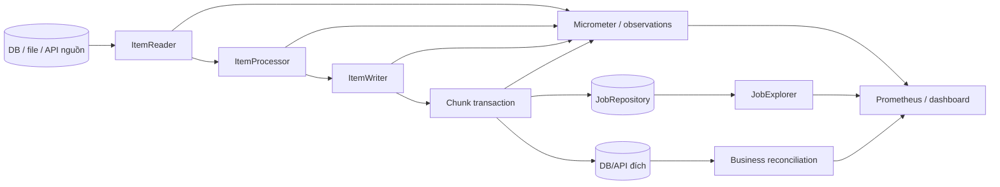
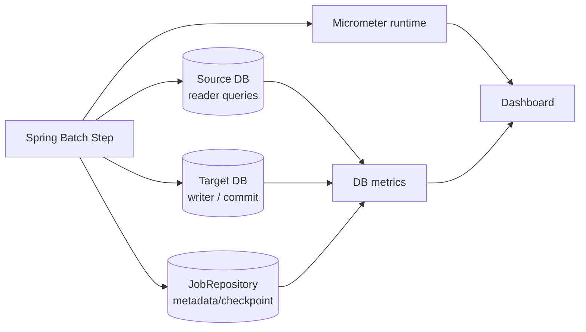
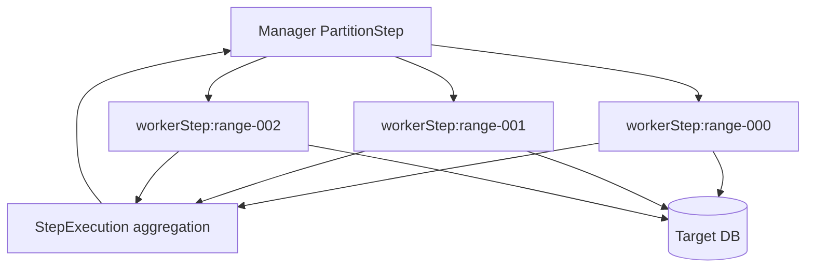
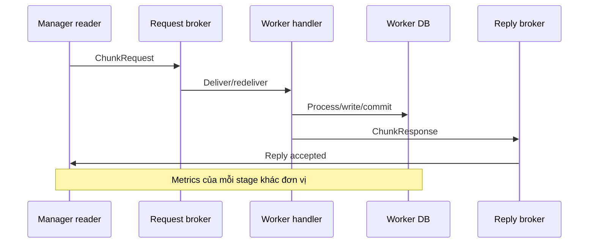

# Micrometer metrics cho Spring Batch: đo throughput, latency và lỗi khi mở rộng workload

Một Spring Batch job đọc hàng triệu bản ghi có thể báo `COMPLETED` nhưng mất nhiều thời gian vì database connection pool nghẽn. Một job khác có thể đạt `writeCount=500000`, trong khi writer đã gọi external API nhiều lần vì retry và dữ liệu đích bị duplicate. Khi tăng worker từ 4 lên 16, CPU ứng dụng thấp hơn mong đợi nhưng transaction latency và queue wait tăng. **Cần đo những đại lượng nào để biết công việc thực sự nhanh hơn, ổn định hơn và đúng hơn?**

**Micrometer** cung cấp mô hình instrument độc lập backend như `Counter`, `Timer`, `Gauge` và `DistributionSummary`; Spring Boot Actuator có thể xuất metrics qua Prometheus hoặc hệ thống monitoring khác. Spring Batch cũng có các metrics/observations về Job, Step, chunk và item ở những phiên bản/cấu hình hỗ trợ. Nhưng **không phải counter nào cũng là số item đã commit**, và tên metric/tags xuất ra không giống nhau ở tất cả các phiên bản Spring Batch, Boot, Micrometer hay registry.

Bài thuộc chương **Metrics**, module **SPRING_BATCH_SCALING_OPERATIONS**. Mục tiêu module là mở rộng Spring Batch cho workload dữ liệu lớn bằng multi-threaded step, parallel steps, partitioning và các mô hình xử lý phân tán, đồng thời đo nút thắt, bảo đảm thread safety, retry/restart, vận hành job và lựa chọn kiến trúc theo tài nguyên thực tế.

**Sau bài này, bạn có thể:**

- Phân biệt counters của `StepExecution` với Micrometer meters, observation/tracing và business reconciliation.
- Cấu hình Spring Batch + Spring Boot Actuator + Micrometer/Prometheus theo môi trường chạy.
- Hiểu `Counter`, `Timer`, `LongTaskTimer`, `Gauge` và histogram/percentile.
- Instrument reader, processor, writer, chunk và Step mà không đổi transaction/lifecycle.
- Định nghĩa tags cardinality thấp, tách metrics cho source DB, target DB, JobRepository, broker và worker.
- Tạo PromQL/dashboard về throughput, latency, error/retry/skip, backpressure và scaling efficiency.
- Giải thích vì sao metrics có thể sai lệch sau crash, retry, restart hoặc message redelivery.
- Viết unit/integration tests và một runbook điều tra bottleneck thực tế.

**Nguyên tắc then chốt:** *Metrics giúp quan sát cách hệ thống thực thi; dữ liệu nghiệp vụ đã commit và đối soát độc lập mới xác nhận công việc đúng.*

## 1. Ba cấp độ đo phải tách bạch

| Lớp | Nguồn đo | Câu hỏi | Không nên suy ra |
| --- | --- | --- | --- |
| **Framework execution** | `JobExecution`, `StepExecution`, JobRepository | Job/Step đọc, ghi, filter, skip, commit/rollback bao nhiêu theo lifecycle? | Tất cả side effects đã commit đúng ở mọi resource |
| **Runtime telemetry** | Micrometer, traces, app logs, pools, broker | Code chạy mất bao lâu, có bao nhiêu callback, threads/queue đang bận? | Một callback thành công đồng nghĩa transaction đã commit |
| **Business correctness** | Output DB, ledger, unique keys, audit, downstream state | Bao nhiêu business operations hợp lệ đã hoàn tất, thiếu/trùng/sai giá trị không? | Chỉ cần job `COMPLETED` là đạt |

Sơ đồ điển hình:



Ví dụ Step ghi 10.000 item:

- `StepExecution.writeCount` ghi nhận tiến độ theo framework.
- Writer wrapper có thể quan sát **12.000 item attempts** do rollback/retry.
- Target database có thể chỉ có 9.800 unique rows mới vì 200 conflicts.
- Downstream API có thể có một số tác dụng lặp nếu thiếu idempotency.

Bốn con số trên **không nhất thiết mâu thuẫn**. Chúng đo bốn ranh giới khác nhau.

## 2. Micrometer là gì và nó không làm gì?

Micrometer cung cấp một *facade* đo đạc giúp ứng dụng không buộc chặt vào một backend duy nhất. Ví dụ cùng một `Counter`/`Timer` có thể được xuất sang Prometheus, OTLP hay backend khác tùy registry được cấu hình.

Các thành phần quan trọng:

- **`MeterRegistry`:** nơi đăng ký, lấy và xuất meters.
- **`Counter`:** đếm sự kiện tích lũy đơn điệu trong vòng đời meter/process.
- **`Timer`:** số lần quan sát và phân bố thời gian thực hiện.
- **`LongTaskTimer`:** theo dõi các task *đang tiếp diễn* lâu; phù hợp Job/Step đang chạy khi có cấu hình hỗ trợ.
- **`Gauge`:** đọc một giá trị hiện tại, ví dụ queue depth hoặc active connections.
- **`DistributionSummary`:** phân bố các giá trị không phải duration, ví dụ payload bytes hoặc items/chunk.
- **`ObservationRegistry`:** điểm tích hợp Micrometer Observation để tạo context quan sát; có thể nối metrics và tracing, tùy handlers/auto-configuration.

**Micrometer không tự:**

1. Biết transaction business của bạn đã commit ở DB-A/DB-B hay chưa.
2. Dedupe messages sau broker redelivery.
3. Tạo checkpoint cho `ItemReader`.
4. Làm `ItemWriter` thread-safe.
5. Bảo đảm phép tăng Counter được commit nguyên tử với JobRepository.
6. Giữ memory counters cũ sau khi JVM bị kill nếu backend chưa scrape/nhận dữ liệu.

Nên phân biệt **telemetry near real-time** với **metadata bền vững** và **business ledger**.

## 3. Chọn loại meter theo câu hỏi vận hành

| Câu hỏi | Meter phù hợp | Đơn vị | Cạm bẫy |
| --- | --- | --- | --- |
| Mỗi giây writer được gọi bao nhiêu lần? | `Counter` | callbacks | Callback có thể retry/rollback |
| Độ trễ của `ItemWriter.write`? | `Timer` | seconds | Không nhất thiết bao gồm chunk commit |
| Bao nhiêu threads đang xử lý? | `Gauge` | threads | Không phải số requests pending |
| Executor backlog hiện tại? | `Gauge` | tasks | Queue ở broker/adapter có thể khác |
| Job đang chạy bao lâu? | `LongTaskTimer`/active duration | seconds | Cần lifecycle/cancel đúng |
| Payload per chunk lớn thế nào? | `DistributionSummary` | bytes/items | Không chứng minh output commit |
| Retry lỗi tạm thời xảy ra bao lần? | `Counter` với event rõ | attempts/events | `onError` không nhất thiết là retry đã diễn ra |
| Business outcome unique thành công? | Durable ledger + report/metrics | business operations | Không lấy đơn giản từ `afterWrite` |

**Tên metric phải nói đúng đơn vị.** `batch.writer.items.attempted` phản ánh callback attempts. Chỉ dùng tên `business.committed` nếu có một contract xác nhận dữ liệu đã commit hoặc cơ chế audit và dedup phù hợp.

## 4. Điều kiện môi trường: Spring Batch 5.x và Spring Boot

Bài dùng Spring Batch **5.x** và cách tích hợp Spring Boot/Micrometer thường gặp để minh họa. Với các phiên bản Spring Batch 6.x hoặc Spring Boot/Micrometer mới hơn, phải đối chiếu API/cấu hình và **tên exported metrics thực tế**.

Một project Spring Boot có thể cần các dependencies:

```xml
<!-- Dependency versions phải được quản lý qua Spring Boot BOM
     tương thích với phiên bản Spring Batch đã pin. -->
<dependency>
    <groupId>org.springframework.boot</groupId>
    <artifactId>spring-boot-starter-batch</artifactId>
</dependency>
<dependency>
    <groupId>org.springframework.boot</groupId>
    <artifactId>spring-boot-starter-actuator</artifactId>
</dependency>
<dependency>
    <groupId>io.micrometer</groupId>
    <artifactId>micrometer-registry-prometheus</artifactId>
</dependency>
```

- `spring-boot-starter-batch` giúp tích hợp Spring Batch vào ứng dụng Boot.
- `spring-boot-starter-actuator` cung cấp các endpoints quản trị/monitoring khi kích hoạt.
- `micrometer-registry-prometheus` hỗ trợ Prometheus scrape qua registry tương ứng.
- Nếu có tracing, có thể dùng Micrometer Tracing bridge/exporter phù hợp; **tracing không tự xuất hiện chỉ vì có Prometheus registry**.

**Không tự thêm các phiên bản rời rạc của `micrometer-core` và `spring-batch-core` không tương thích với BOM.** Sự lệch version có thể gây thiếu API, thay đổi tên meter hoặc instrumentation không hoạt động.

### Không nhầm “có dependencies” và “có dữ liệu”

Cần xác minh:

1. Ứng dụng đã cấu hình `MeterRegistry` chưa?
2. Job/Step có observations built-in được bật và nối tới registry không?
3. Endpoint Actuator được expose và bảo vệ phù hợp chưa?
4. Prometheus thực sự scrape instance cần giám sát chưa?
5. Có một Job/Step/Chunk thực chạy trong thời gian đo chưa?
6. Registry/exposition có lọc hoặc rename meter names không?

Meter chỉ xuất hiện sau khi code/observation thực sự ghi nhận dữ liệu; không thấy tên ở endpoint **chưa chắc** là framework không hỗ trợ.

## 5. Cấu hình Actuator và Prometheus mẫu

Ví dụ `application.yml` cho môi trường nội bộ:

```yaml
management:
  endpoints:
    web:
      exposure:
        include: health,info,metrics,prometheus
  endpoint:
    health:
      show-details: when_authorized
  metrics:
    tags:
      application: orders-batch
    distribution:
      percentiles-histogram:
        "batch.writer.call": true
        "batch.chunk.execution": true
```

Các meter names `batch.writer.call` và `batch.chunk.execution` ở đây là **metrics tùy chỉnh của ví dụ trong bài**, không phải defaults của Spring Batch. Việc bật percentile histogram tăng số time series và chi phí quan sát.

### Bảo vệ endpoint

**Không mở `/actuator/prometheus`, `/actuator/metrics` hoặc các endpoint nhạy cảm ra Internet công khai chỉ để tiện debug.** Cần:

- Internal network/private scrape hoặc endpoint security.
- Authentication/authorization phù hợp cho môi trường.
- TLS, giới hạn IP/ingress, audit access nếu yêu cầu.
- Không expose `env`, config props, thread/heap dumps bừa bãi.
- Không đưa credentials, headers hay raw `ExecutionContext` vào metrics.

Trong môi trường cần nhiều deployment instances, Prometheus thường scrape **từng instance**, rồi các query tổng hợp theo `job`/`step`/pool. **Không dùng process-local Counter làm nguồn báo cáo bền vững duy nhất** khi pods có thể bị thay thế.

## 6. Tìm các metric đã thực sự có

Khi ứng dụng chạy và được cấp quyền, các endpoint có thể hỗ trợ:

```text
GET /actuator/metrics
GET /actuator/metrics/spring.batch.job
GET /actuator/prometheus
```

Tên `spring.batch.job` phía trên chỉ là **ví dụ cần xác minh**: danh sách metric built-in có thể phụ thuộc phiên bản framework, ObservationRegistry, Boot actuator và cách rename của exporter.

Quy trình kiểm tra:

1. Gọi `/actuator/metrics` để xem các meter names đã xuất hiện.
2. Chạy Job test có reader/writer và ít nhất một chunk.
3. Tìm prefix liên quan Job/Step/item/chunk trong danh sách.
4. Mở từng metric để xem measurements, tags và loại meter.
5. Đối chiếu `/actuator/prometheus` để biết tên series thật được export.
6. Ghi lại **framework version + registry version + metric schema** trong dashboard contract.

Ví dụ trong nhiều tài liệu Spring Batch 5.x có các meter/observations với tên khái niệm như `spring.batch.job`, `spring.batch.step`, `spring.batch.item.read`, `spring.batch.item.process`, `spring.batch.chunk.write` và `spring.batch.chunk`. **Không coi danh sách, tags, loại timer và sự sẵn có của tất cả những tên đó là cam kết tương thích cho mọi bản 5.x.**

### Lỗi thường gặp: một query PromQL “không có dữ liệu”

Nguyên nhân có thể là:

- Chưa chạy Job/Step tương ứng.
- Observation handler hoặc registry không nối.
- Actuator/Prometheus endpoint chưa expose.
- Meter name bị transform, thêm suffix `_seconds`/`_total`.
- Một tag key khác dự kiến.
- Meter bị `MeterFilter` loại hoặc high-cardinality cap.
- Prometheus scrape nhầm pod/namespace/port.
- Pod kết thúc trước khi được scrape.

**Đừng vội gắn thêm instrumentation song song** trước khi xác minh built-in metrics có thể đáp ứng nhu cầu.

## 7. Built-in observations và custom metrics khác nhau thế nào?

Spring Batch hỗ trợ instrumentation có sẵn trên nhiều lifecycle points. Sử dụng chúng để lấy baseline là hợp lý, nhưng custom metrics vẫn cần khi ứng dụng muốn theo dõi bottleneck/semantics riêng.

| Cấp độ | Built-in có thể hỗ trợ khi cấu hình đúng | Metric tự xây thường cần |
| --- | --- | --- |
| Job | Duration/status, active execution | SLA theo business batch, result quality |
| Step | Duration/status, active execution | Partition skew, worker pool, custom failure code |
| Item read | Read operation duration/status | Source query/page latency, bytes/item, input lag |
| Item process | Process duration/status | Validation reasons, downstream API call |
| Chunk/write | Chunk/write duration/status | JDBC batch size, DB lock wait, committed outcome |
| JobRepository | Không nên giả định có mọi DAO timer | Metadata write latency, serialization bytes |
| TaskExecutor | Phụ thuộc Spring/Boot binders | Active/queued/outstanding, admission wait |
| Broker | Phụ thuộc middleware integration | Queue age, redelivery, request/reply lag |
| Business DB | Phụ thuộc JDBC/db exporter | Unique committed rows, deadlocks, WAL/IO |

**Không tạo custom Counter đo “job completed” nếu nó đã được đo giống hệt bằng built-in mà không có nhu cầu cụ thể.** Trùng metric gây dashboard khó hiểu; nếu cần một KPI mới, hãy ghi rõ semantics của nó.

### Observation và metrics/tracing

`ObservationRegistry` là điểm kết nối giúp instrumentation sinh observation events; tùy handlers, chúng có thể được chuyển thành timers/metrics hoặc tracing spans. Một observation không bảo đảm **một SQL commit đã thành công**, trừ khi chính instrumentation đặt outcome tại commit boundary phù hợp.

Trong code Spring Batch config thủ công, các API để truyền registry vào Job/Step builders và auto-configuration phụ thuộc version. **Ưu tiên cấu hình theo đúng dependency pin**, tránh tự đăng ký đồng thời observations built-in và listener timers trùng scope.

## 8. Counter và Timer trong Spring Batch: ví dụ tối thiểu

Ví dụ một component có Counter đếm sự kiện request đã được chấp nhận và Timer đo thời gian xử lý:

```java
package example.batch.metrics;

import io.micrometer.core.instrument.Counter;
import io.micrometer.core.instrument.MeterRegistry;
import io.micrometer.core.instrument.Timer;

public final class ImportTelemetry {
    private final MeterRegistry registry;
    private final Counter attempts;
    private final Timer processingTime;

    public ImportTelemetry(MeterRegistry registry) {
        this.registry = registry;

        attempts = Counter.builder("batch.import.attempt")
                .description("Observed logical handler invocations")
                .tag("pipeline", "orders")
                .register(registry);

        processingTime = Timer.builder("batch.import.processing")
                .description("Duration of handler invocations")
                .tag("pipeline", "orders")
                .register(registry);
    }

    public void measure(Runnable action) {
        attempts.increment();
        processingTime.record(action);
    }
}
```

**Ý nghĩa:** mỗi lần `measure` được gọi sẽ tăng 1 attempt, Timer ghi thời gian thực thi callback. Nếu `action.run()` ném exception, `Timer.record(...)` vẫn đo duration, và exception được truyền tiếp. Đây **không phải** metric item/transaction commit của Spring Batch.

### Không gắn “count” trùng ý nghĩa một cách vô ích

`Timer` đã có số lần quan sát và tổng thời gian. Nếu chỉ cần **số handler executions và latency**, một Timer có thể đủ; thêm Counter chỉ khi muốn đếm một loại event khác như **rejected requests** hoặc xây contract riêng.

**Không gọi `record` quanh một vòng lặp chứa cả job nhiều giờ nếu chỉ muốn item processing latency**; sẽ mất phân giải từng item/chunk và khó xác định bottleneck.

## 9. Timer: count, totalTime, max và histogram

Một `Timer` cung cấp các measurements như:

- **`count`:** số lần quan sát duration.
- **`totalTime`:** tổng thời gian của các samples.
- **`max`:** cực đại theo semantics/time window của meter implementation.
- **Percentiles/histogram:** chỉ có khi được cấu hình hỗ trợ.

Trong Prometheus, timer có thể tạo các series như `..._seconds_count`, `..._seconds_sum` và `..._seconds_bucket` (nếu histogram buckets bật).

### Vì sao không lấy average làm tiêu chuẩn duy nhất?

Ví dụ hai nhóm chunk có cùng latency trung bình 100 ms:

```text
A: 100,100,100,100,100 ms
B:   5,  5,  5,  5,480 ms
```

Nhóm B có tail latency lớn; nếu worker timeout sau 300 ms, một số chunk có thể retry và làm backlog tăng dù average giống A.

Cần quan sát:

- p50/p95/p99 khi có đủ samples và histogram phù hợp.
- Queue wait, DB connection acquisition, transaction commit.
- Số chunk attempted/completed và error/retry rate.
- Sample count để tránh tin một p99 tính từ 3 observations.

**Không cộng p95 của reader + p95 processor + p95 writer rồi coi là p95 chunk tổng.** Percentiles không cộng tuyến tính; hơn nữa các stages có thể chồng lấn hoặc có nested timing.

## 10. Gauge: giá trị hiện tại, không phải event count

Ví dụ đo `ThreadPoolTaskExecutor`:

```java
import io.micrometer.core.instrument.Gauge;
import io.micrometer.core.instrument.MeterRegistry;
import org.springframework.scheduling.concurrent.ThreadPoolTaskExecutor;

public final class ExecutorMeters {
    public ExecutorMeters(
            MeterRegistry registry,
            ThreadPoolTaskExecutor executor) {

        Gauge.builder("batch.worker.active", executor,
                     ThreadPoolTaskExecutor::getActiveCount)
                .description("Running executor tasks")
                .tag("pool", "orders-worker")
                .register(registry);

        Gauge.builder("batch.worker.queued", executor,
                     e -> e.getThreadPoolExecutor().getQueue().size())
                .description("Tasks waiting in executor queue")
                .tag("pool", "orders-worker")
                .register(registry);
    }
}
```

**Điều kiện:** bean executor phải được `initialize()` trước khi lấy `getThreadPoolExecutor()`; quản lý vòng đời dài hơn registry/meter. Với một số Micrometer gauge overloads, object được giữ yếu; nếu target object bị GC, series có thể mất/ra `NaN`. Giữ reference bean rõ ràng, không tạo một anonymous object chỉ để register.

### Đừng lẫn active, queued và in-flight

```text
Active workers = 8
Executor queued = 12
Accepted-but-not-completed tasks = 20
Remote requests awaiting reply = 30
```

Các số không thể luôn được cộng lại vì có thể đo trên các phạm vi chồng lấn. Một **manager in-flight window** phải có metric riêng với identity/request lifecycle rõ. Gauge pool chỉ cho biết **tải tại một tầng**, không phải business operations còn dang dở trên toàn cluster.

## 11. DistributionSummary: payload/chunk size

Một số chunk có 200 item nhưng byte size rất khác nhau. `DistributionSummary` có thể đo kích thước payload để giải thích heap/GC, broker latency và writer throughput.

```java
import io.micrometer.core.instrument.DistributionSummary;
import io.micrometer.core.instrument.MeterRegistry;

public final class ChunkSizeTelemetry {
    private final DistributionSummary itemCount;
    private final DistributionSummary payloadBytes;

    public ChunkSizeTelemetry(MeterRegistry registry) {
        itemCount = DistributionSummary
                .builder("batch.chunk.items")
                .baseUnit("items")
                .tag("step", "loadOrdersStep")
                .register(registry);

        payloadBytes = DistributionSummary
                .builder("batch.chunk.payload")
                .baseUnit("bytes")
                .tag("step", "loadOrdersStep")
                .register(registry);
    }

    public void record(int count, long bytes) {
        if (count < 0 || bytes < 0) {
            throw new IllegalArgumentException("Negative size");
        }
        itemCount.record(count);
        payloadBytes.record(bytes);
    }
}
```

**Giới hạn:** tự tính kích thước payload bằng `collection.size()` không phải byte size. Nếu có serialized message, dùng byte length thật tại adapter; với object graph trong RAM, cần profiling/heap sizing thay vì coi chuỗi UTF-8 là kích thước heap.

Không lưu toàn bộ payload/serialization dump vào metrics; chỉ số lượng/bytes là đủ để điều tra capacity.

## 12. LongTaskTimer: Job/Step chạy nhiều giờ

`Timer` ghi duration **khi operation kết thúc**; nếu một Job mất 6 giờ, không có sample hoàn tất trước giờ thứ sáu. `LongTaskTimer` hữu ích để biết:

- Bao nhiêu long-running tasks đang active.
- Tổng hoặc tối đa active duration tùy meter.
- Job/Step nào có nguy cơ vượt SLO.

```java
import io.micrometer.core.instrument.LongTaskTimer;
import io.micrometer.core.instrument.MeterRegistry;

public final class LongJobOperation implements AutoCloseable {
    private final LongTaskTimer.Sample sample;

    public LongJobOperation(MeterRegistry registry) {
        LongTaskTimer timer =
                LongTaskTimer.builder("batch.custom.job.active")
                        .tag("job_type", "orders-import")
                        .register(registry);
        this.sample = timer.start();
    }

    @Override
    public void close() {
        sample.stop();
    }
}
```

Ví dụ `LongJobOperation` là helper ứng dụng, không gắn tự động vào Spring Batch Job. Phải dùng `try-with-resources` hoặc lifecycle hook chính xác để bảo đảm `sample.stop()` cả khi lỗi.

**Nếu JVM crash** trước cleanup, dữ liệu in-process bị mất cùng process. Backend scrape/retention quyết định những gì còn được thấy; không dùng LongTaskTimer thay cho `JobRepository` để kết luận job còn chạy hoặc đã hoàn tất. Spring Batch versions có thể đã có observations về active Jobs/Steps; kiểm tra trước khi thêm custom LongTaskTimer trùng.

## 13. Các bộ đếm bền vững trong StepExecution

`StepExecution` có một số số đếm do framework quản lý:

| Trường/API | Ngữ nghĩa điển hình | Không nên dùng thay |
| --- | --- | --- |
| `getReadCount()` | Items reader đọc thành công theo lifecycle | SQL rows fetched / committed output |
| `getWriteCount()` | Items writer ghi nhận theo contribution/commit lifecycle | Unique business outputs trên hệ thống ngoài |
| `getFilterCount()` | Items processor trả `null` | Process skips |
| `getReadSkipCount()` | Read skips theo policy | Retry attempts |
| `getProcessSkipCount()` | Process skips theo policy | Validation failures chưa được skip |
| `getWriteSkipCount()` | Write skips theo policy | DB rows lỗi vĩnh viễn |
| `getSkipCount()` | Tổng ba nhóm skip | Unique records bị loại qua mọi restart |
| `getCommitCount()` | Chunk commit count theo Step lifecycle | Database-wide transactions |
| `getRollbackCount()` | Chunk rollback count | Retry count |
| `getReadSkipCount()+...` | Tổng theo execution | Global error budget trên mọi partitions |

Spring Batch giữ metadata trong `JobRepository` theo các transaction/checkpoint. Nó hữu ích cho audit sau khi process dừng, nhưng **không tự là nguồn near-real-time từng item**.

**Trạng thái khác counters:** `StepExecution.getStatus()` trả `BatchStatus` (ví dụ `COMPLETED`, `FAILED`, `STOPPED`), còn `getExitStatus()` cung cấp `ExitStatus` chi tiết phục vụ điều phối luồng job. Hai giá trị này không thay thế kiểm tra dữ liệu đích. `BatchStatus.COMPLETED` có thể đi kèm skip hợp lệ hoặc external side effects cần đối soát.

### Không có “retryCount mặc định bền vững” tương đương

`StepExecution` không cung cấp `getRetryCount()` chuẩn tương ứng với `getSkipCount()`. Nếu cần số retry attempts, instrument đúng retry engine và chỉ rõ đơn vị: **item, chunk, HTTP request, SQL transaction hay broker message**.

`RetryListener.onError(...)` có thể đếm **failed attempts**, nhưng một lỗi terminal có thể xảy ra mà không có lần retry tiếp theo. Đừng đặt nhãn `actual_retry_total` chỉ bằng cách tăng Counter trong `onError`.

## 14. Lấy StepExecution counters bằng JobExplorer

`JobExplorer` là API **read-only** để xem Job/Step executions từ repository. Ví dụ:

```java
import java.util.Comparator;
import org.springframework.batch.core.JobExecution;
import org.springframework.batch.core.StepExecution;
import org.springframework.batch.core.explore.JobExplorer;

public final class PersistedStepMetricsInspector {
    private final JobExplorer explorer;

    public PersistedStepMetricsInspector(JobExplorer explorer) {
        this.explorer = explorer;
    }

    public void report(long jobExecutionId) {
        JobExecution job = explorer.getJobExecution(jobExecutionId);
        if (job == null) {
            throw new IllegalArgumentException("Unknown JobExecution");
        }

        job.getStepExecutions().stream()
                .sorted(Comparator.comparing(StepExecution::getId))
                .forEach(step -> System.out.printf(
                    "jobExecutionId=%d stepExecutionId=%d step=%s "
                    + "status=%s read=%d write=%d filter=%d "
                    + "skip=%d rollback=%d commit=%d%n",
                    jobExecutionId,
                    step.getId(),
                    step.getStepName(),
                    step.getStatus(),
                    step.getReadCount(),
                    step.getWriteCount(),
                    step.getFilterCount(),
                    step.getSkipCount(),
                    step.getRollbackCount(),
                    step.getCommitCount()));
    }
}
```

Các IDs giúp phân biệt các `StepExecution` có cùng tên qua restart. Với partitioning, một manager Step có thể **aggregate** counts từ workers. **Không cộng cả manager aggregate và worker counts rồi coi là hai loại công việc khác nhau**.

### Cần phân biệt ba cấp report

1. **StepExecution:** counts của một execution cụ thể.
2. **JobInstance:** lịch sử nhiều JobExecutions khi restart; có thể có replay.
3. **Business batch/snapshot:** unique committed operations sau dedup/reconciliation.

Không cộng mù `writeCount` của mọi StepExecutions cũ/mới rồi coi là số đơn hàng unique đã hoàn tất.

## 15. Đo ItemReader callback latency bằng wrapper

Để đo reader cụ thể (như JDBC query, file read, API call), có thể bọc `ItemStreamReader<T>`. Decorator sau đo **call duration và outcome**, không thay payload:

```java
package example.batch.metrics;

import java.util.Objects;
import io.micrometer.core.instrument.MeterRegistry;
import io.micrometer.core.instrument.Timer;
import org.springframework.batch.item.ExecutionContext;
import org.springframework.batch.item.ItemStreamReader;

public final class MeasuredReader<T>
        implements ItemStreamReader<T> {

    private final ItemStreamReader<T> delegate;
    private final MeterRegistry registry;
    private final Timer itemReturned;
    private final Timer endOfInput;
    private final Timer readError;

    public MeasuredReader(ItemStreamReader<T> delegate,
                          MeterRegistry registry,
                          String logicalStepName) {
        this.delegate = Objects.requireNonNull(delegate);
        this.registry = Objects.requireNonNull(registry);

        itemReturned = timer("item", logicalStepName);
        endOfInput = timer("eof", logicalStepName);
        readError = timer("error", logicalStepName);
    }

    private Timer timer(String result, String step) {
        return Timer.builder("batch.reader.call")
                .tag("step", step)
                .tag("result", result)
                .register(registry);
    }

    @Override
    public T read() throws Exception {
        Timer.Sample sample = Timer.start(registry);
        Timer target = readError;
        try {
            T value = delegate.read();
            target = value == null ? endOfInput : itemReturned;
            return value;
        } finally {
            sample.stop(target);
        }
    }

    @Override
    public void open(ExecutionContext context) {
        delegate.open(context);
    }

    @Override
    public void update(ExecutionContext context) {
        delegate.update(context);
    }

    @Override
    public void close() {
        delegate.close();
    }
}
```

**Ngữ nghĩa:**

- `result=item` khi `read()` trả một item.
- `result=eof` khi `read()` trả `null`; không đếm null như một item.
- `result=error` khi `read()` ném exception, metric ghi attempt lỗi.
- Timer bao quanh `read()` callback; **không nhất thiết bao gồm toàn bộ transaction hoặc SQL networking ở những tầng khác**.
- `open/update/close` được delegate để bảo toàn `ItemStream` state/restart. Nếu muốn đo chúng, dùng meters riêng, tránh thay thứ tự/lifecycle.

**Quan trọng:** nếu reader gốc không thread-safe, decorator không làm nó thread-safe. Khi dùng multi-threaded Step, kiểm tra sharing, read synchronization và **commit order**; `@StepScope` không tự tạo reader cho từng thread.

### Khi reader là delegate của composite

Đảm bảo Step nhận bean/decorator thực tế có interface `ItemStream`, hoặc dùng `.stream(...)` để đăng ký delegate phù hợp. Không đăng ký cùng một stream hai lần gây `open/update/close` lặp không mong muốn.

## 16. Đo ItemProcessor: filter khác failure

Một `ItemProcessor<I,O>` có thể:

- Trả output bình thường.
- Trả `null` để filter.
- Ném exception được retry/skip/fail theo policy.

Ví dụ decorator đo callback duration và outcome:

```java
package example.batch.metrics;

import java.util.Objects;
import io.micrometer.core.instrument.MeterRegistry;
import io.micrometer.core.instrument.Timer;
import org.springframework.batch.item.ItemProcessor;

public final class MeasuredProcessor<I, O>
        implements ItemProcessor<I, O> {

    private final ItemProcessor<I, O> delegate;
    private final MeterRegistry registry;
    private final Timer processed;
    private final Timer filtered;
    private final Timer failed;

    public MeasuredProcessor(
            ItemProcessor<I, O> delegate,
            MeterRegistry registry,
            String logicalStepName) {

        this.delegate = Objects.requireNonNull(delegate);
        this.registry = Objects.requireNonNull(registry);
        processed = timer(logicalStepName, "processed");
        filtered = timer(logicalStepName, "filtered");
        failed = timer(logicalStepName, "error");
    }

    private Timer timer(String step, String result) {
        return Timer.builder("batch.processor.call")
                .tag("step", step)
                .tag("result", result)
                .register(registry);
    }

    @Override
    public O process(I item) throws Exception {
        Timer.Sample sample = Timer.start(registry);
        Timer result = failed;

        try {
            O output = delegate.process(item);
            result = output == null ? filtered : processed;
            return output;
        } finally {
            sample.stop(result);
        }
    }
}
```

**Không gọi `processor.return null` là skip.** Filter là một kết quả logic bình thường; `StepExecution.filterCount` khác `processSkipCount`. Ngoài ra, retry/rollback có thể làm processor chạy lại cùng item; timer/callback counts **không tương đương unique items**.

## 17. Đo ItemWriter: attempts khác committed rows

Đo thời gian writer callback và số item được chuyển vào writer:

```java
package example.batch.metrics;

import java.util.Objects;
import io.micrometer.core.instrument.Counter;
import io.micrometer.core.instrument.MeterRegistry;
import io.micrometer.core.instrument.Timer;
import org.springframework.batch.item.Chunk;
import org.springframework.batch.item.ItemWriter;

public final class MeasuredWriter<T> implements ItemWriter<T> {

    private final ItemWriter<T> delegate;
    private final MeterRegistry registry;
    private final Timer callSuccess;
    private final Timer callFailure;
    private final Counter itemsAttempted;

    public MeasuredWriter(
            ItemWriter<T> delegate,
            MeterRegistry registry,
            String step) {

        this.delegate = Objects.requireNonNull(delegate);
        this.registry = Objects.requireNonNull(registry);

        callSuccess = Timer.builder("batch.writer.call")
                .tag("step", step)
                .tag("result", "returned")
                .register(registry);

        callFailure = Timer.builder("batch.writer.call")
                .tag("step", step)
                .tag("result", "error")
                .register(registry);

        itemsAttempted = Counter.builder(
                    "batch.writer.items.attempted")
                .description("Items passed to writer callbacks")
                .tag("step", step)
                .register(registry);
    }

    @Override
    public void write(Chunk<? extends T> chunk) throws Exception {
        itemsAttempted.increment(chunk.size());
        Timer.Sample sample = Timer.start(registry);
        boolean returned = false;
        try {
            delegate.write(chunk);
            returned = true;
        } finally {
            sample.stop(returned ? callSuccess : callFailure);
        }
    }
}
```

### Chính xác wrapper đo gì?

- `itemsAttempted` tăng khi writer callback được gọi, **ngay cả nếu delegate thất bại**.
- `result=returned` nghĩa là callback trả về bình thường, **không bảo đảm transaction đã commit**.
- `Timer` đo writer callback duration, có thể chưa bao gồm transaction commit, JobRepository metadata update hoặc broker reply.
- Một chunk rollback rồi retry có thể làm cùng business item bị ghi nhận attempt nhiều lần.
- Với JDBC UPSERT, row conflict/update count và số output unique còn khác nhau.
- Nếu delegate còn implement `ItemStream`/`StepListener`, wrapper thuần `ItemWriter` không tự delegate lifecycle bổ sung; cần đăng ký delegate tương ứng khi dựng Step hoặc dùng decorator giữ đủ interfaces.

**Không đặt tên meter `business.committed.rows` cho các counts của wrapper này.**

## 18. ChunkListener: quan sát chunk completion và thời gian

`ChunkListener` cung cấp callback `beforeChunk`, `afterChunk` và `afterChunkError`. Có thể đo duration theo lifecycle chunk:

```java
package example.batch.metrics;

import io.micrometer.core.instrument.Counter;
import io.micrometer.core.instrument.MeterRegistry;
import io.micrometer.core.instrument.Timer;
import org.springframework.batch.core.ChunkListener;
import org.springframework.batch.core.scope.context.ChunkContext;

public final class ChunkMetricsListener implements ChunkListener {

    private static final String TIMER_START =
            "application.chunk.timer.start";

    private final MeterRegistry registry;
    private final Timer successDuration;
    private final Timer failureDuration;
    private final Counter successEvents;
    private final Counter failureEvents;

    public ChunkMetricsListener(MeterRegistry registry, String step) {
        this.registry = registry;

        successDuration = Timer.builder("batch.chunk.execution")
                .tag("step", step).tag("result", "success")
                .register(registry);
        failureDuration = Timer.builder("batch.chunk.execution")
                .tag("step", step).tag("result", "error")
                .register(registry);

        successEvents = Counter.builder("batch.chunk.event")
                .tag("step", step).tag("result", "success")
                .register(registry);
        failureEvents = Counter.builder("batch.chunk.event")
                .tag("step", step).tag("result", "error")
                .register(registry);
    }

    @Override
    public void beforeChunk(ChunkContext context) {
        // Context thuộc lifecycle chunk, không dùng field singleton
        // mutable vì Step có thể chạy trên nhiều threads.
        context.setAttribute(TIMER_START, Timer.start(registry));
    }

    @Override
    public void afterChunk(ChunkContext context) {
        stop(context, successDuration);
        successEvents.increment();
    }

    @Override
    public void afterChunkError(ChunkContext context) {
        stop(context, failureDuration);
        failureEvents.increment();
    }

    private void stop(ChunkContext context, Timer target) {
        Object sample = context.removeAttribute(TIMER_START);
        if (sample instanceof Timer.Sample timed) {
            timed.stop(target);
        }
    }
}
```

Mẫu này giả định `ChunkContext` và lifecycle callbacks được dùng như ở Spring Batch 5.x; cần kiểm thử với phiên bản pin. `removeAttribute` tránh giữ sample sau callback. Nếu context/callback bị hủy bởi hard crash, sample không được ghi; đó là giới hạn in-process metrics.

### Không đồng nhất chunk callback với DB commit

- `afterChunk` theo lifecycle thông thường được gọi sau chunk transaction thành công.
- Một transaction ở DB khác hoặc external API side effect **không tự tham gia chung atomic commit**.
- Metrics backend không transactionally atomic với DB hoặc JobRepository.
- `afterChunkError` không có nghĩa cứ một callback là một row DB rollback.
- Nếu JVM crash sau database commit nhưng trước callback/export, metric có thể thấp hơn thực tế.
- Nếu rollback/retry trong cùng logical chunk, error/success events có thể nhiều hơn số logical input chunks.

Đo throughput **business committed rows** bằng durable output state/ledger và đối soát độc lập, không chỉ `Counter` trong `afterChunk`.

## 19. Gắn custom listeners và decorators vào Step

Ví dụ config Java Spring Batch 5.x dùng `JobRepository`, `PlatformTransactionManager` và beans nghiệp vụ đã có:

```java
import org.springframework.batch.core.Step;
import org.springframework.batch.core.repository.JobRepository;
import org.springframework.batch.core.step.builder.StepBuilder;
import org.springframework.batch.item.ItemProcessor;
import org.springframework.batch.item.ItemStreamReader;
import org.springframework.batch.item.ItemWriter;
import org.springframework.context.annotation.Bean;
import org.springframework.transaction.PlatformTransactionManager;
import io.micrometer.core.instrument.MeterRegistry;

@Bean
public Step measuredOrdersStep(
        JobRepository jobRepository,
        PlatformTransactionManager txManager,
        ItemStreamReader<RawOrder> sourceReader,
        ItemProcessor<RawOrder, NormalizedOrder> normalize,
        ItemWriter<NormalizedOrder> dbWriter,
        MeterRegistry registry) {

    var reader = new MeasuredReader<>(
            sourceReader, registry, "ordersStep");
    var processor = new MeasuredProcessor<>(
            normalize, registry, "ordersStep");
    var writer = new MeasuredWriter<>(
            dbWriter, registry, "ordersStep");

    return new StepBuilder("ordersStep", jobRepository)
            .<RawOrder, NormalizedOrder>chunk(200, txManager)
            .reader(reader)
            .processor(processor)
            .writer(writer)
            .listener(new ChunkMetricsListener(registry, "ordersStep"))
            .build();
}
```

`RawOrder`, `NormalizedOrder` và các beans reader/processor/writer là model/bean ứng dụng cần định nghĩa riêng. Đây là snippet tập trung vào instrumentation, **chưa phải project chạy độc lập**.

### Những điều cần kiểm tra trước khi deploy

1. `MeasuredReader` giữ nguyên `ItemStream.open/update/close`; không làm mất checkpoint.
2. Writer delegate có interface `ItemStream` hay listener khác không? Nếu có, đăng ký phù hợp để không mất lifecycle.
3. Không instrument cả built-in và custom timers cùng metric name/tag nếu semantics khác.
4. Processor/writer/reader có thực sự thread-safe theo concurrency model không?
5. `Timer.record`/`Counter.increment` không được thay đổi exception propagation.
6. Không log raw input/order, SQL params hay credentials làm meter tags.
7. Meter name + label schema phải ổn định khi nâng cấp deployment.

## 20. Job/Step kết thúc: báo cáo counters theo execution

Một Step listener có thể ghi summary sau execution:

```java
import org.slf4j.Logger;
import org.slf4j.LoggerFactory;
import org.springframework.batch.core.ExitStatus;
import org.springframework.batch.core.StepExecution;
import org.springframework.batch.core.StepExecutionListener;

public final class SafeStepSummaryListener
        implements StepExecutionListener {

    private static final Logger log =
            LoggerFactory.getLogger(SafeStepSummaryListener.class);

    @Override
    public ExitStatus afterStep(StepExecution step) {
        log.info("event=batch_step_summary "
                + "step={} stepExecutionId={} status={} "
                + "read={} write={} filter={} readSkip={} "
                + "processSkip={} writeSkip={} commit={} rollback={}",
            step.getStepName(),
            step.getId(),
            step.getStatus(),
            step.getReadCount(),
            step.getWriteCount(),
            step.getFilterCount(),
            step.getReadSkipCount(),
            step.getProcessSkipCount(),
            step.getWriteSkipCount(),
            step.getCommitCount(),
            step.getRollbackCount());
        return null;
    }
}
```

`return null` nghĩa là listener không thay đổi `ExitStatus` đã có. **Không ghi `ExecutionContext`, `JobParameters` hoặc raw exception message vào log** nếu chưa phân loại thông tin nhạy cảm.

Một callback `afterStep` **có thể không chạy khi JVM hard crash**. Để làm báo cáo cuối đáng tin cậy, job monitor cần truy lại `JobRepository` bằng `JobExplorer` sau khi trạng thái đã được reconcile.

### Vì sao không chuyển ngay counters này thành Gauge có tag stepExecutionId?

Mỗi StepExecution mới tạo một time series và có thể tồn tại hàng dài trong backend. `Gauge` còn là snapshot process state, không bền khi pod mất. Thay vào đó:

- Tạo summary theo execution trong logs/DB audit được phân quyền.
- Metrics tổng hợp theo **logical step type/status** với cardinality thấp.
- Dashboard drill-down từ log/JobRepository theo execution ID khi cần.

## 21. Skip metrics: đọc metadata và theo dõi event riêng

Trong Step fault-tolerant, `SkipListener` cung cấp `onSkipInRead(Throwable)`, `onSkipInProcess(I,Throwable)` và `onSkipInWrite(O,Throwable)`. Chúng thích hợp cho telemetry gần realtime; `StepExecution.getReadSkipCount()`, `getProcessSkipCount()` và `getWriteSkipCount()` là **counters framework** được giữ trong `JobRepository` theo lifecycle execution.

```java
import io.micrometer.core.instrument.Counter;
import io.micrometer.core.instrument.MeterRegistry;
import org.springframework.batch.core.SkipListener;

public final class SkipEventMeters<I, O> implements SkipListener<I, O> {

    private final Counter read;
    private final Counter process;
    private final Counter write;

    public SkipEventMeters(MeterRegistry registry, String step) {
        read = counter(registry, step, "read");
        process = counter(registry, step, "process");
        write = counter(registry, step, "write");
    }

    private Counter counter(
            MeterRegistry registry, String step, String phase) {
        return Counter.builder("batch.item.skip.callback")
                .description("Observed skip callbacks, not unique records")
                .tag("step", step).tag("phase", phase)
                .register(registry);
    }

    @Override
    public void onSkipInRead(Throwable t) {
        read.increment();
    }

    @Override
    public void onSkipInProcess(I item, Throwable t) {
        process.increment();
    }

    @Override
    public void onSkipInWrite(O item, Throwable t) {
        write.increment();
    }
}
```

**Không cộng số `SkipListener` callback và `StepExecution.skipCount`** rồi gọi là số lỗi unique. Một callback có thể được quan sát rồi process chết trước khi telemetry được scrape; replay/restart có thể tạo thêm event. Với item parse lỗi, có thể không tồn tại item object để trích business key. `processor.return null` là **filter**, không phải skip.

Nếu cần thống kê **business records bị bỏ qua chính xác một lần**, dùng quarantine/audit table có unique key, snapshot và quy tắc dedupe; không chỉ tăng Counter trong listener.

## 22. Retry metrics: failed attempts khác actual retries

Trong Spring Retry, `RetryListener.onError` thường quan sát mỗi attempt bị lỗi; điều đó **không chứng minh một retry tiếp theo thực sự đã bắt đầu**.

| Retry operation | Failed attempts | Attempts bổ sung sau lần đầu | Skips |
| --- | ---: | ---: | --- |
| Thành công lần 1 | 0 | 0 | 0 |
| Lỗi lần 1, thành công lần 2 | 1 | 1 | 0 |
| Lỗi hai lần, thành công lần 3 | 2 | 2 | 0 |
| Lỗi cả ba attempts, hết budget | 3 | 2 | Tùy SkipPolicy |
| Nonretryable lỗi lần đầu | 1 | 0 | Tùy SkipPolicy |

Nên tách bốn metrics tự định nghĩa:

- `attempt_failure_total`: một attempt bị lỗi.
- `retry_attempt_started_total`: một attempt bổ sung thực sự bắt đầu.
- `retry_exhausted_total`: một retry operation hết budget.
- `retry_recovered_total`: một operation từng lỗi rồi thành công.

**Không dùng `StepExecution.rollbackCount` thay retry count**. Một rollback có thể do write skip recovery, transaction timeout, terminal failure; retry cũng có thể xảy ra tại HTTP client/broker ngoài Spring Batch.

Với nhiều tầng retry, ghi rõ `retry_layer=batch/http/db/broker` trong metric catalog và không đếm broker redelivery thành item-level retry nếu đơn vị không trùng nhau.

## 23. Cạm bẫy transaction: Counter có thể tăng nhưng DB rollback

```text
Writer nhận 200 items và Counter += 200.
Writer thực thi DML trong transaction.
DML cuối phát sinh deadlock hoặc constraint error.
Transaction rollback.
Micrometer Counter vẫn tăng.
Output DB không có 200 rows được commit từ lần attempt này.
```

Đây **không phải lỗi Micrometer**. Metric increment ở process không cùng transaction với business database.

### Sự kiện afterCommit có tốt hơn?

Spring Framework cho phép đăng ký `TransactionSynchronization.afterCommit` với transaction manager đang hoạt động:

```java
import io.micrometer.core.instrument.Counter;
import org.springframework.transaction.support.TransactionSynchronization;
import org.springframework.transaction.support.TransactionSynchronizationManager;

public final class PostCommitSignal {
    private final Counter completedChunkSignals;

    public PostCommitSignal(Counter completedChunkSignals) {
        this.completedChunkSignals = completedChunkSignals;
    }

    public void registerOncePerChunk() {
        if (!TransactionSynchronizationManager
                .isSynchronizationActive()
                || !TransactionSynchronizationManager
                .isActualTransactionActive()) {
            throw new IllegalStateException("Expected active transaction");
        }

        TransactionSynchronizationManager.registerSynchronization(
                new TransactionSynchronization() {
                    @Override
                    public void afterCommit() {
                        completedChunkSignals.increment();
                    }
                });
    }
}
```

**Cần hiểu giới hạn trước khi dùng:**

1. `registerOncePerChunk` phải thực sự được gọi **một lần cho mỗi transaction chunk cần đo**; không gọi trong vòng lặp từng item.
2. `afterCommit` quan sát transaction mà Spring đang quản lý; không bảo đảm external API hoặc DB khác đã commit cùng lúc.
3. Nếu process crash giữa DB commit và callback/export, metric vẫn có thể thiếu.
4. Nếu network connection mất đúng khi commit, outcome có thể không chắc chắn; cần query durable state/ledger.
5. Không làm công việc chậm, gửi network request hay ném exception chỉ để tăng metric trong callback.

Do đó dùng `afterCommit` cải thiện timing nhưng **không mang lại exactly-once durable business counter**. Với yêu cầu audit, dùng output/ledger/outbox cùng transaction DB và đối soát business keys.

## 24. Metric catalog: định nghĩa rõ contract và đơn vị

Một contract nên ghi:

| Trường | Ví dụ | Tại sao cần |
| --- | --- | --- |
| Name | `batch.writer.items.attempted` | Định danh |
| Meter type | Counter | Biết nên dùng `rate`/`increase` |
| Unit | items | Không lẫn item/chunk/message |
| Increment boundary | Khi `ItemWriter.write` được gọi | Biết retries/rollbacks |
| Scope | JVM và logical Step | Tổng hợp qua pods |
| Labels | `step`, `result` | Cardinality |
| Reset semantics | Khi pod/process restart | Tránh query sai |
| Reliability | Best effort, không transaction | Không dùng làm business ledger |
| Owner/version | Batch team / v1 | Quản trị compatibility |

Tên tự định nghĩa trong bài:

| Metric | Kiểu | Ngữ nghĩa |
| --- | --- | --- |
| `batch.reader.call` | Timer | Reader callback duration/outcome |
| `batch.processor.call` | Timer | Processor callback duration/filter/error |
| `batch.writer.call` | Timer | Writer callback duration, chưa chắc commit |
| `batch.writer.items.attempted` | Counter | Items đã đi qua writer attempts |
| `batch.chunk.execution` | Timer | Chunk callback duration |
| `batch.chunk.event` | Counter | Observed chunk success/error callbacks |
| `batch.item.skip.callback` | Counter | Observed skip callbacks |
| `batch.worker.active` | Gauge | Executor tasks đang chạy |
| `batch.worker.queued` | Gauge | Executor tasks đang xếp hàng |

**Không tạo hai meters có cùng name/tags nhưng khác loại/đơn vị**, ví dụ vừa Timer vừa Counter tên `batch.chunk.execution`. Metric name phải ổn định theo schema; việc đổi từ attempt sang committed semantics cần tên khác hoặc migration dashboard.

## 25. Tag cardinality: điểm dễ làm monitoring quá tải

Mỗi tổ hợp label values có thể tạo một time series riêng. Với 20 jobs × 12 steps × 3 results × 5 error groups × 4 pools, có tới **14.400 tổ hợp lý thuyết**, chưa tính các instance và histogram buckets.

| Dimension | Khuyến nghị | Vì sao |
| --- | --- | --- |
| `application` | Có | Phân biệt service |
| `job_name` | Có, nếu tập nhỏ | Nhóm workflow |
| `logical_step` | Có, nếu chuẩn hóa | So sánh stages |
| `result`/`phase` | Có | Tập hữu hạn |
| `error_group` | Có khi dùng allowlist | validation/transient/io/other |
| `db_role` | Có | source/target/repository |
| `worker_pool` | Có điều kiện | Tập hữu hạn |
| `partition_name` | Tránh nếu có rất nhiều | Tăng series |
| `jobExecutionId`/`stepExecutionId` | Không | Tăng theo lần chạy |
| `itemId`/`chunkId`/`correlationId` | Không | Cardinality rất cao |
| `tenantId` | Thận trọng | Tăng series, có thể nhạy cảm |
| Exception message, raw SQL | Không | Cardinality và leak |
| Password, token, Authorization | **Tuyệt đối không** | Credential leakage |

Để điều tra từng execution/partition/item, dùng **structured logs/traces có phân quyền**, không gắn ID vào labels của mọi time series.

### Không tag exception message

```java
// Sai: exception message có thể chứa SQL/PII/credential.
Counter.builder("batch.error")
        .tag("error", exception.getMessage())
        .register(registry).increment();
```

Dùng classifier hữu hạn:

```java
public enum ErrorGroup {
    VALIDATION, TRANSIENT_DATABASE,
    TRANSIENT_NETWORK, CONFIGURATION, OTHER
}

public ErrorGroup classify(Throwable error) {
    if (error instanceof org.springframework.dao
            .TransientDataAccessException) {
        return ErrorGroup.TRANSIENT_DATABASE;
    }
    return ErrorGroup.OTHER;
}
```

Đây là ví dụ, production cần phân loại đúng domain exception và root cause, không được biến mọi lỗi thành `skippable` để job không fail.

## 26. HikariCP, database và JobRepository: ba nguồn nút thắt

Một job có thể dùng các datasource khác nhau:



Theo dõi cả ba vai trò:

- **Source:** SQL query/fetch latency, buffer cache, IO, connection acquisition.
- **Target:** writer/commit latency, lock waits, WAL/IO, UPSERT conflicts, pool pending.
- **JobRepository:** StepExecution/context serialization/update latency, metadata locks, transaction throughput.

HikariCP thường được Spring Boot/Micrometer instrument cho active/idle/pending/max connections khi cấu hình hỗ trợ. **Xác minh tên và tags thật ở endpoint**, thay vì khẳng định mọi deployment đều có một tên `hikaricp_connections_pending` cụ thể.

### Triệu chứng

| Tín hiệu | Có thể là | Cần kiểm tra tiếp |
| --- | --- | --- |
| Hikari pending cao | Pool cap hoặc connections giữ lâu | Transactions/locks, pool budget |
| Writer p95 tăng, DB lock waits tăng | Contention | SQL/index/chunk size |
| Reader latency tăng, writer nhàn | Source bottleneck | Query plan/fetch size |
| JobRepository latency cao | Metadata bottleneck | Context size, repository locks |
| CPU app cao, DB nhàn | Processor CPU-bound | CPU profile/GC |
| DB CPU/I/O cao, goodput plateau | DB saturation | SQL/IO/WAL, retry load |
| Broker lag cao | Consumers/reply slow | Remote worker/broker metrics |

### Database-wide counters không phải per-job counters

PostgreSQL `pg_stat_database.xact_commit`, `xact_rollback` và `tup_inserted` đo hoạt động ở cấp database, có thể bao gồm JobRepository và các ứng dụng khác. **Không gán toàn bộ database TPS cho một JobExecution** khi database shared.

```sql
SELECT clock_timestamp() AS observed_at,
       datname, xact_commit, xact_rollback,
       tup_inserted, tup_updated, tup_deleted,
       deadlocks, blks_hit, blks_read
FROM pg_stat_database
WHERE datname = current_database();
```

Lấy delta trong hai snapshot/transactions phù hợp, không reset thống kê production chỉ để benchmark. `pg_stat_statements` và `pg_stat_activity` (khi có permission/extension phù hợp) giúp phân tích hot SQL và waits.

## 27. Backpressure: executor queue khác in-flight requests

Đối với multi-threaded Step/partitioning/remote chunking, cần tách:

- `active_workers`: workers đang chạy.
- `executor_queued_tasks`: tasks đã nhận nhưng đang đợi.
- `admission_wait_seconds`: producer bị chặn khi thiếu slot.
- `inflight_chunks`: logical chunks được tiếp nhận nhưng chưa terminal theo contract.
- `broker_queue_age`: oldest pending message.
- `remote_reply_wait_seconds`: thời gian manager chờ reply.

```text
8 worker threads đang chạy
12 tasks xếp hàng executor
20 remote requests chưa xác nhận terminal
```

Không cộng mù ba con số vì có thể **chồng lấn phạm vi**. Một Step local có outstanding=20 và active=8; một remote manager còn có 20 requests chờ replies. Tăng worker concurrency không bảo đảm throughput tăng nếu DB đã lock contention.

**Bảo vệ bằng bounded queue/window**, không chỉ metrics. Khi queue saturation, alerts giúp điều tra; admission control mới là thứ thực sự giảm producer pressure.

## 28. Partitioning: metric theo worker và tránh double count

Trong local/remote partitioning:

- Manager điều phối nhiều worker `StepExecution`.
- Mỗi worker có read/write/skip/rollback counts và context riêng.
- Manager `PartitionStep` có thể tổng hợp counters từ workers.



**Cạm bẫy:** cộng `writeCount` của manager đã aggregate với `writeCount` của workers sẽ đếm cùng công việc hai lần.

Để tổng hợp:

1. Chọn **một nguồn canonical** cho Step counters: manager aggregate **hoặc** tập workers đã đối chiếu.
2. Dùng logical Step name trong low-cardinality metrics.
3. Dùng StepExecutionId/partition name ở logs/JobRepository cho drill-down, không dùng làm metric labels vô hạn.
4. Phân biệt StepExecutions cũ và mới khi restart.
5. Đo straggler/partition skew bằng duration và business throughput theo partition qua audit/log phù hợp.

### Tài nguyên là cấp cluster

10 pods × 12 JDBC connections/pod = 120 connections tiềm năng từ workload đó, chưa tính services khác. **Không đánh giá DB capacity chỉ qua một pool rảnh trên một worker**.

## 29. Remote chunking: request throughput không phải business goodput

Trong remote chunking:



Các số đo phải tách:

| Metric | Nó đo gì |
| --- | --- |
| Published requests/s | Manager dispatch attempts |
| Received requests/s | Worker deliveries, gồm redelivery |
| Worker write attempts/s | Writer invocations |
| Worker target DB commit/s | Transactions trên DB đích |
| Replies accepted/s | Manager thấy terminal outcomes theo protocol |
| Unique business rows/s | Output đã commit/đối soát |

Một worker có thể commit DB rồi mất reply; manager timeout/retry làm publish và attempts tăng nhưng unique outcomes không tăng. **Message ACK/reply và DB commit không tự atomic với nhau**.

Broker message ID/`ChunkRequest.sequence` dùng transport correlation theo protocol, không phải business idempotency key ổn định xuyên mọi JobExecution restart.

## 30. Restart: in-process counters reset, JobRepository còn metadata

```text
09:00 pod A starts, Counter = 0
09:10 pod A Counter = 5000
09:11 pod A crashes, một số events chưa được scrape
09:12 pod B starts, Counter = 0
09:20 pod B Counter = 3000
```

`rate()`/`increase()` của Prometheus có thể xử lý counter reset với dữ liệu scrape đã có; **không thể khôi phục events chưa từng được scrape/đẩy**.

Khi JobInstance restart:

- Một `JobExecution` mới được tạo; StepExecution cũng có thể mới.
- Step completed có thể bị skip, trừ khi cấu hình rerun.
- Writer có thể xử lý lại business item theo checkpoint/transaction semantics.
- `StepExecution` và `JobRepository` giúp truy lịch sử đã persist, nhưng counts không tự bằng business IDs unique.
- Metrics backend có retention/downsampling, không phải kho audit vĩnh viễn.

**Đừng tính unique completed orders bằng tổng `increase(batch_writer_items_attempted_total)` qua nhiều pods/restarts**. Đối soát output bằng stable keys, input snapshot và idempotency contract.

## 31. Tracing: correlation ở logs/spans, không phải metric labels

Micrometer Observation/Tracing có thể tạo spans cho Job/Step, HTTP/JDBC call hoặc message processing tùy instrumentation đã bật.

| ID | Mục đích |
| --- | --- |
| `traceId`/`spanId` | Correlation giữa các services |
| `JobInstanceId` | Một batch công việc logic |
| `JobExecutionId` | Lần thực thi Job |
| `StepExecutionId` | Lần thực thi Step |
| `chunkSequence` | Correlation transport trong phạm vi protocol |
| `businessOperationId` | Dedupe/đối soát nghiệp vụ |

Tracing có thể bị sampling hoặc thiếu spans khi crash; **traceId không phải idempotency key**. Không đưa secrets, raw SQL parameters, Authorization headers, `ExecutionContext` nguyên bản hay PII vào span attributes.

Khi điều tra remote worker, structured log gắn execution/correlation ID (trong phạm vi được phép) giúp truy dấu, nhưng time-series metrics chỉ nên có tags hữu hạn.

## 32. PromQL: tốc độ item attempts và chunk completions

Giả sử ứng dụng export các custom meters trong bài qua Prometheus. Tên series bên dưới là **ví dụ**, phải kiểm tra `/actuator/prometheus` để biết conversion và tag keys chính xác.

### Writer attempts/s

```promql
sum by (step) (
  rate(batch_writer_items_attempted_total[5m])
)
```

**Không đọc là committed business rows/s.** Writer có thể bị gọi lại khi retry, và `ON CONFLICT` có thể làm output unique không tăng.

### Chunk callback success events/s

```promql
sum by (step) (
  rate(batch_chunk_event_total{result="success"}[5m])
)
```

`afterChunk` diễn ra theo chunk lifecycle; nó không chứng minh mọi resource khác database đã commit.

### Skip callback events/s

```promql
sum by (step, phase) (
  rate(batch_item_skip_callback_total[5m])
)
```

Nếu `phase=read` tăng mạnh, ưu tiên kiểm tra input/parser; `phase=write` tăng thì kiểm target constraints, transaction và policy cho phép skip.

### Writer callback error rate

```promql
sum by (step) (
  rate(batch_writer_call_seconds_count{result="error"}[5m])
)
/
clamp_min(
  sum by (step) (
    rate(batch_writer_call_seconds_count[5m])
  ),
  1e-9
)
```

Tỷ lệ này có mẫu số là **writer callback invocations**, không phải logical business items. Khi retry nhiều lần, cùng item có thể đóng góp nhiều samples.

## 33. PromQL: p95 latency và queue saturation

Nếu đã bật histogram cho `batch.writer.call` và exporter tạo classic bucket series:

```promql
histogram_quantile(
  0.95,
  sum by (le, step) (
    rate(batch_writer_call_seconds_bucket[5m])
  )
)
```

Lưu ý:

- Nếu không bật histogram, series `_bucket` có thể không tồn tại.
- Cần đủ sample count để p95 có ý nghĩa; một p95 từ vài samples không phản ánh SLO.
- Percentiles của các phase không thể cộng rồi coi là p95 end-to-end.
- Một số backend/native histogram modes có cách query khác, cần đối chiếu exporter/Prometheus version.

### Active và queued workers

```promql
sum by (pool) (batch_worker_active)
```

```promql
sum by (pool) (batch_worker_queued)
```

Nếu active thường xuyên chạm cap và queued tăng, có thể pool/downstream đang nghẽn. Nếu active thấp nhưng queue lớn, cần xem scheduling hoặc blocked tasks. **Không suy rằng queue của executor bằng queue của broker**.

### Counter reset sau process restart

Dùng `rate`/`increase` với cumulative counters thay vì lấy hai raw samples từ pods có thể đổi tên/restart rồi trừ bừa. Nhưng **Prometheus không thể tái tạo những events chưa bao giờ được scrape**.

## 34. Dashboard nên trả lời được các quyết định thực tế

Một dashboard cho scaling thường có năm khu vực:

| Khu vực | KPIs | Quyết định hỗ trợ |
| --- | --- | --- |
| **Business result** | Unique committed goodput, missing/duplicate keys, Job status | Có thể publish downstream chưa? |
| **Throughput** | Read items/s, writer attempts/s, chunks/s, worker completion rate | Stage nào nghẽn? |
| **Latency** | Reader/processor/writer/chunk p50/p95/p99, Job duration | SLO nào đang bị vi phạm? |
| **Resilience** | Retry failed attempts, actual retry starts, skips, rollback, redelivery | Hệ thống đang sống nhờ retry không? |
| **Capacity** | Active/queued/inflight, Hikari pending, DB locks, broker lag, heap/GC | Nên tăng workers hay sửa bottleneck? |

### Diễn giải một ví dụ

```text
Window = 5 phút
Input read rate             = 7.000 items/s
Writer attempted rate       = 6.800 items/s
Committed business goodput  = 4.200 items/s
Writer p95                  = 600 ms (baseline 100 ms)
DB pool pending             = 18 (baseline 0)
DB lock waits               = tăng
Rollback/retry events       = tăng
```

Số liệu giả định. Ở đây **không nên vội tăng threads**. Pool và lock contention có thể đã là nút thắt; attempts nhiều hơn goodput có thể do replay/UPSERT/conflicts, còn filter/skip cũng phải được kiểm.

**So sánh throughput với lỗi và chi phí tài nguyên** thay vì tối ưu một biểu đồ duy nhất.

## 35. Alerting: phát hiện vấn đề trước khi Job thất bại

Các alert phải liên hệ được với hành động:

| Điều kiện | Nguồn quan sát | Hành động |
| --- | --- | --- |
| Job/Step chạy vượt SLA | Active duration + JobRepository | Kiểm reader/DB/broker/worker |
| Writer p95 tăng và committed goodput giảm | Timers + output ledger | Tìm SQL/lock/pool bottleneck |
| Hikari pending cao liên tục | Pool gauge | Đánh giá connection budget/transactions |
| Retry exhausted > 0 | Custom retry telemetry | Kiểm transient vs permanent, stop/recover |
| Skip vượt error budget | StepExecution + quarantine | Chặn publish, điều tra chất lượng dữ liệu |
| Remote reply timeout/redelivery tăng | Broker/manager metrics | Kiểm idempotency, reply/ack |
| Metrics exporter mất scrape | Prometheus target health | Kiểm pod/endpoint/security |
| Job COMPLETED nhưng reconciliation fail | Business DB/audit | Block downstream, phục hồi dữ liệu |

**Các ngưỡng phải dựa trên SLO/baseline cụ thể**, không suy rằng “p95=1s luôn xấu” hoặc “1% skip luôn chấp nhận được” cho mọi pipeline.

### Alert khác runtime policy

- Alert có thể trễ vài phút bởi scrape/window.
- `skipLimit`, `retryLimit` và transaction controls quyết định hành vi Step ngay lúc chạy.
- Bounded queue/backpressure giới hạn tải khi producer nhanh hơn consumer.
- Business quality gate quyết định dữ liệu có thể được sử dụng hay không.

Monitoring không thay thế logic đảm bảo dữ liệu đúng.

## 36. Scaling efficiency và Little’s Law

Giả sử committed goodput với một worker là \(T_1\), với \(n\) workers là \(T_n\):

\[
E(n) = \frac{T_n}{nT_1}
\]

Một benchmark giả định:

| Workers | Committed goodput (rows/s) | Efficiency | Writer p95 |
| ---: | ---: | ---: | ---: |
| 1 | 1.000 | 1,00 | 60 ms |
| 4 | 3.200 | 0,80 | 75 ms |
| 8 | 4.100 | 0,51 | 140 ms |
| 16 | 4.300 | 0,27 | 410 ms |

Tăng 8→16 workers chỉ thêm 200 rows/s trong khi latency tăng mạnh: có thể đã đến **knee of saturation**. Hãy kiểm database/pool/CPU/broker và partition skew trước khi tiếp tục tăng concurrency.

**Little’s Law** ở trạng thái ổn định:

\[
L = \lambda W
\]

Nếu throughput chunk hoàn tất trung bình 20 chunks/s và latency **admit→completion** trung bình 0,4 s, số in-flight trung bình khoảng 8. Công thức này **không bảo đảm** chọn 8 worker threads sẽ đạt throughput mong muốn; phải đo queueing và tài nguyên. Dùng average latency đúng phạm vi, không thay bằng p95 một cách máy móc.

### Cái bẫy goodput và attempts

Một hệ thống có thể tăng `batch.writer.items.attempted` từ 10.000 lên 15.000/s bằng cách retry nhiều hơn, nhưng unique committed output vẫn 8.000/s. Nếu KPI được đặt ở attempts, dashboard đang **khuyến khích lỗi**.

## 37. Unit test: SimpleMeterRegistry kiểm tra semantic của writer

`SimpleMeterRegistry` rất hữu ích để test custom instrumentation mà không cần Prometheus hoặc mạng.

```java
import static org.junit.jupiter.api.Assertions.*;

import java.util.List;
import java.util.concurrent.atomic.AtomicInteger;

import io.micrometer.core.instrument.simple.SimpleMeterRegistry;
import org.junit.jupiter.api.Test;
import org.springframework.batch.item.Chunk;
import org.springframework.batch.item.ItemWriter;

class MeasuredWriterTest {

    @Test
    void countsItemsPassedToWriterCallbacks() throws Exception {
        try (var registry = new SimpleMeterRegistry()) {
            AtomicInteger callbacks = new AtomicInteger();

            ItemWriter<String> delegate = chunk ->
                    callbacks.incrementAndGet();

            var writer = new MeasuredWriter<>(
                    delegate, registry, "ordersStep");

            writer.write(new Chunk<>(List.of("a", "b")));
            writer.write(new Chunk<>(List.of("c")));

            assertEquals(2, callbacks.get());
            assertEquals(3.0,
                registry.get("batch.writer.items.attempted")
                        .tag("step", "ordersStep")
                        .counter().count());

            assertEquals(2L,
                registry.get("batch.writer.call")
                        .tag("step", "ordersStep")
                        .tag("result", "returned")
                        .timer().count());
        }
    }

    @Test
    void failedCallbackStillCountsAttemptedItems() {
        try (var registry = new SimpleMeterRegistry()) {
            ItemWriter<String> failing = chunk -> {
                throw new IllegalStateException("synthetic failure");
            };

            var writer = new MeasuredWriter<>(
                    failing, registry, "ordersStep");

            assertThrows(IllegalStateException.class,
                    () -> writer.write(
                        new Chunk<>(List.of("a", "b"))));

            assertEquals(2.0,
                registry.get("batch.writer.items.attempted")
                        .tag("step", "ordersStep")
                        .counter().count());

            assertEquals(1L,
                registry.get("batch.writer.call")
                        .tag("step", "ordersStep")
                        .tag("result", "error")
                        .timer().count());
        }
    }
}
```

**Các tests này kiểm tra meter semantics trong RAM**, không chứng minh Spring Batch transaction đã commit, `ItemStream` checkpoint đúng, registry Prometheus đã scrape hay worker thread-safe.

### Test reader và processor cũng cần

- Reader trả item: timer `result=item` tăng.
- Reader trả `null`: timer `result=eof` tăng; không coi EOF là business item.
- Reader ném lỗi: timer `result=error` tăng; exception vẫn truyền ra.
- Processor trả `null`: timer `filtered` tăng, không tự tăng skip.
- Processor ném exception: timer `error` tăng; fault tolerance policy vẫn quyết định retry/skip.
- Không tạo new Timer series theo item ID hoặc raw exception message.

## 38. Integration test cần JobRepository và output DB thật

Một test hoàn chỉnh nên dùng môi trường đại diện như Spring Batch test context, một JDBC JobRepository, một output DB và registry cho test.

### Kịch bản

1. Tạo input snapshot 1.000 records với stable business keys.
2. Cấu hình Step chunk size=100, reader/processor/writer đã được instrument.
3. Chạy baseline để xác nhận metrics timer/counter có sample.
4. Inject writer failure ở chunk thứ ba; yêu cầu rollback theo transaction manager thật.
5. Kiểm `itemsAttempted` có thể tăng dù output của chunk lỗi chưa commit.
6. Đọc `StepExecution` sau failure bằng `JobExplorer`, so read/write/rollback/skip counts.
7. Restart **cùng JobInstance** bằng identifying JobParameters không đổi.
8. Đối soát output database: đủ business keys, đúng giá trị, không side effects trùng.
9. Kiểm process/pod restart làm registry reset, nhưng JobRepository và output DB vẫn phản ánh thực tế.
10. Nếu chạy distributed, giả lập message redelivery/lost reply và đối soát worker output.

**Không test chỉ bằng `assertEquals(COMPLETED, status)`**. Kết quả đúng còn đòi hỏi checksum, missing/extra business keys và transaction semantics.

### SQL đối soát minh họa

```sql
-- Input batch -> output đúng một row với cùng business key.
SELECT i.id
FROM staging_orders i
LEFT JOIN processed_orders o
  ON o.batch_id = i.batch_id
 AND o.order_id = i.id
WHERE i.batch_id = :batchId
  AND o.order_id IS NULL;

-- Output không thuộc snapshot input.
SELECT o.order_id
FROM processed_orders o
LEFT JOIN staging_orders i
  ON i.batch_id = o.batch_id
 AND i.id = o.order_id
WHERE o.batch_id = :batchId
  AND i.id IS NULL;

-- Kiểm tra tổng row/giá trị.
SELECT COUNT(*) AS count_rows,
       SUM(normalized_amount) AS sum_amount
FROM processed_orders
WHERE batch_id = :batchId;
```

Nếu processor filter/skip hoặc một input sinh nhiều output, phép kiểm `1:1` phải được thay bằng expected-output contract đúng nghiệp vụ. Nếu writer gọi HTTP/email, cần kiểm side effects tại downstream hoặc outbox.

## 39. Fault injection matrix cho Micrometer metrics

| Kịch bản | Lỗi chủ động | Điều phải kiểm |
| --- | --- | --- |
| Writer rollback | Throw sau DML trong chunk | Attempt metric tăng, DB output rollback |
| Retry thành công | Fail transient 2 lần, lần 3 success | Failed attempts vs actual retries đúng |
| Retry exhausted | Lỗi mãi đến hết budget | Error events và Step FAILED/skip policy |
| Processor filter | Trả `null` | Filter metric tăng, skip không tăng |
| Read parse error | Reader ném skippable error | Read skip callback và Step count phù hợp |
| Step crash trước exporter scrape | Kill JVM | Metrics có thể mất, JobRepository giúp điều tra |
| Crash sau DB commit trước callback | Kill đúng commit window | Business output không mất, metric có thể thiếu |
| Pod restart | Thay instance | Counter reset được xử lý, no fake negative rate |
| Manager Step aggregate partitions | Nhiều worker Step counts | Không double count manager + workers |
| Remote reply timeout | Worker commit nhưng drop reply | Requests/s khác goodput, idempotency đúng |
| Broker redelivery | Gửi cùng chunk lại | Attempts tăng, business effect không nhân đôi |
| Concurrency tăng | 2→4→8→16 workers | Throughput, p95/p99, DB pool, GC/locks |
| Connection pool limit | Workers > pool cap | Pending wait metric phản ánh bottleneck |
| Huge chunk | Tăng chunk/payload bytes | GC/latency và memory budget được đo |
| Label explosion | Tạo nhiều execution IDs | MeterFilter/cấu hình chặn high cardinality |
| Prometheus scrape lỗi | Chặn endpoint nội bộ trong test | Alert scrape health, không suy job FAILED |
| Observation built-in + custom | Cùng lifecycle được instrument hai lần | Dashboard không cộng metric trùng |
| Reader checkpoint đổi | Rename/serializer khác giữa restart | Không đánh đổi data correctness lấy đẹp metrics |

Tiêu chí PASS không chỉ là có metric; **metric phải mang đúng ngữ nghĩa, không gây tải lớn và không che các lỗi dữ liệu**.

## 40. Runbook: không thấy Spring Batch metrics trên dashboard

1. **Kiểm Job có thực chạy không**: `JobRepository`/`JobExplorer`, Job/Step status và timeframe.
2. **Xác minh dependencies và versions**: Batch 5.x, Boot Actuator, Micrometer registry; không trộn version.
3. **Mở `/actuator/metrics` có quyền**: xác định names hiện có sau khi Job chạy.
4. **Mở `/actuator/prometheus` có quyền**: xác định exported names, suffix, labels và histogram buckets.
5. **Kiểm ObservationRegistry/built-in wiring** nếu đang dựa vào built-in observations.
6. **Kiểm network/auth/TLS và Prometheus target scrape health**: có scrape nhầm pod/port/namespace không?
7. **Kiểm MeterFilter**: meter có bị deny hoặc đổi tag/name không?
8. **Kiểm endpoint security**: không tắt authentication và expose public để debug nhanh.
9. **Kiểm Counter resets/retention**: pod có restart trước khi scrape không?
10. **Kiểm query PromQL**: timer `_seconds_count` hay Counter `_total`, tags có tồn tại không?
11. **Kiểm instrumentation duplicate**: metrics built-in và custom có cùng nghĩa không?
12. **Chạy test có kiểm soát**, sau đó xác minh cả metadata/outcome, không chỉ dashboard.

**Đừng hardcode một danh sách tên metrics mà không nhìn version/exporter thực**. Không thấy `_bucket` thường đơn giản là histogram chưa bật.

## 41. Runbook: throughput giảm khi tăng worker

1. Xác định **committed goodput** theo business output, không lấy writer attempts.
2. So sánh input read/s, writer attempts/s, chunk completion/s và missing/duplicate keys.
3. Xem writer/reader/chunk p50/p95/p99 latency và sample counts.
4. Xem Hikari active/pending/max cho source, target và JobRepository.
5. Xem DB locks, slow SQL, WAL/IO, CPU, transaction duration và deadlocks.
6. Xem pool/queue/inflight/backpressure: active workers có chạm cap không?
7. Nếu distributed, xem broker redelivery, reply wait, DLQ và partition skew.
8. Xem retry/skip/rollback; có một deploy gần đây thay SkipPolicy/SQL/schema không?
9. Giảm concurrency tạm thời **nếu tăng worker gây lock contention/retry storm**, không tăng vô hạn retryLimit.
10. Chạy benchmark thay từng biến: chunk size, workers, pool, index/query/batching.
11. Inject crash/restart và đối soát output dưới cấu hình đề xuất.
12. Chốt SLO/alerts và cập nhật runbook theo bottleneck đã xác nhận.

**Không dùng CPU application thấp làm lý do duy nhất để tăng threads**. Worker có thể đang chờ DB lock, connection hoặc broker reply.

## 42. Checklist production: Micrometer metrics cho Spring Batch

- [ ] Đã pin phiên bản Spring Batch/Boot/Micrometer/registry và xác minh built-in metric names thực.
- [ ] Có MeterRegistry được kết nối, Actuator endpoint được bảo vệ và scrape hoạt động.
- [ ] Dùng built-in observations khi phù hợp; custom metrics không double-count semantics.
- [ ] Meter catalog ghi type, unit, increment boundary, scope, tags và reset behavior.
- [ ] Counters, timers, gauges và long-task metrics được chọn theo đúng câu hỏi.
- [ ] Đã đo reader, processor, writer, chunk duration với success/error outcomes.
- [ ] Reader `ItemStream.open/update/close` và checkpoint không bị decorator làm sai.
- [ ] Processor `return null` được đo là filter, không phải skip.
- [ ] Writer items attempted không bị gọi sai là rows committed.
- [ ] Chunk `afterChunk` callbacks không bị coi là exactly-once durable output.
- [ ] `StepExecution` read/write/filter/skip/rollback/commit counts có đường tra qua JobExplorer.
- [ ] Retry metrics phân biệt failed attempts và actual retry attempts; không lấy rollbackCount làm retryCount.
- [ ] Không đưa `JobExecutionId`/`StepExecutionId`/itemId/correlationId vào high-cardinality metric labels.
- [ ] Không log credential, exception message nhạy cảm, SQL params hay raw ExecutionContext vào metrics/traces.
- [ ] Histograms/percentile buckets chỉ bật cho meters cần thiết, kiểm overhead/series.
- [ ] HikariCP pool metrics được phân biệt source/target/repository.
- [ ] Có DB SQL/transaction/locks/WAL/IO metrics để tìm bottleneck thực.
- [ ] Có queue/active/inflight/backpressure metrics cho local/distributed processing.
- [ ] Partition report không cộng manager aggregate và worker counters lần hai.
- [ ] Remote chunking tách manager requests, worker attempts, replies và committed outcomes.
- [ ] Pod crash/reset và missing scrapes được hiểu khi dùng rate/increase.
- [ ] Có business ledger/SQL reconciliation cho unique committed output và quality gate.
- [ ] Có benchmark chunk size/concurrency và tracking p95/p99 + scaling efficiency.
- [ ] Có alert theo baseline/SLO, retry exhaustion, skip budget, pool saturation và scrape health.
- [ ] Có tests cho lỗi, rollback, restart, redelivery, duplicate metric và concurrency.
- [ ] Có runbook khi metrics trống hoặc throughput giảm; không tăng resources mù.

## 43. Câu hỏi và bài tập tự đánh giá

1. Micrometer `MeterRegistry` dùng để làm gì? Nó có thay thế JobRepository không?
2. Khi nào dùng `Counter`, `Timer`, `Gauge`, `LongTaskTimer`, `DistributionSummary`?
3. Vì sao `ItemWriter.write` trả về bình thường không chứng minh database đã commit?
4. Một writer nhận 200 items, transaction rollback: `itemsAttempted` và committed rows có thể là bao nhiêu?
5. `StepExecution.getWriteCount()` khác `batch.writer.items.attempted` như thế nào?
6. Spring Batch có `StepExecution.getRetryCount()` chuẩn bền vững tương đương `getSkipCount()` không?
7. Vì sao `RetryListener.onError` không nhất thiết đếm actual retries?
8. Một processor trả `null`: nên ghi metric `filtered` hay `processSkip`?
9. Tại sao sau Pod crash, `Counter` in memory có thể reset? `rate()` khắc phục phần nào và không khắc phục phần nào?
10. Khi nào dùng `LongTaskTimer` thay vì ordinary Timer?
11. Vì sao bật histogram cho mọi item/StepExecution tags có thể gây cardinality explosion?
12. Hãy tính số tổ hợp lý thuyết nếu có 10 jobs × 5 steps × 4 results × 6 pools.
13. Tại sao không được đặt token/API key hay raw exception message vào tags?
14. Một Step manager đã aggregate `writeCount=1000` và workers tổng cũng 1000. Dashboard có nên cộng thành 2000 không?
15. Remote worker đã commit DB rồi mất `ChunkResponse`. Những metrics nào có thể tăng mà unique output không tăng?
16. Vì sao `pg_stat_database.xact_commit` khác `StepExecution.commitCount`?
17. Hikari pending=0 có chắc database không nghẽn không? Xem thêm chỉ số gì?
18. Một writer timer p95 tăng nhưng CPU app thấp, hãy liệt kê ba bottleneck có thể xảy ra.
19. Vì sao không cộng p95 reader và p95 writer để tạo p95 chunk?
20. `afterCommit` synchronization có giải quyết exactly-once durable metric hoàn toàn không?
21. Thiết kế PromQL cho writer callback error ratio dựa trên hai timer result tags.
22. Hãy nêu cách kiểm `/actuator/prometheus` được bảo vệ mà vẫn để monitoring scrape.
23. Một registry histogram không xuất `_bucket`, bạn cần kiểm những gì?
24. Khi JobInstance restart, vì sao không cộng mù writeCounts của mọi StepExecutions để tính unique results?
25. Nếu tăng 8 lên 16 workers mà committed goodput tăng ít nhưng p95 tăng mạnh, nên làm gì?
26. Thiết kế JUnit SimpleMeterRegistry test chứng minh writer exception vẫn đếm attempts.
27. Thiết kế integration test có rollback và business reconciliation, xác định khác biệt giữa metric và output.
28. Khi Step `COMPLETED` nhưng skipCount tăng mạnh, dashboard và quality gate nên xử lý thế nào?
29. Với remote chunking, phân biệt publish throughput, worker attempt throughput, reply throughput và business goodput.
30. Hãy viết metric catalog tối thiểu cho một job đọc PostgreSQL, ghi PostgreSQL và dùng remote partitioning.

## 44. Tài liệu tham khảo và lưu ý phiên bản

Các nguồn chính thức nên đối chiếu khi triển khai:

- [Spring Batch Reference — Monitoring and metrics](https://docs.spring.io/spring-batch/reference/monitoring-and-metrics.html)
- [Spring Batch Reference — Scaling and parallel processing](https://docs.spring.io/spring-batch/reference/scalability.html)
- [Micrometer Reference — Concepts and meter types](https://docs.micrometer.io/micrometer/reference/concepts.html)
- [Spring Boot Actuator — Metrics](https://docs.spring.io/spring-boot/reference/actuator/metrics.html)
- [Prometheus — Query functions](https://prometheus.io/docs/prometheus/latest/querying/functions/)
- [Spring Framework — TransactionSynchronization](https://docs.spring.io/spring-framework/docs/current/javadoc-api/org/springframework/transaction/support/TransactionSynchronization.html)

**Ghi chú:** Tài liệu này dùng API Spring Batch 5.x và ví dụ Micrometer/Boot thường gặp. Tên meters built-in, tag keys, exported Prometheus series, ObservationRegistry wiring và class signatures phải được kiểm tra trên **dependency versions thực tế**; snippets `MeasuredReader`, `MeasuredProcessor`, `MeasuredWriter` và `ChunkMetricsListener` là **components ví dụ**, không phải Spring Batch built-in classes.

## Kết luận

**Micrometer metrics cho Spring Batch là lớp quan sát hiệu năng và sức khỏe workload, không phải nguồn xác nhận duy nhất của kết quả giao dịch.** Spring Batch cung cấp metadata bền vững về Job/Step/skip/commit/rollback trong `JobRepository`, trong khi Micrometer ghi nhận thời gian callback, sự kiện, gauges và mức độ bão hòa tài nguyên. Hai lớp bổ sung nhau nhưng có transaction và vòng đời khác nhau.

Để mở rộng Spring Batch an toàn qua multi-threaded steps, parallel steps, partitioning và remote chunking, hãy **định nghĩa đơn vị và ranh giới đo trước**, tránh tags cardinality cao, dùng đúng Timer/Counter/Gauge, giám sát DB/pool/queue/retries, so sánh committed goodput với p95/p99 và đối soát business output sau crash/restart. Một dashboard tốt không chỉ cho biết “job nhanh bao nhiêu”, mà còn giúp quyết định **vì sao nó chậm, có nên tăng concurrency hay không, và dữ liệu cuối có thực sự đúng không**.
