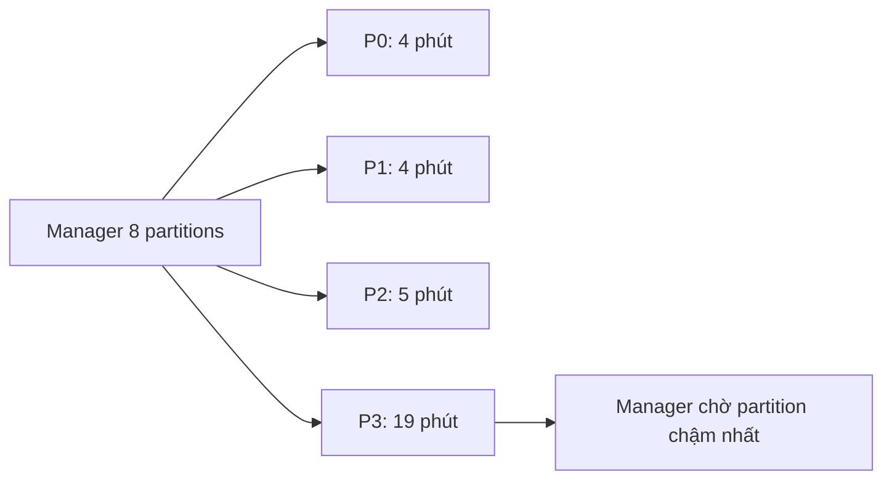
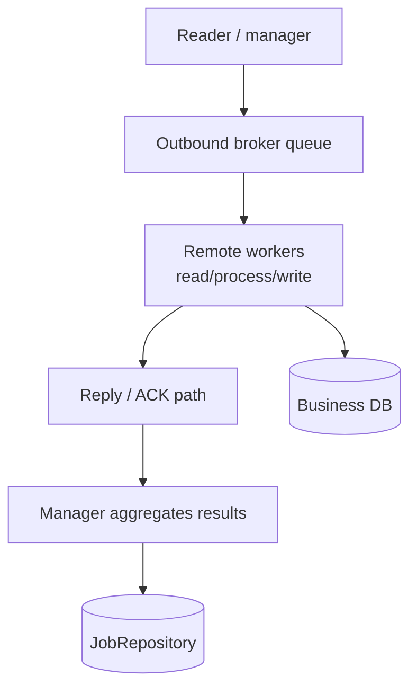
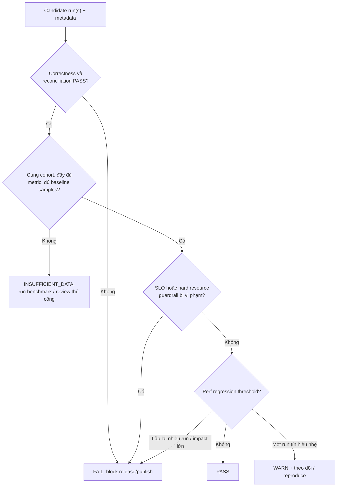
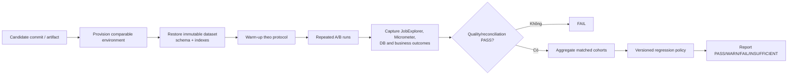

# Baseline và regression threshold: Phát hiện suy giảm hiệu năng khi mở rộng Spring Batch

> **Chương:** Metrics  
> **Mục tiêu:** Xây dựng **performance baseline** đáng tin cho Spring Batch, đặt **regression threshold** theo throughput, latency, transaction/retry, tài nguyên và chất lượng đầu ra; so sánh công bằng giữa các lần chạy multi-threaded step, parallel flows, local/remote partitioning và remote chunking. Bài sử dụng **Spring Batch 5.2.x**, Java 17, JDBC JobRepository, Micrometer, Prometheus và PostgreSQL để minh họa.  
> **Nguyên tắc:** Baseline là tập số liệu có điều kiện và bằng chứng, **không phải một con số tốt nhất từng đo**. Ngưỡng regression phải phân biệt suy giảm thực với nhiễu tải, thay đổi input và sự khác nhau về kiến trúc.

## 1. Bài toán: Tăng từ 4 lên 12 worker nhưng job chạy chậm hơn

Một job nhập dữ liệu giao dịch từ file, xử lý và ghi PostgreSQL. Nhóm phát triển nâng số worker từ 4 lên 12 với mục tiêu tăng throughput.

```text
Lần chạy A: 4 workers
    input                  5.000.000 records
    dữ liệu đầu ra hợp lệ   4.990.000 records
    elapsed                1.000 giây
    throughput             4.990 records/giây
    rollbackCount          40
    p95 chunk duration     0,32 giây

Lần chạy B: 12 workers
    input                  5.000.000 records
    dữ liệu đầu ra hợp lệ   4.990.000 records
    elapsed                1.220 giây
    throughput             4.090 records/giây (xấp xỉ)
    rollbackCount          2.700
    p95 chunk duration     1,50 giây
```

Đây là **số liệu giả định**, chưa phải benchmark đã đo. B chậm hơn dù có nhiều workers, có thể do deadlock, DB connection pool, hot rows hoặc chi phí retry/rollback.

Nhưng nếu B xử lý file có nhiều dòng lớn hơn, thêm validation logic hoặc chạy vào giờ cao điểm, việc quy kết “12 workers gây regression” **chưa có cơ sở**.

Cần trả lời ba câu hỏi:

1. **So với cái gì?** Baseline cùng điều kiện hoặc mô hình đã điều chỉnh theo workload.
2. **Thay đổi lớn đến mức nào mới được xem là suy giảm?** Threshold có đơn vị, hướng tăng/giảm và độ nhiễu.
3. **Nếu vượt ngưỡng, sẽ làm gì?** Chặn release, giảm concurrency, điều tra nguyên nhân hay chỉ cảnh báo?

**Mục tiêu của baseline và threshold là hỗ trợ quyết định**, không phải làm đẹp dashboard.

## 2. Khái niệm: Baseline khác benchmark, SLO và threshold

| Khái niệm | Định nghĩa | Ví dụ |
| --- | --- | --- |
| **Baseline** | Phân phối quan sát từ các lần chạy đủ điều kiện, có bối cảnh tương đồng | Median throughput của 20 đêm xử lý loại input X |
| **Benchmark** | Thử nghiệm có thiết kế, workload và biến được kiểm soát để so sánh | Chạy 4/8/12 workers trên cùng snapshot |
| **Regression** | Chỉ số trở nên tệ hơn so với tham chiếu đáng tin | Throughput giảm 18% khi cùng workload |
| **Threshold** | Quy tắc quyết định suy giảm đáng kể hoặc vi phạm giới hạn | Giảm >10% và vượt noise floor |
| **SLO** | Mục tiêu mức dịch vụ/chất lượng đã thống nhất | 99% đêm hoàn tất trước 05:30 |
| **SLA** | Cam kết dịch vụ có hậu quả/thỏa thuận, tùy tổ chức | Deadline xử lý đã ký kết |
| **Guardrail** | Giới hạn không được vượt dù throughput tốt hơn | Không mất bản ghi, rollback pressure <=2% |
| **Alert** | Thông báo cần hành động theo rule | P95 chunk >2× baseline trong 3 lần chạy cùng cohort |

Không được thay SLO bằng baseline. Nếu baseline cũ vốn đã quá chậm, “không regression so với baseline” vẫn có thể **không đạt deadline**.

### Threshold có ba hướng

- **Higher is worse:** job duration, p95 latency, rollback pressure, skipped items, DB lock waits.
- **Lower is worse:** throughput, goodput, business records applied/s khi có cùng input.
- **Exact/zero tolerance:** business reconciliation mismatch, duplicate financial effect, missing required rows, dữ liệu phiên bản sai.

Không gộp tất cả KPI vào một phép trừ `new - old` mà không xác định trước hướng cải thiện.

## 3. Thiết kế từ yêu cầu nghiệp vụ trước khi đo

Giả sử dịch vụ phải nạp 20 triệu records trong cửa sổ từ 01:00 đến 05:00, nhưng chỉ có **3 giờ xử lý hữu ích** vì cần thời gian staging và graceful stop.

Yêu cầu tối thiểu (bỏ qua kích thước/độ phức tạp khác nhau):

\[
q_{\min} = \frac{20\,000\,000}{3\times3600}
\approx 1\,852\ \text{records/s}.
\]

Nếu vẫn cần quality gate, downstream publishing và reconciliation sau nhập, throughput phải có thêm capacity margin.

Một bản KPI contract hữu ích:

| KPI | Đơn vị | Điều kiện đo | Decision |
| --- | --- | --- | --- |
| End-to-end elapsed | s | Từ accepted start tới terminal + quality gate nếu contract quy định | <= hard runtime budget |
| Goodput | distinct valid events/s | Chỉ effects nghiệp vụ đã đối soát | Không giảm quá ngưỡng |
| Step/Chunk p95 | s | Cùng step, chunk config, sample đủ lớn | Không tăng bất thường |
| Rollback pressure | tỷ lệ transaction outcomes | Cùng topology và transaction semantics | Phải giữ trong guardrail |
| Retry exhausted | events/run | Cùng lỗi/đầu vào | Bằng 0 hoặc được chấp thuận |
| Business mismatches | events | Đối soát source/target | Thường bằng 0 |
| Memory peak | GiB | Cùng JVM/pod limit | Không vượt giới hạn an toàn |
| DB pool pending | connections/s hoặc wait s | Cùng DB pool và tải nền | Không tăng tới saturation |
| Deadline miss | runs | Tính theo business window | Chặn publish hoặc escalation |

**Điểm then chốt:** Khi job cần “không mất hoặc ghi trùng dữ liệu”, correctness **được đánh giá trước** performance. Một bản release chạy nhanh nhờ bỏ qua lỗi hay giảm validation không được coi là tối ưu.

## 4. Chọn đơn vị phân tích: JobInstance, JobExecution hay StepExecution?

Spring Batch có các cấp metadata khác nhau:

| Scope | Phù hợp đo | Cạm bẫy |
| --- | --- | --- |
| `JobInstance` | Một kỳ công việc logic theo identifying JobParameters | Có thể có nhiều attempts do restart |
| `JobExecution` | Một lượt chạy thực tế với start/end/status | Failed run và retry/restart không được tùy tiện bỏ |
| `StepExecution` | Counters, latency và status của một step/worker partition | Partition manager có thể đã aggregate worker counters |
| Chunk | Tail latency, I/O spikes, rollback/retry behavior | Số chunks và kích thước khác nhau giữa runs |
| File/partition | Skew, straggler, data distribution | Nhiều small files khác big files |
| Business event | Goodput, duplicate/reconcile correctness | Không nhất thiết 1 record = 1 effect |

**Đừng so JobExecution #2 của một JobInstance đã xử lý 95% input ở lượt trước với một JobExecution chạy từ đầu.** Lần restart sau có thể rất nhanh vì khối lượng còn lại nhỏ, nhưng điều đó không chứng minh bản code tốt hơn.

### Hai khái niệm throughput

\[
\text{Batch throughput}
= \frac{\text{StepExecution.writeCount}}{\text{step elapsed seconds}}
\]

và

\[
\text{Business goodput}
= \frac{\text{distinct newly applied valid business events}}{\text{elapsed seconds}}.
\]

Chúng có thể khác nhau: writer `ON CONFLICT DO NOTHING` nhận 1.000 items nhưng chỉ thêm 900 rows. Với business SLA, **goodput đã xác minh** thường hữu ích hơn.

### Một Job COMPLETED chưa chắc quality PASS

Một step có skip limit hoặc filtered data có thể kết thúc `COMPLETED` nhưng thiếu records bắt buộc. Trước khi đưa run vào baseline “healthy”, phải kiểm tra status, data reconciliation, skip quota, corrupt output, schema và release marker.

## 5. Baseline phải theo cohort tương đương

Một **cohort** là tập run có bối cảnh đủ giống nhau để so sánh công bằng.

Ví dụ định nghĩa cohort:

```text
jobName               = invoiceImport
inputClass            = daily-invoices-v3
sizeBucket            = 5-10M-records
sourceSnapshotType    = immutable-csv
workerMode            = local-partitioning
workerCount           = 8
chunkSize             = 200
databaseClass         = postgres-primary-16vcpu
databaseSchemaVersion = v17
deploymentClass       = dedicated-nightly
businessWindow        = off-peak
comparisonVersion     = release-2026-11-A
```

Không nhất thiết tạo một metric label cho mọi trường ở trên. Cohort này có thể là **metadata trong một warehouse/reporting table**, còn Prometheus labels nên giới hạn cardinality.

### Các biến nhiễu quan trọng

- **Input:** số row, bytes, độ rộng record, file count, số dòng invalid, phân bố business keys, gzip/compression ratio.
- **Business semantics:** validation, enrichment rules, event dedup, API calls, số output tables.
- **App runtime:** Java version, GC, CPU limit, heap, Spring Batch version, JDBC driver.
- **Parallelism:** worker count, `gridSize`, partition count, thread pool, chunk size.
- **Persistence:** DB instance, schema/index, connection pool, isolation level, hot keys, I/O capacity.
- **Infrastructure:** node size, noisy neighbors, network RTT, object storage, TLS, cold/warm cache.
- **Scheduling:** giờ chạy, data ingestion backlog, downstream rate limiting, maintenance window.
- **Correctness:** skip/filter settings, retryLimit, noRollback exceptions, reader checkpoint.
- **Restart:** cold run vs resumed run; số chunks đã commit ở lượt trước.

**Không gộp 4-worker và 16-worker vào một baseline duy nhất rồi lấy trung bình** nếu mục tiêu là phát hiện regression của một cấu hình cố định. Khi muốn đánh giá lợi ích tăng concurrency, dùng một **thử nghiệm so sánh hai cohorts có workload được giữ tương đương**.

## 6. Snapshot, manifest và reproducibility

Một benchmark hữu ích cần cùng một tập input bất biến:

```text
snapshotId = invoices-2026-11-25-v1
recordCount = 5.000.000
fileCount = 420
totalBytes = 9,8 GiB
checksumManifest = SHA256(...)
schemaVersion = 3
invalidRows = 10.000
businessKeyDistribution = documented
```

Cần lưu snapshot ID/version hoặc hash, không chỉ đường dẫn `/incoming/latest`. Khi test 4 vs 12 workers, đọc **đúng bytes** hoặc một workload tương đương có bằng chứng.

Nếu nguồn chứa PII, không log raw payload hay public checksum có thể tiết lộ thông tin. Chỉ lưu fingerprints cần thiết trong kho bảo mật.

### File skew quan trọng hơn tổng số bytes

Hai datasets đều 10 GiB có thể khác xa:

- Dataset A: 1.000 file ~10 MiB.
- Dataset B: 9 file nhỏ + 1 file 9,9 GiB.

Với one-file-per-partition, dataset B có một **straggler** khiến 15 workers hoàn thành sớm, một worker làm nốt file lớn. Baseline phải mô tả phân phối file size/chunk cost, không chỉ tổng row count.

### Restart có làm thay đổi baseline?

Phải tách:

- **Fresh-start benchmark:** Toàn bộ input chưa xử lý.
- **Recovery benchmark:** Đã commit X%, crash rồi restart.
- **Full logical completion:** Tổng thời gian qua tất cả JobExecutions, downtime và reconciliation theo một JobInstance.

Ba phép đo trả lời ba câu hỏi khác nhau. Không đánh đồng `execution duration` ngắn của restart với end-to-end completion time.

## 7. Thu thập metrics từ Spring Batch 5.2

Spring Batch 5.2 cung cấp Micrometer timers với prefix `spring.batch`:

| Metric Micrometer | Loại | Mục đích |
| --- | --- | --- |
| `spring.batch.job` | Timer | Thời gian JobExecution |
| `spring.batch.job.active` | Long-task timer | Job đang hoạt động |
| `spring.batch.step` | Timer | Thời gian StepExecution |
| `spring.batch.step.active` | Long-task timer | Step đang hoạt động |
| `spring.batch.item.read` | Timer | Thời gian đọc item |
| `spring.batch.item.process` | Timer | Thời gian processor |
| `spring.batch.chunk.write` | Timer | Thời gian writer cho chunk |

Danh sách trên theo [Spring Batch 5.2 Monitoring and Metrics](https://docs.spring.io/spring-batch/reference/5.2/monitoring-and-metrics.html). Những timer này **không tự cung cấp mọi KPI** như end-to-end goodput, retry attempt count, DB lock wait, business mismatch hoặc một metric transaction `commitCount` riêng.

### Đọc counters từ StepExecution

Các counter thông dụng:

```java
stepExecution.getReadCount();
stepExecution.getWriteCount();
stepExecution.getFilterCount();
stepExecution.getReadSkipCount();
stepExecution.getProcessSkipCount();
stepExecution.getWriteSkipCount();
stepExecution.getCommitCount();
stepExecution.getRollbackCount();
```

**`commitCount` và `rollbackCount` không bằng số item thành công/thất bại**, không bằng số RetryTemplate attempts; chúng phản ánh giao dịch của StepExecution theo semantics của framework.

### Không lấy thời gian từ một nguồn duy nhất

Để so sánh end-to-end performance, định nghĩa rõ:

- `JobExecution start/end` từ JobRepository;
- application stopwatch quanh công việc đo, dùng monotonic clock nếu muốn elapsed accuracy nội bộ;
- time queue/wait/launch/staging và quality gate;
- wall-clock schedule window từ start request tới kết quả đã đối soát.

Timer của `spring.batch.job` không tự gồm toàn bộ thời gian chờ lịch hoặc publish sau job, trừ khi những phần đó được đặt trong phạm vi job thực sự.

## 8. Thu thập run summary trong Java bằng StepExecutionListener

Một listener ghi **snapshot các counters cuối step**; không biến một listener gọi lại thành tăng Counter vô hạn:

```java
package com.example.batch.metrics;

import org.slf4j.Logger;
import org.slf4j.LoggerFactory;
import org.springframework.batch.core.ExitStatus;
import org.springframework.batch.core.StepExecution;
import org.springframework.batch.core.StepExecutionListener;
import org.springframework.stereotype.Component;

@Component
public final class BaselineStepSummaryListener
        implements StepExecutionListener {

    private static final Logger log =
            LoggerFactory.getLogger(BaselineStepSummaryListener.class);

    @Override
    public ExitStatus afterStep(StepExecution step) {
        log.info(
            "metric=step_summary jobExecutionId={} stepExecutionId={} " +
            "stepName={} status={} read={} write={} filter={} " +
            "readSkip={} processSkip={} writeSkip={} " +
            "commit={} rollback={}",
            step.getJobExecutionId(),
            step.getId(),
            step.getStepName(),
            step.getStatus(),
            step.getReadCount(),
            step.getWriteCount(),
            step.getFilterCount(),
            step.getReadSkipCount(),
            step.getProcessSkipCount(),
            step.getWriteSkipCount(),
            step.getCommitCount(),
            step.getRollbackCount()
        );

        // Giữ nguyên ExitStatus.
        return null;
    }
}
```

Đăng ký trong một StepBuilder của Batch 5.2:

```java
return new StepBuilder("invoiceImportStep", jobRepository)
        .<Invoice, Invoice>chunk(200, transactionManager)
        .reader(reader)
        .writer(writer)
        .listener(baselineStepSummaryListener)
        .build();
```

**Ranh giới của listener:**

- `afterStep` có thể **không chạy** nếu process bị SIGKILL/OOM/node loss. Cần thu thập bổ sung từ `JobExplorer`/JDBC JobRepository.
- Listener chỉ log snapshot; không sửa `StepExecution.commitCount`/`VERSION` vì framework quản lý metadata.
- Trong partitioning, **manager aggregate** có thể chứa tổng counter workers. Gộp cả manager và worker sẽ đếm đôi.
- Log INFO cho mỗi chunk rất tốn I/O ở workload lớn; nên log một lần/StepExecution rồi sampling chunks nếu cần.
- Với multi-threaded step, listener bean shared phải không chứa mutable state không thread-safe. Mẫu trên chỉ dùng immutable logger.

### Mở rộng thành run report bền vững

Khi xử lý dữ liệu lớn, nên đưa counters đã persist từ `JobRepository`, thời gian thực và business reconciliation sang **bảng reporting riêng** qua một exporter idempotent sau khi JobExecution terminal. Không chèn thêm metadata tùy ý vào `BATCH_STEP_EXECUTION`.

## 9. Bảng reporting cho baseline: Ghi đủ context và outcome

Ví dụ PostgreSQL:

```sql
CREATE TABLE batch_benchmark_run (
    job_execution_id BIGINT PRIMARY KEY,
    job_name VARCHAR(160) NOT NULL,
    cohort_key VARCHAR(160) NOT NULL,
    app_version VARCHAR(100) NOT NULL,
    scenario VARCHAR(60) NOT NULL,
    snapshot_id VARCHAR(200) NOT NULL,
    worker_count INTEGER NOT NULL CHECK (worker_count > 0),
    chunk_size INTEGER NOT NULL CHECK (chunk_size > 0),
    input_records BIGINT NOT NULL CHECK (input_records >= 0),
    input_bytes BIGINT NOT NULL CHECK (input_bytes >= 0),
    applied_valid_events BIGINT NOT NULL CHECK (applied_valid_events >= 0),
    elapsed_seconds DOUBLE PRECISION,
    rollback_count BIGINT,
    commit_count BIGINT,
    business_mismatch_count BIGINT,
    job_status VARCHAR(30) NOT NULL,
    quality_pass BOOLEAN NOT NULL,
    environment VARCHAR(80) NOT NULL,
    run_completed_at TIMESTAMPTZ,
    exporter_version VARCHAR(80) NOT NULL
);
CREATE INDEX idx_benchmark_baseline
    ON batch_benchmark_run (
        job_name, cohort_key, environment, run_completed_at
    );
```

Schema là **mô hình báo cáo**, không phải một phần của Spring Batch JobRepository. Cần:

1. Ghi `job_execution_id` như primary key để exporter chạy lại không tạo hai rows.
2. Ghi `cohort_key` theo quy tắc có version; giữ chi tiết context trong bảng metadata phụ/JSON được kiểm soát khi cần.
3. Chỉ tin `applied_valid_events` nếu đã đối soát business output thật, không tự lấy nguyên `writeCount` khi writer idempotent.
4. Lưu cả **FAILED/STOPPED runs** để theo dõi reliability, dù baseline throughput healthy chỉ chọn runs hợp lệ.
5. Khi `elapsed_seconds` NULL hoặc không đo được, đánh dấu missing; không tự đặt bằng 0.
6. Không chứa PII, token hoặc raw business event keys.
7. Nếu dữ liệu đầu vào chứa corrections/backfill, phân loại scenario riêng.
8. Lưu phiên bản benchmark config và môi trường, tránh thay baseline âm thầm sau nâng cấp DB/JDK.

### Không ghi một sample cho từng item vào bảng reporting

Với hàng chục triệu items, việc insert telemetry row per item có thể làm benchmark chính nó chậm đi. Ghi histogram/timers ở instrumentation, kết thúc run thì tổng hợp counters và business outcomes.

## 10. Baseline tối thiểu cần đủ nhiều lần chạy

**Một lần chạy tốt nhất** không phải baseline; có thể chỉ may mắn nhờ cache nóng và ít lock contention. Ví dụ cùng workload trong một môi trường:

```text
Throughput (events/s) của 10 run hợp lệ:
    9.800 10.050 9.900 10.100 9.750
    9.950 10.000 9.870 10.200 9.920
```

Median gần **9.935 events/s** (giá trị minh họa); nó phản ánh trung tâm phân phối mà không bị kéo mạnh bởi một outlier.

### Những thống kê hữu ích

| Thống kê | Dùng để làm gì? | Giới hạn |
| --- | --- | --- |
| Median | Trung tâm bền hơn average khi có outliers | Không mô tả tail |
| p10 throughput | Mức kém trong các runs | Cần đủ samples để ước lượng ổn định |
| p90/p95 duration | Các runs chậm bất thường | Ít runs thì p95 rất nhiễu |
| MAD | Độ phân tán robust quanh median | Có thể bằng 0 nếu số làm tròn/coarse |
| Coefficient of variation | So sánh độ biến động nếu phân phối phù hợp | Nhạy với outliers/mean gần 0 |
| Failure rate | Reliability theo số failed/total runs | Cần kể cả failed runs, không lọc hết |
| Deadline miss rate | Khả năng đáp ứng thời hạn | Phải giữ nguyên định nghĩa deadline |
| Reconciliation mismatch | Correctness | Không được đánh đổi để tăng throughput |

### Median absolute deviation (MAD)

Với các giá trị `x_i`:

\[
m=\operatorname{median}(x_i),\quad
\mathrm{MAD}=\operatorname{median}(|x_i-m|).
\]

Nếu cần ước lượng độ lệch chuẩn từ dữ liệu gần chuẩn, đôi khi dùng `1.4826×MAD`. **Đừng áp nó như một bằng chứng dữ liệu batch có phân phối chuẩn**; các runs có thể đa đỉnh vì cold/warm caches hoặc sự cố DB.

Chọn baseline từ **các runs hợp lệ cùng cohort** và một khoảng thời gian đủ ngắn để vẫn đại diện môi trường hiện tại, đủ dài để có mẫu. Ví dụ 20–30 runs nếu chạy hằng ngày; khi số mẫu thấp, báo **insufficient baseline** thay vì ngụy tạo p99 chính xác.

## 11. Baseline tĩnh, rolling và theo phiên bản

Có ba cách quản lý:

| Loại baseline | Ưu điểm | Rủi ro |
| --- | --- | --- |
| **Pinned baseline** từ release đã chấp thuận | Ổn định, dễ audit | Môi trường thay đổi theo thời gian |
| **Rolling baseline** 14–30 run gần nhất | Bắt nhịp drift theo môi trường | Có thể “học” luôn regression dài hạn |
| **Versioned cohort baseline** | Cân bằng release và scenario | Cần quản lý metadata và vòng đời |

**Khuyến nghị cho change validation:** Dùng pinned/reference baseline đã QA cho release gate, đồng thời rolling baseline cho vận hành hàng ngày. Nếu rolling baseline liên tục hấp thụ các runs chậm, dashboard có thể coi một regression kéo dài là “bình thường mới”.

### Quy tắc cập nhật baseline

Baseline mới chỉ được phê duyệt khi:

- Đủ runs hợp lệ, có quality gate;
- biết thay đổi code, DB/JDK/infrastructure và scenario;
- đã so với pinned baseline và SLO;
- quyết định regression/optimization được review;
- lưu version, người duyệt, ngày hiệu lực và điều kiện rollback.

Không cho job thất bại hoặc data corruption tự cập nhật baseline để ngưỡng ngày sau dễ vượt hơn.

## 12. Thiết kế regression threshold có hướng và noise floor

Giả sử baseline throughput median là `10.000 events/s`, bản mới đạt `8.800 events/s`.

Với **higher-is-better**:

\[
d_q = \frac{q_{\mathrm{baseline}}-q_{\mathrm{candidate}}}
{q_{\mathrm{baseline}}}.
\]

\[
d_q=\frac{10000-8800}{10000}=0.12=12\%.
\]

Với **lower-is-better**, ví dụ duration baseline 1.000 s, candidate 1.140 s:

\[
d_t=\frac{t_{\mathrm{candidate}}-t_{\mathrm{baseline}}}
{t_{\mathrm{baseline}}}=14\%.
\]

### Kết hợp threshold tương đối và tuyệt đối

Một rule minh họa:

```text
WARN throughput:
    candidate_goodput < baseline_median × 0.90
    AND absolute_loss > 300 events/s
    AND comparisons cùng cohort + enough samples

FAIL throughput:
    candidate_goodput < baseline_median × 0.80
    OR violates business minimum throughput

FAIL correctness:
    business_mismatch_count > 0
```

Nếu baseline chỉ 20 events/s, giảm 2 events/s tương đương 10% nhưng có thể nằm trong sai số đo rất lớn; vì vậy cần **absolute floor** và guardrail theo nghiệp vụ.

Nếu baseline 10.000 events/s, tụt 8% (800 events/s) có thể rất quan trọng dù chưa qua threshold 10%; SLO và impact được đánh giá độc lập.

### Threshold theo noise: Không đơn giản lấy số đẹp

Một cách đặt bound robust cho metric higher-is-worse:

\[
U=\max\left(m(1+r),\;m+k\cdot \mathrm{MAD},\;m+a\right)
\]

Trong đó:

- `m` là median baseline;
- `r` là mức dung sai tương đối;
- `a` là dung sai tuyệt đối (đơn vị của metric);
- `k` là hệ số nhiễu dùng để giảm false positive.

Nếu candidate `x>U`, coi là **có tín hiệu regression**, rồi xác minh cohort, sample quality, correctness và tài nguyên. Công thức là một **policy thiết kế**, không phải kiểm định thống kê chứng minh nhân quả. Với higher-is-better có thể dùng bound dưới tương ứng:

\[
L=\min\left(m(1-r),\;m-k\cdot \mathrm{MAD},\;m-a\right).
\]

Điều kiện warning: `x<L`. Bound **không thể thay cho SLO**; một baseline đã tệ hơn SLA không được trở thành ngưỡng đủ tốt.

> **Chọn ngưỡng theo quy tắc rõ:** Dùng `max` ở upper bound hay `min` ở lower bound nghĩa là **chỉ cảnh báo khi vượt tất cả mức dung sai đã định**. Nếu mục tiêu là phát hiện sớm bất kỳ rủi ro nào, dùng logic `OR`/ngưỡng chặt hơn với review; phải thể hiện rõ trong policy, không đổi âm thầm khi triển khai.


## 13. Ví dụ định lượng: Từ baseline tới quyết định regression

Có một baseline hợp lệ của job `invoiceImport` trong cohort 8 workers, `chunk(200)`, 5 triệu records:

| Chỉ số | Baseline median | MAD | Candidate A | Candidate B |
| --- | ---: | ---: | ---: | ---: |
| Goodput, events/s | 10.000 | 120 | 9.650 | 8.800 |
| End-to-end duration, s | 500 | 12 | 515 | 585 |
| p95 chunk duration, ms | 350 | 20 | 370 | 690 |
| Rollback pressure | 0,5% | 0,2 điểm % | 0,7% | 6,0% |
| Business mismatch | 0 | 0 | 0 | 0 |
| Job status | COMPLETED | — | COMPLETED | COMPLETED |

Đây là **bảng số liệu giả định**; MAD đo trên **phân phối các run-level values**, không phải lấy MAD của một chunk.

Đặt chính sách minh họa:

```text
Goodput: lower bound = min(
    baseline × (1 - 0.10),
    baseline - 3×MAD,
    baseline - 300 events/s
)

Duration: upper bound = max(
    baseline × (1 + 0.10),
    baseline + 3×MAD,
    baseline + 30 seconds
)

Rollback guardrail:
    pressure > 3% ⇒ WARN/FAIL theo workload policy

Correctness:
    mismatches > 0 ⇒ FAIL ngay
```

Tính:

\[
L_q = \min(9000,9640,9700)=9000\ \text{events/s}
\]

\[
U_t = \max(550,536,530)=550\ \text{s}
\]

- **Candidate A:** goodput 9.650 ≥ 9.000, duration 515 ≤ 550; quality PASS. Không có tín hiệu regression theo rule minh họa.
- **Candidate B:** goodput 8.800 `<` 9.000, duration 585 > 550; rollback pressure 6% vượt guardrail. **Regression signal mạnh** và cần điều tra, dù BatchStatus vẫn COMPLETED.

Điều này **chưa chứng minh** nguyên nhân là code. Muốn kết luận 12 workers gây chậm phải so thiết kế có cùng input/DB state và kiểm soát concurrency. Cũng không nên xét chỉ một candidate run nếu baseline có biến động lớn.

### Threshold != quality gate

Nếu Candidate A có một duplicate financial effect, outcome phải **FAIL correctness**, dù mọi chỉ số performance đều tốt.

## 14. PostgreSQL: Lấy median và MAD từ reporting table

Không sửa JobRepository chỉ để tính baseline. Với bảng `batch_benchmark_run` ở phần 9, truy vấn chỉ lấy các runs **healthy** trong cùng cohort:

```sql
WITH eligible AS (
    SELECT
        job_execution_id,
        (applied_valid_events::double precision
            / NULLIF(elapsed_seconds, 0)) AS goodput
    FROM batch_benchmark_run
    WHERE job_name = :job_name
      AND cohort_key = :cohort_key
      AND environment = :environment
      AND scenario = 'fresh'
      AND quality_pass = TRUE
      AND job_status = 'COMPLETED'
      AND business_mismatch_count = 0
      AND elapsed_seconds > 0
      AND run_completed_at >= :window_start
      AND run_completed_at < :candidate_start
),
median_result AS (
    SELECT
        COUNT(*) AS sample_count,
        percentile_cont(0.5) WITHIN GROUP
            (ORDER BY goodput) AS median_goodput
    FROM eligible
)
SELECT sample_count, median_goodput
FROM median_result;
```

**Đây là PostgreSQL SQL với named bind parameters của ứng dụng**, không phải SQL literal chạy trực tiếp trong `psql` nếu chưa bind values. Các điều kiện về release, hardware, DB version, row-size bucket có thể được mã hóa trong `cohort_key` hoặc lọc thêm ở bảng dimension.

Tính MAD đúng theo hai bước:

```sql
WITH eligible AS (
    SELECT
        applied_valid_events::double precision
            / NULLIF(elapsed_seconds, 0) AS goodput
    FROM batch_benchmark_run
    WHERE job_name = :job_name
      AND cohort_key = :cohort_key
      AND environment = :environment
      AND scenario = 'fresh'
      AND quality_pass = TRUE
      AND job_status = 'COMPLETED'
      AND business_mismatch_count = 0
      AND elapsed_seconds > 0
      AND run_completed_at >= :window_start
      AND run_completed_at < :candidate_start
),
center AS (
    SELECT percentile_cont(0.5) WITHIN GROUP
               (ORDER BY goodput) AS median_goodput
    FROM eligible
),
deviations AS (
    SELECT ABS(e.goodput - c.median_goodput) AS deviation
    FROM eligible e CROSS JOIN center c
)
SELECT
    (SELECT COUNT(*) FROM eligible) AS sample_count,
    (SELECT median_goodput FROM center) AS median_goodput,
    percentile_cont(0.5) WITHIN GROUP
        (ORDER BY deviation) AS mad_goodput
FROM deviations;
```

**Điều kiện an toàn khi dùng kết quả:**

- `sample_count` phải đạt min sample của policy trước khi lấy threshold.
- `NULL` median/MAD khi không có sample không được chuyển thành “không regression”.
- Không dùng số liệu candidate để tạo baseline rồi so chính nó, vì đó là **data leakage**.
- Khi nhiều versions khác nhau chạy song song, cần phân biệt `app_version` hoặc version của baseline được ghim.
- Chọn `window_start`/`candidate_start` trước khi tính, không thay cửa sổ theo kết quả mong muốn.
- Query median từ reporting table là kết quả **per run**, không tự tạo percentile của mọi chunks trên toàn bộ cluster.

### Baseline selection không được che reliability

Nếu chỉ lấy `COMPLETED` làm baseline performance, các runs FAILED bị loại khỏi throughput distribution là hợp lý để so các runs hoàn tất, **nhưng phải có reliability metric riêng**. Một release gây 30% FAILED nhưng 70% thành công rất nhanh không được coi là tối ưu.

## 15. Java 17: Regression gate typed, không so sánh string

Mẫu evaluator thuần Java dễ unit-test, không phụ thuộc trực tiếp vào JobRepository:

```java
package com.example.batch.metrics;

public final class RegressionGate {

    public enum Direction {
        HIGHER_IS_BETTER, LOWER_IS_BETTER
    }

    public enum Verdict {
        PASS, REGRESSION, INSUFFICIENT_BASELINE, INVALID_SAMPLE
    }

    public record Baseline(
            long healthyRuns,
            double median,
            double mad) {}

    public record Rule(
            Direction direction,
            long minHealthyRuns,
            double relativeTolerance,
            double absoluteTolerance,
            double noiseMultiplier) {}

    public record Result(
            Verdict verdict,
            double observed,
            double threshold) {}

    public static Result evaluate(
            Baseline baseline, Rule rule, double candidate) {

        if (baseline.healthyRuns() < rule.minHealthyRuns()) {
            return new Result(
                    Verdict.INSUFFICIENT_BASELINE,
                    candidate, Double.NaN);
        }

        if (!Double.isFinite(baseline.median())
                || baseline.median() <= 0
                || !Double.isFinite(baseline.mad())
                || baseline.mad() < 0
                || !Double.isFinite(candidate)
                || candidate < 0
                || rule.relativeTolerance() < 0
                || rule.absoluteTolerance() < 0
                || rule.noiseMultiplier() < 0) {
            return new Result(
                    Verdict.INVALID_SAMPLE, candidate, Double.NaN);
        }

        double center = baseline.median();
        double spread = baseline.mad();

        if (rule.direction() == Direction.HIGHER_IS_BETTER) {
            double threshold = Math.max(0.0,
                    Math.min(
                        center * (1.0 - rule.relativeTolerance()),
                        Math.min(
                            center - rule.noiseMultiplier() * spread,
                            center - rule.absoluteTolerance())));
            return new Result(
                    candidate < threshold
                        ? Verdict.REGRESSION : Verdict.PASS,
                    candidate, threshold);
        }

        double threshold = Math.max(
                center * (1.0 + rule.relativeTolerance()),
                Math.max(
                    center + rule.noiseMultiplier() * spread,
                    center + rule.absoluteTolerance()));

        return new Result(
                candidate > threshold
                    ? Verdict.REGRESSION : Verdict.PASS,
                candidate, threshold);
    }

    private RegressionGate() {}
}
```

Sử dụng:

```java
var baseline = new RegressionGate.Baseline(
        24, 10_000.0, 120.0);

var rule = new RegressionGate.Rule(
        RegressionGate.Direction.HIGHER_IS_BETTER,
        20, 0.10, 300.0, 3.0);

var evaluation = RegressionGate.evaluate(
        baseline, rule, 8_800.0);

// evaluation.verdict() = REGRESSION
// evaluation.threshold() = 9_000.0
```

**Giới hạn quan trọng của snippet:**

1. Evaluator chỉ nhận **metrics đã được chuẩn hóa và cùng cohort**. Nó không biết JobInstance/StepExecution identity hay business correctness.
2. `PASS` của một metric không chứng minh run đạt mọi SLO; quality, deadline và những metrics khác phải được kiểm tra độc lập.
3. Với baseline median bằng 0, cần rule riêng cho zero-target counters như `mismatchCount`, không dùng công thức chia/nhân phổ quát.
4. Nếu `rule.direction()` là `null`, đoạn mã chưa validate null; production nên dùng validation của DTO/config và unit tests.
5. Những tham số rule phải được version hóa, không thay ngay giữa một thử nghiệm.
6. Lấy `candidate` bằng một run đơn lẻ có thể gây false alarm; trong CI nên dùng nhiều repeats hoặc thiết kế A/B có kiểm soát.
7. `Double.NaN` được dùng làm sentinel nội bộ. Khi xuất JSON, nên chuyển sang status/reason rõ thay vì serialize NaN như một số chuẩn JSON.

### Không nên tính confidence từ một phép compare đơn lẻ

Một ngưỡng dựa trên median/MAD là **heuristic engineering**, không phải phép chứng minh thống kê rằng thay đổi code đã gây regression. Có thể bổ sung bootstrap confidence interval, kiểm định phù hợp và effect-size khi cần, nhưng không dùng p-value để bỏ qua một vi phạm correctness/SLO rõ ràng.

## 16. p95/p99: Không lấy trung bình percentile của các workers

Một lỗi thường gặp khi mở rộng Spring Batch:

```text
Worker A: p95 chunk = 200 ms
Worker B: p95 chunk = 800 ms
Dashboard: avg(p95_A, p95_B) = 500 ms  ← KHÔNG phải p95 toàn cluster
```

Percentile **không cộng tuyến tính**. Nếu số chunks của worker A là 200.000 và B là 100, trung bình hai p95 càng sai lệch.

### Micrometer Timer và Prometheus histogram

Theo tài liệu Spring Batch 5.2, timer `spring.batch.chunk.write` có sẵn. Nhưng **Prometheus histogram bucket series không mặc định tồn tại chỉ vì có Timer**: cần cấu hình histogram/distribution phù hợp ở Micrometer/exporter.

Một ví dụ custom timer riêng để minh họa:

```java
package com.example.batch.metrics;

import io.micrometer.core.instrument.MeterRegistry;
import io.micrometer.core.instrument.Timer;
import java.util.concurrent.Callable;

public final class ChunkLatencyMeter {

    private final Timer timer;
    private final MeterRegistry registry;

    public ChunkLatencyMeter(MeterRegistry registry) {
        this.registry = registry;
        this.timer = Timer.builder("app.batch.chunk.duration")
                .description("Observed time of a chunk work unit")
                .tag("job.name", "invoiceImport")
                .tag("step.name", "importWorker")
                .publishPercentileHistogram()
                .register(registry);
    }

    public <T> T time(Callable<T> operation) throws Exception {
        Timer.Sample sample = Timer.start(registry);
        try {
            return operation.call();
        } finally {
            sample.stop(timer);
        }
    }
}
```

**Lưu ý:** Mẫu giữ chính `MeterRegistry` được inject và dùng nó cho cả `Timer.start(registry)` và timer đã đăng ký; không trộn hai registry khác nhau. Khi instrument thực tế, đo đúng một work unit có định nghĩa rõ, không bọc double quanh cả Spring Batch timer mặc định rồi suy đó là hai metrics độc lập.

Một mẫu PromQL với **classic histogram đã được bật**:

```promql
histogram_quantile(
  0.95,
  sum by (le, job_name, step_name) (
    rate(app_batch_chunk_duration_seconds_bucket[10m])
  )
)
```

Tên metric và nhãn là kết quả phụ thuộc registry/naming convention; cần **xác minh trong `/actuator/prometheus` hoặc endpoint exporter thực tế**. Nếu dùng histogram bản native, PromQL và biểu diễn series khác; đừng copy truy vấn bucket classic cho tất cả backends.

**Đừng dùng:**

```promql
avg(app_batch_chunk_duration_seconds{quantile="0.95"})
```

để làm “p95 toàn cluster”. Tài liệu Prometheus giải thích vì sao summary quantiles không aggregate được, còn histogram buckets có thể cộng sau rate khi bucket boundaries tương thích.

### p95 chunk khác p95 job duration

- `p95 chunk write` mô tả tail của thời gian writer, không nhất thiết gồm đọc, process, transaction commit và queue.
- `p95 full chunk` cần instrumentation span phù hợp.
- `p95 JobExecution duration` cần **nhiều JobExecutions** đủ mẫu, không lấy từ một job duy nhất.
- `max partition duration` thường quyết định thời gian hoàn tất manager khi một partition straggler.

Đừng gộp p95 của worker, job và source file vào một “latency p95” không có unit/scope.

## 17. Multi-threaded step: Speedup, efficiency và bottleneck

Khi thay đổi số workers, đánh giá **scaling experiment** riêng khỏi regression của một cấu hình cố định.

Với cùng input:

\[
\mathrm{speedup}(p)=\frac{T(1)}{T(p)},
\quad
\mathrm{efficiency}(p)=\frac{\mathrm{speedup}(p)}{p}.
\]

Ví dụ:

| Workers | Elapsed (s) | Speedup so với 1 | Efficiency |
| ---: | ---: | ---: | ---: |
| 1 | 2.400 | 1,00× | 100% |
| 4 | 700 | 3,43× | 85,7% |
| 8 | 420 | 5,71× | 71,4% |
| 16 | 390 | 6,15× | 38,5% |

Số liệu **giả định**. Tăng 8 lên 16 worker chỉ giảm 30 giây nhưng tiêu thụ thêm tài nguyên, có thể làm DB contention tăng.

### Không gọi 16 workers “regression” chỉ vì efficiency giảm

Efficiency có xu hướng giảm khi gặp phần việc không song song được, coordination overhead hoặc giới hạn DB. Phải xác định **mục tiêu tối ưu**:

- Minimize elapsed time?
- Maximize events/s/cost?
- Giữ DB dành cho online traffic dưới 50% utilization?
- Giữ rollback pressure thấp để restart an toàn?
- Đáp ứng deadline với ít workers nhất?

Nếu 8 workers đã đạt deadline với 30% CPU margin và DB không cạn pool, nó có thể là lựa chọn tốt hơn 16 workers, dù 16 nhanh hơn một chút.

### Counter interplay

Nếu khi tăng workers:

```text
rollbackCount     ↑↑
deadlock_count    ↑
db_lock_wait      ↑
p95 chunk latency ↑
goodput           ↓
```

thì nghi ngờ **contention/hot key/lock order**. Nhưng commit/rollback count của `StepExecution` **không** là số retries chính xác; cần ghi exception family, SQLSTATE, retry attempts riêng.

## 18. Partitioning: Straggler và double-count manager

Partitioning thường có `manager StepExecution` tổng hợp counters từ worker `StepExecutions`. Với `DefaultStepExecutionAggregator`, `commitCount`, `rollbackCount` và counters tương tự **được cộng từ children** vào manager.

Ví dụ:

```text
fileManager              writeCount=1.000.000 (aggregate)
fileWorker:partition0    writeCount=250.000
fileWorker:partition1    writeCount=250.000
fileWorker:partition2    writeCount=250.000
fileWorker:partition3    writeCount=250.000

Sai: SUM(5 rows) = 2.000.000
Đúng về output Batch trong ví dụ: 1.000.000
```

Khi so baseline goodput hoặc rollback pressure theo job, **chọn một mức tổng hợp**:

1. Dùng manager aggregate **sau khi hoàn tất**, nếu semantics phù hợp.
2. Hoặc cộng **chỉ worker leaves** đã được xác nhận, không gồm manager.
3. Nếu nhiều JobExecutions của cùng JobInstance, xác định rõ có cộng attempts/replays không.

### Critical path quan trọng hơn average worker duration



Nếu p95 chung của nhiều chunks không thay đổi nhưng một partition file rất lớn kéo dài tới 19 phút, tổng job elapsed vẫn có thể regression. Cần baseline theo:

- `max(partition_elapsed)`;
- p95 partition duration **có đủ partitions**;
- rows/bytes per partition, skew ratio;
- worker utilization và thời gian chờ queue;
- dispatcher/JobRepository overhead.

Partition có nhiều rows hơn chưa chắc chậm hơn do code; phải chuẩn hóa theo bytes, record complexity hoặc phân tích skew.

## 19. Remote chunking và remote partitioning: Tách lỗi mạng khỏi compute

Trong remote processing, end-to-end throughput chịu ảnh hưởng từ **hệ thống điều phối và middleware**, không chỉ logic ItemProcessor/ItemWriter.



Cần đo tối thiểu:

| Phạm vi | Chỉ số cần baseline |
| --- | --- |
| Manager | Read throughput, requests created, time waiting for replies |
| Broker | Queue backlog, delivery latency, redelivery count, DLQ |
| Worker | Processing/writing p95, active workers, DB waits |
| Business DB | Committed applied events, locks, connection pool |
| Correlation | Request/reply timeout, duplicates, uncertain outcomes |
| JobRepository | StepExecution updates, metadata transaction waits |
| Recovery | Retries, restarts, lease/fencing events |

**Không gọi `manager StepExecution.rollbackCount` là tổng rollback của worker database** nếu worker đang ghi ở transaction riêng. Cũng không dùng message ACK count như số successful business events.

### Lost reply có thể tạo “regression giả” trên message metrics

Worker commit business DB nhưng response bị mất. Broker redeliver cùng chunk, làm request count tăng; goodput thật có thể vẫn như cũ do idempotent writer. Nếu chỉ nhìn số messages processed, hệ có vẻ nhanh hơn (xử lý nhiều messages), nhưng **không tạo thêm business effect**.

Khi đặt threshold cho remote processing:

- Ưu tiên goodput đã đối soát.
- Cùng lúc theo dõi `redelivery / unique business effects`.
- Có guardrail về duplicate/no-op/reconcile backlog.
- Đo time-to-terminal thật của JobExecution và các worker còn in-flight.
- Không hạ threshold bằng cách chỉ đo các workers đã COMPLETED rồi bỏ sót slow/failing workers.

## 20. So sánh có kiểm soát: Paired runs và canary

Một thay đổi như tăng worker count, đổi chunk size hoặc JDBC fetch size nên được thử theo thiết kế.

### Thử nghiệm A/B minh họa

```text
A = cấu hình baseline đã QA, 8 workers
B = thay đổi cần đánh giá, 12 workers

Giữ cố định:
    input snapshot và version
    business rules
    database schema/index
    hardware/cgroup limits
    upstream/downstream quota
    JobParameters business identity cho từng run test có kiểm soát
    kế hoạch cleanup/output namespace riêng

Thực hiện:
    warm-up theo protocol
    đo A, B luân phiên hoặc randomize thứ tự
    lặp đủ số runs
    ghi throughput, latency, rollback, resource, quality
    quyết định theo policy đã cố định trước
```

Một thiết kế **ABBA** hoặc randomize order có thể giúp giảm sai lệch do cache/DB nhiệt, nhưng **không bảo đảm loại bỏ hết biến động**. Khi các runs cạnh tranh cùng database/broker, chúng không độc lập; có thể phải chạy tuần tự trên môi trường cô lập hoặc đo interference riêng.

### Canaries trong production

Đối với job có side effects, không thể cho version A và B cùng xử lý **cùng business events** trên cùng output chỉ để so tốc độ. Các lựa chọn:

- Chạy **shadow read-only/dry-run** với output tách biệt và không publish;
- Chia business keys/ranges **không chồng** với stratification, lưu số liệu khác biệt;
- Dùng bản snapshot replay trên môi trường test có data anonymized/production-like;
- Triển khai B trên một cohort/cửa sổ nhỏ có khả năng rollback release, có guardrail.

Tạo môi trường benchmark có data thật phải tuân thủ bảo mật; không copy dữ liệu nhạy cảm ra hệ không có kiểm soát.

### Guardrail thứ tự quyết định

1. Source/target correctness, schema, idempotency, reconciliation.
2. Reliability, retry exhausted, failed/timeout/deadline.
3. Resource safety: DB lock contention, CPU/memory/connection pool.
4. Throughput/latency/cost và so baseline.
5. Nếu có regression: rollback release hoặc giảm concurrency/chunk tùy nguyên nhân.

Một release chạy nhanh hơn 15% nhưng làm thiếu 0,01% giao dịch **không đạt**.


## 21. Release gate: PASS, WARN, FAIL và INSUFFICIENT_DATA

Để regression threshold có tác dụng, mỗi kết quả phải dẫn tới một hành động xác định.



| Verdict | Điều kiện điển hình | Quyết định |
| --- | --- | --- |
| **PASS** | Quality PASS, sample đủ, không vi phạm guardrail, metrics trong ngưỡng | Có thể tiếp tục release process |
| **WARN** | Dấu hiệu nhẹ, một run bất thường, chưa đủ chứng cứ nhân quả | Chạy lại so sánh, giám sát canary |
| **FAIL** | Correctness lỗi, SLO hard violation, resource exhaustion hoặc regression tái lập | Block/revert/tối ưu trước rollout |
| **INSUFFICIENT_DATA** | Baseline thiếu, dữ liệu không tương đương, timer series không đủ | Không tự động coi là PASS |
| **INVALID** | Zero duration, negative counters, snapshot mismatch, exporter lỗi | Sửa measurement pipeline trước khi quyết định |

**Một pipeline tốt không ép mọi kết quả về PASS/FAIL.** Khi chỉ có 2 sample nhưng rule đòi 20, kết luận đúng là **chưa đủ dữ liệu**, không phải “không regression”.

### Chính sách mẫu ở dạng cấu hình

```yaml
metricPolicy:
  version: "benchmark-v4"
  cohort: "invoiceImport/local-partitioning/8w/200c"
  healthyBaselineRunsMin: 20
  comparison:
    primary: businessGoodputPerSecond
    direction: higher-is-better
    relativeTolerance: 0.10
    absoluteTolerance: 300.0
    madMultiplier: 3.0
  hardGuards:
    businessMismatchCount: 0
    requireJobStatus: COMPLETED
    requireQualityPass: true
    endToEndDeadlineSeconds: 900.0
    rollbackPressureMax: 0.03
  confirmation:
    warningOnOneBadRun: true
    failOnConsecutiveBadRuns: 2
  actions:
    fail: block-release
    insufficient: manual-review
```

File YAML là **ví dụ policy độc lập**, **không phải schema Spring Batch tạo sẵn**. Một ứng dụng cần tự viết parser/validator và kiểm soát phiên bản. Trong thực tế, nếu có hard guardrail vượt ở một run, không nhất thiết đợi hai runs để fail.

### Tránh “hạ ngưỡng cho xanh dashboard”

Một threshold thay đổi sau khi đã thấy candidate fail là **post-hoc tuning**. Nếu thật sự cần đổi tiêu chí do workload/architecture mới, tạo policy version mới, lý do, reviewer và baseline/experiment độc lập.

## 22. Alert vận hành khác regression gate trong CI

**CI/release gate** so một phiên bản candidate với benchmark/reference có kiểm soát. **Production alert** theo dõi hệ đang chạy với điều kiện thay đổi liên tục. Hai mục tiêu cần thiết kế khác nhau.

| Ngữ cảnh | Khi đo | Hành động |
| --- | --- | --- |
| PR performance test | Có repeatable test environment | Cảnh báo developer, kiểm tra candidate |
| Pre-release benchmark | Dataset và infrastructure chuẩn | PASS/WARN/FAIL release gate |
| Canary production | Workload thật nhưng giới hạn phạm vi | Dừng rollout/rollback nếu guardrail vi phạm |
| Nightly operations | Mỗi kỳ chạy có biến động tự nhiên | So với cohort và SLO, triage |
| Long-term capacity planning | Nhiều tuần/tháng | Đo drift, headroom và cost |
| Incident investigation | Khi job fail/timeout | Correlate metrics, logs, traces và DB |

### Alert cần đủ evidence

Một chính sách minh họa:

```text
1. Nếu mismatchCount > 0
     → critical, block publish

2. Nếu JobExecution.status = FAILED
     → investigate; không suy luôn là perf regression

3. Nếu quality PASS và 2 trong 3 healthy runs gần nhất:
       goodput < threshold
       AND DB lock wait tăng hoặc chunk p95 xấu đi
     → performance regression warning/incident

4. Nếu baseline sample count thấp
     → insufficient data; không đánh dấu PASS giả
```

Đây là **quy tắc minh họa**, không phải default Spring Batch.

### Multiplicity và alert fatigue

Khi kiểm tra 100 metrics mỗi phút với ngưỡng nhạy, một số metrics có thể vượt ngưỡng ngẫu nhiên. Giảm nhiễu bằng:

- Chọn vài **primary KPI**; secondary metrics để giải thích.
- Yêu cầu số samples/cycles tối thiểu.
- Dùng hysteresis (ngưỡng vào/ra khác nhau) và cooldown.
- Tách hard correctness guardrail khỏi performance anomaly.
- Không lặp notification mỗi lần poll cùng một JobExecution.
- Giữ audit lịch sử rule version/threshold đã dùng.

**Không đợi nhiều lần** đối với mất dữ liệu, duplicate side effect hoặc lộ dữ liệu; đó là hard failure chứ không phải nhiễu thống kê.

## 23. Regression triage: Từ chỉ số tới nguyên nhân

Một đường điều tra nên bắt đầu từ **khả năng so sánh**, sau đó tới dấu hiệu tài nguyên.

### Bước 1 — Xác minh cohort và measurement

- Candidate có cùng input snapshot hoặc cùng loại workload đã được điều chỉnh chưa?
- Có thay đổi SQL schema/index, driver, JVM, memory limits hoặc database class?
- Input records/bytes/file sizes có đổi đáng kể?
- Job đã restart hay thực sự xử lý từ đầu?
- Writer có no-op duplicate nhiều hơn?
- Sample count và timer/histogram có đủ dữ liệu không?
- Manager partition count có bị cộng đôi với workers không?

### Bước 2 — Xác định bottleneck

| Tín hiệu | Giả thuyết cần kiểm tra | Hướng đo tiếp |
| --- | --- | --- |
| Goodput giảm, CPU worker thấp | DB/network wait | Pool pending, DB waits, broker queues |
| Goodput giảm, CPU 100% | CPU-bound processor/serialization | Profiling, allocation, GC |
| Rollback pressure tăng + deadlock tăng | Contention/hot key | Lock graph, SQLSTATE, update order |
| p95 writer tăng nhưng read latency ổn | Sink chậm | Query plan, indexes, batch size |
| Read throughput giảm, staging wait cao | File/object storage | GET latency, bytes/s, file count |
| Một partition kéo dài bất thường | Skew/straggler | Max partition duration, bytes/partition |
| Memory/GC pauses tăng | Object churn/chunk quá lớn | Heap, GC pause, allocation profile |
| Message redelivery tăng | Lost ACK/reply/worker fail | Broker timeout, worker TX outcome |
| Step writeCount tăng nhưng goodput đứng yên | Replays/duplicates no-op | Unique business effects, idempotency ledger |
| Job duration tăng dù chunk p95 ổn | Launch/queue/metadata/quality stage | End-to-end timeline |

Không tự suy **nhân quả** từ hai đồ thị cùng tăng: lock wait và rollback cùng tăng có thể do chung nguyên nhân khác, hoặc rollback làm tăng lock load. Cần kiểm tra SQL traces, nguồn event và thử giảm concurrency trong một controlled experiment.

### Bước 3 — Chọn remediation có thể kiểm chứng

- Giảm worker count nếu DB là nút thắt.
- Sửa khóa/index và thứ tự lock thay vì tăng retry vô hạn.
- Chuyển partition từ theo file sang theo business key nếu hot keys khiến contention.
- Dùng immutable input snapshot, sửa skew và reader state.
- Tách external HTTP side effects khỏi chunk transaction bằng outbox/idempotency.
- Thêm rate limit hoặc backpressure nếu downstream quá tải.
- Cân nhắc đổi chunk size dựa trên p99 transaction và latency, không chỉ average.
- Sửa correlation/ACK/reply protocol khi remote chunking tạo duplicate work.
- Sau thay đổi, **đo lại cùng cohort/benchmark protocol** và so cả correctness.

## 24. CI benchmark pipeline và reproducibility

Một pipeline kiểm thử performance nên có:



### Những artifact nên giữ để audit

1. Commit hash/container digest, JDK/Spring Batch/driver versions.
2. Database schema migration version, index snapshot và instance class.
3. Dataset manifest/hash, record/byte/file counts, skew description.
4. `JobParameters` identifying vs non-identifying, JobInstance/JobExecution IDs.
5. Worker count, chunk size, gridSize, thread pool, pool size, retry/backoff policy.
6. Raw elapsed durations, counters, histogram buckets và resource metrics.
7. Business reconciliation result.
8. Baseline policy ID, thresholds và sample count.
9. Decision/reviewer và incident links.
10. Reproduction commands/configuration (không chứa credentials).

### Ví dụ output report theo định dạng máy đọc

```json
{
  "cohort": "invoiceImport/local-partitioning/8w/200c",
  "candidateVersion": "release-2026-11-B",
  "baselineVersion": "release-2026-11-A",
  "healthyBaselineRuns": 24,
  "candidateRepeats": 5,
  "quality": {
    "status": "PASS",
    "businessMismatchCount": 0
  },
  "metrics": {
    "businessGoodputPerSecond": {
      "baselineMedian": 10000.0,
      "candidateMedian": 8800.0,
      "lowerThreshold": 9000.0,
      "verdict": "REGRESSION"
    }
  },
  "overallVerdict": "FAIL",
  "policyVersion": "benchmark-v4"
}
```

Đây là **schema báo cáo minh họa**, không phải output của một lệnh Spring Batch có sẵn.

### Tránh benchmark làm thay đổi dữ liệu thật

Nếu cùng dataset được chạy lặp nhiều lần, phải dùng:

- database/sink test có snapshot reset;
- output namespace riêng cho mỗi lần test;
- hoặc business model hỗ trợ idempotent replay có đối soát;
- không chạy destructive/charge/payment effects trong thử nghiệm.

Một benchmark có duplicate no-op vì output của lần trước còn nguyên sẽ **không đo được** chi phí ghi như production fresh run.

## 25. Fault injection và bài tập

**Bài A — Phân biệt baseline và SLO.** Có 20 runs healthy với median 100 phút, trong khi SLA quy định phải xong trong 60 phút. Candidate 95 phút không regression theo baseline, nhưng quyết định release thế nào? Giải thích.

**Bài B — Đặt cohort.** Chọn các trường cần tách cohort cho job đọc CSV lớn, có PostgreSQL writer, chạy 1/4/8 workers và `chunk(100/500)`. Giải thích vì sao worker count là biến cấu hình cần ghi nhận.

**Bài C — Cùng bytes khác file distribution.** Hai snapshots cùng 10 GiB nhưng file size skew khác nhau. Đo max partition duration, total duration, queue wait và bytes/s. Thiết kế normalized comparison.

**Bài D — Median.** Với 10 giá trị throughput ở phần 10, tính median và MAD. Xác định tại sao một best run 10.200 events/s không thể làm baseline duy nhất.

**Bài E — Regression higher-is-better.** Baseline median 10.000 events/s, relative tolerance 10%, absolute 300, MAD 120, k=3. Tính lower bound và so candidate 8.800.

**Bài F — Regression lower-is-better.** Baseline duration 500 s, MAD 12, relative 10%, absolute 30 s, k=3. Tính upper bound và so candidate 585 s.

**Bài G — Không có baseline.** Cohort mới chỉ có 3 healthy runs, policy yêu cầu ít nhất 20. Kết quả phải là `INSUFFICIENT_DATA`; thiết kế quy trình manual review/chạy thêm benchmark.

**Bài H — Data quality guardrail.** Candidate nhanh hơn 30% nhưng bỏ sót 12 mandatory events. Gate phải fail; thiết kế reconciliation query độc lập `writeCount`.

**Bài I — Retry và rollback.** Cho DB deadlock tăng khi worker count tăng. Quan sát `rollbackCount`, SQLSTATE `40P01`, p95 writer, lock wait, goodput. Đừng coi rollbackCount bằng retry attempts.

**Bài J — Micrometer baseline.** Bật `spring.batch.job`, `spring.batch.step` và `spring.batch.chunk.write`. Xác minh timer names/labels thực tế tại exporter, không giả định histogram buckets mặc định xuất hiện.

**Bài K — p95 toàn cluster.** Hai workers có khác số samples. Chứng minh `avg(worker_p95)` không ra p95 chung; bật compatible histogram buckets và viết PromQL `histogram_quantile`.

**Bài L — Partition manager double count.** Đọc counters manager/child partitions rồi so `SUM(all StepExecution rows)` với `SUM(worker leaves)`. Xác định cấp tổng hợp đúng của dashboard.

**Bài M — Straggler.** Tạo một file lớn hơn 20 lần các file còn lại. Đo max partition elapsed và critical path trước/sau cân bằng partition. Đừng chỉ nhìn average partition throughput.

**Bài N — Remote chunking redelivery.** Worker commit DB rồi mất reply; broker giao lại chunk. So message throughput, worker CPU và **unique business goodput**. Đề xuất guardrail retry amplification.

**Bài O — Paired A/B.** Chạy 8 vs 12 workers trên cùng immutable snapshot, DB reset mỗi run. Lặp A/B/B/A hoặc randomized order, ghi môi trường/cache/GC và xác định confidence hạn chế.

**Bài P — Cold/warm baseline.** Chạy cùng input sau cold start và sau warm-up. Chứng minh trộn hai nhóm làm MAD cao và threshold kém nhạy.

**Bài Q — Restart metrics.** JobExecution 1 FAILED khi đã commit 80%, JobExecution 2 hoàn thành phần còn lại. So duration của lần restart với full logical JobInstance duration và giải thích vì sao không so cùng baseline fresh run.

**Bài R — Drift.** Một rolling median giảm 2% mỗi tuần trong 8 tuần do DB latency tăng. So với pinned baseline để phát hiện “slow regression” bị rolling baseline hấp thụ.

**Bài S — Alert fatigue.** Mô phỏng 50 metrics có threshold nhạy với vài mẫu. Thiết kế primary KPI, hysteresis, cooldown và volume threshold, không làm trễ hard correctness alert.

**Bài T — Capacity.** Tính speedup/efficiency với bảng 1/4/8/16 workers ở phần 17. Chọn cấu hình đạt deadline với resource cost hợp lý, không chỉ tối ưu elapsed thấp nhất.

**Bài U — Exporter duplication.** Job report exporter chạy hai lần sau network timeout. Đảm bảo bảng `batch_benchmark_run` dùng primary key execution ID và upsert idempotent, không tạo duplicate baseline samples.

**Bài V — Benchmark reproduction.** Thay đổi JDBC fetch size, giữ workload và những cấu hình khác cố định, kiểm tra read latency, DB roundtrips, GC và end-to-end goodput trước/sau.

**Bài W — Hard deadline.** Candidate không vi phạm throughput threshold nhưng hoàn tất muộn hơn hard deadline của cửa sổ. Đưa ra verdict và kế hoạch giảm tail latency/overlap.

**Bài X — Incident runbook.** Candidate có throughput giảm 15%, p95 writer tăng gấp đôi, rollback pressure tăng 10×. Xây chuỗi điều tra từ cohort → snapshot → database locks → concurrency → retry → quality gate → controlled mitigation.

### Checklist nghiệm thu

- [ ] Baseline có **cohort key** và phiên bản, không lấy best run duy nhất.
- [ ] Dataset/manifest/version bất biến; có record/byte/file counts và skew.
- [ ] Đơn vị KPI, scope JobExecution/StepExecution/partition/worker rõ ràng.
- [ ] Phân biệt `writeCount` với distinct business effects.
- [ ] Có baseline sample minimum và cách xử lý missing/invalid values.
- [ ] Không gộp fresh run với resumed/restarted run.
- [ ] Regression threshold có hướng, relative/absolute tolerance và noise policy.
- [ ] SLO và correctness guardrail độc lập với baseline.
- [ ] p95/p99 không lấy trung bình từ các workers.
- [ ] Histogram buckets/PromQL đúng cấu hình exporter thực tế.
- [ ] Partition manager aggregate không bị cộng đôi với worker counters.
- [ ] Có resource telemetry: DB, CPU, GC, I/O, broker, JobRepository.
- [ ] CI/canary có repeated matched runs và quality gate.
- [ ] Baseline không tự “học” regression khi dùng rolling window.
- [ ] Dashboard có PASS/WARN/FAIL/INSUFFICIENT_DATA rõ ràng.
- [ ] Alert có owner, escalation, cooldown và runbook.
- [ ] Report đủ ngữ cảnh để một người khác tái hiện phép đo.
- [ ] Không thay threshold sau khi nhìn thấy kết quả chỉ để làm xanh release.

## 26. Tài liệu tham khảo chính thức

- [Spring Batch 5.2 — Monitoring and metrics](https://docs.spring.io/spring-batch/reference/5.2/monitoring-and-metrics.html)
- [Spring Batch 5.2 — The Domain Language of Batch](https://docs.spring.io/spring-batch/reference/5.2/domain.html)
- [Spring Batch 5.2 — Meta-Data Schema](https://docs.spring.io/spring-batch/reference/5.2/schema-appendix.html)
- [Spring Batch 5.2 — Advanced Meta-Data Usage và JobExplorer](https://docs.spring.io/spring-batch/reference/5.2/job/advanced-meta-data.html)
- [Spring Batch 5.2 — Chunk-Oriented Processing](https://docs.spring.io/spring-batch/reference/5.2/step/chunk-oriented-processing.html)
- [Spring Batch 5.2 — Configuring Retry Logic](https://docs.spring.io/spring-batch/reference/5.2/step/chunk-oriented-processing/retry-logic.html)
- [Spring Batch 5.2 — Configuring Skip Logic](https://docs.spring.io/spring-batch/reference/5.2/step/chunk-oriented-processing/configuring-skip.html)
- [Spring Batch 5.2 — Scaling and Parallel Processing](https://docs.spring.io/spring-batch/reference/5.2/scalability.html)
- [Spring Batch 5.2.6 — StepExecution API](https://docs.spring.io/spring-batch/docs/5.2.x/api/org/springframework/batch/core/StepExecution.html)
- [Spring Batch 5.2.x — StepExecutionListener API](https://docs.spring.io/spring-batch/docs/5.2.x/api/org/springframework/batch/core/StepExecutionListener.html)
- [Spring Batch 5.2.x — DefaultStepExecutionAggregator API](https://docs.spring.io/spring-batch/docs/5.2.x/api/org/springframework/batch/core/partition/support/DefaultStepExecutionAggregator.html)
- [Micrometer — Timers](https://docs.micrometer.io/micrometer/reference/concepts/timers.html)
- [Micrometer — Histograms and Percentiles](https://docs.micrometer.io/micrometer/reference/concepts/histogram-quantiles.html)
- [Prometheus — Histograms and summaries](https://prometheus.io/docs/practices/histograms/)
- [Prometheus — Query Functions / histogram_quantile](https://prometheus.io/docs/prometheus/latest/querying/functions/)
- [PostgreSQL — Ordered-set aggregate percentile_cont](https://www.postgresql.org/docs/current/functions-aggregate.html)

> **Phạm vi và giới hạn:** Bài dùng **Spring Batch 5.2.x**; Spring Batch 6 thay đổi một số package/API, cần đối chiếu Javadoc khi nâng cấp. Các snippets SQL, Java, PromQL và policy YAML là **mô hình để học và tích hợp**, không tạo sẵn job/repository/exporter/runbook hoàn chỉnh; benchmark table riêng không thuộc schema Spring Batch. Những bảng số và threshold 10%/MAD multiplier trong bài chỉ là **ví dụ minh họa**, không phải SLO mặc định hay kết quả đo production. Mọi quyết định release phải kiểm tra workload comparability, số mẫu, correctness và hạ tầng thực tế.

**Ghi nhớ:** **Baseline** là phân phối kết quả của những runs **đúng cohort, đủ mẫu, đúng chất lượng dữ liệu**, không phải kết quả nhanh nhất. **Regression threshold** là quy tắc đo được về mức suy giảm có ý nghĩa, gồm hướng metric, dung sai tương đối/tuyệt đối, độ nhiễu và các **hard guardrails**. Khi scale Spring Batch, hãy phân biệt Batch counters với business goodput, partition manager với worker, chunk p95 với job duration, restart với fresh run và metric của middleware với side effects thực tế. Chỉ khi **đo đúng, so công bằng và có quality gate** thì dashboard hay CI mới giúp quyết định tăng thread, partition hoặc triển khai phiên bản mới an toàn.
