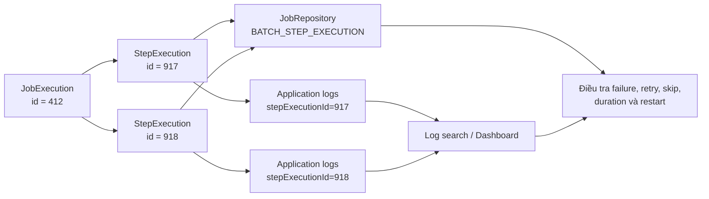

# Log theo StepExecution ID trong Spring Batch

> **Chương:** Observability  
> **Mục tiêu:** Gắn định danh thực thi step vào log để điều tra chậm, lỗi và restart trong Spring Batch; theo dõi đúng ngữ cảnh khi chạy multi-threaded step, parallel flows, partitioning hoặc worker phân tán.

## 1. Vì sao cần log theo StepExecution ID?

Một ứng dụng batch xử lý hàng triệu bản ghi mỗi đêm thường có nhiều job và step cùng chạy. Cùng một `stepName` có thể xuất hiện trong các tình huống rất khác nhau:

- Một job được chạy vào nhiều ngày hoặc với nhiều tập `JobParameters`.
- Job thất bại rồi được **restart**, làm phát sinh một lượt thực thi mới.
- `split` chạy nhiều flow đồng thời, log của chúng xen kẽ.
- Một step xử lý bằng nhiều thread hoặc được chia thành hàng chục partition.
- Nhiều instance ứng dụng/worker cùng ghi log vào một hệ thống tập trung.

Chỉ tìm log bằng tên `importCustomersStep` là chưa đủ để phân biệt những lượt chạy này. Spring Batch cấp định danh cho từng `StepExecution`, thường truy cập bằng `stepExecution.getId()`. Đây là khóa liên kết giữa **log vận hành** và **metadata thực thi** mà `JobRepository` lưu lại.

Ví dụ hai dòng log, trước và sau khi bổ sung ngữ cảnh:

```text
2026-11-26 01:15:02 WARN  [batch-worker-3] c.e.CustomerWriter - retrying database write

2026-11-26 01:15:02 WARN  [batch-worker-3] jobExecutionId=412 stepExecutionId=917
  stepName=importCustomersStep c.e.CustomerWriter - retrying database write
```

Các ID và thời gian trên chỉ là dữ liệu minh họa. Khi có `stepExecutionId=917`, người vận hành có thể tìm tất cả log thuộc lần chạy step ấy và đối chiếu trực tiếp với bản ghi `BATCH_STEP_EXECUTION`.

### Ba khái niệm cần phân biệt

| Thuộc tính | Đại diện cho | Khi restart hoặc chạy song song |
| --- | --- | --- |
| `JobInstance` / `jobInstanceId` | Một thực thể job logic, được nhận diện theo job name và bộ tham số định danh | Restart đúng JobInstance vẫn giữ định danh logic này |
| `JobExecution` / `jobExecutionId` | Một **lần cố gắng chạy** JobInstance | Restart tạo một `JobExecution` mới |
| `StepExecution` / `stepExecutionId` | Một lần thực thi step cụ thể trong một `JobExecution` | Step được thực thi lại có `StepExecution` mới; các partition có StepExecution riêng |

**Không dùng `stepName` như khóa duy nhất của log.** `stepExecutionId` là định danh cho một bản ghi trong phạm vi `JobRepository` đang dùng; nếu có nhiều hệ thống dùng những repository độc lập, nên kết hợp thêm `service`, `environment` hoặc định danh repository/cluster.

## 2. Bức tranh tổng thể: Từ log đến metadata



Luồng truy vết thực tế:

1. Dashboard hoặc cảnh báo phát hiện một step lỗi hoặc chạy chậm.
2. Lấy `jobExecutionId`, `stepExecutionId`, `stepName` từ log hoặc bảng metadata.
3. Lọc log theo **đúng** `stepExecutionId`; đọc các lỗi trước đó, thread/worker liên quan và thông điệp cuối cùng.
4. Đối chiếu `BatchStatus`, `ExitStatus`, thời điểm bắt đầu/kết thúc, `readCount`, `writeCount`, `skipCount`, `rollbackCount`.
5. Quyết định retry, restart, replay dữ liệu lỗi hay xử lý sự cố hạ tầng dựa trên bằng chứng.

Log giúp biết **chuyện gì đã xảy ra**; metadata giúp biết **Spring Batch nhìn nhận kết quả ra sao**; metrics và tracing giúp xác định **độ rộng và vị trí của nút thắt**.

## 3. Dùng SLF4J MDC để đưa ID vào mọi log trong cùng thread

SLF4J cung cấp `MDC` (Mapped Diagnostic Context) để giữ các trường ngữ cảnh theo thread. Logging backend như Logback có thể in các trường ấy qua `%X{...}` trong pattern hoặc xuất thành thuộc tính JSON.

Thiết kế key ổn định:

| Key | Nguồn dữ liệu | Mục đích |
| --- | --- | --- |
| `jobExecutionId` | `StepExecution.getJobExecutionId()` | Gom step của cùng một lượt job |
| `stepExecutionId` | `StepExecution.getId()` | Định vị chính xác một lần chạy step |
| `stepName` | `StepExecution.getStepName()` | Đọc nhanh nhánh nghiệp vụ |
| `jobName` (tùy chọn) | Metadata `JobInstance` | Nhóm theo loại job |
| `partitionKey` (tùy chọn) | Khóa partition nếu có và được chuẩn hóa | So sánh workload giữa các partition |
| `traceId`/`spanId` (nếu bật tracing) | Hệ thống tracing | Liên kết log với distributed trace |

### Ví dụ pattern của Spring Boot + Logback

```yaml
# application.yml - chỉ là cấu hình hiển thị log
logging:
  pattern:
    console: >-
      %d{yyyy-MM-dd'T'HH:mm:ss.SSSXXX} %-5level [%thread]
      jobExecutionId=%X{jobExecutionId:-}
      stepExecutionId=%X{stepExecutionId:-}
      stepName=%X{stepName:-}
      %logger{36} - %msg%n
```

Với step không có MDC, ký hiệu `-` giúp log vẫn đọc được. Pattern chỉ quyết định **cách in**; nó **không tự nạp** `StepExecution` vào MDC. Phải đặt MDC tại nơi đã có ngữ cảnh thực thi, và luôn dọn dẹp để tránh nhiễm log của tác vụ tiếp theo.

Trong môi trường có log aggregator, ưu tiên **structured JSON logging**, lưu `stepExecutionId` thành trường riêng để tìm kiếm chính xác. Có thể giữ giá trị ID dưới dạng chuỗi trong log nhằm tránh lỗi kiểu dữ liệu giữa các emitter và backend.

## 4. Helper giữ và khôi phục MDC an toàn

Ví dụ mã Java dưới đây nhắm đến **Spring Batch 5.2.x**, Spring Boot với SLF4J/Logback. Tạo một helper stateless, dùng lại ở listener. `withStep` giữ và khôi phục toàn bộ MDC trước khi chạy callback; `putStep` dùng cho vùng xử lý chunk cần tồn tại qua nhiều lời gọi.

```java
package com.example.batch.observability;

import java.util.Map;
import org.slf4j.MDC;
import org.springframework.batch.core.StepExecution;

public final class BatchLogContext {

    private static final String JOB_EXECUTION_ID = "jobExecutionId";
    private static final String STEP_EXECUTION_ID = "stepExecutionId";
    private static final String STEP_NAME = "stepName";

    private BatchLogContext() {}

    public static void putStep(StepExecution step) {
        putOrRemove(JOB_EXECUTION_ID, step.getJobExecutionId());
        putOrRemove(STEP_EXECUTION_ID, step.getId());
        putOrRemove(STEP_NAME, step.getStepName());
    }

    private static void putOrRemove(String key, Object value) {
        if (value == null) {
            MDC.remove(key);
        } else {
            MDC.put(key, value.toString());
        }
    }

    public static void clearStepFields() {
        MDC.remove(JOB_EXECUTION_ID);
        MDC.remove(STEP_EXECUTION_ID);
        MDC.remove(STEP_NAME);
    }

    public static void withStep(StepExecution step, Runnable action) {
        Map<String, String> previous = MDC.getCopyOfContextMap();
        try {
            putStep(step);
            action.run();
        } finally {
            if (previous == null) {
                MDC.clear();
            } else {
                MDC.setContextMap(previous);
            }
        }
    }
}
```

`MDC` là **ngữ cảnh của thread đang chạy**, không phải biến chia sẻ toàn ứng dụng. Các trường không tự đi theo công việc khi Spring Batch chuyển sang thread của `TaskExecutor`, và cũng không tự xuất hiện trên máy/tiến trình khác.

## 5. Log vòng đời step bằng `StepExecutionListener`

Step listener là điểm dễ lấy `StepExecution` nhất. Dùng nó để ghi sự kiện **bắt đầu**, **kết thúc**, các counter quan trọng và trạng thái. Listener không lưu `StepExecution` vào field của singleton.

```java
package com.example.batch.observability;

import org.slf4j.Logger;
import org.slf4j.LoggerFactory;
import org.springframework.batch.core.ExitStatus;
import org.springframework.batch.core.StepExecution;
import org.springframework.batch.core.StepExecutionListener;
import org.springframework.stereotype.Component;

@Component
public class StepLifecycleLogListener implements StepExecutionListener {

    private static final Logger log =
            LoggerFactory.getLogger(StepLifecycleLogListener.class);

    @Override
    public void beforeStep(StepExecution stepExecution) {
        BatchLogContext.withStep(stepExecution, () ->
                log.info("batch_step_started status={}",
                        stepExecution.getStatus()));
    }

    @Override
    public ExitStatus afterStep(StepExecution stepExecution) {
        BatchLogContext.withStep(stepExecution, () ->
                log.info(
                        "batch_step_finished batchStatus={} exitCode={} " +
                        "readCount={} writeCount={} skipCount={} " +
                        "filterCount={} rollbackCount={}",
                        stepExecution.getStatus(),
                        stepExecution.getExitStatus().getExitCode(),
                        stepExecution.getReadCount(),
                        stepExecution.getWriteCount(),
                        stepExecution.getSkipCount(),
                        stepExecution.getFilterCount(),
                        stepExecution.getRollbackCount()));

        return null; // Giữ ExitStatus hiện tại; không thay đổi kết quả step.
    }
}
```

Vì `withStep` chỉ giữ MDC trong lúc log callback, ví dụ này **không hứa hẹn** rằng các dòng log sâu bên trong reader/processor/writer tự có ID. Để log trong từng chunk được gắn ID trên **đúng thread**, dùng listener ở phần tiếp theo.

Đừng dùng `beforeStep` để gán `StepExecution` vào một field của singleton rồi lấy field ấy từ các worker thread. Khi nhiều job/partition chạy cùng lúc, field có thể bị ghi đè, gây gắn nhầm ID vào log.

## 6. Gắn MDC cho toàn bộ chunk bằng `ChunkListener`

Trong Spring Batch 5.2, `ChunkListener.beforeChunk(ChunkContext)` chạy khi chunk bắt đầu xử lý; `afterChunk` và `afterChunkError` được gọi sau đường thành công hoặc lỗi tương ứng. Đây là điểm phù hợp để bọc log phát sinh bởi reader, processor và writer trong chunk.

```java
package com.example.batch.observability;

import java.util.Map;
import org.slf4j.Logger;
import org.slf4j.LoggerFactory;
import org.slf4j.MDC;
import org.springframework.batch.core.ChunkListener;
import org.springframework.batch.core.scope.context.ChunkContext;
import org.springframework.stereotype.Component;

@Component
public class ChunkMdcListener implements ChunkListener {

    private static final Logger log =
            LoggerFactory.getLogger(ChunkMdcListener.class);

    // Một snapshot cho mỗi thread; không lưu vào field dùng chung.
    private final ThreadLocal<Map<String, String>> previousMdc =
            new ThreadLocal<>();

    @Override
    public void beforeChunk(ChunkContext context) {
        Map<String, String> old = MDC.getCopyOfContextMap();
        previousMdc.set(old == null ? Map.of() : old);
        BatchLogContext.putStep(
                context.getStepContext().getStepExecution());
    }

    @Override
    public void afterChunk(ChunkContext context) {
        try {
            log.debug("batch_chunk_committed");
        } finally {
            restorePreviousMdc();
        }
    }

    @Override
    public void afterChunkError(ChunkContext context) {
        try {
            Object error = context.getAttribute(
                    ChunkListener.ROLLBACK_EXCEPTION_KEY);
            String type = error == null
                    ? "unknown"
                    : error.getClass().getSimpleName();
            log.warn("batch_chunk_rolled_back errorType={}", type);
        } finally {
            restorePreviousMdc();
        }
    }

    private void restorePreviousMdc() {
        Map<String, String> saved = previousMdc.get();
        previousMdc.remove();
        if (saved == null) {
            // Phòng trường hợp callback kết thúc không có snapshot.
            BatchLogContext.clearStepFields();
        } else if (saved.isEmpty()) {
            MDC.clear();
        } else {
            MDC.setContextMap(saved);
        }
    }
}
```

Điểm cần hiểu trong đoạn mã:

1. `context.getStepContext().getStepExecution()` lấy step thực đang xử lý chunk, không suy ID từ thread name.
2. `previousMdc` là `ThreadLocal`: khi các chunk chạy ở nhiều worker thread, mỗi thread giữ snapshot của mình. `remove()` tránh lưu state trên thread pool sau khi chunk kết thúc.
3. `finally` khôi phục MDC ngay cả khi callback log không thành công. Listener **không được dùng** để ném lỗi nghiệp vụ; exception từ listener có thể làm step thất bại ngoài chính sách skip/retry.
4. `afterChunkError` có thể được gọi sau rollback; callback này chỉ ghi log nhẹ, không tự ghi dữ liệu vào cùng transaction đã rollback.
5. Các dòng `DEBUG` được tránh bật đại trà khi workload có hàng triệu chunk. Sự kiện rollback cần log có mức độ và khả năng chống bão log.

**Ranh giới kỹ thuật:** Cách này áp dụng cho đường thực thi **chunk-oriented của Spring Batch 5.2** và thread chạy callback. Nếu reader tạo thêm async task/virtual thread riêng, phải truyền MDC tới task đó như phần 8. Nếu muốn gắn ID vào log phát sinh **trước `beforeChunk`** (ví dụ mở file trong `ItemStream.open`) cần bọc riêng điểm mở/đóng hoặc cơ chế context cấp step.

## 7. Đăng ký listener vào step

Ví dụ sau cho thấy cách gắn hai listener vào một step chunk-oriented Spring Batch 5.2. Các bean reader/processor/writer do module nghiệp vụ cung cấp.

```java
import org.springframework.batch.core.Step;
import org.springframework.batch.core.repository.JobRepository;
import org.springframework.batch.core.step.builder.StepBuilder;
import org.springframework.batch.item.ItemProcessor;
import org.springframework.batch.item.ItemReader;
import org.springframework.batch.item.ItemWriter;
import org.springframework.beans.factory.annotation.Qualifier;
import org.springframework.context.annotation.Bean;
import org.springframework.transaction.PlatformTransactionManager;

@Bean
Step importCustomersStep(
        JobRepository jobRepository,
        PlatformTransactionManager transactionManager,
        @Qualifier("customerReader") ItemReader<String> reader,
        @Qualifier("customerProcessor") ItemProcessor<String, String> processor,
        @Qualifier("customerWriter") ItemWriter<String> writer,
        StepLifecycleLogListener lifecycleLogs,
        ChunkMdcListener chunkMdc) {

    return new StepBuilder("importCustomersStep", jobRepository)
            .<String, String>chunk(100, transactionManager)
            .reader(reader)
            .processor(processor)
            .writer(writer)
            .listener(lifecycleLogs)
            .listener(chunkMdc)
            .build();
}
```

Hai class listener tách riêng giúp chọn đúng overload `.listener(...)`. Nếu một đối tượng đồng thời triển khai nhiều listener interface, Java có thể gặp overload không rõ ràng; khi đó cần ép kiểu interface cụ thể hoặc đăng ký từng listener.

Trong log thực tế, bạn nên thấy dòng `batch_step_started`, các dòng của reader/processor/writer có cùng `stepExecutionId` trong vùng chunk, rồi `batch_step_finished`. Nếu không thấy ID trong dòng log, kiểm tra **nơi và thread phát sinh log** trước khi thay đổi logging pattern.

### Tasklet step thì sao?

Với tasklet tùy chỉnh, có thể lấy `StepExecution` từ `StepContribution` và bọc đoạn nghiệp vụ để có MDC chính xác:

```java
import org.springframework.batch.repeat.RepeatStatus;

.tasklet((contribution, chunkContext) -> {
    var stepExecution = contribution.getStepExecution();
    BatchLogContext.withStep(stepExecution, () -> {
        log.info("start_external_export");
        exportService.exportForCurrentBusinessDate();
        log.info("finished_external_export");
    });
    return RepeatStatus.FINISHED;
}, transactionManager)
```

Đây là đoạn minh họa bên trong `StepBuilder.tasklet(...)`: `log`, `exportService` và `transactionManager` là các thành phần phải có trong class thực tế. Khi công việc ném exception, `withStep` vẫn dọn MDC rồi exception được truyền lên step để quyết định trạng thái.

## 8. Khi chạy multi-threaded step hoặc parallel flows

Giả sử một step chạy trên thread pool `batch-worker-1` và `batch-worker-2`. Cả hai có thể log cùng **`stepExecutionId`** vì chúng cùng xử lý một `StepExecution`, nhưng mỗi thread có MDC riêng. Đây là kết quả **đúng**:

```text
INFO [batch-worker-1] stepExecutionId=917 stepName=importCustomersStep - processed chunk 31
INFO [batch-worker-2] stepExecutionId=917 stepName=importCustomersStep - processed chunk 32
```

Với **parallel flows** (`split`), mỗi step trong các nhánh có `StepExecution` riêng. Với **partitioning**, mỗi worker/partition thường nhận `StepExecution` riêng (và step name có thể chứa hậu tố partition). Điều này cho phép tách lỗi của từng partition, rồi tổng hợp ở job/manager.

### Truyền MDC vào tác vụ async do ứng dụng tự tạo

Khi sử dụng `ThreadPoolTaskExecutor` để chạy task bất đồng bộ do ứng dụng tạo, có thể dùng `TaskDecorator` để chụp ngữ cảnh **tại lúc submit** rồi khôi phục ngữ cảnh cũ của worker:

```java
import java.util.Map;
import org.slf4j.MDC;
import org.springframework.context.annotation.Bean;
import org.springframework.scheduling.concurrent.ThreadPoolTaskExecutor;

@Bean
ThreadPoolTaskExecutor batchWorkerExecutor() {
    ThreadPoolTaskExecutor executor = new ThreadPoolTaskExecutor();
    executor.setCorePoolSize(4);
    executor.setMaxPoolSize(4);
    executor.setQueueCapacity(100);
    executor.setThreadNamePrefix("batch-worker-");

    executor.setTaskDecorator(task -> {
        Map<String, String> captured = MDC.getCopyOfContextMap();
        return () -> {
            Map<String, String> old = MDC.getCopyOfContextMap();
            try {
                if (captured == null) MDC.clear();
                else MDC.setContextMap(captured);
                task.run();
            } finally {
                if (old == null) MDC.clear();
                else MDC.setContextMap(old);
            }
        };
    });
    return executor;
}
```

**Giới hạn quan trọng:** `TaskDecorator` chỉ sao chép MDC **đã có trên thread submit**. Nếu lúc submit không có `stepExecutionId`, decorator không thể tự suy ra ID. Bởi vậy phải bổ sung ngữ cảnh ở nơi có `StepExecution` thực (listener/wrapper). Ngoài ra, MDC không thay thế cơ chế truyền `JobParameters`, transaction context hay `StepScope`.

| Tình huống | Cách gắn ngữ cảnh hợp lý |
| --- | --- |
| Step tuần tự, log đầu/cuối | `StepExecutionListener` dùng trực tiếp `StepExecution` |
| Chunk chạy trên thread pool | `ChunkListener` trên thread xử lý hoặc wrapper quanh code nghiệp vụ |
| Async task do chính ứng dụng submit | `TaskDecorator` nếu tại điểm submit đã có MDC đúng, kết hợp gắn ID rõ ràng khi cần |
| Parallel flows | Listener áp dụng trên **mỗi step**, không dùng chung field mutable |
| Local/remote partitioning | Worker dùng `StepExecution` của partition hiện tại; kèm `jobExecutionId` và định danh node |
| Remote chunking/messaging | Truyền `stepExecutionId`/correlation ID qua message header hoặc payload; set/restore MDC **mỗi lần nhận message** |

Khi làm việc phân tán, chỉ thread pool cục bộ mới biết MDC hiện tại. Một message broker hoặc remote worker **không tự chép MDC**. Cần thiết kế hợp đồng message rõ ràng và không tin dữ liệu correlation từ nguồn không đáng tin cậy nếu nó dùng để quyết định quyền truy cập.

## 9. Tìm StepExecution trong bảng JobRepository

Với JobRepository JDBC mặc định, bảng `BATCH_STEP_EXECUTION` chứa khóa `STEP_EXECUTION_ID`, cùng trạng thái, thời điểm và các counter. Truy vấn dưới đây minh họa việc bắt đầu từ ID tìm được trong log:

```sql
SELECT
    se.STEP_EXECUTION_ID,
    se.STEP_NAME,
    se.JOB_EXECUTION_ID,
    je.JOB_INSTANCE_ID,
    ji.JOB_NAME,
    se.STATUS,
    se.EXIT_CODE,
    se.START_TIME,
    se.END_TIME,
    se.READ_COUNT,
    se.WRITE_COUNT,
    se.READ_SKIP_COUNT,
    se.PROCESS_SKIP_COUNT,
    se.WRITE_SKIP_COUNT,
    se.ROLLBACK_COUNT
FROM BATCH_STEP_EXECUTION se
JOIN BATCH_JOB_EXECUTION je
  ON je.JOB_EXECUTION_ID = se.JOB_EXECUTION_ID
JOIN BATCH_JOB_INSTANCE ji
  ON ji.JOB_INSTANCE_ID = je.JOB_INSTANCE_ID
WHERE se.STEP_EXECUTION_ID = ?;
```

Truyền tham số truy vấn bằng prepared statement/JdbcTemplate, không nối ID trực tiếp vào chuỗi SQL lấy từ log. Với kho log có nhiều môi trường hoặc nhiều JobRepository độc lập, phải chọn **đúng nguồn metadata** trước khi đối chiếu.

Khi tìm log sau một lần restart, có thể thấy:

```text
JobInstance ID = 80
  JobExecution ID = 412 (FAILED)
    StepExecution ID = 917, importCustomersStep (FAILED)

JobInstance ID = 80
  JobExecution ID = 413 (COMPLETED)
    StepExecution ID = 922, importCustomersStep (COMPLETED)
```

Đây là ví dụ logic, không phải dữ liệu trong repository của người học. Khi restart cùng JobInstance, các step đã `COMPLETED` thường không chạy lại theo mặc định; do đó **không mặc định** cho rằng mọi step của lượt chạy trước đều xuất hiện ở lần chạy sau.

Để tìm cả chuỗi retry/restart, lấy `JOB_INSTANCE_ID` từ metadata rồi truy vấn các `JobExecution` và `StepExecution` liên quan. Dùng `stepExecutionId` để điều tra **một lượt step**, và `jobInstanceId` để điều tra **toàn bộ vòng đời logic** của job.

## 10. Kết hợp logs, metrics và tracing đúng mục đích

Ba loại tín hiệu bổ trợ nhau:

| Tín hiệu | Trả lời câu hỏi | Lưu ý |
| --- | --- | --- |
| **Logs** gắn `stepExecutionId` | Lần xử lý nào xảy ra lỗi? Lỗi xuất hiện ở thread/worker nào? | Dùng ID để lọc tập log và kết hợp sự kiện |
| **Metrics** của Spring Batch/Micrometer | Step nào thường chậm, tỷ lệ fail/skip/rollback tăng không? | Dùng nhãn ổn định: tên job/step, status, môi trường |
| **Traces** (nếu đã bật) | Độ trễ nằm ở job, step, DB, API hay giao tiếp giữa worker? | Dùng `traceId`/`spanId`, liên kết thêm step ID trong log |
| **JobRepository** | Spring Batch đã commit, skip, fail hay restart thế nào? | Là nguồn metadata phục vụ điều tra trạng thái |

Ở **Spring Batch 5.2**, các metric Micrometer mặc định gồm `spring.batch.job`, `spring.batch.step`, `spring.batch.item.read`, `spring.batch.item.process` và `spring.batch.chunk.write`. Tùy cấu hình registry và cơ chế export, tên hiển thị ở hệ thống giám sát có thể đổi dạng (ví dụ hậu tố cho timer).

**Không đưa `stepExecutionId` hay `jobExecutionId` vào nhãn Prometheus của mỗi time series.** Những ID liên tục sinh mới dẫn đến **cardinality cao**, làm tăng bộ nhớ và chi phí lưu trữ. Giữ ID ở log/traces, còn metric dùng các tag có số lượng giá trị thấp, ví dụ `job.name`, `step.name`, `status`.

Spring Batch 5.2 có hỗ trợ tracing dựa trên Micrometer Observation; có trace/span hay không và có được export hay không còn phụ thuộc vào **cấu hình observability cụ thể** của ứng dụng. MDC step ID bổ sung khả năng truy xuất metadata; nó không tự tạo distributed trace.

## 11. Vận hành: Những việc nên và không nên log

Log quá dày có thể khiến job chậm và đẩy chi phí logging lên cao hơn lợi ích giám sát. Một chiến lược phù hợp cho workload lớn:

- `INFO`: start/end job, step, trạng thái, tổng read/write/skip, duration, thông tin checkpoint/mốc xử lý có chọn lọc.
- `WARN`: retry kéo dài, lỗi dữ liệu theo **tổng nhóm**, skip vượt xu hướng bình thường, chunk rollback có giới hạn số lượng log.
- `ERROR`: step/job thất bại, lỗi không phục hồi, không thể mở tài nguyên thiết yếu.
- `DEBUG` hoặc trace có chọn lọc: từng chunk, batch SQL hoặc item cá biệt trong môi trường điều tra được kiểm soát.

Không ghi mật khẩu, token, số tài khoản, PII hoặc payload thô vào log tập trung. Với bản ghi bị skip, dùng `recordKey` đã chuẩn hóa, mã lỗi và tham chiếu quarantine; không cần in toàn bộ bản ghi. Tìm kiếm theo `stepExecutionId` vẫn hiệu quả khi log đã được giảm bớt ở mức phù hợp.

### Các tình huống lỗi thường gặp

| Triệu chứng | Nguyên nhân khả dĩ | Cách khắc phục |
| --- | --- | --- |
| Log hiển thị `stepExecutionId=-` | Chưa set MDC, code chạy ngoài callback, hoặc khác thread | Kiểm tra đường đi của log; đặt ngữ cảnh ở listener/wrapper đúng thread |
| Log của job A có ID của job B | MDC không được dọn khi tái sử dụng worker thread; mutable field singleton | Dùng `try/finally`, khôi phục MDC, bỏ field chứa ID dùng chung |
| Log ở worker khác không có ID | MDC không truyền qua process/message | Truyền correlation ID tường minh trong message và set MDC ở receiver |
| Có ID nhưng không tìm thấy metadata | Đang truy vấn sai DB/environment; metadata cũ đã bị xóa | Đối chiếu service/repository và chính sách retention |
| Một `stepExecutionId` có nhiều thread | Multi-threaded step xử lý nhiều chunk trong cùng step | Đây là hành vi bình thường; lọc thêm `thread` khi cần |
| Restart cho ra ID mới | Mỗi lần chạy lại tạo StepExecution mới cho step được chạy | Dùng `jobInstanceId` để liên kết các lượt, lọc từng `stepExecutionId` để xem chi tiết |
| Dashboard metrics phình dữ liệu | Đưa execution ID vào metric tag | Bỏ tag cardinality cao; chuyển ID sang structured log |

### Quy trình điều tra ví dụ

1. Cảnh báo báo `importCustomersStep` lỗi trong environment `prod`.
2. Lọc log với `stepExecutionId=917`, `service=spring-batch-scaling-operations`, environment và khoảng thời gian tương ứng.
3. Xem dòng `batch_step_started`, các cảnh báo DB, `batch_chunk_rolled_back`, rồi `batch_step_finished`.
4. Chạy truy vấn JobRepository cho ID 917, kiểm tra `STATUS`, `EXIT_CODE`, `READ_COUNT`, `WRITE_COUNT`, các `SKIP_COUNT` và `ROLLBACK_COUNT`.
5. So sánh với metric thời gian step và connection pool. Nếu restart tạo StepExecution mới, liên kết bằng `JOB_INSTANCE_ID` để xác nhận tiến độ phục hồi.

## 12. Bài thực hành

**Bài 1 — Gắn correlation cho step.** Dùng một job đọc CSV với hai step `loadStep` và `validateStep`. Đăng ký `StepLifecycleLogListener`, bật pattern ở phần 3. Chạy job hai lần với JobInstance khác nhau. Chứng minh mỗi lượt step có `stepExecutionId` riêng.

**Bài 2 — Gắn correlation trong chunk.** Đăng ký `ChunkMdcListener`. Cho processor log một thông điệp khi gặp bản ghi hợp lệ theo khoảng cách 10.000 item. Kiểm tra tất cả log từ processor được gắn đúng ID trong lúc chunk chạy, và log của tác vụ kế tiếp trên cùng worker thread không bị nhiễm MDC.

**Bài 3 — Chạy song song.** Tạo hai flow bằng `split` hoặc một multi-threaded step dùng pool giới hạn. Quan sát log xen kẽ, nhóm theo `stepExecutionId` và thêm `thread` để kiểm tra sự chồng lấp. Không dùng tên thread làm định danh thay cho StepExecution.

**Bài 4 — Failure và restart.** Chủ động gây lỗi một step sau một số chunk; lấy `stepExecutionId` từ log để đối chiếu `BATCH_STEP_EXECUTION`. Restart cùng JobInstance, xác nhận step chạy lại có ID mới và số liệu thực thi phù hợp với checkpoint.

**Bài 5 — Observability ở quy mô lớn.** Thử logging mỗi item trên tập 100.000 item so với log mức step/chunk có giới hạn. Đo thời gian, số lượng dòng log, I/O và chi phí ingest. Đảm bảo metrics không dùng execution ID làm tag.

### Tiêu chí đạt

- [ ] Phân biệt rõ JobInstance, JobExecution, StepExecution và quan hệ restart.
- [ ] Mọi log quan trọng trong step có `stepExecutionId` và `jobExecutionId` đúng.
- [ ] MDC được gắn/khôi phục đúng thread, không rò rỉ qua các task trên thread pool.
- [ ] Có thể truy vấn JobRepository từ một ID tìm thấy trong log.
- [ ] Đã kiểm tra split, multi-threaded step hoặc partitioning trong tình huống cần scale.
- [ ] Log không chứa dữ liệu nhạy cảm và metric không phát sinh tag cardinality cao.

## 13. Tài liệu tham khảo chính thức

- [Spring Batch 5.2 — Intercepting Step Execution](https://docs.spring.io/spring-batch/reference/5.2/step/chunk-oriented-processing/intercepting-execution.html)
- [Spring Batch 5.2 — Monitoring and Metrics](https://docs.spring.io/spring-batch/reference/5.2/monitoring-and-metrics.html)
- [Spring Batch 5.2 — Tracing](https://docs.spring.io/spring-batch/reference/5.2/tracing.html)
- [Spring Batch 5.2 — StepExecution API](https://docs.spring.io/spring-batch/docs/5.2.5/api/org/springframework/batch/core/StepExecution.html)
- [Spring Batch 5.2 — ChunkListener API](https://docs.spring.io/spring-batch/docs/5.2.x/api/org/springframework/batch/core/ChunkListener.html)
- [Spring Framework — ThreadPoolTaskExecutor](https://docs.spring.io/spring-framework/docs/current/javadoc-api/org/springframework/scheduling/concurrent/ThreadPoolTaskExecutor.html)
- [SLF4J — MDC](https://www.slf4j.org/manual.html#mdc)

> **Lưu ý phiên bản:** Các import `org.springframework.batch.core.StepExecution`, `ChunkListener.beforeChunk(ChunkContext)` và cách cấu hình chunk trong bài hướng đến **Spring Batch 5.2.x**. Spring Batch 6 thay đổi package/API của một số thành phần, đặc biệt callback chunk. Khi chuyển phiên bản, cần đối chiếu reference/Javadoc của phiên bản thực tế thay vì chép nguyên chữ ký listener.

**Ghi nhớ:** `StepExecution ID` giúp liên kết **log cụ thể** với **trạng thái được JobRepository ghi nhận**. Để log đúng khi scale, phải lấy ID từ ngữ cảnh thực thi, gắn vào MDC trên thread phát sinh log, khôi phục MDC sau tác vụ và sử dụng ID như trường truy vấn của log thay vì nhãn metric.
