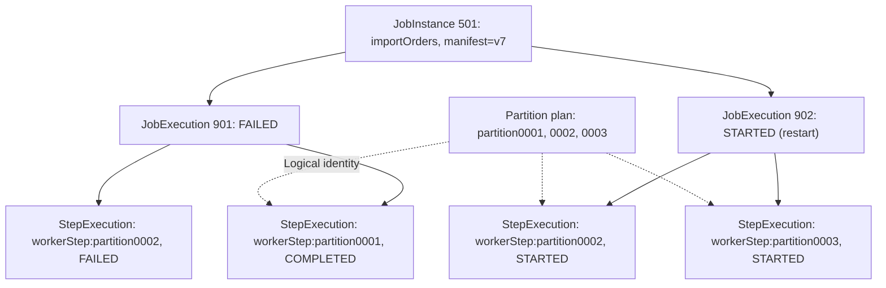
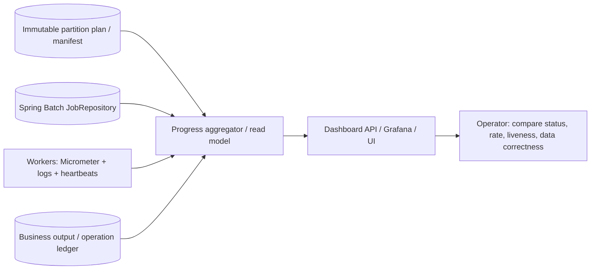

# Dashboard tiến độ partition trong Spring Batch: nhìn đúng công việc, bottleneck và restart

## 1. Tình huống: “70% partition hoàn thành” có nghĩa gì?

Một job Spring Batch nhập 100 triệu bản ghi từ nhiều tenant, chia thành 40 partition chạy trên tám worker. Dashboard ban đầu hiển thị **28/40 partition COMPLETED = 70%**. Người vận hành dự đoán job sắp xong, nhưng tám partition còn lại chiếm gần 65% tổng số bản ghi và có một partition đang chờ lock database. Đến ngày hôm sau, một worker lỗi, job được restart và dashboard đếm **42 StepExecution thành công trên 40 partition** do cộng cả lịch sử các lần chạy.

Hai sai lầm có nguồn gốc khác nhau:

1. **Lấy số partition hoàn thành làm phần trăm dữ liệu** dù các partition không có trọng lượng bằng nhau.
2. **Đếm StepExecution attempts thay vì logical partitions**, khiến restart/retry làm tăng giả số lượng hoàn thành.

Một **dashboard tiến độ partition** đúng không chỉ có một thanh progress bar. Nó cần chỉ rõ **JobInstance nào**, **partition plan/manifest nào**, **execution attempt nào đang chạy**, dữ liệu đã được commit tới đâu, còn bao nhiêu công việc và nút thắt thực sự ở đâu.

Bài thuộc chương **Observability** của module `SPRING_BATCH_SCALING_OPERATIONS`. Mục tiêu module là mở rộng Spring Batch trên dữ liệu lớn bằng **multi-threaded step, parallel steps, partitioning và xử lý phân tán**, đồng thời đo bottleneck, giữ thread safety, retry/restart và vận hành theo tài nguyên thực tế. Vì vậy dashboard vừa là công cụ giám sát hiệu năng, vừa là **cơ chế xác minh recovery và tính đầy đủ** của công việc.

### Sau bài học, bạn có thể

- Phân biệt `JobInstance`, `JobExecution`, `StepExecution` và **logical partition identity**.
- Tính tiến độ theo **partition count**, **ước lượng item/bytes** và **unique business operations** mà không cộng trùng attempts.
- Truy vấn `JobRepository` Spring Batch 5.2 để tổng hợp trạng thái từng worker partition.
- Thiết kế **partition manifest** làm mẫu số bền vững, kể cả partition chưa từng được submit.
- Thêm listener xuất **commit progress snapshot** sau mỗi chunk và hiểu giới hạn nhất quán của phép đo.
- Dùng Micrometer/Prometheus/Grafana để quan sát throughput, queue wait, skew, lỗi, liveness và ETA.
- Phân biệt local partitioning với remote partitioning; giám sát broker/replies mà không đánh đồng với StepExecution progress.
- Kiểm thử dashboard khi worker crash, job restart, metadata trễ, database failover và nhiều owner trùng scope.

> **Phạm vi phiên bản:** các bảng metadata, API và ví dụ dùng **Spring Batch 5.2.x**, Spring Framework 6.x, Spring Boot 3.x, Java 17+, PostgreSQL và Micrometer. Spring Batch 6.x có thể khác API/schema; cần đối chiếu hệ đang chạy trước khi dùng code/SQL trong production.

## 2. Cấp độ danh tính: JobInstance → JobExecution → StepExecution

Dashboard phải trả lời **đang quan sát “công việc logic” hay “lần thử thực thi”?**



### 2.1. Bốn lớp danh tính

| Lớp | Ví dụ | Dùng cho |
| --- | --- | --- |
| **JobInstance** | `501`, xác định từ job name + identifying `JobParameters` | Một logical run có thể trải nhiều lần restart |
| **JobExecution** | `901` thất bại, `902` chạy lại | Một attempt của cùng JobInstance |
| **StepExecution** | `2102`: `workerStep:partition0002` | Một lần thực thi của một step/partition với counters và trạng thái riêng |
| **Logical partition** | `partition0002` trong `manifest=v7` | Đơn vị công việc ổn định cần theo dõi **qua attempts** |

Trong Spring Batch partitioning, `Partitioner` trả `Map<String, ExecutionContext>`. Tên key như `partition0002` được dùng trong step name thực tế kiểu `workerStep:partition0002`; `ExecutionContext` mang range/file/tenant/bucket được giao. Manager/worker có thể ở chung JVM hoặc các process khác. **Partition name không phải worker pod ID**.

### 2.2. Restart làm xuất hiện nhiều lịch sử, không thêm việc logic

Ví dụ partition `partition0002`:

```text
JobInstance 501 / logical partition0002
  Attempt 1: JobExecution 901, StepExecution 2102, FAILED, readCount=8.000
  Attempt 2: JobExecution 902, StepExecution 2207, STARTED, readCount=3.000
```

Không được suy `8.000 + 3.000 = 11.000 unique records completed`. Attempt 2 có thể bắt đầu từ checkpoint, replay một số records hoặc chịu input snapshot thay đổi. Cần tách **attempt read counters** khỏi **business committed unique items**.

Nếu mục tiêu là ô trạng thái **mới nhất** của logical partition, chọn attempt phù hợp theo `JobExecution.CREATE_TIME` / `StepExecution.STEP_EXECUTION_ID`. Nếu mục tiêu là thống kê **chi phí retry**, lưu và cộng **attempts** với nhãn rõ ràng, không dùng chúng làm completion denominator.

### 2.3. Trạng thái Spring Batch và trạng thái dashboard suy diễn

| Trạng thái / nhãn | Thuộc framework hay dashboard? | Ý nghĩa |
| --- | --- | --- |
| `STARTING`, `STARTED`, `STOPPING` | `BatchStatus` | Đang khởi động/chạy/được yêu cầu dừng ở metadata |
| `COMPLETED`, `FAILED`, `STOPPED` | `BatchStatus` | Kết thúc thành công/thất bại/dừng theo StepExecution |
| `ABANDONED`, `UNKNOWN` | `BatchStatus` | Trường hợp cần xử lý vận hành riêng |
| **PENDING** | **Nhãn dashboard**, không phải `BatchStatus` mặc định | Partition có trong plan nhưng chưa có StepExecution phù hợp |
| **STALE/SUSPECTED_STALLED** | **Nhãn dashboard** | Không có tín hiệu tiến triển mới trong khoảng quan sát, **không chứng minh worker đã chết** |
| **RETRYING/RESTARTED** | **Nhãn dashboard suy diễn** | Có lịch sử execution attempts hoặc retry events |
| **RECONCILIATION_REQUIRED** | **Nhãn dashboard nghiệp vụ** | Metadata và dữ liệu đã commit chưa khớp |

**Quan trọng:** `BatchStatus.STARTED` là trạng thái **được ghi cuối cùng**, không phải một heartbeat xác nhận process còn sống. `LAST_UPDATED` là thời điểm metadata được persist, không nhất thiết cập nhật mỗi vài giây khi chunk/transaction dài.

### 2.4. Khi nào không dùng `StepExecution` để phân hoạch?

Một **multi-threaded step** có thể có nhiều chunks chạy song song trong **một StepExecution**. Một **parallel flow** có nhiều steps nhưng không nhất thiết được tạo từ `Partitioner`. Đừng áp dụng mẫu dashboard partition như thể mỗi thread/chunk đều có một `StepExecution` riêng.

Với **remote chunking**, manager tạo các `ChunkRequest` qua broker và workers là message consumers/`ChunkProcessor`; thông thường không có một `StepExecution` riêng cho mỗi chunk ở worker tương tự remote partitioning. Muốn dashboard **chunk in-flight**, phải thiết kế request/reply correlation và worker metrics riêng.

## 3. Chọn mẫu số tiến độ trước khi hiển thị phần trăm

### 3.1. Partition-count progress

Nếu một manifest có `P` logical partitions đã chốt:

\[
\operatorname{PartitionCompletion} =
\frac{N_{\mathrm{logical\ partitions\ COMPLETED}}}{P}
\times100\%
\]

Ví dụ `28/40=70\%`. Chỉ nên gắn nhãn **“70% partition hoàn thành”**, không ghi **“70% dữ liệu”** nếu các partition khác kích thước.

**Không dùng `gridSize` làm mẫu số một cách mặc định**: `gridSize` là gợi ý; `Partitioner` có thể trả số entries khác, có thể bỏ partitions rỗng hoặc tạo số partitions cố định bất kể grid size. Mẫu số tốt nhất là **số logical partitions trong kế hoạch thực tế đã chốt**, không phải số worker hay pool threads.

### 3.2. Weighted progress theo số item ước lượng

Giả sử manifest cung cấp `estimated_items_i` cho partition `i`, cùng nguồn dữ liệu/snapshot và cách đếm nhất quán. Khi mỗi partition có số item thực tế đã hoàn tất đáng tin `done_i`:

\[
\operatorname{WeightedProgress} =
\frac{\sum_i \min(done_i, estimated_i)}
     {\sum_i estimated_i} \times100\%
\]

Ở đây `done_i` phải có **semantics rõ**: số item đã được checkpoint, số logical operations đã commit, hoặc một metric riêng theo business source. Không được tự lấy `READ_COUNT` rồi coi là **committed business rows**.

Ví dụ:

| Partition | Ước tính item | Đã hoàn tất theo ledger | Tỷ lệ trong partition |
| --- | ---: | ---: | ---: |
| partition0001 | 10.000 | 10.000 | 100% |
| partition0002 | 10.000 | 10.000 | 100% |
| partition0003 | 80.000 | 20.000 | 25% |
| partition0004 | 100.000 | 0 | 0% |
| **Tổng** | **200.000** | **40.000** | **20% theo item** |

Với ví dụ này, **2/4 partitions đã hoàn tất = 50% theo partition**, nhưng **20% item đã hoàn tất**. Dashboard nên hiển thị hai tỷ lệ **bên cạnh nhau**, có ghi nguồn và độ tin cậy.

### 3.3. Estimated, exact và unknown denominators

| Đầu vào | Có mẫu số chính xác không? | Cách thể hiện |
| --- | --- | --- |
| Immutable file có record count đã xác nhận | Có thể, nếu parser/skips được định nghĩa | `x/y records` với snapshot checksum |
| Query range với ID thưa, không đếm trước | Chưa chắc | `rowsProcessed` và `rangeCovered` riêng |
| Streaming input thay đổi liên tục | Thường không | Throughput, backlog, watermark; tránh phần trăm giả |
| Partition theo file có kích thước byte | Biết số byte, không biết số record | Byte progress và file completion, có chú thích |
| API cursor/paging nguồn động | Mẫu số có thể đổi | Đo page/token progress, input snapshot nếu có |
| Remote partitioning theo tenant | Có thể đếm tenant, nhưng lệch trọng số | Count + estimated/actual records per tenant |

Nếu `estimated_items_i` chỉ là dự báo, có thể vượt quá hoặc thấp hơn thực tế. Khi đó dashboard ghi **“ước lượng”**, không âm thầm cắt về 100% trong khi còn công việc hoặc báo 110% rồi mặc định đó là sự cố. Có thể thể hiện **100% sau xác nhận hoàn tất logical partition** và kèm độ lệch dự báo.

### 3.4. Skip/filter và “đã đọc” khác “đã ghi”

Ở một chunk-oriented step:

- `READ_COUNT`: số item được reader đọc thành công và ghi nhận theo step execution.
- `FILTER_COUNT`: item bị processor loại ra bằng `null`.
- `WRITE_COUNT`: items được writer ghi nhận, **không phải luôn số DB rows chịu tác động**.
- `READ_SKIP_COUNT`, `PROCESS_SKIP_COUNT`, `WRITE_SKIP_COUNT`: các loại skip.
- `COMMIT_COUNT`, `ROLLBACK_COUNT`: transaction counters.

Nếu 10.000 rows được đọc, 2.000 filtered và 8.000 được writer ghi nhận, có thể đó là hoàn thành **100% việc đọc/biến đổi của partition**, dù `WRITE_COUNT=8.000`. Ngược lại, một writer có thể sử dụng `UPSERT DO NOTHING` cho event đã tồn tại, nên số logical operations **mới được commit** khác số item writer nhận.

**Mỗi thanh phần trăm phải có nhãn:** “source items accounted for”, “business operations committed”, “files finalized”, hay “logical partitions completed”. Không tạo một metric `progress_percent` vô ngữ nghĩa rồi để nhiều màn hình diễn giải khác nhau.

### 3.5. ETA: nên tính từ việc còn lại, không chỉ số partition

Nếu biết tổng item còn lại và **throughput hữu ích** tương đối ổn định:

\[
\operatorname{ETA}_{\mathrm{rough}} =
\frac{N_{\mathrm{remaining\ unique\ operations}}}
     {R_{\mathrm{useful\ operations/s}}}
\]

Đây chỉ là **ước lượng thô**. Partition skew, hot key, resource pools, cold start, retries và những partition chưa mở sẽ làm ETA thay đổi. Nếu `R_useful=0`, ETA phải là **unknown/stalled**, không chia cho 0 hoặc hiển thị một ngày hoàn tất tưởng tượng.

Khi công việc phân chia theo partitions không thể chia nhỏ giữa chừng, makespan còn bị chặn bởi **partition nặng nhất**; kể cả tổng throughput cao, một partition dài có thể quyết định thời điểm job xong.

## 4. Kiến trúc dữ liệu quan sát: metadata, manifest, metrics, business ledger

Một dashboard tin cậy thường cần **bốn nguồn** khác nhau:



| Nguồn | Làm source of truth cho | Không chứng minh được |
| --- | --- | --- |
| **Partition plan / manifest** | Những logical partitions **đáng lẽ phải tồn tại**, scope, estimated items, snapshot version | Worker đã chạy hoặc business effects đã commit |
| **`JobRepository`** | Trạng thái và counters các `JobExecution`/`StepExecution` được persist | Liveness thời gian thực hoặc kết quả ở external API |
| **Micrometer/logs/heartbeat** | Throughput, latency, queue wait, worker resource, thời điểm có hoạt động gần nhất | Tính đầy đủ/duy nhất nghiệp vụ khi metric mất |
| **Business ledger / target DB** | Logical operations **thực sự đã commit** theo key nghiệp vụ | Ai là worker hiện tại, queue size hoặc lý do chậm |

### 4.1. Không đọc trực tiếp mỗi giây từ `BATCH_STEP_EXECUTION` ở quy mô lớn

`JobRepository` là đường nóng cho metadata transactions và restart. Dashboard polling hàng nghìn partitions mỗi giây có thể tăng DB I/O, tạo lock/contention gián tiếp và làm việc giám sát ảnh hưởng job.

Lựa chọn thực tế:

1. Một backend **read-only progress service** lấy snapshot metadata định kỳ (ví dụ 10–30 giây, tùy SLA).
2. Collector/metrics scrape các JVM/worker với cadence riêng.
3. Duy trì **materialized/read model** hoặc cache theo `JobInstance` và partition identity.
4. Sử dụng **business reconciliation** theo checkpoint/đợt, không query một bảng ledger hàng trăm triệu hàng trên mỗi HTTP refresh.

Đây là cấu trúc gợi ý, không có thành phần `ProgressAggregator` mặc định trong Spring Batch.

### 4.2. Tốc độ cập nhật và độ mới của dữ liệu

Dashboard phải hiển thị:

```text
lastMetadataReadAt   : 2026-11-26T03:40:00Z
lastWorkerHeartbeat  : 2026-11-26T03:39:57Z (custom metric)
lastBusinessAuditAt  : 2026-11-26T03:39:30Z
snapshotFreshness    : 3s / 30s / ...
```

Các mốc là ví dụ. Nếu ba nguồn chênh vài chục giây, **các tile không phải snapshot phân tán nguyên tử**. Đừng khẳng định metadata và ledger “không khớp” chỉ từ hai samples ở thời điểm khác nhau; trước khi báo lỗi dữ liệu, cần watermark/transaction-consistent reconciliation.

### 4.3. Phân quyền và bảo mật

Dashboard nên chạy bằng **read-only role** có quyền truy cập metadata cần thiết, không nhận quyền cập nhật `BatchStatus` hoặc bảng `ExecutionContext`. Nội dung context, JobParameters, file paths hay tenant IDs có thể chứa dữ liệu nhạy cảm; nên lọc/redact theo RBAC.

Không expose `EXIT_MESSAGE` chứa stack trace, connection string, SQL, PII hoặc secrets nguyên văn trên dashboard cho mọi người xem. Error panel dùng **reason code** và dẫn tới log có quyền.

## 5. Thiết kế partition manifest để dashboard biết công việc chưa bắt đầu

Nếu chỉ truy vấn `BATCH_STEP_EXECUTION`, dashboard thấy **những StepExecution đã được tạo**, không nhất thiết thấy toàn bộ partition được lên kế hoạch nhưng chưa dispatch, hoặc một plan đã bị thay đổi sai giữa các lần restart.

Một **manifest bất biến** ở tầng ứng dụng giúp phân biệt:

```text
JobInstance 501 / manifest orders-v7
  expected:
    workerStep:partition0000, range [0, 250000)
    workerStep:partition0001, range [250000, 500000)
    workerStep:partition0002, range [500000, 750000)
    workerStep:partition0003, range [750000, 1000000)

JobRepository:
    0000 COMPLETED
    0001 STARTED
    0002 chưa có StepExecution
    0003 chưa có StepExecution
```

Dashboard hợp lý là **1 COMPLETED + 1 STARTED + 2 PENDING**, không phải **1 COMPLETED / 2 partitions được phát hiện = 50%**. Mẫu số từ plan là **4**, không phải số records có trong metadata ở thời điểm polling.

### 5.1. Bảng manifest minh họa PostgreSQL

Đây là **bảng ứng dụng**, không phải bảng mặc định của Spring Batch:

```sql
CREATE TABLE app_partition_plan (
    job_instance_id BIGINT NOT NULL,
    manifest_id VARCHAR(120) NOT NULL,
    worker_step_name VARCHAR(100) NOT NULL,
    partition_name VARCHAR(100) NOT NULL,
    estimated_items BIGINT,
    scope_fingerprint VARCHAR(120) NOT NULL,
    plan_version VARCHAR(40) NOT NULL,
    PRIMARY KEY (
        job_instance_id, worker_step_name, partition_name
    ),
    CHECK (estimated_items IS NULL OR estimated_items >= 0)
);

-- Đề xuất đọc theo JobInstance + worker step khi dựng dashboard.
CREATE INDEX idx_partition_plan_manifest
    ON app_partition_plan (
        job_instance_id, worker_step_name, manifest_id
    );
```

`scope_fingerprint` là hash/version của contract partition, ví dụ range bounds + tenant + input snapshot. Nó giúp phát hiện drift; **không phải khóa bảo mật**. Việc tạo manifest phải được điều phối nhất quán với việc khởi chạy JobInstance, không lấy một danh sách mới từ cấu hình runtime khi restart.

**Không yêu cầu sửa schema `BATCH_*` để thêm cột custom.** Tách bảng ứng dụng giúp nâng cấp Spring Batch dễ hơn và giới hạn quyền dashboard. Chỉ lưu vào manifest những dữ liệu cần thiết để quan sát; nếu range hoặc file URI có thông tin nhạy cảm thì phân quyền/rút gọn.

### 5.2. Mẫu số có thể tăng không?

Trong một run có **dynamic task discovery**, số partition dự kiến có thể thay đổi. Khi đó:

- Không gọi phần trăm `100%` khi hệ thống còn có thể phát hiện thêm việc.
- Hiển thị `discoveredPartitions`, `sealedPlan` và `remainingDiscovery`.
- Chỉ coi manifest đóng băng/`sealed` là mẫu số xác định.
- Nếu kiến trúc cho phép sửa plan, phải version hóa, hiển thị mẫu số thay đổi và giải thích việc phần trăm **giảm** khi plan mở rộng.

Trong partitioning kiểu `Partitioner` với `ExecutionContext` checkpoint, **thay plan giữa restart là rủi ro lớn**. Phần lớn batch dữ liệu lớn nên đóng băng logical partitions theo JobInstance và chỉ thay worker assignment/concurrency.

### 5.3. ID partition và tên step phải ổn định

Spring Batch 5.2 dùng tên trong `Partitioner.partition(gridSize)` để định danh các worker `StepExecution`. Nếu triển khai `PartitionNameProvider` nhằm tối ưu restart, danh sách tên phải **trùng tuyệt đối** với tên trước đó. Mọi dashboard mapping theo `partitionName` cũng phải giữ convention.

Không parse tên bằng `split(":")` rồi mặc định mọi worker step đều chỉ có đúng một dấu hai chấm, trừ khi tên được contract hóa như vậy. Tốt nhất manifest lưu **cả `workerStepName` và `partitionName`**, còn full step name là `workerStepName + ":" + partitionName` với validation rõ.

## 6. SQL 1 — Xem lịch sử tất cả partition attempts của một JobInstance

Các truy vấn sau dùng **schema mặc định `BATCH_*` của Spring Batch 5.2** và cú pháp PostgreSQL. Với table prefix/custom schema khác, cần thay cho đúng DB thực tế. Đây là các truy vấn **read-only**, nên thực hiện với role chỉ đọc hoặc trên một read replica có độ trễ đã biết.

### 6.1. Lịch sử thực thi từ repository

```sql
SELECT ji.JOB_NAME,
       ji.JOB_INSTANCE_ID,
       je.JOB_EXECUTION_ID,
       je.CREATE_TIME AS job_execution_created_at,
       je.STATUS AS job_status,
       se.STEP_EXECUTION_ID,
       se.STEP_NAME,
       se.STATUS AS step_status,
       se.READ_COUNT,
       se.WRITE_COUNT,
       se.FILTER_COUNT,
       se.READ_SKIP_COUNT,
       se.PROCESS_SKIP_COUNT,
       se.WRITE_SKIP_COUNT,
       se.COMMIT_COUNT,
       se.ROLLBACK_COUNT,
       se.CREATE_TIME,
       se.START_TIME,
       se.END_TIME,
       se.LAST_UPDATED
FROM BATCH_JOB_INSTANCE ji
JOIN BATCH_JOB_EXECUTION je
  ON je.JOB_INSTANCE_ID = ji.JOB_INSTANCE_ID
JOIN BATCH_STEP_EXECUTION se
  ON se.JOB_EXECUTION_ID = je.JOB_EXECUTION_ID
WHERE ji.JOB_INSTANCE_ID = :jobInstanceId
  AND se.STEP_NAME LIKE 'partitionWorkerStep:%'
ORDER BY se.STEP_NAME, je.CREATE_TIME, se.STEP_EXECUTION_ID;
```

Trong ví dụ, tên worker step cố định là `partitionWorkerStep` và partition names không chứa ký tự làm sai điều kiện lọc. Nếu tên worker step có `_%`, hãy dùng predicate prefix không phụ thuộc wildcard:

```sql
-- Thay WHERE của truy vấn trên:
WHERE ji.JOB_INSTANCE_ID = :jobInstanceId
  AND LEFT(se.STEP_NAME, LENGTH(:workerStepName) + 1)
      = :workerStepName || ':'
```

**Không làm `SUM(READ_COUNT)` của tất cả hàng rồi coi đó là unique progress.** Bảng trên là **lịch sử attempts**. Nó hữu ích để biết worker nào thất bại, một partition đã được restart bao nhiêu lần, và thời điểm bất thường nào xảy ra.

### 6.2. Vì sao dùng JobInstance làm bộ lọc?

`JOB_EXECUTION_ID` chỉ là **một attempt**. Nếu dashboard hiển thị tiến độ của một JobInstance và chỉ đọc `JobExecution` mới nhất, những partitions đã `COMPLETED` ở attempt trước nhưng **không cần chạy lại** sẽ biến mất khỏi bảng.

Để hiển thị trạng thái cuối của mọi logical partition, phải nhìn **across JobExecutions trong cùng JobInstance**, hoặc dùng một materialized read model đã hợp nhất lịch sử đúng cách.

Nếu yêu cầu chỉ hiển thị **hiệu năng attempt hiện tại**, lọc `JOB_EXECUTION_ID` là hợp lý — nhưng nhãn phải là **“current attempt”**, không phải toàn bộ logical run.

## 7. SQL 2 — Chọn trạng thái mới nhất của mỗi logical partition

Trong một `JobInstance`, một full `STEP_NAME` của worker partition có thể xuất hiện trong nhiều `JobExecution` khi restart. Để dựng **một hàng/partition**, dùng window function:

```sql
WITH ranked_attempts AS (
    SELECT je.JOB_INSTANCE_ID,
           je.JOB_EXECUTION_ID,
           je.CREATE_TIME AS execution_created_at,
           se.STEP_EXECUTION_ID,
           se.STEP_NAME,
           se.STATUS,
           se.READ_COUNT,
           se.WRITE_COUNT,
           se.FILTER_COUNT,
           se.COMMIT_COUNT,
           se.ROLLBACK_COUNT,
           se.START_TIME,
           se.END_TIME,
           se.LAST_UPDATED,
           ROW_NUMBER() OVER (
               PARTITION BY je.JOB_INSTANCE_ID, se.STEP_NAME
               ORDER BY je.CREATE_TIME DESC,
                        se.STEP_EXECUTION_ID DESC
           ) AS attempt_rank,
           COUNT(*) OVER (
               PARTITION BY je.JOB_INSTANCE_ID, se.STEP_NAME
           ) AS attempt_count
    FROM BATCH_JOB_EXECUTION je
    JOIN BATCH_STEP_EXECUTION se
      ON se.JOB_EXECUTION_ID = je.JOB_EXECUTION_ID
    WHERE je.JOB_INSTANCE_ID = :jobInstanceId
      AND LEFT(se.STEP_NAME, LENGTH(:workerStepName) + 1)
          = :workerStepName || ':'
)
SELECT STEP_NAME,
       STEP_EXECUTION_ID,
       JOB_EXECUTION_ID,
       STATUS,
       attempt_count,
       READ_COUNT,
       WRITE_COUNT,
       FILTER_COUNT,
       COMMIT_COUNT,
       ROLLBACK_COUNT,
       START_TIME,
       END_TIME,
       LAST_UPDATED
FROM ranked_attempts
WHERE attempt_rank = 1
ORDER BY STEP_NAME;
```

Ví dụ, query chọn `partition0002` ở attempt 902 thay vì attempt 901, nhưng `partition0001` đã thành công ở attempt 901 vẫn được hiển thị.

**Giới hạn:** query này chỉ chọn **attempt có metadata mới nhất**, không tự giải thích execution bị mất trong crash hoặc đã commit business effect mà chưa update repository. Trạng thái `STARTED` ở attempt cuối có thể đã stale. Muốn biết tính đúng dữ liệu, phải đối soát business ledger và manifest.

### 7.1. Không dùng riêng `LAST_UPDATED` để chọn attempt mới nhất

`LAST_UPDATED` có thể:

- `NULL` hoặc không tăng đều trong một step dài.
- Được persist muộn sau một chunk dài.
- Nằm trên DB có clock và replication lag khác.

Sắp xếp theo `JobExecution.CREATE_TIME` và `STEP_EXECUTION_ID` là cách thực dụng trong schema mặc định để chọn lịch sử attempt. **Không dùng đó làm distributed fencing**: timestamp/ID không chứng minh worker cũ đã dừng ghi sau manager failover.

### 7.2. Đếm “restart attempts” nhưng không cộng vào completion

`attempt_count=2` chỉ nói một logical partition có hai `StepExecution` trong lịch sử được truy vấn, không chứng minh hai worker cùng thực thi đồng thời. Một restart sau failure là hành vi hợp lệ.

Ngược lại, **cùng một StepExecution bị giao trùng cho hai processes** trong lỗi orchestration có thể không tạo hai hàng metadata khác nhau. Muốn phát hiện **duplicate ownership**, cần heartbeat/worker identity/lease epoch và audit business operations; `COUNT(*)` trong `BATCH_STEP_EXECUTION` không đủ.

## 8. SQL 3 — Ghép manifest để hiện cả partition đang PENDING

Lấy bảng `app_partition_plan` ở mục 5 làm mẫu số; ghép với `StepExecution` cuối của từng partition:

```sql
WITH ranked_attempts AS (
    SELECT je.JOB_INSTANCE_ID,
           se.STEP_NAME,
           se.STEP_EXECUTION_ID,
           se.STATUS,
           se.READ_COUNT,
           se.WRITE_COUNT,
           se.FILTER_COUNT,
           se.COMMIT_COUNT,
           se.ROLLBACK_COUNT,
           se.START_TIME,
           se.END_TIME,
           se.LAST_UPDATED,
           ROW_NUMBER() OVER (
               PARTITION BY je.JOB_INSTANCE_ID, se.STEP_NAME
               ORDER BY je.CREATE_TIME DESC,
                        se.STEP_EXECUTION_ID DESC
           ) AS rn,
           COUNT(*) OVER (
               PARTITION BY je.JOB_INSTANCE_ID, se.STEP_NAME
           ) AS attempts
    FROM BATCH_JOB_EXECUTION je
    JOIN BATCH_STEP_EXECUTION se
      ON se.JOB_EXECUTION_ID = je.JOB_EXECUTION_ID
    WHERE je.JOB_INSTANCE_ID = :jobInstanceId
)
SELECT p.partition_name,
       p.estimated_items,
       p.manifest_id,
       p.scope_fingerprint,
       COALESCE(a.STATUS, 'PENDING') AS dashboard_status,
       a.STEP_EXECUTION_ID,
       COALESCE(a.attempts, 0) AS observed_attempt_count,
       a.READ_COUNT,
       a.WRITE_COUNT,
       a.FILTER_COUNT,
       a.COMMIT_COUNT,
       a.ROLLBACK_COUNT,
       a.START_TIME,
       a.END_TIME,
       a.LAST_UPDATED
FROM app_partition_plan p
LEFT JOIN ranked_attempts a
  ON a.JOB_INSTANCE_ID = p.job_instance_id
 AND a.STEP_NAME = p.worker_step_name || ':' || p.partition_name
 AND a.rn = 1
WHERE p.job_instance_id = :jobInstanceId
  AND p.worker_step_name = :workerStepName
ORDER BY p.partition_name;
```

**`PENDING` được suy từ `LEFT JOIN` không có execution row; nó không phải `BatchStatus`.** Một partition đã được manager dispatch nhưng metadata chưa được persist có thể hiện PENDING trong khoảng ngắn; độ mới của repository và manifest cần được hiển thị.

### 8.1. Tổng hợp theo trạng thái từ read model

Giả sử backend đã chạy truy vấn trên và nhận mỗi row là **một logical partition**, có thể group:

```sql
WITH partition_rows AS (
    -- Thay bằng SELECT/CTE của truy vấn mục 8;
    -- mỗi partition_name đúng một row trong manifest.
    SELECT p.partition_name,
           COALESCE(a.status, 'PENDING') AS dashboard_status
    FROM app_partition_plan p
    LEFT JOIN app_partition_latest_status a
      ON a.job_instance_id = p.job_instance_id
     AND a.worker_step_name = p.worker_step_name
     AND a.partition_name = p.partition_name
    WHERE p.job_instance_id = :jobInstanceId
)
SELECT dashboard_status, COUNT(*) AS partitions
FROM partition_rows
GROUP BY dashboard_status
ORDER BY dashboard_status;
```

**Lưu ý:** `app_partition_latest_status` là **read model ứng dụng giả định**, không thuộc Spring Batch và chưa được tạo trong các ví dụ trước. Nếu chưa có read model, group trực tiếp các rows từ CTE mục 8 trong application code hoặc dùng một query đầy đủ có cùng logic `ranked_attempts`. Không chạy SQL minh họa với một bảng chưa tồn tại rồi nghĩ Spring Batch sẽ tạo nó.

### 8.2. Phát hiện partition xuất hiện trong repository nhưng không có trong manifest

Lỗi drift có thể xảy ra nếu `Partitioner` đổi tên hoặc thay plan ở restart:

```sql
SELECT DISTINCT se.STEP_NAME
FROM BATCH_JOB_EXECUTION je
JOIN BATCH_STEP_EXECUTION se
  ON se.JOB_EXECUTION_ID = je.JOB_EXECUTION_ID
WHERE je.JOB_INSTANCE_ID = :jobInstanceId
  AND LEFT(se.STEP_NAME, LENGTH(:workerStepName) + 1)
      = :workerStepName || ':'
  AND NOT EXISTS (
      SELECT 1
      FROM app_partition_plan p
      WHERE p.job_instance_id = je.JOB_INSTANCE_ID
        AND p.worker_step_name = :workerStepName
        AND p.worker_step_name || ':' || p.partition_name
            = se.STEP_NAME
  );
```

Nếu có hàng trả về, không tự tạo manifest entry “để phần trăm đủ đẹp”. Cần kiểm tra **plan version, job parameters, partitioner, worker step name và scope ownership**; partition lạ có thể là lỗi chạy ngoài phạm vi.

## 9. Dashboard cần snapshot giữa chừng, không chỉ trạng thái lúc kết thúc

`BATCH_STEP_EXECUTION` được persist tại những mốc do Spring Batch quản lý; khi một chunk kéo dài hoặc worker bị kẹt trước commit, `READ_COUNT` và `LAST_UPDATED` trong repository có thể đứng yên dù JVM đang sử dụng CPU hoặc chờ DB.

Để phân biệt **“đang xử lý chunk dài”** với **“worker đã chết”**, cần ít nhất hai loại tín hiệu:

1. **Checkpoint progress**: counters đã được persist sau những chunk hoàn tất.
2. **Liveness/resource signal**: heartbeat hoặc metrics từ worker JVM (CPU, current task, DB pending, in-flight chunk) có cadence riêng.

Không thay `JobRepository` bằng một counter trong RAM. Metadata là nguồn trạng thái **restartable**; metrics/heartbeat chỉ bổ sung độ mới của quan sát.

### 9.1. Lúc nào gửi progress event?

Trong Spring Batch 5.2:

- `StepExecutionListener.beforeStep`: ghi mốc worker bắt đầu attempt.
- `ChunkListener.afterChunk`: callback sau một chunk đã thực thi, **ngoài transaction** của chunk; phù hợp ghi snapshot sau checkpoint trong đường thành công.
- `ChunkListener.afterChunkError`: phân loại rollback/error, không tự coi là business commit.
- `StepExecutionListener.afterStep`: ghi snapshot cuối attempt và trạng thái kết thúc.

**Giới hạn quan trọng:** gửi event ở `afterChunk` qua HTTP/broker là **best effort** nếu không phối hợp transaction. Worker có thể commit dữ liệu rồi crash trước khi publish event; hoặc event tới dashboard muộn/trùng. Event quan sát phải **không được dùng làm giao dịch nghiệp vụ** và **không phải chứng cứ duy nhất** để xác định task đã hoàn tất.

### 9.2. DTO của progress snapshot

```java
// PartitionProgressEvent.java
package example.batch.observability;

import java.time.Instant;

public record PartitionProgressEvent(
        long jobInstanceId,
        long jobExecutionId,
        long stepExecutionId,
        String stepName,
        String phase,
        String batchStatus,
        long readCount,
        long writeCount,
        long filterCount,
        long commitCount,
        long rollbackCount,
        Instant observedAt
) {}
```

`stepExecutionId` phân biệt một **attempt**, `stepName` liên hệ tới logical partition, còn `jobInstanceId` liên hệ tới logical run. Có thể thêm `manifestId`, `partitionScopeFingerprint` và `workerInstanceId` từ contract an toàn, nhưng **không gắn PII hoặc payload dữ liệu vào progress event**.

Không đưa riêng `StepExecutionId` lên một tổng `partitionCompletedCount` để tăng theo mỗi afterChunk; event này là **snapshot counters tích lũy của một attempt**, không phải một sự kiện hoàn tất một logical partition.

### 9.3. Listener Java Spring Batch 5.2

```java
// PartitionProgressListener.java
package example.batch.observability;

import java.time.Clock;
import java.time.Instant;
import org.slf4j.Logger;
import org.slf4j.LoggerFactory;
import org.springframework.batch.core.ChunkListener;
import org.springframework.batch.core.ExitStatus;
import org.springframework.batch.core.StepExecution;
import org.springframework.batch.core.StepExecutionListener;
import org.springframework.batch.core.scope.context.ChunkContext;

public final class PartitionProgressListener
        implements ChunkListener, StepExecutionListener {

    private static final Logger log =
            LoggerFactory.getLogger(PartitionProgressListener.class);

    private final PartitionProgressSink sink;
    private final Clock clock;

    public PartitionProgressListener(
            PartitionProgressSink sink, Clock clock) {
        this.sink = sink;
        this.clock = clock;
    }

    @Override
    public void beforeStep(StepExecution execution) {
        emitBestEffort(execution, "START");
    }

    @Override
    public void afterChunk(ChunkContext context) {
        emitBestEffort(
                context.getStepContext().getStepExecution(),
                "AFTER_CHUNK");
    }

    @Override
    public void afterChunkError(ChunkContext context) {
        emitBestEffort(
                context.getStepContext().getStepExecution(),
                "CHUNK_ERROR");
    }

    @Override
    public ExitStatus afterStep(StepExecution execution) {
        emitBestEffort(execution, "END");
        return null; // Không sửa ExitStatus của worker step.
    }

    private void emitBestEffort(
            StepExecution execution, String phase) {
        try {
            var jobExecution = execution.getJobExecution();
            var jobInstance = jobExecution.getJobInstance();

            // Long IDs đã được cấp trước khi worker step thực thi.
            PartitionProgressEvent snapshot =
                    new PartitionProgressEvent(
                            jobInstance.getInstanceId(),
                            jobExecution.getId(),
                            execution.getId(),
                            execution.getStepName(),
                            phase,
                            execution.getStatus().name(),
                            execution.getReadCount(),
                            execution.getWriteCount(),
                            execution.getFilterCount(),
                            execution.getCommitCount(),
                            execution.getRollbackCount(),
                            Instant.now(clock));
            sink.offer(snapshot);
        } catch (RuntimeException ex) {
            // Observability không được biến chunk đã commit thành
            // failure chỉ vì metrics backend tạm thời unavailable.
            log.warn("Cannot publish partition progress snapshot", ex);
        }
    }
}
```

Interface `PartitionProgressSink` được ứng dụng tự triển khai:

```java
// PartitionProgressSink.java
package example.batch.observability;

@FunctionalInterface
public interface PartitionProgressSink {
    // Hợp đồng gợi ý: non-blocking hoặc có timeout ngắn,
    // queue có giới hạn; không làm network I/O dài trên worker.
    void offer(PartitionProgressEvent event);
}
```

Một sink thực tế có thể đưa snapshot vào **bounded in-process queue**, ghi logs có cấu trúc, hoặc gửi tới collector. Nếu queue quan sát đầy, có thể **coalesce các snapshots của cùng StepExecution**, ghi dropped-observation counter rồi nhờ repository polling bù lại; **không bỏ dữ liệu nghiệp vụ**. Nếu cần delivery bền cho audit nghiệp vụ, đó là một hệ thống event/outbox riêng, không nên nhầm với metrics sampling.

### 9.4. Gắn listener vào worker step

```java
// Ví dụ wiring trong @Configuration; các bean đã có.
@Bean
public Step partitionWorkerStep(
        JobRepository jobRepository,
        PlatformTransactionManager transactionManager,
        ItemReader<PartitionRecord> reader,
        ItemWriter<PartitionRecord> writer,
        PartitionProgressListener progressListener) {

    return new StepBuilder("partitionWorkerStep", jobRepository)
            .<PartitionRecord, PartitionRecord>chunk(200, transactionManager)
            .reader(reader)
            .writer(writer)
            .listener((ChunkListener) progressListener)
            .listener((StepExecutionListener) progressListener)
            .build();
}
```

**Lưu ý tính biên dịch:** `PartitionRecord` là DTO ứng dụng cần tự định nghĩa; fragment cố ý dùng cùng kiểu dữ liệu ở reader/writer để tập trung vào instrumentation. Nếu đầu vào/đầu ra khác kiểu, phải thêm `ItemProcessor<I,O>` phù hợp. Các import cho fragment gồm `Step`, `JobRepository`, `StepBuilder`, `PlatformTransactionManager`, `ItemReader`, `ItemWriter`, `ChunkListener`, `StepExecutionListener` và `@Bean`.

Listener trong ví dụ **stateless theo StepExecution** (không giữ `lastReadCount` trong một field dùng chung), nên có thể dùng chung giữa nhiều worker steps về mặt thống kê. Nếu muốn tính delta ngay trong listener, state phải được lưu theo `stepExecutionId` và xử lý duplicate/out-of-order; một `long previousReadCount` trong singleton listener sẽ tạo race giữa partitions.

### 9.5. Không xuất một event cho từng item nếu job rất lớn

Với 100 triệu items, ghi mỗi `ItemReadListener.afterRead` vào broker/log sẽ tạo **100 triệu progress messages**, có thể làm observability thành bottleneck. Các lựa chọn:

- Xuất progress **theo chunk** hoặc mỗi N chunks.
- Xuất snapshot **theo thời gian** (ví dụ 5–15 giây) và final event khi kết thúc.
- Đưa metrics vào registry **in-process** rồi scrape.
- Gộp nhiều updates cùng step/attempt trong bounded queue, giữ snapshot mới nhất.
- Mọi phương án đều phải có **dropped/late observation counter** và repository readback.

Đừng cho dashboard polling trực tiếp từng ItemReader bằng một synchronized lock nếu làm giảm throughput worker.

## 10. Progress read model: snapshot khác event audit

Đối với UI đọc thường xuyên, có thể duy trì một read model ứng dụng, ví dụ:

```sql
CREATE TABLE app_partition_progress_snapshot (
    step_execution_id BIGINT PRIMARY KEY,
    job_instance_id BIGINT NOT NULL,
    job_execution_id BIGINT NOT NULL,
    step_name VARCHAR(160) NOT NULL,
    batch_status VARCHAR(20) NOT NULL,
    phase VARCHAR(30) NOT NULL,
    read_count BIGINT NOT NULL,
    write_count BIGINT NOT NULL,
    filter_count BIGINT NOT NULL,
    commit_count BIGINT NOT NULL,
    rollback_count BIGINT NOT NULL,
    observed_at TIMESTAMPTZ NOT NULL
);

CREATE INDEX idx_app_progress_instance
    ON app_partition_progress_snapshot (
        job_instance_id, step_name
    );
```

Đây là **bảng cache quan sát**, không thay `BATCH_STEP_EXECUTION`. Một snapshot cuối của attempt cũ **không được ghi đè** snapshot của attempt mới vì khóa `step_execution_id` khác nhau.

Khi nhận event trùng/lệch thứ tự của **cùng attempt**, consumer có thể dùng upsert có điều kiện:

```sql
INSERT INTO app_partition_progress_snapshot
       (step_execution_id, job_instance_id,
        job_execution_id, step_name, batch_status, phase,
        read_count, write_count, filter_count,
        commit_count, rollback_count, observed_at)
VALUES (:stepExecutionId, :jobInstanceId,
        :jobExecutionId, :stepName, :status, :phase,
        :readCount, :writeCount, :filterCount,
        :commitCount, :rollbackCount, :observedAt)
ON CONFLICT (step_execution_id) DO UPDATE
SET batch_status = EXCLUDED.batch_status,
    phase = EXCLUDED.phase,
    read_count = EXCLUDED.read_count,
    write_count = EXCLUDED.write_count,
    filter_count = EXCLUDED.filter_count,
    commit_count = EXCLUDED.commit_count,
    rollback_count = EXCLUDED.rollback_count,
    observed_at = EXCLUDED.observed_at
WHERE app_partition_progress_snapshot.observed_at
      < EXCLUDED.observed_at;
```

**Giới hạn của upsert mẫu:** `observed_at` đến từ worker JVM. Nếu có hai producers đồng thời dùng chung `stepExecutionId`, clock skew hoặc duplicate ownership, “timestamp lớn hơn” **không bảo đảm snapshot đúng hơn**. Production nên xác thực tính nhất quán của IDs, dùng sequence/version được cấp có thứ tự hoặc chọn metadata mới nhất từ repository; với cross-process duplicate owners phải giải quyết **fencing**, không sửa bằng cách tăng timestamp.

`APP_*` ở đây là tên minh họa của ứng dụng; đừng trộn code đọc model này với DAO/transaction của Spring Batch và nghĩ nó sẽ điều khiển restart. Cần **retention** và migration policy cho progress snapshots riêng, cũng như chính sách lỗi nếu collector xuống.

### 10.1. Snapshot counters có thể tụt sau restart mà dữ liệu không mất

`readCount=10.000` ở attempt 901, còn attempt 902 bắt đầu từ 0 là bình thường nếu counter được ghi **theo StepExecution mới**. Chart không nên nối hai đường thẳng như cùng một counter toàn run rồi phát hiện “readCount giảm 10.000”.

Muốn một đường `cumulative unique business work` xuyên attempts, dùng business ledger, committed source offset/watermark hoặc một phép hợp nhất checkpoint được thiết kế cho reader/partition đó. Không giả định cộng mọi `READ_COUNT` là đủ.

### 10.2. Chọn ID idempotent cho progress event

Nếu xây append-only audit event thay vì snapshot:

- Identity gợi ý: `(stepExecutionId, localObservationSequence)`, tạo sequence tăng theo từng attempt.
- `afterChunk` và `afterStep` có thể cùng giá trị `commitCount` nhưng khác phase/status; **không dùng `commitCount` duy nhất làm key** cho mọi observations.
- Event có thể đến lặp; consumer phải idempotent.
- Khi JVM restart, sequence reset ở **StepExecution mới** là ổn; không được reset trong cùng attempt nếu producer vẫn còn quyền gửi mà collector coi sequence cũ là mới.

Một bảng event history giúp phân tích stall/retry, nhưng không thay hệ thống metrics time-series; audit chi tiết nên có retention, compression và giới hạn volume.

## 11. Micrometer: metric có sẵn và metric cần bổ sung

Spring Batch 5.2 có các metric Micrometer dưới tiền tố `spring.batch` (khi registry/exporter được cấu hình và metrics không bị filter). Tài liệu chính thức liệt kê:

| Metric Spring Batch | Loại | Ý nghĩa |
| --- | --- | --- |
| `spring.batch.job` | Timer | Thời lượng JobExecution đã kết thúc |
| `spring.batch.job.active` | LongTaskTimer | Jobs đang hoạt động |
| `spring.batch.step` | Timer | Thời lượng StepExecution |
| `spring.batch.step.active` | LongTaskTimer | Steps đang hoạt động |
| `spring.batch.item.read` | Timer | Thời gian đọc item |
| `spring.batch.item.process` | Timer | Thời gian xử lý item |
| `spring.batch.chunk.write` | Timer | Thời gian ghi chunk |

Các tags được framework định nghĩa theo metric, ví dụ `name`, `job.name`, `step.name`, `status`. **Đây chủ yếu là timers/liveness, không phải dashboard partition progress percentages built-in.** Tên xuất ở Prometheus thường được chuẩn hóa qua Micrometer naming convention; nên kiểm tra chính endpoint `/actuator/prometheus` của ứng dụng.

### 11.1. Metric ứng dụng nên thêm

| Metric ứng dụng | Loại | Tại sao |
| --- | --- | --- |
| `batch.partition.plan.total` | Gauge | Số logical partitions trong manifest |
| `batch.partition.status.count` | Gauge theo nhóm status | Completed/running/failed/pending theo logical identity |
| `batch.partition.unique.committed` | Gauge/counter tùy semantics | Business operations thực sự đã commit |
| `batch.partition.active.workers` | Gauge | Concurrency thực tế |
| `batch.partition.queue.wait` | Timer | Delay dispatch→worker start ở tầng executor/broker |
| `batch.partition.last.progress.age` | Gauge | Thời gian từ commit progress gần nhất |
| `batch.partition.retry.attempts` | Counter | Lần worker/partition chạy lại hoặc retry được ghi nhận |
| `batch.partition.missing.operations` | Gauge | Kết quả reconciliation với manifest |
| `batch.partition.scope.violation` | Counter | Reader/writer phát hiện item ngoài phạm vi |
| `batch.partition.worker.heartbeat.age` | Gauge | Liveness custom khi metadata chưa thay đổi |
| `batch.partition.rejected.submissions` | Counter | Pool/broker không nhận được việc |

Tên trên là **đề xuất ứng dụng**, không phải tên metric Spring Batch phát tự động. Chọn các đơn vị (items, partitions, seconds), mô tả và tags hữu hạn trước khi triển khai.

### 11.2. Đừng tag mỗi partition trong metric toàn tổ chức

Nếu có 10.000 partitions/run × 100 jobs × hàng trăm lần chạy, các tags `partitionName`, `jobExecutionId`, `stepExecutionId`, `tenantId` có thể làm Prometheus có **hàng triệu time series**.

Một thiết kế an toàn:

- **Grafana top-level:** metric tổng hợp theo `jobName`/`workerStepName`/`status`/`environment`.
- **Per-partition details:** đọc phân trang qua progress API/DB read model khi mở một JobInstance.
- **Trace/log:** lưu IDs đầy đủ trong structured logs có retention và quyền truy cập.
- **Temporary drilldown:** tag partition có allowlist khi sự cố hoặc trên hệ thống metrics riêng có cardinality budget.

Spring Batch built-in `spring.batch.step` có thể dùng full worker step name (chứa suffix partition) trong tag `name`; nếu số lượng partition khổng lồ, đánh giá `MeterFilter` và aggregation policy trước khi bật export vô hạn.

### 11.3. Gắn đo thời gian thực thi đúng chỗ

`spring.batch.step` đo thời lượng StepExecution; nó **không đo riêng** thời gian chờ trong `TaskExecutor` trước khi worker nhận task. Với local partitioning, có thể thêm `TaskDecorator` để đo **submit-to-start delay**. Với remote, cần đo request publish→delivery, listener entry và worker service time; không gọi tất cả là “step duration”.

Tách:

```text
Partition plan created
  → manager dispatch
  → executor/broker wait
  → worker actual start
  → chunk processing and transaction commits
  → StepExecution status final
  → manager aggregates result
```

Đối với dashboard, **queue wait cao** có thể khiến 80% partitions vẫn PENDING trong khi 20% còn lại chạy khỏe. Tăng `gridSize` hoặc worker threads mà DB đã bão hòa có thể làm hiệu năng tệ hơn; đo từng ranh giới trước khi scale.

## 12. Thiết kế màn hình dashboard: từ tổng quan tới từng partition

Một màn hình tốt cần trả lời nhanh theo thứ tự:

1. **JobInstance này có đúng kế hoạch và đang ở trạng thái nào?**
2. **Bao nhiêu logical partitions đã hoàn tất/đang chạy/đang chờ/thất bại?**
3. **Bao nhiêu công việc nghiệp vụ đã commit, còn bao nhiêu?**
4. **Nút thắt ở worker, queue, CPU, DB hay broker?**
5. **Những partition nào cần hành động ngay?**

### 12.1. Bố cục minh họa

```text
Job: importOrders
JobInstance: 501  |  Current JobExecution: 902
Manifest: orders-v7 (sealed)  |  Snapshot freshness: 11s

┌───────────────┬─────────────────┬────────────────┬───────────────┐
│ Partitions    │ Items done      │ Running / Busy │ Job status    │
│ 28 / 40       │ 35% estimated   │ 8 / 8 workers  │ STARTED       │
│ COMPLETED     │ [estimated]     │ pool 100%      │               │
└───────────────┴─────────────────┴────────────────┴───────────────┘

Status: [ COMPLETED 28 | STARTED 8 | PENDING 3 | FAILED 1 ]

Throughput (unique commits/s) -- 5m / 1h / attempt trend
Executor/broker queue age     -- p95 / oldest pending
Business DB                    -- connections pending / lock wait

Partition table:
name   status     attempt  read/estimate   last progress  worker
p0001  COMPLETED      1    2k/2k          09:32          worker-A
p0002  STARTED        2    5k/20k         09:33          worker-C
p0003  FAILED         2    8k/50k         09:01          worker-B
...

Drilldown: per-attempt timeline + checkpoint + errors + business reconciliation
```

**Tất cả số liệu trên chỉ là mock data.** “Items done = 35%” phải có nguồn định nghĩa riêng, không được lấy từ `READ_COUNT` nếu chưa chứng minh readCount tương ứng nguồn business progress. Tên worker, thời điểm tiến triển và ETA phải có độ mới, đơn vị và nguồn đáng tin.

### 12.2. Cards/KPIs nên hiện gì?

| Ô tổng quan | Hiển thị | Cần ghi kèm |
| --- | --- | --- |
| **Logical partitions** | `completed/expected` | Manifest sealed? Plan version? |
| **Partition status distribution** | Completed/Running/Pending/Failed/Stopped/Unknown | Trạng thái mới nhất qua attempts |
| **Weighted input progress** | `accounted items / planned estimated items` | Exact hay estimated? Filter/skip semantics? |
| **Business committed progress** | Unique operations committed / expected | Ledger freshness, reconciliation |
| **Active worker capacity** | Running tasks / allocated threads, pods | Local/remote, có bao gồm blocked tasks không? |
| **Healthy throughput** | New committed logical operations/s | Không cộng replay attempts |
| **Tail wait & stall risk** | p95/p99 queue wait, oldest pending, stale partition count | Không dùng một mình `LAST_UPDATED` |
| **Recovery debt** | Failed/unknown partitions và unreconciled operations | Có old owner vẫn active hay không? |

Nếu có nhiều nguồn progress khác nhau, **đừng lấy trung bình ba tỷ lệ** (partition%, rows%, business%) rồi gọi là “overall progress”. Chúng đo các population và ranh giới khác nhau.

### 12.3. Partition table để thao tác vận hành

Mỗi hàng trong bảng nên đại diện **một logical partition của manifest**:

| Cột | Diễn giải |
| --- | --- |
| `partitionName` | Tên ổn định từ `Partitioner`, ví dụ `partition0007` |
| `currentBatchStatus` | Trạng thái attempt cuối, kèm nhãn custom PENDING/STALE nếu cần |
| `attemptCount` | Số StepExecution attempts trong cùng JobInstance |
| `scope` | File/range/bucket đã rút gọn, có quyền mới mở chi tiết |
| `readCount/writeCount/filterCount` | Counters **của attempt đã chọn**, không mặc định cộng xuyên attempts |
| `estimatedItems` | Ước tính theo manifest, có version |
| `uniqueCommitted` | Business progress nếu có operation ledger/offset |
| `lastMetadataUpdate` | Timestamp persisted từ `JobRepository` |
| `lastWorkerHeartbeat` | Tín hiệu custom, không mặc định của framework |
| `queueWait/processingDuration` | Khi có instrumentation ở các ranh giới đúng |
| `workerInstance` | Pod/JVM hiện tại, nếu có ownership signal đáng tin |
| `exitCode/errorReason` | Mã lỗi, chi tiết có thể drill down theo RBAC |

Bảng nên có filter theo `status`, `worker`, `duration` và `skew`; sort theo **thời gian không có progress** hoặc **remaining estimated work**, có phân trang/virtual scrolling khi có hàng chục nghìn partitions.

### 12.4. Timeline/Gantt cho attempts

Mỗi logical partition là một dòng, mỗi attempt là một đoạn thời gian:

```text
time → 10:00    10:10    10:20    10:30    10:40
p0001   [========== COMPLETED]
p0002   [---- FAILED]        [==== STARTED → ...]
p0003             [==== COMPLETED]
p0004                         [--- STARTED ...]
```

Timeline này giúp phân biệt:

- Partition nằm trong queue lâu trước khi start.
- Worker thực sự xử lý chậm.
- Một partition restart nhiều lần.
- Hai owners có thời gian chạy **chồng lên nhau**.
- Metadata kết thúc trễ so với business commit hoặc heartbeat.

Để thể hiện thời gian **dispatch→worker start**, cần lưu `dispatchedAt` bên ngoài StepExecution nếu muốn đo chính xác; `START_TIME` trong repository là mốc execution, không phải nhất thiết là thời điểm manager đã submit task.

### 12.5. Heatmap theo partition hoặc tenant

Có thể dùng màu/trạng thái trên heatmap (UI triển khai thực tế) để thấy:

- Rows processed / estimated items.
- Last progress age.
- Worker processing time.
- Number of retries/rollbacks.
- Skew giữa các logical buckets.

Tuy nhiên đừng gán màu đỏ cho mọi partition có `READ_COUNT=0`: nó có thể là PENDING đúng kế hoạch, file rỗng hoặc một worker step đã hoàn tất không có input. Cần đọc **status, expectedRows và data freshness** cùng nhau.

## 13. Throughput, ETA và phát hiện partition lệch tải

Một bảng partition-count status có thể hoàn toàn đúng nhưng **không dự đoán được thời gian kết thúc** khi một partition nóng chiếm phần lớn công việc.

### 13.1. Throughput hữu ích theo cửa sổ thời gian

Nếu có ledger hoặc một counter business operation đã commit duy nhất:

\[
R_{\mathrm{useful}}(t_0,t_1) =
\frac{N_{\mathrm{uniqueCommitted}}(t_1)
-N_{\mathrm{uniqueCommitted}}(t_0)}
{t_1-t_0}
\]

Đo trên các cửa sổ 1 phút, 5 phút, 15 phút, tránh dùng tốc độ toàn job từ đầu khi tải thay đổi mạnh.

**Không lấy `SUM(WRITE_COUNT)` trên tất cả attempts** làm `N_uniqueCommitted` vì cùng item có thể được đọc/ghi qua retry, request redelivery hoặc restart. Nếu không có ledger, đặt tên metric là **attempt-level item throughput** và công bố giới hạn.

### 13.2. ETA từ critical partition

Gọi `w_i` là ước lượng công việc còn lại của partition `i` và `r_i` là tốc độ xử lý quan sát của partition đó. Một heuristic:

\[
\widehat{T}_{i,\mathrm{remaining}} =
\frac{w_i}{r_i}
\]

Nếu mỗi logical partition không được chạy song song nội bộ và một partition lớn đang xử lý trên một worker, **partition có remaining duration lớn nhất** có thể chi phối ETA toàn job. Tổng throughput trên 8 workers không có nghĩa tất cả partition hoàn thành cùng lúc.

Nếu `r_i` nhỏ, biến động hoặc vừa mới restart, hiển thị `ETA: uncertain` thay vì một mốc giờ chính xác giả tạo. ETA còn bị thay đổi bởi queue wait của partitions chưa start, tranh DB lock, số worker còn hoạt động và lỗi.

### 13.3. Độ lệch phân phối

Một bảng gợi ý:

| Partition | Estimated rows | Worker rate | Est. remaining | Ghi chú |
| --- | ---: | ---: | ---: | --- |
| p01 | 10.000 | 1.000/s | 0 s | COMPLETED |
| p02 | 50.000 | 500/s | 80 s | RUNNING |
| p03 | 800.000 | 200/s | 3.200 s | Hot partition |
| p04 | 20.000 | 800/s | 15 s | RUNNING |

Với dữ liệu minh họa, thêm bốn workers khi `p03` là **một scope bắt buộc tuần tự** không nhất thiết làm nó nhanh hơn. Cần tối ưu DB query/index, phân vùng lại **ở run mới**, thay đổi business reducer nếu phép toán cho phép hoặc tăng năng lực xử lý trên chính hot partition.

### 13.4. Metrics latency theo tầng

Phân biệt:

```text
manager dispatch
  └─ TaskExecutor queue wait / broker ready delay
      └─ worker start / listener entry
          └─ reader wait / CPU processor
              └─ JDBC connection acquire
                  └─ DB locks / transaction commit
                      └─ reply / manager result aggregation
```

Nếu active partitions ít hơn expected concurrency, cần hỏi **công việc đang đợi ở đâu?** Nếu active workers chạm max nhưng unique throughput thấp, cần kiểm tra DB pool/CPU/GC/remote API; tăng `gridSize` hoặc queue capacity không sửa bottleneck downstream.

## 14. Local partitioning, remote partitioning và remote chunking khác nhau

### 14.1. Local partitioning — một JVM, nhiều worker step tasks

`TaskExecutorPartitionHandler` có thể chạy `StepExecution` của các partitions trong nhiều threads của cùng JVM. Dashboard thường có:

- Cùng `JobRepository` dùng chung.
- Worker step names `workerStep:partitionN`.
- Executor `poolSize/activeCount/queueSize`.
- Partition runtimes, read/write counts và checkpoint.

Một worker task có thể **đang trong executor queue** mà `StepExecution` chưa thực sự bắt đầu xử lý. Đo submit-to-start bằng `TaskDecorator` nếu cần. Khi JVM chết, queued `Runnable` trong RAM **không durable**; khôi phục dựa vào `JobRepository`, partition plan và writer idempotent, không dựa vào queue depth vừa mất.

### 14.2. Remote partitioning — StepExecution chạy trên process khác

Manager tạo/giao `StepExecution` và `ExecutionContext` đến worker. Worker đọc/ghi phạm vi riêng và cập nhật metadata theo cấu hình repository. Dashboard nên kết hợp:

| Lớp | Cần quan sát |
| --- | --- |
| Manager | Partition plan, dispatch attempts, reply/result aggregation |
| Middleware | Request ready/in-flight, redelivery, dead-letter/error, reply latency |
| Worker process | Heartbeat, instance ID, CPU/heap/DB pool, active StepExecution |
| `JobRepository` | Worker step status/counters/checkpoints |
| Business DB | Unique committed items, missing operations và scope violations |

Worker bị timeout chưa chắc đã chết. Manager mới có thể giao lại partition trong khi worker cũ vẫn còn kết nối business DB; nếu cùng scope có hai writers, cần **fencing/epoch** hoặc resource-level idempotency. Dashboard nên cảnh báo **concurrent owners theo logical partition**, không chỉ đếm StepExecution rows.

### 14.3. Remote chunking — không biến chunk thành partition

Trong remote chunking, manager đọc input và gửi `ChunkRequest` tới worker consumers. Một chunk thường không có một worker `StepExecution` độc lập theo mô hình partitioning ở trên; worker không nhất thiết có một manifest partition scope. Vì vậy:

- Dashboard partition của manager có thể vẫn hiển thị **một manager StepExecution**.
- Để thấy tiến độ chunk, cần request sequence/correlation, broker metrics, worker processing metrics và `ChunkResponse`.
- `JMSMessageID` có thể thay đổi khi redelivery/send lại; nó không phải business operation ID bền.
- Request ACK, worker DB commit, reply publish và manager checkpoint **không đồng nghĩa**.

**Không cộng 500 `ChunkRequest` rồi gọi là “500 partitions completed”** nếu job không thực sự có 500 logical partitions. Nếu hệ thống kết hợp partitioning với remote chunking bên trong partition worker, phân biệt rõ **partition-level status** và **chunk-level in-flight** trên hai màn hình hoặc hai nhóm metric.

### 14.4. Parallel steps và multi-threaded step

Parallel flows có thể chia các **steps theo chức năng** (`extractStep`, `enrichStep`, `loadStep`), không phải các partitions của cùng worker step. Multi-threaded step có nhiều chunks chạy song song nhưng thường vẫn là **một StepExecution**.

Dashboard cho hai kiến trúc này phải hiển thị flow DAG/step timeline hoặc chunk concurrency tương ứng. Chỉ dùng bảng partition nếu có một **partition plan** thực tế.

## 15. Stale partition, slow partition và dead partition: ba khái niệm khác nhau

Một vấn đề vận hành khó là `StepExecution.STATUS=STARTED` và `LAST_UPDATED` đã cũ.

### 15.1. Vì sao `LAST_UPDATED` không phải heartbeat?

`LAST_UPDATED` ghi nhận lần persist gần nhất của `StepExecution`. Nó có thể lâu không đổi khi:

- Một chunk dài 20 phút vẫn đang xử lý CPU.
- Worker đang chờ database lock hoặc external API.
- Reader đang đọc một file lớn trước checkpoint.
- Worker đã chết và không kịp lưu final status.
- Repository/DB replication lag khiến dashboard nhìn thấy dữ liệu cũ.

Do đó, điều kiện “`LAST_UPDATED < now() - 5 minutes`” chỉ nên tạo nhãn **suspected stale**, không tự sửa status thành `FAILED` hoặc tự gửi lại partition.

### 15.2. Kết hợp nhiều tín hiệu để phân loại

| Quan sát | Cách diễn giải hợp lý | Bước điều tra |
| --- | --- | --- |
| Metadata cũ, heartbeat mới, CPU cao | Có thể đang chạy chunk dài | Chờ budget/kiểm tra chunk start và thread dump |
| Metadata cũ, heartbeat mới, DB acquire wait cao | Worker sống nhưng bị downstream block | HikariCP/DB locks/transaction timeouts |
| Metadata cũ, heartbeat mất, pod đã terminated | Có thể cần recovery | Xác minh owner cũ đã dừng/fenced rồi restart |
| Metadata mới, unique ledger không tăng | Có thể đang filter/replay hoặc writer no-op | Kiểm tra filter/duplicate-suppressed và scope |
| Metadata `COMPLETED` nhưng ledger thiếu operations | Có thể dữ liệu mất/RPO mismatch hoặc input drift | Reconcile từ manifest |
| Hai worker heartbeats cho cùng partition | Có nguy cơ duplicate ownership | Kiểm tra lease epoch/fencing và transaction audit |
| `FAILED` nhưng business ledger đủ | Lỗi metadata/reply sau business commit | Reconcile, tránh replay side effect không idempotent |

### 15.3. Worker heartbeat phải được định nghĩa riêng

Ví dụ worker phát tín hiệu:

```text
workerInstanceId = pod-7d9c
logicalPartition = workerStep:partition0002
jobInstanceId    = 501
stepExecutionId  = 2207
ownerEpoch       = 42
heartbeatAt      = 2026-11-26T03:40:01Z
lastCommittedAt  = 2026-11-26T03:39:30Z
activeChunkAge   = 31 seconds
```

`ownerEpoch` là **trường orchestration ứng dụng** nếu có triển khai fencing, không phải cột mặc định của `BATCH_STEP_EXECUTION`. Heartbeat có thể bị trễ/mất trong network partition, nên không đủ để chứng minh độc quyền ghi. Nếu hệ thống thật sự cần một owner duy nhất, resource phải kiểm tra fencing hoặc có cơ chế atomic ownership phù hợp.

### 15.4. Cảnh báo có điều kiện, không giật theo một sample

Ví dụ policy minh họa:

```text
WARNING:
  logical partition STARTED
  AND no metadata progress >= 2 * expected_chunk_p99
  AND business unique-commits rate low
  FOR 3 consecutive collection windows

CRITICAL (triage):
  warning persists
  AND worker heartbeat missing / worker pod terminated
  AND owner lease/fencing needs verification

DO NOT:
  UPDATE BATCH_STEP_EXECUTION SET STATUS='FAILED'
  just because LAST_UPDATED is old
```

Nếu chunk bình thường dài 30 phút, threshold 2 phút là cảnh báo giả. Cần profile theo **loại partition**, kích thước input và DB dependency. Ngược lại, một partition nhỏ có expected duration 5 giây nhưng không tiến triển 10 phút có thể cần cảnh báo sớm hơn.

## 16. SQL cho các panel vận hành: trạng thái, slowest partitions, stale

Các query tiếp theo giả định **PostgreSQL**, `JobRepository` dùng schema mặc định `BATCH_*` và partition plan ở mục 5. Chúng được thiết kế để lấy **snapshot quan sát**, không để tự sửa tiến độ.

### 16.1. Panel phân phối trạng thái với mẫu số thật

Đây là phiên bản **truy vấn đầy đủ không cần bảng read model phụ**, dùng plan và latest attempts:

```sql
WITH latest_attempt AS (
    SELECT je.JOB_INSTANCE_ID,
           se.STEP_NAME,
           se.STATUS,
           ROW_NUMBER() OVER (
               PARTITION BY je.JOB_INSTANCE_ID, se.STEP_NAME
               ORDER BY je.CREATE_TIME DESC,
                        se.STEP_EXECUTION_ID DESC
           ) AS rn
    FROM BATCH_JOB_EXECUTION je
    JOIN BATCH_STEP_EXECUTION se
      ON se.JOB_EXECUTION_ID = je.JOB_EXECUTION_ID
    WHERE je.JOB_INSTANCE_ID = :jobInstanceId
),
partitions AS (
    SELECT p.partition_name,
           COALESCE(a.STATUS, 'PENDING') AS dashboard_status
    FROM app_partition_plan p
    LEFT JOIN latest_attempt a
      ON a.JOB_INSTANCE_ID = p.job_instance_id
     AND a.STEP_NAME =
         p.worker_step_name || ':' || p.partition_name
     AND a.rn = 1
    WHERE p.job_instance_id = :jobInstanceId
      AND p.worker_step_name = :workerStepName
)
SELECT dashboard_status,
       COUNT(*) AS logical_partition_count
FROM partitions
GROUP BY dashboard_status
ORDER BY dashboard_status;
```

Nếu dùng màn hình gộp nhiều worker steps, phải thêm `worker_step_name` vào group key. Một partition tên `partition0001` ở `loadStep` không nhất thiết là cùng công việc với `partition0001` ở `extractStep`.

### 16.2. Panel “top slowest running partitions”

```sql
WITH current_attempt AS (
    SELECT je.JOB_INSTANCE_ID,
           se.STEP_NAME,
           se.STEP_EXECUTION_ID,
           se.STATUS,
           se.START_TIME,
           se.LAST_UPDATED,
           se.READ_COUNT,
           se.WRITE_COUNT,
           se.ROLLBACK_COUNT,
           ROW_NUMBER() OVER (
               PARTITION BY je.JOB_INSTANCE_ID, se.STEP_NAME
               ORDER BY je.CREATE_TIME DESC,
                        se.STEP_EXECUTION_ID DESC
           ) AS rn
    FROM BATCH_JOB_EXECUTION je
    JOIN BATCH_STEP_EXECUTION se
      ON se.JOB_EXECUTION_ID = je.JOB_EXECUTION_ID
    WHERE je.JOB_INSTANCE_ID = :jobInstanceId
      AND LEFT(se.STEP_NAME, LENGTH(:workerStepName) + 1)
          = :workerStepName || ':'
)
SELECT STEP_NAME,
       STEP_EXECUTION_ID,
       STATUS,
       READ_COUNT,
       WRITE_COUNT,
       ROLLBACK_COUNT,
       START_TIME,
       LAST_UPDATED,
       EXTRACT(EPOCH FROM
           (CURRENT_TIMESTAMP - START_TIME)) AS elapsed_seconds,
       EXTRACT(EPOCH FROM
           (CURRENT_TIMESTAMP - LAST_UPDATED)) AS metadata_age_seconds
FROM current_attempt
WHERE rn = 1
  AND STATUS IN ('STARTING', 'STARTED', 'STOPPING')
ORDER BY elapsed_seconds DESC NULLS LAST
LIMIT 25;
```

**Elapsed lâu không đồng nghĩa kẹt**. Một partition có 100 triệu bản ghi có thể chạy lâu nhưng đúng. So với `estimated_items`, throughput window, `lastProgressAt`, worker heartbeat và DB metrics trước khi cảnh báo.

`CURRENT_TIMESTAMP` ở DB có clock timezone của connection/server; các cột Batch trong nhiều schema là `TIMESTAMP` không có timezone. Phải quy ước UTC hoặc session timezone nhất quán trước khi tính tuổi dữ liệu qua các hệ thống. **Không lấy chênh lệch âm rồi clamp về 0 một cách âm thầm** nếu clock lệch.

### 16.3. Panel “partitions có nhiều attempts”

```sql
SELECT je.JOB_INSTANCE_ID,
       se.STEP_NAME,
       COUNT(*) AS attempt_count,
       COUNT(*) FILTER (
           WHERE se.STATUS = 'FAILED'
       ) AS failed_attempts,
       MIN(se.START_TIME) AS first_started_at,
       MAX(se.END_TIME) AS latest_end_at
FROM BATCH_STEP_EXECUTION se
JOIN BATCH_JOB_EXECUTION je
  ON je.JOB_EXECUTION_ID = se.JOB_EXECUTION_ID
WHERE je.JOB_INSTANCE_ID = :jobInstanceId
  AND LEFT(se.STEP_NAME, LENGTH(:workerStepName) + 1)
      = :workerStepName || ':'
GROUP BY je.JOB_INSTANCE_ID, se.STEP_NAME
HAVING COUNT(*) > 1
ORDER BY attempt_count DESC, se.STEP_NAME;
```

Kết quả `attempt_count=3` có thể chỉ là **hai lần restart hợp lệ**. Không tự coi đó là ba lần business operation commit. Kiểm tra các lỗi/exit codes và ledger nếu cần xem duplicate side effects.

### 16.4. Panel “metadata nghi ngờ stale”

```sql
SELECT se.STEP_EXECUTION_ID,
       se.STEP_NAME,
       se.STATUS,
       se.LAST_UPDATED,
       EXTRACT(EPOCH FROM
           (CURRENT_TIMESTAMP - se.LAST_UPDATED)
       ) AS age_seconds
FROM BATCH_JOB_EXECUTION je
JOIN BATCH_STEP_EXECUTION se
  ON se.JOB_EXECUTION_ID = je.JOB_EXECUTION_ID
WHERE je.JOB_INSTANCE_ID = :jobInstanceId
  AND se.STATUS IN ('STARTED', 'STARTING', 'STOPPING')
  AND se.LAST_UPDATED <
      CURRENT_TIMESTAMP - INTERVAL '15 minutes'
ORDER BY se.LAST_UPDATED;
```

Ngưỡng 15 phút chỉ là ví dụ; query **trả cả attempts cũ bị bỏ lại sau crash**, không chỉ attempt mới nhất. Để tạo alarm theo logical partition, nên kết hợp với `ROW_NUMBER()` của mục 7 và kiểm tra worker heartbeat/ownership. **Không tự `UPDATE STATUS='FAILED'`** chỉ dựa trên kết quả này.

### 16.5. SQL kiểm tra plan “không có input nhưng COMPLETED”

Nếu một partition có `estimated_items=0` và `status=COMPLETED`, đó **có thể là kết quả hoàn toàn đúng** của partition rỗng. Dashboard hiển thị `0/0 items; partition completed`, không chia `0/0` để ra NaN hoặc 0% bất hợp lý.

Ngược lại, nếu `estimated_items > 0` mà `READ_COUNT=0` và status `COMPLETED`, **chưa đủ kết luận dữ liệu thiếu** vì count chỉ là ước lượng. Hãy dùng manifest item IDs/file records và business ledger để xác minh.

## 17. Contract của dashboard API và độ tin cậy của dữ liệu

Một API phục vụ UI nên **tự chứa metadata ngữ nghĩa**, không chỉ trả một số phần trăm.

### 17.1. Ví dụ response được thiết kế ở tầng ứng dụng

```json
{
  "jobName": "importOrders",
  "jobInstanceId": 501,
  "currentJobExecutionId": 902,
  "manifestId": "orders-v7",
  "manifestSealed": true,
  "observedAt": "2026-11-26T03:40:00Z",
  "sources": {
    "jobRepository": {
      "lastReadAt": "2026-11-26T03:39:55Z"
    },
    "businessLedger": {
      "lastReconciledAt": "2026-11-26T03:39:25Z"
    }
  },
  "logicalPartitions": {
    "total": 40,
    "completed": 28,
    "running": 8,
    "failed": 1,
    "pending": 3,
    "completionPct": 70.0,
    "completionMetric": "completed_logical_partitions"
  },
  "businessProgress": {
    "completedUniqueOperations": 3500000,
    "plannedEstimatedOperations": 10000000,
    "completionPctEstimate": 35.0,
    "isEstimate": true
  },
  "alerts": [
    {
      "code": "PARTITION_PROGRESS_STALE",
      "partitionName": "partition0019",
      "severity": "warning"
    }
  ]
}
```

**JSON trên là contract mẫu của một Progress API tự viết**, không phải response mặc định của Spring Batch hoặc Actuator. Không hiển thị thời gian tương đối như “11 giây trước” khi backend không cung cấp mốc quan sát. Cần định nghĩa field nào có thể null/unknown khi source chưa sẵn sàng.

### 17.2. Một partition drilldown nên có

```json
{
  "partitionName": "partition0019",
  "workerStepName": "partitionWorkerStep",
  "manifestId": "orders-v7",
  "statusSource": "JobRepository",
  "currentBatchStatus": "STARTED",
  "suspectedStale": true,
  "attemptCount": 2,
  "attempts": [
    {
      "jobExecutionId": 901,
      "stepExecutionId": 2119,
      "status": "FAILED",
      "readCount": 2500
    },
    {
      "jobExecutionId": 902,
      "stepExecutionId": 2219,
      "status": "STARTED",
      "readCount": 1800
    }
  ],
  "latestWorkerHeartbeatAt": null,
  "businessProgress": {
    "uniqueCommitted": 3100,
    "estimatedItems": 8000,
    "ledgerReconciled": false
  }
}
```

**Không cộng `2500+1800` để ra `uniqueCommitted=4300`**; trường 3100 trong ví dụ là **số liệu độc lập của ledger**. Khi ledger chưa đối soát hoặc có snapshot lag, UI phải hiển thị `ledgerReconciled=false`/độ mới thay vì mặc định đây là kết quả cuối.

### 17.3. Đồng bộ nhiều lần refresh

Dashboard thường đọc repository, Prometheus và business DB bằng những requests khác nhau. Trong lúc job đang chạy, dữ liệu có thể thay đổi giữa các lần đọc.

- Đính kèm `observedAt` và `lastReadAt` cho từng nguồn.
- Có **monotonic snapshot revision** nếu materialized aggregator quản lý được.
- Dùng “last known” chỉ khi UI ghi rõ trạng thái stale.
- Nếu `JobInstance` chuyển từ attempt 901 sang 902 giữa hai API calls, bỏ hoặc rebuild view chưa cùng identity; **không trộn status của 901 với details của 902 thành một ảnh chụp giả**.
- Với reconciliation business data, cần cùng input manifest/snapshot và transaction-consistent view phù hợp trước khi báo missing operations.

### 17.4. Refresh rate không phải càng nhanh càng tốt

Một chiến lược tham khảo:

| Nguồn | Cadence gợi ý, tùy SLA | Ghi chú |
| --- | --- | --- |
| Spring Batch repository | 10–30 giây cho job đang chạy | Poll read-only, cache, giới hạn số partitions |
| Worker metrics | 5–15 giây scrape | Chọn theo resource/SLI |
| Worker custom heartbeat | 5–20 giây | Không dùng một mình để failover |
| Manifest | Khi launch/cutover, sau đó read-only | Versioned/sealed |
| Business ledger reconciliation | Mỗi mốc checkpoint/đợt hoặc cuối run | Không scan toàn bảng mỗi giây |
| Dashboard UI | 5–30 giây | Dựa trên dữ liệu backend đã cache |

Đây là **gợi ý vận hành**, không phải yêu cầu Spring Batch. Với 100.000 partitions, database polling mỗi 5 giây có thể quá nặng; có thể giảm cadence, materialize incrementally và hiển thị rõ **data freshness**.

## 18. Kiểm thử dashboard bằng dữ liệu và lỗi có chủ đích

### 18.1. Một bài test nhỏ chứng minh không đếm trùng restart

Giả sử manifest có ba partitions `p0,p1,p2`. Repository có bốn StepExecution rows:

```text
partition  JobExecution  StepExecution  status
p0         901           1001          COMPLETED
p1         901           1002          FAILED
p1         902           1102          COMPLETED
p2         902           1103          STARTED
```

Kết quả dashboard:

```text
Logical partitions = 3
Latest statuses    = p0 COMPLETED, p1 COMPLETED, p2 STARTED
Completed count    = 2
Completion %       = 2/3 ≈ 66.7%
Total attempts     = 4
Restarted p1       = 2 attempts
```

Nếu dashboard hiện `3/3 completed`, có thể nó đang cộng **hai thành công của p0/p1** với một attempt khác sai hoặc dùng một biểu thức không có grouping. Nếu hiện `2/4=50%`, nó đang lấy **số StepExecution rows làm mẫu số**. Hai cách đều sai với logical partition completion.

### 18.2. JUnit 5 fragment cho aggregator logic

Ví dụ này kiểm tra **logic tổng hợp trong Java**, độc lập với query SQL:

```java
import java.util.Comparator;
import java.util.List;
import java.util.Map;
import java.util.Set;
import java.util.function.BinaryOperator;
import java.util.stream.Collectors;
import org.junit.jupiter.api.Test;

import static org.junit.jupiter.api.Assertions.*;

class PartitionDashboardReducerTest {

    record Attempt(
            String partition, long executionOrdinal,
            long stepExecutionId, String status) {}

    @Test
    void restartDoesNotInflateLogicalPartitionCompletion() {
        Set<String> plan = Set.of("p0", "p1", "p2");
        List<Attempt> history = List.of(
                new Attempt("p0", 901, 1001, "COMPLETED"),
                new Attempt("p1", 901, 1002, "FAILED"),
                new Attempt("p1", 902, 1102, "COMPLETED"),
                new Attempt("p2", 902, 1103, "STARTED"));

        Comparator<Attempt> byAttempt =
                Comparator.comparingLong(Attempt::executionOrdinal)
                        .thenComparingLong(Attempt::stepExecutionId);

        Map<String, Attempt> latest = history.stream()
                .collect(Collectors.toMap(
                        Attempt::partition,
                        a -> a,
                        BinaryOperator.maxBy(byAttempt)));

        long completed = plan.stream()
                .filter(p -> latest.containsKey(p))
                .filter(p -> "COMPLETED".equals(latest.get(p).status()))
                .count();

        assertEquals(3, plan.size());
        assertEquals(2, completed);
        assertEquals(4, history.size()); // Attempts khác partitions.
        assertEquals("COMPLETED", latest.get("p1").status());
    }
}
```

**Lưu ý:** `executionOrdinal` ở fragment là số thứ tự đã được xác định từ lịch sử attempt. Trong SQL mục 7, thứ tự được chọn theo `JobExecution.CREATE_TIME` rồi `StepExecutionId`; đừng dùng việc một pod bắt đầu sau pod khác để suy logical ordering khi repository chưa đồng bộ.

### 18.3. Ma trận kiểm thử cho một dashboard production

| Test | Tình huống | Tiêu chí đạt |
| --- | --- | --- |
| 1. No partitions | Manifest rỗng có chủ đích | `0 planned`, trạng thái kết thúc phù hợp; không chia 0 |
| 2. Empty worker partition | Partition có 0 source items | `COMPLETED` hợp lệ, item progress không NaN |
| 3. PENDING partition | Có manifest row nhưng chưa StepExecution | Vẫn nằm trong mẫu số, có nhãn PENDING |
| 4. Restart failed partition | Attempt 901 FAILED, 902 COMPLETED | Một logical partition COMPLETED, attempt count 2 |
| 5. Completed prior attempt | Partition đã xong ở JobExecution 901, không chạy lại 902 | Vẫn COMPLETED trên màn hình JobInstance |
| 6. Concurrent jobs | Hai JobInstances có tên partition giống nhau | Không trộn trạng thái/ước lượng |
| 7. Different worker steps | Hai worker step dùng cùng `partition0001` | Không gộp nếu scopes khác nhau |
| 8. Manifest drift | Partition name trong repo không có ở manifest | Cảnh báo plan mismatch, không tự thêm vào mẫu số |
| 9. Estimated sizes skew | Hai partitions nhỏ xong, một partition lớn còn | Partition % khác weighted % và hiển thị đúng |
| 10. Unknown estimate | Không có estimatedItems | Hiển thị unknown/throughput, không invent 100% |
| 11. Filter/skip items | Processor lọc 20% | Đúng semantic read vs write vs business progress |
| 12. Business dedup | Worker replay sau checkpoint lag | Unique commits không tăng hai lần |
| 13. Crash before commit | Worker chết giữa chunk | Metadata/ledger được đối soát, status/recovery rõ |
| 14. Crash after business commit | Metadata chưa kịp update | Không báo duplicate business effect từ replay |
| 15. Long healthy chunk | 20 phút không metadata update, heartbeat/CPU còn | Chỉ cảnh báo suspected stale, không auto-fail |
| 16. Truly dead worker | Heartbeat mất, pod chết | Cần operator/fencing/restart flow hợp lệ |
| 17. Two owners | Old worker và new worker cùng nhận partition | Phát hiện ownership collision bằng worker/epoch |
| 18. Remote reply lost | Worker commit nhưng reply manager mất | Đánh dấu uncertain; reconciliation trước replay |
| 19. DB replica lag | Dashboard đọc standby trễ 30 giây | Freshness cảnh báo, tránh kết luận thiếu rows |
| 20. Metric exporter down | Micrometer/Prometheus unavailable | Dashboard hạ mức tin cậy, job nghiệp vụ vẫn chạy |
| 21. High-cardinality load | 50.000 partitions, 100 runs | Metrics series budget và UI pagination ổn |
| 22. Metadata schema migration | Nâng framework, thay schema/version | Query/model compatibility được kiểm chứng |
| 23. Scope overlap/gap | Partitioner trả ranges chồng lấn/bỏ khoảng | Plan validator/ledger đối soát phát hiện |
| 24. UNKNOWN/ABANDONED | StepExecution trạng thái đặc biệt | Tách trạng thái, không tô thành COMPLETED |

### 18.4. Không lấy screenshot đẹp làm tiêu chí correctness

Sau mỗi failure-injection test, xác minh độc lập:

\[
\{\text{expected logical operations}\}
 \setminus
\{\text{committed operations}\}
\]

phải rỗng nếu không có skip được phê duyệt. Đồng thời kiểm tra không có **duplicate business effects** theo operation key, kể cả khi nhiều attempts xảy ra. Với side effect ngoài DB, cần reconciliation từ chính downstream service; `COMPLETED` và biểu đồ 100% không đủ.

### 18.5. Benchmark chi phí quan sát

Đo trước/sau khi bật dashboard:

- Job wall-clock và useful business commits/s.
- `JobRepository` query QPS/latency, DB locks, connection pool.
- Worker CPU, heap, GC và thời gian trong listeners.
- Số observations/s, tỷ lệ dropped/coalesced, exporter queue wait.
- Số metric time series và memory/retention của monitoring backend.
- p95/p99 API response time khi hiển thị hàng chục nghìn partitions.

Observability phải giúp vận hành mà **không trở thành bottleneck mới**. Nếu mỗi chunk commit 10 ms nhưng listener chờ HTTP 100 ms để xuất progress, việc giám sát đã phá thông lượng. Dùng bounded asynchronous dispatch, sampling phù hợp hoặc scrape in-process.

## 19. Runbook khi dashboard báo job không tiến triển

Một dashboard có thể giúp khoanh vùng sự cố, nhưng **không tự quyết định sửa trạng thái metadata hoặc replay side effects**. Quy trình cần bảo vệ tính đúng và chỉ hành động sau khi có bằng chứng.

### Pha A — Xác định đối tượng và nguồn dữ liệu

1. Chọn đúng `jobName`, **JobInstance**, current/historical `JobExecution` và `manifestId`.
2. Xác nhận plan đã `sealed`, tổng partitions hợp lệ, scope fingerprint không đổi.
3. Kiểm tra `snapshotFreshness` của repository, metrics, heartbeat và ledger; nếu collector xuống, ưu tiên xử lý observability gap trước khi kết luận job chết.
4. Đọc status distribution **theo latest attempt**, không cộng mọi StepExecution từ lịch sử.
5. Xác định triệu chứng là **queue wait**, **worker chậm**, **stale metadata**, **failed partition** hay **business reconciliation gap**.

### Pha B — Xác minh worker và bottleneck

1. Với partition đang `STARTED`, so `LAST_UPDATED` với **last chunk progress**, heartbeat và estimated work.
2. Kiểm tra process/pod, thread dump, CPU/GC, Hikari pending và DB lock wait.
3. Với remote partitioning, xem broker ready/unacked, dispatch/reply correlation, worker instance và owner lease/epoch.
4. Nếu một worker cũ vẫn có quyền ghi, **không giao lại cùng scope ngay**. Cần xác minh old owner đã dừng hoặc được fence tại resource.
5. Nếu nhiều partitions chờ nhưng worker pool còn ít active, kiểm tra `corePoolSize/maxPoolSize/queueCapacity`, `gridSize` và queue wait thay vì tăng số partition tùy ý.

### Pha C — Phân loại correctness trước restart

| Bằng chứng | Quyết định khả dĩ | Tránh làm |
| --- | --- | --- |
| Metadata stale nhưng worker heartbeat/CPU còn và DB đang commit | Tiếp tục quan sát theo chunk SLA, điều tra bottleneck | Ép `STATUS=FAILED` |
| Worker đã chết, scope có checkpoint hợp lệ | Recovery/restart đúng JobInstance sau fencing | Đổi identifying `runId` để tạo JobInstance mới |
| Business ledger đủ, metadata chưa ghi success | Replay idempotent/reconcile result | Áp dụng side effect lần hai không có dedup |
| Metadata COMPLETED nhưng ledger thiếu item | Repair từ manifest, xác minh RPO | Tin 100% progress bar |
| Broker reply mất, worker DB đã commit | Điều tra reply durability/correlation, reconcile | Purge reply queue rồi blind retry |
| Partition không có trong manifest | Dừng scope lạ và điều tra plan drift | Tự thêm vào denominator |
| Thấy hai owners cùng partition | Fencing/unique operation key trước resume | Chỉ chọn row có timestamp lớn hơn |

### Pha D — Resume có kiểm soát

1. Kiểm tra `JobRepository` chung và write primary hợp lệ; không có split-brain.
2. Chốt input snapshot, partition names và `ExecutionContext` cũ.
3. Dùng restart framework phù hợp với trạng thái/restartability, chỉ sau khi old owner dừng/fenced.
4. Điều chỉnh worker concurrency/broker prefetch theo downstream headroom và thực hiện rollout nhỏ trước.
5. Kiểm tra status distribution cập nhật đúng, retry attempts không làm tăng logical completion giả.
6. Đo queue wait, useful commits/s, DB locks và oldest pending work.

### Pha E — Kết thúc và đối soát

1. Toàn bộ logical partitions trong **manifest sealed** có trạng thái kết thúc được phê duyệt (thường COMPLETED).
2. Mọi source operation được đối soát với unique business effect hoặc skip/compensation hợp lệ.
3. Không có out-of-scope workers, orphan messages hoặc reply chưa biết owner.
4. Metadata attempts giữ lịch sử; không sửa tay các hàng quá khứ để dashboard “đẹp”.
5. Đánh giá lại SLO, alert fatigue, polling cost, cardinality và việc metrics có bắt được sự cố trước khi user phát hiện hay không.

**Định nghĩa hoàn tất:** một dashboard hiển thị **100% logical partitions COMPLETED** là tín hiệu vận hành tốt, nhưng xác nhận dữ liệu cuối cùng cần **business reconciliation**, đặc biệt nếu metadata DB và business DB có RPO/transaction độc lập.

## 20. Những anti-pattern khi làm dashboard partition

| Anti-pattern | Vì sao sai | Cách làm đúng |
| --- | --- | --- |
| **`SUM(COMPLETED StepExecution rows)` qua mọi restart** | Một partition có nhiều attempts | Chọn latest attempt cho từng logical partition của JobInstance |
| **Lấy `gridSize` làm số partition thật** | `Partitioner` có thể tạo số entries khác | Dùng manifest/actual plan đã seal |
| **Lấy `COUNT(StepExecution)` làm mẫu số** | Bỏ sót PENDING partition, cộng attempts | LEFT JOIN plan rồi group logic |
| **28/40 COMPLETED = 70% rows** | Partition sizes có thể lệch lớn | Partition-count % và weighted/ledger % riêng |
| **`READ_COUNT` = business committed rows** | Filter, skip, retry, external effects và writer semantics | Business ledger/manifest audit |
| **Cộng READ_COUNT của nhiều attempts** | Cùng item có thể được replay | Giữ attempt counters riêng, unique progress riêng |
| **Chỉ query current JobExecution** | Bỏ partitions đã xong ở lần trước | View xuyên JobExecutions trong cùng JobInstance |
| **Lấy `LAST_UPDATED` làm heartbeat** | Metadata chỉ được persist tại một số mốc | Custom heartbeat + metrics + worker state |
| **Tự fail partition khi metadata cũ** | Worker có thể xử lý chunk dài hoặc chờ lock | Triage/fencing rồi recovery theo runbook |
| **Trạng thái PENDING được coi là BatchStatus** | `PENDING` chỉ là nhãn UI từ manifest | Phân biệt status từ framework và derived status |
| **Một gauge cho mỗi `StepExecutionId`** | High cardinality, time series explosion | Tổng hợp metric, drilldown API cho IDs |
| **Ghi metrics đồng bộ vào DB mỗi item** | Listener biến thành bottleneck | Chunk/time sampling, bounded async sink |
| **Báo COMPLETED khi queue request rỗng** | Có thể còn messages unacked, reply pending, business commit chưa xác nhận | Broker lifecycle + StepExecution + ledger |
| **Nhầm remote chunking requests với partitions** | ChunkRequest không phải logical StepExecution partition | Màn hình chunk in-flight riêng |
| **Tính ETA bằng completedPartitionCount × average duration** | Skew/hot partition và queue wait | Weighted remaining work + throughput + confidence |
| **Ghi worker IP/pod như partition key** | Worker thay qua failover | Logical partition name + attempt identity |
| **Chỉ xem một timestamp từ một replica DB** | Lag/clock skew gây false alarms | Per-source freshness, UTC/clock policy |
| **Gộp metadata và ledger samples lệch thời gian** | False missing/duplicate alerts | Watermark/consistent reconciliation |
| **Expose `EXIT_MESSAGE` nguyên văn** | Có thể lộ secrets, SQL, PII | RBAC, redact, reason code và link log bảo mật |
| **Đổi partition plan để tăng progress** | Làm checkpoint/ownership không tương thích | Freeze plan theo JobInstance, migration versioned |
| **Phát hiện duplicate owner chỉ bằng COUNT StepExecution** | Hai processes có thể cùng dùng một StepExecution | Owner epoch/heartbeat + resource-level fencing |
| **Thêm worker khi DB đã nghẽn** | Tăng connection/lock contention, throughput giảm | Đo Hikari pending, locks và admission |
| **Chỉ tối ưu dashboard render time** | Có thể query gây nghẽn JobRepository | Read model/cache, polling budget và database plan |
| **Coi `COMPLETED` đủ xác nhận không thiếu dữ liệu** | Metadata có thể đi trước business state hoặc lost WAL | Manifest-to-ledger reconciliation |

### 20.1. Bảy câu hỏi khi người vận hành nói “dashboard sai”

1. Dashboard đang hiển thị **JobInstance** hay **JobExecution attempt**?
2. Mẫu số là **plan sealed**, số records metadata hay một giá trị `gridSize`?
3. Con số đo **logical partitions**, **read items** hay **unique committed business operations**?
4. Có bao nhiêu `StepExecution` cho cùng full step name qua restart?
5. Dữ liệu từ repository/worker metrics/ledger **mới tới thời điểm nào**?
6. Có worker cũ, message redelivery hoặc DB replica lag khiến snapshot mâu thuẫn không?
7. Lỗi là **hiển thị** hay thật sự có **mất/trùng nghiệp vụ**?

Trả lời từng câu bằng bằng chứng từ manifest, SQL và audit trước khi chỉnh biểu đồ hoặc chỉnh job.

## 21. Checklist triển khai dashboard tiến độ partition

- [ ] Dashboard xác định **JobInstance** bằng job name và identifying parameters; có thể drill down tới JobExecutions.
- [ ] Có manifest/partition plan **đã chốt** làm mẫu số, có version/snapshot/scope fingerprint.
- [ ] Partition identity gồm worker step name + logical partition name, không dùng pod ID hoặc thread index.
- [ ] Trạng thái được chọn theo **latest StepExecution attempt** của logical partition trong cùng JobInstance.
- [ ] Partitions hoàn thành ở JobExecution trước vẫn hiện sau restart.
- [ ] PENDING là trạng thái **suy diễn từ plan**, không nhầm với `BatchStatus`.
- [ ] Không cộng `READ_COUNT/WRITE_COUNT` của nhiều attempts thành unique progress.
- [ ] Có phân biệt **partition-count progress**, estimated item progress và business committed progress.
- [ ] Mỗi progress percentage có nguồn, mẫu số, đơn vị, cách xử lý empty/unknown và trạng thái estimate.
- [ ] Có business ledger hoặc phép reconciliation khác cho correctness khi retry/restart/RPO mismatch.
- [ ] SQL read-only dùng đúng schema/prefix Spring Batch 5.2 và có filter theo JobInstance.
- [ ] Có read model/cache/polling budget để dashboard không gây nghẽn `JobRepository`.
- [ ] Có last-observed/freshness và policy timezone/clock skew cho từng nguồn.
- [ ] Có step/partition attempt timeline, status distribution và danh sách hot/stale/failed partitions.
- [ ] Có queue wait, active workers, DB connection pending, locks và useful throughput để tìm bottleneck.
- [ ] `LAST_UPDATED` không bị dùng như heartbeat duy nhất, đặc biệt khi chunk dài.
- [ ] Có worker heartbeat/lease/epoch tùy kiến trúc và **fencing thực sự** khi old owner còn quyền ghi.
- [ ] Với local partitioning, instrument executor queue/active threads và kiểm tra restart sau JVM crash.
- [ ] Với remote partitioning, phân biệt request, worker StepExecution, reply và broker in-flight.
- [ ] Với remote chunking, không gán mỗi ChunkRequest thành một partition; có màn hình riêng cho chunk correlation.
- [ ] Listener progress snapshot không chặn worker bằng I/O dài; có bounded sink và dropped event counter.
- [ ] Snapshot collector xử lý duplicate/out-of-order events theo attempt identity; không cho clock skew quyết định owner.
- [ ] Metric tags được giới hạn cardinality, không gắn `jobExecutionId/partitionName` vô hạn vào Prometheus.
- [ ] `EXIT_MESSAGE`, tenant IDs, file paths và JobParameters được lọc/redact theo RBAC.
- [ ] Có thử nghiệm PENDING, empty input, restart nhiều attempts, completed prior attempt, manifest drift.
- [ ] Có thử crash trước/sau DB commit, reply lost, failover metadata/business DB, long-running healthy chunk.
- [ ] Có thử duplicate owner, missing operations, orphan message và clock/replica lag.
- [ ] Tính ETA dựa trên weighted remaining work, rate/critical partition và hiển thị độ bất định.
- [ ] Alert có threshold theo loại workload, hysteresis, sample count, clock freshness và runbook.
- [ ] Dashboard API có pagination và stress test với hàng chục nghìn logical partitions.
- [ ] Sau job COMPLETED, có quy trình đối soát manifest với business output trước khi công bố dữ liệu hoàn chỉnh.

## 22. Tổng kết

Một **dashboard tiến độ partition** tin cậy phải mô hình hóa **logical partition xuyên nhiều lần JobExecution**, không chỉ lấy các hàng `BATCH_STEP_EXECUTION` rồi cộng. `JobRepository` là nguồn metadata về attempt/status/counters; **manifest** xác định công việc đáng lẽ phải có; **metrics/heartbeats** cho biết liveness và bottleneck; còn **business ledger** kiểm chứng dữ liệu đã commit.

Ba thông điệp quan trọng:

1. **Đếm đúng đơn vị:** partition hoàn thành khác item hoàn thành, StepExecution attempt khác logical partition, `READ_COUNT` khác business commit.
2. **Đo đúng độ mới:** `STARTED` và `LAST_UPDATED` không chứng minh worker còn sống; một chunk dài hoặc replica lag có thể tạo cảnh báo giả.
3. **Hành động không phá tính đúng:** khi lỗi/failover, kiểm tra ownership, metadata, broker và business ledger trước khi restart; không sửa status bằng SQL hoặc chạy lại JobInstance mới tùy tiện.

Khi ghép các nguồn theo định danh ổn định và hiển thị rõ độ tin cậy của từng tỷ lệ, dashboard sẽ giúp vận hành Spring Batch scale-out bằng **bằng chứng**, phát hiện bottleneck và khôi phục an toàn thay vì chỉ cung cấp một thanh phần trăm đẹp.

### Tài liệu tham khảo chính thức

- [Spring Batch 5.2 — Scaling and Parallel Processing](https://docs.spring.io/spring-batch/reference/5.2/scalability.html) — `Partitioner`, `PartitionHandler`, `TaskExecutorPartitionHandler`, `PartitionNameProvider` và restart.
- [Spring Batch 5.2 — Meta-Data Schema](https://docs.spring.io/spring-batch/reference/5.2/schema-appendix.html) — định nghĩa `BATCH_JOB_INSTANCE`/`BATCH_JOB_EXECUTION`/`BATCH_STEP_EXECUTION` và các counters.
- [Spring Batch 5.2 — Monitoring and Metrics](https://docs.spring.io/spring-batch/reference/5.2/monitoring-and-metrics.html) — metric `spring.batch.*`, Micrometer timers và active jobs/steps.
- [Spring Batch 5.2 — Domain Language](https://docs.spring.io/spring-batch/reference/5.2/domain.html) — `JobInstance`, `JobExecution`, `StepExecution`, `BatchStatus`.
- [Spring Batch 5.2 — Late Binding of Job and Step Attributes](https://docs.spring.io/spring-batch/reference/5.2/step/late-binding.html) — `@StepScope` và `ExecutionContext`.
- [Spring Batch 5.2 — ChunkListener API](https://docs.spring.io/spring-batch/docs/5.2.x/api/org/springframework/batch/core/ChunkListener.html) — lifecycle callback sau chunk commit/rollback.
- [Spring Batch 5.2 — StepExecutionListener API](https://docs.spring.io/spring-batch/docs/5.2.x/api/org/springframework/batch/core/StepExecutionListener.html) — trước/sau StepExecution.
- [Spring Batch 5.2 — StepExecution API](https://docs.spring.io/spring-batch/docs/5.2.x/api/org/springframework/batch/core/StepExecution.html) — getters của counters và execution identity.
- [Spring Batch 5.2 — Spring Batch Integration](https://docs.spring.io/spring-batch/reference/5.2/spring-batch-integration/externalizing-execution.html) — remote chunking và remote partitioning.
- [Micrometer — Timers](https://docs.micrometer.io/micrometer/reference/concepts/timers.html) — histogram, percentiles, Timer và LongTaskTimer.
- [Micrometer — Gauges](https://docs.micrometer.io/micrometer/reference/concepts/gauges.html) — snapshot metrics và object references.
- [Spring Boot 3.4 — Metrics and Observability](https://docs.spring.io/spring-boot/3.4/reference/actuator/metrics.html) — Actuator/Micrometer instrumentation.
- [PostgreSQL — Window Functions](https://www.postgresql.org/docs/current/tutorial-window.html) — `ROW_NUMBER() OVER (...)` để chọn latest partition attempts.
