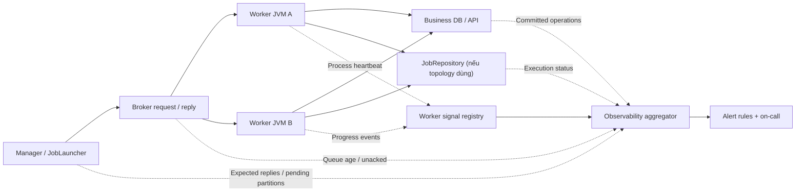
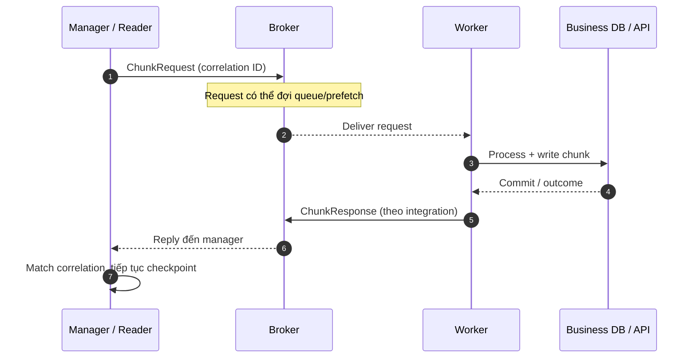
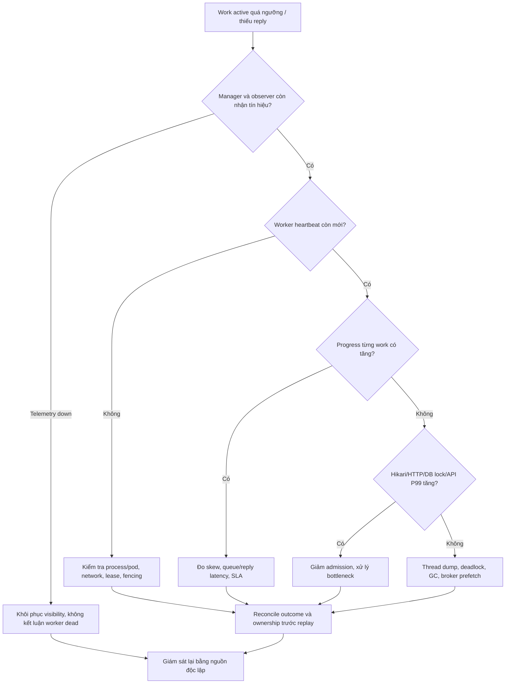

# Alert worker không phản hồi trong Spring Batch: phát hiện đúng, tránh báo giả và phục hồi an toàn

Một batch job đang chạy 24 remote partitions trên nhiều JVM. Dashboard cho thấy manager chưa nhận kết quả của `partition-17` trong 8 phút. Worker vẫn có process sống, pod `Ready`, nhưng `StepExecution.LAST_UPDATED` đã cũ. Liệu worker chết, đang xử lý chunk dài, mắc kẹt trong HTTP call, chờ JDBC connection, hay reply đã được gửi nhưng broker không chuyển tới manager? Nếu coi tất cả là “worker không phản hồi” và tự phát lại partition, **hai worker có thể cùng tạo tác dụng phụ trên một business key**.

**Alert worker không phản hồi** là thiết kế tín hiệu, ngưỡng, cảnh báo và quy trình xử lý khi một worker hoặc phần việc được giao **không có tiến triển hay phản hồi đúng contract trong khoảng thời gian cho phép**. Tín hiệu phải phân biệt *process còn sống*, *worker đang nhận việc*, *công việc thật sự có tiến triển* và *manager đã ghi nhận kết quả*. Chỉ khi phân loại đúng mới quyết định cảnh báo, backpressure, fencing hoặc restart.

Bài thuộc chương **Observability** của module **SPRING_BATCH_SCALING_OPERATIONS**. Phạm vi gồm multi-threaded step, parallel steps, local partitioning, remote partitioning, remote chunking, JobRepository, broker, JDBC/HTTP pools, retry/restart và các hệ thống xử lý phân tán. Mục tiêu là phát hiện chậm/mất worker đủ sớm để giữ **batch SLA và committed throughput**, nhưng không hy sinh **thread safety, checkpoint, idempotency và tính đúng dữ liệu**.

**Nguyên tắc:** *Không nhận được reply không đồng nghĩa worker đã chết; không có heartbeat không chứng minh side effect chưa commit; timestamp metadata cũ không tự chứng minh step đang treo.*

## 1. Định nghĩa “không phản hồi” theo từng cấp

| Cấp quan sát | Câu hỏi | Tín hiệu cần thu | Điều chưa thể kết luận |
| --- | --- | --- | --- |
| **Process liveness** | JVM/worker process còn hoạt động? | Runtime health, process heartbeat, pod status | Job đang xử lý item có tiến triển |
| **Worker readiness** | Worker có thể nhận workload mới? | Consumer connected, executor slots, pool health, schema version | Request đang chạy sẽ hoàn tất đúng hạn |
| **Work progress** | Partition/chunk đang tiến tới checkpoint? | Chunk committed, items committed, progress event | Reply đã đến manager |
| **Delivery/ack** | Broker đã chuyển/ACK message? | Queue age, unacked, delivery attempts, offset | Business writer đã commit |
| **Manager acknowledgment** | Manager đã nhận và xử lý kết quả? | Correlation ID, reply age, StepExecution aggregation | Worker chưa ghi nếu reply mất |
| **Business outcome** | Dữ liệu đầu ra đã bền vững? | Operation key/unique ledger, reconciliation | JobRepository đã cập nhật checkpoint đồng bộ |

Một cảnh báo chính xác thường kết hợp nhiều loại tín hiệu. Ví dụ **heartbeat còn mới nhưng progress không thay đổi** là khả năng worker bị kẹt I/O, không phải node chết. **Progress đã commit nhưng reply quá hạn** lại có thể là đường broker/reply channel.

## 2. Tại sao một ngưỡng timeout duy nhất rất nguy hiểm?

Một worker có thể xử lý:

- Chunk 50 item với API P95 100 ms, mỗi item gọi tuần tự.
- Chunk 500 item có retries, xử lý vài phút.
- File 30 GB với bước checksum chạy lâu nhưng hợp lệ.
- Transaction đang chờ DB lock hoặc JDBC pool acquire.
- Một partition ước lượng 5 phút nhưng có data skew lên 25 phút.
- Worker đã xử lý xong nhưng reply bị mất do broker/reply consumer lỗi.

Nếu đặt `workerTimeout=60s` cho tất cả, phần lớn job lớn sẽ báo giả. Nếu đặt 60 phút cho tất cả, một worker chết sau 2 phút có thể làm lỡ batch window.

Cần tách ít nhất:

\[
T_{\mathrm{heartbeat}}\quad
T_{\mathrm{progress}}\quad
T_{\mathrm{reply}}\quad
T_{\mathrm{jobDeadline}}
\]

Chúng có ý nghĩa khác nhau. Heartbeat từ process độc lập có thể mỗi 15 giây; một chunk hợp lệ có thể mất 5 phút; reply phải được tính từ request/operation correlation và SLA riêng. **Không nhân một interval heartbeat rồi áp làm timeout chunk**.

## 3. “Worker không phản hồi” trong các mô hình scale

| Mô hình | Worker thực tế | Đâu là “response” cần quan sát? |
| --- | --- | --- |
| **Multi-threaded step** | Chunk threads trong cùng JVM/StepExecution | Chunk progress, executor queue, thread health; không nhất thiết có reply message |
| **Parallel steps** | Các flow/step đồng thời | Step status, dependency join, phase latency |
| **Local partitioning** | TaskExecutor chạy partition steps | Partition StepExecution outcome, futures/handler, executor queue |
| **Remote partitioning** | Worker JVM nhận partition request | Partition StepExecution trên shared JobRepository; reply/aggregation tùy partition handler |
| **Remote chunking** | Worker nhận ChunkRequest, process/write rồi gửi ChunkResponse | Request–reply correlation, in-flight chunks và manager checkpoint |
| **Custom broker workers** | Consumer/handler theo contract riêng | ACK, reply, transaction hoặc status API tùy implementation |

**Remote partitioning không bắt buộc lấy một ChunkResponse cho mỗi chunk.** Trong mô hình tiêu chuẩn, StepExecution của partition là đơn vị quan sát chính; manager có thể nhận reply hoặc theo dõi repository tùy handler/polling strategy.

**Remote chunking không tự tạo một StepExecution trên worker cho mỗi message.** Manager thường sở hữu reader/logical step và phải đợi reply. Vì vậy cảnh báo dựa hoàn toàn vào `StepExecution.LAST_UPDATED` có thể bỏ lỡ worker đã ngừng xử lý request.

## 4. Kiến trúc tín hiệu: heartbeat, progress, reply và outcome



Không nhất thiết triển khai một database heartbeat riêng cho hệ thống nhỏ; có thể dùng telemetry backend, Kubernetes events hoặc app-level progress gauge. Nhưng **nguồn tín hiệu phải được xác định độc lập với kết luận**: nếu chỉ dựa vào metrics exporter cùng tiến trình đã chết, series có thể biến mất và alert `value > threshold` sẽ không chạy.

Nên tách:

1. **Worker signal emitter**: gửi heartbeat và event tiến triển với correlation/ownership phù hợp.
2. **Manager tracker**: lưu thời điểm dispatch, request ID, deadline và reply state.
3. **Independent observer**: biết số worker/operations *được kỳ vọng* và lần cuối nhìn thấy chúng.
4. **Business reconciliation**: xác minh side effect khi timeout đã xảy ra.

## 5. Phân loại failure trước khi đặt cảnh báo

| Failure mode | Heartbeat | Progress | Reply | Dấu hiệu đi kèm |
| --- | --- | --- | --- | --- |
| JVM crash/OOM | Mất | Dừng | Thiếu | Pod restart, process exit |
| Network partition worker→manager | Có thể vẫn có ở mạng khác | Có thể tiếp tục | Thiếu | Broker/reply connectivity lỗi |
| Worker stuck ở API | Còn | Không đổi | Chưa có | HTTP P99, timeout, in-flight tăng |
| JDBC pool exhausted | Còn | Chậm/dừng | Trễ | Hikari pending/acquire tăng |
| DB lock wait | Còn | Chậm/dừng | Trễ | SQL wait, long transaction |
| Input data skew | Còn | Tiến triển chậm | Trễ | Một partition nhiều item hơn |
| Broker backlog | Còn ở worker khác | Chưa bắt đầu | Thiếu | Queue age, consumer lag |
| Reply routing sai | Còn | Có thể đã xong | Thiếu | DLQ, unroutable reply, manager lag |
| Manager crash | Workers có thể còn sống | Có thể tiếp tục | Không ai nhận | Manager process/repository state |
| Metrics exporter lỗi | Không thấy heartbeat | Có thể vẫn chạy | Có thể bình thường | Monitoring target down/telemetry errors |

**Không biến mọi failure thành “tự restart worker”.** Khi worker cũ còn có khả năng ghi, restart có thể tạo xử lý đồng thời. Cần xác minh ownership, fencing và idempotency.

## 6. StepExecution status và LAST_UPDATED không phải heartbeat

Với JDBC `JobRepository`, `BATCH_STEP_EXECUTION` lưu `START_TIME`, `END_TIME`, `LAST_UPDATED`, status và counters. Những thuộc tính này phục vụ batch lifecycle/checkpoint, không phải giao thức heartbeat chuẩn với fixed interval.

- `LAST_UPDATED` thay đổi khi repository cập nhật metadata theo lifecycle/chunk; **không được hứa cập nhật mỗi 5 giây**.
- Một chunk lớn, HTTP call chậm hoặc listener lâu có thể giữ StepExecution lâu mà không checkpoint.
- Worker có thể chết đột ngột khiến StepExecution còn `STARTED` với `END_TIME IS NULL`.
- Worker có thể vẫn sống nhưng bị network partition khỏi metadata database.
- JobRepository và business DB có thể commit ở hai transaction riêng; StepExecution cũ **không chứng minh chưa có business side effect**.

Hệ quả: chỉ cảnh báo `NOW() - LAST_UPDATED > 60 seconds` thường tạo false positives trên partition xử lý chậm và false negatives khi metadata được một đường khác cập nhật dù task thực sự bị kẹt.

## 7. Phân biệt heartbeat với tín hiệu tiến triển thật

**Heartbeat process** trả lời “đường gửi tín hiệu từ một worker còn hoạt động gần đây?” Có thể được phát định kỳ bởi scheduler thread ngay cả khi worker processing thread bị kẹt.

**Progress event** trả lời “công việc đã hoàn thành thêm bao nhiêu?” Nên ưu tiên một mốc đáng tin như:

- `afterChunk` sau chunk hoàn tất theo lifecycle, thường sau transaction commit thành công.
- Completion của partition StepExecution với status thích hợp.
- Writer business operation đã commit và có operation key.
- Worker đã phát `ChunkResponse`, nhưng chưa đồng nghĩa manager đã nhận.
- Manager đã cập nhật checkpoint/correlation sau khi nhận reply.

Bảng diễn giải:

| Heartbeat | Progress | Khả năng |
| --- | --- | --- |
| Mới | Mới | Worker có vẻ khỏe và đang tiến triển |
| Mới | Cũ | Slow chunk, blocked I/O, deadlock, starvation hoặc chưa được giao việc |
| Cũ | Cũ | Worker chết, mất network, telemetry down hoặc scheduler heartbeat bị kẹt |
| Cũ | Mới | Đường heartbeat lỗi hoặc progress đi qua kênh khác |
| Mới | Không có work active | Worker idle bình thường, **không nên báo stuck** |

**Không coi heartbeat từ một thread phụ là xác nhận transaction đang commit đúng.** Khi không có in-flight work, không có progress là trạng thái bình thường.

## 8. Thiết lập trạng thái expected, assigned và in-flight

Một monitor biết “worker không có tiến triển” chỉ có ý nghĩa nếu nó biết **worker được kỳ vọng đang làm gì**.

Hãy mô hình hóa các trường tối thiểu:

| Trường | Phạm vi | Ý nghĩa |
| --- | --- | --- |
| `worker_instance_id` | Process/Pod | Tìm log/process cụ thể; có thể đổi sau restart |
| `worker_generation/lease_epoch` | Ownership | Phân biệt owner cũ/mới của work |
| `business_run_key` | Logical run | Business date/version bất biến qua retry |
| `job_execution_id` | Spring Batch run | Ghép metadata với instance trong incident |
| `step_execution_id` / `partition_name` | Remote partitioning | Xác định partition đang thuộc worker nào |
| `chunk_correlation_id` | Remote chunking | Match request, delivery, reply |
| `assigned_at/received_at` | Manager/broker | Bắt đầu theo dõi queue và admission |
| `last_heartbeat_at` | Monitor registry | Lần cuối observer **nhận** heartbeat |
| `last_progress_at` | Worker/monitor | Mốc checkpoint/progress thật |
| `deadline_at` | Manager/operation | Ngưỡng phù hợp workload |
| `state` | Coordinator | ASSIGNED/RUNNING/COMPLETED/UNKNOWN/RECOVERY |

Cấu trúc trên là **custom monitoring state**, không phải toàn bộ các field Spring Batch mặc định. Không nhồi heartbeat/temporary in-flight map vào `ExecutionContext` và cập nhật JobRepository mỗi vài giây: điều đó có thể làm metadata DB thành nút thắt và tạo race optimistic locking.

## 9. Phân tích timeout dựa trên workload, không đoán theo CPU

Giả sử một chunk có `C=200` item, processor gọi API đồng bộ mỗi item với P95 120 ms. Nếu dùng con số 120 ms làm latency cho mọi item thì ước lượng đơn giản:

\[
T_{\mathrm{chunk,rough}}\approx C\times0{,}12
=24\text{ giây}
\]

Nhưng đây **không phải P95 của tổng chunk**: percentile không cộng được theo cách ấy, và còn reader/writer/commit/retry/queue. Chunk thực tế có thể dài hơn vài lần khi có 429/backoff hoặc một item outlier.

Để chọn timeout:

1. Đo histogram **chunk wall-clock** trong benchmark đại diện.
2. Tách thời gian *queue before processing* khỏi *processing after start*.
3. Đo `P95/P99/P99.9` chunk durations trong từng class workload/partition.
4. Thêm budget hữu hạn cho retry/backoff/network và degraded mode có business SLA.
5. Phân biệt worker mất heartbeat với worker đang ở chunk chậm hợp lệ.
6. Xác định thời điểm escalated theo job deadline, không chỉ chunk timeout.

Một khoảng mặc định `T_{\mathrm{progress}}=3\times P99(chunk)` có thể dùng làm **giá trị khởi tạo thử nghiệm** nếu đủ samples, nhưng không phải định luật; phải hiệu chỉnh theo rủi ro false alarm và tail/outage thực.

## 10. Công thức kiểm soát thời gian phản ứng cảnh báo

Giả sử process heartbeat phát mỗi `h` giây, observer đánh giá mỗi `e` giây và rule cần giữ điều kiện `f` giây (Prometheus `for`). Nếu đặt stale threshold `d` giây, thời gian phát hiện mất heartbeat có thể xấp xỉ:

\[
T_{\mathrm{detect}}\approx d+e+f+T_{\mathrm{notification}}
\]

Con số còn phụ thuộc thời điểm mất worker giữa hai heartbeat, scrape interval, no-data semantics và Alertmanager grouping. Đây là **budget gần đúng**, không bảo đảm thời gian phản hồi tối đa cứng.

Ví dụ heartbeat 15 giây, stale threshold 60 giây, rule evaluation 15 giây, `for: 2m`:

- Một worker thực sự chết có thể được alert sau **hơn 3 phút**, cộng notification delay.
- Tốc độ phát hiện không còn là “60 giây” dù threshold chỉ 60 giây.
- Nếu mạng mất gói có thể báo giả nếu threshold nhỏ hơn jitter/burst thông thường.
- Với RTO 5 phút, phải tính cả diagnosis, fencing và restart sau alert.

**SLO cảnh báo:** Định nghĩa thời gian *detect* và *time to safe recovery* riêng; một alert nhanh nhưng yêu cầu manual reconciliation lâu vẫn có thể không đạt batch window.

## 11. Clock skew và nơi ghi nhận thời gian heartbeat

So sánh `workerClock.now()` với `managerClock.now()` có thể sai nếu hai máy lệch giờ. Với nhiều JVM, hãy ưu tiên **server-side received timestamp** ở observer/registry:

- Worker gửi `sent_at` cho tracing.
- Observer nhận và ghi `last_seen_at` theo **clock của observer/DB**.
- Delay = observerNow − last_seen_at trên cùng nguồn thời gian.
- Nếu cần elapsed nội bộ JVM, dùng `System.nanoTime()`; không gửi giá trị này sang JVM khác để trừ.
- Theo dõi NTP drift/clock sync, lag của telemetry ingestion và exporter freshness.

Nếu reporter đẩy heartbeat qua broker nhưng observer xử lý trễ 2 phút, giá trị `received_at` mới có thể làm worker trông khỏe dù heartbeat đã nằm chờ rất lâu. Nên thu cả **event age, broker lag và producer timestamp** (đã hiểu clock skew) hoặc giới hạn tuổi message; đừng chỉ dựa một trường.

## 12. Thiết kế heartbeat channel không tạo thêm điểm lỗi

Một reporter phù hợp cần:

- Chạy định kỳ độc lập với chunk worker threads khi có thể, nhưng không tuyên bố thread còn sống nghĩa job tiến triển.
- Sử dụng timeout outbound ngắn, buffer/queue có giới hạn và không làm writer fail chỉ vì telemetry sink unavailable.
- Gửi worker identity, role, revision, active work count, optional lease epoch và last progress summary.
- Không gửi raw `ExecutionContext`, credentials hoặc item payload.
- Chỉ gửi active StepExecution/chunk IDs qua structured events/logs có bảo vệ quyền.
- Thực hiện aggregation ở observer, không tạo một Prometheus time series cho mỗi item/chunk.
- Có tín hiệu riêng báo **monitoring pipeline down**; đừng quy mọi lỗi telemetry thành worker dead.
- Có cleanup/TTL của registry khi worker dừng hợp lệ và cách phân biệt `DRAINING` với mất kết nối.

Một JobRepository metadata update mỗi heartbeat dễ gây lock contention khi hàng trăm workers cùng ghi; **heartbeat registry/telemetry phải có capacity plan riêng**, không chiếm transaction/checkpoint path của Spring Batch.

## 13. Java: worker process heartbeat và counter progress độc lập

Ví dụ Spring Boot 3 / Java 17 định nghĩa telemetry custom. Nó không sửa JobRepository và không gọi Spring Batch API ngoài lifecycle.

```java
import java.time.Clock;
import java.time.Instant;
import java.util.UUID;
import java.util.concurrent.atomic.AtomicLong;

import org.slf4j.Logger;
import org.slf4j.LoggerFactory;
import org.springframework.scheduling.annotation.Scheduled;
import org.springframework.stereotype.Component;

record WorkerHeartbeat(
        String instanceId,
        Instant emittedAt,
        long committedChunks,
        long lastChunkCommittedEpochMillis) {}

interface WorkerTelemetrySink {
    void publish(WorkerHeartbeat signal);
}

@Component
public final class WorkerSignalEmitter {

    private static final Logger log =
            LoggerFactory.getLogger(WorkerSignalEmitter.class);

    private final WorkerTelemetrySink sink;
    private final Clock clock;

    // ID thay đổi khi JVM restart: dùng để tra log, không làm business key.
    private final String instanceId = UUID.randomUUID().toString();
    private final AtomicLong committedChunks = new AtomicLong();
    private final AtomicLong lastCommittedAtMillis = new AtomicLong();

    public WorkerSignalEmitter(WorkerTelemetrySink sink, Clock clock) {
        this.sink = sink;
        this.clock = clock;
    }

    public void recordCommittedChunk() {
        committedChunks.incrementAndGet();
        lastCommittedAtMillis.set(clock.millis());
    }

    @Scheduled(fixedDelay = 15_000)
    public void publishHeartbeat() {
        try {
            sink.publish(new WorkerHeartbeat(
                    instanceId,
                    clock.instant(),
                    committedChunks.get(),
                    lastCommittedAtMillis.get()));
        } catch (RuntimeException ex) {
            log.warn("Worker heartbeat publish failed", ex);
        }
    }
}
```

Yêu cầu cấu hình ngoài đoạn mẫu: bật `@EnableScheduling`; cung cấp bean `Clock.systemUTC()` và implementation `WorkerTelemetrySink` **có timeout + bounded resources**. ID process chỉ dùng trong log/registry, không gắn như tag cho hàng nghìn workers không giới hạn.

Đây là **process heartbeat**, không phải chứng minh thread xử lý chính đã hoàn tất. `lastChunkCommittedEpochMillis=0` nghĩa chưa ghi nhận chunk kể từ khi reporter khởi động; không diễn giải thành worker kẹt nếu chưa có assignment.

Khi sink lỗi, reporter log warning và job vẫn chạy; monitoring phải có cảnh báo riêng về pipeline sink. Tránh log exception nguyên văn từng 15 giây quá mức khi telemetry outage kéo dài (rate-limited logging là lựa chọn tốt hơn trong production).

## 14. Java: phát progress sau một chunk hoàn tất

Đối với chunk-oriented step, có thể ghi nhận callback `afterChunk`. Trong Spring Batch, callback này liên quan đến chunk đã hoàn tất, thông thường được gọi sau commit transaction của chunk; nó không bảo đảm side effects ở **hệ khác transaction** được commit nguyên tử với metadata.

```java
import org.springframework.batch.core.ChunkListener;
import org.springframework.batch.core.scope.context.ChunkContext;
import org.springframework.stereotype.Component;

@Component
public final class CommittedChunkSignalListener implements ChunkListener {

    private final WorkerSignalEmitter signals;

    public CommittedChunkSignalListener(WorkerSignalEmitter signals) {
        this.signals = signals;
    }

    @Override
    public void afterChunk(ChunkContext context) {
        // Chỉ cập nhật counters local/telemetry, không sửa StepExecution
        // hoặc ExecutionContext từ thread heartbeat.
        signals.recordCommittedChunk();
    }

    @Override
    public void afterChunkError(ChunkContext context) {
        // Ghi failure signal ở hệ telemetry nếu cần, không mark progress.
    }
}
```

Đăng ký listener cho **worker step thực sự chạy**, ví dụ `.listener(committedChunkSignalListener)` trong cấu hình StepBuilder. Cần kiểm thử callback thực tế với rollback, retry, skip, multi-threaded chunks và remote workers.

**Không dùng `ItemWriteListener.afterWrite` làm tín hiệu “đã commit” nếu listener có thể chạy trước commit**. Với external HTTP/DB tách transaction, thậm chí `afterChunk` cũng phải đi cùng business operation ledger/idempotency khi xác nhận dữ liệu cuối.

Ví dụ reporter dùng AtomicLong để nhiều chunk threads cập nhật an toàn. Nếu cần alert **từng partition**, bổ sung một progress registry theo logical partition/correlation, với TTL và batch window; đừng chỉ dùng counter tổng của JVM vì một partition chậm có thể bị những partition khác che lấp.

## 15. Theo dõi partition worker trong remote partitioning

Manager thường tạo nhiều `StepExecution`, dispatch qua partition handler và chờ chúng được xử lý/aggregate. Những điều cần đo:

1. Tổng partitions `CREATED/ASSIGNED/STARTED/COMPLETED/FAILED/UNKNOWN` theo **state quan sát của manager**.
2. `assignment age` từ lúc dispatch đến khi worker nhận.
3. `execution elapsed/progress age` của partition đang chạy.
4. Worker owner/epoch, phiên bản application và heartbeat độc lập.
5. `JobRepository` update latency, kết nối shared metadata DB và lock contention.
6. Phần thời gian manager chờ aggregate/reply sau khi worker đã hoàn tất.
7. Thông lượng items committed của từng partition và data skew.

Nếu manager dùng cơ chế chờ/poll JobRepository thay vì nhận reply ngay, **không tạo alert “missing reply” cho một message mà protocol không có**. Cần monitor `StepExecution` trong repository cộng với worker health và handler-specific completion status.

**Không tự phát lại partition chỉ vì `StepExecution.STARTED` quá 5 phút.** Partition có thể chạy lâu hợp lệ hoặc worker cũ vẫn đang commit. Khi chuyển ownership, fencing cần được kiểm tra tại đường ghi hoặc writer phải idempotent.

## 16. Theo dõi ChunkRequest/ChunkResponse trong remote chunking

Remote chunking thường có chuỗi:



Cần đo các mốc độc lập:

| Đồng hồ | Bắt đầu–kết thúc | Khả năng nghẽn |
| --- | --- | --- |
| `dispatch-to-deliver` | Manager send → worker receive | Broker lag, consumer không sẵn sàng |
| `deliver-to-worker-finish` | Worker receive → commit/response | API/JDBC/CPU/lock/GC |
| `worker-finish-to-reply` | Worker finished → manager receives | Reply channel, routing, manager consumer |
| `in-flight age` | Manager dispatch → correlated reply | Toàn bộ pipeline, không phân biệt nguyên nhân |
| `commit-to-checkpoint` | Business commit → durable state manager | Transaction/metadata outage, reply loss |

**Không mặc định ACK đồng nghĩa business commit; không mặc định nhận ChunkResponse là exactly-once end-to-end.** Thứ tự ACK, transaction và reply phụ thuộc Spring Integration/middleware và custom code.

Nếu worker đã commit nhưng response mất, manager có thể replay chunk từ checkpoint cũ khi recovery. Writer phải idempotent theo **business operation key**, không chỉ theo delivery attempt ID.

## 17. Broker metrics: worker chưa nhận hay nhận rồi mắc kẹt?

| Broker tín hiệu | Giải thích có thể | Cần đối chiếu |
| --- | --- | --- |
| Queue depth/oldest age tăng | Consumer không nhận kịp hoặc upstream dispatch quá nhanh | Worker count, consumer concurrency, downstream capacity |
| Unacked/prefetch cao | Worker đã nhận nhưng chưa ACK | Actual processing progress, transaction, network |
| Redelivery count tăng | Retry/rebalance/crash dẫn tới giao lại | Idempotency, consumer errors, DLQ |
| Reply queue tăng | Worker có thể đã trả kết quả, manager chưa nhận | Reply consumer, routing, manager health |
| Requests queue rỗng, no reply | Request có thể in-flight/ACK rồi/reply mất | Correlation registry, worker logs, business outcomes |
| Consumer lag tăng | Worker capacity chưa theo kịp input | API quota, CPU, Hikari pending, executor queue |
| DLQ tăng | Message lỗi permanent/transient exhausted | Schema/version, poison item, reconciliation |

Đừng coi `queue depth = 0` là bằng chứng tất cả chunks đã hoàn tất. Broker có thể đã deliver nhưng message còn unacked, hoặc bị ACK trước lúc business effect được xác nhận.

Với Kafka, xem consumer group lag/offset commit/rebalance; với RabbitMQ, xem ready/unacked/prefetch/DLQ; với JMS, xem session/ack mode và delivery. Không dùng một metric broker cho mọi middleware như thể semantics giống nhau.

## 18. Worker lifecycle: bình thường idle, draining hay mất tín hiệu?

Alert phải biết worker pool đang ở trạng thái nào:

- **IDLE:** Không có work assigned. Không có progress là bình thường; vẫn có thể cần health alert nếu là worker pool trực 24/7.
- **STARTING:** Pod/process vừa boot, consumer chưa sẵn sàng. Có startup grace period.
- **READY:** Có thể nhận việc mới; heartbeat và connection khỏe.
- **BUSY:** Đang xử lý partition/chunk; cần progress và deadline riêng.
- **DRAINING:** Đang shutdown có kiểm soát, không nhận việc mới nhưng có thể hoàn thành in-flight.
- **LOST/UNKNOWN:** Observer không nghe tín hiệu; chưa chứng minh process hay side effect đã dừng.
- **RECOVERING:** Reconcile ownership và outcome trước khi worker khác nhận lại việc.

Trạng thái này nên do orchestration/monitoring định nghĩa, **không tạo BatchStatus mới trong JobRepository**. Đặc biệt, khi HPA giảm replicas hoặc rolling deploy, một worker DRAINING hợp lệ có thể ngừng heartbeat sau khi in-flight đã hoàn tất mà không cần page SEV-1.

Trong network partition, worker có thể không gửi heartbeat tới monitor nhưng vẫn gọi được business API; do đó **heartbeat timeout không tự thu hồi quyền ghi**.

## 19. Registry quan sát và lease: không nhầm theo dõi với quyền ghi

Một registry cho manager/observer có thể có record:

```json
{
  "pool": "order-partition-workers",
  "workerInstance": "worker-b-7",
  "generation": 42,
  "state": "BUSY",
  "assignedWork": "partition-17",
  "lastHeartbeatReceivedAt": "2026-11-26T01:18:15Z",
  "lastProgressReceivedAt": "2026-11-26T01:16:45Z",
  "lastCommittedChunkSequence": 183,
  "workDeadlineAt": "2026-11-26T01:30:00Z"
}
```

Đây là schema **custom**, không phải một bảng Spring Batch mặc định. Nên tách các dữ liệu:

- **Heartbeat registry:** Trả lời thời gian gần nhất monitor nhận tín hiệu.
- **Work assignment registry:** Trả lời work thuộc owner/epoch nào; thường cần durable.
- **Progress registry:** Trả lời checkpoint/progress thật theo partition/chunk correlation.
- **Business operation ledger:** Xác định side effect đã commit.

Nếu monitor giữ heartbeat trong memory rồi observer chết, phải có cách rebuild hoặc phân loại no-data. Không mặc định mọi worker đã chết chỉ vì observer vừa khởi động và chưa thấy heartbeat.

**Fencing:** Lease hết hạn có thể cho phép coordinator *chọn owner mới*, nhưng phải ngăn owner cũ tiếp tục ghi bằng fencing token được kiểm tra **tại đường ghi** hoặc bảo đảm writer idempotent. Một timestamp heartbeat không làm old worker tự dừng khi network bị chia cắt.

### Khi nào cần heartbeat durable?

Với một local step, process health và TaskExecutor metrics có thể đủ. Với remote workers có ownership thay đổi, registry bền vững giúp điều tra và chuyển quyền. Tuy nhiên đừng biến mỗi heartbeat 10 giây thành một transaction cập nhật cùng hàng `BATCH_STEP_EXECUTION`; hãy đánh giá tải metadata và dùng storage/telemetry phù hợp.

## 20. Metrics cần có: đo nơi nào ngừng tiến triển

Một hệ observability nên xác định rõ metric nào **tùy chỉnh**, metric nào do thư viện cung cấp.

| Custom metric hoặc nguồn | Ý nghĩa | Tag hợp lý |
| --- | --- | --- |
| `batch_worker_pool_expected_workers` | Số worker được kỳ vọng trong pool hoạt động | `pool` |
| `batch_worker_pool_healthy_workers` | Số worker có heartbeat mới theo observer | `pool` |
| `batch_worker_pool_inflight_work` | Số assigned operations đang chờ hoàn tất | `pool`, `work_type` |
| `batch_worker_pool_oldest_progress_age_seconds` | Tuổi không tiến triển của active work cũ nhất | `pool` |
| `batch_manager_pending_replies` | Số ChunkRequest đang chờ reply | `job_type` |
| `batch_manager_oldest_reply_age_seconds` | Tuổi request chưa correlated reply lâu nhất | `job_type` |
| `batch_partition_active` | Số partition có trạng thái active | `job_type` |
| `batch_partition_stale_progress_count` | Active partitions quá ngưỡng dự kiến | `job_type` |
| HikariCP `active/pending/acquire/usage` | JDBC checkout và connection hold time | `pool` |
| HTTP `leased/pending/requests/429/503` | Outbound pool, quota và degradation | `upstream` |
| Broker lag/unacked/DLQ/reply age | Nơi message bị chậm hoặc redeliver | `queue/topic` hữu hạn |
| `batch_worker_signal_publish_failures` | Worker không gửi được telemetry | `worker_pool` |
| `batch_worker_signal_receiver_age_seconds` | Observer/telemetry không nhận được tín hiệu | `worker_pool` |

Các metric `batch_worker_*` và `batch_manager_*` ở đây là **metric custom** đã đặt tên theo phong cách Prometheus; không phải tên mặc định Spring Batch/Micrometer.

**Lưu ý:** `oldest_progress_age_seconds` tính từ work thực sự **đang in-flight**, dựa trên assignment/last progress; khi pool idle cần trả 0 hoặc mask bằng `inflight_work`. Không lấy “tuổi từ chunk cuối của worker” để báo lỗi khi worker hợp lệ đang idle cả đêm.

Nếu metric chỉ từ **worker self-exporter**, process chết có thể làm series biến mất chứ không giữ giá trị cũ. Một **central observer** có bảng expected workers/last-received để phát `healthy_workers=0` ổn định; vẫn cần alert khi observer down.

## 21. Prometheus alert rules: có điều kiện và chống no-data

Ví dụ dưới đây giả định ứng dụng **tự phát các metric** từ một central observer. Metric được tổng hợp theo pool/job type có tập nhãn hữu hạn. Ngưỡng 3–15 phút chỉ minh họa và phải hiệu chỉnh theo P99 chunk, delivery và SLA thật.

```yaml
groups:
  - name: spring-batch-remote-workers
    rules:
      - alert: BatchWorkerPoolReducedHealth
        expr: |
          (
            batch_worker_pool_expected_workers{pool="order-workers"}
            - on(pool)
            batch_worker_pool_healthy_workers{pool="order-workers"}
          ) > 0
        for: 3m
        labels:
          severity: warning
        annotations:
          summary: "Ít worker khỏe hơn số được kỳ vọng"
          description: "Kiểm tra heartbeat registry và worker/pod states"

      - alert: BatchWorkerActiveWorkNoProgress
        expr: |
          (batch_worker_pool_inflight_work{pool="order-workers"} > 0)
          and on(pool)
          (batch_worker_pool_oldest_progress_age_seconds{
             pool="order-workers"} > 600)
        for: 2m
        labels:
          severity: warning
        annotations:
          summary: "Work active không có tiến triển quá lâu"
          description: "Phân biệt slow chunk, pool/DB wait và worker crash"

      - alert: BatchRemoteChunkRepliesOverdue
        expr: |
          (batch_manager_pending_replies{job_type="order-import"} > 0)
          and on(job_type)
          (batch_manager_oldest_reply_age_seconds{
             job_type="order-import"} > 900)
        for: 2m
        labels:
          severity: critical
        annotations:
          summary: "Chunk reply quá hạn trong remote chunking"
          description: "Đối chiếu broker, worker và business outcome"

      - alert: BatchWorkerObserverMetricsMissing
        expr: |
          absent(batch_worker_pool_expected_workers{
             pool="order-workers"})
        for: 2m
        labels:
          severity: warning
        annotations:
          summary: "Không có dữ liệu expected-worker từ observer"
          description: "Kiểm tra exporter, scrape, registry và network"
```

**Cách đọc và giới hạn:**

1. Health rule so sánh **expected và healthy**, có ích khi central observer xuất cả hai metric liên tục, kể cả khi có 0 worker khỏe.
2. No-progress chỉ có ý nghĩa khi `inflight_work > 0` và tuổi tính theo active work.
3. Reply timeout dành cho **remote chunking có correlated replies**; không áp vào partition handler không có reply protocol tương ứng.
4. `for: 2m/3m` là thời gian rule phải liên tục đúng, không phải timeout của worker trong runtime.
5. Nếu một series bị mất, phép toán vector và `and` có thể không trả alert. Rule `absent(...)` chỉ kiểm tra một series expected; cần thêm exporter/registry availability checks cho mọi pools/job types.
6. Khi telemetry exporter offline, phải phân biệt **monitoring blind** với **worker dead**.
7. Severity critical nên dựa trên ảnh hưởng SLA/dữ liệu; với workload dài hợp lệ, điều chỉnh ngưỡng hoặc kết hợp JobDeadline risk.

Không tự động `kubectl delete pod` hay restart JobInstance chỉ từ các rule trên.

## 22. Alert routing: khi nào warning, khi nào page?

| Trường hợp | Mức gợi ý | Hành động |
| --- | --- | --- |
| Heartbeat chậm trong lúc worker idle | Không alert hoặc informational | Theo dõi jitter |
| Một worker mất heartbeat, pool còn capacity, không in-flight | Warning | Kiểm tra pod, rollout, autoscaler |
| Heartbeat mới, chunk chậm chưa vượt P99 hợp lệ | Dashboard | Không restart |
| Work active quá hạn, queue tăng, committed throughput giảm | Warning/critical theo SLA | Triage pool/DB/API/broker |
| Manager thiếu nhiều replies, job sắp trễ deadline | Critical | Incident manager/broker/worker |
| Split-brain hoặc hai workers ghi cùng business range | Critical | Contain/fencing trước recovery |
| Observer/telemetry down | Monitoring incident riêng | Khôi phục visibility, không suy workers dead |
| Worker crash sau business commit trước reply | Critical nếu outcome không biết | Reconcile/idempotency trước replay |

Cảnh báo nên nói **vấn đề quan sát được**, không diễn giải sẵn “worker chết”. Tiêu đề **“Partition chưa có tiến triển 10 phút”** chính xác hơn **“Worker DEAD”** khi chỉ thấy queue latency.

Alertmanager grouping nên tránh flood khi 100 partitions cùng chờ database: group theo job type/pool/root dependency và giữ affected correlation IDs trong dashboard/logs.

## 23. Tránh cardinality cao và dữ liệu nhạy cảm

Trong cluster có thể có hàng trăm nghìn chunks, StepExecutions và business IDs. Nếu mỗi ID thành metric label, Prometheus phải lưu hàng triệu series.

**Metric tags nên dùng:** `job_type`, `step_type`, `worker_pool`, `region` có tập giá trị nhỏ, `phase/outcome/reason_code` cố định, `upstream_category`.

**Structured logs/traces hoặc registry có TTL mới chứa:** JobExecution ID, StepExecution ID, partition ID, chunk correlation ID, delivery tag, worker UUID, business operation key, file name và stack trace.

Không ghi raw `ExecutionContext`, API secret, token hay payload PII trong heartbeat hoặc metric labels. Tổ chức lưu trữ dữ liệu chẩn đoán cần quyền truy cập và retention riêng.

## 24. Distributed tracing xuyên manager, broker, worker và JobRepository

Một trace lý tưởng có các spans:

```text
JobExecution / logical business run
  manager.dispatch ChunkRequest
    broker.enqueue/dequeue
      worker.receive
        worker.process
          remote HTTP / JDBC / writer
        worker.commit
      worker.publish ChunkResponse
    manager.consume reply
  manager.checkpoint / JobRepository update
```

Trace có thể đứt vì asynchronous messaging, process restart hoặc sampling. Truyền **trace context/correlation ID** qua message headers theo convention đang dùng. Trace missing không chứng minh message thất lạc; vẫn cần broker retention và business ledger.

**Đừng gửi `System.nanoTime()` từ worker rồi trừ nó với manager nanoTime**: không có common origin. Dùng spans, observer receipt time và clock synchronization cho cross-node, monotonic timing cho nội bộ JVM.

Nếu không có OpenTelemetry hoàn chỉnh, structured event log với các mốc `dispatched, received, committed, reply_sent, reply_received` vẫn hỗ trợ triage hiệu quả.

## 25. SQL PostgreSQL: tra StepExecution cũ trong JobRepository

Các truy vấn **read-only**, dựa trên JDBC Spring Batch metadata schema; điều chỉnh prefix/schema/SQL dialect thật. Named parameters phải được bind bằng công cụ hỗ trợ:

```sql
SELECT
    STEP_EXECUTION_ID,
    JOB_EXECUTION_ID,
    STEP_NAME,
    STATUS,
    START_TIME,
    END_TIME,
    LAST_UPDATED,
    READ_COUNT,
    WRITE_COUNT,
    COMMIT_COUNT,
    ROLLBACK_COUNT,
    NOW() - LAST_UPDATED AS metadata_update_age
FROM BATCH_STEP_EXECUTION
WHERE JOB_EXECUTION_ID = :jobExecutionId
  AND STATUS IN ('STARTING', 'STARTED', 'STOPPING')
ORDER BY LAST_UPDATED NULLS FIRST;
```

`metadata_update_age` chỉ là khoảng từ lần lưu metadata cuối, không phải thời gian worker ngừng heartbeat. Query dùng để tìm execution cần điều tra, **không đủ cơ sở để restart hay sửa status**.

Nếu database clock và application clock lệch, hiệu `NOW() - LAST_UPDATED` có thể sai; đối chiếu timestamp và logs cùng worker.

### PostgreSQL: kiểm tra blocking transactions

```sql
SELECT
    a.pid, a.application_name, a.state,
    a.wait_event_type, a.wait_event, a.xact_start,
    NOW() - a.xact_start AS transaction_age,
    pg_blocking_pids(a.pid) AS blocking_pids
FROM pg_stat_activity AS a
WHERE a.datname = current_database()
  AND (
       cardinality(pg_blocking_pids(a.pid)) > 0
       OR a.state = 'idle in transaction'
  )
ORDER BY a.xact_start NULLS LAST;
```

Một deadlock có thể đã rollback và biến mất trước khi query; cần logs SQLSTATE như PostgreSQL `40P01` (deadlock), `40001` (serialization failure).

**Không kill DB sessions, truncate business tables hay UPDATE `BATCH_*` để “gỡ stuck” khi chưa hiểu transaction và side effects.**

## 26. Decision tree: worker chậm hay không thể tiến triển?



**Tín hiệu định hướng nhanh:**

- Heartbeat mất và process đã exit: có bằng chứng process đó dừng, nhưng cần xác minh outstanding HTTP/broker/DB effects.
- Heartbeat mới, thread dump có JDBC checkout waits: có thể resource exhaustion.
- Heartbeat mới, chunk commit mỗi 2 phút: không page “no-progress 60 giây”.
- Worker commit xong, reply queue tăng, manager không consume: root cause ở reply path.
- Manager chờ partition aggregation, metadata DB unavailable: triệu chứng có thể do repository.
- Worker idle nhưng broker unacked cao: xem consumer assignment/prefetch/thread pool, không suy worker chưa có việc.

## 27. Runbook xử lý alert worker không phản hồi

**Pha 1 — Xác nhận scope và nguồn cảnh báo**

1. Lấy job type, run key, JobExecution ID, partition/chunk correlation, worker pool và thời điểm.
2. Xác định alert dựa trên heartbeat, progress, broker age hay reply timeout.
3. Xác minh observer, scrape, event pipeline còn khỏe và không bị stale/no-data.
4. Đánh giá committed throughput, in-flight work, backlog và SLA remaining.

**Pha 2 — Khoanh vùng và giữ bằng chứng**

5. Giảm dispatch/admission khi backlog/retries tăng; không purge queue hoặc sửa metadata.
6. Lưu request/reply logs, broker unacked/DLQ, worker logs, pod events, DB lock snapshots.
7. Xác minh worker cũ có thể còn ghi, đang DRAINING hay bị network partition.
8. Đối chiếu JobRepository với business ledger; không suy outcome chỉ từ StepExecution.

**Pha 3 — Chọn hướng xử lý**

9. Nếu slow chunk hợp lệ: điều chỉnh ngưỡng theo class workload, không replay.
10. Nếu DB/API/pool bão hòa: giảm concurrency, sửa downstream, backoff/retry hữu hạn.
11. Nếu manager/reply route lỗi: sửa routing/consumer, reconcile replies, tránh gửi lại chunks.
12. Nếu worker thật sự mất: xác nhận owner cũ đã dừng/fenced, sau đó reassign/restart hợp lệ.
13. Nếu business side effect outcome unknown: status lookup/idempotency/reconciliation trước replay.

**Pha 4 — Recovery và nghiệm thu**

14. Resume bằng canary ít partitions/chunks, tránh retry storm.
15. Theo dõi heartbeat, progress, broker age, JobRepository và committed operations.
16. Đối soát unique keys, duplicates/skips và StepExecution states trước đóng incident.
17. Lưu timeline, cause, detection lag, time-to-recover, ngưỡng cần cải tiến.

**Không để alert tự động gọi `JobOperator.restart(...)` hoặc tạo JobInstance mới trong khi ownership/side-effect outcome còn bất định**.

## 28. Fencing và chống worker cũ tiếp tục ghi

Worker mất heartbeat do network split có thể **vẫn sống và vẫn gọi business API**. Nếu manager chuyển cùng partition sang worker mới, hai processes có thể ghi cạnh tranh.

Có ba cấp bảo vệ:

| Cấp | Cơ chế | Giới hạn |
| --- | --- | --- |
| **Stop/drain** | Yêu cầu worker cũ dừng, xác nhận không còn in-flight work | Không bảo đảm khi network partition |
| **Lease/leader election** | Cấp ownership bằng generation/epoch tăng đơn điệu | Lease expired không tự ngăn old writer |
| **Fencing ở write path** | Business DB/gateway từ chối generation cũ bằng atomic check | Cần tài nguyên đích hỗ trợ kiểm tra epoch |

Ví dụ:

```text
businessRun = invoice/2026-11-26
partition = partition-17
epoch 31 => worker-A (owner cũ)
epoch 32 => worker-B (owner mới)

Worker-A còn gửi write với epoch 31 sau khi 32 đã có hiệu lực.
Business writer phải reject epoch 31 nếu sử dụng fencing.
```

Không tạo fencing token bằng `System.currentTimeMillis()` của mỗi worker. Token phải có nguồn cấp generation có ordering và đường ghi thật sự kiểm tra nó, không chỉ nằm trong manager memory.

Nếu API không hỗ trợ fencing, kết hợp idempotency key ổn định, stop/drain, operation ledger và reconciliation. **Không tuyên bố exactly-once chỉ vì manager có một bảng lease.**

## 29. Restart, replay và redelivery an toàn khi thiếu phản hồi

Một alert “no reply” là **tín hiệu điều tra**, không phải điều kiện đủ để phát lại công việc.

| Tình huống | Cách xử lý ưu tiên |
| --- | --- |
| Heartbeat ổn, progress tăng | Tiếp tục nếu còn SLA; điều tra reply path nếu vẫn thiếu |
| Worker process chết, không rõ business commit | Đối soát operation IDs trước reassign/restart |
| Worker alive nhưng blocked JDBC/HTTP | Giảm concurrency và giải quyết upstream/DB |
| Broker request delivered nhưng reply mất | Tra business output và correlation, không replay mù |
| Partition StepExecution FAILED, owner cũ đã dừng | Restart cùng JobInstance theo lifecycle và checkpoint |
| StepExecution STARTED stale, chưa rõ owner | Fencing/drain/diagnose; không chỉnh STATUS bằng SQL |
| JobRepository unavailable | Khôi phục DB trước khi kết luận có thể launch mới |
| Payload permanent error | DLQ/quarantine theo business rule, không retry vô hạn |

`JobOperator.restart` phụ thuộc JobInstance, BatchStatus và restartability; nó không tự phân xử side effects tại HTTP/API/broker. `JobExecutionAlreadyRunningException` có thể đang bảo vệ logical run; không né bằng identifying parameter ngẫu nhiên.

Khi remote chunking replay chunk đã business-commit nhưng manager chưa nhận reply, writer phải idempotent theo **business operation key**, không chỉ theo broker delivery attempt.

## 30. Idempotent writer khi missing reply xảy ra sau commit

Một bảo vệ đơn giản trong **cùng database transaction**:

```sql
CREATE TABLE business_operation_guard (
    operation_key VARCHAR(180) PRIMARY KEY,
    payload_digest CHAR(64) NOT NULL,
    committed_at TIMESTAMPTZ NOT NULL DEFAULT NOW()
);
```

Khi writer xử lý một operation:

```sql
INSERT INTO business_operation_guard (
    operation_key, payload_digest
) VALUES (:operationKey, :payloadDigest)
ON CONFLICT (operation_key) DO NOTHING
RETURNING operation_key;
```

- Có row trả về ⇒ operation chưa có guard; tiếp tục ghi business data **trong cùng transaction** rồi commit.
- Không trả row ⇒ tra trạng thái/digest; không mặc định duplicate hợp lệ nếu payload khác.
- Crash trước commit ⇒ guard và business write rollback cùng nhau.
- Crash sau business commit, trước reply ⇒ replay thấy operation key đã ghi và có thể bỏ qua side effect, sau khi kiểm tra nhất quán.

**Không dùng JobExecution ID làm operation key** khi restart tạo execution ID mới cho cùng business run. Dùng key của logical operation gắn business version.

Nếu writer gọi API ngoài database, local guard không tạo giao dịch ACID xuyên HTTP. Cần idempotency key được upstream đảm bảo, status lookup, outbox/inbox hoặc reconciliation. Heartbeat và ACK không giải quyết failure window này.

## 31. Điều chỉnh ngưỡng theo capacity và batch window

Giả sử job 1.800.000 item, deadline còn 20 phút, đã commit 600.000 item. Cần hoàn thành 1.200.000 item:

\[
R_{\mathrm{required}}=
\frac{1.200.000}{20\times60}
=1.000\text{ items/s}
\]

Nếu committed throughput gần đây 1.300 item/s, payload time lý tưởng còn:

\[
T_{\mathrm{payload}}\approx
\frac{1.200.000}{1.300}
\approx923\text{ s}\approx15,4\text{ phút}
\]

Còn 4,6 phút cho retry, stragglers, checkpoint và validation. Nếu một partition không phản hồi 8 phút, SLO cần báo rủi ro **critical path**, không chỉ xem heartbeat.

Nếu throughput giảm còn 800 item/s:

\[
T_{\mathrm{payload}}\approx
\frac{1.200.000}{800}
=1.500\text{ s}=25\text{ phút}
\]

**Không đủ 20 phút**, dù tất cả workers vẫn heartbeat. Vì vậy phải có alert **deadline risk/SLA burn** từ committed throughput và remaining work, tách khỏi liveness. Không tăng worker khi API 429 hoặc DB lock wait đã cao; có thể khiến mọi request chậm hơn.

## 32. Fault-injection test: kiểm chứng báo đúng và replay an toàn

| Kịch bản | Cách mô phỏng ở môi trường test | Kết quả cần thấy |
| --- | --- | --- |
| Worker idle | Không assignment 10 phút | Không có no-progress stuck |
| Chunk dài hợp lệ | Một chunk mất 6 phút | Heartbeat đều, progress alert theo workload threshold |
| Worker OOM/crash | Kill process khi đang xử lý | Heartbeat mất, observer UNKNOWN, không tự replay mù |
| Heartbeat sink outage | Ngắt telemetry khi worker còn chạy | Monitoring-blind alert, không gọi worker DEAD |
| JDBC pool exhaustion | Giữ pool/transaction trong test | Hikari pending tăng, alert resource wait |
| HTTP timeout/429 | Stub remote API chậm/throttle | Progress chậm, requests/429 rõ, backoff hữu hạn |
| Broker backlog | Dừng consumers nhưng manager còn dispatch | Queue age tăng, không nhầm worker processing |
| Reply channel down | Worker commit nhưng drop reply | No-reply alert, ledger phát hiện commit |
| Old worker network partition | Cắt manager↔worker nhưng giữ DB/API | Fencing hoặc idempotency ngăn double side effects |
| Duplicate/redelivery | Gửi lại ChunkRequest cùng operation keys | Không có duplicate business effects |
| Manager crash | Kill manager sau dispatch trước reply | Outcome được reconcile, không reassign vô căn cứ |
| JobRepository DB failover | Chặn metadata update trong chunk | Không sửa status bằng tay, recovery hợp lệ |
| Rollout/HPA | Tăng/giảm pods liên tục | Expected count thay đổi đúng grace/draining |
| Clock skew | Lệch clock worker/manager trong test | Observer receipt time giữ logic phù hợp |
| Partition data skew | Một partition có input gấp 10 lần | Alert straggler/SLA đúng, không báo process chết |

Không chỉ test “PromQL expression trả true”. Cần test **sự kiện → exporter → scrape → alert → điều tra → outcome reconciliation**. Với test crash sau commit trước reply, dùng latch/fault-injection hook để tạo failure window tái lập.

Không cố ý gây deadlock hoặc xóa message trên hệ thống production của đối tác.

## 33. Case study: missing reply không đồng nghĩa worker chết

Một job enrich **2.400.000 item** qua remote chunking với 12 worker JVM; mỗi chunk 100 item, manager phát request/reply qua broker. Khi bình thường:

- Worker heartbeat mỗi 15 giây, observer lưu `last_seen_at`.
- Median worker chunk duration 18 giây, P99 85 giây.
- Broker request queue age dưới 10 giây.
- Manager giữ correlation ID cho mọi in-flight ChunkRequest.
- Writer dùng operation key ổn định và unique guard.

**Timeline giả định:**

| Mốc | Quan sát |
| --- | --- |
| 01:40 | Manager dispatch chunk-1287 |
| 01:40:02 | Worker-05 nhận request |
| 01:40:23 | Worker-05 commit business operations |
| 01:40:24 | Worker-05 gửi ChunkResponse |
| 01:42 | Worker heartbeats và progress tiếp tục đều |
| 01:48 | Manager vẫn chưa match reply, pending age 8 phút |
| 01:49 | Reply queue backlog và manager reply consumer disconnected |

### Câu hỏi 1 — Có nên restart worker-05?

**Không.** Worker có heartbeat mới, output đã commit và các chunk khác vẫn progress. Giả thuyết mạnh là **reply path/manager consumer**.

### Câu hỏi 2 — Cần xác minh gì trước khi replay chunk-1287?

Tra request/reply correlation, broker routing, StepExecution/checkpoint của manager và operation keys trong business ledger. Nếu side effects đã commit, replay mù có thể gửi lại.

### Câu hỏi 3 — Cảnh báo nên viết gì?

**“Remote chunk reply overdue: manager pending replies vượt ngưỡng, reply consumer unhealthy.”** Trỏ đến log query theo correlation, không gắn chunk ID làm metric label.

### Câu hỏi 4 — Nếu worker-05 mất heartbeat sau đó?

Đây là tín hiệu **mới**. Xác nhận pod/process, owner cũ, in-flight API calls; trước khi reassign cần fencing hoặc idempotent replay.

### Câu hỏi 5 — SLA còn 20 phút, mới commit 1.200.000 item thì sao?

Còn 1.200.000 item. Nếu safe throughput 1.200 items/s, payload lý tưởng còn 1.000 giây (16,7 phút), chỉ dư khoảng 3,3 phút. Reply outage kéo dài đe dọa SLA dù workers vẫn khỏe. Triage khẩn vì **critical-path latency**, không phải kết luận “worker chết”.

**Bài học:** Cảnh báo hữu ích trả lời **đoạn pipeline nào ngừng tiến triển**. Sửa reply path và reconcile hiệu quả hơn restart hàng loạt workers.

## 34. Những sai lầm quan sát thường gặp

1. **Coi StepExecution.LAST_UPDATED là heartbeat cố định** và alert mỗi 15 giây.
2. **Coi pod Ready nghĩa chunk đang commit**, bỏ qua thread kẹt.
3. **Coi thiếu ChunkResponse nghĩa worker chết**, dù reply channel lỗi.
4. **Coi unacked message nghĩa chắc chắn chưa business commit**.
5. **Coi queue depth bằng 0 nghĩa mọi chunks xong**.
6. **Coi heartbeat mới nghĩa partition tiến triển**, dù progress đứng.
7. **Báo no-progress cho worker idle**, thiếu active-work mask.
8. **Một timeout 60 giây áp cho mọi chunk**, không tính P99 workload.
9. **Trừ hai timestamp từ clocks không đồng bộ**, queue age âm.
10. **Không có no-data alert**, để process chết làm series biến mất.
11. **Gắn StepExecution/chunk ID vào mọi histogram**, high cardinality.
12. **Đọc thiếu reply rồi republish ngay**, gây duplicate writes.
13. **Alert tự kill pod/restart JobInstance**, chưa fencing/reconcile.
14. **Đổi run.id né JobExecutionAlreadyRunningException**, tạo logical duplicate.
15. **Tăng gridSize khi DB/API bão hòa**, gây retry storm.
16. **Dùng heartbeat scheduler thread sửa ExecutionContext**, gây race/state corruption.
17. **CPU thấp rồi tăng threads**, bỏ qua Hikari pending/lock waits.
18. **Chỉ nhìn mean latency**, bỏ P99 chunks/stragglers.
19. **Heartbeat ghi quá dày vào JobRepository**, tạo metadata contention.
20. **Dựa một kênh telemetry**, coi exporter outage là worker chết.
21. **Bỏ qua DRAINING/HPA rollout**, page khi worker rời pool hợp lệ.
22. **Không có correlation ID lúc dispatch**, khó xác minh reply mất.
23. **Không đối soát business ledger**, suy dữ liệu đúng từ COMPLETED.
24. **Không test crash sau commit trước reply**, chỉ test lỗi trước writer.
25. **Tối ưu alert cho dashboard luôn xanh**, bỏ SLA và correctness.

## 35. Checklist triển khai alert worker không phản hồi

- [ ] Phân biệt process liveness, readiness, work progress, manager reply và business outcome.
- [ ] Xác định đúng mô hình multi-threaded, local/remote partitioning hoặc remote chunking.
- [ ] Không giả định remote partitioning luôn có per-chunk reply.
- [ ] Không giả định remote chunking có StepExecution riêng cho mỗi ChunkRequest.
- [ ] Có expected active workers/work và trạng thái idle/draining rõ ràng.
- [ ] Heartbeat có period/timeout/grace phù hợp, không chiếm business transaction.
- [ ] Có progress signal sau committed chunk/operation, không chỉ process heartbeat.
- [ ] Tín hiệu correlate qua execution, partition/chunk, operation IDs ở log/registry.
- [ ] Alert mask khi không có in-flight work; ngưỡng dựa benchmark và SLA.
- [ ] Có healthy-vs-expected, oldest progress age, reply age và broker backlog.
- [ ] Có no-data/telemetry outage alert riêng cho observer.
- [ ] Dashboard có Hikari/HTTP pool, DB locks, 429/503, executor queue và broker lag.
- [ ] Metric tags low cardinality, không dùng raw ID cho mọi series.
- [ ] Dùng server receipt time hoặc clock sync cross-node, không trừ nanoTime khác JVM.
- [ ] Có deadline/committed throughput alert, không chỉ heartbeat.
- [ ] Routing warning/critical theo SLA và rủi ro business.
- [ ] Không auto-restart chỉ vì heartbeat/LAST_UPDATED cũ.
- [ ] Có drain/fencing và xác nhận ownership trước chuyển partition.
- [ ] Writer có idempotency/reconciliation khi reply mất sau commit.
- [ ] Không sửa BATCH_* STATUS/VERSION để chữa stale state.
- [ ] Runbook bao gồm manager, worker, JobRepository, broker và business DB.
- [ ] Test idle, slow chunk, worker crash, network split, reply loss và rollback.
- [ ] Test telemetry exporter outage/no-data và rollout/HPA grace.
- [ ] Benchmark false positives, detection lag và time-to-safe-recover.
- [ ] Chỉ đóng incident khi lifecycle hợp lệ và business output đủ, không trùng.

## 36. Tài liệu tham khảo

- [Spring Batch Reference — Monitoring and Metrics](https://docs.spring.io/spring-batch/reference/monitoring-and-metrics.html): Job/Step/chunk observations.
- [Spring Batch Reference — Scaling and Parallel Processing](https://docs.spring.io/spring-batch/reference/scalability.html): remote partitioning, remote chunking, multi-threaded và parallel steps.
- [Spring Batch Reference — Domain Language](https://docs.spring.io/spring-batch/reference/domain.html): JobExecution, StepExecution, lifecycle.
- [Spring Batch Reference — Meta-Data Schema](https://docs.spring.io/spring-batch/reference/schema-appendix.html): BATCH_STEP_EXECUTION và LAST_UPDATED.
- [Spring Batch Reference — Configuring a JobRepository](https://docs.spring.io/spring-batch/reference/job/configuring-repository.html): metadata transaction và restart.
- [Spring Batch Reference — Transactions and Retry](https://docs.spring.io/spring-batch/reference/transaction-appendix.html): rollback, retries và commit boundaries.
- [Spring Batch 5.2 API — ChunkListener](https://docs.spring.io/spring-batch/docs/5.2.x/api/org/springframework/batch/core/ChunkListener.html): callbacks before/after chunk.
- [Spring Batch 5.2 API — JobExplorer](https://docs.spring.io/spring-batch/docs/5.2.x/api/org/springframework/batch/core/explore/JobExplorer.html): truy vấn trạng thái.
- [Micrometer — Counters](https://docs.micrometer.io/micrometer/reference/concepts/counters.html): tiến triển và counts.
- [Micrometer — Gauges](https://docs.micrometer.io/micrometer/reference/concepts/gauges.html): số work/worker active.
- [Prometheus — Alerting Rules](https://prometheus.io/docs/prometheus/latest/configuration/alerting_rules/): rules và for durations.
- [Prometheus — Query Functions](https://prometheus.io/docs/prometheus/latest/querying/functions/): absent, rates.
- [Prometheus — Operators](https://prometheus.io/docs/prometheus/latest/querying/operators/): vector matching, and on.
- [Alertmanager — Configuration](https://prometheus.io/docs/alerting/latest/configuration/): grouping và routing.
- [Spring Kafka Reference](https://docs.spring.io/spring-kafka/reference/): consumer offsets/lag.
- [Spring AMQP Reference](https://docs.spring.io/spring-amqp/reference/): ACK/prefetch/DLQ.
- [PostgreSQL — Monitoring Database Activity](https://www.postgresql.org/docs/current/monitoring-stats.html): sessions, locks.
- [OpenTelemetry — Traces](https://opentelemetry.io/docs/concepts/signals/traces/): distributed trace/correlation.

> **Ghi nhớ:** **Alert worker không phản hồi chỉ có ý nghĩa khi biết chính xác tín hiệu đang thiếu: heartbeat, progress, partition completion hay ChunkResponse.** Hãy dựa trên expected active work, ngưỡng theo P99 chunk/partition và SLA, kết hợp JobRepository, broker, pools, worker telemetry và business ledger. Không dùng LAST_UPDATED như heartbeat, không nhầm missing reply với worker dead và không tự reassign khi owner cũ có thể vẫn ghi. Cảnh báo tốt dẫn đến **triage đúng nút thắt, fencing/idempotent replay an toàn và committed throughput đáp ứng batch window**, thay vì chỉ làm dashboard xanh.
