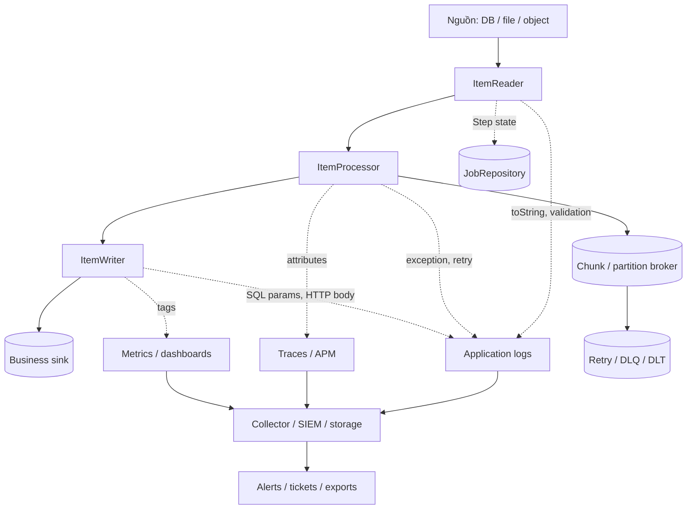
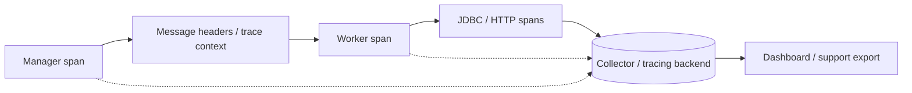
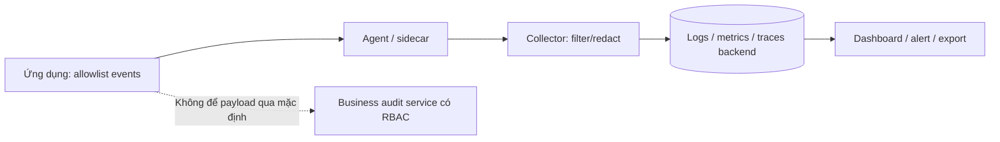

# Ẩn dữ liệu nghiệp vụ nhạy cảm

## 1. Vì sao observability có thể trở thành nơi rò rỉ dữ liệu?

Một pipeline Spring Batch xử lý hàng triệu giao dịch thanh toán. Mỗi item có mã khách hàng, email, số tài khoản, mã định danh giao dịch và token của nhà cung cấp. Khi một worker remote partitioning bị lỗi, lập trình viên thêm dòng log để dễ điều tra:

```java
// KHÔNG AN TOÀN: ví dụ phản diện, tuyệt đối không dùng với dữ liệu thật.
log.error("Cannot import payment record: {}", paymentRecord, exception);
```

Nếu `paymentRecord.toString()` in toàn bộ field, dữ liệu nghiệp vụ sẽ đi vào log agent, collector, log storage, dashboard, alert, ticket hỗ trợ và có thể tồn tại lâu hơn cả database nguồn. Ngoài ra `exception.getMessage()` hoặc stack trace có thể chứa **SQL bind values, URL query parameter, HTTP body hoặc một phần file CSV**. Một lần bật DEBUG để xử lý lỗi có thể làm dữ liệu nhạy cảm bị nhân bản sang nhiều hệ thống.

Với Spring Batch chạy **multi-threaded step, parallel steps, partitioning, remote chunking hoặc worker phân tán**, diện tích rò rỉ còn lớn hơn:

- Manager và workers có log/tracing pipeline, cấu hình và quyền truy cập khác nhau.
- `JobParameters` và `ExecutionContext` được ghi xuống `JobRepository` để phục vụ restart.
- `Partitioner` có thể ghép email, customer ID hoặc tenant name vào `StepExecution.stepName`.
- Remote chunk requests/replies, message headers, dead-letter queue và retry logs có thể chứa payload.
- Micrometer metrics hoặc OpenTelemetry span attributes có thể gắn business ID thành tag.
- Tool hỗ trợ vận hành xuất log, heap dump, SQL queries và snapshot sang nơi khác.

Chủ đề **“Ẩn dữ liệu nghiệp vụ nhạy cảm”** thuộc chương **Observability** của module **SPRING_BATCH_SCALING_OPERATIONS**. Mục tiêu module là mở rộng workload dữ liệu lớn mà vẫn đo được bottleneck, thread safety, retry/restart và chất lượng vận hành. Việc **bảo vệ dữ liệu ngay trong telemetry** là một phần của tính đúng kiến trúc, không phải thao tác dọn log ở bước cuối.

> **Nguyên tắc cốt lõi:** chỉ thu thập **tín hiệu cần để chẩn đoán và vận hành**, không thu thập payload nghiệp vụ theo mặc định. Ưu tiên **allowlist field an toàn tại nguồn phát telemetry**; redaction ở collector là lớp bảo vệ bổ sung, không phải bảo đảm duy nhất.

### Mục tiêu học tập

Sau bài, bạn có thể:

1. Lập bảng phân loại dữ liệu nhạy cảm và xác định đường đi qua logs, metrics, traces, metadata, broker và công cụ hỗ trợ.
2. Thiết kế schema sự kiện observability **không chứa business payload** nhưng vẫn điều tra được JobExecution/StepExecution và bottleneck.
3. Hiểu vì sao che bằng regex, thay bằng `***` hoặc hash SHA-256 trực tiếp **không đủ** cho mọi tình huống.
4. Viết `StepExecutionListener` và logging helpers để chỉ phát các trạng thái/counter cho phép.
5. Dùng mã tham chiếu ngẫu nhiên hoặc HMAC có khóa để hỗ trợ tra cứu theo quyền, không biến định danh nhạy cảm thành metric label.
6. Giữ `JobParameters`, `ExecutionContext` và tên partition an toàn, không làm hỏng checkpoint/restart.
7. Kiểm soát dữ liệu trong remote chunking, SQL logs, traces, Actuator, dump, dashboard và incident response.
8. Kiểm thử rò rỉ ở cả normal path, error path, crash, retry/restart, multi-worker và export pipeline.

## 2. “Nhạy cảm” không chỉ là mật khẩu

**Dữ liệu nhạy cảm** trong bài gồm những giá trị nếu bị tiết lộ, liên kết chéo hoặc sửa trái phép có thể gây rủi ro cho con người, khách hàng, tổ chức và bí mật thương mại. Nó không chỉ gồm PII (*personally identifiable information*).

| Nhóm | Ví dụ | Rủi ro trong telemetry |
| --- | --- | --- |
| **Thông tin cá nhân trực tiếp** | Họ tên, email, điện thoại, địa chỉ, số giấy tờ định danh | Lộ định danh, liên hệ trái phép |
| **Thông tin tài chính** | Số tài khoản, số thẻ, giao dịch, số dư, lương | Lộ tài chính và thói quen |
| **Dữ liệu nghiệp vụ độc quyền** | Giá hợp đồng, chiến lược khách hàng, đơn hàng, risk score | Lộ bí mật thương mại |
| **Thông tin y tế/hồ sơ đặc thù** | Kết quả xét nghiệm, hồ sơ điều trị | Rủi ro quyền riêng tư rất cao |
| **Secrets/credentials** | Password, API token, broker credential, JDBC URL có mật khẩu, private key | Chiếm quyền và lan truyền sự cố |
| **Định danh gián tiếp** | Customer ID, tenant ID, object key, file path chứa tên người | Có thể tra ngược hoặc ghép với dataset khác |
| **Metadata nhạy cảm** | Timestamp tương tác, IP, thiết bị, địa điểm, nguồn dữ liệu | Có thể suy luận hành vi hoặc nhận diện |
| **Payload lỗi** | Validation error kèm JSON/CSV row, SQL bind params, HTTP response body | Rò rỉ khi retry/fail |
| **Dữ liệu suy diễn** | Risk tier, fraud flag, segmentation, expected revenue | Tiết lộ quyết định nội bộ |

Một giá trị như `customer-000123` có thể không tự nhận diện khách hàng đối với người ngoài, nhưng nếu người có quyền tra cứu trong hệ thống khác thì nó vẫn **có khả năng liên kết**. Không mặc định một định danh có vẻ “nội bộ” là an toàn để xuất vào mọi hệ thống observability.

### 2.1. Bốn mức phân loại thực dụng

| Mức gợi ý | Loại dữ liệu | Cách xử lý mặc định |
| --- | --- | --- |
| **PUBLIC** | Tên chức năng đã công khai, nhãn trạng thái chuẩn | Có thể ghi trong telemetry phù hợp |
| **INTERNAL** | Mã component, environment, job type, ID hệ thống nội bộ không trực tiếp nhận diện cá nhân | Dùng có giới hạn và phân quyền |
| **CONFIDENTIAL** | Customer IDs, business amounts, order paths, tài liệu vận hành mật | Không đưa vào telemetry chung; dùng audit được bảo vệ nếu cần |
| **SECRET/RESTRICTED** | Access tokens, mật khẩu, khóa, dữ liệu cá nhân/nhạy cảm đặc biệt | Không log; quản lý qua secret store / kho dữ liệu có kiểm soát |

Tên bốn mức là **một mô hình nội bộ để triển khai**, không phải phân loại pháp lý áp dụng thống nhất mọi nơi. Tổ chức cần áp dụng chính sách bảo mật và quy định quyền riêng tư hiện hành phù hợp ngữ cảnh, loại dữ liệu, nơi lưu và thời gian lưu.

## 3. Bản đồ rò rỉ dữ liệu trong Spring Batch

Một item có thể bị ghi lại ở nhiều điểm, kể cả khi code của `ItemWriter` không bao giờ gọi logger.



### 3.1. Checklist theo lớp

| Lớp | Dữ liệu nguy cơ cao | Biện pháp chủ đạo |
| --- | --- | --- |
| Reader/processor/writer | Item `toString()`, full JSON/CSV, raw exception | Safe events, không log payload |
| JobRepository | `JobParameters`, `ExecutionContext`, step names, exit descriptions | Dùng reference IDs/allowlist, quyền DB và retention |
| JVM logging | MDC, stack traces, logging patterns, thread dumps | Schema an toàn, sanitization, không ghi secret |
| JDBC/APM | SQL literals, bind variables, connection URLs | Tắt param logging nhạy cảm, kiểm soát instrumentation |
| HTTP client/server | Authorization headers, URL query, request/response bodies | Header allowlist, không capture body, generic error |
| Broker | Headers, chunk payload, DLQ, retry transport | ACL/TLS/encryption/retention, không dump payload |
| Metrics | Tags/labels lấy từ input | Low cardinality allowlist |
| Traces | Span attributes, baggage, exception events | Attribute policy, sampling, collector redaction |
| Export/alert | Mẫu log trong Slack/email/tickets, incident bundles | Template dữ liệu tối thiểu, access control |
| Debug tools | `heapdump`, thread dump, file log, crash reports | Không mở công khai, quy trình truy cập tạm thời |

**Bài học quan trọng:** dữ liệu nhạy cảm vẫn có thể lọt vào telemetry **trước khi đến log collector**. Chỉ cấu hình một regex mask ở hệ thống tập trung không chặn mọi con đường, ví dụ file log cục bộ, heap dump, APM agent, retry topic hoặc screenshot dashboard.

## 4. Thiết kế “safe observability event” bằng allowlist

Với job xử lý thanh toán, một event vận hành hữu ích có thể có:

```json
{
  "event": "batch.partition.completed",
  "service": "spring-batch-scaling-operations",
  "job_type": "payment-import",
  "worker_step_type": "paymentWorker",
  "job_execution_id": 1750,
  "step_execution_id": 8191,
  "status": "COMPLETED",
  "read_count": 200000,
  "write_count": 199998,
  "filter_count": 2,
  "duration_ms": 91823,
  "retry_count": 0,
  "trace_id": "random-trace-reference"
}
```

Đây là **log schema minh họa**, không phải output mặc định Spring Batch. Nó không có email, số tài khoản, số tiền, API token hay payload record. `trace_id` phải là ID hợp lệ do trace system tạo; chuỗi ở trên chỉ minh họa.

Từ một event an toàn, SRE vẫn trả lời được:

- Worker nào chạy chậm, commit bao nhiêu records?
- Retry có tăng không, error category thuộc database hay transport?
- Partition nào có mismatch giữa read và write counts?
- Có StepExecution nào bị treo hoặc worker chết?
- Tổng runtime vượt SLA ở bước reader, processor hay writer?
- Manager có nhận đủ replies hay đang đợi?

Nếu cần xác minh **một giao dịch cụ thể**, điều đó thuộc **audit/reconciliation service với quyền riêng**, không phải lý do cho phép mọi logs/metrics hiển thị customer ID.

### 4.1. Allowlist khác denylist

**Allowlist** định nghĩa các field được phép xuất:

```text
event type
job type theo enum tĩnh
step type theo enum tĩnh
status theo enum
execution ID nội bộ có policy
counts và durations
error category chuẩn hóa
request/trace ID ngẫu nhiên, không phải business key
```

**Denylist** cố tìm và che những field đã biết như `password`, `token`, `email`. Nó thường bỏ sót alias: `apiKey`, `access_key`, `accountNo`, `payload`, `customerReference`, nội dung error message không có tên field, URL path hoặc một số định danh mới.

**Ưu tiên allowlist tại ứng dụng**; dùng denylist/regex tại collector như **defense in depth**, nhất là để phát hiện lỗi cấu hình hoặc thư viện phát log ngoài ý muốn.

### 4.2. Giữ tách biệt ba nhu cầu

| Nhu cầu | Dữ liệu | Cửa truy cập |
| --- | --- | --- |
| **Telemetry vận hành** | Counters, times, status, error category | Dashboard/log rộng hơn trong nội bộ |
| **Business audit** | Ai thực hiện thao tác gì với record nào, sau xác thực | Audit DB/service có RBAC, retention và truy cập được ghi nhận |
| **Forensic/debug nhạy cảm** | Mẫu dữ liệu tối thiểu được phê duyệt trong sự cố | Kênh hạn chế, thời gian ngắn, mã hóa và audit |

Không đưa dữ liệu audit vào log chung chỉ vì “đội hỗ trợ cần tra cứu”. Một trace ID trong log có thể giúp người vận hành chuyển sang công cụ audit, nhưng công cụ đó **phải tự xác thực quyền** và không được suy ra quyền từ việc sở hữu trace ID.

## 5. Chỗ rò rỉ ít được chú ý: JobParameters

`JobParameters` được dùng để định danh hoặc cấu hình `JobInstance`. Với JDBC `JobRepository`, những tham số này được lưu vào metadata database theo schema/version. Có thể xuất hiện ở:

- `JobOperator`, job launch APIs, dashboard và CLI;
- Bảng tham số job trong `JobRepository`;
- Exceptions khi launch/restart sai hoặc parameter validation fail;
- Log mặc định hay custom khi in `jobParameters.toString()`;
- Alert/webhook gửi metadata thực thi.

### 5.1. Ví dụ không nên làm

```java
// KHÔNG AN TOÀN: JobParameters có thể được lưu và in ở nhiều nơi.
JobParameters params = new JobParametersBuilder()
        .addString("customerEmail", email)
        .addString("apiToken", token)
        .addString("accountNumber", accountNumber)
        .toJobParameters();
```

Kể cả không log, bạn đã có nguy cơ lưu thông tin nhạy cảm trong `JobRepository`. Đặt `identifying=false` **không phải biện pháp mã hóa/ẩn dữ liệu**; non-identifying parameters vẫn có thể được persist và được đọc.

### 5.2. Dùng tham chiếu nghiệp vụ có kiểm soát

```java
// Mẫu tốt hơn: chỉ truyền opaque ID trỏ đến manifest đã kiểm soát.
JobParameters params = new JobParametersBuilder()
        .addString("manifestId", manifestId, true)
        .addString("sourceSchemaVersion", "v3", false)
        .toJobParameters();
```

`manifestId` phải là mã tham chiếu ngẫu nhiên/khó đoán hoặc một mã nội bộ **được đánh giá là không nhạy cảm đối với nơi nó xuất hiện**; nếu nó trực tiếp tiết lộ khách hàng/tenant thì chưa an toàn. Manifest store phải áp quyền kiểm soát độc lập, không cho xem dữ liệu chỉ bằng cách biết ID.

**Vì sao cần identifying parameter?** Khi restart Spring Batch, cùng `JobInstance` phải gắn với cùng input/snapshot. Dùng một `manifestId` identifying ổn định giúp tránh đổi tập nguồn vô tình. **Không** thay bằng một random `run.id` mới mỗi lần retry rồi gọi đó là restart.

### 5.3. Secrets nên nằm ở đâu?

- Password/credential đặt trong secret manager, environment/volume được bảo vệ hoặc cơ chế cấp quyền workload identity phù hợp.
- Worker nhận quyền qua configuration/identity, **không** qua `JobParameters`.
- Không serialize credential vào `ExecutionContext` để “dễ resume”.
- Hạn chế scope, rotation, audit và thời gian sống của secret.
- URL/kết nối chứa password/Authorization header không được log; đọc secret từ environment không tự bảo vệ nếu `/env`, heap dump hoặc debug logs bị mở.

## 6. ExecutionContext: checkpoint bền vững, không phải kho payload

`ExecutionContext` hỗ trợ restart ở `JobExecution` và `StepExecution`. Framework và ứng dụng có thể lưu offset, input resource, range, snapshot ID, cursor và trạng thái reader.

Vì metadata này có thể được **serialize xuống `JobRepository`**, thiết kế phải tránh:

```java
// KHÔNG AN TOÀN:
executionContext.put("currentPaymentRecord", paymentDto);
executionContext.putString("lastApiResponse", responseBody);
executionContext.putString("authorization", bearerToken);
executionContext.putString("accountId", rawAccountId);
```

Các giá trị như raw record, response body và secret có thể xuất hiện trong bảng context, database backups, export hoặc debug dump. Payload lớn còn gây tăng metadata size và chi phí commit/checkpoint.

### 6.1. Nên lưu gì?

| Field | Nên? | Lưu ý |
| --- | --- | --- |
| `snapshotId` | Có nếu không nhạy và quyền truy cập phù hợp | Phải ổn định qua restart |
| `fileId` hoặc resource key opaque | Có theo contract | Tránh tên file chứa email/CMND |
| `rangeStart/rangeEnd` | Có nếu range không rò PII | Nếu key là customer ID, dùng logical slice ID |
| `pageNumber`/`readCount` | Có | Không chứng minh output unique |
| `checkpointVersion` | Có | Version schema/reader cần rõ |
| Raw account number | Tránh | Trỏ tới manifest/database có quyền |
| Full JSON/CSV payload | Tránh | Tăng rò rỉ và metadata growth |
| API key/DB credential | Không | Dùng secret management |
| Exception stack trace chứa dữ liệu | Không | Log theo safe category |

### 6.2. Ví dụ context dùng IDs logic

```java
ExecutionContext context = new ExecutionContext();
context.putString("manifestId", manifestId);
context.putString("partitionId", "partition-000042");
context.putLong("offset", 18_000L);
context.putString("readerVersion", "v2");
```

`partitionId` là **mã logic không chứa raw tenant/business identity**. Một `Partitioner` thực tế còn phải bảo đảm tên partition và mapping input **không thay đổi khi restart cùng JobInstance**. Đổi partition names chỉ để tránh lộ thông tin **sau khi job đã có checkpoint** có thể làm recovery sai; cần sửa thiết kế ở nguồn manifest trước khi chạy batch mới.

### 6.3. Step name cũng có thể rò dữ liệu

```text
Không nên:
paymentWorker:email=person@example.invalid
paymentWorker:customerPhone=0900000000
paymentWorker:/data/tenant-acme/private/account-123.csv

Nên:
paymentWorker:partition-000042
```

Spring Batch sử dụng tên worker step để nhận diện partition; các giá trị này có thể xuất hiện ở `BATCH_STEP_EXECUTION.STEP_NAME`, metrics `spring.batch.step` tags, logs và traces. **Không lấy business key chưa được phân loại an toàn làm step name**.

## 7. Java: StepExecutionListener phát log theo allowlist

Một ứng dụng không cần in dữ liệu item để biết step có chạy đúng hay không. Ví dụ sau dùng **Spring Batch 5.x** và SLF4J:

```java
import java.sql.SQLException;
import java.util.List;

import org.slf4j.Logger;
import org.slf4j.LoggerFactory;
import org.springframework.batch.core.BatchStatus;
import org.springframework.batch.core.ExitStatus;
import org.springframework.batch.core.StepExecution;
import org.springframework.batch.core.StepExecutionListener;

public final class SafeBatchStepListener
        implements StepExecutionListener {

    private static final Logger LOG =
            LoggerFactory.getLogger(SafeBatchStepListener.class);

    @Override
    public ExitStatus afterStep(StepExecution execution) {
        String stepType = safeStepType(execution.getStepName());
        String outcome = execution.getStatus() == BatchStatus.COMPLETED
                ? "completed" : "not_completed";

        LOG.info(
            "batch.step.end step_type={} outcome={} " +
            "read_count={} write_count={} filter_count={} " +
            "rollback_count={}",
            stepType,
            outcome,
            execution.getReadCount(),
            execution.getWriteCount(),
            execution.getFilterCount(),
            execution.getRollbackCount()
        );

        if (!execution.getFailureExceptions().isEmpty()) {
            LOG.warn(
                "batch.step.failure step_type={} error_category={}",
                stepType,
                errorCategory(execution.getFailureExceptions())
            );
        }
        return null; // Không thay đổi ExitStatus.
    }

    private static String safeStepType(String stepName) {
        // Allowlist; không xuất nguyên raw StepExecution.stepName.
        if (stepName.equals("paymentManagerStep")) {
            return "payment_manager";
        }
        if (stepName.startsWith("paymentWorkerStep:")) {
            return "payment_worker";
        }
        return "other";
    }

    private static String errorCategory(List<Throwable> failures) {
        for (Throwable t : failures) {
            if (t instanceof SQLException) {
                return "database";
            }
        }
        return "processing";
    }
}
```

**Các giới hạn của ví dụ:**

- `errorCategory` chỉ là cách phân loại thô; production có thể xây **taxonomy ổn định** (`validation`, `database`, `network`, `timeout`, `security`, `unknown`).
- Không in trực tiếp exception object, `getMessage()`, raw SQL, `JobParameters`, `ExecutionContext` hoặc `StepExecution.toString()`.
- `safeStepType` chỉ xuất **tên loại step tĩnh**; không gắn partition name chứa dữ liệu nhạy cảm.
- `readCount`/`writeCount` là counters framework, **không chắc bằng unique committed business records** sau retry/restart.
- Listener ở đây không log dữ liệu, nhưng **không tự ngăn thư viện khác/driver/APM log payload**.
- `afterStep` chỉ chạy khi lifecycle tới callback; kill cứng có thể không phát log kết thúc. Vẫn cần JobRepository và health/heartbeat để quan sát stale executions.

### 7.1. Vì sao không log nguyên exception?

Ví dụ error path:

```java
// KHÔNG AN TOÀN nếu exception message chứa dữ liệu record.
LOG.error("Failed to write item {}", item, exception);

// Cũng có rủi ro khi exception.toString() chứa input.
LOG.error("Failed: {}", exception.getMessage());
```

Một validation exception có thể mang `Invalid row: email=...` hoặc HTTP client exception chứa response body. Stack trace đôi khi chứa SQL literals hoặc vendor-specific details. Nếu cần điều tra sâu, đưa **bằng chứng đã lọc** vào kênh restricted audit với quy trình riêng, không mở logging full payload trên toàn cluster.

Đối với một nhóm lỗi đã được kiểm toán **không chứa dữ liệu**, có thể log class + stack trace theo policy và sampling. Nhưng không biến “log stack trace mọi exception” thành mặc định cho pipeline có dữ liệu nhạy cảm.

### 7.2. Bảo đảm thread safety của logger và state

SLF4J logger thường được dùng giữa nhiều threads, nhưng **business state trong singleton listener/processor** có thể không thread-safe. Không đặt `currentCustomerId` vào một field mutable của singleton rồi log ở `afterStep`; dưới multi-threaded step, ID có thể bị tráo từ thread khác.

Nếu muốn log thêm throughput hoặc duration, đo bằng Micrometer Timer hoặc listener không giữ raw business state; không lưu cả item trong MDC/ThreadLocal để “nhặt lại lúc fail”.

## 8. Structured logging không có nghĩa tự động an toàn

Structured JSON logs giúp query dễ hơn, nhưng nếu app tạo:

```json
{
  "event": "batch.item.validation_failed",
  "payload": {
    "fullName": "Example Person",
    "email": "person@example.invalid",
    "accountNo": "DEMO-ACCOUNT-NOT-REAL",
    "token": "DEMO-TOKEN-NOT-REAL"
  },
  "exception": "Cannot parse record: { ...full payload... }"
}
```

thì JSON chỉ làm **dễ truy vấn thông tin nhạy cảm hơn**, không bảo vệ nó.

Mẫu phù hợp hơn:

```json
{
  "event": "batch.item.validation_failed",
  "job_type": "payment-import",
  "step_type": "paymentWorker",
  "error_category": "invalid_schema",
  "rule_code": "PAYMENT_DATE_FORMAT",
  "source_partition": "partition-000042",
  "retryable": false,
  "failed_count": 1
}
```

`rule_code` thuộc **enum ổn định**, không chứa input value. `source_partition` cũng phải được cấp theo mã an toàn, không chứa customer/tenant name.

### 8.1. Không dựa vào regex mask duy nhất

Một regex tìm email và số điện thoại có thể:

- Bỏ sót ID không có cấu trúc nhận diện rõ;
- Lỗi trên Unicode, mã hóa, nested JSON, Base64 hoặc multiline stack traces;
- Che nhầm thông tin kỹ thuật cần thiết;
- Không áp dụng cho binary payload, metrics tags hoặc message DLQ;
- Bị bỏ qua khi code đổi logging framework/encoder.

Có thể dùng regex ở agent/collector để phát hiện thêm, nhưng **không cho phép code tự do log raw records rồi hy vọng regex sẽ tìm hết**.

### 8.2. Masking một phần vẫn có thể nhận diện

```text
phone=******1234
email=p***@example.invalid
account=**********9876
```

Việc che bớt ký tự có thể vẫn cho phép liên kết thông tin với người thật, đặc biệt khi kết hợp timestamp, địa điểm, tenant ID, số tiền hoặc một event hiếm gặp. **Masked data chưa chắc đã ẩn danh** và vẫn cần phân loại, phân quyền và retention.

## 9. Mã tham chiếu cho tra cứu: random ID, hash hay HMAC?

Đôi khi cần nối log với business audit mà không xuất raw customer ID.

| Phương án | Ưu điểm | Giới hạn |
| --- | --- | --- |
| **Random opaque reference** | Không tiết lộ business key theo cú pháp | Cần registry bảo vệ; không coi biết ID là có quyền |
| **Hash SHA-256 trực tiếp** | Dễ tính, ổn định | Với domain nhỏ có thể đoán bằng dictionary/brute force |
| **HMAC-SHA-256 với secret key** | Khó đoán hơn khi không có key | Vẫn linkable, key compromise/rotation, không ẩn danh tuyệt đối |
| **Encrypt token** | Có thể giải mã khi được phép | Quản lý khóa, ciphertext và quyền giải mã |
| **Partial masking** | Dễ đọc cho con người | Có thể tái nhận diện; không phù hợp mọi chính sách |

**Không gọi một customer ID được hash là “dữ liệu hoàn toàn vô danh”.** Pseudonym vẫn có thể liên kết nhiều sự kiện, và một bên có key hoặc dữ liệu đối chiếu có thể tái định danh.

### 9.1. Java: tạo HMAC reference khi thật sự cần

```java
import java.nio.charset.StandardCharsets;
import java.util.Arrays;
import java.util.Base64;
import javax.crypto.Mac;
import javax.crypto.spec.SecretKeySpec;

public final class SafeReference {

    private SafeReference() {}

    public static String hmacReference(
            String namespace,
            String businessId,
            byte[] secretKey) throws Exception {

        if (secretKey == null || secretKey.length < 32) {
            throw new IllegalArgumentException("Invalid HMAC key");
        }

        // Tách namespace để tránh va chạm khác loại identifier.
        String input = namespace.length() + ":" + namespace
                + businessId.length() + ":" + businessId;

        Mac mac = Mac.getInstance("HmacSHA256");
        mac.init(new SecretKeySpec(secretKey, "HmacSHA256"));
        byte[] digest = mac.doFinal(
                input.getBytes(StandardCharsets.UTF_8));

        // 128-bit truncated reference cho use case tìm kiếm nội bộ.
        byte[] prefix = Arrays.copyOf(digest, 16);
        return Base64.getUrlEncoder()
                .withoutPadding()
                .encodeToString(prefix);
    }
}
```

**Điều kiện bắt buộc nếu áp dụng:**

- `secretKey` lấy từ secret manager/KMS hoặc cơ chế quản lý khóa được phê duyệt, **không** hardcode, đưa vào YAML/JobParameters hay log.
- Có `keyId`/rotation strategy và phạm vi namespace ổn định; khi rotate, cùng business ID cho reference khác.
- Không log input `businessId`, key hoặc combined string.
- 128-bit truncated output là tradeoff cho **reference**, không dùng làm bằng chứng duy nhất cho giao dịch tài chính hay authorization.
- Giá trị vẫn có tính **linkability** giữa những lần phát sinh có cùng key; quản trị như dữ liệu pseudonymized.
- **Không** dùng output này làm Prometheus tag theo từng khách hàng: dù được HMAC, cardinality và khả năng theo dõi cá nhân vẫn tồn tại.

Nếu chỉ cần join một job với log, **JobExecutionId/trace ID ngẫu nhiên** thường đơn giản và ít nguy cơ hơn việc tự HMAC customer ID.

### 9.2. Một ID an toàn ở log không tự an toàn ở mọi nơi

`job_execution_id` là ID nội bộ có thể giúp điều tra JobRepository. Tuy nhiên, khi kết hợp dashboard công khai, export ra bên ngoài hoặc khả năng truy vấn metadata không kiểm soát, nó vẫn có rủi ro liên kết. Phân quyền ở nơi **truy cập metadata thực** quan trọng hơn việc chỉ đổi tên field thành `id`.

## 10. MDC/ThreadLocal: context an toàn trong môi trường đa luồng

`MDC` giúp bổ sung field tự động vào log theo thread. Nếu đặt raw customer ID vào MDC, **mọi logger trên thread đó** có thể mang theo ID, kể cả thư viện bên thứ ba.

### 10.1. Anti-pattern

```java
// KHÔNG AN TOÀN:
MDC.put("customerEmail", customer.getEmail());
MDC.put("record", record.toString());
processor.process(record);
// Quên MDC.clear() khiến dữ liệu tràn sang item/job kế tiếp.
```

Trong thread pool, threads **được tái sử dụng**. Nếu MDC không xóa, context của một khách hàng hoặc JobExecution có thể xuất hiện trong logs của công việc khác. Với async/remote workers, MDC cũng **không tự truyền đúng** qua executor/broker; khi truyền tùy tiện có thể làm lộ cả context nhạy cảm sang node khác.

### 10.2. Đặt và xóa context an toàn theo scope

```java
import org.slf4j.MDC;

void processOneWorkUnit(
        long jobExecutionId,
        WorkUnit item) throws Exception {

    // Chỉ dùng trường đã được phân loại an toàn; không đưa item vào MDC.
    try (MDC.MDCCloseable job =
             MDC.putCloseable(
                 "job_execution_id", Long.toString(jobExecutionId));
         MDC.MDCCloseable stage =
             MDC.putCloseable("stage", "normalize")) {

        safeProcessor.process(item);
    }
}
```

Mã chỉ minh họa scope logging; `WorkUnit` và `safeProcessor` là dependency của ứng dụng. Với `MDC.MDCCloseable` theo SLF4J, giá trị được gỡ khi đóng scope. Nếu có MDC trước đó cần bảo tồn, phải có chiến lược snapshot/restore phù hợp; không giả định close luôn khôi phục mọi previous value.

**Đừng chia sẻ `MDC` tự động qua toàn bộ `TaskExecutor` mà không lọc keys.** Nếu dùng `TaskDecorator` hoặc context-propagation library, chỉ propagate **allowlisted fields** như trace context hoặc job type; không copy raw request headers/baggage/record metadata từ nguồn không tin cậy.

### 10.3. Correlation trong remote chunking

Khi manager gửi chunk/partition request, có thể dùng **transport correlation ID ngẫu nhiên hoặc protocol-defined correlation** để nối request/reply. Nhưng:

- Không thay đổi các header bắt buộc của Spring Batch Integration một cách tùy tiện.
- Không nhét raw account/customer ID vào `correlationId` để debug.
- Header được broker/consumer/logging agent ghi lại có thể tồn tại trong DLQ hoặc traces.
- Nếu cần business audit, lưu mapping correlation → business record trong service có RBAC.

## 11. Metrics: vì sao label không được chứa ID nghiệp vụ?

Micrometer metrics thường có tags; Prometheus export chúng thành label sets. Một ví dụ nguy hiểm:

```java
// KHÔNG AN TOÀN: vừa lộ ID vừa tạo cardinality cao.
Counter.builder("batch.payment.processed")
       .tag("customer_email", item.getCustomerEmail())
       .tag("account_no", item.getAccountNumber())
       .register(meterRegistry)
       .increment();
```

Nếu có 3 triệu khách hàng, bạn có thể tạo hàng triệu series, gây memory/ingestion cost, query chậm và phơi bày định danh trong `/actuator/prometheus`, dashboard, backups của TSDB.

### 11.1. Tags được khuyến nghị

| Tag | Ví dụ | Vì sao hợp lý |
| --- | --- | --- |
| `job_type` | `payment-import` | Enum tĩnh/low cardinality |
| `step_type` | `paymentWorker` | Tên loại step, không gồm partition key |
| `outcome` | `success` / `failure` | Tập giá trị nhỏ |
| `error_category` | `database` / `validation` / `network` | Taxonomy đóng |
| `source_type` | `file` / `jdbc` / `broker` | Tập nhỏ |
| `environment` | `prod` / `staging` | Không chứa bí mật |
| `worker_role` | `manager` / `worker` | Giúp chia pipeline |
| `size_class` | `small` / `medium` / `large` | Thể hiện cost mà không lộ raw value |

Không nên gắn:

- Email, phone, account number, card token, personal ID;
- File path có tên khách hàng;
- `JobParameters` hay `ExecutionContext` toàn bộ;
- `StepExecution.stepName` có hậu tố tenant/business key;
- `JobExecutionId`, `StepExecutionId` hoặc UUID cho mỗi item vào histogram có cardinality lớn;
- HMAC business ID per customer như một “cách hợp pháp hóa” metric label.

### 11.2. Metric có thể tiết lộ dữ liệu từ tập nhỏ

Ngay cả khi labels an toàn, một metric như:

```text
business_export_approved_amount{department="tiny-team-A"} = 912345.67
```

có thể suy ra số liệu nhạy cảm nếu chỉ một người/giao dịch trong nhóm. Cần xem **giá trị đo** có phải là dữ liệu nghiệp vụ bí mật không, không chỉ labels. Thay bằng count/duration/size band nếu đủ mục tiêu vận hành, hoặc để aggregate tài chính trong kho báo cáo có quyền riêng.

### 11.3. Spring Batch 5.x và 6.x có cách bật metrics khác nhau

Theo tài liệu **Spring Batch 5.2**, framework cung cấp các metrics Micrometer dưới prefix `spring.batch` như `spring.batch.job`, `spring.batch.step`, `spring.batch.item.read`, `spring.batch.chunk.write`. Còn tài liệu **Spring Batch 6.x** mô tả việc sử dụng `ObservationRegistry`/ObservationHandlers để kích hoạt metrics theo cấu hình.

**Tuy nhiên**, dù framework tự sinh các metrics, cấu hình **tên job/step** vẫn có thể chứa ID nghiệp vụ khi bạn đặt names không an toàn. Đừng coi “built-in metrics” là nơi chắc chắn không có dữ liệu nhạy cảm. Kiểm tra tags thực xuất, version dependency và `MeterFilter`/registry policy.

## 12. Java: custom metric chỉ dùng nhãn an toàn

```java
import io.micrometer.core.instrument.Counter;
import io.micrometer.core.instrument.MeterRegistry;

public final class SafeBatchMetrics {
    private final Counter succeeded;
    private final Counter failed;

    public SafeBatchMetrics(MeterRegistry registry) {
        this.succeeded = Counter.builder("batch.records.processed")
                .description("Records successfully processed")
                .tag("step_type", "payment_worker")
                .tag("outcome", "success")
                .register(registry);

        this.failed = Counter.builder("batch.records.processed")
                .description("Records that failed")
                .tag("step_type", "payment_worker")
                .tag("outcome", "failure")
                .register(registry);
    }

    public void onSuccess() {
        succeeded.increment();
    }

    public void onFailure() {
        failed.increment();
    }
}
```

Với ứng dụng thật, cần định nghĩa **“processed” ở ranh giới nào**: đọc, processor thành công, writer invoked hay **sink committed**. Gọi `onSuccess()` trước transaction commit có thể tạo metric đếm cả items sau đó rollback. Cần ghi contract rõ ràng; metrics counters thường phục vụ performance, không thay thế business audit và reconciliation sau retry/restart.

**Lưu ý thread safety:** Micrometer `Counter` thường hỗ trợ increment từ nhiều threads; trái lại business accumulator tự tạo như `HashMap<customerId, count>` cần đồng bộ và có nguy cơ giữ dữ liệu nhạy cảm trong heap. Đừng biến metrics thành kho customer state.

## 13. Traces: span attributes, baggage và error events

Distributed tracing giúp nối manager → broker → worker → database. Nó cũng có thể lan truyền metadata ra **nhiều process và tổ chức**.



Những trường nên cân nhắc:

| Field | Hành vi khuyến nghị |
| --- | --- |
| `trace_id`, `span_id` | ID tracing do hệ thống tạo; vẫn phân quyền và retention |
| `job_type`, `step_type` | Low-cardinality, không chứa raw IDs |
| `partition_group` | Enum/size bucket nếu giúp điều tra |
| `retry_attempt` | Số lượng nhỏ, không kèm payload |
| `db.system`, `messaging.system` | Thuộc tính kỹ thuật theo semantic conventions |
| Raw SQL/bind values | Tắt capture hoặc sanitize trước khi xuất |
| URL đầy query params | Dùng sanitized route/path, không capture token |
| HTTP request/response body | Không capture mặc định |
| `user.id`, `account.number` | Tránh trong trace chung, không tự gắn |
| `baggage` chứa dữ liệu người dùng | Không phát tán; lọc ở nguồn |

### 13.1. Baggage là kênh phát tán đặc biệt

OpenTelemetry/W3C Baggage cho phép truyền key/value qua process boundaries. Nếu đưa email/tenant bí mật vào baggage, nó có thể đi theo HTTP headers, queue messages và logs của nhiều services ngoài phạm vi batch.

**Không cho user-controlled baggage được copy vào every span/log.** Chọn các key được phép, kiểm tra size/quota và loại bỏ dữ liệu nhạy cảm ở ingress; khi tích hợp service bên ngoài, quy định rõ context propagation nào được gửi.

### 13.2. Sampling không phải redaction

Sampling 1% traces **vẫn có thể lưu 1% payload nhạy cảm**. Nó giảm volume, không biến dữ liệu còn lại thành an toàn. Hơn nữa các logs, metrics, unsampled context propagation, APM errors hoặc broker headers vẫn có thể chứa dữ liệu.

**Privacy controls phải áp dụng trước khi sampling/export**, đồng thời collector có cơ chế phòng vệ thứ hai. Không trông chờ sampling hoặc chi phí storage để giải quyết bảo mật.

### 13.3. Exception event trong spans

Trace instrumentations có thể tự tạo `exception.message`, `exception.stacktrace`. Nếu exception message chứa item input, nó vẫn sẽ xuất ở tracing backend dù logging app đã bỏ payload.

Đặt chính sách cụ thể:

1. Tắt/tùy biến exception capture nhạy cảm ở instrumentation được sử dụng.
2. Phân loại error codes theo enum an toàn.
3. Dùng code review và integration tests cho exceptions từ JDBC/HTTP client.
4. Chặn nội dung đã nhiễm ở collector trước export, theo version và exporter.
5. Xác định đường forensic riêng cho sự cố cần stack trace đầy đủ.

## 14. SQL/JDBC logging và APM: nguy cơ bind parameters

Một query batch có thể hợp lệ:

```sql
SELECT invoice_id, customer_email, amount
FROM invoice_source
WHERE customer_email = :customerEmail
  AND batch_id = :batchId;
```

Nếu bật JDBC bind-parameter logging, các values nhạy cảm có thể bị xuất:

```text
[UNSAFE EXAMPLE]
Preparing statement ... customer_email=person@example.invalid
Binding parameter [1] = person@example.invalid
```

Tương tự, `JdbcBatchItemWriter` với SQL chứa thông tin nghiệp vụ có thể khiến ORM/JDBC driver, proxy như SQL logger, APM instrumentation hoặc database audit logs lưu bind values. Có thể phát sinh trong:

- Spring JDBC DEBUG/TRACE logging hoặc `StatementCreatorUtils` theo version;
- Hibernate/JPA parameter binding logs;
- JDBC proxy như p6spy/log4jdbc nếu được cài;
- Driver-level wire/protocol logging;
- APM SQL capture/slow query sampling;
- Database server logs, pg_stat_statement/query logs hoặc audit extension;
- Application error messages chứa SQL literals.

**Không có một property duy nhất tắt toàn bộ đường rò rỉ trên mọi thư viện**. Cần kiểm tra stack thực tế và cấu hình tương ứng. Production nên đo query duration, SQL operation/query fingerprint đã sanitize, row count, error category, connection wait; không cần raw bind values để biết DB đang chậm.

### 14.1. Query fingerprint an toàn hơn câu SQL nguyên bản

```text
Không nên:
SELECT * FROM customers WHERE email='person@example.invalid'

Có thể dùng:
operation=read_customer
db_system=postgresql
query_template_id=CUSTOMER_LOOKUP_V1
duration_ms=118
rows=1
```

Tên `query_template_id` là nhãn tĩnh do ứng dụng định nghĩa, không chứa identifier input. Nếu APM tự normalize SQL thành fingerprint, phải **kiểm chứng thực** nó không giữ literal/PII trong field khác, tags hoặc exception events.

### 14.2. Debug một item hỏng mà không in item

Thay vì log record hỏng:

1. Ghi `rule_code` an toàn, input source version và partition ID opaque.
2. Tăng metric số item lỗi theo **error category**.
3. Ghi một **audit reference** tới record trong kho hạn chế, không in giá trị.
4. Người có quyền có thể truy record theo quy trình đã audit.
5. Khi cần chia sẻ cho developer, dùng **synthetic/test record** cùng đặc tính lỗi, không đưa dữ liệu khách hàng thật lên ticket.

## 15. HTTP/REST và external API: đừng để token vào telemetry

Worker có thể gọi API tính phí, thanh toán hoặc kiểm tra giao dịch. Các nguồn rò rỉ phổ biến:

- `Authorization: Bearer ...`, API key ở header/query string;
- URL có `?email=...` hoặc `?access_token=...`;
- Request/response body trong HTTP client interceptors;
- Server error trả về toàn bộ request;
- Exception message chứa `responseBodyAsString`;
- Reverse proxy/sidecar access logs và APM spans;
- Retry libraries log payload trong mỗi attempt.

**Thiết kế tốt hơn:**

```text
HTTP method = POST
route template = /payments/{id}/validate
status family = 5xx
retryable = true
duration_ms = 430
error_category = downstream_timeout
external_service = payment_gateway
```

Không log raw URL với token hoặc business identifier. Với một response `429`, ghi status và retry/backoff budget, không cần response body. Nếu gateway trả về error code chứa dữ liệu do người dùng nhập, dùng một mapping sang **internal safe enum**.

## 16. Messaging: remote chunking, partitioning, DLQ và replies

Trong **remote chunking**, manager gửi một `ChunkRequest` chứa **items** đến workers. Nếu item là payment DTO, broker request queue **đang thực sự chứa dữ liệu nghiệp vụ**, dù logs không in nó. Worker replies, failure payloads hoặc error channels cũng có thể mang metadata nhạy cảm theo adapter/version.

Trong **remote partitioning**, message thường chứa step execution identity/context, nhưng `ExecutionContext` hoặc partition name vẫn có thể rò PII nếu đặt sai.

### 16.1. Vì sao DLQ vẫn là nơi lưu dữ liệu nhạy cảm?

Khi một message xử lý lỗi, broker có thể copy/move payload sang DLQ/DLT. Điều đó tạo thêm bản sao có tuổi thọ khác, có thể được:

- Tải xuống để replay thủ công;
- Mở trong broker management UI;
- Log ra bởi worker/tool chẩn đoán;
- Export sang data lake để phân tích lỗi;
- Truy cập bởi đội có quyền broker nhưng không có quyền DB nguồn.

**DLQ không tự động là “vùng an toàn” chỉ vì tên queue là `dead-letter`.** Cần ACL, encryption in transit/at rest theo provider, retention, audit, giới hạn read access và replay tooling.

### 16.2. Hợp đồng telemetry cho chunk requests

| Nên ghi | Không ghi |
| --- | --- |
| Job type và worker step type | Toàn bộ `ChunkRequest.toString()` |
| Partition ID opaque, chunk sequence theo protocol | Danh sách item IDs nhạy cảm |
| Payload **bytes** hoặc record count | Raw serialized payload |
| Retry count/transport error category | Authorization header, broker credentials |
| Correlation ID được phép | Customer account number làm correlation ID |
| Publish/receive/ACK/reply latency | Response body chứa dữ liệu nghiệp vụ |
| Worker outcome và sink commit signal | SQL bind values từ writer |

Không có metric transport nào chứng minh **business exactly-once**. Worker có thể commit DB rồi mất reply; manager retry khiến item được xử lý lại. Hãy dùng business idempotency và reconciliation; việc **không log payload** không được làm hỏng cơ chế dedup/khôi phục.

### 16.3. Bảo vệ retry/restart logs

```text
Không nên:
"Retrying customer=ACCT-... payload={...} token=..."

Nên:
"batch.work.retry step_type=payment_worker
 error_category=downstream_timeout
 retry_attempt=2 backoff_ms=800"
```

Chỉ xuất `retry_attempt`, status, duration, error code an toàn. Nếu cần biết công việc cụ thể nào bị lỗi, dùng correlation/reference đã được phân quyền, không log business payload.

## 17. Spring Boot Actuator không thay thế chính sách dữ liệu

Spring Boot Actuator có thể cung cấp metrics, health và các endpoints như `/env`, `/configprops`, `/logfile`, `/heapdump` hoặc `/httpexchanges` tùy dependency/configuration. Một số endpoint có thể hiển thị secrets, log hoặc memory.

Theo tài liệu Spring Boot gần đây, `/env` và `/configprops` có cơ chế **sanitization mặc định**, và `show-values` có các chính sách như `never`/`when-authorized`/`always`. **Đừng đổi `show-values=always` để debug production** mà bỏ qua dữ liệu được phát tán; đồng thời không giả định tự động sanitization bảo vệ mọi custom actuator endpoint hoặc heap dump.

### 17.1. Một cấu hình exposure thận trọng, mang tính minh họa

```yaml
management:
  endpoints:
    web:
      exposure:
        include: health,info,prometheus
  endpoint:
    env:
      show-values: never
    configprops:
      show-values: never
```

Cú pháp thuộc **Spring Boot các phiên bản hiện đại**; phải đối chiếu version thực. Đây **không phải cấu hình bảo mật hoàn chỉnh**: `/prometheus` và `/health` vẫn có thể để lộ topology/business metrics nếu public. Cần secure ingress, Spring Security/roles, network policy, TLS, auth của monitoring collector và quyền theo môi trường.

**Nếu có custom `SecurityFilterChain`**, auto-security của actuator có thể không áp dụng như bạn tưởng. Kiểm thử truy cập thực bằng người dùng không đăng nhập, user thường và monitoring service identity.

### 17.2. Những endpoint đặc biệt nhạy cảm

- `heapdump`: có thể chứa DTO, secret và strings đã giải mã trong heap.
- `logfile`: trả nguyên nội dung file log nếu app cấu hình log file.
- `env/configprops`: có thể hiển thị giá trị cấu hình khi cho phép unsanitized.
- `httpexchanges`: metadata request/response, có thể rò route hoặc headers tùy capture.
- `threaddump`: thường ít payload hơn heap dump, nhưng vẫn có thể tiết lộ tên thread chứa business key.
- Custom endpoints `/jobparameters`/`/executions`: cần validate output DTO, không trả `ExecutionContext` nguyên vẹn.

Chỉ expose những endpoint thật sự cần cho vận hành; giám sát phải có kênh riêng được bảo vệ. Không lấy “chỉ dùng nội bộ VPC” làm lý do duy nhất để bỏ auth.

## 18. Collector và pipeline redaction: lớp phòng vệ thứ hai

Một pipeline observability có thể có các tầng:



### 18.1. Điều nên làm tại collector

- Chỉ nhận attributes thuộc schema đã công bố nếu nguồn có khả năng chuẩn hóa.
- Loại bỏ known sensitive headers (Authorization, Cookie, token-like fields).
- Sanitize `url.query`, `db.statement`/query literals, exception messages theo policy.
- Giới hạn event size, sampling và retry/export queues có quota.
- Bảo vệ collector ↔ backend bằng authentication/TLS và quyền tối thiểu.
- Log/metric được **đo số sự kiện bị chặn** mà không xuất lại nội dung bị chặn.
- Version pin cấu hình collector/agent, kiểm thử khi cập nhật instrumentation.
- Xác định fail-open/fail-closed behavior khi redaction component lỗi.

**Không** log raw event để kiểm tra vì sao redaction thất bại; làm vậy vô tình tạo thêm một log rò rỉ. Có thể log **field names, category và số lượng**, không log rejected values.

### 18.2. Không phụ thuộc một chốt chặn

Nếu ứng dụng ghi raw PII vào file trước khi collector đọc, dữ liệu đã tồn tại trên disk. Nếu collector chỉ lọc logs mà APM agent gửi traces riêng, traces vẫn rò. Nếu collector giảm số labels metrics nhưng dump JobRepository bị export tự do, metadata vẫn rò.

Cần kiểm soát theo hướng **data minimization ở nguồn + redaction tại agent + access control ở storage + audit/retention**.

## 19. Error handling: vừa đủ để debug, không lộ payload

Làm thế nào điều tra lỗi cụ thể mà không log dữ liệu cá nhân?

### 19.1. Dùng taxonomy lỗi và mã rule

| Nhóm lỗi | Field an toàn nên log | Cấm in theo mặc định |
| --- | --- | --- |
| CSV parse | `error_category=bad_format`, column/rule code tĩnh, file-partition opaque | Raw row, tên file chứa khách hàng |
| Constraint violation | `error_category=constraint`, constraint enum nội bộ | SQL bind values, record contents |
| API timeout | `error_category=timeout`, remote service name tĩnh, duration | Full URL/token/body |
| Auth failure | `error_category=auth`, endpoint type | Credential, token, full header |
| Broker unavailable | `error_category=transport`, queue type, retry count | Message payload, broker password |
| Duplicate business event | `error_category=duplicate`, retry count | Raw business key, event payload |
| Permission denied | `error_category=access`, component name | Complete secret path, credential |
| Unmapped exception | `error_category=unknown`, alert reference | Raw stack trace nếu chưa scrub |

Không dùng `exception.getClass().getSimpleName()` làm business rule code nếu tên class do plugin/tenant source tùy biến và có dữ liệu ngoài ý muốn; với các lỗi nhạy cảm, mapping về **enum đã kiểm soát** giúp ổn định dashboard và hạn chế thông tin.

### 19.2. Quarantine một record sai có được không?

Nếu cần lưu raw record để xử lý lại, có thể đưa vào **quarantine data store** với:

- Quyền truy cập tương đương hoặc nghiêm hơn source;
- Encryption và secret management;
- Retention theo business/legal policy;
- Immutable ID/reference để đối chiếu;
- Audit access và thao tác export/download;
- Replay tool có kiểm tra quyền và idempotency;
- Không copy record sang logging backend hoặc public ticket.

Quarantine **là một hệ thống lưu business data**, không phải “log được bảo vệ vì nằm trong DLQ”. Nó phải nằm trong data governance và threat model của pipeline.

## 20. Dashboards và alerts cũng có thể lộ dữ liệu

Dashboard thường được chia sẻ rộng hơn production database. Một màn hình “top failed customers” chứa account IDs hoặc số tiền có thể là rò rỉ dù log ban đầu có ACL.

### 20.1. Thiết kế dashboard theo vai trò

| Vai trò | Xem được | Không cần |
| --- | --- | --- |
| SRE vận hành | Job type, runtime, queue depth, status, error category, trace ref | Raw customer/item payload |
| Developer | Code errors category, sanitized traces, performance spans | Toàn bộ bản ghi thật |
| Business operator | Aggregated counts, approved reports, audit link theo quyền | Broker credential, raw stack traces |
| Security responder | Indicators/incident IDs, access audit, phạm vi rò | Quyền duy trì truy cập mọi records |
| Quản trị kho audit | Business record theo request/approval có kiểm soát | Mặc định export vô hạn ra dashboard |

**Rủi ro bổ sung:** alert gửi qua email/chat/ticket có thể được lưu hoặc chuyển tiếp ra bên ngoài tổ chức. Nội dung alert nên là:

```text
Job payment-import
Partition group impacted: 8 of 64
Error category: downstream_timeout
SLA risk: high
Trace reference: <opaque internal link>
```

Không gửi kèm full log event/body hoặc screenshot chứa customer fields. Nếu link có thể truy cập không cần auth, **opaque URL không phải biện pháp phân quyền**.

### 20.2. Data aggregation có thể không đủ bảo vệ

Nếu một tenant chỉ có **một giao dịch** trong một khoảng thời gian, dashboard hiển thị tổng tiền theo tenant vẫn có thể suy ra giá trị giao dịch. Cân nhắc áp dụng minimum cohort size, suppression, aggregation level và data access policy phù hợp; không có một con số k-anonymity cố định giải quyết mọi trường hợp.

## 21. Retention, encryption và phân quyền

Ẩn payload trong ứng dụng là tuyến phòng thủ đầu tiên. Các bản sao telemetry đã lưu còn cần:

1. **Least privilege**: log viewers, dashboard editors, exporters và collector service accounts có quyền tối thiểu.
2. **Encryption in transit**: app → collector → backend qua TLS/mTLS phù hợp; broker transport cũng cần bảo vệ.
3. **Encryption at rest**: logs, traces, metric storage, JobRepository, quarantine/DLQ, backups và object exports.
4. **Retention ngắn nhất hợp lý**: khác nhau giữa troubleshooting telemetry và business audit theo yêu cầu.
5. **Access audit**: ai truy vấn/xuất log, xem audit record, tải heap dump hoặc incident bundle.
6. **Backup/replica policy**: dữ liệu có thể đã bị nhân bản sang vùng và account khác.
7. **Deletion/correction workflow**: nếu phát hiện PII trong telemetry, phải xử lý các bản lưu và bản sao theo quy trình, không chỉ sửa code.
8. **Cross-tenant isolation**: query và dashboard không cho tenant này xem telemetry dẫn tới tenant khác.
9. **Secret rotation**: nếu token bị log, xóa log chưa đủ; phải thu hồi/đổi secret theo incident response.
10. **Authorized break-glass**: truy cập forensic phải có approval, audit, scope, thời hạn và hậu kiểm.

**Không tạo default “giữ log càng lâu càng tốt”.** Logging backend không phải kho lưu business events chuẩn; dữ liệu quá cũ, thiếu identity và không có quyền/retention tương ứng dễ trở thành rủi ro tồn đọng.

## 22. Multi-tenant batch và nguy cơ liên kết dữ liệu

Trong hệ thống multi-tenant, một số thông tin tưởng như kỹ thuật lại có khả năng suy luận:

```text
paymentWorker:tenant=bank-premium-A
source_path=/data/bank-premium-A/settlement-2026-11-26.csv
exception=Invalid account for customer 8472...
metric_tag={tenant=bank-premium-A, high_value=true}
```

Đây đều có thể làm lộ danh tính khách hàng lớn, thời điểm settlement, quy mô dữ liệu hoặc cấp độ giao dịch.

### 22.1. Giữ tenant isolation mà không phát tán tenant ID

- Gán partition logical ID có namespace an toàn và lưu mapping ở registry có quyền.
- Giới hạn quyền JobRepository query hoặc tách metadata theo boundary nếu nhiều tenant không cùng trust domain.
- Tách roles/tenancy của log index, tracer và dashboard; không cho query xuyên tenant theo mặc định.
- Có thể dùng cohort/tenant class **nếu được phê duyệt** và không suy ra danh tính từ nhóm quá nhỏ.
- Với debugging một tenant, dùng audit reference và authorization riêng, không tăng mức log DEBUG toàn cluster.
- Data residency/retention của telemetry có thể khác business DB; phải đánh giá trước khi export.

### 22.2. Biến một file name thành metric label là rủi ro kép

Một `filePath` chứa `/customer-A/statement-2026-11.csv` vừa tiết lộ tenant vừa có cardinality theo file. Dùng `source_type=file`, `format=csv`, `size_bucket=large`; file identity chi tiết nằm trong manifest/audit registry hạn chế.

## 23. Hiệu năng và chi phí của privacy-safe observability

Data minimization thường **giảm** chi phí vì không serialize DTO và không gửi payload lớn vào logging pipeline. Nhưng một số cơ chế bảo vệ cũng tốn tài nguyên:

| Cơ chế | Chi phí | Cách quản lý |
| --- | --- | --- |
| HMAC per item | CPU cryptography và secret access | Dùng khi thật sự cần; không HMAC hàng triệu records chỉ để log |
| Regex redaction nhiều tầng | CPU/latency và false positives | Allowlist từ nguồn; benchmark |
| Structured logging | JSON encode và allocation | Chọn sampling/level phù hợp |
| OpenTelemetry tracing | Span memory/export bytes | Instrument stage quan trọng; không ghi payload |
| Histogram metrics | Time series/bucket cost | Low cardinality và số bucket hợp lý |
| Audit reference lookup | Truy vấn registry/DB được bảo vệ | Chỉ khi người có quyền điều tra |
| Encryption và DLP scan | I/O/CPU | Tách khỏi hot path khi có kiến trúc phù hợp |
| Quarantine records | Storage và compliance lifecycle | Bounded retention/capacity |

**Đừng dùng “privacy” làm lý do tắt toàn bộ metrics khi không cần thiết.** Có thể duy trì CPU, JVM GC, DB pool, queue age, chunk duration và retry rate bằng dữ liệu tổng hợp an toàn. Bài toán là giảm độ nhạy của telemetry, không xóa khả năng vận hành.

## 24. Kiểm thử bảo đảm không rò dữ liệu

Một security review trên source code chưa đủ. Cần chạy pipeline với **synthetic canary values**, buộc các failure paths phát sinh và kiểm tra **tất cả observability outputs**.

### 24.1. Bộ canary giả lập

```text
Synthetic email:    canary-user@example.invalid
Synthetic account:  DEMO-ACCOUNT-PLACEHOLDER-4137
Synthetic token:    DO-NOT-USE-TOKEN-CANARY-5981
Synthetic tenant:   canary-tenant-confidential
Synthetic URL:      https://example.invalid/api?access_token=CANARY
```

Các giá trị này **không phải dữ liệu thật**, không phải credentials có thể sử dụng. Trong test có kiểm soát, tạo cùng canary ở JSON fields, CSV columns, JobParameters (negative test), Exception message, broker headers, database bind parameters và đường dẫn file.

### 24.2. Test matrix

| Test | Tình huống | Kỳ vọng |
| --- | --- | --- |
| T01 | Normal successful chunk | Không có raw canary trong logs/traces/metrics |
| T02 | Invalid CSV/JSON record | Chỉ log rule code/error category |
| T03 | Writer SQL constraint exception | Không xuất bind params/raw record |
| T04 | HTTP 429/500 trả về body chứa canary | Không capture response body |
| T05 | Debug/TRACE vô tình bật cho JDBC | Security test fail nếu parameter logging rò |
| T06 | ItemProcessor retry | Không log full DTO mỗi attempt |
| T07 | Worker crash sau DB commit trước reply | Không xuất chunk payload trong retry/error logs |
| T08 | Remote chunking DLQ | ACL và retention đúng; không expose qua dashboard |
| T09 | Manager/worker MDC reuse | Không còn context tenant của task trước |
| T10 | ThreadPoolTaskExecutor async | Không truyền raw MDC/baggage sang threads khác |
| T11 | Partition name chứa email (negative test) | Preflight reject name hoặc telemetry không ghi raw |
| T12 | JobParameters chứa token (negative test) | Launch policy reject; không persist token |
| T13 | ExecutionContext chứa raw DTO (negative test) | Validation reject hoặc test phát hiện metadata contamination |
| T14 | Actuator `/env`/`/configprops` | Không hiện secret cho unauthorized users |
| T15 | `/heapdump`/`/logfile` endpoint | Không thể truy cập trái quyền |
| T16 | Metrics label dùng account number | MeterFilter/schema test từ chối |
| T17 | Trace exception event chứa payload | Scrubber/instrumentation policy chặn |
| T18 | Collector exporter fail | Không fallback ghi raw payload vào stderr/backup |
| T19 | Support ticket alert mẫu | Không kèm canary/body/secret |
| T20 | JobRepository SQL query audit | Quyền hạn và metadata field policy đúng |
| T21 | Rolling deploy worker hai phiên bản | Cả hai vẫn áp policy log/trace thống nhất |
| T22 | Incident export/backups | Sanitization/retention và RBAC trên bản copy |
| T23 | Pseudonym HMAC lookup | Không suy ra ID khi thiếu secret; rotation được kiểm thử |
| T24 | Failed business reconciliation | Report có counts/IDs opaque, không dump toàn dataset |

### 24.3. Quét output của test harness

Quy trình tham khảo:

```text
1. Seed test-only synthetic dataset với known canary strings.
2. Bật instrumentation gần giống production theo version thực tế.
3. Chạy successful, failed, timeout, retry và worker-crash scenarios.
4. Thu logs từ app, sidecar, collector và backend.
5. Thu spans, metrics labels/values, alert payload và Actuator responses.
6. Inspect JobRepository/ExecutionContext chỉ trong test DB được phép.
7. Kiểm tra broker request/reply/DLQ bằng quyền test-only.
8. Tìm exact canary + biến thể URL-encoded/JSON-escaped/Base64.
9. Kiểm tra ngữ nghĩa schema allowlist; không chỉ regex string.
10. Fail pipeline nếu một canary xuất hiện ở telemetry không được phép.
11. Kiểm tra business output vẫn chính xác và restart vẫn hoạt động.
```

**Không làm test bằng PII thật.** Canary exact-match giúp phát hiện một số rò rỉ, nhưng không bao trùm mọi cách biến đổi, encoding hay loại dữ liệu. Kết hợp schema validation, static analysis/code review và DLP scan của môi trường sản xuất theo chính sách.

### 24.4. Ví dụ Java unit test với in-memory logger

Thay vì phụ thuộc một thư viện logging test cụ thể, ý tưởng contract:

```java
// PSEUDOCODE: triển khai với ListAppender/TestLogger
// tùy Logback/Log4j2 version của dự án.
var canary = "canary-user@example.invalid";

runBatchWithSyntheticItemAndForcedValidationError(canary);

String logs = captureTestLogEvents();
assertThat(logs).doesNotContain(canary);
assertThat(logs).contains("error_category=invalid_schema");

// Bổ sung assertions cho traces, metrics labels và JobRepository.
// Unit test log không đủ để chứng minh collector/transport an toàn.
```

Không triển khai business replay bằng cách ném exception sau commit giả nếu test thật sự cần kiểm chứng **DB commit thành công nhưng reply bị mất**; phải dùng fault hook đúng thời điểm hoặc broker/network proxy trong integration test.

## 25. Runbook khi phát hiện dữ liệu nhạy cảm trong telemetry

### Bước 1 — Khoanh vùng nhanh

Xác định loại dữ liệu (PII, secret, financial, business confidential), nguồn xuất (logger/JDBC/APM/exception/JobRepository/broker), khoảng thời gian, services, worker versions và các nơi đã được export. Không phát tán mẫu dữ liệu nhạy cảm vào chat chung để “cho mọi người thấy”.

### Bước 2 — Ngăn rò rỉ tiếp diễn

- Tắt/cấu hình lại **đúng logging path** đang phát dữ liệu, không tắt bừa toàn bộ quan sát.
- Áp allowlist/redaction trước khi xuất.
- Với secret lộ, **revoke/rotate** theo incident policy; chỉ xóa log chưa đủ.
- Kiểm tra sidecars, collector và APM exporter khác có còn gửi nội dung hay không.
- Không tự làm mất bằng chứng cần cho điều tra có phê duyệt.

### Bước 3 — Xác định phạm vi bản sao

Log files cục bộ, agents, central storage, dashboards, traces, metrics, alert emails, tickets, DLQ, debug bundles, backups và DR replicas có thể cùng chứa bản sao. Cần điều tra **phạm vi truy cập thực** theo audit logs, không chỉ phạm vi “đã cấu hình”.

### Bước 4 — Khôi phục quyền kiểm soát

Điều chỉnh RBAC/ACL, revoke share links, giới hạn export/query, kiểm tra multi-tenant isolation. Sử dụng kênh forensic được kiểm soát cho những bản ghi cần giữ vì điều tra.

### Bước 5 — Xử lý dữ liệu lưu theo chính sách

Lên kế hoạch xóa/redact/expire ở tất cả nơi phù hợp, kể cả snapshots/backups theo cơ chế của platform và các nghĩa vụ pháp lý. Nếu có legal hold, xử lý theo quy trình được phê duyệt; không tự tuyên bố dữ liệu “đã bị xóa hết” khi còn bản sao chưa kiểm chứng.

### Bước 6 — Kiểm thử bản sửa

Chạy canary tests trên **normal, failure, retry, restart, distributed worker** và export paths. Đảm bảo vẫn có logging an toàn cho duration, error category, counts, retry, status và business reconciliation reference.

### Bước 7 — Hậu kiểm và phòng ngừa tái phát

Bổ sung policy vào code review, CI redaction tests, alerts từ DLP, instrumentation config kiểm soát phiên bản, registry phân loại fields và trách nhiệm sở hữu từng nguồn telemetry.

## 26. Case study: sự cố remote chunking vào giờ cao điểm

Một ngân hàng chạy nightly import từ file và dữ liệu JDBC trên **một manager và 12 remote workers**. Mỗi chunk chứa 500 giao dịch. Khi gateway timeout, worker dùng:

```java
// KHÔNG AN TOÀN:
log.warn("Retry chunk {}: {}", chunkId, items, gatewayException);
```

Log collector thu nhiều GB JSON mỗi giờ; team hỗ trợ tra được **số tài khoản và dữ liệu định danh** trong error traces. Worker còn in `ChunkRequest` vào logs, còn broker DLQ lưu payload đầy đủ. Hệ thống vẫn có đủ metrics runtime, nhưng rủi ro bảo mật đã vượt khỏi ứng dụng nguồn.

### 26.1. Phân tích nguyên nhân

1. DTO `toString()` trả toàn bộ fields.
2. Code log nguyên `items` và exception message tại failure path.
3. APM instrument HTTP client capture URL có query chứa identifier.
4. `Partitioner` đặt name theo raw account range, lộ trong `BATCH_STEP_EXECUTION` và metrics.
5. Broker DLQ retention dài, nhiều roles có quyền xem message body.
6. Dashboard support hiển thị raw exception để “tiện debug”.
7. Không có canary integration test cho retry/lost reply.

### 26.2. Cách xử lý

1. Đổi sang event schema allowlist: `step_type`, chunk sequence, retry attempt, error category, duration và counts.
2. Loại bỏ `items`/raw exception khỏi logs, sanitize exception events và JDBC/HTTP spans.
3. Đặt partition names dạng `partition-000x`, giữ mapping vào registry có RBAC; áp dụng cho **JobInstance mới**, không đổi checkpoint của job đang restart.
4. `JobParameters` chỉ chứa `manifestId` an toàn, không chứa account list/token.
5. Thiết kế DLQ có encryption, ACL, retention, replay tool và access audit; không xuất payload vào dashboard chung.
6. Giữ business idempotency/reconciliation theo transaction ID trong business DB, không xóa khóa nghiệp vụ chỉ để bảo vệ logs.
7. Đặt trace/correlation IDs theo giao thức, không chứa account ID.
8. Bảo vệ Actuator/logfile/heapdump và kiểm tra SecurityFilterChain.
9. Chạy canary tests gồm 429/500, JDBC exception, worker crash sau commit, manager restart, DLQ replay và collector export.
10. Đối chiếu throughput/queue age để chứng minh privacy controls **không làm mất khả năng vận hành**.

### 26.3. Điều gì được xem là thành công?

- Không tìm thấy raw canary từ test ở logs, traces, metrics labels, alerts hoặc Actuator không được phép.
- JobRepository chỉ lưu metadata/reference đã được phân loại; quyền truy cập đúng.
- DLQ/quarantine vẫn có payload theo contract nhưng được quản lý như **business data nhạy cảm**, không như log công khai.
- SRE vẫn xác định được worker lỗi, retry storm, partition straggler, backlog và RTO.
- Restart cùng JobInstance/manifest không sai checkpoint; output không bị mất/trùng vì idempotency vẫn hoạt động.
- Các secrets đã lộ được xử lý theo incident policy, bản sao telemetry được điều tra/giảm thiểu và có kiểm chứng.

**Không có nghĩa** sau một test pass hệ thống mãi mãi không thể rò: instrumentation upgrade, thư viện mới, custom exceptions và thay đổi schema dữ liệu có thể mở đường mới. Privacy observability cần kiểm tra định kỳ và mỗi lần thay đổi platform.

## 27. Những hiểu lầm thường gặp

| Nhận định | Điều đúng |
| --- | --- |
| “Log chỉ để nội bộ nên không cần bảo vệ.” | Log thường được sao chép sang nhiều backend, users và tickets. |
| “Ẩn password là đủ.” | PII, business data, indirect IDs và error payload cũng nhạy cảm. |
| “Structured JSON logging tự động an toàn.” | JSON vẫn có thể chứa nguyên payload. |
| “Regex mask email và phone sẽ chặn mọi rò rỉ.” | Có thể bỏ sót business IDs, encoding, traces, binary data và alias. |
| “Hash SHA-256 customer ID đã là anonymous.” | Domain thấp entropy có thể bị đoán và hash vẫn linkable. |
| “HMAC customer ID thì được dùng làm metric label.” | Pseudonym vẫn linkable và tạo cardinality cao. |
| “Chỉ mask vài ký tự cuối là đủ cho dữ liệu cá nhân.” | Kết hợp metadata vẫn có thể tái định danh. |
| “Non-identifying JobParameter không được lưu trong repository.” | Non-identifying không đồng nghĩa không persist. |
| “ExecutionContext chỉ tồn tại trong RAM.” | Context phục vụ checkpoint/restart và có thể được serialize vào DB. |
| “Partition name chỉ là tên kỹ thuật.” | Có thể chứa customer ID/path và thành metric tag. |
| “Log nguyên exception luôn an toàn vì chỉ có stack trace.” | Message, SQL params và HTTP body có thể nằm trong exception. |
| “MDC tự xóa và tự truyền đúng giữa threads.” | Thread reuse/context propagation có rủi ro leak/cross-task. |
| “Tắt DEBUG JDBC là xong.” | APM/driver/proxy/DB logs có thể còn capture values. |
| “Dùng sampling 1% thì dữ liệu đã an toàn.” | 1% còn lại vẫn có thể lộ raw PII. |
| “Collector redaction đủ, ứng dụng log gì cũng được.” | File log và agents khác có thể lưu payload trước collector. |
| “DLQ chỉ là hệ thống kỹ thuật, không chứa business data.” | Nó thường chứa nguyên message payload. |
| “Actuator auto-sanitization bảo vệ cả heapdump.” | Heap dumps có thể chứa dữ liệu trong bộ nhớ. |
| “Trace ID là quyền truy cập vào business record.” | Nó chỉ là reference; authorization phải tách riêng. |
| “Đổi raw account ID thành tên khác là đã an toàn.” | Classification theo giá trị, không theo tên field. |
| “Metrics chỉ có số nên không thể lộ business data.” | Values/tags của nhóm nhỏ vẫn có thể suy ra dữ liệu nhạy cảm. |
| “Job COMPLETED chứng minh không có rò rỉ.” | Batch correctness và privacy là hai thuộc tính khác nhau. |
| “Không log payload thì không điều tra được lỗi.” | Safe taxonomy, counts, traces, references và audit service hỗ trợ điều tra. |
| “Xóa log trung tâm là hết sự cố.” | Backups, agents, tickets, DLQ và exports có thể giữ bản sao. |

## 28. Câu hỏi tự kiểm tra

**Câu 1.** Một `JobParameter` chứa `customerEmail` nhưng đặt `identifying=false`. Như vậy email có còn nguy cơ bị persist vào `JobRepository` không?

*Gợi ý:* Có. Non-identifying chỉ ảnh hưởng cách tạo JobInstance identity, **không** phải cơ chế bảo mật.

**Câu 2.** Một `StepExecution.stepName` là `paymentWorker:account-9876`. Dù log không in item, nơi nào vẫn có thể lộ thông tin?

*Gợi ý:* Metadata `BATCH_STEP_EXECUTION`, built-in step metric tags, logs/traces hoặc dashboard.

**Câu 3.** Dùng `SHA-256(phone)` làm label metric có an toàn tuyệt đối không?

*Gợi ý:* Không. Phone domain có thể đoán, hash linkable và số series có thể tăng theo số người dùng.

**Câu 4.** Worker gọi `log.error("...", exception)` khi exception message chứa SQL bind values. Có nguy cơ gì?

*Gợi ý:* Log có thể chứa dữ liệu người dùng dù code không truyền trực tiếp `item` vào logger. Phải kiểm tra exception message và instrumentation.

**Câu 5.** Một log collector dùng regex che email. Vì sao vẫn phải kiểm thử APM traces và DLQ?

*Gợi ý:* Collector logs chỉ bảo vệ một đường xuất; traces và broker messages là hai hệ thống riêng, có thể giữ raw payload.

**Câu 6.** Vì sao MDC trong thread pool cần cleanup?

*Gợi ý:* Threads được reuse; context cũ có thể rò sang công việc/tenant khác và làm sai correlation.

**Câu 7.** Sau khi bỏ payload logging, làm sao điều tra một item sai mà vẫn bảo vệ dữ liệu?

*Gợi ý:* Safe error category/rule code + opaque reference; người có quyền truy record qua business audit/quarantine service.

**Câu 8.** Spring Batch metrics báo một worker hoàn thành, nhưng một DLQ vẫn chứa raw failed item. Có thể kết luận hệ thống đã “không rò dữ liệu” không?

*Gợi ý:* Không. DLQ chứa dữ liệu nghiệp vụ và cần ACL, encryption, retention, audit và không export payload vào observability chung.

**Câu 9.** Nếu phát hiện API token đã bị ghi log, có phải chỉ cần sửa logger và xóa record là xong?

*Gợi ý:* Không. Cần revoke/rotate secret, tìm bản sao/export, kiểm tra quyền truy cập và quy trình incident response.

## 29. Checklist đưa vào production

- [ ] Có data classification cho PII, financial/business secrets, credentials và indirect identifiers.
- [ ] Có sơ đồ luồng dữ liệu từ source qua reader/processor/writer đến logs/metrics/traces/JobRepository/broker.
- [ ] Telemetry events áp **allowlist fields**, không serialize `Item`/DTO tự động.
- [ ] Không log raw `JobParameters`, `ExecutionContext`, `StepExecution.toString()` hoặc full exception messages.
- [ ] `JobParameters` không chứa secret, raw PII hoặc payload; chỉ chứa snapshot/reference IDs an toàn.
- [ ] `ExecutionContext` chỉ lưu checkpoint/manifest/range metadata cần thiết, không lưu business records.
- [ ] Partition names/step names không chứa customer/tenant identity hoặc file paths nhạy cảm.
- [ ] Có `StepExecutionListener`/logger dùng safe error categories, counts, durations và status.
- [ ] MDC fields có allowlist, cleanup đúng scope và chính sách context propagation giữa threads.
- [ ] Không đưa data nghiệp vụ, HMAC per-user hoặc high-cardinality IDs vào metric labels.
- [ ] Đã kiểm tra **giá trị** metrics có thể làm lộ thông tin của một cohort nhỏ.
- [ ] Spring Batch 5.x/6.x instrumentation được xác minh version và actual tags.
- [ ] SQL/JDBC/ORM/driver/APM parameter capture đã được rà soát và kiểm thử.
- [ ] HTTP client/server logging không ghi Authorization, query secret, request/response body mặc định.
- [ ] Trace attributes/baggage/exception events có policy scrub/allowlist, sampling không thay redaction.
- [ ] Broker request/reply/headers/DLQ được phân quyền, mã hóa và có retention phù hợp.
- [ ] Không dựa vào collector redaction làm chốt chặn duy nhất; đã kiểm soát app-side logs.
- [ ] Actuator endpoints có exposure tối thiểu, authentication/authorization và access test.
- [ ] `/env`/`/configprops` không mở unsanitized values tùy tiện; `/heapdump`/`/logfile` được bảo vệ.
- [ ] Central logs/traces/metrics, support tickets và alert exports có RBAC và audit access.
- [ ] Có quy trình tra cứu business audit có quyền, không dùng trace ID như credential.
- [ ] HMAC/pseudonymization nếu dùng có secret storage, key rotation và threat model.
- [ ] Retention/encryption/backup/data residency đáp ứng policy áp dụng.
- [ ] Synthetic canary tests cover normal/validation/SQL/HTTP/remote/retry/restart paths.
- [ ] Canary scan kiểm tra logs, traces, metrics labels, Actuator, alerts và JobRepository test DB.
- [ ] Test worker crash sau commit và missing reply **không** khiến payload bị in khi debug.
- [ ] Test MDC/thread reuse, message header mapping, DLQ/quarantine và collector fallback.
- [ ] Có runbook incident, revoke/rotate secrets, khoanh vùng exports/backups và kiểm chứng remediation.
- [ ] Có code review/CI guard để chặn logger nhận DTO hoặc logging raw exception theo policy.
- [ ] Sau khi giảm telemetry data, vẫn có metrics runtime, queue age, retry, status và business reconciliation.
- [ ] Không tuyên bố “anonymous” chỉ vì đã mask/hash thông tin trực tiếp.
- [ ] Có lịch audit lại khi upgrade Spring Batch, Spring Boot, Micrometer, OTel agent, JDBC/broker adapters.

## Tài liệu tham khảo

- [Spring Batch — Monitoring and Metrics 5.2](https://docs.spring.io/spring-batch/reference/5.2/monitoring-and-metrics.html): built-in Micrometer timers và tags; kiểm soát tên job/step.
- [Spring Batch 6.x — Micrometer Support](https://docs.spring.io/spring-batch/reference/spring-batch-observability/micrometer.html): `ObservationRegistry`, Micrometer và thay đổi theo phiên bản.
- [Spring Batch — Domain Language of Batch](https://docs.spring.io/spring-batch/reference/domain.html): `JobInstance`, `JobExecution`, `StepExecution`, `JobParameters` và `ExecutionContext`.
- [Spring Batch — Configuring a JobRepository](https://docs.spring.io/spring-batch/reference/job/configuring-repository.html): metadata database và persistence.
- [Spring Batch — Database Schema Appendix](https://docs.spring.io/spring-batch/reference/schema-appendix.html): thông tin lưu trong bảng `BATCH_*`.
- [Spring Batch — Scaling and Parallel Processing](https://docs.spring.io/spring-batch/reference/scalability.html): manager/worker, partitioning, concurrency và distributed flows.
- [Spring Batch Integration — Externalizing Batch Process Execution](https://docs.spring.io/spring-batch/reference/spring-batch-integration/externalizing-execution.html): remote chunk request/reply và message transport.
- [Spring Boot — Actuator Endpoints](https://docs.spring.io/spring-boot/reference/actuator/endpoints.html): exposure, security, sanitization cho `/env`/`/configprops` và các endpoints nhạy cảm.
- [Spring Boot — Logging](https://docs.spring.io/spring-boot/reference/features/logging.html): cấu hình logging và structured output.
- [SLF4J — MDC API](https://www.slf4j.org/api/org/slf4j/MDC.html): context gắn theo thread và lifecycle.
- [Micrometer — Meters and Tags](https://docs.micrometer.io/micrometer/reference/concepts/meters.html): meter identity và thẻ dimension.
- [Micrometer — Observation](https://docs.micrometer.io/micrometer/reference/observation/introduction.html): telemetry observations và key-value conventions.
- [OpenTelemetry — Semantic Conventions](https://opentelemetry.io/docs/concepts/semantic-conventions/): thuộc tính thống nhất cho logs/metrics/traces; cảnh giác sensitive attributes.
- [OpenTelemetry — Handling Sensitive Data](https://opentelemetry.io/docs/security/handling-sensitive-data/): hướng dẫn giảm lượng và bảo vệ dữ liệu nhạy cảm trong telemetry.
- [OWASP — Logging Cheat Sheet](https://cheatsheetseries.owasp.org/cheatsheets/Logging_Cheat_Sheet.html): data minimization, sanitization và log security.
- [OWASP — Secrets Management Cheat Sheet](https://cheatsheetseries.owasp.org/cheatsheets/Secrets_Management_Cheat_Sheet.html): quản lý và rotation secrets.
- [Prometheus — Naming and Labels](https://prometheus.io/docs/practices/naming/): metric labels và cardinality.
- [NIST SP 800-122](https://csrc.nist.gov/pubs/sp/800/122/final): hướng dẫn bảo vệ tính bí mật của PII.

**Điểm cần nhớ:** **Observability phải cho biết job đang làm gì, chậm ở đâu, lỗi tại sao và restart có đúng không — mà không sao chép dữ liệu nghiệp vụ nhạy cảm vào telemetry**. Với Spring Batch scaling, hãy dùng **allowlist từ nguồn phát, JobParameters/ExecutionContext tối thiểu, tên partition opaque, metrics labels low-cardinality, traces/logs không chứa payload, collector redaction bổ sung và audit store có phân quyền**. Kiểm thử cả **đường thành công lẫn lỗi, retry, lost reply, worker crash và export**; chỉ khi đó pipeline vừa quan sát được vừa bảo vệ được dữ liệu.
