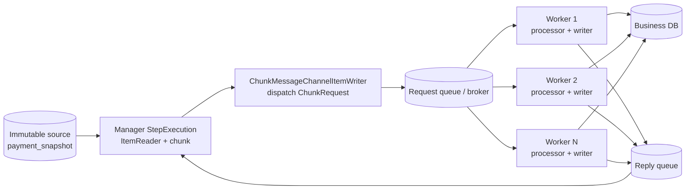
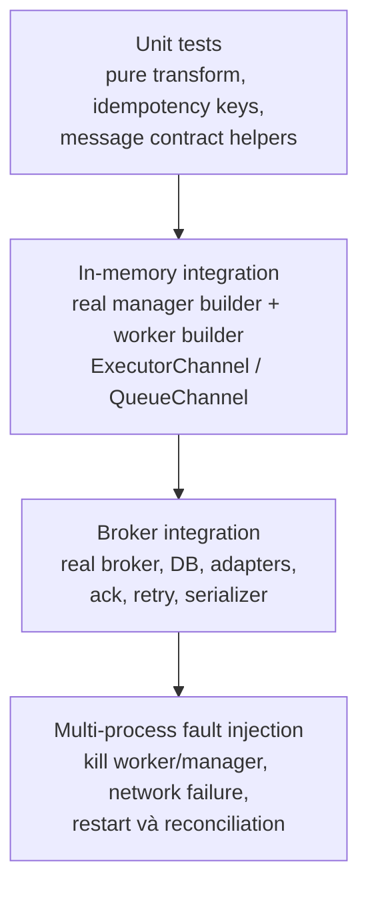
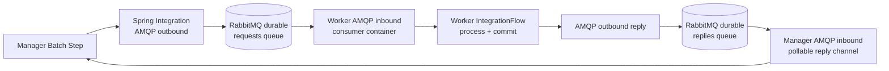
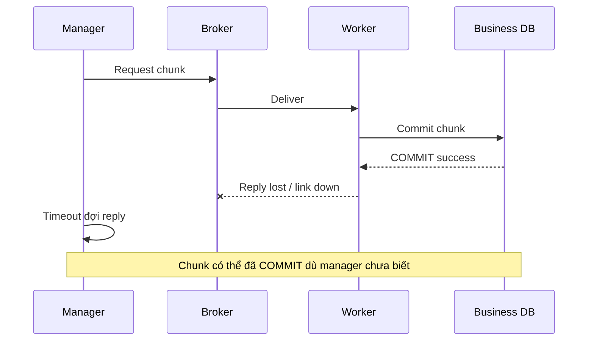

# Test remote chunking trong Spring Batch: kiểm chứng concurrency, message delivery và restart

## 1. Bối cảnh và mục tiêu học tập

Trong chương **Testing concurrency** của module **SPRING_BATCH_SCALING_OPERATIONS**, việc chạy nhanh hơn nhờ **multi-threaded step, parallel steps, partitioning** và **remote chunking** chỉ có giá trị khi kết quả vẫn đúng dù workers chạy đồng thời, message bị gửi lại hoặc một process chết giữa transaction.

Chủ đề **Test remote chunking** tập trung vào **kiểm thử hành vi phân tán**, không chỉ kiểm thử `ItemProcessor` trả đúng DTO.

Một pipeline remote chunking có thể vượt qua happy path nhưng vẫn có lỗi nghiêm trọng:

- Worker ghi dữ liệu thành công rồi chết trước khi gửi reply; chunk được giao lại và **ghi trùng**.
- Manager chờ reply đã mất, còn worker thực tế vẫn đang commit; restart quá sớm tạo hai attempts chồng lên nhau.
- Hai consumers cùng nhận work trên một queue được cấu hình sai, hoặc một message bị xử lý hai lần sau redelivery.
- Worker ném exception, broker đã ack trước khi transaction business commit, khiến item **mất vĩnh viễn**.
- Reply đến sai queue/job, thiếu correlation hoặc bị duplicate, khiến manager ghi nhận tiến độ sai.
- Queue **ready = 0** nhưng còn messages `unacked`, manager `in-flight` hoặc DLQ chưa giải quyết.
- Test chạy bằng `DirectChannel` trong cùng JVM vẫn xanh, nhưng production lỗi do **serialization, network, broker acknowledgment** hoặc container crash.

Sau bài học, bạn có thể:

1. Giải thích manager-reader/worker-processor-writer và request/reply trong Spring Batch 5.2.x.
2. Phân biệt remote chunking với remote partitioning, tránh kiểm thử sai đơn vị công việc.
3. Thiết kế **test pyramid**: unit → in-memory integration → broker+database integration → multi-process fault injection.
4. Kiểm chứng worker concurrency bằng barrier/latch thay vì dựa vào `Thread.sleep`.
5. Thiết kế unique business key, writer idempotent và test duplicate/redelivery.
6. Tiêm lỗi **trước commit**, **sau commit trước reply/ack**, **mất reply**, **reply trễ** và **manager/worker crash**.
7. Kiểm tra cùng JobInstance khi restart, checkpoint reader và sự đầy đủ của business output.
8. Đo queue depth, `unacked`, in-flight chunks, retry count, p95 commit và throughput.
9. Không nhầm test in-memory với bảo đảm durability của RabbitMQ/JMS/Kafka.
10. Xây dựng một bộ tiêu chí pass/fail có thể dùng trong CI và runbook production.

> **Phạm vi phiên bản:** Java 17+, **Spring Batch 5.2.x**, Spring Batch Integration, Spring Integration, JUnit 5 và PostgreSQL; phần broker dùng RabbitMQ làm ví dụ kiến trúc. Các đoạn Java là cấu hình/fixture tham khảo, cần imports, Spring context, migration, adapter, broker và lifecycle phù hợp mới thành project chạy thật. Không dùng tên builder hoặc hành vi mặc định của Spring Batch 6 để thay thế API 5.2.

## 2. Remote chunking thực sự chạy thế nào?



**Manager** trong remote chunking giữ `ItemReader`, tạo các chunk và gửi request tới middleware. **Workers** xử lý `ItemProcessor` và `ItemWriter` rồi trả phản hồi. Manager cập nhật tiến độ thông qua request/reply và metadata JobRepository.

Các lớp API quan trọng ở Spring Batch 5.2:

- `RemoteChunkingManagerStepBuilder<I,O>` hoặc `RemoteChunkingManagerStepBuilderFactory` xây manager step.
- `ChunkMessageChannelItemWriter` là writer gửi request do manager builder cấu hình, không phải business writer của worker.
- `ChunkRequest<T>` mang một chunk, sequence, job identifier và `StepContribution`.
- `RemoteChunkingWorkerBuilder<I,O>` tạo `IntegrationFlow` ở worker.
- `ChunkProcessorChunkHandler` thực thi processor/writer và tạo `ChunkResponse`.
- `ChunkResponse` truyền trạng thái/contribution cho manager.

**Không nhầm với remote partitioning:** remote partitioning giao cả **worker StepExecution** và worker thường tự đọc phân vùng input. Remote chunking giao **chunks đã đọc tại manager**, và không mặc nhiên tạo một worker StepExecution riêng cho mỗi chunk. Nếu test tìm `paymentWorker:partition-000` trong JobRepository của remote chunking, đó có thể là **kiểm tra sai kiến trúc**.

### Trách nhiệm theo boundary

| Thành phần | Phải làm | Điều không được giả định |
| --- | --- | --- |
| Manager reader | Đọc item, giữ checkpoint/stream state | Không giả định đã đọc = worker đã commit |
| Manager chunk writer | Gửi request và theo dõi reply/contribution | Không phải business writer của worker |
| Broker | Lưu/giao message theo cấu hình delivery/ack | Không mặc nhiên exactly-once qua DB |
| Worker processor | Áp business rule | Không được lưu state mutable không thread-safe |
| Worker writer | Ghi business sink an toàn | Không nằm trong cùng transaction với manager theo mặc định |
| Reply channel | Chuyển response về đúng manager | Reply đến trễ/duplicate không tự vô hại |
| JobRepository | Lưu JobExecution/StepExecution/context | Không chứng minh mọi external side effect đã commit |
| Business sink | Lưu kết quả/đối soát | Không chứng minh source không bị bỏ sót nếu chỉ nhìn row count |

## 3. Vì sao test concurrency phải kiểm tra nhiều hơn output count?

Giả sử manager gửi 4 chunk, mỗi chunk 3 payments:

```text
Chunk #0: IDs [1, 2, 3]
Chunk #1: IDs [4, 5, 6]
Chunk #2: IDs [7, 8, 9]
Chunk #3: IDs [10, 11, 12]
```

Worker #2 có thể hoàn tất chunk #1 trước worker #1 hoàn tất chunk #0. Đây là bình thường nếu output contract không yêu cầu thứ tự commit.

Kết quả cần đúng:

```text
EXPECTED KEYS = {1,2,3,4,5,6,7,8,9,10,11,12}
ACTUAL KEYS   = {1,2,3,4,5,6,7,8,9,10,11,12}

Và với mọi key:
  payload/ruleVersion đúng như snapshot.
  Không có extra row, không duplicate side effect.
```

**Chỉ `COUNT(*) = 12` chưa đủ**: có thể thiếu payment 3 nhưng thừa payment 99; hoặc payment 5 tồn tại với số tiền sai. Vì thế phải có **set equality + payload/value comparison**, không chỉ row counts hoặc `BatchStatus.COMPLETED`.

### Một test có thể xanh nhưng vẫn sai

```java
assertEquals(BatchStatus.COMPLETED, execution.getStatus());
assertEquals(12L, outputRepository.count());
```

Hai assertions trên không kiểm tra:

- Trùng message/processing attempts có dẫn tới gọi external API hai lần không?
- Commit order có làm hỏng business semantics không?
- Hàng trả về có đúng ID/payload/version không?
- Worker đã xử lý xong nhưng reply không tới manager thì sao?
- Có chunks đang DLQ/in-flight khi job được công bố không?
- Restart có tạo JobInstance mới hay giữ checkpoint từ execution trước?

**Nguyên tắc:** Đo **độ đúng nghiệp vụ** trước, sau đó đo **tính đúng của protocol** và cuối cùng mới đánh giá thông lượng.

## 4. Test pyramid cho remote chunking



| Tầng | Mục tiêu | Không thể chứng minh |
| --- | --- | --- |
| **Unit** | Business transformation, sort/key invariants, lỗi cố định | Broker ack, process crash |
| **In-memory Spring Integration** | Wiring manager→worker→reply, concurrency, status aggregation | Durable delivery, network, serialization |
| **Broker + PostgreSQL Testcontainers** | Routing, ack/requeue/DLQ, transactions, serializer | Mọi tình huống kill/redeploy trong Kubernetes |
| **Multi-process/system** | Process crash, late replies, ownership, restart, quotas | Tính đúng trên mọi môi trường/config bất kỳ |
| **Load/soak** | Saturation, retry storms, memory/queue behavior | Tính đúng nếu thiếu semantic assertions |

Chạy các tầng theo thứ tự. Test in-memory nên nhanh và deterministic; test broker phải dùng middleware tương ứng production; thử nghiệm kill process phải chạy trong môi trường cách ly đủ điều kiện và có timeout chặt.

## 5. Hợp đồng của bộ dữ liệu test

Đặt fixture nhỏ, có danh tính ổn định:

```text
runKey       = remote-chunking-test-v1
snapshotId   = snapshot-test-v1
paymentIds   = 1..12
chunkSize    = 3
expected     = 4 chunks và 12 unique business outputs
ruleVersion  = v1
```

Dữ liệu nguồn **không đổi giữa hai JobExecutions của cùng JobInstance**. Nếu nguồn thay sau failure, checkpoint reader cũ có thể trỏ tới tập item khác.

### Schema PostgreSQL tối thiểu

```sql
CREATE TABLE payment_snapshot (
    snapshot_id varchar(100) NOT NULL,
    payment_id  bigint NOT NULL,
    amount      numeric(20,2) NOT NULL,
    PRIMARY KEY (snapshot_id, payment_id)
);

CREATE TABLE payment_result (
    run_key      varchar(160) NOT NULL,
    payment_id   bigint NOT NULL,
    amount       numeric(20,2) NOT NULL,
    rule_version varchar(40) NOT NULL,
    PRIMARY KEY (run_key, payment_id)
);
```

Fixture:

```sql
INSERT INTO payment_snapshot (snapshot_id, payment_id, amount)
SELECT 'snapshot-test-v1',
       id,
       (id * 10)::numeric(20,2)
FROM generate_series(1, 12) AS id;
```

PostgreSQL `generate_series` chỉ dùng để tạo fixture, không phải câu lệnh Spring Batch. Unique key ở `payment_result` bảo vệ một row cho mỗi logical payment trong một run, nhưng **không ngăn được việc gọi API ngoài DB hai lần**.

### Đối soát trước và sau test

```sql
-- Input hợp lệ bị thiếu output
SELECT s.payment_id
FROM payment_snapshot s
LEFT JOIN payment_result r
  ON r.run_key = :runKey
 AND r.payment_id = s.payment_id
WHERE s.snapshot_id = :snapshotId
  AND r.payment_id IS NULL;

-- Output không có trong snapshot
SELECT r.payment_id
FROM payment_result r
LEFT JOIN payment_snapshot s
  ON s.snapshot_id = :snapshotId
 AND s.payment_id = r.payment_id
WHERE r.run_key = :runKey
  AND s.payment_id IS NULL;
```

Happy path kỳ vọng cả hai tập truy vấn đều **rỗng**. Nếu có filter/skip được phê duyệt, expected set cần tính sau khi áp business rule/quarantine.

## 6. DTO truyền qua request phải có stable business identity

Một input worker có thể là:

```java
public record PaymentInput(
        String runKey,
        long paymentId,
        BigDecimal amount) implements Serializable {}

public record PaymentResult(
        String runKey,
        long paymentId,
        BigDecimal amount,
        String ruleVersion) implements Serializable {}
```

Các record `Serializable` chỉ hỗ trợ demo hoặc một số message converters; **không khuyến nghị cho broker production sử dụng Java native serialization**. Với RabbitMQ/JMS, cấu hình JSON/Avro/Protobuf converter có schema/version, allowlist types và test compatibility.

**Vì sao mang `runKey` trong payload?** Worker remote chunking không mặc nhiên có một worker `StepExecutionContext` chứa `jobParameters['runKey']`. Nếu processor/writer cần danh tính nghiệp vụ, truyền qua DTO hoặc một hợp đồng message metadata đã kiểm chứng thay vì dựa vào thread-local Spring Batch context chưa tồn tại.

Không dùng `JobExecutionId` hay `ChunkRequest.sequence` làm khóa dedupe **business item** duy nhất: ID execution/sequence có semantics của protocol/attempt và có thể khác khi restart.

## 7. Manager reader có checkpoint và sort key ổn định

Một reader từ snapshot giúp kiểm chứng restart:

```java
@Bean("paymentReader")
@StepScope
JdbcPagingItemReader<PaymentInput> paymentReader(
        DataSource dataSource,
        @Value("#{jobParameters['runKey']}") String runKey,
        @Value("#{jobParameters['snapshotId']}") String snapshotId) {

    return new JdbcPagingItemReaderBuilder<PaymentInput>()
            .name("paymentReader")
            .dataSource(dataSource)
            .selectClause("SELECT payment_id, amount")
            .fromClause("FROM payment_snapshot")
            .whereClause("WHERE snapshot_id = :snapshotId")
            .parameterValues(Map.of("snapshotId", snapshotId))
            .sortKeys(Map.of("payment_id", Order.ASCENDING))
            .pageSize(3)
            .rowMapper((rs, n) -> new PaymentInput(
                    runKey,
                    rs.getLong("payment_id"),
                    rs.getBigDecimal("amount")))
            .saveState(true)
            .build();
}
```

**Điều kiện để checkpoint có ý nghĩa:**

- `payment_id` unique trong snapshot và có thứ tự deterministic.
- Input snapshot bất biến giữa attempts.
- Reader `@StepScope` không bị chia sẻ cursor giữa các concurrent chunk threads của cùng StepExecution.
- `name("paymentReader")` ổn định để khôi phục `ExecutionContext`.
- Bảng nguồn/sort/order không thay đổi trong khi restart.

`pageSize(3)` là lựa chọn test, **không** mang nghĩa broker queue gửi chính xác ba messages. `chunk(3)` ở manager mới quyết định commit interval/số item tối đa một ChunkRequest trong trường hợp thông thường.

## 8. Manager step builder trong Spring Batch 5.2

Spring Batch 5.2 có factory được `@EnableBatchIntegration` cung cấp:

```java
@Configuration
@EnableBatchProcessing
@EnableBatchIntegration
public class ManagerBatchConfig {

    @Bean("remotePaymentManager")
    TaskletStep remotePaymentManager(
            RemoteChunkingManagerStepBuilderFactory managerFactory,
            @Qualifier("paymentReader")
            ItemStreamReader<PaymentInput> reader,
            @Qualifier("managerRequests") MessageChannel requests,
            @Qualifier("managerReplies") PollableChannel replies) {

        return managerFactory
                .<PaymentInput, PaymentResult>get("remotePaymentManager")
                .chunk(3)
                .reader(reader)
                .outputChannel(requests)
                .inputChannel(replies)
                .throttleLimit(4)
                .maxWaitTimeouts(10)
                .build();
    }

    @Bean("remotePaymentJob")
    Job remotePaymentJob(
            JobRepository repository,
            @Qualifier("remotePaymentManager") Step manager) {

        return new JobBuilder("remotePaymentJob", repository)
                .start(manager)
                .build();
    }
}
```

Cấu hình thể hiện **manager thực tế**; giả định đã có `DataSource`, `JobRepository`, transaction manager và channels thích hợp, cùng các imports. `@EnableBatchProcessing` + `@EnableBatchIntegration` ở test có thể làm trùng bean nếu Spring Boot auto-configuration được cấu hình khác; phải chọn một chiến lược cấu hình thống nhất.

**Điều không được làm:**

```java
// KHÔNG gắn business writer vào remote manager:
managerFactory.<PaymentInput, PaymentResult>
        get("remotePaymentManager")
        .writer(businessWriter); // Không được hỗ trợ.
```

Trong Spring Batch 5.2, manager builder tự thiết lập `ChunkMessageChannelItemWriter`. Gọi `writer(...)` lên builder này sẽ ném `UnsupportedOperationException`.

### `throttleLimit` và `maxWaitTimeouts` không phải cùng một thông số

| Setting | Ý nghĩa ở manager builder 5.2 | Không nên hiểu thành |
| --- | --- | --- |
| `throttleLimit(4)` | Giới hạn số pending chunk-processing requests của manager | Số consumer processes cố định |
| `maxWaitTimeouts(10)` | Giới hạn số lần đợi không nhận được reply cuối step | Global deadline chính xác 10 giây |
| Reply receive timeout | Khoảng đợi một lần receive trên messaging gateway/template liên quan | Bảo đảm worker đã chết sau timeout |
| `chunk(3)` | Commit interval/tối đa input items trong một chunk | Prefetch=3 hoặc đúng 3 messages toàn job |

`maxWaitTimeouts` kết hợp với **receive timeout của cơ chế receive** theo JavaDoc, nên test phải cấu hình cả receive timeout lẫn số lần chờ nếu muốn có thời gian thất bại hữu hạn. Không tự suy từ `maxWaitTimeouts(10)` rằng mọi worker sẽ bị kill sau 10 giây.

## 9. Worker flow xử lý request và trả reply

`RemoteChunkingWorkerBuilder<I,O>` xây một `IntegrationFlow` ở phía worker. Ví dụ:

```java
@Configuration
public class WorkerBatchConfig {

    @Bean("paymentWorkerFlow")
    IntegrationFlow paymentWorkerFlow(
            @Qualifier("workerRequests") MessageChannel requests,
            @Qualifier("workerReplies") MessageChannel replies,
            @Qualifier("paymentProcessor")
            ItemProcessor<PaymentInput, PaymentResult> processor,
            @Qualifier("paymentWriter")
            ItemWriter<PaymentResult> writer) {

        return new RemoteChunkingWorkerBuilder<
                PaymentInput, PaymentResult>()
                .itemProcessor(processor)
                .itemWriter(writer)
                .inputChannel(requests)
                .outputChannel(replies)
                .build();
    }
}
```

Worker builder tạo flow xử lý `ChunkRequest` và gửi `ChunkResponse`. Ở remote chunking thông thường **worker không tự đọc nguồn bằng `ItemReader`**; input đã được manager gửi tới.

**Quan trọng về transaction:** Worker builder ở ví dụ **không nhận một transaction manager riêng**. Đừng giả định chỉ vì manager step có transaction, worker business writer ở process khác tự nằm trong cùng transaction. Cần thiết kế transaction/ack boundary ở worker hoặc writer/adapter.

### Processor nên deterministic và stateless

```java
@Bean("paymentProcessor")
ItemProcessor<PaymentInput, PaymentResult> paymentProcessor() {

    return item -> {
        if (item.amount() == null || item.amount().signum() < 0) {
            throw new IllegalArgumentException(
                    "Invalid payment amount");
        }

        return new PaymentResult(
                item.runKey(),
                item.paymentId(),
                item.amount().setScale(
                        2, RoundingMode.HALF_EVEN),
                "v1");
    };
}
```

Không sử dụng mutable field `lastPaymentId` trong singleton processor để điều phối thứ tự. Nhiều workers hoặc nhiều messages có thể chạy đồng thời; nếu nghiệp vụ đòi ordering, cần thiết kế per-key serialization/ordered downstream thay vì dựa vào thread arrival order.

## 10. Worker writer idempotent và transaction boundary riêng

Một mẫu **correctness-first** dùng `TransactionTemplate` với `JdbcTemplate`. Đoạn ví dụ cố ý kiểm tra payload sau `INSERT ... ON CONFLICT DO NOTHING` để không che mismatch:

```java
@Bean("paymentWriter")
ItemWriter<PaymentResult> paymentWriter(
        JdbcTemplate jdbc,
        @Qualifier("businessTransactionManager")
        PlatformTransactionManager txManager) {

    TransactionTemplate tx = new TransactionTemplate(txManager);

    return chunk -> tx.executeWithoutResult(status -> {
        for (PaymentResult item : chunk.getItems()) {

            jdbc.update("""
                INSERT INTO payment_result
                    (run_key, payment_id, amount, rule_version)
                VALUES (?, ?, ?, ?)
                ON CONFLICT (run_key, payment_id) DO NOTHING
                """,
                item.runKey(),
                item.paymentId(),
                item.amount(),
                item.ruleVersion());

            PaymentResult stored = jdbc.queryForObject("""
                SELECT run_key, payment_id, amount, rule_version
                FROM payment_result
                WHERE run_key = ? AND payment_id = ?
                """,
                (rs, n) -> new PaymentResult(
                        rs.getString("run_key"),
                        rs.getLong("payment_id"),
                        rs.getBigDecimal("amount"),
                        rs.getString("rule_version")),
                item.runKey(), item.paymentId());

            if (stored == null
                    || stored.amount().compareTo(item.amount()) != 0
                    || !stored.ruleVersion().equals(item.ruleVersion())) {
                throw new IllegalStateException(
                    "Conflicting replay for payment "
                    + item.paymentId());
            }
        }
    });
}
```

**Vì sao ví dụ không tối ưu tốc độ?** Nó kiểm tra từng row trong transaction để bài test thấy rõ idempotency và payload mismatch. Production có thể dùng `JdbcBatchItemWriter`, `INSERT ... RETURNING`, staging hash hay bulk verification hiệu quả hơn, nhưng không nên hy sinh business correctness.

**Để transaction thật sự đúng:**

- `businessTransactionManager` phải quản lý **chính DataSource** của `jdbc`.
- Exception runtime trong template phải rollback transaction.
- Transaction business commit trước khi flow coi worker đã thành công/gửi reply.
- Listener/transport acknowledgment phải được cấu hình nhất quán với business commit; `TransactionTemplate` **không tự hợp nhất DB transaction với broker ack**.
- Nếu manager/worker dùng hai datasources, transaction không tự lan xuyên process.
- Nếu sink là external API thay vì DB, phải có idempotency key/outbox/inbox hoặc compensation thích hợp.

Test phải chủ động tạo replay có **cùng payload**, và replay cùng business key có **khác payload** để chắc chắn policy không che lỗi.

## 11. Thiết kế hai kênh request/reply riêng biệt

Một manager và worker cần contract hai hướng:

```text
managerRequests (manager output)
      -> middleware -> workerRequests (worker input)

workerReplies (worker output)
      -> middleware -> managerReplies (manager input)
```

Với **một JVM test harness**, có thể trỏ cùng một channel object cho mỗi cặp để bỏ qua network/broker, nhưng vẫn dùng hai builders và IntegrationFlow thật.

### Channel in-memory với worker concurrency

```java
@Bean("testWorkerExecutor")
ThreadPoolTaskExecutor testWorkerExecutor() {
    ThreadPoolTaskExecutor pool = new ThreadPoolTaskExecutor();
    pool.setCorePoolSize(2);
    pool.setMaxPoolSize(2);
    pool.setQueueCapacity(8);
    pool.setThreadNamePrefix("remote-test-worker-");
    pool.initialize();
    return pool;
}

@Bean("managerRequests")
MessageChannel managerRequests(
        @Qualifier("testWorkerExecutor") TaskExecutor executor) {
    return new ExecutorChannel(executor);
}

@Bean("workerRequests")
MessageChannel workerRequests(
        @Qualifier("managerRequests") MessageChannel managerRequests) {
    return managerRequests;
}

@Bean("managerReplies")
PollableChannel managerReplies() {
    return new QueueChannel();
}

@Bean("workerReplies")
MessageChannel workerReplies(
        @Qualifier("managerReplies") PollableChannel managerReplies) {
    return (MessageChannel) managerReplies;
}
```

**Đây là cấu hình dành cho in-memory integration test, không phải deployment đa process.** Một `ExecutorChannel` chuyển message tới subscriber asynchronously trên thread pool; `QueueChannel` giữ replies để manager poll. `TaskExecutor` cần đủ threads cho kiểm thử concurrency.

Trong project thực, cân nhắc tránh hai `@Bean` names trả về cùng channel instance nếu bean lifecycle/proxying phức tạp; có thể inject trực tiếp hai channel objects vào manager/worker config của test. Điểm quan trọng là **manager output và worker input phải thật sự nối cùng request stream**, tương tự cho replies.

### Không dùng `DirectChannel` để “chứng minh đã chạy song song”

`DirectChannel` thường dispatch subscriber trong **thread của sender**. Vì vậy test xanh với `DirectChannel` có thể chỉ chạy worker synchronously trong manager thread. Muốn test concurrency, dùng `ExecutorChannel` hoặc một broker consumer setup có concurrency, sau đó xác minh **hai requests thực sự ở trong worker cùng lúc**.

**Không** dùng `ExecutorChannel` để giả lập message persistence: mọi state ở RAM sẽ mất khi JVM crash.

## 12. Kiến trúc broker integration với RabbitMQ

Khi chuyển từ in-memory sang broker, đặt rõ transport adapters:



Các bean `managerRequests`/`managerReplies` là **Spring Integration channels**, không phải trực tiếp `RabbitTemplate` hoặc tên queue String. Các adapters thực hiện chuyển đổi giữa channels và Rabbit broker.

### Cần kiểm chứng topology

| Phần | Điều kiện test |
| --- | --- |
| Request exchange/queue | Durable và routing key/bindings đúng |
| Worker consumers | Cùng một logical request không bị fan-out nhầm sang mọi worker |
| Ack policy | Không ack trước boundary đã cam kết xử lý bền vững |
| Reply queue | Manager nhận đúng responses; cô lập concurrent jobs nếu cần |
| Message converter | Đúng kiểu `ChunkRequest`/`ChunkResponse`, schema/version hợp lệ |
| Prefetch | Bounded, không giữ quá nhiều unacked ở một worker |
| Redelivery/DLQ | Retry giới hạn, poison handling có audit |
| Publisher confirms | Thực sự biết broker đã nhận publish, không đồng nhất với worker completion |
| TLS/auth/ACL | Broker test/prod dùng policy phù hợp |
| Queue retention/TTL | Không làm mất business work khi worker down lâu |
| Correlation | Replies liên kết được với đúng JobExecution/step/chunk |
| Shutdown | Consumer drain, không ack nửa chừng hoặc bỏ in-flight |

**Không** khẳng định chỉ cấu hình `durable=true` là đạt guaranteed delivery end-to-end. Cần kiểm tra publisher confirmation, persistent messages, consumer acknowledgment, broker recovery và error paths theo loại queue/broker.

## 13. Correlation: request/reply nào thuộc chunk nào?

Spring Batch 5.2 có `ChunkRequest<T>` với các thành phần nhận diện/trạng thái như:

```text
ChunkRequest:
  getSequence()
  getJobId()
  getItems()
  getStepContribution()

ChunkResponse:
  sequence/job identifier
  success/failure + contribution/status
```

**Không tự tạo một `ChunkResponse` giả chỉ có sequence khớp để đánh dấu work đã hoàn tất**. Protocol dùng contribution và các trường khác; thử nghiệm chỉ chỉnh một field có thể không giống điều kiện thật.

### Bài test correlation cần kiểm tra

- Request của manager run A không bị gắn reply của run B.
- Chunks #0 và #1 xử lý song song, reply #1 có thể đến trước #0.
- Duplicate reply không làm tăng business output/StepContribution hai lần.
- Reply của execution cũ đến sau restart được xử lý theo protocol, không cộng nhầm vào execution mới.
- Worker không nhận input DTO thiếu `runKey`/business identity.
- Invalid/malformed request bị reject/DLQ có audit, không ghi business sink.

### Không dùng raw sequence làm idempotency key

`sequence=3` có thể xuất hiện ở nhiều jobs/attempts. Nếu ứng dụng xây request ledger riêng, cần nhận diện trong một phạm vi đã xác định, ví dụ `(runKey, logicalChunkId, schemaVersion)`, và xử lý những trường hợp chunk boundaries thay đổi khi restart.

**Per-item business key** như `(runKey,paymentId)` là lớp chống duplicate độc lập và thường bền vững hơn per-chunk sequence.

## 14. Unit test business processor thuần

```java
@Test
void processorProducesStableValueForSameInput() throws Exception {
    ItemProcessor<PaymentInput, PaymentResult> processor =
            paymentProcessor();

    PaymentInput input = new PaymentInput(
            "remote-chunking-test-v1",
            7L,
            new BigDecimal("70.000"));

    PaymentResult a = processor.process(input);
    PaymentResult b = processor.process(input);

    assertNotNull(a);
    assertEquals(a, b);
    assertEquals(7L, a.paymentId());
    assertEquals("v1", a.ruleVersion());
    assertEquals(new BigDecimal("70.00"), a.amount());
}
```

**Test này không có concurrency**; nó chỉ là bước nền để loại bỏ tính không xác định của business transformation. Nếu processor dùng API ngoài, phải fake/mocking có kiểm soát; test network error/retry ở tầng integration, không lồng vào unit test một cách ngẫu nhiên.

### Nên test cả bất biến

- Amount không âm; currency/scale/rounding theo quy tắc.
- Business key không phụ thuộc JobExecutionId.
- Hai inputs khác nhau không vô tình map cùng key nếu policy cấm.
- Trùng input do replay tạo kết quả tương đương.
- Rule version được khóa cho run; không đổi giữa restart.

## 15. Database integration test: writer replay hai lần

Khi có PostgreSQL test datasource và writer đã tạo:

```java
@Test
void writingSameChunkTwiceKeepsOneRowPerBusinessKey()
        throws Exception {

    ItemWriter<PaymentResult> writer = paymentWriter;

    Chunk<PaymentResult> items = new Chunk<>(List.of(
            new PaymentResult(
                    "remote-chunking-test-v1", 1L,
                    new BigDecimal("10.00"), "v1"),
            new PaymentResult(
                    "remote-chunking-test-v1", 2L,
                    new BigDecimal("20.00"), "v1")
    ));

    writer.write(items);
    writer.write(items); // Mô phỏng redelivery cùng payload.

    Long rows = jdbcTemplate.queryForObject("""
        SELECT COUNT(*) FROM payment_result
        WHERE run_key = ?
        """,
        Long.class,
        "remote-chunking-test-v1");

    assertEquals(2L, rows);
}
```

Giả định `paymentWriter`/`jdbcTemplate` là fixtures được inject và bảng đã migrate/seed sạch. Đây là **DB integration test**, không phải broker test; nó chứng minh data-level replay idempotency cho cùng business keys.

### Replay cùng key nhưng payload khác phải fail

```java
@Test
void conflictingReplayIsNotSilentlyAccepted()
        throws Exception {

    paymentWriter.write(new Chunk<>(List.of(
            new PaymentResult(
                    "remote-chunking-test-v1", 1L,
                    new BigDecimal("10.00"), "v1"))));

    assertThrows(IllegalStateException.class, () ->
            paymentWriter.write(new Chunk<>(List.of(
                    new PaymentResult(
                            "remote-chunking-test-v1", 1L,
                            new BigDecimal("999.00"), "v1")))));
}
```

Nếu writer chỉ `ON CONFLICT DO NOTHING` mà không kiểm tra mismatch, test thứ hai có thể xanh sai hoặc không throw, tức là **đang che lỗi dữ liệu**.

**Test isolation:** Mỗi test phải có `runKey` riêng hoặc reset schema/fixtures có kiểm soát. Không vô tình xóa JobRepository/output giữa **hai attempts của cùng một restart test**.

## 16. In-memory end-to-end test: manager thật, worker thật

Ở tầng này, ứng dụng test dùng:

- `RemoteChunkingManagerStepBuilderFactory` và JobRepository thật.
- `RemoteChunkingWorkerBuilder` và IntegrationFlow thật.
- `ExecutorChannel` cho request để worker chạy asynchronous.
- `QueueChannel` cho reply; không có broker.
- `JdbcPagingItemReader` nguồn snapshot.
- `TransactionTemplate` + PostgreSQL writer ở worker.

**Mục đích:** Xác minh Spring Batch manager/writer protocol phối hợp với worker flow và kết quả cuối khi requests có thể hoàn thành khác thứ tự. Không test durability/ack của RabbitMQ.

### JUnit Spring Batch Test skeleton

```java
@SpringBatchTest
@SpringBootTest(
        classes = RemoteChunkTestApplication.class,
        properties = {"spring.batch.job.enabled=false"})
class InMemoryRemoteChunkingIntegrationTest {

    @Autowired JobLauncherTestUtils jobLauncherTestUtils;
    @Autowired JdbcTemplate jdbcTemplate;

    private JobParameters parameters(String runKey) {
        return new JobParametersBuilder()
                .addString("runKey", runKey, true)
                .addString("snapshotId", "snapshot-test-v1", true)
                .toJobParameters();
    }

    @Test
    void managerAndWorkersCompleteAllChunks() throws Exception {
        String runKey = "remote-inmemory-001";

        JobExecution execution = jobLauncherTestUtils.launchJob(
                parameters(runKey));

        assertEquals(BatchStatus.COMPLETED,
                     execution.getStatus());

        Long rows = jdbcTemplate.queryForObject("""
                SELECT COUNT(*) FROM payment_result
                WHERE run_key = ?
                """, Long.class, runKey);

        assertEquals(12L, rows);
    }
}
```

Đây là **skeleton**, cần `RemoteChunkTestApplication`, import configs, `@EnableBatchProcessing/Integration` phù hợp, auto-started IntegrationFlow và migration/fixture. `JobLauncherTestUtils` cần chọn đúng job `remotePaymentJob` nếu context có nhiều jobs.

**Bổ sung bắt buộc:** Assertion SQL missing/extra keys và amount/ruleVersion của cả 12 items; kiểm tra `StepExecution` manager; test unit/DB trước đó không thay thế assertion này.

### Đừng dùng `Thread.sleep(200)` để “đảm bảo concurrency”

Thread scheduling và CI load làm sleep flaky: có thể chạy tuần tự mà vẫn pass, hoặc test timeout tùy máy. Để chứng minh hai chunks cùng vào worker, dùng latch/barrier tại **một điểm đã kiểm soát**.

## 17. Chứng minh hai chunk thực sự xử lý đồng thời bằng latch

Một processor wrapper cho test, chỉ chặn **payment 1** của chunk đầu và **payment 4** của chunk thứ hai:

```java
public final class ConcurrentChunkProbe
        implements ItemProcessor<PaymentInput, PaymentResult> {

    private final ItemProcessor<PaymentInput, PaymentResult> delegate;
    private final CountDownLatch bothEntered = new CountDownLatch(2);
    private final Set<String> threads =
            ConcurrentHashMap.newKeySet();

    public ConcurrentChunkProbe(
            ItemProcessor<PaymentInput, PaymentResult> delegate) {
        this.delegate = delegate;
    }

    @Override
    public PaymentResult process(PaymentInput item) throws Exception {
        if (item.paymentId() == 1L || item.paymentId() == 4L) {
            threads.add(Thread.currentThread().getName());
            bothEntered.countDown();

            if (!bothEntered.await(5, TimeUnit.SECONDS)) {
                throw new IllegalStateException(
                        "Second chunk did not enter concurrently");
            }
        }

        return delegate.process(item);
    }

    public int distinctThreads() {
        return threads.size();
    }
}
```

Nếu hai chunks được dispatch tới hai worker threads và cả hai đi qua probe, latch giải phóng. Nếu chỉ có một worker thread, lần đầu chờ hết timeout; test có thể FAIL thay vì báo thành công giả.

### Cách dùng trong test

```java
@Test
void twoRemoteChunksCanRunAtSameTime() throws Exception {
    // Test profile wire worker processor thành ConcurrentChunkProbe.
    JobExecution execution = jobLauncherTestUtils.launchJob(
            parameters("remote-concurrent-001"));

    assertEquals(BatchStatus.COMPLETED,
                 execution.getStatus());
    assertTrue(concurrentChunkProbe.distinctThreads() >= 2);

    // Kèm đối soát tất cả business keys sau khi job hoàn thành.
    assertAllPaymentsPresent("remote-concurrent-001");
}
```

Các fields `concurrentChunkProbe`, `assertAllPaymentsPresent` và wiring trong test profile cần triển khai. **Không** instantiate `ConcurrentChunkProbe` ngoài IntegrationFlow rồi kiểm tra một object khác chưa được sử dụng.

**Lưu ý:** Test này chứng minh concurrency trong **single-JVM asynchronous test harness**. Nó không chứng minh hai máy vật lý/process đã xử lý cùng lúc. Muốn chứng minh thực sự đa process, log/process identity và trace span với worker ID/kết quả broker.

## 18. Test out-of-order reply: completion order không phải source order

Giả sử chunk #1 phải đợi lâu, chunk #2 trả về nhanh:

```mermaid
sequenceDiagram
    participant M as Manager
    participant B as Broker/channel
    participant W1 as Worker A
    participant W2 as Worker B
    M->>B: Chunk #0 [1,2,3]
    M->>B: Chunk #1 [4,5,6]
    B->>W1: #0
    B->>W2: #1
    W1->>W1: chờ latch / API chậm
    W2->>W2: commit #1
    W2-->>M: reply #1 đến trước
    W1->>W1: commit #0
    W1-->>M: reply #0 đến sau
    Note over M: Phải tổng hợp đúng cả hai; không dựa vào reply order
```

Ở test:

- Có thể chặn chunk #0 bằng một latch trong test processor/writer rồi cho chunk #1 hoàn tất.
- Ghi thời điểm/sequence của replies ở **test observation channel/interceptor**.
- Xác nhận manager không chuyển JobExecution thành COMPLETED cho đến khi mọi chunk bắt buộc đã terminal.
- Khi cho chunk #0 hoàn tất, JobExecution cuối COMPLETED và set business keys đủ.
- **Không bắt buộc output rows được commit theo `payment_id` tăng dần**, trừ khi có một bước ordered merge riêng.

**Không tự thay đổi `ChunkResponse` fields để giả lập completion** nếu chưa hiểu protocol. Tốt hơn là thay đổi **thời gian worker processing** hoặc vận chuyển thật của reply, rồi để framework tạo response bình thường.

## 19. Test fault-injection matrix: đặt lỗi ở đâu?

| Điểm tiêm lỗi | Tình huống cần mô phỏng | Điều phải xác minh |
| --- | --- | --- |
| Manager reader trước dispatch | Parse exception, snapshot thiếu | Không phát chunk giả, JobExecution fail đúng |
| Request publisher trước broker confirm | Publish thất bại | Không xem chunk đã được broker nhận |
| Broker đã nhận, trước worker delivery | Worker down | Request còn durable/được xử lý khi worker trở lại |
| Worker nhận request trước DB transaction | Consumer crash | Redelivery theo ack policy |
| Worker writer **trước DB commit** | Throw runtime, rollback | Không có partial chunk output nếu cùng transaction |
| Worker DB commit xong, **trước reply** | Crash/exception | Replay không duplicate/mismatch |
| Worker reply thành công, trước broker ack | Redelivery/reply duplicate | Manager không cộng contribution hai lần |
| Worker commit nhưng reply bị drop | Manager timeout/UNKNOWN | Không coi timeout là “chưa commit” |
| Reply từ attempt cũ đến sau restart | Late reply | Không cộng sai JobExecution hiện tại |
| Broker retry/DLQ | Poison message | Giới hạn attempts, không mất audit |
| Manager crash khi workers in-flight | JobRepository STARTED | Không chạy chồng work chưa được reconcile |
| DB pool bão hòa | Slow consumer/backlog | Backpressure, timeout, committed throughput |
| Worker OOMKilled | Chết không có Java stacktrace | Cơ chế khôi phục không mất/trùng business item |
| Serializer không tương thích | Schema/class whitelist lỗi | DLQ/quarantine, không ghi dữ liệu sai |
| Output publication thất bại | Business DB đã commit nhưng downstream chưa nhận | Reconciliation + idempotent publish |

**Quan trọng:** Kỳ vọng JobExecution `FAILED` hay `STOPPED` cụ thể phải gắn với timeout/adapter/config đã kiểm chứng; một test làm mất reply mà không cấu hình finite timeout có thể **treo vô hạn**, không được coi là test pass.

## 20. Worker fail trước commit: rollback phải đúng ranh giới

Một writer giả lập lỗi **trước khi gọi delegate**:

```java
public final class FailBeforeWriteOnce
        implements ItemWriter<PaymentResult> {

    private final ItemWriter<PaymentResult> delegate;
    private final AtomicBoolean once = new AtomicBoolean(true);

    public FailBeforeWriteOnce(
            ItemWriter<PaymentResult> delegate) {
        this.delegate = delegate;
    }

    @Override
    public void write(Chunk<? extends PaymentResult> chunk)
            throws Exception {

        boolean target = chunk.getItems().stream()
                .anyMatch(row -> row.paymentId() == 5L);

        if (target && once.compareAndSet(true, false)) {
            throw new IllegalStateException(
                    "Injected failure before write");
        }

        delegate.write(chunk);
    }
}
```

Với chunk size 3, input ID 5 ở chunk `[4,5,6]`. Lần đầu processing của chunk này có thể fail trước business write, trong khi các chunk khác có thể đã commit tùy scheduling.

### Assertions cần có

- Chunk lỗi không có **partial rows đã commit** ở DB khi writer/transaction được cấu hình atomically.
- Đã có thông tin lỗi/delivery state rõ; không ack như success.
- Retry/redelivery **có giới hạn**, không busy loop vô hạn.
- Sau correction/recovery, output đủ 12 keys.
- Test giữ cùng input snapshot và business run identity.

Đừng dựa vào `skip(Exception.class)` để làm test “hết đỏ” — nó có thể che lỗi hạ tầng thành missing business records.

## 21. Worker commit rồi lỗi trước reply: trường hợp quan trọng nhất

Một failure window nổi tiếng:

```text
1) Worker receives chunk [4,5,6]
2) Business DB commits IDs 4,5,6
3) Worker crashes BEFORE reply/ack reaches manager
4) Broker redelivers request
5) Another worker processes [4,5,6] again
```

Nếu writer chỉ `INSERT` không có unique key, output có thể bị trùng. Nếu sink là API chuyển tiền, replay có thể gây **side effect trùng nguy hiểm**.

### Fault injector sau transaction commit

```java
public final class FailAfterCommittedWriteOnce
        implements ItemWriter<PaymentResult> {

    private final ItemWriter<PaymentResult> committedDelegate;
    private final AtomicBoolean once = new AtomicBoolean(true);

    public FailAfterCommittedWriteOnce(
            ItemWriter<PaymentResult> committedDelegate) {
        this.committedDelegate = committedDelegate;
    }

    @Override
    public void write(Chunk<? extends PaymentResult> chunk)
            throws Exception {

        committedDelegate.write(chunk);

        boolean target = chunk.getItems().stream()
                .anyMatch(row -> row.paymentId() == 5L);

        if (target && once.compareAndSet(true, false)) {
            throw new IllegalStateException(
                    "Injected after delegate committed");
        }
    }
}
```

Đoạn này **chỉ tạo đúng failure window** khi `committedDelegate` thực sự **commit transaction trước khi trả về**, ví dụ writer `TransactionTemplate` ở phần 10. Nếu delegate tham gia một transaction rộng do container quản lý và **chưa commit khi return**, exception sẽ rollback; đó là **lỗi trước commit**, không phải lỗi sau commit.

**Không khẳng định exception tự làm broker redeliver**; cần kiểm tra ack/requeue transaction mode của adapter và redelivery policy của middleware. Để test gần thực tế hơn, kill worker process sau khi quan sát DB commit nhưng trước bước publish reply.

### Kỳ vọng test

- Business DB vẫn có IDs 4–6 sau khi worker lỗi.
- Broker/adapter requeues request theo policy.
- Writer xử lý replay an toàn, giữ **một row mỗi `(runKey,paymentId)`**.
- Payload mismatch bị phát hiện thay vì `DO NOTHING` âm thầm.
- Manager cuối cùng nhận kết quả terminal hợp lệ và không double count.
- Không publish JobExecution COMPLETED trước khi reconciliation đạt.

## 22. Mất reply và reply trễ: tại sao timeout không phải rollback?

Một sequence:



**Không** tự động phát lại cùng business operation sau timeout mà không có idempotency/reconciliation. Trong test:

1. Dùng test adapter/proxy/interceptor **chặn reply** cho chunk mục tiêu, không chặn DB commit.
2. Xác nhận business output thực sự đã commit.
3. Chờ đến **timeout hữu hạn** được cấu hình cho test.
4. Quan sát manager response/status và message in-flight.
5. Khôi phục reply hoặc kích hoạt redelivery theo policy.
6. Xác nhận không duplicate business output, không đếm contribution sai.
7. Đối soát JobRepository với business sink.

### Timeout test phải có ngân sách

Ví dụ giả định:

```text
replyReceiveTimeout = 500 ms
maxWaitTimeouts = 3
testRunnerFuture.get(10, SECONDS)
```

`maxWaitTimeouts` chỉ liên quan đến số lần đợi cuối step và receive timeout của gateway/template; thực tế còn work processing, scheduling, transport, DB timeouts. **Không** xem tích `500 ms × 3` là deadline end-to-end chính xác. Dùng test harness outer deadline để không treo CI.

### Duplicate/late reply

Một số transport/adapters có thể phát lại response sau reconnect. Khi test duplicate reply, nên **replay chính response thật đã capture** thông qua broker adapter trong môi trường test, thay vì tạo một `ChunkResponse` giả thiếu contribution. Kiểm tra manager contribution/business output không tăng hai lần và correlation không bị nhầm với JobExecution mới.

## 23. Manager crash khi workers vẫn chạy

Manager process có thể chết ngay sau khi dispatch một số chunks:

```text
Manager:
  chunk #0 published
  chunk #1 published
  chunk #2 published
  JVM killed

Workers:
  #0 committed
  #1 currently processing
  #2 waiting in broker
```

JobRepository có thể còn `STARTED` vì manager không kịp cập nhật status. Khởi chạy ngay một JobExecution mới cùng run key trong khi worker #1 còn hoạt động có thể tạo **hai attempts ghi chồng**.

### System test an toàn

- Launch manager và workers trong **process/container riêng**.
- Chờ tín hiệu requests đã được broker nhận và ít nhất một worker đã bắt đầu.
- Kill **manager process** (không chỉ stop job bình thường).
- Ghi nhận worker nào còn in-flight, broker ready/unacked và business rows đã commit.
- Chặn scheduler tạo JobInstance khác cùng runKey.
- Drain/stop workers cũ theo policy, kiểm tra late replies và DB activity.
- Giải quyết trạng thái `STARTED/UNKNOWN` qua runbook/framework controls đã được kiểm chứng; **không UPDATE JobRepository SQL tùy tiện**.
- Restart hợp lệ cùng JobInstance khi an toàn; đối soát toàn bộ input/output.

**Kết quả kỳ vọng:** Không mất item và không duplicate side effect trong business contract; trạng thái JobRepository phản ánh đúng attempts; worker cũ không còn ghi sau khi publish kết quả final.

## 24. Dùng cùng JobInstance khi test restart

JobInstance được xác định bởi **job name + identifying JobParameters**.

```java
private JobParameters parameters(String runKey) {
    return new JobParametersBuilder()
            .addString("runKey", runKey, true)
            .addString("snapshotId", "snapshot-test-v1", true)
            .toJobParameters();
}
```

Một integration test restart nên giữ **cùng parameters**, gồm cả `runKey` và `snapshotId`:

```java
@Test
void failedManagerCanRestartSameJobInstance() throws Exception {
    JobParameters parameters =
            parameters("remote-restart-001");

    // Test profile: fault injection once và finite reply timeout.
    JobExecution first =
            jobLauncherTestUtils.launchJob(parameters);

    assertEquals(BatchStatus.FAILED,
                 first.getStatus());

    // Giải quyết worker in-flight và fault condition trước retry.
    JobExecution resumed =
            jobLauncherTestUtils.launchJob(parameters);

    assertEquals(BatchStatus.COMPLETED,
                 resumed.getStatus());

    assertEquals(
            first.getJobInstance().getInstanceId(),
            resumed.getJobInstance().getInstanceId());
    assertNotEquals(first.getId(), resumed.getId());

    assertAllPaymentsPresent("remote-restart-001");
}
```

**Skeleton có điều kiện**: Lần đầu chỉ `FAILED` nếu fault injector/adapter làm manager fail theo cấu hình và timeout; test phải thực sự wiring fault. Với message lỗi bị DLQ và thiếu reply, manager có thể timeout chứ không tự động nhận `FAILED` ngay. Không ép kịch bản `FAILED` bằng cách dùng `@DirtiesContext` hoặc xóa metadata.

**Không** thêm identifying `run.id`/timestamp mới để khiến launch lần hai thành công; điều đó tạo JobInstance khác và không chứng minh restart/checkpoint. Cũng không xóa `BATCH_*` tables giữa hai attempts.

### Dùng `JobOperator`

```java
long newExecutionId =
        jobOperator.restart(failedJobExecutionId);
```

`failedJobExecutionId` phải là ID của JobExecution đã kết thúc trong trạng thái đủ điều kiện, không phải JobInstance ID. Kết quả là một JobExecution mới của **cùng JobInstance** khi restart hợp lệ.

## 25. Worker remote chunking khác worker partitioning ở metadata

Với remote partitioning, bạn thường thấy các worker `StepExecution` dạng:

```text
paymentWorker:partition-000
paymentWorker:partition-001
...
```

Nhưng remote chunking **không tạo một StepExecution riêng ở worker cho mỗi chunk** theo mặc định; manager step giữ vòng đời chunk và metadata. Vì thế SQL kiểm thử không được kỳ vọng `paymentWorker:partition-*` chỉ vì có nhiều worker processes.

### Xem lịch sử manager StepExecution

```sql
SELECT je.JOB_INSTANCE_ID,
       je.JOB_EXECUTION_ID,
       je.STATUS AS job_status,
       se.STEP_EXECUTION_ID,
       se.STEP_NAME,
       se.STATUS AS step_status,
       se.READ_COUNT,
       se.WRITE_COUNT,
       se.COMMIT_COUNT,
       se.ROLLBACK_COUNT,
       se.READ_SKIP_COUNT,
       se.PROCESS_SKIP_COUNT,
       se.WRITE_SKIP_COUNT
FROM BATCH_JOB_EXECUTION je
JOIN BATCH_STEP_EXECUTION se
  ON se.JOB_EXECUTION_ID = je.JOB_EXECUTION_ID
WHERE je.JOB_INSTANCE_ID = :jobInstanceId
  AND se.STEP_NAME = 'remotePaymentManager'
ORDER BY je.JOB_EXECUTION_ID, se.STEP_EXECUTION_ID;
```

**Không suy `WRITE_COUNT = 12` là 12 database rows mới INSERT**: manager đang gửi chunks và tổng hợp contributions; retry/replay, filter/skip, DB idempotent insert có semantics khác. Business sink vẫn là nguồn đối soát số items độc nhất đã commit.

### Checkpoint reader của manager

```sql
SELECT se.JOB_EXECUTION_ID,
       se.STEP_EXECUTION_ID,
       se.STEP_NAME,
       ec.SHORT_CONTEXT
FROM BATCH_STEP_EXECUTION se
JOIN BATCH_STEP_EXECUTION_CONTEXT ec
  ON ec.STEP_EXECUTION_ID = se.STEP_EXECUTION_ID
WHERE se.JOB_EXECUTION_ID = :jobExecutionId
  AND se.STEP_NAME = 'remotePaymentManager';
```

`SHORT_CONTEXT` có thể bị truncate hoặc phụ thuộc serializer. **Không chỉnh sửa thủ công** để nhảy vị trí reader sau crash; xác minh `ItemStream`/`ExecutionContext` và restart behavior qua integration test.

## 26. Test redelivery bằng broker thật thay vì gọi writer hai lần

`writer.write(chunk)` hai lần là bước tốt để test idempotency, nhưng **không test**:

- Broker requeues đúng request sau consumer crash.
- Ack mode có đúng transaction boundary không.
- Consumer nhận lại một `ChunkRequest` với payload đã serialize/deserialized.
- Reply bị gửi trùng/đến nhầm manager.
- Dead-letter routing và retry policy.
- Prefetch/channel/connection recovery.

### Kịch bản RabbitMQ/Testcontainers

1. Chạy một RabbitMQ container, PostgreSQL container với version cố định.
2. Tạo request/reply queues, exchanges và bindings như production test topology.
3. Khởi động manager và **ít nhất hai worker consumers**.
4. Launch job `remote-broker-001`, chờ chunk mục tiêu đến worker.
5. Tiêm lỗi/crash worker trước ack (theo đúng adapter mode).
6. Kiểm tra broker redelivery; đừng chỉ `await queue.ready=0`.
7. Resume worker hoặc worker khác xử lý request.
8. Chờ JobExecution terminal trong timeout hữu hạn.
9. SQL kiểm tra đủ 12 business keys, không duplicate/mismatch.
10. Kiểm tra retries, DLQ và late replies sau terminal.

**Chỉ đặt Testcontainers annotations không tự cấu hình Spring Integration AMQP flows.** Phải wiring inbound/outbound adapters và converters, bao gồm **replies đi vào PollableChannel** mà manager builder dùng.

### Tách khả năng test ở các lớp

| Cần chứng minh | Test thích hợp |
| --- | --- |
| Processor đúng | Unit |
| Writer replay idempotent | PostgreSQL integration |
| Manager/worker channels đúng | In-memory integration |
| Hai chunks xử lý đồng thời | In-memory ExecutorChannel + latch |
| Rabbit serialization/converter | Rabbit broker integration |
| Rabbit ack/requeue/DLQ | Rabbit broker integration |
| Worker JVM death giữa request | Multi-process/container fault test |
| Manager death/JobRepository STARTED | Multi-process recovery test |
| SLA/throughput khi backlog | Load/soak test với broker & DB |

## 27. Testcontainers fixture minh họa

Đối với Spring Boot tích hợp Testcontainers, có thể dùng:

```java
@Testcontainers
@SpringBootTest(
    classes = RemoteChunkBrokerTestApplication.class,
    properties = {"spring.batch.job.enabled=false"})
@SpringBatchTest
class RemoteChunkBrokerIntegrationTest {

    @Container
    static PostgreSQLContainer<?> postgres =
            new PostgreSQLContainer<>("postgres:16-alpine");

    @Container
    static RabbitMQContainer rabbit =
            new RabbitMQContainer("rabbitmq:3.13-management");

    @DynamicPropertySource
    static void properties(DynamicPropertyRegistry registry) {
        registry.add("spring.datasource.url",
                postgres::getJdbcUrl);
        registry.add("spring.datasource.username",
                postgres::getUsername);
        registry.add("spring.datasource.password",
                postgres::getPassword);
        registry.add("spring.rabbitmq.host",
                rabbit::getHost);
        registry.add("spring.rabbitmq.port",
                rabbit::getAmqpPort);
    }

    // @BeforeEach: seed snapshot, clear test run data;
    // @Test: launch, fault injection, Awaitility assertions.
}
```

**Giới hạn:** Đây chỉ là skeleton test-container wiring. Còn cần dependencies `org.testcontainers:postgresql`, `org.testcontainers:rabbitmq`, JDBC driver, Spring AMQP/Spring Integration AMQP, DB migrations, exchange/queue bindings, message converter và manager/worker configuration.

Nếu broker user/password không khớp defaults của container đã cấu hình, phải bind thêm credentials. Spring Boot auto-configuration và Spring Batch version phải thống nhất; không giả định sử dụng `RabbitMQContainer` sẽ tự tạo message topology/consumer callbacks.

### Test isolation

- Dùng runKey duy nhất cho từng test.
- Làm sạch business rows theo runKey **trước test**, không giữa FAILED và restart attempts.
- Mỗi test giữ request/reply queue riêng hoặc đảm bảo draining/namespace isolation.
- Không để replies của test trước lọt vào test sau.
- Startup readiness dựa trên broker/consumer health, không chỉ `sleep(1000)`.
- Timeouts rõ ràng, đóng consumers/containers sau test.

## 28. Awaitility hoặc polling có deadline

Đối với hệ thống bất đồng bộ, assertion ngay sau publish có thể xảy ra khi worker chưa commit:

```java
// Sai về mặt timing:
publishRequest();
assertEquals(12, paymentResultCount());
```

Nên chờ **điều kiện có nghĩa**, ví dụ business output đủ và JobExecution đã terminal:

```java
await()
        .atMost(Duration.ofSeconds(20))
        .pollInterval(Duration.ofMillis(100))
        .untilAsserted(() -> {
            assertEquals(12L,
                    committedRows("remote-broker-001"));
        });
```

`await()` minh họa API của Awaitility, là dependency test **phải thêm**. Đây là polling có deadline, không phải giải pháp thay thế cho transaction/ack semantics.

### Không dừng test quá sớm

Nếu kiểm tra count = 12 khi worker còn in-flight, một redelivery trễ có thể gây duplicate API call sau assertion. Để PASS một system test, nên:

1. Chờ manager JobExecution terminal.
2. Đối soát business sink.
3. Chờ request/reply work đã được giải quyết đúng lifecycle (các queues/in-flight/DLQ) trong một bounded observation window.
4. Xác nhận không có late side effects/duplicates.
5. Chỉ khi ấy cleanup test resources.

**Không** chờ broker queue `ready=0` như điều kiện duy nhất: còn `unacked`, delayed retry và manager pending chunks.

## 29. Kiểm chứng backpressure và consumer chậm

Với remote chunking, manager có thể giới hạn pending requests và chờ responses. Consumer chậm không nhất thiết làm broker ready tăng vô hạn: manager có thể bị chặn bởi `throttleLimit` hoặc reply waiting.

### Các chỉ số quan trọng

| Tầng | Metric/quan sát | Tác dụng |
| --- | --- | --- |
| Manager | Items read/s, chunks sent/s | Producer pressure |
| Manager | Pending chunk requests | In-flight chưa terminal |
| Manager | Reply timeout/age | Worker slow hoặc lost reply |
| Broker | Ready/unacked/redelivery | Work location và delivery health |
| Worker | Active consumers/threads, process p95 | Consumer capacity |
| DB | Pool pending, lock waits, commit p95 | Downstream bottleneck |
| JobRepository | Read/write/commit/rollback/skip counts | Batch execution metadata |
| Business sink | Unique committed items/s, duplicates | Correctness và throughput |
| DLQ/quarantine | Số unresolved business items | Không coi queue rỗng là success |

### Tình huống test

```text
Arrival rate ở manager: 10 chunks/s
Actual worker completion:  6 chunks/s

Nếu manager cho phát không giới hạn:
  backlog tăng xấp xỉ 4 chunks/s.

Nếu throttleLimit giới hạn in-flight:
  manager có thể giảm dispatch rate;
  broker ready có thể thấp nhưng job vẫn bị nghẽn.
```

Đo `end-to-end committed throughput` và oldest work age cùng queue depth; đừng chỉ nhìn queue ready.

## 30. Load test nhiều consumers: không chỉ tăng số thread

Một benchmark nhỏ giữ **cùng input snapshot, chunk size và DB schema**:

| Run | Worker consumers | Prefetch | Chunk size | Kiểm tra |
| --- | ---: | ---: | ---: | --- |
| B0 | 1 | 4 | 3 | Baseline correctness |
| B1 | 2 | 4 | 3 | Concurrency/order-independent |
| B2 | 4 | 8 | 3 | DB pool và reply latency |
| B3 | 8 | 32 | 3 | Redelivery/unacked và lock contention |
| B4 | 4 | 8 | 10 | Commit/retry/memory cost |
| B5 | 4 | 8 | 3 | Worker fail-before-commit |
| B6 | 4 | 8 | 3 | Worker fail-after-commit-before-reply |
| B7 | 4 | 8 | 3 | Manager crash/restart |

Thông số là **đề xuất thí nghiệm**, không phải cấu hình production. Với fixture 12 items, một load test không đủ thống kê throughput; dùng snapshot lớn hơn nhưng vẫn xác định expected keys và deterministic payload.

**Một điểm dễ bỏ qua:** Tăng consumers từ 4 lên 8 có thể **không** cải thiện committed/s nếu DB chỉ có 4 connections hoặc quá nhiều workers cùng update một hot key. Hãy đo DB waits và retry rate trước khi scale.

### Những metric cần báo cáo

```text
business_committed_items_per_second
chunk_requests_sent_total
chunk_replies_terminal_total
chunk_reply_latency_p95_seconds
worker_processing_p95_seconds
worker_db_commit_p95_seconds
rabbit_ready_messages
rabbit_unacked_messages
rabbit_redelivery_total
manager_inflight_chunks
worker_active_threads
db_pool_pending
job_restarts_total
duplicate_business_keys_detected
missing_business_keys
payload_mismatches
```

Các tên trên là **logical/example metrics**, không mặc định được Spring Batch/Spring AMQP xuất ra dưới tên tương ứng.

## 31. Thread safety khi nhiều worker requests chạy đồng thời

Remote chunking có thể scale ra nhiều worker JVMs. Một số thread-safety mistakes:

| Anti-pattern | Điều gì xảy ra? | Test để lộ lỗi |
| --- | --- | --- |
| Processor singleton giữ `lastId` mutable | Race/lẫn item khi messages concurrent | Latch 2 chunks + many repeated runs |
| Shared mutable `List` kết quả trên worker | Missing/duplicated items | Parallel load + set equality |
| Writer dùng buffer chung không đồng bộ | Interleaved/corrupt batch | Concurrent append/DB constraint |
| Converter dùng mutable serializer state unsafe | Payload hỏng ngẫu nhiên | Real broker serialization stress |
| Worker đánh dấu ack trước commit | Crash mất work | Kill after ack before DB commit |
| Dedupe theo sequence không scope | Hai jobs có sequence trùng | Concurrent runKey test |
| Mỗi worker đọc cùng full source | Nhân đôi input/logic sai kiến trúc | Topology contract assertions |
| Test shared database state không isolation | Flaky/fake success | Unique runKey, clean fixtures |
| Test dựa vào sleep | Race không deterministic | Latch/barrier/outer deadline |
| Không chặn duplicate side effect | Replay gây ghi trùng | Fail-after-commit integration |
| Retry vô hạn poison chunk | Backlog, timeouts, CI hang | Attempt cap + DLQ assertions |

**Không phải mọi shared bean đều sai:** `JdbcTemplate` được thiết kế để dùng chung khi datasource được cấu hình đúng; nhưng một writer tự lưu batch mutable theo instance có thể không thread-safe. Test nên tập trung vào **state thực sự chia sẻ**.

## 32. Chọn đúng retry và skip policy

Remote chunking có các lớp lỗi khác nhau:

- **Read/parse error ở manager:** Có thể áp skip theo `ItemReader` contract nếu nghiệp vụ cho phép.
- **Worker domain-invalid item:** Worker có thể trả failure; cần một policy rõ về quarantine/skip và toàn bộ contribution, không tự nhận `skipLimit` ở manager sẽ phản ánh mọi exception remote như local.
- **DB transient failure ở worker:** Transaction rollback và broker redelivery/retry theo adapter policy; đừng retry vô hạn.
- **Broker publish/receive failure:** Transport layer error, khác item validation.
- **Reply timeout:** Không đủ biết worker đã commit hay chưa.
- **Poison chunk:** Có item luôn gây lỗi, cần DLQ/manual intervention hoặc sửa input/reprocess version, không cứ redeliver ngay.

### Test một poison item

1. Chọn payment ID 5 luôn gây `InvalidPaymentException`.
2. Cho worker nhận chunk chứa nó.
3. Xác minh số attempts đạt giới hạn cấu hình, không loop vô hạn.
4. Kiểm tra DLQ/quarantine chứa correlation và business key nhưng không log PII thô.
5. Job phải phản ánh contract: FAILED hoặc COMPLETED với skip được phê duyệt; không tự coi việc đưa DLQ là thành công.
6. Sau khi quyết định xử lý, có thể repair/reprocess theo version và idempotency policy.

**Không gắn `skip(Exception.class)` hoặc `retry(Exception.class)` tràn lan** để test trở thành xanh: có thể che DB outage và data loss.

## 33. Sự khác nhau giữa ack và reply

Trong một broker có acknowledgment:

```text
Consumer ACK broker:
  xác nhận delivery theo protocol của broker.

ChunkResponse:
  báo kết quả xử lý chunk về manager.

Business COMMIT:
  transaction ở sink thực sự hoàn tất.

Manager StepExecution update:
  metadata batch nhận kết quả của chunk.
```

Đây là **bốn sự kiện khác nhau**. Worker có thể ack broker nhưng reply chưa tới manager; có thể commit DB nhưng broker vẫn unacked. Test phải quan sát từng boundary, không dùng một trạng thái thay tất cả.

### Lỗi ack quá sớm

```text
Worker receives chunk
  -> broker ACK
  -> worker crashes before business COMMIT
```

Request có thể không được redeliver: đây là một cách **mất xử lý**. Test này có ý nghĩa đặc biệt nếu adapter dùng auto-ack, consumer prefetch hoặc acknowledgment callback custom.

### Lỗi reply trước commit

```text
Worker creates ChunkResponse success
  -> sends reply
  -> DB transaction later rolls back
```

Manager có thể ghi nhận hoàn tất khi business data chưa commit. Hãy thiết kế worker processing/transaction sao cho **success reply chỉ đại diện transaction đã thành công**, rồi kiểm chứng bằng fault injection.

Không mặc định JTA/XA across broker + DB trừ khi chủ động triển khai và kiểm chứng; idempotency/reconciliation vẫn rất quan trọng.

## 34. Thử nghiệm serialization và schema evolution

Spring Batch chunk protocol truyền objects qua Spring Integration. Khi chạy cùng JVM, DTO không bị serialize; vì vậy test in-memory có thể bỏ sót:

- JSON property name đổi.
- `BigDecimal` scale/precision bị thay.
- Unknown field/old worker version.
- Invalid class whitelist/native serialization security.
- Size limit của message.
- Nested DTO lớn gây OOM/GC.
- Custom header/correlation bị converter bỏ.
- Charset/binary content khác nhau giữa manager và worker.

### Contract test gợi ý

| Case | Input | Expected |
| --- | --- | --- |
| Current manager/current worker | DTO schema v1 | Deserialize và process đúng |
| New manager/old worker | Có optional field mới | Compatibility theo policy |
| Old manager/new worker | Thiếu optional field | Default hoặc fail rõ |
| Invalid numeric precision | Amount vượt schema | Reject/quarantine |
| Oversized chunk | Payload lớn vượt limit | Fail có kiểm soát, không OOM |
| Missing runKey | Không có business identity | Reject trước side effect |
| Wrong reply correlation | Response từ job khác | Không được nhận là completion |
| Duplicate serialized request | Same logical work | Idempotent output |
| Tampered/unknown type | Payload bất thường | Không deserialize arbitrary class |

Không dùng **Java native serialization** trên untrusted broker messages nếu không có allowlist/controls; với JSON, cấu hình trusted packages/type mapping cẩn trọng.

## 35. Multi-process fault testing: kill thật khác throw exception

Để kiểm chứng khả năng phục hồi khi worker process chết, một test chỉ ném `IllegalStateException` trong JVM đang chạy **chưa đủ**. Một exception có thể được interceptor/error handler bắt và ack theo policy, trong khi `SIGKILL`/OOMKill xảy ra mà không chạy cleanup hooks.

### Một workflow thực tế

1. Tạo broker+DB containers.
2. Khởi động manager process và tối thiểu hai worker processes riêng.
3. Gắn observable test gate quanh **business DB commit** của một chunk.
4. Dùng process/container kill có chủ đích sau khi DB commit nhưng trước reply.
5. Chờ broker ghi nhận consumer disconnect/redelivery.
6. Worker còn sống nhận lại chunk.
7. Kiểm tra unique business keys và payload.
8. Manager/JobExecution terminal theo policy trong deadline.
9. Kiểm tra queue ready/unacked/DLQ và late reply.
10. Cleanup sau khi thu đủ evidence.

**Không kill production containers**, không thay đổi broker chia sẻ thực bằng fault injection. Test phải chạy trên môi trường cô lập với resource quotas và cleanup.

### Cần một bằng chứng ở đúng thời điểm

Để chứng minh crash **sau commit**, chỉ xem log “writer started” chưa đủ. Có thể dùng:

- DB audit row/transaction marker có thể query từ process test.
- Test-only endpoint/event sau commit.
- Proxy/callback để kill process sau khi transaction hoàn tất.
- Container logs + DB state với barrier deterministic.

Nếu kill trước commit, bạn đang test lỗi khác; đừng báo là đã chứng minh post-commit replay.

## 36. Test simultaneous JobInstances và reply isolation

Hai jobs A và B có thể chạy song song trên cùng broker:

```text
runKey A: payments [1..12], manager execution A
runKey B: payments [1..12], manager execution B
```

Do business IDs trùng, writer phải có key `(runKey,paymentId)`, không chỉ `paymentId` toàn cục. Replies phải đi tới đúng manager/job theo protocol. Một reply queue chung có thể cần message routing/correlation ownership; không giả định manager A sẽ tự bỏ qua reply mà adapter B đã lấy mất.

### Assertions

- Job A COMPLETED với 12 rows chỉ thuộc run A.
- Job B COMPLETED với 12 rows chỉ thuộc run B.
- Không có rows A mang amount/ruleVersion của B và ngược lại.
- Mỗi manager chỉ nhận replies của own work.
- Broker request/reply queues không có stuck foreign messages.
- Restart riêng run A không làm run B thay đổi.

**Đặt tên unique runKey** trong test dễ hơn dùng JobExecutionId làm business key, vì JobExecutionId còn thay đổi khi restart. Để test same-JobInstance restart, giữ identifying runKey của riêng run đó.

## 37. Kiểm thử shutdown, backpressure và draining

Remote workers thường được deploy/restart theo rolling update. Nếu tắt consumer khi đang xử lý chunk:

- Đừng ack trước DB commit.
- Chặn nhận requests mới khi drain.
- Cho in-flight chunks có cơ hội commit/reply hoặc chuyển về trạng thái có thể redeliver.
- Manager phải có timeout/reconciliation khi reply chưa rõ.
- Không cho một worker cũ và một worker mới cùng thực hiện side effect không có idempotency guard.

### Test graceful shutdown

1. Cho ít nhất hai chunks đang được worker xử lý.
2. Stop consumer container **gracefully** và đo in-flight.
3. Xác minh không nhận thêm requests mới.
4. Chờ chunks đang xử lý hoàn tất/rollback trong budget.
5. Restart consumer hoặc khởi động worker mới.
6. Đối soát tất cả payment keys và queue/reply states.
7. Lặp lại bằng **forced kill** để chứng minh khác biệt với graceful stop.

### Test backlog lớn

- Giới hạn prefetch và concurrency.
- Cho worker xử lý chậm bằng controllable stub/latch.
- Đo manager pending, broker ready/unacked, p95 reply age.
- Xác nhận manager không phát vô hạn vượt ngân sách in-flight.
- Nếu broker đầy hoặc producer bị reject, work phải được giữ ở nguồn bền vững, không silently drop.

## 38. Những dữ liệu nào không nên khẳng định sau test?

| Quan sát | Kết luận sai | Diễn giải đúng |
| --- | --- | --- |
| `JobExecution COMPLETED` | Mọi external side effect đúng đúng một lần | Cần business reconciliation và idempotency |
| `readCount=12` | 12 rows chắc chắn đã commit | Manager read != worker DB commit |
| `writeCount=12` | 12 INSERT mới | Count theo framework có thể không tương ứng inserts |
| Request queue ready=0 | Không còn outstanding work | Có thể unacked/in-flight/retry |
| Reply count=4 | Bốn chunks unique hoàn tất | Có thể duplicate/late replies |
| Writer gọi đúng một lần trong test | Broker đảm bảo exactly-once | Test chưa gây redelivery |
| DirectChannel test pass | Remote topology đã được kiểm chứng | Chưa test network, broker, converter |
| Worker thread names khác nhau | Hai process khác nhau | Có thể hai threads cùng JVM |
| `AtomicBoolean failOnce` đã reset | Restart thực sự từ checkpoint | Phải kiểm tra JobInstanceId và metadata |
| DB row count đúng | Không thiếu/trùng payload | Cần compare keys và values |
| Timeout xảy ra | Worker chưa commit | Timeout chỉ là thiếu xác nhận |
| Test không chạy quá thời hạn | Hệ thống đã đúng | Có thể timeout bị swallow/drop |

## 39. Tiêu chí pass/fail của một test suite có giá trị

Một **happy path** chỉ PASS khi:

- Manager StepExecution và JobExecution COMPLETED.
- Every expected input business key có output tương ứng.
- Không có extra business key.
- Payload/ruleVersion đúng.
- Transport requests/replies được giải quyết đúng protocol.
- Không còn error/poison/DLQ chưa giải quyết nếu hợp đồng đòi tất cả thành công.

Một **replay/restart test** chỉ PASS khi:

- Test thực sự tạo lỗi đúng **failure window**.
- Output đã commit trước lỗi còn nguyên.
- Replay/restart không tạo duplicate business effects.
- Cùng JobInstance được dùng khi restart.
- Worker/process cũ đã dừng hoặc ownership được giải quyết.
- Late replies/duplicate messages không làm manager cập nhật sai.
- Final output đầy đủ và đúng payload.

Một **concurrency test** chỉ PASS khi:

- Có bằng chứng ít nhất hai requests/chunks đang xử lý đồng thời.
- Mọi shared mutable state được bảo vệ hoặc loại bỏ.
- Không cần giả định thứ tự replies.
- Business output đúng ở nhiều lần chạy với scheduling khác nhau.
- Throughput/latency được đo sau correctness, không phải ngược lại.

## 40. Ma trận độ tin cậy kiểm thử

| Layer | Baseline | Critical race | Recovery | Bằng chứng |
| --- | --- | --- | --- | --- |
| Pure unit | Deterministic processor | Concurrent calls nếu có state | N/A | Same input → same output |
| DB integration | Idempotent writer | 2 threads ghi cùng key | Replay payload mismatch | Unique keys/values |
| In-memory manager/worker | End-to-end 4 chunks | Out-of-order reply/latch | Fail-once | JobRepository + DB |
| Rabbit broker integration | Durable request/reply | Prefetch/concurrent consumers | Redelivery/late reply | Ack/DLQ/DB |
| Multi-process | Manager/workers riêng | Work in-flight trong rolling deploy | Kill after commit | Correlation + DB audit |
| Load/soak | Throughput cơ sở | Backpressure/lock contention | Retry storm | Committed/s + no missing |
| Restart | FAILED → COMPLETED | Old worker still alive | Same JobInstance | JobExecution IDs + output |

**Không phải test nào cũng phải chạy ở mỗi commit**: unit/in-memory có thể chạy thường xuyên; broker integration và kill tests có thể có nhóm CI riêng. Tuy nhiên trước khi deploy thay đổi transport/ack/transaction, các test liên quan phải được chạy trên môi trường đại diện.

## 41. Runbook khi test remote chunking bị treo

1. Xem manager JobExecution/StepExecution status và stack của thread đợi reply.
2. Kiểm tra manager `maxWaitTimeouts` và **receive timeout thực**.
3. Kiểm tra worker IntegrationFlow đã được start/subscribe hay chưa.
4. Kiểm tra request queue ready/unacked, reply queue ready/unacked, DLQ.
5. Xác nhận broker routing keys, queue bindings, exchange names và consumer permissions.
6. Kiểm tra serializer/converter errors; message có bị reject trước processor không?
7. Kiểm tra active workers và DB transaction/connection pool pending.
8. Nếu worker commit nhưng reply không về, đối soát DB trước khi phát lại.
9. Nếu message được ack mà chưa commit, coi là nghi vấn data loss cần điều tra.
10. Áp test-runner timeout để không treo CI; lưu logs/JobRepository/broker stats để phân tích.
11. Không tự UPDATE `BATCH_JOB_EXECUTION.STATUS` để “mở khóa” một JobExecution đang STARTED.
12. Sau khi giải quyết in-flight, thử lại trong test isolation với nguyên nhân đã được sửa.

## 42. Runbook khi test trả dữ liệu trùng hoặc thiếu

1. Xác minh expected input set và runKey/snapshot/ruleVersion.
2. Truy duplicate source key, duplicate message deliveries và retry counts.
3. Kiểm tra writer unique constraints và idempotency behavior.
4. Kiểm tra broker ack trước hay sau DB commit.
5. Kiểm tra transaction manager worker có quản lý đúng datasource không.
6. Kiểm tra lost/late replies dẫn đến re-dispatch.
7. Kiểm tra DLQ, TTL/overflow và dead-letter policy.
8. Kiểm tra output đúng row count nhưng payload/version sai.
9. So JobRepository manager checkpoint với business output; không dùng raw `readCount` làm bằng chứng đủ.
10. Đánh giá có worker cũ vẫn ghi sau restart không.
11. Bổ sung test cho đúng failure window vừa phát hiện.
12. Chỉ công bố job thành công khi tất cả business invariants đạt.

## 43. Checklist triển khai

- [ ] Xác nhận đang test **remote chunking**, không nhầm remote partitioning.
- [ ] Manager giữ `ItemReader` và `ChunkMessageChannelItemWriter`; worker giữ processor/writer.
- [ ] API/builders đúng Spring Batch 5.2.x.
- [ ] Đã định nghĩa request/reply channels và broker adapters hai hướng.
- [ ] Có immutable snapshot, stable identifying runKey và deterministic reader order.
- [ ] Có DTO payload/schema version/correlation và serializer contract.
- [ ] Không dựa vào worker `StepExecutionContext` không tồn tại theo mặc định.
- [ ] Worker business write có transaction boundary riêng rõ ràng.
- [ ] Broker ack không diễn ra sớm hơn durable success policy.
- [ ] Writer idempotent theo stable business key và detect replay mismatch.
- [ ] Có baseline unit test processor và DB writer replay.
- [ ] Có in-memory integration sử dụng builder thật, channel async và reply pollable.
- [ ] Concurrency test dùng latch/barrier, không chỉ sleep.
- [ ] Test out-of-order replies và không giả định completion order.
- [ ] Có broker integration với RabbitMQ/JMS/Kafka adapter thực tế nếu dùng chúng.
- [ ] Test serialization, queue bindings, consumer concurrency và prefetch.
- [ ] Fault injection trước commit và sau commit/trước reply.
- [ ] Có kiểm thử lost/late/duplicate replies và finite timeouts.
- [ ] Có thử nghiệm kill worker/manager trong process riêng.
- [ ] Tách ack, reply, business commit và JobRepository status thành các kiểm tra riêng.
- [ ] Có retry attempts cap, backoff, DLQ/quarantine và audit.
- [ ] Test same-JobInstance restart không xóa metadata giữa attempts.
- [ ] Đã xử lý worker in-flight/`STARTED`/`UNKNOWN` trước restart.
- [ ] Đối soát expected vs actual business keys, payload và version.
- [ ] Theo dõi ready/unacked/in-flight/committed throughput/DB pool và late reply.
- [ ] Benchmark scale consumers chỉ sau correctness tests.
- [ ] CI có deadline, cleanup resource, test isolation và evidence khi fail.
- [ ] Không expose test brokers/credentials hoặc log raw payment data.
- [ ] Có runbook xử lý test hang, duplicate, missing và restart failures.

## 44. Câu hỏi tự kiểm tra

**1. Remote chunking worker có `ItemReader` riêng và `StepExecution` riêng cho mỗi chunk không?** Không mặc định. Manager đọc input và giữ manager StepExecution; worker xử lý chunks được gửi qua middleware.

**2. Vì sao in-memory `DirectChannel` test không chứng minh concurrency?** Vì nó thường gọi subscriber trong thread của sender. Muốn test overlap cần async channel/worker threads và latch.

**3. Vì sao một JobExecution COMPLETED vẫn cần đối soát business sink?** Vì DB/API side effects và broker/JobRepository không tự có distributed transaction end-to-end.

**4. Worker commit xong rồi crash trước reply sẽ gây gì?** Manager có thể không biết đã commit; broker có thể redeliver, dẫn đến replay cần idempotency.

**5. Broker ack thành công có phải business transaction đã commit không?** Không. Đây là một giao thức xác nhận delivery riêng; ack quá sớm có thể làm mất work.

**6. `maxWaitTimeouts(3)` nghĩa toàn bộ test timeout sau ba giây?** Không. Nó là số lần đợi reply cuối step, phụ thuộc receive timeout và các thành phần khác.

**7. Vì sao không dùng `ChunkRequest.sequence` đơn lẻ làm business dedupe key?** Sequence thuộc protocol/attempt; nhiều jobs/runs có thể trùng. Dùng stable runKey + business item key.

**8. Duplicate reply có được phép cộng vào `writeCount` lần hai không?** Không nên coi là completion mới. Phải kiểm thử manager contribution/correlation và business output.

**9. Vì sao worker transaction không tự nối với manager transaction?** Hai processes/resources có ranh giới riêng. Cần transaction strategy ở worker và idempotency across message delivery.

**10. Nếu input có 12 rows và output cũng 12 rows, kết luận đủ chưa?** Chưa. Có thể thiếu key này và thừa key khác, hoặc payload sai. Cần set/value equality.

**11. Khi nào retry một chunk phải dừng?** Khi vượt attempts budget, gặp permanent business error hoặc điều kiện vận hành cần quarantine/DLQ theo policy; không retry vô hạn.

**12. Vì sao test lost reply phải query DB?** Vì không có reply không chứng minh worker chưa commit.

**13. Làm thế nào chứng minh test đã thật sự crash sau commit?** Có durable DB marker/audit và kill tại gate sau transaction completion; không chỉ sleep hay log “write started”.

**14. Vì sao không xóa JobRepository giữa lần FAILED và restart?** Vì khi đó mất lịch sử JobInstance/StepExecution, không kiểm tra restart/checkpoint thực.

**15. Remote chunking có bắt buộc global output ordering không?** Không mặc định. Chunk completion order có thể khác source order; nếu nghiệp vụ đòi ordered output phải có bước staging/sort/merge riêng.

**16. Testcontainers khởi tạo broker/DB có tự cấu hình request/reply IntegrationFlow không?** Không. Phải tự cấu hình adapters, bindings, converters và consumer lifecycle.

**17. Vì sao queue ready bằng 0 không đồng nghĩa job xong?** Có thể còn unacked, in-flight, delayed retries, DLQ và late replies.

**18. Test với hai worker threads có chứng minh hai worker JVMs chạy thật không?** Không. Cần multi-process test với worker/container identities riêng.

**19. Khi manager crash mà worker còn ghi, nên restart ngay không?** Không. Cần drain/fencing/ownership reconciliation để tránh chồng side effects.

**20. Thước đo throughput nào quan trọng nhất khi tối ưu remote chunking?** Tốc độ **unique business items đã commit đúng** cùng SLA, retry/restart correctness và tài nguyên, không chỉ message receive/attempts/s.

## Tài liệu tham khảo

- [Spring Batch 5.2 — Scaling and Parallel Processing](https://docs.spring.io/spring-batch/reference/5.2/scalability.html): mô hình remote chunking, partitioning và yêu cầu middleware.
- [Spring Batch 5.2 — Spring Batch Integration](https://docs.spring.io/spring-batch/reference/5.2/spring-batch-integration.html): cấu hình manager/worker và message channels.
- [Spring Batch 5.2 API — RemoteChunkingManagerStepBuilder](https://docs.spring.io/spring-batch/docs/5.2.x/api/org/springframework/batch/integration/chunk/RemoteChunkingManagerStepBuilder.html): `inputChannel`, `outputChannel`, `throttleLimit`, `maxWaitTimeouts` và manager writer.
- [Spring Batch 5.2 API — RemoteChunkingWorkerBuilder](https://docs.spring.io/spring-batch/docs/5.2.x/api/org/springframework/batch/integration/chunk/RemoteChunkingWorkerBuilder.html): worker IntegrationFlow.
- [Spring Batch 5.2 API — EnableBatchIntegration](https://docs.spring.io/spring-batch/docs/5.2.x/api/org/springframework/batch/integration/config/annotation/EnableBatchIntegration.html): bean factories và integration enablement.
- [Spring Batch 5.2 API — ChunkRequest](https://docs.spring.io/spring-batch/docs/5.2.x/api/org/springframework/batch/integration/chunk/ChunkRequest.html): cấu trúc request, sequence, job ID, items và contribution.
- [Spring Batch 5.2 API — ChunkResponse](https://docs.spring.io/spring-batch/docs/5.2.x/api/org/springframework/batch/integration/chunk/ChunkResponse.html): response và status/contribution.
- [Spring Batch 5.2 — Chunk-oriented Processing](https://docs.spring.io/spring-batch/reference/5.2/step/chunk-oriented-processing.html): transaction, writer, commit interval.
- [Spring Batch 5.2 — ItemStream](https://docs.spring.io/spring-batch/reference/5.2/readers-and-writers/item-stream.html): checkpoint và `ExecutionContext`.
- [Spring Batch 5.2 — Configuring a Step for Restart](https://docs.spring.io/spring-batch/reference/5.2/step/chunk-oriented-processing/restart.html): restart và status semantics.
- [Spring Batch 5.2 — Testing](https://docs.spring.io/spring-batch/reference/5.2/testing.html): `@SpringBatchTest`, `JobLauncherTestUtils` và integration tests.
- [Spring Integration — Message Channels](https://docs.spring.io/spring-integration/reference/channel.html): `DirectChannel`, `ExecutorChannel`, `QueueChannel`.
- [Spring Integration — AMQP](https://docs.spring.io/spring-integration/reference/amqp.html): broker adapters, inbound/outbound flows.
- [RabbitMQ — Consumer Acknowledgements and Publisher Confirms](https://www.rabbitmq.com/docs/confirms): phân biệt ack và publisher confirm.
- [RabbitMQ — Consumer Prefetch](https://www.rabbitmq.com/docs/consumer-prefetch): QoS, unacked/in-flight.
- [Testcontainers — RabbitMQ Module](https://java.testcontainers.org/modules/rabbitmq/): RabbitMQ container tests.
- [Testcontainers — PostgreSQL Module](https://java.testcontainers.org/modules/databases/postgres/): database integration tests.

**Điều cần nhớ:** **Test remote chunking phải kiểm chứng cả business correctness lẫn protocol request/reply qua nhiều failure windows.** Manager đọc và dispatch chunks; workers xử lý/commit ở boundary khác. Kết quả đúng trên `DirectChannel` hoặc với một worker **không chứng minh** durability, acknowledgment, concurrency hay recovery ở broker thật. Một bộ test tốt dùng **latch để chứng minh xử lý song song, broker để kiểm tra redelivery, DB unique keys để chống trùng, fault injection sau commit trước reply, cùng JobInstance để xác minh restart, và business reconciliation để chốt kết quả**. Chỉ khi đủ các bằng chứng đó mới có cơ sở tăng số workers mà không đánh đổi dữ liệu.
