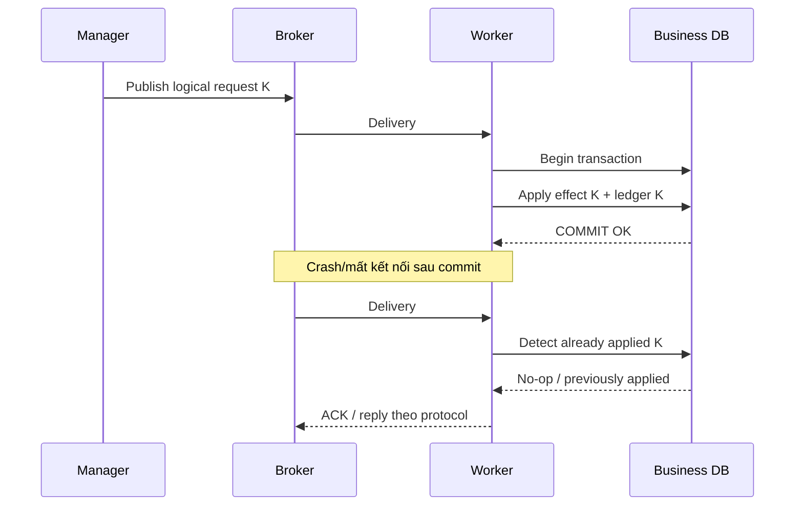
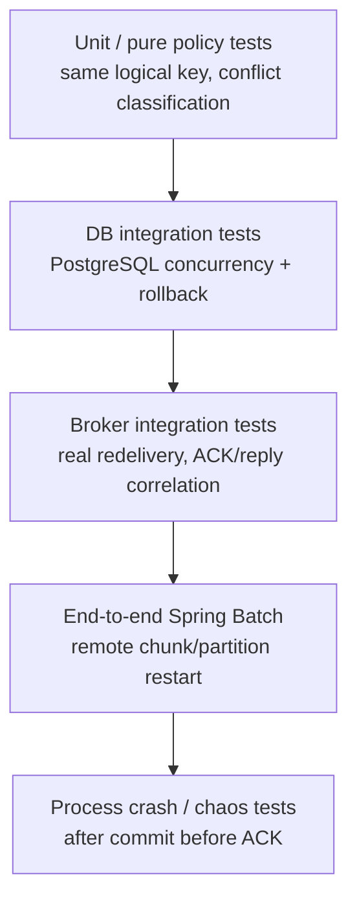
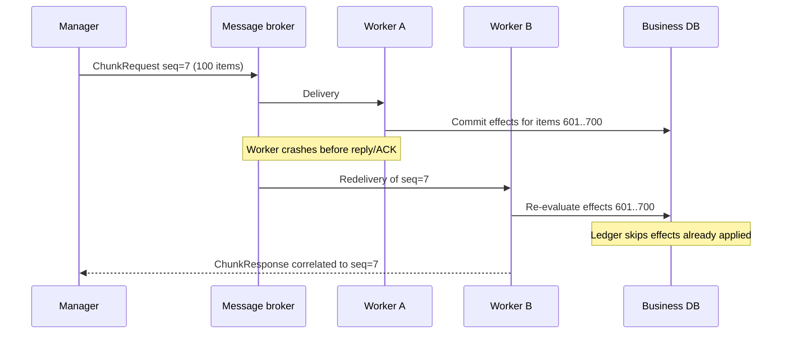
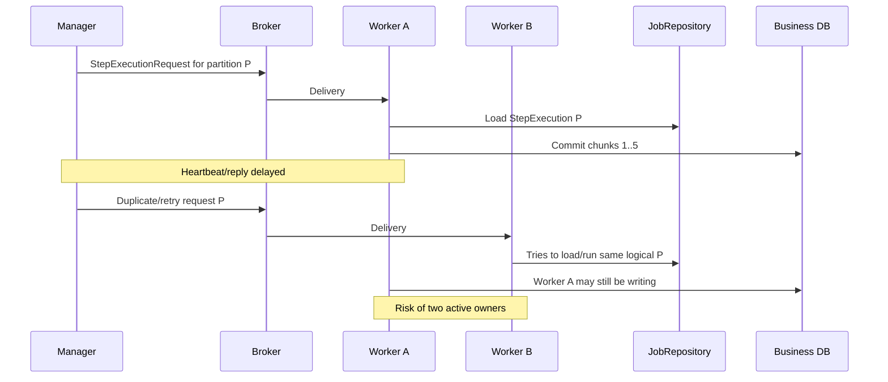

# Test duplicate message

## 1. Vì sao phải kiểm thử message bị giao trùng?

Trong chương **Testing concurrency** của module **SPRING_BATCH_SCALING_OPERATIONS**, chúng ta nghiên cứu cách kiểm chứng một hệ thống Spring Batch xử lý dữ liệu lớn bằng *multi-threaded step*, *parallel steps*, *partitioning*, remote partitioning và remote chunking. Ngoài throughput, thread safety và restartability, hệ thống cần chịu được một đặc tính quan trọng của giao tiếp phân tán: **một logical message có thể được giao tới worker nhiều lần**.

Hãy tưởng tượng manager gửi một chunk chứa 100 invoice đến worker qua broker:

1. Worker nhận chunk, xử lý xong và commit kết quả.
2. Worker chưa kịp gửi reply hoặc ACK thì kết nối bị ngắt.
3. Broker không có bằng chứng delivery hoàn tất nên phát lại message.
4. Một worker khác nhận chunk và có thể thực thi lại các nghiệp vụ đã commit.

Nếu writer thực hiện `UPDATE balance = balance + amount` mà không có cơ chế chống trùng, số dư có thể bị cộng hai lần. Nếu chỉ kiểm tra `JobExecution.STATUS=COMPLETED`, lỗi này có thể hoàn toàn bị bỏ sót.

**Test duplicate message** phải chứng minh rằng nhiều lần giao cùng công việc logic không làm sai kết quả cuối, kể cả khi:

- Hai deliveries đến **đồng thời**, không chỉ lần lượt.
- Có rollback, retry, process crash và worker replacement.
- Message có transport ID khác nhau nhưng cùng business effect.
- Có message payload mâu thuẫn cùng business key.
- Reply, ACK hoặc cập nhật JobRepository bị mất sau business commit.
- Manager hoặc broker phát lại toàn chunk/partition, không chỉ một item.

> **Invariant chính:** Có thể xảy ra nhiều delivery và nhiều execution attempts, nhưng một **business effect** được phép ghi vào đích **không nhiều hơn một lần**, và mọi effect hợp lệ phải cuối cùng được xử lý hoặc được ghi nhận rõ là pending/failed/quarantined theo chính sách. Đây là **exactly-once effect ở ranh giới nghiệp vụ**, không phải cam kết broker chỉ giao message đúng một lần.

### Mục tiêu học tập

Sau bài này, bạn có thể:

1. Phân biệt duplicate delivery, duplicate message ID, duplicate logical request, replay và duplicate business effect.
2. Giải thích vì sao at-least-once delivery cần idempotent consumer và không suy ra exactly-once effect.
3. Xác định business idempotency key ổn định xuyên retry, restart, redelivery và thay worker.
4. Thiết kế PostgreSQL ledger + unique constraint + business update trong **cùng transaction**.
5. Viết JUnit integration tests cho duplicate tuần tự, đồng thời, payload conflict và rollback.
6. Tổ chức Testcontainers/broker tests để xác minh **redelivery thật**, correlation và ACK sau commit.
7. Tạo fault-injection tại các ranh giới **trước commit**, **sau commit trước reply/ACK** và **manager timeout**.
8. Hiểu các điểm khác nhau giữa remote chunking, remote partitioning và retry của Spring Batch step.
9. Đối soát JobRepository, dữ liệu đích, ledger, message deliveries và retry metrics.
10. Thiết kế kiểm thử tải, CI và runbook để phát hiện duplicated effects ở môi trường phân tán.

## 2. Định nghĩa chính xác: “duplicate” là duplicate của cái gì?

| Hiện tượng | Ví dụ | Có nhất thiết là lỗi? |
| --- | --- | --- |
| **Transport redelivery** | Broker giao lại cùng message do chưa ACK | Không; là semantics bình thường của at-least-once |
| **Duplicate transport message** | Producer publish hai messages có ID khác nhau cùng payload | Cần dedup bằng logical key, không tin message ID |
| **Duplicate logical work** | Hai requests cùng xử lý invoice #42 của snapshot S7 | Có thể hợp lệ nếu hai attempts thuộc recovery; phải có guard |
| **Duplicate processing attempt** | Processor được gọi lại sau rollback | Thường xảy ra với retry; không được gắn mỗi call với một effect mới |
| **Duplicate business effect** | Một lần charge bị thực hiện hai lần | Lỗi nghiêm trọng nếu hợp đồng chỉ cho một effect |
| **Intentional repeated event** | Hai khoản nạp 100.000 đồng khác nhau | **Không** được dedup thành một chỉ vì payload giống nhau |
| **Conflicting replay** | Cùng effect key nhưng amount/account khác | Phải báo conflict, không silent no-op |

### 2.1. Thứ tự message ID, chunk ID và business key

Một logical effect có thể có nhiều định danh:

```text
JobInstance (business workload):
    settlement|tenant-A|businessDate=2026-11-26|snapshot=S7

Logical partition:
    range:00010000-00019999|snapshot=S7

Remote request:
    ChunkRequest(seq=42) hoặc StepExecutionRequest(...)

Transport delivery:
    brokerMessageId=...; deliveryTag=...; redelivered=true/false

Business effect:
    tenant-A|sourceEventId=EVT-912|operation=APPLY_BALANCE_V1
```

Trong test và production, **effect key phải được thiết kế dựa trên đơn vị nghiệp vụ thật**, không lấy ngẫu nhiên một `UUID.randomUUID()` mỗi delivery, `deliveryTag`, `JobExecutionId` hoặc `StepExecutionId` rồi coi là business identity. Các ID execution/transport có thể đổi sau restart hoặc republish.

### 2.2. Duplicate effect khác duplicate payload

Hai event có amount, account và timestamp bằng nhau vẫn có thể là hai giao dịch **thực sự khác nhau**. Nếu dedup theo `hash(payload)` mà không có source event ID/operation identity, hệ thống có thể **làm mất giao dịch hợp lệ**.

Ngược lại, cùng `effect_key` nhưng payload thay đổi là **xung đột dữ liệu**. Một ledger tốt cần lưu hash/canonical version để phát hiện thay đổi, không chỉ `ON CONFLICT DO NOTHING` rồi im lặng.

## 3. Các cửa sổ lỗi tạo duplicate message



Tình huống trên được gọi là **commit-before-ack/reply**. Đây là cửa sổ kiểm thử quan trọng nhất vì:

- Nếu crash **trước DB commit**, retry cần thực thi effect để không mất dữ liệu.
- Nếu crash **sau DB commit trước broker ACK**, retry phải **không thực thi effect thêm lần nữa**.
- Nếu broker ACK trước DB commit và worker crash, message có thể bị mất mà effect chưa được thực hiện.
- Nếu manager nhận reply trước khi business effect durable, manager có thể tưởng chunk đã hoàn tất dù worker còn chưa commit.

Không tồn tại một rollback ACID tự động bao trùm mọi API/DB/broker chỉ vì dùng Spring Batch. Khi có hai hệ thống giao dịch khác nhau, cần idempotency, outbox/inbox hoặc giao thức reconciliation tương ứng.

### 3.1. Ma trận cửa sổ lỗi

| Thời điểm lỗi | DB effect | Broker delivery | Yêu cầu với consumer |
| --- | --- | --- | --- |
| Trước xử lý | Chưa có | Có thể redeliver | Phải áp dụng effect một lần |
| Sau insert ledger nhưng trước commit | Transaction rollback | Redeliver | Retry phải có thể thắng và áp dụng |
| Sau effect nhưng trước commit | Transaction rollback nếu cùng DB TX | Redeliver | Không bỏ sót effect |
| Sau DB commit trước reply | Đã có effect | Có thể redeliver | No-op hoặc trả previous result |
| Sau reply nhưng trước ACK | Đã có effect | Có thể redeliver | Không nhân đôi effect/reply bookkeeping |
| ACK trước commit | Effect có thể thiếu | Broker tưởng đã xử lý | **Thiết kế cần loại bỏ**, không thể chữa chỉ bằng dedup |
| Manager timeout, worker còn chạy | Có thể đang commit | Manager có thể retry work | Ownership/fencing và idempotency |
| Hai consumers nhận cùng logical key đồng thời | Một hoặc hai TX đang tranh | Concurrent deliveries | Chỉ một effect được commit |

**Lưu ý:** Thời điểm ACK/reply phụ thuộc giao thức Spring Integration và broker; ứng dụng không nên tự ý ACK trong một callback nếu điều đó phá flow mặc định của Spring Batch remote handler. Khi test cần biết **đâu là ranh giới commit thực** và **đâu là thời điểm transport coi request resolved**.

## 4. Spring Batch concurrency và vị trí duplicate xuất hiện

### 4.1. Multi-threaded step

Một multi-threaded chunk step có nhiều chunks được xử lý bởi executor trong **cùng `StepExecution`**. Một chunk rollback có thể làm processor/writer xử lý lại một số items. Nếu writer có side effect không nằm trong chunk transaction (HTTP POST, file publish), replay có thể tạo effect trùng.

**Không suy ra** rằng `@StepScope` tạo bean riêng cho mỗi chunk thread: scope là theo `StepExecution`, do đó reader/writer mutable state vẫn cần thread-safety. Test duplicate cần bao gồm replay của cùng item **trong cùng JobExecution**, không chỉ broker messages.

### 4.2. Parallel steps

Hai branches của `split` có thể chạm cùng business key nếu thiết kế source ownership sai. Chạy song song không tự ngăn `stepA` và `stepB` cùng phát event cập nhật account. Nếu có thể dùng cùng effect key, cần invariant partition/route và unique constraint tại sink.

### 4.3. Local partitioning

`Partitioner` chia input thành `ExecutionContext` cho mỗi worker `StepExecution`. Nếu các partition ranges chồng nhau, một source item có thể được xử lý bởi hai partitions **ngay lần đầu**, không cần lỗi broker. Cần:

1. Test manifest/partition ranges không chồng lấn nếu business đòi partition độc quyền.
2. Test mỗi source business key xuất hiện đúng expected count.
3. Sink idempotent để giảm hậu quả khi replay, nhưng **không lấy dedup thay validation partition plan**.

### 4.4. Remote partitioning

Manager thường gửi `StepExecutionRequest`, worker chạy một `StepExecution` liên quan repository. Message redelivery, reply timeout hoặc manager recovery có thể khiến cùng logical partition được yêu cầu xử lý lại. Những request về một `StepExecution` đang `STARTED` không mặc nhiên an toàn khi dispatch cho hai owners.

**JobRepository không thay thế business idempotency.** Metadata có optimistic locking và quản lý restart nhưng **không giao dịch nguyên tử với mọi HTTP/file/database ngoài repository**; nếu effect đã commit trong hệ thống khác nhưng StepExecution metadata chưa kịp checkpoint, replay có thể xảy ra.

### 4.5. Remote chunking

Manager đọc items và gửi `ChunkRequest`; worker process/write và gửi `ChunkResponse`. Một chunk chứa **nhiều business items**, không phải một StepExecution riêng mặc định. Nếu reply mất, broker có thể redeliver chunk chứa các item đã ghi.

Kiểm thử phải đối soát theo **item-level effect key** trong chunk, chứ không chỉ số lần callback của `ChunkProcessor` hoặc sequence của `ChunkRequest`. Ngay cả khi một chunk request có correlation ID được giữ ổn định, đó chưa đủ bảo vệ các side effects phát sinh bởi nhiều items nếu các retries tạo hoặc truyền request khác.

### 4.6. Message delivery và Job restart là hai tầng khác nhau

Một `retryLimit(3)` ở fault-tolerant step không giới hạn số message broker giao lại, và broker redelivery policy không giới hạn số lần HTTP SDK retry bên trong một worker. Vì vậy:

```text
Item retry (Spring Batch)
   × SDK HTTP retry
   × Broker redelivery
   × Job restart
   = có thể khuếch đại physical attempts
```

Phép nhân chỉ là **mô hình worst-case nếu các tầng thực sự lồng nhau**, không phải công thức cứng cho mọi Spring Batch architecture. Mục tiêu của test là đếm **physical attempts** và **unique committed effects** theo cùng logical key.

## 5. Xác định hợp đồng idempotency trước khi viết test

Một test không có invariant rõ chỉ có thể chứng minh “method chạy hai lần”, chứ không biết kết quả đó đúng hay sai.

### 5.1. Ví dụ nghiệp vụ

Hệ thống nhận event:

```json
{
  "eventId": "EVT-1024",
  "tenantId": "tenant-A",
  "accountId": "ACC-05",
  "delta": "150.00",
  "operationVersion": "BALANCE_APPLY_V1",
  "sourceSnapshot": "S7"
}
```

Hợp đồng:

- `eventId` định danh **một sự kiện nguồn duy nhất** trong namespace `tenantId` và snapshot/operation scope thích hợp.
- Một business event hợp lệ chỉ được cộng `delta` **một lần**, dù giao 1, 2 hay 100 lần.
- Event khác có cùng `delta` nhưng `eventId` khác được áp dụng riêng.
- Cùng `eventId` nhưng `accountId`/`delta`/operation khác phải bị phát hiện là **conflict**.
- Khi transaction rollback, event chưa được tính là applied, delivery sau được phép retry.
- Khi đã commit, retry trả `ALREADY_APPLIED` hoặc kết quả tương đương, không cộng lại.
- Nếu có ordering requirement theo account, cần **sequence guard bổ sung**; idempotency không tự ép event đến đúng thứ tự.

### 5.2. Một bộ invariant có thể đo được

| ID | Invariant | Cách kiểm chứng |
| --- | --- | --- |
| I01 | Tối đa một committed ledger row cho một `(consumer, effect_key)` | Unique constraint và SQL count |
| I02 | Một effect hợp lệ chỉ thay đổi balance một lần | So số dư với tổng distinct events |
| I03 | Duplicate cùng payload không ghi lại | `APPLIED=1`, `ALREADY_APPLIED=N-1` |
| I04 | Duplicate payload khác phải fail | Conflict exception, balance không đổi |
| I05 | Crash/exception trước commit không ghi ledger/effect | Query ledger và balance sau rollback |
| I06 | Replay sau rollback cuối cùng áp dụng một lần | Retry thành công, ledger một row |
| I07 | Hai deliveries đồng thời không double commit | Start barrier + TX concurrent |
| I08 | Different business keys vẫn có thể áp dụng | Không dedup nhầm payload giống nhau |
| I09 | Broker redelivery được quan sát thật | Broker metric/delivery record/test hook |
| I10 | Sau commit trước ACK crash, output chỉ có một effect | Process kill + query durable DB |
| I11 | Job restart dùng cùng source identity | Same identifying parameters/snapshot |
| I12 | Không bị mất business events hợp lệ | Compare manifest/source to committed ledger |
| I13 | Queue/reply correlation không bị mất | Một logical result cho đúng request context |
| I14 | Poison payload không lặp mãi | Bounded retry, DLQ/quarantine có audit |
| I15 | Metrics phân biệt delivery với effect | Counts trên từng phạm vi |
| I16 | Không có hai worker owners ghi trái fencing | Lease/generation/side-effect guard nếu áp dụng |

**Không chỉ assert `balance=150` rồi kết luận mọi thứ đúng**: một bug có thể cộng hai lần và trừ bù, hoặc đã publish hai HTTP requests bên ngoài. Test quan trọng cần kiểm tra ledger, output, event IDs, transaction boundaries và downstream side effects độc lập.

## 6. PostgreSQL schema: ledger và business effect trong cùng database

Ví dụ kiểm thử sử dụng PostgreSQL. Mục đích là xác minh hai workers đồng thời xử lý **cùng account event** nhưng chỉ một transaction được phép thực sự thay đổi balance.

```sql
CREATE TABLE account_balance (
    tenant_id   VARCHAR(80) NOT NULL,
    account_id  VARCHAR(120) NOT NULL,
    balance     NUMERIC(20, 2) NOT NULL DEFAULT 0,
    PRIMARY KEY (tenant_id, account_id)
);

CREATE TABLE applied_business_effect (
    consumer_name VARCHAR(120) NOT NULL,
    effect_key    VARCHAR(300) NOT NULL,
    payload_hash  CHAR(64) NOT NULL,
    tenant_id     VARCHAR(80) NOT NULL,
    account_id    VARCHAR(120) NOT NULL,
    delta         NUMERIC(20, 2) NOT NULL,
    committed_at  TIMESTAMPTZ NOT NULL DEFAULT CURRENT_TIMESTAMP,
    PRIMARY KEY (consumer_name, effect_key)
);

CREATE INDEX idx_effect_tenant_account
    ON applied_business_effect(tenant_id, account_id);

INSERT INTO account_balance(tenant_id, account_id, balance)
VALUES ('tenant-A', 'ACC-05', 0);
```

**Hai bảng này là schema nghiệp vụ của bài học**, không phải metadata `BATCH_*` do Spring Batch quản lý. Trong production, unique key có thể dùng cột tách riêng `(tenant_id, source_event_id, operation_version)` thay vì ghép chuỗi; sample ghép chuỗi để code ngắn và cần validate namespace/encoding.

### 6.1. Tại sao unique constraint quan trọng?

Chỉ kiểm tra bằng Java:

```java
if (!alreadyProcessed(eventId)) {
    applyBusinessEffect();
    markProcessed(eventId);
}
```

**không an toàn khi hai workers chạy song song**. Cả A và B có thể cùng thấy “chưa processed”, rồi cùng cập nhật balance. Một `ConcurrentHashMap` chỉ bảo vệ trong cùng JVM, không bảo vệ 10 pods hoặc process crash/restart.

Unique constraint ở **database chịu trách nhiệm commit** là điểm đồng bộ bền vững. Khi hai transactions INSERT cùng primary key, PostgreSQL điều phối conflict; với `INSERT ... ON CONFLICT DO NOTHING`, một transaction có thể phải chờ transaction cạnh tranh quyết định commit/rollback. Kiểm thử dưới tải thật sẽ xác nhận trường hợp đó.

### 6.2. Điều kiện bắt buộc: ledger và business update atomic

```text
BEGIN TRANSACTION
  INSERT ledger(effect_key)
  IF INSERT succeeded:
      UPDATE account balance
  ELSE:
      verify stored payload hash and return ALREADY_APPLIED
COMMIT
```

Không commit ledger trong transaction A rồi cập nhật balance ở transaction B. Nếu worker chết giữa hai transaction, retry thấy ledger đã có và có thể **bỏ qua effect chưa bao giờ xảy ra**.

Tương tự, cập nhật balance trước rồi mới ghi ledger **ngoài cùng transaction** có thể tạo double effect khi process chết giữa hai bước.

### 6.3. Một database transaction không bao trùm HTTP/JMS/S3

Nếu worker đồng thời ghi database và gọi HTTP POST, ledger cùng database không tự bảo đảm POST chỉ chạy một lần. Cần:

- Server-side idempotency key được API nhận và thực thi; hoặc
- Transactional outbox (ghi ý định phát message cùng business DB transaction) + idempotent consumer bên nhận; hoặc
- Workflow tra cứu trạng thái, reconciliation và bù trừ theo domain.

**Đừng tuyên bố “exactly once delivery” chỉ từ unique constraint ở một database**; bảo đảm ở đây là **hiệu lực được bảo vệ trong chính database đó**.

## 7. Java 17: business message và idempotency key ổn định

Để test dễ quan sát, mỗi message mang:

- Identity của sự kiện nguồn, tenant, snapshot và operation.
- Dữ liệu cập nhật account.
- Payload hash canonical để nhận biết conflicting replay.

```java
import java.math.BigDecimal;
import java.nio.charset.StandardCharsets;
import java.security.MessageDigest;
import java.security.NoSuchAlgorithmException;
import java.util.HexFormat;
import java.util.Objects;

public record EffectMessage(
        String tenantId,
        String eventId,
        String snapshotVersion,
        String operationVersion,
        String accountId,
        BigDecimal delta) {

    public EffectMessage {
        Objects.requireNonNull(tenantId);
        Objects.requireNonNull(eventId);
        Objects.requireNonNull(snapshotVersion);
        Objects.requireNonNull(operationVersion);
        Objects.requireNonNull(accountId);
        Objects.requireNonNull(delta);
        if (tenantId.isBlank() || eventId.isBlank()
                || snapshotVersion.isBlank()
                || operationVersion.isBlank()
                || accountId.isBlank()) {
            throw new IllegalArgumentException("Blank business identity");
        }
        delta = delta.setScale(2, java.math.RoundingMode.UNNECESSARY);
    }

    public String effectKey() {
        return tenantId + "|" + snapshotVersion + "|"
            + operationVersion + "|" + eventId;
    }

    public String payloadHash() {
        String canonical = "EFFECT_V1|" + tenantId + "|"
            + snapshotVersion + "|" + operationVersion
            + "|" + eventId + "|" + accountId + "|"
            + delta.toPlainString();
        try {
            byte[] digest = MessageDigest.getInstance("SHA-256")
                .digest(canonical.getBytes(StandardCharsets.UTF_8));
            return HexFormat.of().formatHex(digest);
        } catch (NoSuchAlgorithmException impossibleOnJava17) {
            throw new IllegalStateException(
                "SHA-256 unavailable", impossibleOnJava17);
        }
    }
}
```

**Ví dụ dùng ký tự `|` để minh họa canonicalization**. Production phải dùng canonical encoding có **length-prefix, escaping hoặc format canonical versioned** để tránh trường hợp hai bộ fields khác nhau tạo cùng chuỗi trước hash. Đặt giới hạn độ dài/format cho business IDs để `effectKey` nằm trong kích thước cột và tránh collision do ghép delimiter.

**Không dùng hash payload làm effect key**: hai transactions cùng amount/account có thể giống payload nhưng là hai event độc lập. `effectKey` được xây từ **source event identity** và operation scope; hash dùng để so **tính nhất quán của payload** cho cùng identity.

### 7.1. Một số kiểm thử định danh

| Đầu vào | Effect key | Kỳ vọng |
| --- | --- | --- |
| Cùng event, cùng snapshot, gửi lại | Giữ nguyên | Duplicate no-op |
| Cùng event, transport message ID mới | Giữ nguyên | Duplicate no-op |
| Cùng event, worker/job execution mới | Giữ nguyên | Duplicate no-op |
| Event ID khác, amount giống | Khác | Hai legitimate effects |
| Cùng event ID nhưng amount khác | Cùng key, hash khác | Conflict |
| Cùng event ID nhưng operation version khác | Khác theo contract | Có thể là effect khác, cần domain approval |
| Snapshot mới có ý nghĩa correction | Key theo operation/snapshot policy | Không tự coi là cùng effect nếu domain khác |

Việc đưa `snapshotVersion` vào effect key là lựa chọn **theo hợp đồng giả định** của ví dụ: nếu nghiệp vụ yêu cầu cùng source event chỉ được tính một lần **xuyên mọi snapshot**, cần **không đưa snapshot vào key** hoặc có một lớp business dedup xuyên snapshot. Không áp dụng mẫu một cách máy móc.

## 8. Java 17 + Spring JDBC: xử lý idempotent có transaction

Đây là mã xử lý core business effect; nó **không phụ thuộc trực tiếp vào broker listener**, do đó có thể test transaction trước khi thử JMS/AMQP. `TransactionTemplate` tạo transaction mới cho mỗi lần `apply` trong trường hợp caller chưa mở transaction. Trong ứng dụng thật, cần xác minh transaction propagation với Spring Batch chunk transaction và datasource thực.

### 8.1. Contract kết quả và fault hook

```java
enum ApplyResult {
    APPLIED,
    ALREADY_APPLIED
}

@FunctionalInterface
interface AfterLedgerInsertHook {
    void afterInsert(EffectMessage message);

    static AfterLedgerInsertHook none() {
        return ignored -> { };
    }
}
```

`AfterLedgerInsertHook` là **test seam**: test có thể ném lỗi sau INSERT ledger nhưng trước khi UPDATE business effect. Production sử dụng `none()` hoặc bỏ hook hoàn toàn. Không để hook có side effect ngoài transaction mà test lầm là sẽ tự rollback theo JDBC.

### 8.2. Service áp dụng effect

```java
import java.util.List;
import java.util.Objects;
import org.springframework.jdbc.core.JdbcTemplate;
import org.springframework.transaction.PlatformTransactionManager;
import org.springframework.transaction.support.TransactionTemplate;

public final class IdempotentEffectService {
    private static final String CONSUMER = "balance-writer-v1";

    private final JdbcTemplate jdbc;
    private final TransactionTemplate transactions;
    private final AfterLedgerInsertHook hook;

    public IdempotentEffectService(
            JdbcTemplate jdbc,
            PlatformTransactionManager transactionManager,
            AfterLedgerInsertHook hook) {
        this.jdbc = Objects.requireNonNull(jdbc);
        this.transactions =
            new TransactionTemplate(transactionManager);
        this.hook = Objects.requireNonNull(hook);
    }

    public ApplyResult apply(EffectMessage message) {
        Objects.requireNonNull(message);

        return Objects.requireNonNull(
            transactions.execute(status -> {
                int inserted = jdbc.update("""
                    INSERT INTO applied_business_effect (
                        consumer_name, effect_key, payload_hash,
                        tenant_id, account_id, delta
                    )
                    VALUES (?, ?, ?, ?, ?, ?)
                    ON CONFLICT (consumer_name, effect_key)
                    DO NOTHING
                    """,
                    CONSUMER,
                    message.effectKey(),
                    message.payloadHash(),
                    message.tenantId(),
                    message.accountId(),
                    message.delta());

                if (inserted == 0) {
                    List<String> hashes = jdbc.query("""
                        SELECT payload_hash
                        FROM applied_business_effect
                        WHERE consumer_name = ?
                          AND effect_key = ?
                        """,
                        (rs, rowNum) ->
                            rs.getString("payload_hash").trim(),
                        CONSUMER, message.effectKey());

                    if (hashes.size() != 1) {
                        throw new IllegalStateException(
                            "Ledger conflict not visible; retry whole TX");
                    }
                    if (!hashes.get(0).equals(message.payloadHash())) {
                        throw new IllegalArgumentException(
                            "Conflicting payload for business effect key");
                    }
                    return ApplyResult.ALREADY_APPLIED;
                }

                // Fault injection trong cùng transaction.
                hook.afterInsert(message);

                int changed = jdbc.update("""
                    UPDATE account_balance
                    SET balance = balance + ?
                    WHERE tenant_id = ? AND account_id = ?
                    """,
                    message.delta(),
                    message.tenantId(),
                    message.accountId());

                if (changed != 1) {
                    // Exception khiến rollback cả ledger INSERT.
                    throw new IllegalStateException(
                        "Account not found or ambiguous");
                }
                return ApplyResult.APPLIED;
            })
        );
    }
}
```

**Tính chất transaction của code:**

1. `INSERT ... ON CONFLICT DO NOTHING` là điểm cạnh tranh chính theo effect key.
2. Nếu INSERT thành công, code UPDATE balance **trong cùng DB transaction**.
3. Nếu UPDATE lỗi/đổi 0 rows, exception làm rollback **cả ledger và balance**.
4. Nếu cùng key đã commit, code so hash: giống → no-op; khác → conflict.
5. Hai threads cùng gửi key, PostgreSQL unique constraint giải quyết cuộc đua, không phụ thuộc Java synchronized.

**Giới hạn cần kiểm chứng:** Ví dụ giả định PostgreSQL isolation `READ COMMITTED` và bảng ledger/business dùng **cùng DataSource/transaction manager**. Dưới isolation khác, ví dụ `REPEATABLE READ` với concurrent conflict, query ngay sau `ON CONFLICT DO NOTHING` có thể không nhìn thấy row đối thủ như kỳ vọng; khi đó phải retry **toàn transaction** theo policy. Lỗi commit ambiguous, deadlock và serialization failure phải được phân loại và xử lý có giới hạn, không đổi sang `retry(Exception.class)`.

### 8.3. Không dùng `@Transactional` trên phương thức nội bộ không qua proxy

Một triển khai khác có thể dùng `@Transactional` trên Spring bean:

```java
@org.springframework.transaction.annotation.Transactional
public ApplyResult applyMessage(EffectMessage msg) {
    // business JDBC operations
    return ApplyResult.APPLIED;
}
```

Nếu gọi `this.applyMessage(...)` từ một method khác trong cùng bean, proxy-based Spring transaction có thể **không được kích hoạt**. Với concurrency tests, nên gọi qua bean proxy thực tế hoặc dùng `TransactionTemplate` tường minh như ví dụ trên. Đừng để test PASS chỉ vì framework test đã mở một transaction ngoại vi và vô tình che lấp boundary của consumer.

## 9. Mẫu assertion đáng tin: final effects, không chỉ callback count

Một bộ test nên ghi riêng:

```text
logical_requests_total      = 1
transport_deliveries_total  = 3
handler_invocations_total   = 3
business_effect_applied     = 1
business_effect_duplicate   = 2
ledger_rows_for_effect      = 1
balance_delta               = +150.00
```

Với duplicate đang xử lý đồng thời, thứ tự hoàn tất của ba callback không xác định. **Không assert worker cụ thể luôn thắng**, chỉ assert có đúng một `APPLIED` và những attempt còn lại là `ALREADY_APPLIED` hoặc được retry hợp lệ sau rollback.

### 9.1. Counter không phải bằng chứng hoàn chỉnh

Nếu code bắt duplicate bằng `ConcurrentHashMap`, test một JVM có thể PASS nhưng khi chạy hai JVM lại double effect. Ngược lại, nếu chỉ assert `applied=1` từ metric, process crash có thể mất metric trong khi DB đã commit. **Đích bền vững (unique ledger + business state) phải là source of truth của test correctness**.

### 9.2. Số effect duy nhất phải khớp input manifest

Nếu có 100 source events, 10 events intentional filter, 3 events bị quarantine có audit, output mong đợi là 87 **logical effects thành công**. Không suy ra số records từ broker `message count` vì một chunk chứa nhiều items; không cộng manager `StepExecution` counters với worker counters hai lần.

## 10. Testcontainers PostgreSQL: môi trường integration test

Unit test với `ConcurrentHashMap` hoặc mock `JdbcTemplate` không thể chứng minh unique constraint, transaction visibility, row locking và rollback thật của PostgreSQL. Với duplicate message, các đặc tính **đồng thời trong database** là phần phải kiểm chứng bằng integration test.

Ví dụ dùng:

- Java 17+ và JUnit Jupiter 5.
- Testcontainers PostgreSQL.
- Spring JDBC, `DataSourceTransactionManager` và `TransactionTemplate`.
- PostgreSQL JDBC driver.

Không cần chạy toàn bộ Spring Boot application để kiểm thử service JDBC; phần broker/Batch end-to-end sẽ được test riêng.

### 10.1. Test fixture cơ bản

```java
import java.math.BigDecimal;

import org.junit.jupiter.api.BeforeAll;
import org.junit.jupiter.api.BeforeEach;
import org.junit.jupiter.api.Test;
import org.springframework.jdbc.core.JdbcTemplate;
import org.springframework.jdbc.datasource.DriverManagerDataSource;
import org.springframework.jdbc.datasource.DataSourceTransactionManager;
import org.springframework.transaction.PlatformTransactionManager;
import org.testcontainers.containers.PostgreSQLContainer;
import org.testcontainers.junit.jupiter.Container;
import org.testcontainers.junit.jupiter.Testcontainers;

import static org.junit.jupiter.api.Assertions.*;

@Testcontainers
class DuplicateMessageJdbcIT {

    @Container
    static final PostgreSQLContainer<?> postgres =
        new PostgreSQLContainer<>("postgres:16-alpine")
            .withDatabaseName("batch_test")
            .withUsername("batch_test")
            .withPassword("batch_test");

    static JdbcTemplate jdbc;
    static PlatformTransactionManager transactionManager;
    static IdempotentEffectService service;

    @BeforeAll
    static void prepareSchema() {
        DriverManagerDataSource dataSource =
            new DriverManagerDataSource();
        dataSource.setDriverClassName("org.postgresql.Driver");
        dataSource.setUrl(postgres.getJdbcUrl());
        dataSource.setUsername(postgres.getUsername());
        dataSource.setPassword(postgres.getPassword());

        jdbc = new JdbcTemplate(dataSource);
        transactionManager =
            new DataSourceTransactionManager(dataSource);
        service = new IdempotentEffectService(
            jdbc, transactionManager, AfterLedgerInsertHook.none());

        jdbc.execute("""
            CREATE TABLE account_balance (
                tenant_id VARCHAR(80) NOT NULL,
                account_id VARCHAR(120) NOT NULL,
                balance NUMERIC(20,2) NOT NULL DEFAULT 0,
                PRIMARY KEY (tenant_id, account_id)
            )
            """);
        jdbc.execute("""
            CREATE TABLE applied_business_effect (
                consumer_name VARCHAR(120) NOT NULL,
                effect_key VARCHAR(300) NOT NULL,
                payload_hash CHAR(64) NOT NULL,
                tenant_id VARCHAR(80) NOT NULL,
                account_id VARCHAR(120) NOT NULL,
                delta NUMERIC(20,2) NOT NULL,
                committed_at TIMESTAMPTZ NOT NULL
                    DEFAULT CURRENT_TIMESTAMP,
                PRIMARY KEY (consumer_name, effect_key)
            )
            """);
        jdbc.update("""
            INSERT INTO account_balance
                (tenant_id, account_id, balance)
            VALUES ('tenant-A', 'ACC-05', 0)
            """);
    }

    @BeforeEach
    void resetBusinessState() {
        jdbc.update("DELETE FROM applied_business_effect");
        jdbc.update("""
            UPDATE account_balance SET balance = 0
            WHERE tenant_id = 'tenant-A'
              AND account_id = 'ACC-05'
            """);
    }

    static EffectMessage event() {
        return new EffectMessage(
            "tenant-A", "EVT-1024", "S7",
            "BALANCE_APPLY_V1", "ACC-05",
            new BigDecimal("150.00"));
    }

    long ledgerRows() {
        return jdbc.queryForObject("""
            SELECT COUNT(*) FROM applied_business_effect
            WHERE consumer_name = 'balance-writer-v1'
            """, Long.class);
    }

    BigDecimal balance() {
        return jdbc.queryForObject("""
            SELECT balance FROM account_balance
            WHERE tenant_id = 'tenant-A'
              AND account_id = 'ACC-05'
            """, BigDecimal.class);
    }

    void assertBalance(String expected) {
        assertEquals(0, balance().compareTo(
            new BigDecimal(expected)));
    }

    // Những @Test dưới đây thuộc cùng class fixture.
}
```

**Đây là fixture minh họa, không cần thêm file SQL để hiểu bài.** Production nên tạo schema bằng migration (Flyway/Liquibase) và test nên kiểm tra phiên bản migration thật. `DriverManagerDataSource` mở kết nối mới theo yêu cầu, phù hợp để trình bày transaction behavior trong test nhỏ; production cần bounded connection pool, connection timeout và telemetry.

Các snippets `@Test` ở mục tiếp theo **đặt bên trong class `DuplicateMessageJdbcIT`**, không đặt độc lập ở top-level Java. Tương tự, `EffectMessage`, `IdempotentEffectService`, `ApplyResult` và `AfterLedgerInsertHook` thuộc các source classes tương ứng.

## 11. Test duplicate tuần tự và hai event hợp lệ cùng payload

### 11.1. D01: cùng message được xử lý hai lần

```java
@Test
void sequentialDuplicateAppliesEffectOnlyOnce() {
    EffectMessage original = event();

    ApplyResult first = service.apply(original);
    ApplyResult second = service.apply(original);

    assertEquals(ApplyResult.APPLIED, first);
    assertEquals(ApplyResult.ALREADY_APPLIED, second);
    assertEquals(1L, ledgerRows());
    assertBalance("150.00");
}
```

Test này kiểm tra cả hai trạng thái:

- **Ledger có 1 row:** bảo đảm một key chỉ được ghi một lần.
- **Balance tăng đúng 150:** bảo đảm effect nghiệp vụ không nhân đôi.

Đừng chỉ assert service trả `ALREADY_APPLIED`: một implementation sai vẫn có thể UPDATE balance lần hai rồi trả ALREADY_APPLIED.

### 11.2. D02: hai business events khác nhau có cùng amount

```java
@Test
void distinctEventIdsAreBothAppliedEvenWithSamePayloadAmount() {
    EffectMessage first = event();
    EffectMessage second = new EffectMessage(
        "tenant-A", "EVT-1025", "S7",
        "BALANCE_APPLY_V1", "ACC-05",
        new BigDecimal("150.00"));

    assertEquals(ApplyResult.APPLIED, service.apply(first));
    assertEquals(ApplyResult.APPLIED, service.apply(second));
    assertEquals(2L, ledgerRows());
    assertBalance("300.00");
}
```

Hai event đều tăng balance thêm 150 nhưng có `eventId` khác nhau. Nếu hệ thống dedup theo toàn bộ serialized payload mà bỏ qua event identity, nó có thể **làm mất effect thứ hai**. Test này bảo vệ sự khác nhau giữa **duplicate delivery** và **hai sự kiện hợp lệ trùng giá trị**.

### 11.3. D03: cùng effect key nhưng payload khác

```java
@Test
void conflictingDuplicateIsRejectedWithoutSecondEffect() {
    service.apply(event());

    EffectMessage conflicting = new EffectMessage(
        "tenant-A", "EVT-1024", "S7",
        "BALANCE_APPLY_V1", "ACC-05",
        new BigDecimal("999.00"));

    IllegalArgumentException failure = assertThrows(
        IllegalArgumentException.class,
        () -> service.apply(conflicting));

    assertTrue(failure.getMessage().contains(
        "Conflicting payload"));
    assertEquals(1L, ledgerRows());
    assertBalance("150.00");
}
```

Đây là lỗi **data contract**, không phải transient HTTP failure. Không nên retry message này vô hạn. Có thể chuyển DLQ/quarantine và báo nguồn phát; phải lưu cả effect key, hash cũ/mới, source snapshot và security-safe diagnostic.

## 12. Test duplicate đồng thời trên cùng database

Test tuần tự chưa phơi bày race của `check-then-act`. Cần cho **nhiều transaction bắt đầu gần như cùng lúc** trên cùng effect key.

### 12.1. D04: 16 threads cùng apply một event

```java
import java.util.ArrayList;
import java.util.List;
import java.util.concurrent.CountDownLatch;
import java.util.concurrent.ExecutorService;
import java.util.concurrent.Executors;
import java.util.concurrent.Future;
import java.util.concurrent.TimeUnit;

@Test
void concurrentDuplicateDeliveriesCommitExactlyOneEffect()
        throws Exception {

    int attempts = 16;
    CountDownLatch ready = new CountDownLatch(attempts);
    CountDownLatch start = new CountDownLatch(1);
    ExecutorService pool = Executors.newFixedThreadPool(attempts);
    List<Future<ApplyResult>> futures = new ArrayList<>();

    try {
        for (int i = 0; i < attempts; i++) {
            futures.add(pool.submit(() -> {
                ready.countDown();
                if (!start.await(10, TimeUnit.SECONDS)) {
                    throw new IllegalStateException("Start gate timeout");
                }
                return service.apply(event());
            }));
        }

        boolean allReady = ready.await(10, TimeUnit.SECONDS);
        start.countDown(); // Luôn mở gate trước assertion.
        assertTrue(allReady, "Threads did not reach test barrier");

        int applied = 0;
        int alreadyApplied = 0;
        for (Future<ApplyResult> future : futures) {
            ApplyResult result =
                future.get(30, TimeUnit.SECONDS);
            if (result == ApplyResult.APPLIED) {
                applied++;
            } else if (result == ApplyResult.ALREADY_APPLIED) {
                alreadyApplied++;
            }
        }

        assertEquals(1, applied);
        assertEquals(15, alreadyApplied);
        assertEquals(1L, ledgerRows());
        assertBalance("150.00");
    } finally {
        start.countDown();
        pool.shutdownNow();
        assertTrue(pool.awaitTermination(10, TimeUnit.SECONDS),
            "Executor did not stop; inspect blocked JDBC calls");
    }
}
```

**Lý do dùng `CountDownLatch`:** Không thể chứng minh xử lý đồng thời bằng cách gọi method 16 lần trong một vòng lặp. Latch ép các threads cùng đến điểm bắt đầu, làm tăng xác suất contention tại unique constraint.

**Không khẳng định test này tạo đúng một thứ tự giao dịch cố định.** Các threads vẫn chịu scheduling của JVM/OS và PostgreSQL; test quan trọng cần assert **invariant cuối**, không assert “thread #0 luôn thắng”.

**Lưu ý test stability:**

- 16 JDBC connections cùng lúc có thể vượt pool nếu dùng HikariCP nhỏ; cần cấu hình pool test phù hợp hoặc giảm `attempts` và ghi rõ giới hạn.
- Future timeout giúp test fail có giới hạn; nó không ngắt mọi blocking I/O lập tức.
- Nếu `awaitTermination` fail, phải điều tra DB lock/wait; không bỏ qua để CI trông xanh.
- Trong test này không có HTTP và broker, vì mục tiêu là **atomic DB effect**. Những tầng đó phải có tests riêng.

### 12.2. Vì sao khóa Java không phải lời giải cho remote workers?

Nếu dùng:

```java
private final java.util.Set<String> seen =
    java.util.concurrent.ConcurrentHashMap.newKeySet();

if (seen.add(effectKey)) {
    updateBalance();
}
```

Test 16 threads cùng một JVM có thể PASS. Nhưng:

- Worker JVM B có một `seen` khác.
- Process restart xóa bộ nhớ.
- Crash **sau `seen.add` nhưng trước DB commit** khiến lần sau khó xác minh trạng thái.
- Cache eviction có thể đưa key đã xử lý trở lại.

Vì vậy **concurrent set là optimization tại một process**, không thay unique ledger bền vững của business sink.

## 13. Test transaction rollback và retry đúng sau lỗi

Một consumer còn cần xử lý trường hợp **ledger đã insert nhưng transaction chưa commit**. Nếu design đánh dấu event “đã xử lý” quá sớm, retry có thể bỏ sót effect.

### 13.1. D05: exception sau ledger INSERT, trước business UPDATE

```java
@Test
void rolledBackLedgerDoesNotBurnTheBusinessKey() {
    IdempotentEffectService failing =
        new IdempotentEffectService(
            jdbc, transactionManager,
            message -> {
                throw new IllegalStateException(
                    "Injected after ledger insert");
            });

    assertThrows(IllegalStateException.class,
        () -> failing.apply(event()));

    // Không có ledger và không có effect sau rollback.
    assertEquals(0L, ledgerRows());
    assertBalance("0.00");

    // Delivery sau phải thực thi được, không bị coi là duplicate.
    assertEquals(ApplyResult.APPLIED, service.apply(event()));
    assertEquals(1L, ledgerRows());
    assertBalance("150.00");
}
```

Test này dùng **fault hook nằm bên trong JDBC transaction**. Nó kiểm chứng rollback logic, không phải process crash sau commit. Không dùng D05 để báo rằng đã kiểm tra broker redelivery.

### 13.2. D06: exception sau UPDATE nhưng trước COMMIT

Muốn test cửa sổ này, cần một hook khác **ngay sau business UPDATE nhưng trước transaction commit**:

```text
BEGIN
  insert ledger
  update account_balance
  testHook.afterBusinessUpdate -> throw
ROLLBACK

expected:
  ledger count = 0
  balance unchanged
  next delivery APPLIED once
```

Một test có thể thêm điểm chèn lỗi vào service ở môi trường test hoặc dùng faulting `TransactionSynchronization` với hiểu biết đúng về commit callbacks. **Không ném lỗi sau khi transaction đã commit rồi kỳ vọng DB rollback**.

### 13.3. D07: first transaction rollback trong khi second chờ cùng key

Để kiểm thử unique index coordination dưới concurrency:

1. Transaction A INSERT ledger cho key K, tạm dừng bằng barrier **trước UPDATE/COMMIT**.
2. Transaction B bắt đầu cùng `INSERT ... ON CONFLICT` và có thể chờ A quyết định.
3. A rollback do injected failure.
4. B tiếp tục và có thể INSERT thành công, rồi UPDATE balance/COMMIT.
5. Assert balance tăng đúng một lần, ledger có một row và không còn blocked transaction.

Lưu ý **B không nhất thiết đã đến đúng PostgreSQL lock wait** chỉ nhờ `Thread.sleep`; muốn chứng minh contention thật, dùng barrier/hook, database activity views hoặc test log có timestamp. Không nhét `Thread.sleep(500)` vào production service để “giảm race”.

### 13.4. D08: failure tại database commit

Một JDBC commit có thể thất bại theo nhiều cách:

- Transaction thực sự rollback.
- Client mất kết nối **sau server commit** nhưng trước khi nhận ACK của commit; outcome không rõ.

Không được tự động kết luận mọi `SQLException` ở commit nghĩa là business effect chưa xảy ra. Với stable effect key, caller có thể retry/reconcile: nếu ledger đã commit, nhận ALREADY_APPLIED; nếu chưa, có thể APPLIED. Test network interruption tại ranh giới commit bằng fault proxy hoặc process control là bài kiểm thử nâng cao, cần tách khỏi lỗi ném **trước commit**.

## 14. Ba cấp kiểm thử không thể thay thế nhau

Một chương trình test duplicate message có thể chia thành ba lớp rõ ràng:



| Lớp test | Điều chứng minh được | Điều **không** chứng minh |
| --- | --- | --- |
| Pure unit | Key/canonical hash, retry classification | DB unique constraint hoặc broker semantics |
| PostgreSQL/Testcontainers | Atomic ledger, concurrency, rollback | Broker thực giao trùng hoặc ACK timing |
| Broker + listener | Redelivery thực, ACK/nack, transport headers | Lifecycle Spring Batch remote protocol |
| Spring Batch integration | `JobRepository`, StepExecution, chunk/restart | SIGKILL sau commit nếu không thực sự chèn lỗi |
| Multi-process chaos | Crash/recovery, pending messages, duplicate effects | Mọi môi trường broker/config đều giống nhau |

### 14.1. Test “gọi handler hai lần” vẫn hữu ích nhưng chưa đủ

```java
service.apply(event());
service.apply(event());
```

Đoạn trên kiểm chứng idempotency core. Nó **không xác nhận** rằng khi worker chết, broker thực sự phát lại message; cũng không xác nhận consumer đã cấu hình acknowledgment đúng. Tránh đặt tên test `brokerRedeliversAfterCrash` nếu thực tế test chỉ gọi method hai lần.

### 14.2. Bài test cần khả năng quan sát transport

Tùy middleware, ghi:

- Logical request/correlation key.
- Broker message ID và delivery attempt metadata nếu có.
- Consumer instance/worker ID.
- ACK/nack hoặc transaction completion evidence.
- Handler start/end và business commit marker.
- Reply/correlation ID đã được manager chấp nhận.

**Không dùng transport flag “redelivered” như cơ chế idempotency**. Một producer có thể publish một message logic khác với broker ID mới và flag không báo redelivered, nhưng effect key vẫn phải dedup.

## 15. Broker integration: kiểm thử một consumer có manual ACK

Ví dụ minh họa dùng RabbitMQ/Spring AMQP. Mục đích là làm rõ đường **business commit rồi mới ACK**, không phải thay thế worker handler nội bộ của Spring Batch remote chunking.

### 15.1. Listener ví dụ cho business event riêng

```java
import com.rabbitmq.client.Channel;
import java.io.IOException;
import org.springframework.amqp.rabbit.annotation.RabbitListener;
import org.springframework.amqp.support.AmqpHeaders;
import org.springframework.messaging.handler.annotation.Header;
import org.springframework.stereotype.Component;

@Component
final class BalanceEventListener {
    private final IdempotentEffectService service;

    BalanceEventListener(IdempotentEffectService service) {
        this.service = service;
    }

    @RabbitListener(
        queues = "${app.balance.queue}",
        ackMode = "MANUAL"
    )
    public void onMessage(
            EffectMessage message,
            Channel channel,
            @Header(AmqpHeaders.DELIVERY_TAG) long tag)
            throws IOException {

        // TransactionTemplate trong service kết thúc trước
        // khi method apply() trả về, NẾU chưa có outer TX.
        service.apply(message);

        // ACK sau durable effect. Nếu ACK bị mất và broker
        // giao lại, unique ledger làm lần sau thành no-op.
        channel.basicAck(tag, false);
    }
}
```

**Yêu cầu tích hợp để snippet chạy trong ứng dụng:**

- Spring AMQP listener container, queue, converter deserializing `EffectMessage`, `ConnectionFactory` và broker thích hợp phải được cấu hình.
- `IdempotentEffectService` cần Spring bean hoặc được xây dựng đúng datasource/transaction manager.
- `@RabbitListener` cần enable theo cấu hình Spring Boot/Spring AMQP đang dùng.
- Message format, authentication, retry/DLQ policy và consumer concurrency cần được version hóa, kiểm thử.
- Trong code ví dụ, `TransactionTemplate` phải **thực sự sở hữu commit boundary**; nếu đã có outer transaction, `apply()` có thể chỉ tham gia transaction đó và **chưa commit khi trả về**. Không ACK trước khi transaction thật hoàn tất.
- Với message có outcome conflict vĩnh viễn, listener cần policy **reject/quarantine** thay vì ném lỗi và broker requeue vô hạn.

**Quan trọng đối với Spring Batch:** Đây là **consumer cho business event độc lập**, không phải cách thay trực tiếp `ChunkProcessorChunkHandler`/`StepExecutionRequestHandler` bằng `EffectMessage`. Remote chunking/partitioning có wire protocol riêng; test phải dùng builder/handler/message contract của phiên bản Spring Batch Integration thực tế.

### 15.2. Test manual ACK bằng RabbitMQ thật

Dùng RabbitMQ chạy trong container test, cấu hình queue có ACK thủ công và consumer prefetch hữu hạn:

1. Publish logical event K với nội dung bất biến.
2. Consumer #1 nhận K, `service.apply(K)` commit.
3. Chèn lỗi tại test hook **sau commit nhưng trước `basicAck`** (có thể đóng channel/JVM).
4. Kiểm tra broker chưa xác nhận delivery, sau đó message được **redeliver** cho consumer #2.
5. Consumer #2 gọi `apply(K)` và nhận `ALREADY_APPLIED`.
6. #2 ACK thành công theo protocol.
7. Assert ledger count = 1, balance tăng một lần, queue cuối cùng resolved, redelivery đã được **quan sát**.

Nếu môi trường test chỉ có một receiver gọi hai lần thì **không** được ghi kết quả D09/D10 là “verified broker redelivery”.

### 15.3. RabbitMQ Testcontainers: cấu hình tham khảo

```java
import org.testcontainers.containers.RabbitMQContainer;
import org.testcontainers.junit.jupiter.Container;
import org.testcontainers.junit.jupiter.Testcontainers;

@Testcontainers
class RabbitDuplicateDeliveryIT {

    @Container
    static final RabbitMQContainer rabbit =
        new RabbitMQContainer(
            "rabbitmq:3.13-management");

    // Khi dùng Spring Boot:
    // @DynamicPropertySource khai báo spring.rabbitmq.host/port,
    // username/password từ container.
    //
    // Cần queue/bindings, publisher và listener container thật,
    // latch/metrics để đợi ACK và redelivery với timeout hữu hạn.
    //
    // Test không được chỉ gọi listener.onMessage(...) thủ công.
}
```

Mã trên là **skeleton**, không phải test tự chạy hoàn chỉnh; cần chọn Spring Boot/Spring AMQP version tương thích và wiring listener/publisher, thậm chí mô hình process riêng nếu muốn thực sự kill worker. Đối với JMS, có thể dùng broker container tương ứng và test `CLIENT_ACKNOWLEDGE`/session transacted theo contract. Broker nào có thể hỗ trợ duplicate redelivery khác nhau, vì vậy **không sao chép giả định RabbitMQ sang JMS hoặc Kafka**.

### 15.4. Kịch bản ACK lost và duplicate reply

Một message có thể được **xử lý và reply thành công**, nhưng ACK không tới broker. Khi redelivery, worker có thể gửi **reply thứ hai** cho cùng logical request. Manager phải dựa vào correlation/protocol:

```text
request K
  delivery 1 -> worker commit K -> reply OK (received)
  ACK lost
  delivery 2 -> worker no-op K -> reply OK again

Manager:
  accept one logical completion of K
  ignore/log duplicate completion according to protocol
  do not aggregate READ/WRITE/business effects twice
```

Business ledger bảo vệ output nhưng **không tự khử duplicate replies** trong queue manager. Test cần kiểm tra đúng handler/correlation trong Spring Batch Integration hoặc ứng dụng đang điều phối.

### 15.5. Không ACK “thành công” trước khi output durable

Một anti-pattern:

```text
receive(K)
ACK(K)                 <-- quá sớm
startDatabaseWrite(K)
worker crashes
=> broker không giao lại, effect K có thể mất
```

Lựa chọn an toàn phụ thuộc protocol:

- ACK sau commit của business effect; hoặc
- Bảo đảm message/session transaction và business transaction có phối hợp được kiểm chứng; hoặc
- Transactional inbox/outbox + reconciler.

Đừng giả định **AMQP channel transaction** và JDBC transaction tự trở thành một **distributed ACID transaction** khi đặt cả hai trong một Spring bean.

## 16. Remote chunking: duplicate một chunk khác duplicate một item

Giả sử manager đọc 5.000 invoices, chunk size = 100 và gửi 50 `ChunkRequest`. Mỗi request có nhiều items. Khi một chunk bị redeliver:



**Những số sequence là minh họa**, không nhất thiết là chính xác ID/offset được Spring Batch bản cài đặt hiện tại gán. Phải dùng correlation của protocol thật, không tự sửa headers/payload nội bộ.

### 16.1. D09: lost reply sau commit cả chunk

Test:

1. Manager publish chunk chứa các business source IDs xác định.
2. Worker A process/write và commit đầy đủ vào PostgreSQL.
3. Chặn hoặc làm mất reply sau commit (hoặc kill worker trước reply).
4. Broker/transport phát lại đúng logical chunk; quan sát delivery thứ hai.
5. Worker B xử lý lại request.
6. Kiểm tra **mỗi item effect key** chỉ có một committed ledger row.
7. Manager nhận được một kết quả logic hợp lệ cho chunk; không tăng business write count/aggregate hai lần.
8. Checkpoint/restart không làm mất các chunks kế tiếp.

Nếu manager đã commit checkpoint, broker redelivery có thể xảy ra nhưng không nhất thiết tạo một worker execution giống lần trước. **Không giả định một test specific manager sequencing khi không biết transport/handler configuration**.

### 16.2. D10: worker commit một phần effect ngoài chunk transaction

Trong một chunk, nếu worker gọi API ngoài database transaction, 40/100 HTTP POST đã thành công rồi worker crash, broker redeliver cả chunk có thể gọi lại 40 POST.

Giải pháp đúng không phải chỉ có `chunk size=100`:

- Mỗi POST dùng stable idempotency key, API server bảo đảm no double effect.
- Hoặc worker ghi durable outbox/ledger rồi một publisher idempotent gửi effect.
- Các non-idempotent external calls cần reconciliation/compensation.
- Test phải đo **đích HTTP** (bên server), không chỉ DB của worker.

### 16.3. D11: hai redeliveries của cùng chunk chạy đồng thời

Một broker/consumer topology hoặc producer duplicate có thể khiến hai handlers cùng nhận logical chunk K (mặc dù broker delivery ID khác). Test cho A và B xử lý cùng 100 items đồng thời:

- Không có hai business effects cho một item.
- Không có corruption của writer state hoặc shared reader buffer.
- Không có hai threads đồng thời ghi file output duy nhất không được bảo vệ.
- Nếu manager xử lý duplicate `ChunkResponse`, chỉ một logical completion được tính.

**Không dùng `@StepScope` để tuyên bố thread safety tự động.** Với cùng worker `StepExecution` hoặc cùng singleton writer, mutable state có thể vẫn chia sẻ.

### 16.4. D12: một poison record trong chunk

Nếu một item sai schema, worker không nên redeliver toàn chunk mãi mãi. Test:

- Phân loại validation exception là permanent.
- Không retry toàn bộ 100 items không giới hạn.
- Đưa item/request vào quarantine hoặc fail step tùy nghiệp vụ.
- Giữ audit source identity và lý do để replay có chủ đích sau khi sửa.
- Không coi việc ACK/drop chunk là xử lý thành công khi 99 items còn lại chưa durable.

## 17. Remote partitioning: duplicate request và vấn đề hai worker owner

Trong remote partitioning, manager gửi `StepExecutionRequest` cho worker. Worker lấy `StepExecution` liên quan repository và thực thi worker `Step`. Một partition có thể chạy hàng phút và commit nhiều chunks, khác với một business message xử lý trong một transaction ngắn.

### 17.1. D13: duplicate `StepExecutionRequest` khi worker cũ còn sống



Test phải trả lời **ai được phép thực sự ghi business effects**, không chỉ hai handler có ném `OptimisticLockingFailureException` hay không. Optimistic locking của repository có thể phát hiện update metadata cạnh tranh, nhưng **side effect ở database khác/API có thể đã commit trước khi một metadata conflict được phát hiện**.

**Quy tắc kiểm thử:**

1. Dùng cùng partition identity/`StepExecution` theo protocol version thật.
2. Cho worker A dừng tại hook **sau khi đã commit một số chunks** nhưng chưa hoàn thành partition.
3. Phát lại request hoặc giả lập manager timeout rồi cho worker B nhận.
4. Quan sát repository status/version và worker ownership.
5. Nếu hai workers vẫn cùng chạy, sink phải có idempotency/fencing; nếu không, test phải **FAIL hoặc giữ trạng thái cần can thiệp**, không ghi PASS.
6. Sau khi failover/restart hợp lệ, mọi source item thuộc partition có đúng business effect kỳ vọng.

### 17.2. D14: fencing stale worker

Với dữ liệu có ordered state hoặc side effects không cho duplicate concurrent writes, một ledger theo effect key có thể vẫn chưa đủ để ngăn **worker A đời cũ** ghi sau khi B đã nhận owner mới. Một protocol ownership có thể dùng `generation`:

```text
partitionKey = snapshot-S7|range-1000-1999
owner A      = generation 8
owner B      = generation 9

Business sink accepts write only if
  currentOwnerGeneration == suppliedGeneration
and
  business effect key not yet committed.
```

Để *fencing* có ý nghĩa, kiểm tra generation phải xảy ra tại **cùng ranh giới nguyên tử** với business mutation (hoặc sink external phải hỗ trợ fencing token). Chỉ kiểm tra lease ở đầu `ItemProcessor` rồi gọi HTTP năm phút sau không bảo vệ race: lease có thể đổi chủ trong lúc gọi.

### 17.3. Không tự dùng lease expiry như kill signal

Một worker mất mạng tới coordinator có thể không renew lease, nhưng vẫn có kết nối tới business DB. Nếu manager nhận request timeout rồi tạo B:

```text
T0: A generation 8 đang ghi DB
T1: A mất heartbeat
T2: Lease expire
T3: Manager gán B generation 9
T4: A vẫn ghi nếu sink không kiểm tra fencing
```

Test cần kiểm chứng một trong các bảo đảm:

- A được xác minh đã dừng trước khi B nhận việc; hoặc
- Sink từ chối mọi write mang generation cũ; hoặc
- Business side effects idempotent/commutative và concurrency semantics được chứng minh phù hợp.

Nếu không thể chứng minh, recovery nên dừng ở **REVIEW/manual intervention** thay vì automatic redispatch.

### 17.4. D15: hai partitions vô tình trùng nguồn

Để đánh giá concurrency testing đầy đủ, tạo partition plan cố tình giao item ID 1500 cho hai ranges:

```text
partitionA: source_id 1000..1500
partitionB: source_id 1500..2000
```

Item 1500 có thể được đọc hai lần **không do broker redelivery**. Test nên:

1. Fail validator manifest về overlap nếu business contract yêu cầu partition disjoint.
2. Nếu vẫn chạy đến sink test, ledger phải bảo vệ không tạo double effect.
3. Phân biệt metric `partition_overlap_violation` với `broker_redelivery_total` để root cause chính xác.

**Idempotency là hàng rào cuối**, không phải lý do bỏ qua kiểm tra phân vùng và snapshot.

## 18. Process crash thật sau commit nhưng trước ACK/reply

Lỗi rất phổ biến là đặt test hook **trước database commit**, rồi gọi nó là “crash sau commit”. Test như vậy không chứng minh consumer an toàn khi transaction đã durable nhưng transport chưa biết kết quả.

### 18.1. Chọn đúng ranh giới

```text
Worker process:
  receive(message K)
  result = service.apply(K) // return SAU COMMIT nếu service sở hữu TX
  signal test harness: AFTER_DB_COMMIT_BEFORE_ACK
  block at test-only barrier
  broker.ack(K)

Test controller:
  wait for signal with deadline
  independently query ledger K from another DB connection
  assert ledger K durable
  forcibly kill worker process
  start replacement worker
  wait for broker redelivery of K
  query ledger and business state again
```

**Nếu `service.apply` tham gia transaction mở bên ngoài**, sự trở về của `apply` không chứng minh commit đã xảy ra. Với Spring Batch chunk step, phải hiểu transaction lifecycle của worker và đặt fault hook **sau commit thật của resource cần bảo vệ**; có thể phối hợp test-only `TransactionSynchronization.afterCommit` nhưng hook đó không nên bị nhầm với bước ACK tự động của broker. Hãy kiểm tra code/config adapter version cụ thể.

### 18.2. D16: test controller kill process

Pseudo harness (minh họa để biến thành integration test trong dự án):

```java
// Trong test process (KHÔNG cùng JVM worker):
Process worker = startRealWorkerProcessWithTestHook();

publishBusinessMessage(event());
awaitSignal("AFTER_DB_COMMIT_BEFORE_ACK", 20_000);
assertEquals(1L, queryDurableLedgerFromSeparateConnection());

worker.destroyForcibly();  // tương đương kill mạnh cho fault test
assertTrue(worker.waitFor(10, TimeUnit.SECONDS));

Process replacement = startRealWorkerProcess();
awaitBrokerDeliveryCountAtLeast(2, 30_000);
awaitMessageAcknowledgedByReplacement(30_000);

assertEquals(1L, queryDurableLedgerFromSeparateConnection());
assertBalance("150.00");
assertNoUnresolvedMessageOrDuplicateEffect();
```

Các hàm `startRealWorkerProcessWithTestHook`, `publishBusinessMessage`, `awaitSignal`, `awaitBrokerDeliveryCountAtLeast` là **test harness placeholders**, không phải APIs có sẵn trong Java/Spring Batch. Không coi snippet là executable JUnit test nếu chưa triển khai process launcher, broker probing, cleanup và timeout handling.

Đây là **test cấp process thật**, không phải một test ném exception trong cùng transaction. Chỉ chạy trong môi trường cô lập và điều khiển được, không kill production worker khi đang xử lý dữ liệu thật.

### 18.3. Đừng chỉ chờ status từ cùng process bị kill

Nếu worker gửi “COMMITTED” trên socket nhưng DB transaction chưa thật sự durable, controller có thể kill quá sớm. Nên:

1. Hook chỉ được phát **sau commit thật**.
2. Test process đọc ledger bằng **connection/transaction mới**.
3. Xác nhận row bền vững đã thấy từ DB, không phải một cache trong worker.
4. Sau đó mới kill ở barrier trước ACK/reply.

Test cũng nên kiểm tra ACK **chưa** xảy ra trước khi kill. Nếu listener container đã auto-ACK hoặc channel đã commit, broker có thể không redeliver, và test phải **FAIL/INCONCLUSIVE** chứ không tự coi duplicate delivery đã được chứng minh.

### 18.4. Khởi động lại không có nghĩa auto-claim được mọi công việc

Với remote partitioning, sau manager/worker crash, `JobRepository` có thể còn `STARTED` hoặc `UNKNOWN`; xử lý restart phải theo lifecycle hợp lệ và xác minh worker cũ đã dừng. Không sửa `BATCH_STEP_EXECUTION.STATUS` trực tiếp chỉ để test “cho qua”.

Với một business consumer riêng, broker có thể redeliver sau process disconnect. Hai trường hợp khác nhau cần test bằng **đúng topology đang production sử dụng**, không coi kết quả của consumer `@RabbitListener` độc lập tự chứng minh mọi Spring Batch remote handler.

## 19. Restart cùng JobInstance sau duplicate delivery

Spring Batch lưu `JobInstance` theo tên Job và identifying `JobParameters`. Restart một job thất bại có thể tạo `JobExecution` mới cho **cùng JobInstance**, còn business effect key cần ổn định.

### 19.1. D17: restart không tạo effect mới

Ví dụ:

```text
Job name:       settlementImportJob
tenantId:       tenant-A           (identifying)
businessDate:   2026-11-26        (identifying)
snapshot:       S7                (identifying)
run.id:         omitted

JobExecution #501:
    worker partition 1 COMPLETED
    worker partition 2 FAILED after 17 chunks committed

JobExecution #502:
    restart SAME JobInstance
    partition 2 resumes/replays as required

Expected:
    same source business effect keys
    no duplicate balance effects
    all valid input event IDs reconciled
```

**Không làm:**

```java
new org.springframework.batch.core.JobParametersBuilder()
    .addLong("run.id", System.currentTimeMillis())
    .toJobParameters();
```

Nếu `run.id` là identifying (mặc định với overload này), nó tạo JobInstance khác và có thể đọc/ghi lại toàn bộ source. Muốn business rerun có chủ đích, xác định rõ snapshot/version và idempotency contract.

### 19.2. Test checkpoint không đủ chỉ bằng ledger count

Khi restart:

1. `ItemStream.open/update/close` và `ExecutionContext` phải được dùng đúng trong reader/writer.
2. Input snapshot và partition plan không đổi cho cùng JobInstance.
3. Các worker StepExecutions đã `COMPLETED` không tự bị chạy lại sai policy.
4. Những chunks có commit/rollback ambiguous phải được replay an toàn.
5. Các output của mọi partitions phải được đối soát với source manifest.
6. Không gọi `JobOperator.stop` rồi mặc định worker remote đã chết; stop là cooperative.

`StepExecution` có thể cung cấp `READ_COUNT`, `WRITE_COUNT` và `ROLLBACK_COUNT`, nhưng **không có cột chuẩn “duplicate_message_count”** trong metadata. Để biết chính xác redelivery và physical effects, cần instrument riêng.

### 19.3. D18: crash khi JobRepository chưa lưu checkpoint

Nếu business database và JobRepository không dùng cùng transaction/không cùng resource, có thể xảy ra:

```text
business effect K: COMMITTED
JobRepository checkpoint for K: not yet durable
worker crashes
restart reader re-emits K
ledger detects K already applied
```

Test phải bắt đúng cửa sổ sau business commit trước metadata checkpoint (hoặc mô phỏng bằng hai datasources với failure hook) và xác minh không double effect. Không tuyên bố Spring Batch luôn commit hai resources nguyên tử theo mặc định.

### 19.4. D19: duplicate từ hai JobInstances khác nhau

Một scheduler có thể vô tình khởi chạy cùng dataset hai lần dưới hai bộ identifying params khác nhau. Nếu business contract cho phép effect **chỉ một lần xuyên cả hai JobInstances**, effect key không được phụ thuộc vào `JobExecutionId` hoặc `run.id`. Test cần chạy hai JobInstances khác nhau trên cùng source event và so committed effects.

Ngược lại, nếu nghiệp vụ yêu cầu mỗi snapshot là một phép tính mới có thể cập nhật versioned projection riêng, cần một sink/key contract khác. Không thể quyết định “dedup xuyên mọi JobInstance” chỉ từ framework.

## 20. Spring Batch integration test: nhìn cả Job, Step và business effects

Sau khi test service JDBC, cần chạy đúng **job/step topology** của ứng dụng. Nếu chỉ thay remote message worker bằng mock, bài test không kiểm tra:

- `JobRepository` đã tạo/restart `JobExecution` và `StepExecution` ra sao.
- Chunk commit/retry/skip policy khi broker redeliver.
- `ExecutionContext`/reader checkpoint.
- Worker concurrency và transaction manager.
- `PartitionHandler`, message correlation, reply timeout, worker ownership.

### 20.1. `@SpringBatchTest` và test utilities

Với Spring Batch Test 5.x, `@SpringBatchTest` cung cấp những tiện ích để test job/step khi ứng dụng Spring context được cấu hình đúng. Ví dụ skeleton dùng Spring Boot 3.x:

```java
import org.junit.jupiter.api.Test;
import org.springframework.batch.core.BatchStatus;
import org.springframework.batch.core.JobExecution;
import org.springframework.batch.core.JobParameters;
import org.springframework.batch.core.JobParametersBuilder;
import org.springframework.batch.test.JobLauncherTestUtils;
import org.springframework.batch.test.context.SpringBatchTest;
import org.springframework.beans.factory.annotation.Autowired;
import org.springframework.boot.test.context.SpringBootTest;

import static org.junit.jupiter.api.Assertions.*;

@SpringBatchTest
@SpringBootTest(properties = {
    "spring.batch.job.enabled=false"
})
class RemoteChunkingJobIT {
    @Autowired JobLauncherTestUtils launcherTestUtils;

    @Test
    void jobReconcilesDuplicateChunkDelivery() throws Exception {
        // Arrange: real test broker, worker listener(s), DB fixtures,
        // immutable source manifest, fault-injection hook.
        // Inject duplicate/lost reply at the chosen commit boundary.

        JobParameters parameters = new JobParametersBuilder()
            .addString("tenantId", "tenant-A", true)
            .addString("businessDate", "2026-11-26", true)
            .addString("snapshotVersion", "S7", true)
            .toJobParameters();

        JobExecution execution =
            launcherTestUtils.launchJob(parameters);

        assertEquals(BatchStatus.COMPLETED,
            execution.getStatus());

        // Assert ledger + business output + broker redeliveries,
        // not just the JobExecution status.
    }
}
```

**Đây là skeleton kiến trúc test**, không phải bài integration test đầy đủ: phải khai báo Job bean duy nhất hoặc `JobLauncherTestUtils.setJob`, datasource/JobRepository, broker, remote workers, source fixtures và fault hooks phù hợp. `@SpringBatchTest` **không tự spawn worker JVM** hoặc tạo duplicate deliveries.

Nếu test chỉ có một Spring application context, nó có thể bỏ sót worker isolation, broker network failures và startup/failover giữa processes. Ít nhất một lớp test cần chạy broker cùng các worker processes hoặc môi trường tương đương.

### 20.2. Test counts đúng scope

Trong partitioning, manager `StepExecution` có thể tổng hợp counters của workers; **không cộng manager counts + tất cả worker counts** để suy business items duy nhất. Với remote chunking, một chunk request không đồng nghĩa một StepExecution. Thống kê thực thi là bằng chứng quan sát, còn **ledger + source manifest** mới quyết định correctness của effect.

### 20.3. Test reader checkpoint và retry

Một test restart cần:

1. Seed immutable input snapshot có ID xác định.
2. Chạy job đến khi vài chunks commit.
3. Inject failure (read/process/write hoặc kill worker) đúng ranh giới.
4. Đọc `BATCH_STEP_EXECUTION_CONTEXT`/API `ExecutionContext` và worker status qua API an toàn.
5. Restart cùng identifying parameters sau khi recovery hợp lệ.
6. So output source IDs và business effects với manifest.

**Không thay đổi file nguồn, query order hay partition plan** giữa hai attempts rồi coi bất kỳ mismatch nào là lỗi “duplicate message”. Lỗi nguồn không ổn định là một failure mode khác cần test riêng.

## 21. Bộ ma trận duplicate-message testing đầy đủ

Các case D01–D19 đã được giải thích chi tiết; phần này mở rộng các tình huống cần có trước khi scale lên nhiều JVM.

| ID | Loại duplicate/fault | Điều kiện khởi tạo | Điều phải assert |
| --- | --- | --- | --- |
| D01 | Duplicate tuần tự | Cùng event hai lần | APPLIED một lần; balance đúng |
| D02 | Hai legitimate events cùng amount | Event ID khác | Cả hai được áp dụng |
| D03 | Same key, conflicting payload | Amount đổi | Conflict; không double effect |
| D04 | 16 concurrent duplicates | Start barrier nhiều transactions | Một winner, còn lại no-op |
| D05 | Exception sau ledger INSERT | Rollback trước business update | Ledger không “burn” key |
| D06 | Exception sau business UPDATE | Rollback trước commit | Ledger/effect cùng rollback |
| D07 | Transaction A rollback khi B chờ unique key | Hai transactions cạnh tranh | B có thể thắng; một effect |
| D08 | Ambiguous DB commit outcome | Network fail tại commit boundary | Reconcile, không double effect |
| D09 | Remote chunk reply lost sau commit | Redeliver chunk | Mỗi item một effect |
| D10 | Side effect ngoài chunk transaction | 40/100 POST đã thành công | Server-side key/outbox chống trùng |
| D11 | Concurrent duplicate chunks | Hai worker xử lý same chunk | Không double effects |
| D12 | Poison item | Invalid item trong chunk | Bounded retry/quarantine |
| D13 | Duplicate `StepExecutionRequest` | Worker A vẫn active | Ownership/repo/sink an toàn |
| D14 | Zombie worker stale generation | Worker B takeover | Stale writes bị từ chối |
| D15 | Overlap ranges | Hai partitions cùng item | Plan validator fail; sink bảo vệ |
| D16 | SIGKILL sau DB commit trước ACK | Worker process thật | Broker redelivery thật, một effect |
| D17 | Restart JobInstance | Lỗi sau vài chunks | Đủ dữ liệu, cùng identity |
| D18 | Business effect commit nhưng checkpoint chưa | Hai resources | Replay không nhân effect |
| D19 | Hai JobInstances cùng source | Parameters khác | Domain-level duplicate policy đúng |
| D20 | Broker ACK trước DB commit | Consumer config lỗi | Test phát hiện lost effect; fail |
| D21 | ACK/reply gửi hai lần | Duplicate delivery | Một logical completion ở manager |
| D22 | Broker consumer prefetch cao | In-flight nhiều messages | Capacity bounded, không storm |
| D23 | Worker restart nhiều pods đồng thời | Recovery surge | Rate/concurrency caps hoạt động |
| D24 | DLQ replay sau sửa dữ liệu | Same source event ID | One effect; không mất event |
| D25 | Message IDs khác cùng event key | Republish producer | Dedup theo business key |
| D26 | Same broker ID nhưng new business key | Bad producer/transport test | Không dedup nhầm legitimate work |
| D27 | Backpressure & retry saturation | Downstream HTTP 503 | Physical calls bounded |
| D28 | Manager mất kết nối nhưng worker sống | Remote step ongoing | Không có hai owners không kiểm soát |
| D29 | Writer file output duy nhất | Hai duplicate workers | Không append cùng file sai thứ tự |
| D30 | Quota coordinator mất | Distributed permits | Không bypass hard limit trái policy |

### 21.1. D20: cố ý tạo anti-pattern ACK sớm để test phát hiện

Một negative test có thể cấu hình consumer ACK trước khi business transaction commit, rồi kill worker trước DB write. Nếu message biến mất và ledger trống, test chứng minh implementation **không an toàn**. Negative test này phải **cố ý FAIL theo quality gate**, không phải expectation “mọi thứ vẫn thành công”.

### 21.2. D21: duplicate replies

Gửi hai `ChunkResponse` hoặc response tương đương cùng logical correlation (đúng cách protocol/framework cho phép) và xác minh manager:

- Không tính completed chunk hai lần.
- Không increment business totals hai lần.
- Không chuyển `JobExecution` sang trạng thái kết thúc sai vì reply cũ.
- Có logging/metric để điều tra duplicate reply.

Không tự sửa một field sequence nội bộ của Spring Batch Integration chỉ để tạo duplicate mà không kiểm chứng message contract; dùng replay thật của message hoặc test adapter đúng version.

### 21.3. D22/D27: không gây retry storm khi duplicate

Nếu duplicate message phát lại khi HTTP API đang trả 503, worker có thể retry bên trong listener rồi broker tiếp tục redeliver. Thiết lập:

```text
HTTP SDK max attempts:       1
Spring Batch transient retry: bounded, e.g. 3 attempts
Broker redeliveries:        bounded + DLQ policy
Global HTTP RPS:            must remain within service quota
Concurrent worker requests: bounded
Retry delay:                exponential with jitter
```

Con số là ví dụ, không phải cấu hình tự động. Đếm physical HTTP calls và queue age: **thấy nhiều deliveries không có nghĩa được tăng vô hạn concurrency**. Tầng retry phải phối hợp deadline/`Retry-After` và phân loại lỗi; poison payload không tự hết do retry.

## 22. SQL đối soát sau test: đừng đo bằng cảm giác

### 22.1. Đếm effect theo account

```sql
SELECT
    tenant_id,
    account_id,
    COUNT(*) AS unique_effects,
    COALESCE(SUM(delta), 0) AS sum_effect_delta
FROM applied_business_effect
GROUP BY tenant_id, account_id
ORDER BY tenant_id, account_id;
```

Vì primary key `(consumer_name, effect_key)` ngăn trùng ledger rows, `COUNT(*)` là số **committed effect keys** trên bảng này, không phải số lần listener được gọi. Phải so với source manifest và số dư thực.

### 22.2. Đối soát balance với ledger

Với fixture bài học có **initial balance = 0**, toàn bộ effect vào account đều đã qua ledger, không có manual corrections:

```sql
SELECT
    a.tenant_id,
    a.account_id,
    a.balance,
    COALESCE(SUM(e.delta), 0) AS expected_from_ledger,
    a.balance - COALESCE(SUM(e.delta), 0) AS difference
FROM account_balance a
LEFT JOIN applied_business_effect e
  ON e.tenant_id = a.tenant_id
 AND e.account_id = a.account_id
GROUP BY a.tenant_id, a.account_id, a.balance
HAVING a.balance <> COALESCE(SUM(e.delta), 0);
```

Kỳ vọng query trả **0 rows**. Với hệ thống có initial balance hoặc nhiều operation types, thay công thức bằng **business reconciliation** thực tế; không tự coi toàn bộ balance bằng tổng ledger nếu dữ liệu còn nhiều nguồn cập nhật khác.

### 22.3. Tìm source events chưa có committed effect

Giả sử dự án có bảng manifest bất biến:

```sql
-- Bảng source_effect_manifest là bảng ứng dụng minh họa;
-- không có trong schema tối thiểu ở mục 6.
SELECT
    m.effect_key,
    m.tenant_id,
    m.event_id
FROM source_effect_manifest m
LEFT JOIN applied_business_effect e
  ON e.consumer_name = m.consumer_name
 AND e.effect_key = m.effect_key
WHERE m.run_key = :runKey
  AND m.expected_action = 'APPLY'
  AND e.effect_key IS NULL;
```

Không có source manifest bền vững thì khó chứng minh **không bị mất dữ liệu** sau nhiều retries. `COUNT(*)` source = `COUNT(*)` ledger chưa đủ nếu một source ID bị xử lý hai lần và một ID khác bị bỏ qua (dù primary key ở ledger bảo vệ các effect keys khác nhau thì cần so tập keys).

### 22.4. Phát hiện same key bị republish khác payload

Một unique ledger row không tự phản ánh mọi attempt lỗi. Nên ghi audit conflict an toàn, ví dụ bảng/stream `effect_conflict_audit` chứa:

```text
consumerName
effectKey (có thể redacted/hashed cho logs)
storedPayloadHash
incomingPayloadHash
workerId / JobExecution context
firstSeenAt / conflictAt
broker correlation
resolution state
```

Không ghi raw payment/customer payload chứa PII hoặc secrets vào logs chỉ để debug duplicate; quản lý truy cập và retention.

### 22.5. Truy vấn JobRepository

```sql
SELECT
    STEP_EXECUTION_ID,
    JOB_EXECUTION_ID,
    STEP_NAME,
    STATUS,
    READ_COUNT,
    WRITE_COUNT,
    FILTER_COUNT,
    COMMIT_COUNT,
    ROLLBACK_COUNT,
    READ_SKIP_COUNT,
    PROCESS_SKIP_COUNT,
    WRITE_SKIP_COUNT,
    START_TIME,
    END_TIME,
    LAST_UPDATED
FROM BATCH_STEP_EXECUTION
WHERE JOB_EXECUTION_ID = ?
ORDER BY STEP_EXECUTION_ID;
```

**Không có cột `DUPLICATE_MESSAGE_COUNT` chuẩn** ở đây. Một rollback không tương ứng 1:1 với message redelivery hoặc HTTP retries. Khi partitioning có manager summary counters, không cộng summary với worker counters để suy unique items.

`LAST_UPDATED` không phải heartbeat định kỳ chính xác; worker đang chờ API lâu có thể chưa cập nhật repository. Để biết worker có sống, cần liveness/progress metrics độc lập.

## 23. Metrics và tracing cho duplicate message

| Metric | Scope | Dùng để phát hiện |
| --- | --- | --- |
| `broker_deliveries_total` | Queue/consumer | Tổng physical deliveries |
| `broker_redeliveries_total` | Queue/reason | Redelivery do ACK/requeue/crash |
| `handler_invocations_total` | Worker/operation | Handler bị gọi mấy lần |
| `business_effect_applied_total` | Operation | Effect mới được commit |
| `business_effect_duplicate_total` | Operation | Effect đã có cùng hash |
| `business_effect_conflict_total` | Operation | Same key, payload khác |
| `business_effect_rollback_total` | DB/operation | Tx rollback trước commit |
| `broker_unacked_messages` | Queue | Messages đang in-flight chưa ACK |
| `broker_oldest_message_age` | Queue | Có poison loop/backpressure không |
| `retry_attempts_total` | Exception/downstream | Retry storm |
| `job_restart_total` | Job class/reason | Work có replay nhiều |
| `worker_stale_generation_reject_total` | Partition pool | Fencing có hoạt động |
| `db_unique_conflict_wait_seconds` | Data source | Hot key contention |
| `checkpoint_lag_seconds` | Step group | Không có progress |
| `reconciliation_missing_effects` | Snapshot | Input chưa được xử lý |

### 23.1. Không coi duplicate ratio = error ratio

Một hệ thống at-least-once hoạt động đúng có thể có 1% redeliveries nhưng **0 duplicate effects**. Chỉ số quan trọng là:

\[
\text{physicalAmplification} =
\frac{\text{physical handler attempts}}
     {\text{distinct logical effects}},
\]

và:

\[
\text{businessDuplicateViolationCount}=0.
\]

Trong cửa sổ ngắn, denominator và numerator có thể khác do effects bắt đầu trước/commit sau; nên dùng correlation và dataset scope phù hợp, không phát alert sai chỉ dựa một tỷ lệ phút đơn lẻ.

### 23.2. Phân biệt “saw duplicate” và “no-op correctly”

Một delivery được nhận lại có thể:

- Bị framework từ chối vì worker `StepExecution` đã hoàn tất.
- Được business ledger nhận diện `ALREADY_APPLIED`.
- Bị bỏ do validation failure.
- Được broker đưa vào DLQ trước khi xử lý.
- Gây duplicate effect thật (bug).

Không gộp mọi tình huống thành một metric `duplicate_total` không phân loại. Khi debug, biết **lớp nào** quyết định không xử lý lại là rất quan trọng.

### 23.3. Cardinality và dữ liệu nhạy cảm

Không dùng `effectKey`, `sourceEventId`, `JobExecutionId`, message ID hoặc `invoiceId` làm labels có cardinality lớn trong Prometheus/Micrometer. Dùng tags như `operation`, `workerPool`, `statusClass`, `outcome` và `reason`. Correlation IDs thuộc structured logs/traces có phân quyền và sampling policy.

## 24. DLQ, backpressure và giới hạn duplicate-retry

Một message không xử lý được có thể được broker redeliver nhiều lần, nhưng **không phải mọi lỗi đều đáng retry**. Test duplicate message sẽ tạo tải rất lớn nếu có exception vĩnh viễn bị requeue tức thời.

### 24.1. Phân loại lỗi theo khả năng phục hồi

| Lỗi | Có retry không? | Điều kiện/hành động |
| --- | --- | --- |
| HTTP 503/502 tạm thời | Có, giới hạn | Backoff jitter, deadline, global quota |
| HTTP 429 | Có điều kiện | Tôn trọng `Retry-After` và rate limit |
| JDBC deadlock/serialization failure | Có thể | Retry lại **toàn transaction** sau rollback |
| DB connection pool exhausted | Cẩn trọng | Có thể là saturation nội bộ; giảm concurrency |
| Duplicate cùng key, cùng payload | Không cần retry effect | No-op, ACK/reply theo protocol |
| Duplicate cùng key, hash khác | Không mặc định | Conflict/quarantine/alert |
| Validation/schema sai | Không mặc định | DLQ, quarantine, sửa source/code |
| HTTP POST đã commit, response mất | Không retry mù | Stable server idempotency key hoặc status lookup |
| Worker crash chưa ACK | Broker có thể redeliver | Consumer phải idempotent |
| Manager timeout, worker còn sống | Không dispatch mù | Ownership/repository reconciliation |
| Unknown DB commit outcome | Cần reconcile | Query ledger/business state trước kết luận |

### 24.2. Duplicate amplification khi nhiều tầng retry

Ví dụ minh họa:

```text
Spring Batch fault-tolerant retry: 3 attempts
HTTP client retry internally:    2 attempts
Broker redelivery:               4 deliveries

Potential nested amplification:
    3 * 2 * 4 = 24 physical HTTP requests
    for one logical effect under matching failure path.
```

Đây là **upper-bound minh họa**, vì broker redeliver chunk (chứa nhiều items) và từng tầng có policy/cancellation riêng. Không lấy 24 nhân trực tiếp với `requests/s` để suy QPS; cần đo thời gian, concurrency và backoff.

### 24.3. Consumer backpressure và bounded retries

- Giới hạn worker concurrency, broker prefetch và outstanding chunk requests.
- Đặt retryLimit/elapsed-time deadline ở tầng sở hữu lỗi; không cho HTTP SDK, Batch, broker và scheduler đều retry ngầm vô hạn.
- Khi downstream quá tải, **không ACK/drop work chưa durable** chỉ để queue ngắn đi.
- Dùng retry topic/dead-letter routing hoặc delayed recovery khi broker hỗ trợ, tránh requeue immediate làm queue hot-loop.
- Một message vào DLQ phải có source identity, correlation, attempt history và reason; replay sau sửa lỗi vẫn giữ **same business key**.
- Khi downsteam outage kéo dài, có thể fail/defer Job theo SLA, không tạo JobInstance mới với random `run.id` liên tục.

### 24.4. Duplicate replay sau DLQ vẫn phải an toàn

Điều tra một DLQ message, sửa cấu hình rồi replay:

```text
delivery #1: worker committed K but reply lost
delivery #2: handler failed after reading K
DLQ contains logical request K
operator replays K after fix
delivery #3: consumer sees ledger K -> ALREADY_APPLIED
```

Nếu operator đổi `eventId` hoặc tạo idempotency key mới khi replay, đó có thể được coi là **effect mới** và tạo double charge/balance. Test manual replay path không được bỏ qua việc giữ stable source identity.

## 25. Lập kế hoạch kiểm thử CI, staging và chaos

### 25.1. Ba nhóm test cần tốc độ khác nhau

| Nhóm | Nơi chạy | Thời gian/kịch bản | Mục tiêu |
| --- | --- | --- | --- |
| **Fast test** | Mỗi pull request | Pure key/hash/exception policy | Bắt lỗi logic thường gặp |
| **Database integration** | CI chính | PostgreSQL Testcontainers, concurrent 16 threads | Unique constraint/transactions |
| **Broker integration** | CI mở rộng/staging | RabbitMQ/JMS + listener thật | ACK/redelivery/correlation |
| **Process crash** | Staging/nightly chaos | SIGKILL, network faults, broker restart | Ambiguous commit/failover |
| **Scale/load** | Pre-release/performance | 1/2/8/16/32 workers, large input | Contention và retry storm |

Tách test nhanh khỏi chaos giúp pull request không phụ thuộc vào sleep/minutes-long outages. Nhưng **không có nghĩa bỏ qua chaos trong release gate** nếu hệ thống thật dựa vào at-least-once delivery.

### 25.2. Test timeout không được làm CI treo

Mọi chỗ đợi:

- `CountDownLatch.await(timeout)`
- `Future.get(timeout)`
- Chờ message redelivery
- Chờ StepExecution terminal
- Chờ process exit
- Chờ queue ACK/empty

...phải có **deadline và diagnostic**. Nếu hết hạn, dump metrics/queue depth/worker liveness, fail test và cleanup process/containers. Không dùng `while(true)` polling không timeout hoặc `Thread.sleep(60_000)` cố định thay cho điều kiện quan sát được.

### 25.3. Dùng deterministic synchronization thay vì may rủi

**Tốt:** Test hooks tại commit boundary, `CountDownLatch`, durable marker, query từ connection mới, control channel, barrier.

**Không đủ:** “Chạy 10.000 lần rồi hy vọng race xảy ra”. Stress testing bổ sung giá trị nhưng không thay test race được ép tại đúng thời điểm.

Một mẫu:

```text
Worker A:
  begin transaction -> insert ledger
  signal AFTER_INSERT
  wait releaseA

Worker B:
  attempt same insert -> may block on unique key

Controller:
  wait AFTER_INSERT
  start B and verify it reached DB path
  release A to commit or rollback
  await both outcomes
  assert final ledger + balance
```

### 25.4. Isolation của fixture

Nếu hai CI tests dùng cùng tenant/event ID nhưng chung PostgreSQL instance và chạy song song, chúng có thể ảnh hưởng nhau:

- Test A đã insert ledger K, test B tưởng delivery đầu của nó là duplicate.
- Test B truncate bảng trong khi test A vẫn chạy.
- Broker queue còn message từ test trước.

Giải pháp:

1. Mỗi test suite dùng database/schema/vhost/queue riêng hoặc run namespace duy nhất.
2. Cleanup chỉ khi mọi workers đã dừng và pending deliveries resolved.
3. Không đặt `@Transactional` trên một test JUnit rồi tin các worker threads chia sẻ transaction của test thread: chúng **không tự chia sẻ**.
4. Không kiểm tra final ledger trước khi các tasks/ACK/replies đã kết thúc.
5. Nếu DB unique namespace thay theo run, idempotency key vẫn cần ổn định **trong cùng scenario** qua redelivery.

### 25.5. Performance test với duplicate rate thay đổi

Chạy:

| Scenario | Workers | Duplicate logical requests | Thứ cần đo |
| --- | ---: | ---: | --- |
| Baseline | 1 | 0% | useful throughput và latency |
| Low duplicate | 4 | 1% | ledger conflicts/DB wait |
| Medium duplicate | 8 | 10% | contention, retry/backoff |
| High duplicate | 16 | 50% | hot-key bottleneck, quota |
| Poison burst | 16 | 10% conflicting payloads | DLQ và alert correctness |
| Crash recovery | 8 | Redelivery sau process kill | time-to-recovery, no double effects |

Nếu unique ledger tranh chấp trên một hot key, throughput có thể giảm khi tăng workers; đó là **chi phí của correctness và contention thật**, không tự kết luận “cần tăng threadPoolSize”. Cần đo DB lock waits, broker age và unique effect throughput thay vì chỉ handler invocations/s.

## 26. Runbook: khi phát hiện duplicate messages hoặc double effect

### Giai đoạn 1 — Nhận diện lỗi thực tế

1. Xác định đó là **redelivery bình thường** hay **double business effect**. Duplicate delivery với business effect duy nhất có thể là hoạt động đúng.
2. Lấy tenant, logical effect key, event ID, source snapshot, operation version, worker/partition/correlation context.
3. Tra ledger, business state và source manifest; không chỉ xem log “processed twice”.
4. Kiểm tra broker delivered/unacked/redelivery, queue age, DLQ và reply timeout.
5. Đối chiếu JobExecution/StepExecution/ExecutionContext đúng `JobInstance`.

### Giai đoạn 2 — Khoanh vùng ranh giới bị phá

6. Nếu ledger có một row nhưng balance tăng hai lần, kiểm tra writer có đường update **ngoài transaction ledger** không.
7. Nếu ledger trống nhưng broker đã ACK, kiểm tra ACK quá sớm hoặc source message bị drop.
8. Nếu cùng effect key có payload khác, điều tra producer/schema/snapshot, **không tiếp tục retry mù**.
9. Nếu manager timeout nhưng worker vẫn chạy, dừng auto-reassign cho tới khi ownership/fencing rõ ràng.
10. Nếu nhiều JobInstances cùng dataset, kiểm tra identifying parameters, Cron overlap và scheduler retry.

### Giai đoạn 3 — Giảm tải mà không mất work

11. Hạn chế new dispatch/consumer concurrency nếu đang có retry storm.
12. Không xóa broker queue hoặc ACK hàng loạt chưa xử lý chỉ để giảm backlog.
13. Chuyển poison messages qua DLQ/quarantine theo policy đã kiểm thử.
14. Bật rate limiter/backoff/circuit breaker đúng downstream đang lỗi.
15. Với workers đang commit, chỉ dùng cooperative stop nếu có; không kill/takeover mù khi chưa xác minh side effects.

### Giai đoạn 4 — Khôi phục và đối soát

16. Khi nguồn lỗi đã sửa, replay **cùng logical identity** cho DLQ/failed work hợp lệ.
17. Restart JobInstance đúng identifying params và frozen input/partition plan.
18. Nếu có effect trùng thật, sửa bằng **compensation/reconciliation nghiệp vụ** có audit, không đơn giản DELETE ledger rồi chạy lại.
19. So source manifest IDs với committed ledger IDs, kiểm tra output count/amount/trailer theo nghiệp vụ.
20. Chỉ publish/đánh dấu final success khi coverage, duplicate violation và quality gate đạt.

### Giai đoạn 5 — Ngăn tái phát

21. Bổ sung test D04 concurrent, D05 rollback, D16 process kill sau commit và D17 restart vào release gate.
22. Cập nhật ACK/reply contract, idempotency scope/version, crash hooks và retry ownership.
23. Đặt alerts dựa **businessDuplicateViolationCount** chứ không chỉ redelivery ratio.
24. Tài liệu hóa vùng guarantee: database nào atomic, hệ thống ngoài nào hỗ trợ idempotency, khi nào manual reconciliation.

**Không sửa trực tiếp `BATCH_JOB_EXECUTION.STATUS` hoặc `BATCH_STEP_EXECUTION.VERSION` chỉ để “cho retry chạy lại”**. Một transaction đã commit bên ngoài repository có thể chưa được metadata phản ánh; recovery phải theo lifecycle, ownership và business state.

## 27. Các ngộ nhận thường gặp

| Ngộ nhận | Vì sao sai | Cách làm |
| --- | --- | --- |
| “Broker có at-least-once thì sẽ không giao trùng.” | At-least-once **cho phép** redelivery | Thiết kế idempotent consumer |
| “Có exactly-once message processing nghĩa JDBC effect exactly once.” | Broker protocol không ACID xuyên DB ngoài | Ledger/sink semantics |
| “Test gọi handler hai lần đã chứng minh broker redelivery.” | Không đi qua broker ACK/requeue | Broker integration/chaos |
| “Message ID là idempotency key tốt nhất.” | Republish có thể đổi message ID | Stable source business key |
| “`JobExecutionId` ổn định qua restart.” | Restart có JobExecution mới | Identifying source/operation key |
| “Hash payload giống thì là một business event.” | Hai legitimate events có thể cùng value | Event identity độc lập |
| “`ON CONFLICT DO NOTHING` luôn đủ.” | Conflict payload có thể bị nuốt | Compare canonical payload hash |
| “Unique constraint bảo vệ HTTP POST ngoài DB.” | HTTP effect không cùng JDBC TX | Server key/outbox |
| “Ledger commit trước, business write sau cũng được.” | Crash giữa hai bước làm missing effect | Atomic transaction |
| “Synchronized Java method bảo vệ nhiều worker JVM.” | Lock chỉ có hiệu lực một process | DB unique constraint/fencing |
| “`@StepScope` làm mỗi chunk thread có bean riêng.” | Scope theo StepExecution | Thread safety và partition plan |
| “Worker không ACK nghĩa DB chưa commit.” | DB commit có thể xảy ra trước ACK | Query durable state |
| “Manager timeout nghĩa worker cũ đã chết.” | Worker có thể còn ghi | Ownership/repo reconciliation |
| “RetryLimit 3 giới hạn mọi message deliveries.” | Broker và SDK retry khác scope | Budget xuyên tầng |
| “`ROLLBACK_COUNT` là số broker redeliveries.” | Không tương ứng 1:1 | Transport metrics riêng |
| “Chỉ có một ledger row là đủ chứng minh không thiếu data.” | Có thể thiếu effect keys khác | Source manifest set reconciliation |
| “Crash test dùng exception trong transaction là đủ.” | Không test after-commit window | Separate process kill |
| “Tăng worker sẽ xử lý duplicate nhanh hơn.” | Hot keys/DB locks có thể thành bottleneck | Benchmark contention |
| “DLQ replay được phép đổi event ID.” | Có thể tạo effect mới ngoài ý muốn | Giữ business identity |
| “Job COMPLETED đồng nghĩa business output đúng.” | Có thể skip, filter, external duplicate | Quality gate + ledger |
| “Thấy redelivered=true là đủ để dedup.” | New publish không có flag | Business key check |
| “Mọi lỗi sau duplicate đều retry được.” | Payload conflict/validation là permanent | Taxonomy + quarantine |

## 28. Bài thực hành tổng hợp: Test duplicate message cho Spring Batch phân tán

**Tình huống:** Một job xử lý 3,2 triệu events thay đổi số dư. Input nằm trong snapshot bất biến `S7`, chia thành 32 partitions. Hệ thống có 8 worker JVM (mỗi JVM tối đa 4 worker threads), PostgreSQL JobRepository, PostgreSQL business DB, broker AMQP hoặc JMS và một API phụ trợ. Manager có thể dùng remote partitioning; một bước khác của pipeline dùng remote chunking. Hợp đồng là:

> Mỗi source event hợp lệ được áp dụng chính xác **một business effect** theo identity đã định nghĩa, bất kể có bao nhiêu attempts; những event không thể xử lý phải có trạng thái failed/quarantined rõ ràng và không được âm thầm biến mất.

### Phần A — Thiết kế hợp đồng dữ liệu

1. Chọn `tenantId, eventId, snapshotVersion, operationVersion` làm logical key và nêu lý do mỗi field có/không có trong namespace.
2. Tạo hai sự kiện có payload/amount giống nhau nhưng `eventId` khác; chứng minh không được dedup nhầm.
3. Tạo cùng `eventId` với `delta` khác; định nghĩa conflict exception và quarantine policy.
4. Định nghĩa canonical payload hash có version, escaping/length-prefix; kiểm tra Unicode và dấu phân tách.
5. Định nghĩa ý nghĩa của replay sau **JobInstance restart** và replay trong snapshot mới.
6. Ghi rõ side effects nào nằm trong JDBC transaction và side effects nào nằm ngoài (HTTP/broker/file).

### Phần B — Viết idempotent consumer

7. Tạo PostgreSQL tables `account_balance` và `applied_business_effect` với unique key.
8. Viết `TransactionTemplate` service với ledger insert + balance update trong **một transaction**.
9. Nếu ledger đã tồn tại, so stored payload hash; same → `ALREADY_APPLIED`, mismatch → conflict.
10. Không sử dụng `ConcurrentHashMap` làm nguồn dedup bền vững duy nhất.
11. Không ACK message trước khi transaction thật đã hoàn tất.
12. Nếu cần gọi HTTP POST, yêu cầu idempotency ở API server hoặc outbox; không coi DB ledger local là đủ.

### Phần C — Unit và JDBC integration tests

13. Test D01 duplicate tuần tự: một applied, một no-op.
14. Test D02 hai legitimate events cùng amount: cả hai applied.
15. Test D03 payload conflict: không ghi lại, không được silent skip.
16. Test D04 16 threads qua barrier cùng gửi một key: một applied, 15 no-op.
17. Test D05 exception sau ledger INSERT: transaction rollback, lần sau applied.
18. Test D06 fault sau balance UPDATE nhưng trước commit: cả ledger và balance rollback.
19. Test D07 transaction A rollback khi B đang chờ unique index: một effect cuối.
20. Test commit ambiguous qua fault proxy nếu môi trường đủ kiểm soát; reconciler xác định kết quả cuối.
21. So source IDs và ledger keys, không chỉ so tổng `COUNT(*)`.

### Phần D — Broker/remote message tests

22. Dùng broker thật trong Testcontainers, listener manual ACK hoặc transaction policy của project.
23. Publish K, commit, chặn ACK rồi đóng channel; chờ **redelivery thật** và xác minh effect vẫn một lần.
24. Cho hai consumers xử lý cùng logical key đồng thời bằng republish hoặc delivery race có điều kiện.
25. Với remote chunking, giả lập lost `ChunkResponse` sau khi worker commit, verify tất cả item keys trong chunk.
26. Với remote partitioning, làm manager timeout khi worker A còn sống; kiểm tra owner/`StepExecution`/fencing trước dispatch B.
27. Tạo payload poison, verify bounded retries, DLQ/quarantine và không ACK/drop phần còn lại sai policy.
28. Replay từ DLQ sau sửa lỗi bằng **same business key**, verify no duplicate effect.

### Phần E — Crash/restart thật

29. Chạy worker trong JVM process riêng với test hook sau DB commit trước ACK.
30. Test controller chờ durable marker/đọc ledger từ connection mới rồi mới `SIGKILL` worker.
31. Khởi động worker mới và quan sát redelivery; assert unique effect, broker resolved và không orphaned work.
32. Làm worker crash sau một số chunks/partitions, restart **cùng JobInstance** với immutable snapshot.
33. Không sửa `JobRepository` metadata trực tiếp để ép restart; xử lý lifecycle/recovery có kiểm chứng.
34. Tạo một JobInstance khác trên cùng source để xác minh business dedup **xuyên JobInstances** khi hợp đồng yêu cầu.
35. Chạy health/recovery test khi broker bị restart và khi worker mất connection tới DB.

### Phần F — Performance, SLO và báo cáo

36. Chạy 1/2/8/16/32 worker threads với duplicate rate 0/1/10/50%.
37. Đo `broker_redeliveries`, `handler_invocations`, `unique_committed_effects`, DB lock waits và queue age.
38. Tính physical amplification, không lấy số Spring Batch `ROLLBACK_COUNT` làm redelivery count.
39. Thử HTTP API 503 và bounded retry/backoff/jitter để không phát sinh retry storm.
40. Chứng minh **không có duplicate business effects**, không thiếu source IDs và không có message pending không được giải thích sau test.
41. Viết runbook phân biệt duplicate delivery bình thường với double charge/double balance.
42. Ghi giới hạn thật của bảo đảm: ranh giới transaction, broker, API idempotency, file output và multi-JVM worker fencing.

### Tiêu chí nghiệm thu

| Tiêu chí | PASS khi |
| --- | --- |
| Tính duy nhất | Mỗi source business effect có tối đa một committed effect key |
| Tính đầy đủ | Tập expected IDs = successful IDs + audited quarantine/failed IDs theo policy |
| Atomicity | Ledger và balance rollback/commit cùng nhau trong PostgreSQL |
| Concurrent duplicates | Không double effect dù 16 threads cùng bắt đầu |
| Broker behavior | Quan sát broker redelivery/ACK thật, không chỉ mock handler |
| Crash boundary | Worker bị kill **sau DB commit trước ACK/reply** một cách kiểm chứng được |
| Restart | Cùng JobInstance/manifest, không replay sai hoặc nhân effects |
| Conflict | Same key, different payload được phát hiện và escalated |
| Capacity | Retry/redelivery không vượt policy budget, queue không loop vô hạn |
| Observability | Có đủ correlation/metrics/audit để giải thích outcome cuối |

## 29. Câu hỏi tự kiểm tra

1. At-least-once delivery khác exactly-once business effect thế nào?
2. Vì sao broker có thể giao lại message dù worker đã commit database?
3. Có thể phân biệt “duplicate transport ID” với “duplicate business event” bằng gì?
4. Tại sao không dùng `JobExecutionId` làm business idempotency key?
5. Hai events amount bằng nhau có được dedup thành một không? Dựa vào trường nào?
6. Same effect key nhưng hash khác nên trả `ALREADY_APPLIED` hay conflict?
7. Vì sao `check-then-act` bằng Java không an toàn trên nhiều worker JVM?
8. Unique constraint trong PostgreSQL giải quyết đồng thời theo key ra sao?
9. Nếu ledger commit trước business update, process crash gây vấn đề gì?
10. Test rollback sau ledger INSERT chứng minh điều gì và **không** chứng minh điều gì?
11. Vì sao cần test concurrent duplicates thay vì chỉ gọi service hai lần tuần tự?
12. `CountDownLatch` giúp test điều gì? Vì sao không guarantee một lịch chạy cố định?
13. Với DB isolation khác `READ COMMITTED`, cần kiểm tra thêm điều gì?
14. Khi JDBC commit trả lỗi connection, chắc chắn transaction đã rollback chưa?
15. Vì sao DB ledger không bảo vệ trực tiếp HTTP POST ở hệ thống khác?
16. Trong remote chunking, một `ChunkRequest` tương ứng một item hay nhiều items?
17. Vì sao phải kiểm tra item-level effect keys khi một chunk bị redeliver?
18. Remote partitioning có thể có hai owners khi nào? Timeout có chứng minh worker cũ đã chết không?
19. `StepExecution` optimistic locking có đủ ngăn double external effects không?
20. Fencing token phải được kiểm tra ở ranh giới nào để có ý nghĩa?
21. Test gọi handler hai lần có đủ chứng minh RabbitMQ redelivery không?
22. Vì sao phải kiểm tra ACK chưa xảy ra trước khi kill worker?
23. Fault hook bên trong transaction có tương đương crash sau commit không?
24. Làm sao test controller xác nhận database effect đã durable từ connection khác?
25. Nếu reply gửi hai lần cho một `ChunkRequest`, manager cần bảo vệ điều gì?
26. Vì sao `@StepScope` không bảo đảm mọi chunk threads có reader/writer riêng?
27. Nếu message vào DLQ, lúc replay cần giữ những identity fields nào?
28. Vì sao `retryLimit(3)` không giới hạn broker redeliveries?
29. Khi một JobInstance `COMPLETED`, có cần đối soát business effects không?
30. `BATCH_STEP_EXECUTION.ROLLBACK_COUNT` có thể coi là duplicate delivery count không?
31. Muốn chứng minh “không mất effect” tại sao phải so tập source IDs thay vì chỉ tổng count?
32. Nếu broker ACK trước commit, lỗi gì có thể không được idempotency cứu?
33. Nếu test redelivery không xảy ra, có được ghi PASS “after-commit crash handled” không?
34. Vì sao CI cần PostgreSQL thật thay vì chỉ dùng mock DAO?
35. Khi nào nên có một test chạy worker ở JVM riêng?
36. Làm sao phân biệt retry storm với duplicate delivery bình thường trên dashboard?
37. Trường hợp nào nên fail/quarantine thay vì redeliver message liên tục?
38. Nếu data source dùng cho `JobRepository` khác database business, ranh giới nào có thể phát sinh replay?
39. Test hiệu năng nào chứng minh uniqueness vẫn đúng khi tăng worker concurrency?
40. Trong trường hợp business state đã bị cập nhật hai lần, vì sao không đơn giản xóa ledger rồi chạy lại?

## 30. Tài liệu tham khảo

- [Spring Batch 5.2 — Scaling and Parallel Processing](https://docs.spring.io/spring-batch/reference/5.2/scalability.html).
- [Spring Batch 5.2 — Chunk-oriented Processing](https://docs.spring.io/spring-batch/reference/5.2/step/chunk-oriented-processing.html).
- [Spring Batch 5.2 — Configuring Retry Logic](https://docs.spring.io/spring-batch/reference/5.2/step/chunk-oriented-processing/retry-logic.html).
- [Spring Batch 5.2 — Spring Batch Integration](https://docs.spring.io/spring-batch/reference/5.2/spring-batch-integration.html).
- [Spring Batch 5.2 — Externalizing Batch Process Execution](https://docs.spring.io/spring-batch/reference/5.2/spring-batch-integration/externalizing-execution.html).
- [Spring Batch 5.2 — JobRepository](https://docs.spring.io/spring-batch/reference/5.2/job/configuring-repository.html).
- [Spring Batch 5.2 — Batch Metadata Schema](https://docs.spring.io/spring-batch/reference/5.2/schema-appendix.html).
- [Spring Batch 5.2 — ItemStream and ExecutionContext](https://docs.spring.io/spring-batch/reference/5.2/readers-and-writers/item-stream.html).
- [Spring Batch 5.2 — Step Scope](https://docs.spring.io/spring-batch/reference/5.2/step/late-binding.html).
- [Spring Integration — Message Channels](https://docs.spring.io/spring-integration/reference/channel.html).
- [Spring Integration — AMQP Support](https://docs.spring.io/spring-integration/reference/amqp.html).
- [Spring Integration — JMS Support](https://docs.spring.io/spring-integration/reference/jms.html).
- [Spring AMQP — RabbitListener and Listener Container](https://docs.spring.io/spring-amqp/reference/amqp/receiving-messages/async-annotation-driven.html).
- [RabbitMQ — Consumer Acknowledgements and Publisher Confirms](https://www.rabbitmq.com/docs/confirms).
- [RabbitMQ — Dead Letter Exchanges](https://www.rabbitmq.com/docs/dlx).
- [PostgreSQL — INSERT ON CONFLICT](https://www.postgresql.org/docs/current/sql-insert.html).
- [PostgreSQL — Transaction Isolation](https://www.postgresql.org/docs/current/transaction-iso.html).
- [PostgreSQL — Explicit Locking](https://www.postgresql.org/docs/current/explicit-locking.html).
- [Testcontainers Java — PostgreSQL Module](https://java.testcontainers.org/modules/databases/postgres/).
- [Testcontainers Java — RabbitMQ Module](https://java.testcontainers.org/modules/rabbitmq/).
- [JUnit Jupiter — User Guide](https://junit.org/junit5/docs/current/user-guide/).
- [Micrometer — Metrics](https://docs.micrometer.io/micrometer/reference/).

**Ghi nhớ:** Trong Spring Batch phân tán, duplicate message là một tình huống **phải dự kiến và kiểm thử**, không đơn thuần là lỗi broker. Hãy định danh business effect theo nguồn dữ liệu bất biến, ghi ledger và thay đổi nghiệp vụ **trong cùng transaction**, phát hiện conflicting payload, rồi thử thật các ranh giới **rollback trước commit**, **commit sau đó mất ACK/reply**, **hai worker đồng thời**, **JobInstance restart** và **remote owner failover**. Đánh giá kết quả bằng **source manifest, durable ledger, business state và broker correlation**, không chỉ bằng số callback, `COMPLETED` hoặc `ROLLBACK_COUNT`. Một bài test đạt phải chứng minh **đủ hiệu lực nghiệp vụ, không nhân đôi, không mất work âm thầm và có thể giải thích được toàn bộ recovery path**.


