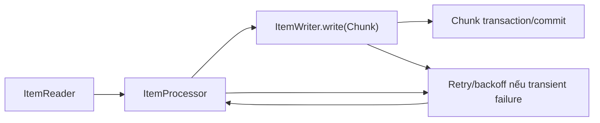
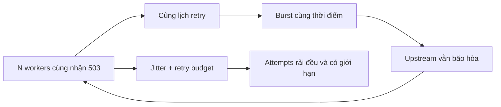
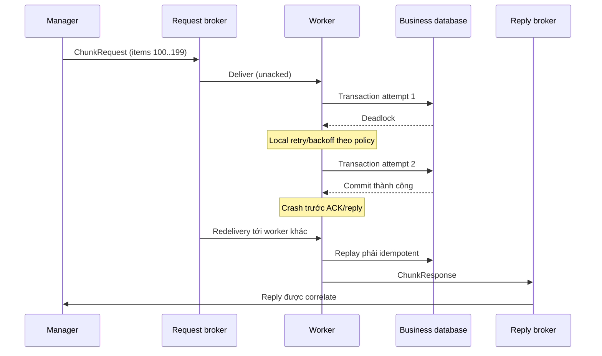
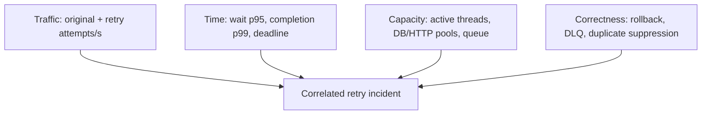

# Test retry backoff dưới tải đồng thời trong Spring Batch

Một job đối soát hàng triệu hóa đơn chạy trên 8 worker. Khi API đối tác trả `503 Service Unavailable` trong 20 giây, hàng nghìn request cùng thất bại. Nếu mọi worker retry ngay lập tức, lượng request đến hệ thống đang lỗi có thể **tăng gấp nhiều lần** thay vì giảm. Nếu tất cả sử dụng exponential backoff với lịch giống nhau, chúng có thể **cùng thức dậy tại các mốc 1s, 2s, 4s**, tạo “retry wave” mới. Nếu backoff bằng `Thread.sleep` trong các thread giữ chunk transaction và connection pool, job có thể kẹt dù CPU thấp.

Bài **“Test retry backoff”** thuộc chương **Testing concurrency** trong module `SPRING_BATCH_SCALING_OPERATIONS`. Mục tiêu là **kiểm chứng bằng thí nghiệm** cơ chế retry/backoff khi mở rộng Spring Batch qua multi-threaded step, parallel steps, partitioning và các worker phân tán. Bài bao gồm phân loại lỗi, lịch retry, jitter, concurrency, transaction, restart, idempotency, broker redelivery, metrics và runbook khi hệ thống quá tải.

Mã ví dụ lấy **Spring Batch 5.2.x, Spring Retry 2.x, Java 17+, JUnit 5, PostgreSQL và Micrometer** làm nền. Các sơ đồ, số liệu và ngưỡng trong bảng là **kịch bản giả định**, không phải kết quả benchmark đã chạy. Mọi snippet đơn lẻ đều cần được ghép với cấu hình Job/`JobRepository`/worker của ứng dụng trước khi vận hành thật.

## 1. Retry, backoff và concurrency là ba câu hỏi khác nhau

| Cơ chế | Câu hỏi trả lời | Ví dụ |
| --- | --- | --- |
| **Retry policy** | Có thử lại không? Thử mấy lần? | Retry connection timeout tối đa 3 attempts |
| **Backoff policy** | Khoảng cách giữa các lần thử? | 250ms, 500ms, 1000ms rồi cap |
| **Jitter** | Có phân tán thời điểm retry giữa workers? | Random hóa độ trễ trong khoảng hợp lệ |
| **Concurrency limit** | Bao nhiêu requests/chunks đang chạy? | Tối đa 8 active chunks/worker |
| **Rate limit** | Bao nhiêu requests được phép gửi mỗi giây? | 100 requests/s cho toàn đối tác |
| **Retry budget** | Retry chiếm tối đa bao nhiêu năng lực hệ thống? | ≤10% request attempts khi upstream lỗi |
| **Circuit breaker** | Khi nào tạm ngừng gửi vào đích đang lỗi? | Mở sau số lỗi liên tiếp, thử phục hồi có kiểm soát |
| **Restart** | Khi job/worker chết thì phục hồi execution nào? | Restart `JobInstance` đã `FAILED`/`STOPPED` |

**Backoff không tự giới hạn số retries, concurrency hay retry storm toàn cụm.** Một policy ngủ rất lâu có thể giảm request rate nhưng chiếm đầy thread pool; một policy có jitter mà không giới hạn attempts có thể vẫn làm tiêu hao hàng triệu requests.

## 2. Từ một item tới một job: xác định ranh giới retry

Với Spring Batch chunk-oriented processing:



Trong thực tế **retry stateful của writer có thể trải qua rollback và một transaction chunk mới**, chứ không phải vòng lặp gọi lại writer vô hại trong cùng transaction. Cần đo đúng:

- **Attempt:** một lần thực sự gọi thao tác có thể thất bại (DB command/API call).
- **Retry:** một lần thử thêm sau attempt ban đầu.
- **Backoff interval:** khoảng chờ giữa attempts, không gồm thời gian thực thi.
- **Chunk rollback:** transaction chunk bị rollback; có thể ảnh hưởng nhiều items.
- **Job restart:** một `JobExecution` mới cho cùng `JobInstance` hợp lệ.
- **Broker redelivery:** một message được chuyển lại cho consumer, có thể trùng với work đã commit.

**Không dùng `retryCount` bằng `JobExecution` restart count.** Một logical operation có thể có 3 retries trong process, redelivery 2 lần và job restart 1 lần. Nếu không có global idempotency/attempt budget, tổng attempts có thể lớn hơn dự kiến.

## 3. Lỗi nào đáng retry?

| Loại lỗi | Thường retry? | Lý do |
| --- | --- | --- |
| DB deadlock/serialization conflict | Có, hữu hạn | Giao dịch khác kết thúc có thể gỡ tranh chấp |
| Temporary DB connection reset | Có, nếu transaction an toàn | Service có thể phục hồi |
| HTTP 429 Too Many Requests | Có theo `Retry-After`/quota | Server yêu cầu giảm tốc |
| HTTP 502/503/504 | Có nếu contract cho phép | Upstream tạm thời không sẵn sàng |
| HTTP read timeout sau POST | **Chỉ khi replay an toàn** | Server có thể đã xử lý POST |
| HTTP 400/422 do payload không hợp lệ | Không mặc định | Thử lại cùng dữ liệu không sửa lỗi |
| Auth 401/403 do quyền sai | Không retry mù | Cần sửa credentials/policy |
| CSV parse/validation deterministically invalid | Không | Dữ liệu không đổi khi đợi |
| Constraint violation do business duplicate | Không retry thông thường | Cần dedupe/reconciliation |
| `OutOfMemoryError` hoặc cấu hình sai | Không coi transient per item | Cần sửa tài nguyên/code và restart có kiểm soát |

**Đừng retry toàn bộ `Exception.class` trong một batch khối lượng lớn.** Nếu item sai dữ liệu, retry chỉ giữ thread và tài nguyên. Nếu lỗi gây side effect ngoài DB, cần biết **idempotency** trước khi retry.

## 4. Đếm attempts chính xác

Trong `RetryTemplate`/`SimpleRetryPolicy` của Spring Retry 2.x:

```text
maxAttempts = 4
attempt 1: gọi đầu tiên
attempt 2: retry thứ nhất
attempt 3: retry thứ hai
attempt 4: retry thứ ba

Số khoảng backoff tối đa = 3
```

Đối với `FaultTolerantStepBuilder.retryLimit(int)` của Spring Batch 5.2, Javadoc nêu **maximum times to try failed item**: `0` hoặc `1` đều tương đương **chỉ thử một lần**, không retry. Đặt `retryLimit(4)` rồi khẳng định “4 lần retry ngoài attempt đầu” là sai. Với retry stateful qua transaction, một lần fail có thể dẫn tới các processor/writer invocations khác và callback/counter không ánh xạ đơn giản 1:1.

### 4.1. Lặp lại theo ba tầng có thể nhân attempts

```text
HTTP library retry       = 3 attempts/call
Spring Retry wrapper     = 3 attempts/wrapper
Broker redelivery limit  = 2 deliveries

Worst-case rough upper bound = 3 × 3 × 2 = 18 HTTP attempts
```

Mô hình trên chỉ là **ước lượng nếu từng tầng đều thực sự bao bọc nhau và chạm max**; Spring Batch retry/rollback có thể thay đổi số invocations thực. Bài test phải **instrument lời gọi HTTP ở lớp sâu nhất** để phát hiện hidden retries của SDK/HTTP client, không chỉ đếm `RetryListener` của một tầng.

## 5. Fixed, exponential và jitter: cách lập lịch

Với `initialDelay=d₀`, multiplier `m>1`, cap `dmax` và retry index `k=0,1,2,...`:

```text
d_k = min(dmax, d0 × m^k)

Ví dụ d0=250ms, m=2, dmax=2000ms:
k=0 -> 250ms
k=1 -> 500ms
k=2 -> 1000ms
k=3 -> 2000ms
k=4 -> 2000ms (cap)
```

**Không có backoff:** tất cả attempts có thể xảy ra ngay lập tức → burst rất cao.

**Fixed delay:** mọi retry chờ 500ms; đơn giản nhưng tạo nhịp đồng bộ giữa workers.

**Exponential deterministic:** giãn khoảng chờ khi lỗi kéo dài nhưng hàng trăm workers cùng thất bại ở `t0` có thể cùng retry ở `t0+250ms`, `+750ms`, `+1750ms`.

**Randomized jitter:** lệch lịch attempts giữa workers. Tuy nhiên có **nhiều kiểu jitter** (full, equal, decorrelated, exponential-random multiplier); không giả định tất cả có phân phối giống nhau. `ExponentialRandomBackOffPolicy` của Spring Retry random hóa multiplier theo contract của chính class, **không mặc định giống full jitter [0,d_k]**.

## 6. Vì sao retry đồng bộ tạo “thundering herd”?

Giả sử 1.000 concurrent requests gặp 503 cùng lúc, retry deterministic:

```text
time=0.00s  -> 1000 attempts thất bại
time=0.25s  -> ~1000 attempts lặp lại
time=0.75s  -> ~1000 attempts lặp lại
time=1.75s  -> ~1000 attempts lặp lại
```

Nếu upstream chỉ chịu nổi 200 requests/s, chính retry waves có thể làm nó tiếp tục 503. Nếu có jitter, retries có xu hướng phân bố trên một khoảng rộng hơn; test phải nhìn **requests-per-100ms/second** và peak, không chỉ tổng requests.



Backoff và jitter giúp giảm đồng bộ, nhưng **không sửa nguyên nhân** nếu arrival rate dài hạn vẫn lớn hơn capacity. Cần kết hợp concurrency limit, rate limit, retry budget và circuit breaker.

## 7. Khi nào backoff giúp, khi nào phản tác dụng?

| Bottleneck | Backoff có thể giúp | Nhưng không giải quyết |
| --- | --- | --- |
| DB deadlock | Chờ giao dịch đối thủ giải phóng lock | SQL/index/lock ordering tệ |
| HTTP 429 | Giảm tốc retry đến quota cho phép | Tổng lượng requests mới quá quota |
| 503 tạm thời | Đợi upstream phục hồi | Hết worker threads do sleep dài |
| Broker reconnect | Phân tán connect attempts | Queue durability/routing mất |
| Service failover | Chờ leader mới sẵn sàng | Owner fencing và duplicate side effects |
| Poison message | Hầu như không | Sai schema/dữ liệu không tự sửa |

**Đánh đổi:** thời gian chờ backoff tiêu một phần **latency budget** và có thể giữ **active worker thread**. Với hàng nghìn operations, dùng delayed retry trong broker/work ledger khi phù hợp sẽ tránh phải ngủ trong cùng một thread, nhưng phải giữ durable intent/checkpoint/idempotency.

## 8. Thiết kế test theo sáu câu hỏi bắt buộc

1. **Điều kiện retry:** chỉ những exception/status nào được thử lại?
2. **Giới hạn:** tổng attempts và tổng thời gian retry thực sự là bao nhiêu?
3. **Lịch:** các khoảng chờ có exponential cap/jitter đúng policy?
4. **Đồng thời:** 8/32/128 workers có gây burst, pool starvation hay deadlock?
5. **Tính đúng:** commit-before-timeout/retry/redelivery có nhân đôi business operation?
6. **Vận hành:** khi budget cạn, step fail/skip/quarantine có thể restart và báo alert đúng?

Thực hiện **unit test không ngủ thật** trước; sau đó concurrency test bằng barriers, rồi integration test với DB/broker/upstream có thể điều khiển lỗi, cuối cùng performance/stress test với resource limits như production.

## 9. Ma trận test tối thiểu

| Trục | Mức thử | Thứ cần so |
| --- | --- | --- |
| Concurrency | 1 / 8 / 32 / 128 | Peak attempts, pool wait, starvation |
| Retry max attempts | 1 / 2 / 4 | Attempts thực và failure outcome |
| Backoff | None / fixed / exponential | Delay vector, throughput, latency |
| Jitter | None / exponential-random / full jitter tùy custom policy | Retry burst concentration |
| Failure duration | 0 / 1 / 10 / 60 giây | Recovery success vs exhausted |
| Failure type | 429 / 503 / timeout / 400 / deadlock | Retry classification |
| Workload | CPU-bound / DB-bound / HTTP-bound | Bottleneck thật |
| Processing | Single-thread / multi-thread / local/remote partition / chunking | Context và restart semantics |
| Injection point | Before commit / after commit before ACK / during backoff | Idempotency, rollback/recovery |
| Downstream quotas | Rộng / vừa / thấp | Backpressure và retry amplification |

**Cố định input snapshot, chunk size, worker count, pool sizes và DB/API capacity khi so riêng backoff policies.** Sau khi baseline rõ ràng, mới làm ma trận đa biến `backoff × concurrency × chunk size`.

## 10. Cấu hình Spring Batch 5.2 fault-tolerant chunk retry

Một cấu hình thử nghiệm **lỗi DB transient**:

```java
import org.springframework.batch.core.Step;
import org.springframework.batch.core.repository.JobRepository;
import org.springframework.batch.core.step.builder.StepBuilder;
import org.springframework.batch.item.ItemProcessor;
import org.springframework.batch.item.ItemReader;
import org.springframework.batch.item.ItemWriter;
import org.springframework.context.annotation.Bean;
import org.springframework.dao.TransientDataAccessException;
import org.springframework.retry.backoff.ExponentialRandomBackOffPolicy;
import org.springframework.transaction.PlatformTransactionManager;

@Bean
Step invoiceRetryStep(
        JobRepository jobRepository,
        PlatformTransactionManager transactionManager,
        ItemReader<Invoice> reader,
        ItemProcessor<Invoice, InvoiceResult> processor,
        ItemWriter<InvoiceResult> writer) {

    ExponentialRandomBackOffPolicy backoff =
            new ExponentialRandomBackOffPolicy();
    backoff.setInitialInterval(250L);
    backoff.setMultiplier(2.0);
    backoff.setMaxInterval(5_000L);

    return new StepBuilder("invoiceRetryStep", jobRepository)
            .<Invoice, InvoiceResult>chunk(100, transactionManager)
            .reader(reader)
            .processor(processor)
            .writer(writer)
            .faultTolerant()
            .retry(TransientDataAccessException.class)
            .noRetry(IllegalArgumentException.class)
            .retryLimit(4)
            .backOffPolicy(backoff)
            .build();
}
```

`Invoice`, `InvoiceResult` và reader/processor/writer là các beans ứng dụng; snippet không tự tạo job đầy đủ. `TransientDataAccessException` là superclass cho một nhóm lỗi transient của Spring JDBC; ứng dụng phải xác minh cách database driver/dialect translate lỗi. **Đừng dùng `retryLimit(4)` cho lỗi business mà không có idempotency.**

**Lưu ý quan trọng từ Javadoc 5.2:** `FaultTolerantStepBuilder.backOffPolicy(...)` được khai báo **bỏ qua nếu cấu hình explicit `retryPolicy(...)`**. Vì vậy ví dụ sử dụng `retry(...)` + `retryLimit(...)` với `backOffPolicy(...)`, không gắn thêm một custom `retryPolicy` rồi mặc định cho rằng backoff vẫn hoạt động. Nếu cần policy phức tạp với retry/backoff riêng, phải kiểm cấu hình thực bằng integration test/version-specific code.

### 10.1. Tại sao không đặt mọi lỗi vào retry?

`retryLimit(4)` tạo nhiều attempts khi exception match. Nếu lỗi do duplicate key hoặc payload invalid không thể tự hết, 4 attempts chỉ làm transaction lâu hơn, rollback nhiều hơn và chiếm slot concurrency. Phân loại lỗi **trước khi** bật `faultTolerant`; xử lý deterministic bad data bằng fail/skip theo business contract và auditing.

## 11. RetryTemplate cho một thao tác API riêng

Đôi khi batch processor gọi một API có transient `503`, cần policy độc lập cho client (tách khỏi step retry):

```java
import java.util.Map;

import org.springframework.retry.support.RetryTemplate;
import org.springframework.retry.policy.SimpleRetryPolicy;
import org.springframework.retry.backoff.ExponentialRandomBackOffPolicy;

public final class RetryTemplates {
    public static RetryTemplate upstreamTemplate() {
        RetryTemplate template = new RetryTemplate();

        template.setRetryPolicy(new SimpleRetryPolicy(
                4,
                Map.<Class<? extends Throwable>, Boolean>of(
                        TemporaryUpstreamException.class, true),
                true,    // traverse causes
                false)); // loại khác mặc định không retry

        ExponentialRandomBackOffPolicy policy =
                new ExponentialRandomBackOffPolicy();
        policy.setInitialInterval(200L);
        policy.setMultiplier(2.0);
        policy.setMaxInterval(2_000L);
        template.setBackOffPolicy(policy);
        return template;
    }
}
```

`TemporaryUpstreamException` là exception ứng dụng được ánh xạ từ response/API client và có contract rõ; không phải class tự sinh từ Spring. `RetryTemplate` này có thể dùng:

```java
String outcome = template.execute(context ->
        upstreamClient.fetchStatus(invoiceId));
```

**Không đặt retry template ở trong processor nếu Spring Batch step đã retry cùng một HTTP operation mà chưa tính tổng số attempts.** Trường hợp cần hai tầng, hãy thiết kế tổng budget, đo requests ở network layer, bảo vệ idempotency và cân nhắc `JobExecution` restart/broker redelivery.

### 11.1. Retry HTTP GET và POST không giống nhau

`GET` read-only thường dễ retry hơn khi contract idempotent. Một `POST /charge` có thể **đã thành công tại server nhưng client timeout trước response**. Retry an toàn yêu cầu **same idempotency key** trên mọi attempts; khi downstream không có key/reconciliation, không retry mù một giao dịch tiền.

## 12. Transaction và stateful retry trong Spring Batch

Một writer update DB có thể nhận deadlock exception ở cuối chunk:

```text
BEGIN chunk transaction
  read/process N items
  write N output records
  DB deadlock -> exception
ROLLBACK transaction
retry state re-identifies work/context
  wait according to retry backoff
  next chunk attempt/transaction if permitted
```

Với Spring Batch fault tolerance, retry khi write/process có thể là **stateful qua transaction boundaries** và input cần được nhận diện ổn định. `StepExecution.rollbackCount`, `writeCount`, callback retry và số SQL attempts **không nhất thiết** bằng nhau. Một chunk gồm nhiều items có thể rollback toàn bộ, dù chỉ một item tạo deadlock.

Nếu reader transactional hoặc nguồn message consumptive, việc replay còn phụ thuộc cách reader/transaction manager tham gia. **Không assume mỗi retry sẽ gọi lại chính cùng một item theo thứ tự hệt attempt cũ**; cần test `ItemReader` restart/read state và input snapshot.

### 12.1. Giữ transaction ngắn khi backoff dài

Spring Retry backoff thường được thực hiện qua `Sleeper` trên thread gọi. Trong một retry lồng bên trong transaction của caller, thời gian đợi có thể **giữ connection/lock** không cần thiết. Với stateful retry của Spring Batch, có thể có rollback trước lần retry tiếp theo; **đừng suy thứ tự lock-release từ pseudo-code**. Khi dùng custom wrapper `RetryTemplate` ở trong `ItemProcessor`, test transaction boundaries và pool utilization thật.

Nếu API down 5 phút, thay vì giữ hàng nghìn chunk threads ngủ 5 phút, cân nhắc **đưa work intent vào durable delayed retry** ở ranh giới an toàn và giải phóng worker slots. Lúc đó phải bảo đảm JobRepository checkpoint/ACK/broker/redelivery không làm mất hoặc nhân đôi work.

## 13. Tách cấp kiểm thử policy khỏi kiểm thử job

**Unit/policy test:** kiểm classification, số attempts, delay vector, cap và interruption **không chạy Spring Batch job**. Dùng mock `Sleeper` để không có `Thread.sleep` và assert lịch chính xác.

**Integration test:** chạy step/job với `JobRepository`, transaction manager, mocked HTTP/real test DB; kiểm `BatchStatus`, retry listener, actual DB commits, rollback/restart.

**Concurrency test:** nhiều logical operations cùng bị lỗi trong một cửa sổ; đo collisions, peak in-flight, pool wait, thread liveness, starvation, retry waves.

**Failure injection:** kill worker/manager, mất broker reply, retry-after window, DB failover và commit-before-ACK; kiểm idempotency và recovery.

**Đừng viết một test vừa giả lập thời gian bằng fake sleeper, vừa dùng con số throughput của nó để dự báo production.** Fake sleeper chứng minh **policy calculation**, còn wall-clock throughput phải đo ở integration/load test có wait thật.

## 14. Unit test: backoff vector không cần ngủ thật

Spring Retry `ExponentialBackOffPolicy` cho phép thay `Sleeper`; test ghi lại khoảng chờ thay vì sleep. Ví dụ JUnit 5:

```java
import static org.junit.jupiter.api.Assertions.assertEquals;

import java.util.ArrayList;
import java.util.List;
import java.util.Map;
import java.util.concurrent.atomic.AtomicInteger;

import org.junit.jupiter.api.Test;
import org.springframework.retry.backoff.ExponentialBackOffPolicy;
import org.springframework.retry.policy.SimpleRetryPolicy;
import org.springframework.retry.support.RetryTemplate;

class RetryDelayPolicyTest {
    static final class TemporaryFailure extends RuntimeException {}

    @Test
    void delaysAreExponentialAndAttemptsAreBounded() {
        List<Long> observedSleeps = new ArrayList<>();
        ExponentialBackOffPolicy backoff =
                new ExponentialBackOffPolicy();
        backoff.setInitialInterval(100);
        backoff.setMultiplier(2.0);
        backoff.setMaxInterval(250);
        backoff.setSleeper(ms -> observedSleeps.add(ms));

        RetryTemplate template = new RetryTemplate();
        template.setRetryPolicy(new SimpleRetryPolicy(
                4,
                Map.<Class<? extends Throwable>, Boolean>of(
                        TemporaryFailure.class, true),
                false,
                false));
        template.setBackOffPolicy(backoff);

        AtomicInteger attempts = new AtomicInteger();
        String result = template.execute(context -> {
            if (attempts.incrementAndGet() <= 3) {
                throw new TemporaryFailure();
            }
            return "OK";
        });

        assertEquals("OK", result);
        assertEquals(4, attempts.get());
        assertEquals(List.of(100L, 200L, 250L), observedSleeps);
    }
}
```

**Ý nghĩa:** 4 attempts tổng cộng → 3 lần wait, cap ở 250ms. Test không lệ thuộc scheduler/CPU của CI nên nhanh và ổn định. Không dùng fake `Sleeper` này làm bằng chứng thực tế 100ms/200ms được thực hiện chính xác ngoài runtime.

### 14.1. Test lỗi không retry được

```java
@Test
void validationFailureIsNotRetried() {
    RetryTemplate template = RetryTemplates.upstreamTemplate();
    AtomicInteger attempts = new AtomicInteger();

    assertThrows(IllegalArgumentException.class,
            () -> template.execute(context -> {
                attempts.incrementAndGet();
                throw new IllegalArgumentException("invalid payload");
            }));

    assertEquals(1, attempts.get());
}
```

Snippet thứ hai đặt **trong cùng test class** với imports JUnit `assertThrows`, `AtomicInteger` và `RetryTemplate`; nó tái sử dụng factory ở mục 11. Chỉ cho phép exception được khai báo retryable; không tự đưa lỗi validation vào retry chỉ vì nó extends `RuntimeException`.

## 15. Unit test jitter: kiểm giới hạn, không assert thời điểm cố định

`ExponentialRandomBackOffPolicy` của Spring Retry chọn random multiplier theo contract của class, nên **không nên assert vector cố định** như `[100,200,400]` ở test deterministic. Có hai cấp kiểm:

- **Policy contract test:** tất cả waits dương, có upper bound phù hợp policy và không gây đồng bộ hoàn toàn trong tập lớn samples; không assert một giá trị random cụ thể.
- **Deterministic algorithm test:** nếu ứng dụng tự viết `full jitter`, inject một pseudo-random generator có seed để test công thức và bounds.

Một thuật toán **full jitter tùy chỉnh** minh họa:

```java
import java.util.SplittableRandom;

public final class JitterMath {
    private JitterMath() {}

    // precondition: capMillis >= 0, đủ nhỏ để +1 không overflow.
    public static long fullJitter(
            long capMillis, SplittableRandom random) {
        return random.nextLong(capMillis + 1);
    }
}
```

Với cap 1.000ms, kết quả nằm trong khoảng `[0,1000]`; giá trị 0 có thể tạo immediate retry, nên việc dùng **minimum delay >0** hoặc chọn dạng jitter khác phải dựa trên SLO và server contract. Đừng gọi mã trên là Spring Retry built-in policy: đó là **function minh họa**, muốn dùng thật phải tích hợp `BackOffPolicy`/scheduler và kiểm overflow/interrupt/concurrent RNG sharing.

### 15.1. Kiểm jitter giúp phá đồng bộ ra sao

Tạo 1.000 logical operations cùng có base cap 1.000ms, seed random cố định cho simulation. Chia delays vào buckets 100ms và kiểm **không phải tất cả cùng một bucket**, phân phối không dồn bất thường. Đây là **test thuật toán/simulation**, không thay cho load test requests/s thật. Không đặt assert “mọi bucket phải có đúng 100 retries”: random distribution có dao động.

## 16. Concurrency test với CountDownLatch: đồng loạt bắt đầu

`CountDownLatch` giúp tạo một đợt lỗi đồng thời, thay vì submit các work items nối tiếp và vô tình tránh được contention. Test dưới đây dùng **một shared `RetryTemplate` đã cấu hình**, nhưng mỗi execution tạo `RetryContext` và counter **theo logical operation riêng**:

```java
import static org.junit.jupiter.api.Assertions.assertEquals;

import java.util.ArrayList;
import java.util.List;
import java.util.Map;
import java.util.concurrent.ConcurrentHashMap;
import java.util.concurrent.CountDownLatch;
import java.util.concurrent.ExecutorService;
import java.util.concurrent.Executors;
import java.util.concurrent.Future;
import java.util.concurrent.TimeUnit;
import java.util.concurrent.atomic.AtomicInteger;

import org.junit.jupiter.api.Test;
import org.springframework.retry.backoff.ExponentialRandomBackOffPolicy;
import org.springframework.retry.policy.SimpleRetryPolicy;
import org.springframework.retry.support.RetryTemplate;

class ConcurrentRetryTest {
    static final class TransientFailure extends RuntimeException {}

    @Test
    void operationsRetryIndependentlyWithoutUnboundedAttempts()
            throws Exception {

        final int workCount = 16;
        RetryTemplate retry = new RetryTemplate();
        retry.setRetryPolicy(new SimpleRetryPolicy(
                3,
                Map.<Class<? extends Throwable>, Boolean>of(
                        TransientFailure.class, true),
                false,
                false));

        ExponentialRandomBackOffPolicy backoff =
                new ExponentialRandomBackOffPolicy();
        backoff.setInitialInterval(10);
        backoff.setMultiplier(2.0);
        backoff.setMaxInterval(50);
        retry.setBackOffPolicy(backoff);

        ConcurrentHashMap<Integer, AtomicInteger> attemptsById =
                new ConcurrentHashMap<>();
        CountDownLatch start = new CountDownLatch(1);
        ExecutorService pool = Executors.newFixedThreadPool(workCount);

        try {
            List<Future<Integer>> results = new ArrayList<>();
            for (int id = 0; id < workCount; id++) {
                final int workId = id;
                results.add(pool.submit(() -> {
                    start.await();
                    return retry.execute(context -> {
                        int count = attemptsById
                                .computeIfAbsent(workId,
                                        k -> new AtomicInteger())
                                .incrementAndGet();
                        if (count <= 2) {
                            throw new TransientFailure();
                        }
                        return workId;
                    });
                }));
            }

            start.countDown();
            for (int i = 0; i < workCount; i++) {
                assertEquals(i, results.get(i)
                        .get(10, TimeUnit.SECONDS));
                assertEquals(3, attemptsById.get(i).get());
            }
        } finally {
            pool.shutdownNow();
        }
    }
}
```

**Test này kiểm** 16 logical operations cùng chạy, mỗi operation tối đa 3 attempts và shared `RetryTemplate` không dùng một bộ đếm retries toàn cục. Nó **chưa chứng minh** upstream không bị quá tải hoặc jitter phân bố tốt theo wall-clock. Tại CI có noise, timeout 10 giây là **safety timeout**, không phải latency SLA; không assert từng sleep có chính xác millisecond.

### 16.1. Điều chưa chứng minh nếu test chỉ chạy trong JVM

- HTTP client library có retry ẩn hay không.
- DB deadlock và rollback semantics thật.
- Broker ACK/redelivery xảy ra như production hay không.
- Request burst toàn cụm khi có nhiều JVM và clock skew.
- Retry state giữ đúng khi process bị kill giữa backoff hay không.

Đó là lý do cần **integration + distributed failure injection** tiếp theo.

## 17. Đo “retry waves” bằng time buckets

Khi load-test API, gắn một **request-attempt ID** trong logs/tracing (không dùng làm Prometheus label). Thu timestamp **server nhận được HTTP request** từ fake upstream. Chia thành buckets 100ms:

```text
time bucket      attempts received
0.0–0.1s         500       <- initial burst
0.1–0.2s           4
0.2–0.3s         495       <- synchronized retry wave
0.3–0.4s           8
0.4–0.5s          12
...
```

Mẫu số trên **minh họa hiện tượng**, không phải benchmark thật. Khi bật jitter, mong muốn retries ít tập trung hơn so với deterministic baseline, nhưng phải kiểm:

- **Peak attempts/s** và **peak requests/100ms** (không chỉ average).
- p50/p95/p99 **logical completion time**.
- Thời gian upstream recovery và số thành công sau recovery.
- Tổng attempts per logical work ID; những ID nào vượt max.
- In-flight HTTP, pending executor/queue, CPU/GC và upstream 429/503.
- Nhóm nào bị starvation/fairness khi một tenant có nhiều retries.

Đo ở **server hoặc network boundary** giúp thấy hidden retries của HTTP SDK. Nếu chỉ đo calls tới `RetryTemplate.execute` thì nhiều HTTP requests có thể nằm trong một callback và không được nhận diện.

## 18. Thiết kế fake upstream có failure window

Một fake API cho bài test nên có **đồng hồ điều khiển được** và các chế độ:

```text
T0..T1: 503 trên mọi request
T1..T2: 429 + Retry-After: 2
T2..end: 200 thành công

Side effects:
  operationId -> số lần nhận request
  operationId -> số lần commit business effect
  request log -> (timestamp, clientId, attemptId, status, latency)
```

Với integration test HTTP thực, có thể dùng **WireMock/MockWebServer hoặc fake service riêng**, sau đó trích logs request. Đừng phụ thuộc vào `Thread.sleep(60_000)` trong test unit; dùng virtual/manual clock ở policy test, còn network test giữ failure windows ngắn và bound tổng thời gian.

### 18.1. Test đồng thời nhiều clients mới thấy hành vi thực

Nếu fake upstream được gọi bởi một worker JVM, các attempts có thể đã bị một thread pool nội bộ serialize. Kết quả không phản ánh trường hợp 20 worker processes cùng gọi đối tác. Test nên chạy:

- **Single JVM:** 1, 8, 32 concurrent tasks để kiểm policy và pool.
- **Multi-process:** ≥2 worker JVMs, cùng retry target để kiểm synchronize/clock skew/quotas.
- **Distributed broker:** nhiều consumers và reply routing, broker redelivery.
- **Degraded downstream:** database/API có capacity thấp để phơi bày feedback loop.

Không đặt fake server trên máy quá yếu rồi kết luận retry backoff của client có bottleneck “network”: cần đo CPU/queue của **test server** để nó không tự biến thành sai số.

## 19. Retry-After cho HTTP 429/503: thử theo contract server

Theo HTTP, `Retry-After` có thể ở dạng **delta-seconds** hoặc **HTTP-date**. Ví dụ:

```http
HTTP/1.1 429 Too Many Requests
Retry-After: 3
```

Nếu client đang dùng exponential backoff 200ms nhưng server bảo đợi 3 giây, client không nên retry sớm bằng lịch 200ms. Một chiến lược:

```text
serverDelay = parse Retry-After if valid
clientDelay = exponentialBackoffWithJitter(...)

effectiveEarliestRetry = max(serverDelay, clientDelay)
```

**Giới hạn vận hành:** nếu header yêu cầu chờ lâu hơn job deadline, không âm thầm clamp xuống 1 giây rồi vi phạm yêu cầu server. Đánh dấu **defer/quarantine/schedule delayed retry** phù hợp với SLA và durable handoff, hoặc fail job có thể restart. Một số API công bố thêm rate-limit headers với semantics riêng, cần đọc contract đích.

### 19.1. Bốn ca kiểm thử Retry-After

| Header | Hành vi cần xác minh |
| --- | --- |
| `Retry-After: 3` | Không gửi attempt mới trước ngưỡng 3s (dưới clock tolerance rõ) |
| HTTP-date trong tương lai | Parse timezone/giờ chính xác, xử lý clock skew |
| Header invalid | Log/metric + fallback policy đã khai báo |
| Header vượt global retry deadline | Defer/fail có kiểm soát, không sleep vô hạn |

Trong test với fake clock, có thể assert tính toán `effectiveEarliestRetry` **không ngủ thật**; ở network integration test, kiểm server-observed arrival time với tolerance scheduler. Khi dùng Date-based header, clock offset giữa client/server là một nguồn sai lệch; không assert 1ms chính xác giữa hai hosts.

## 20. Tổng thời gian backoff phải nằm trong latency budget

Nếu `maxAttempts=5` và deterministic exponential delays `[250ms, 500ms, 1s, 2s]`:

```text
T_wait_total = 0.25 + 0.5 + 1 + 2 = 3.75s
T_operation_total ≈ Σ attempt_durations + T_wait_total + queue_wait
```

Nếu mỗi failed attempt có HTTP timeout 5s, worst-case upper bound thô cho năm attempts **có thể** vượt 25s trước khi cộng 3.75s delays. Với nhiều layers, total job SLA có thể vượt xa người vận hành dự đoán chỉ từ `maxInterval=2s`.

### 20.1. Thêm deadline tổng

Đặt cả:

- **Per-attempt timeout** (connect/read/write/response theo client).
- **Max attempts**.
- **Backoff cap và total wait budget**.
- **Overall operation deadline**.
- **Job SLA và worker termination grace**.

Không chọn backoff > worker shutdown grace rồi chờ graceful stop tự giải quyết. Nếu bị interrupt, phải dừng thử lại theo contract, không nuốt `InterruptedException` và tiếp tục sleep.

## 21. Kịch bản overload: backoff vẫn có thể làm đầy thread pool

Giả sử 32 worker threads, mỗi thread vào retry backoff 10 giây trong lúc giữ một `Chunk` object graph 4 MiB:

```text
32 × 4 MiB = 128 MiB chunk payload được giữ
32 threads đang ngủ = 0 slots xử lý công việc mới
```

Chưa tính JVM baseline, retry contexts, reader buffers, HTTP connections hay DB transaction resources. `CPU thấp` có thể là **starvation** chứ không phải còn capacity.

Đo:

- `activeThreadCount`, executor queue depth/rejections.
- `sleeping/waiting threads` và stack traces.
- Heap/cgroup memory, GC pressure.
- JDBC/HTTP pool active/pending, connection hold duration.
- Queue oldest-message age và business committed throughput.

Nếu mọi active threads cùng ngủ, một phương án là **schedule delayed retry trong broker/DB work ledger** để giải phóng worker slots. Nhưng implementation phải giữ identity bền vững, idempotency, ACK/transaction boundaries và retry budget xuyên lần giao lại.

## 22. Retry budget áp dụng cho toàn cụm, không chỉ một JVM

Ví dụ quota API **200 requests/s**, có 10 worker instances, mỗi worker nhận thêm 50 operations/s. Nếu tất cả retry khi 503, request attempts/s có thể vượt quota nghiêm trọng dù mỗi `RetryTemplate` chỉ retry 3 lần.

Một admission policy tốt có:

1. **Global rate limit** hoặc phân bổ quota per worker có headroom.
2. **Bounded in-flight concurrency** ở caller và broker consumer.
3. Retry budget theo **logical operation**, tenant hoặc job.
4. Backoff + jitter và server `Retry-After`.
5. Circuit breaker cho failures kéo dài.
6. Metrics riêng **original request rate** và **retry attempt rate**.

`Semaphore(10)` trong từng JVM **không** bảo đảm cả cụm chỉ có 10 attempts đồng thời. Muốn thử global limit, phải có shared quota governor hoặc chia budget rõ cho replicas và kiểm khi autoscale.

## 23. Multi-threaded step: thread safety của retry state

Một multi-threaded `Step` dùng `TaskExecutor` để xử lý nhiều chunks. Cùng một `BackOffPolicy` có thể được cấu hình dùng chung; implementation built-in `ExponentialBackOffPolicy` của Spring Retry được mô tả **thread-safe** và tạo `BackOffContext` cho từng retry operation. Tuy nhiên:

- Không đặt một `int retryCounter` mutable singleton trong `ItemProcessor` rồi xem nó là counter từng item.
- Không dùng cùng `RetryContext` cho nhiều logical operations.
- Không chia sẻ stateful `ItemReader` như `JdbcCursorItemReader` trên nhiều threads mà chưa kiểm chứng thread safety; `@StepScope` **không tạo instance riêng per thread**.
- Không map all requests vào một `ConcurrentHashMap` rồi quên cleanup khi success/fail/restart.
- Không dùng `ThreadLocal` giữ payload/counter mà không `remove()` khi thread pool tái sử dụng.

Một shared retry template **có thể dùng được** khi policy/listeners/client underlying thread-safe và đã cấu hình xong trước khi workers chạy; **thay cấu hình policy giữa job đang chạy** tạo behavior không nhất quán và khó tái lập test.

### 23.1. Backoff + chunk concurrency không đồng nghĩa backpressure

Nếu executor có 8 worker threads và queueCapacity=10.000, 8 threads ngủ retry trong lúc manager tiếp tục submit, queue có thể tăng liên tục. Đặt bounded queue, rejection policy gắn với **durable work intent**, concurrency/window hợp lệ, và đo `committed items/s` thay vì chỉ số thread active.

## 24. Local/remote partitioning: retry budget theo partition và item

Trong partitioning, mỗi partition thường có `StepExecution`/`ExecutionContext` riêng. Nếu 100 partitions cùng gặp deadlock với DB, retries có thể đồng bộ ở tất cả workers:

```text
100 partitions
 × 2 chunks active per worker (tùy topology)
 × 4 attempts per transient failure
 = hàng trăm attempts trong một cửa sổ ngắn
```

Đây không phải số attempts chính xác: chunk transactions, retry state và concurrency thực có thể khác. **Đo actual network/SQL operations**.

Test cần xác minh:

1. Mỗi `StepExecution` có retry state và checkpoint đúng scope.
2. Partitions không share reader mutable state hoặc `RetryContext`.
3. Khi một partition lỗi vĩnh viễn, partition khác có thể hoàn thành theo job failure policy.
4. Restart cùng `JobInstance` dùng **stable partition name/range/snapshot**.
5. Một worker bị kill trong backoff **không làm manager gửi chồng work** khi owner cũ có thể vẫn ghi.
6. DB connection pool capacity của **toàn bộ worker replicas** không bị bão hòa bởi sleeping/blocked operations.

`gridSize` là hint số partitions; nó **không** bằng active concurrency hoặc retry concurrency. Khi thử 1/4/8 worker JVMs, đo actual active partitions cùng DB locks/pool waits.

## 25. Remote chunking: retry có ít nhất ba tầng

Với remote chunking:



Ba tầng:

- **Worker-local retry:** bên trong writer/processor/DB/API call.
- **Broker redelivery:** do consumer/channel/ACK policy.
- **Manager/job restart:** do JobExecution/reader checkpoint/pending replies.

**`retryLimit(4)` của một step không tự giới hạn tổng số attempts khi broker redeliver rồi manager restart.** Cần idempotency key, bounded redelivery policy, alert và business outcome reconciliation.

Không dùng `maxWaitTimeouts` của remote chunk manager như thể đó là worker retry limit. Nó là cơ chế chờ pending replies của manager, không phải global retry budget. Khi manager không nhận `ChunkResponse`, worker có thể đã commit DB; đừng tự requeue tất cả chunks theo timeout.

## 26. Broker NACK/requeue: backoff không thể chỉ là sleep ở worker

Nếu một message có permanent failure bị `NACK(requeue=true)` ngay:

```text
deliver -> fail -> NACK requeue -> deliver -> fail -> ...
```

Broker có thể giao lại liên tục mà không chờ `BackOffPolicy` của Spring Batch step, nhất là khi listener ném exception và container requeue theo error handling config. Có thể tạo retry storm không phụ thuộc `faultTolerant().retryLimit(3)`.

**Chính sách transport cần test riêng**:

- Manual/automatic ACK mode, consumer prefetch và exception handler.
- Reject/requeue semantics, retry attempt count (header `x-death` hoặc application attempt ledger tùy queue topology).
- Delayed retry queue/TTL/DLX hoặc delayed-message mechanism nếu khả dụng.
- DLQ/quarantine khi attempts exhausted hoặc payload không sửa được.
- Message TTL và retention dài hơn business recovery window khi phù hợp.
- Duplicate/out-of-order replies và correlation tới `JobExecution` đúng.

**Tránh giữ delivery unacked và `Thread.sleep(30_000)` trong hàng trăm RabbitMQ listeners**: nó chiếm consumer slots, làm lag tăng và có thể gặp consumer acknowledgement timeout. Nếu cần delay dài, chuyển sang **durable delayed retry** có idempotency/reconciliation; đừng ACK original trước khi đảm bảo durable handoff theo contract.

## 27. Idempotency dưới concurrency: đúng một kết quả nghiệp vụ

Tình huống kinh điển:

```text
T0 worker A gửi POST /charge(opKey=X)
T1 server charge thành công
T2 response bị mất; A thấy HTTP timeout
T3 worker B nhận message redelivery
T4 A và B cùng retry(opKey=X)
```

**Backoff chỉ giảm xác suất chạm nhau, không ngăn double charge.** Tầng business phải nhận diện **cùng logical operation key** và trả một outcome nhất quán, bất kể attempt, JobExecution hoặc worker process.

Ví dụ cho kết quả transform deterministic (không phải payment):

```sql
CREATE TABLE invoice_normalized (
    snapshot_id        VARCHAR(100) NOT NULL,
    invoice_id         BIGINT NOT NULL,
    normalized_amount  NUMERIC(18,2) NOT NULL,
    PRIMARY KEY (snapshot_id, invoice_id)
);

INSERT INTO invoice_normalized(
    snapshot_id, invoice_id, normalized_amount)
VALUES (:snapshotId, :invoiceId, :amount)
ON CONFLICT (snapshot_id, invoice_id)
DO UPDATE
SET normalized_amount = EXCLUDED.normalized_amount;
```

Upsert chỉ idempotent nếu **cùng snapshot + input** luôn tính ra cùng amount và database trigger/audit side effects không gây tác dụng không idempotent. Với `balance = balance + amount` hoặc API thanh toán, phải có operation ledger/conditional update/downstream idempotency key riêng, không chỉ `ON CONFLICT DO UPDATE`.

### 27.1. Test trùng song song

Cho 32 worker threads cùng xử lý **cùng operation key X**, giả lập một số timeout sau commit. Assertion tối thiểu:

```text
HTTP attempts / broker deliveries >= 1  (có thể trùng)
Committed business operations for X = 1
Final normalized/payment outcome    = expected value
No missing logical operations        = true
```

Trên DB, dùng unique constraint/transaction đúng để tránh race check-then-insert. Với external payment phải test sandbox downstream **có hỗ trợ idempotency** và kiểm outcome từ chính hệ thống đích.

## 28. Retry/backoff khi worker chết và restart

Nếu process chết trong lúc backoff:

1. Khoảng sleep trong RAM **không được lưu** vào `JobRepository` như một lịch retry persistent.
2. Current retry context/pending futures có thể mất.
3. Broker có thể redeliver message chưa ACK.
4. `JobExecution` có thể còn `STARTED` nếu crash không cập nhật repository.
5. Business side effect có thể đã commit trước crash.

Do đó test phải xác minh restart cùng **`JobInstance`/identifying `JobParameters`**, checkpoint `ExecutionContext` và idempotent outcomes. Nếu muốn lưu `nextAttemptAt` qua process crash, dùng **durable retry ledger/broker delayed messages** do ứng dụng thiết kế, không mặc định Spring Batch tự lưu toàn bộ lịch backoff.

**Không tự sửa `BATCH_STEP_EXECUTION.STATUS` từ `STARTED` sang `FAILED` chỉ vì process không heartbeat vài giây**; cần xác minh worker/manager cũ đã ngừng hoặc bị fencing, transaction/checkpoint/business state có thể restart đúng.

## 29. Integration test DB deadlock có cần database thật?

Có hai mức:

- **Unit:** ném thủ công `DeadlockLoserDataAccessException` để xác minh retry exception classification và backoff calculation.
- **Integration:** chạy **PostgreSQL/Testcontainers** hoặc database giống production, tạo hai transaction cập nhật rows theo thứ tự trái nhau, kiểm DB deadlock SQLSTATE, exception translation, rollback/retry thành công và không duplicate.

H2/in-memory DB **không phản ánh đầy đủ** PostgreSQL lock levels, MVCC, deadlocks hoặc WAL contention. Không dùng một mock exception để tuyên bố concurrency/deadlock recovery production đã được xác minh.

### 29.1. Ma trận DB transaction

| Điều kiện | Test/quan sát |
| --- | --- |
| Hai transactions lock order nghịch | Một side fail, retry thành công sau rollback |
| Transaction timeout | Lỗi được classify đúng, không giữ lock vô hạn |
| Pool exhausted | Backoff không làm queue/threads tăng vô hạn |
| Retry sau rollback | Writer không ghi thiếu/trùng rows |
| Retry exhausted | Step `FAILED` hoặc business-approved skip, audit đầy đủ |
| Restart failed execution | Chỉ reprocess phần cần xử lý; total output đúng |

Trong test thực, bảo đảm mỗi transaction rollback/close đúng; tránh để test thread giữ lock rồi timeout harness. Không tạo deadlock trên production chỉ để kiểm policy.

## 30. Observability: metric nào chứng minh backoff có tác dụng?

| Metric | Đơn vị | Vai trò |
| --- | --- | --- |
| `retry_attempts_total` | attempts | Số network/DB retries thực |
| `original_requests_total` | logical work | Lưu lượng ban đầu |
| `retry_exhausted_total` | logical work | Hết budget, cần xử lý |
| `retry_wait_seconds` | seconds/histogram | Phân phối delay đã thực hiện |
| `attempt_latency_seconds` | seconds/histogram | Thời gian xử lý mỗi attempt |
| `logical_completion_seconds` | seconds/histogram | Tổng latency xuyên retries |
| `retry_in_flight` | gauge | Retry operations đang hoạt động |
| `upstream_requests_per_second` | attempts/s | Peak load thực lên downstream |
| `upstream_429_503_rate` | errors/s | Phục hồi hay càng bão hòa |
| `executor_queued/active/rejected` | tasks | Starvation/backpressure |
| `db_pool_pending/lock_waits` | requests/time | DB contention |
| `broker_ready/unacked/redelivered` | messages | Transport retry storm |
| `business_duplicate_suppressed` | operations | Idempotency và redelivery |
| `StepExecution.rollbackCount` | transactions | Batch failures/rollbacks |

Các tên đầu bảng **là quy ước metrics ứng dụng**, không phải tất cả có sẵn. Spring Batch/Micrometer, HikariCP, RabbitMQ và HTTP client có metrics riêng; cần kiểm names/labels thực tế khi cấu hình actuator/exporters. Không gắn `jobExecutionId`/`invoiceId`/`messageId` vào metric labels: cardinality có thể bùng nổ; giữ trong structured logs/traces.

### 30.1. Instrument RetryListener

Ví dụ Spring Retry 2.x:

```java
import io.micrometer.core.instrument.Counter;
import io.micrometer.core.instrument.MeterRegistry;
import org.springframework.retry.RetryCallback;
import org.springframework.retry.RetryContext;
import org.springframework.retry.RetryListener;

public final class RetryFailureMeter implements RetryListener {
    private final Counter attemptErrors;

    public RetryFailureMeter(MeterRegistry registry) {
        this.attemptErrors = Counter.builder("batch.retry.attempt.error")
                .tag("flow", "invoice")
                .description("Retry callback errors including terminal failure")
                .register(registry);
    }

    @Override
    public <T, E extends Throwable> void onError(
            RetryContext context, RetryCallback<T, E> callback,
            Throwable throwable) {
        attemptErrors.increment();
    }
}
```

Gắn listener bằng `template.registerListener(...)` hoặc `FaultTolerantStepBuilder.listener(retryListener)` theo nơi retry diễn ra. `onError` có thể được gọi cho **mỗi callback error**, kể cả terminal failure; nó **không bằng successful retry count** hay DB commit count. Nếu cùng network call có hidden SDK retries, metric listener không nhìn thấy chúng. Đếm actual HTTP/SQL attempts ở client instrumentation riêng.

### 30.2. Timer cho wait nên đo riêng khỏi attempt execution

Nếu ứng dụng làm custom `Sleeper`, có thể đo **actual elapsed time** bằng `System.nanoTime()` quanh `sleep(...)` trong chính process; nếu bị interrupt, ghi trạng thái và giữ thread interrupt semantics. Timer của một `RetryTemplate.execute` bao gồm **attempt durations + waits + callbacks**: không được gọi đó là “backoff duration” thuần túy.

## 31. Dashboard retry/backoff nên có những biểu đồ nào?



Một dashboard tối thiểu:

- **Original vs retry rate** theo service/role, trong cùng thời gian.
- **Retry ratio** = retries / (originals + retries), định nghĩa rõ số đếm.
- **Peak attempt requests/100ms**, không chỉ 5-minute average.
- **Attempts per logical operation** histogram hoặc summary đã aggregation.
- **Actual backoff waits p50/p95/p99**, số samples và timers in process.
- **Logical completion p95/p99** so với SLA; có no-data alert.
- **Circuit breaker state và `Retry-After` decisions**, nếu có.
- **Worker active/queued/sleeping**, DB/HTTP pool pending, CPU/GC.
- **Broker ready/unacked/redelivery/DLQ** đối với distributed workers.
- **Job/step status**, checkpoint, rollback, output unique business keys.

Khi worker bị kill và không còn attempts nào được gửi, retry histogram có thể **trống**, không phải zero latency. Alert thêm **worker liveness và oldest pending business work age** để không báo “đã phục hồi” chỉ vì request rates sụt xuống.

### 31.1. PromQL mẫu — chú ý counter semantics

Giả sử ứng dụng xuất low-cardinality counters `batch_retry_attempt_total` và `batch_original_request_total` (tên thực phải kiểm ở `/actuator/prometheus`):

```promql
sum(rate(batch_retry_attempt_total{flow="invoice"}[5m]))
```

```promql
sum(rate(batch_retry_attempt_total{flow="invoice"}[5m]))
/
clamp_min(
  sum(rate(batch_retry_attempt_total{flow="invoice"}[5m]))
  +
  sum(rate(batch_original_request_total{flow="invoice"}[5m])),
  1e-9
)
```

Đây là **PromQL cho các metric giả định**, không phải tên metric chắc chắn có từ Spring Batch. Trên broker nhiều replicas, tránh đếm đôi khi exporter đã aggregate. `rate` dùng cho counters và xử lý reset; không dùng nó cho queue-depth gauge. Với short spike, cửa sổ 5 phút làm mượt peak: xem thêm cửa sổ 30s/1m đủ samples hoặc server-side high-resolution logs.

## 32. Baseline và ma trận kết quả giả định

Giả sử 1.000 logical operations, 32 concurrent workers, fake upstream trả `503` trong 1,5 giây rồi phục hồi; mỗi operation tối đa 4 attempts.

| Chính sách | Peak attempts/s | Success % | p95 end-to-end | Attempts/op trung bình | Nhận xét |
| --- | ---: | ---: | ---: | ---: | --- |
| Không retry | 900 | 10% | 0,2s trong số hoàn tất | 1,0 | Fail nhanh, bỏ nhiều work |
| Retry ngay 4 attempts | 2.900 | 35% | 1,1s | 3,4 | Retry storm |
| Fixed 250ms | 1.500 | 55% | 2,2s | 3,0 | Có retry waves |
| Exponential 250/500/1000ms | 1.200 | 85% | 3,0s | 2,6 | Chờ lâu hơn, vẫn đồng bộ |
| Randomized exponential | 850 | 91% | 3,2s | 2,5 | Ít dồn burst hơn |

**Toàn bộ số liệu trong bảng là giả định để luyện phân tích, không phải phép đo thực.** Tỷ lệ success và latency phụ thuộc failure window, timeout, scheduler, jitter distribution, upstream capacity và cách đếm. Không dùng bảng này để thiết lập ngưỡng production.

### 32.1. Chính sách tốt nhất không chỉ có success rate cao nhất

Randomized exponential có thể phục hồi tốt hơn vì giảm burst, nhưng p95 completion chậm hơn và giữ nhiều work in-flight nếu blocking sleep. Nếu SLA yêu cầu ≤2 giây, phải xem phương án khác: giảm concurrency, fail nhanh + durable delayed retry và notification rõ, hoặc tăng upstream capacity. **Không tối ưu success rate bằng cách vượt quá deadline và giấu job failure**.

## 33. Failure injection plan: 20 tình huống phải thử

| # | Tình huống | Quan sát bắt buộc | Kết quả kỳ vọng |
| --- | --- | --- | --- |
| 1 | Một transient exception rồi success | Attempt count, waits | 2 attempts, 1 wait |
| 2 | Always transient, maxAttempts=4 | Count, final error | 4 attempts, 3 waits, exhausted |
| 3 | Permanent validation failure | RetryListener count | Chỉ 1 attempt, fail/skip theo policy |
| 4 | Exponential deterministic d0=100, cap=250 | Fake Sleeper vector | [100,200,250] |
| 5 | Random jitter trên 1.000 logical work | Time buckets, mean/max | Delays hợp lệ, ít đồng bộ hơn |
| 6 | 32 threads start cùng latch | Per-operation attempt map | Không shared retry counter |
| 7 | 128 requests cùng nhận 503 | Upstream peak rate | Không vượt budget đã duyệt |
| 8 | 429 + `Retry-After: 3` | Server arrival timestamps | Không retry trước min delay |
| 9 | Retry-After HTTP-date | Clock offset và parse | Decision đúng hoặc defer/fail có kiểm soát |
| 10 | Invalid Retry-After | Invalid header metric | Fallback policy rõ ràng |
| 11 | HTTP connect timeout | Client retries, pool usage | Thử hữu hạn, không pool leak |
| 12 | POST committed, response lost | Business operation log | Không double side effect |
| 13 | DB deadlock giữa 2 transactions | Rollbacks, SQLSTATE | Retry sau rollback, output đúng |
| 14 | Database pool cạn | Pending/active + thread state | Không tạo queue/retry vô hạn |
| 15 | Worker kill trong backoff | JobRepository + broker state | Restart/replay không mất/trùng work |
| 16 | Broker redelivery sau commit-before-ACK | Duplicate suppression | Business result đúng một lần |
| 17 | Reply queue bị delay/drop | Manager pending, stale replies | Không dispatch chồng vô điều kiện |
| 18 | Poison message gây endless NACK | DLQ/retry counters | Bounded retries và quarantine |
| 19 | Scale workers 2→4→8→16 | Throughput, DB/API load | Không retry storm khi scale |
| 20 | Long run 6 giờ nhiều JobInstances | Memory, active contexts, lag | Không leak retry state/pending futures |

### 33.1. Ghi kết quả test có thể tái lập

```text
test_id,git_sha,jdk_version,framework_version,
input_snapshot,job_instance,worker_count,chunk_size,
retry_policy,initial_delay_ms,multiplier,max_delay_ms,
max_attempts,jitter_kind,seed_if_custom,
failure_kind,failure_start,failure_end,
original_requests,retry_attempts,attempts_per_operation,
peak_attempts_per_second,peak_attempts_per_100ms,
wait_p95_ms,completion_p95_ms,completion_p99_ms,
executor_active_peak,executor_queue_peak,db_pool_pending_peak,
broker_redelivered,dlq_count,step_status,rollback_count,
expected_business_operations,actual_unique_operations,
duplicate_effects,correctness_pass
```

Nếu metric nào chưa thu được, ghi `N/A` và lý do; **không tạo số giả** rồi dùng nó để so variants. Để reproducible, cố định code/driver/JVM flags, CPU quotas, DB schema/index, broker topology, payload distribution và seed của custom jitter simulator.

## 34. Các assertion quan trọng hơn thời gian chạy

```text
For transient then success:
  attempts <= configured maxAttempts
  waits = attempts - 1
  final result = expected

For permanent failure:
  attempts = 1
  final status = FAILED or approved SKIPPED

For distributed replay:
  unique business outcomes = expected unique operations
  missing business keys = 0
  duplicated committed external side effects = 0

For overload:
  bounded in-flight/queue (no unbounded growth)
  retries within rate + deadline budget
  no deadlock/worker starvation
  JobExecution restart semantics valid
```

**Không yêu cầu mọi retry case phải `COMPLETED` trong cùng một lần JobExecution**: khi ngân sách cạn, `FAILED` có kiểm soát có thể là kết quả đúng và cần recovery sau sự cố. Điều sai là âm thầm skip/mất work hoặc trả `COMPLETED` trong khi committed business outcomes thiếu.

### 34.1. Đếm retry theo logical operation, không chỉ thread

Nếu `RetryListener.onError` được gọi ba lần nhưng HTTP client tự gọi network hai lần mỗi callback, server có thể nhận **sáu attempts**. Test nên có:

1. `RetryListener` counts per wrapper.
2. HTTP client/server actual attempts.
3. Business idempotency/outcome counts.
4. Broker deliveries/ACKs.
5. Job/StepExecution rollback/restart state.

Sự khác biệt giữa năm tầng là **dữ liệu chẩn đoán**, không nhất thiết là lỗi. Lỗi là không biết nó tồn tại rồi giả định “maxAttempts=4” áp dụng cho toàn end-to-end pipeline.

## 35. Runbook khi retry storm xuất hiện trên production

### Bước 1 — Định danh lỗi và phạm vi

Thu `JobInstance/JobExecutionId`, step/partition names, worker replicas, upstream URL/service, SQLSTATE/HTTP status, first-failure timestamp, deployment version và retry policy config. Xác định vấn đề ở **DB deadlock, 429, 503, broker redelivery hay application bug**, không gom mọi failure thành "network".

### Bước 2 — So rate gốc với retry rate

Đặt trên cùng timeline **original requests/s**, **actual attempts/s ở network layer**, error rates, p95/p99 completion, queue depth/age và business committed throughput. Nếu attempts/s tăng trong khi committed throughput gần 0, hệ thống đang **khuếch đại sự cố**.

### Bước 3 — Kiểm downstream và pool

Thu DB lock waits, Hikari pending, HTTP pool leased/pending, CPU quota/GC, thread dumps, broker unacked/redeliveries. Nếu tất cả threads ở trạng thái ngủ trong backoff, đừng thêm vô hạn worker để "tăng tốc"; tìm chính sách delayed retry hoặc circuit breaker/admission phù hợp.

### Bước 4 — Giảm tải một cách không mất work

Tạm giảm new dispatch/prefetch hoặc concurrency ở ranh giới an toàn, bật bounded backoff/jitter và retry budgets; giữ những operations chưa xử lý ở **durable source/broker/outbox**. Không ACK message hoặc advance checkpoint như đã hoàn thành chỉ vì retry bị từ chối. Không bỏ qua exceptions bằng `catch (Exception e) { return null; }` để làm chart success đẹp hơn.

### Bước 5 — Giải quyết ownership trước reassign

Nếu worker/manager chết hoặc mất mạng, kiểm process/heartbeat, `JobRepository`, broker pending/unacked, business DB và external side effects. Worker cũ có thể vẫn đang commit khi manager timeout; cần dừng/fencing/lease/idempotency trước khi chạy trùng partition/chunk.

### Bước 6 — Khi upstream phục hồi

Đưa traffic trở lại **từng bước**, đo throughput đã commit, p95/p99 và DB/API saturation. Dùng jitter, giới hạn số concurrent retries và ưu tiên công việc mới/đang chờ theo business SLA. Không đổ toàn bộ DLQ/backlog vào queue chính ngay sau khi upstream vừa trả 200.

### Bước 7 — Đóng incident khi kết quả nghiệp vụ khớp

Kiểm missing/duplicate business IDs, idempotency keys, step statuses, retries exhausted/quarantined, broker stale replies và `JobExecution` cuối. Ghi **MTTD/MTTR**, max retry amplification, số false positives, bài học về deadline và cách tái tạo failure injection ở staging.

## 36. Những sai lầm thường gặp

| Sai lầm | Hệ quả | Cách làm đúng |
| --- | --- | --- |
| “Retry càng nhiều càng tăng thành công” | Retry storm, pool starvation, vượt SLA | Budget theo attempts và elapsed time |
| “Backoff là xử lý lỗi vĩnh viễn” | Cùng bad item lỗi mãi | Exception classification, quarantine |
| “4 retries nghĩa maxAttempts=4” | Nhầm 4 attempts với 4 lần thử thêm | Assert attempts và wait count |
| “Tăng multiplier không cần max interval” | Sleeps phình rất lớn | Cap + total deadline |
| “Exponential tự phá synchronized retries” | Workers cùng lịch vẫn tạo wave | Jitter + rate/concurrency limit |
| “ExponentialRandomBackOffPolicy = full jitter” | Sai phân phối, test sai | Kiểm contract từng policy |
| “Assert sleep chính xác 100ms ngoài CI” | Flaky vì scheduler/GC | Fake `Sleeper` cho unit tests |
| “Fake Sleeper test đạt là production throughput đạt” | Không đo network/DB latency | Integration & load tests riêng |
| “Đếm `RetryListener` bằng HTTP calls” | HTTP SDK retry ẩn | Instrument network attempts |
| “Ném mọi exception vào retry” | Validation/permission lỗi không tự hết | Chỉ retry transient |
| “POST timeout nghĩa server chưa xử lý” | Charge/email trùng | Stable idempotency key |
| “`retryLimit` khống chế broker redelivery” | Nhiều tầng nhân attempts | Transport retry budget riêng |
| “Backoff ngủ trong transaction không ảnh hưởng DB” | Connection/lock giữ lâu | Kiểm transaction boundaries; delayed retry nếu cần |
| “`@StepScope` nghĩa per-thread” | Reader mutable shared bị race | Thread-safe reader hoặc partition riêng |
| “Queue vô hạn giúp không bỏ sót retry” | OOM trước khi workers xử lý hết | Durable bounded backlog/admission |
| “Lỗi 429 cứ theo 100ms của client” | Vi phạm `Retry-After` | Honor server delay hoặc defer/fail |
| “Tăng worker để chữa 503” | Tải upstream tăng thêm | Scale theo downstream headroom |
| “Backoff tự lưu qua JVM crash” | Retry timing/state mất | Durable ledger/deferred work khi cần |
| “Step `COMPLETED` chứng minh payment đúng một lần” | External side effects ngoài transaction | Reconciliation downstream |
| “Retry metric giảm tức sự cố hết” | Workers có thể đã chết | Theo dõi liveness + oldest work age |
| “Một job FAIL là đủ lý do sửa thẳng `BATCH_*`” | Hỏng checkpoint/metadata | `JobOperator`/runbook orphan execution hợp lệ |
| “Chỉ so average RPS là đủ” | Bỏ peak 100ms và fairness | Histogram/buckets + per-operation outcomes |

## 37. Câu hỏi tự kiểm tra

**Câu 1.** `maxAttempts=4` nghĩa có mấy retry ngoài attempt đầu?

**Đáp án:** Tối đa 3 retries, tổng 4 attempts. Trong kịch bản luôn lỗi sẽ có tối đa 3 backoff waits giữa attempts.

**Câu 2.** Với `d0=250ms`, `m=2`, `cap=1000ms`, ba waits đầu là gì?

**Đáp án:** 250ms, 500ms, 1000ms. Các waits sau chạm cap 1000ms cho deterministic exponential.

**Câu 3.** Vì sao 1.000 workers retry exponential deterministic vẫn có thể gây 503?

**Đáp án:** Nếu cùng bắt đầu tại `t0`, chúng cùng thức dậy theo lịch giống nhau và tạo retry waves; cần jitter và rate/concurrency budgets.

**Câu 4.** Có nên retry exception do JSON payload invalid không?

**Đáp án:** Không theo mặc định. Đây là deterministic error; retry cùng dữ liệu không sửa lỗi, cần validation/quarantine hoặc business skip policy.

**Câu 5.** Unit test muốn kiểm vector backoff chính xác mà không chờ 3,75 giây thì làm sao?

**Đáp án:** Thay `Sleeper` bằng fake/recorder trong `ExponentialBackOffPolicy` và assert các khoảng chờ; load test mới dùng real time.

**Câu 6.** Tại sao không assert giá trị jitter random chính xác?

**Đáp án:** Giá trị và phân phối phụ thuộc generator/policy; unit test nên kiểm bounds/contract hoặc inject seeded RNG cho custom jitter. Đo burst thực trong concurrency test.

**Câu 7.** `retryLimit(4)` trong Spring Batch có khống chế tổng redeliveries khi RabbitMQ consumer crash không?

**Đáp án:** Không. Retry của step khác broker redelivery và manager restart; cần policy transport, business dedupe và reconciliation.

**Câu 8.** Worker A gửi `POST /charge`, server xử lý xong nhưng A timeout. Có thể retry với key mới để tránh cache không?

**Đáp án:** Không. Key mới làm mất khả năng dedupe. Giữ cùng idempotency key và truy vấn outcome nếu response không rõ.

**Câu 9.** Spring Batch fault-tolerant chunk có thể rollback trước retry khác với vòng lặp `RetryTemplate` trong một method không?

**Đáp án:** Có. Stateful retries và transaction boundaries/chunk replay khác nhau; phải test với `JobRepository` và DB thật.

**Câu 10.** Tại sao test đồng thời nên dùng `CountDownLatch`?

**Đáp án:** Bắt đầu nhiều operations trong cùng cửa sổ để phơi bày contention/retry waves, thay vì submit nối tiếp làm giảm xác suất race.

**Câu 11.** Khi retry 32 threads trong 10s, CPU rất thấp nhưng queue age tăng. Có thể coi máy còn nhiều khả năng xử lý không?

**Đáp án:** Không. Threads có thể đang sleep giữ chunk, connection/permit; phải đo worker active/queued, pool waits, memory và committed throughput.

**Câu 12.** Server trả `Retry-After: 3`, client exponential yêu cầu 200ms. Khi nào gửi lại?

**Đáp án:** Không trước 3 giây theo server contract nếu còn retry hợp lệ; nếu vượt job deadline thì defer/fail có kiểm soát, không lén retry sớm.

**Câu 13.** Vì sao `RetryListener.onError` không phải số HTTP requests thực?

**Đáp án:** Một callback có thể gọi HTTP SDK đang retry ẩn, còn broker redelivery có thể tạo lại operation ở JVM khác; cần instrument network attempts riêng.

**Câu 14.** Những gì phải giữ khi restart một partitioned `JobInstance`?

**Đáp án:** Identifying parameters, partition names/ranges, input snapshot và valid ExecutionContext/checkpoint; bảo vệ business side effects bằng stable idempotency.

**Câu 15.** Có thể bảo production “recovery đạt” vì retry errors giảm sau worker crash không?

**Đáp án:** Không. Có thể không còn attempts vì workers chết. Cần committed throughput, oldest pending age, broker state và business reconciliation.

**Câu 16.** Cấu hình retry nào nên chọn giữa policy A nhanh hơn 10% nhưng có double charge và B chậm hơn?

**Đáp án:** Policy A **không đạt correctness**. Phải chọn cấu hình không nhân side effect, đạt SLA và resource budget; tối ưu throughput chỉ sau khi đúng.

## 38. Checklist trước khi chấp nhận retry backoff cho job dữ liệu lớn

- [ ] Transient vs permanent exception classes được phân loại và test.
- [ ] Max attempts được tính **bao gồm attempt đầu**; retry count/layers được làm rõ.
- [ ] Delays được kiểm bằng fake `Sleeper`/clock; cap và overflow cases có test.
- [ ] Jitter kind/phân phối được ghi rõ; không đồng nhất exponential-random với full jitter.
- [ ] Thử 1/8/32/128 concurrent operations đồng thời, có timeouts cho harness.
- [ ] Đo peak requests/s và 100ms buckets ở upstream network boundary.
- [ ] Kiểm HTTP `Retry-After` delta-seconds, HTTP-date, invalid, over-deadline.
- [ ] Giới hạn per-attempt timeout, total retry wait và overall job SLA.
- [ ] Không xếp hàng vô hạn; concurrency, pool, queue và retry budget có giới hạn.
- [ ] Không giữ DB lock/connection lâu trong backoff mà không biết transaction scope.
- [ ] Test PostgreSQL deadlock/rollback thật nếu production sử dụng PostgreSQL.
- [ ] Test reader/writer thread safety, partition isolation và `@StepScope` assumptions.
- [ ] Kiểm broker ACK/requeue/DLQ/poison message với topology giống production.
- [ ] Test worker crash sau DB commit trước ACK/reply; business dedupe phải hoạt động.
- [ ] Restart đúng `JobInstance`/`ExecutionContext`, không tạo JobInstance khác để gọi là resume.
- [ ] Test distributed worker count và global API quota, không chỉ single JVM.
- [ ] Có metrics attempt/original rate, exhausted, waits, completion, worker capacity.
- [ ] Không có metric labels per item/job execution; logs/traces chứa IDs phục vụ debug.
- [ ] Có dashboard, alert retry storm, oldest pending work, pool starvation và no-sample.
- [ ] Có runbook pause/admission, drain, reassign/fencing, compensation và reconciliation.
- [ ] Kết quả cuối đủ unique business work, không duplicate committed external effects.

## 39. Tài liệu tham khảo

- [Spring Batch 5.2 — Configuring Retry Logic](https://docs.spring.io/spring-batch/reference/5.2/step/chunk-oriented-processing/retry-logic.html): retryable exceptions và `retryLimit`.
- [Spring Batch 5.2 — FaultTolerantStepBuilder Javadoc](https://docs.spring.io/spring-batch/docs/5.2.x/api/org/springframework/batch/core/step/builder/FaultTolerantStepBuilder.html): `backOffPolicy`, `retryLimit`, `retryPolicy`, `RetryListener`.
- [Spring Batch 5.2 — Batch Processing and Transactions](https://docs.spring.io/spring-batch/reference/5.2/transaction-appendix.html): stateful retry, rollback, chunk retry/recovery.
- [Spring Batch 5.2 — Scaling and Parallel Processing](https://docs.spring.io/spring-batch/reference/5.2/scalability.html): multi-threaded step và partitioning.
- [Spring Batch 5.2 — Restart](https://docs.spring.io/spring-batch/reference/5.2/step/chunk-oriented-processing/restart.html): checkpoints và restart semantics.
- [Spring Retry 2.x — ExponentialBackOffPolicy](https://docs.spring.io/spring-retry/docs/current/apidocs/spring.retry/org/springframework/retry/backoff/ExponentialBackOffPolicy.html): initial/multiplier/max, `setSleeper`, thread safety.
- [Spring Retry 2.x — ExponentialRandomBackOffPolicy](https://docs.spring.io/spring-retry/docs/current/apidocs/spring.retry/org/springframework/retry/backoff/ExponentialRandomBackOffPolicy.html): randomized exponential multiplier.
- [Spring Retry 2.x — SimpleRetryPolicy](https://docs.spring.io/spring-retry/docs/current/apidocs/spring.retry/org/springframework/retry/policy/SimpleRetryPolicy.html): `maxAttempts` bao gồm attempt đầu và classification.
- [Spring Retry 2.x — RetryTemplateBuilder](https://docs.spring.io/spring-retry/docs/2.0.x/apidocs/spring.retry/org/springframework/retry/support/RetryTemplateBuilder.html): fixed/exponential backoff configuration.
- [Spring Retry — BackOffPolicy](https://docs.spring.io/spring-retry/docs/current/apidocs/spring.retry/org/springframework/retry/backoff/BackOffPolicy.html): `BackOffContext` per retry operation, concurrency contract.
- [RabbitMQ — Consumer Acknowledgements and Publisher Confirms](https://www.rabbitmq.com/docs/confirms): redelivery, ACK/NACK, publisher confirms.
- [RabbitMQ — Consumer Prefetch](https://www.rabbitmq.com/docs/consumer-prefetch): hạn chế unacknowledged deliveries.
- [Micrometer — Counters](https://docs.micrometer.io/micrometer/reference/concepts/counters.html): attempt/error counters và metrics conventions.
- [Micrometer — Timers](https://docs.micrometer.io/micrometer/reference/concepts/timers.html): latency/wait distributions.
- [Prometheus — Histograms and Summaries](https://prometheus.io/docs/practices/histograms/): p95/p99 và aggregation.
- [PostgreSQL — Explicit Locking](https://www.postgresql.org/docs/current/explicit-locking.html): row locks và deadlocks.
- [HTTP Semantics — Retry-After](https://www.rfc-editor.org/rfc/rfc9110.html#name-retry-after): delta-seconds/HTTP-date.

**Ghi nhớ:** **Test retry backoff** không chỉ xác nhận “có chờ 250ms rồi thử lại”. Nó phải chứng minh **đúng loại lỗi mới retry, attempts và tổng deadline hữu hạn, jitter thực sự giảm các retry waves, concurrency không chiếm cạn pool, và mọi business operation vẫn đúng khi rollback/redelivery/restart**. Hãy bắt đầu bằng policy unit tests có fake Sleeper, nâng lên load test nhiều workers với upstream failure window, inject crash sau commit trước ACK, rồi đối soát `JobRepository` và business output. Một retry policy tốt là policy **giúp dịch vụ phục hồi mà không biến lỗi tạm thời thành retry storm hoặc lỗi dữ liệu lâu dài**.
