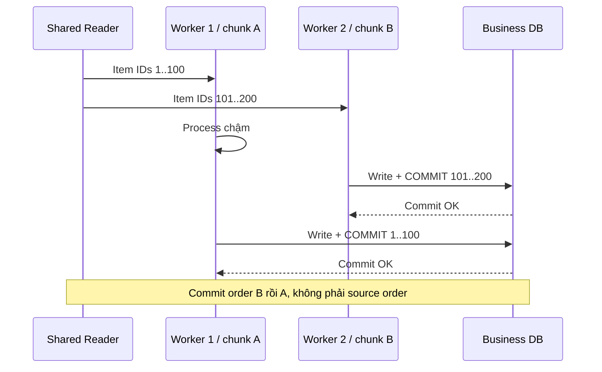
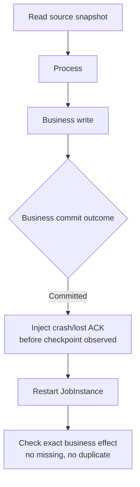
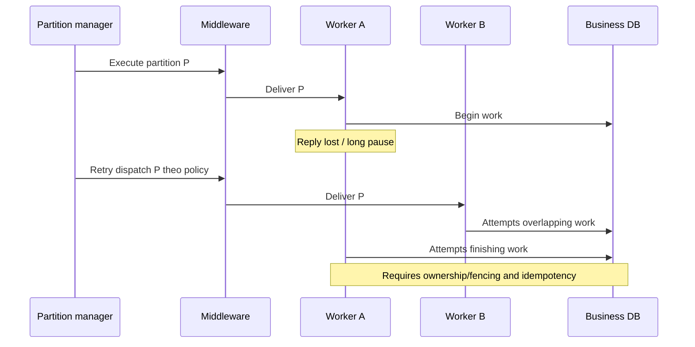
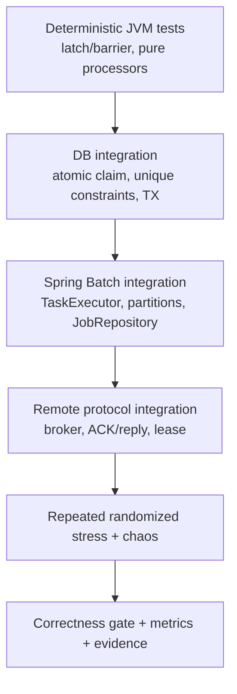

# Test ordering và race condition trong Spring Batch

> **Chương:** Testing concurrency  
> **Mục tiêu:** Thiết kế kiểm thử tái hiện được các lỗi **thứ tự xử lý**, **race condition**, lost update, ghi trùng, checkpoint lệch và stale worker khi mở rộng Spring Batch bằng multi-threaded step, parallel steps, local/remote partitioning và remote chunking. Thực hành dùng **Spring Batch 5.2.x**, **Java 17**, **JUnit Jupiter 5**, Spring Batch Test, PostgreSQL và các primitive của `java.util.concurrent`.  
> **Nguyên tắc:** Test phải chứng minh **bất biến nghiệp vụ** dưới nhiều interleavings; không chỉ chạy một lần rồi khẳng định “không thấy lỗi”.

## 1. Bài toán: Cùng input, kết quả khác nhau khi tăng worker

Một job đọc 100.000 sự kiện thanh toán, xử lý chunk 200 và ghi vào PostgreSQL. Chạy một luồng, tổng số event hợp lệ và số dư luôn đúng. Khi cấu hình `TaskExecutor` 8 luồng, đôi khi:

- Một event được ghi hai lần sau retry hoặc broker redelivery.
- Hai luồng cùng đọc một item từ reader không thread-safe.
- Item B hoàn thành trước A, làm trạng thái cuối phụ thuộc thứ tự ghi.
- Chunk đã commit nhưng checkpoint chưa cập nhật; restart phát lại dữ liệu.
- Hai partition có ranges chồng nhau.
- Một worker cũ mất lease rồi vẫn tiếp tục ghi sau khi worker mới được cấp quyền.
- Job `COMPLETED` nhưng business output thiếu bản ghi.

Lỗi thường **biến mất** khi thêm `System.out.println`, chạy bằng debugger hay giảm số threads. Đó là đặc trưng của các lỗi timing-sensitive: việc quan sát hoặc tăng log có thể đổi lịch thực thi.

Cách tiếp cận bài này:

1. Mô tả rõ **correctness invariant** trước khi chạy test.
2. Tạo một **interleaving có chủ đích** bằng latch/barrier thay vì hy vọng race tự xuất hiện.
3. Kiểm tra cả **metadata Spring Batch** lẫn **business effect** trong nguồn/đích.
4. Chạy integration tests trên database/middleware có semantics phù hợp, không dùng mỗi mock.
5. Thêm stress/chaos tests để khám phá interleavings mới, nhưng không coi test stress thay thế unit test tái hiện xác định.

## 2. Phân biệt các loại ordering

Trong Spring Batch, “thứ tự” có nhiều nghĩa:

| Loại thứ tự | Câu hỏi | Có được framework bảo đảm tự động? |
| --- | --- | --- |
| **Source order** | Item nào được reader trả về trước? | Phụ thuộc reader và snapshot/SQL ordering |
| **Processor start order** | Thread nào bắt đầu process trước? | Không cố định khi chạy song song |
| **Processor completion order** | Item nào hoàn tất xử lý trước? | Không cố định |
| **Chunk composition** | Những item nào nằm cùng chunk? | Có thể khác khi step multi-threaded |
| **Writer invocation order** | Chunk nào được writer gọi trước? | Không cố định |
| **Transaction commit order** | Chunk nào commit đầu tiên? | Phụ thuộc scheduling/locks |
| **Message delivery order** | Broker giao chunk/partition theo thứ tự nào? | Theo transport/consumer/partition contract |
| **Business order** | Phiên bản nào được phép áp dụng trước? | Ứng dụng phải định nghĩa rõ |

Theo [Spring Batch 5.2 — Scaling and Parallel Processing](https://docs.spring.io/spring-batch/reference/5.2/scalability.html), khi thêm `TaskExecutor` vào chunk step, các chunk được thực thi trên nhiều thread và **không còn thứ tự item cố định**; chunk có thể chứa các item không liên tiếp như khi chạy đơn luồng.

Vì vậy, một test kiểu:

```java
// PHẢN VÍ DỤ trong multi-threaded Step:
assertEquals(
    List.of("event-1", "event-2", "event-3"),
    emittedEventIds);
```

có thể thất bại dù kết quả hoàn toàn hợp lệ, nếu nghiệp vụ chỉ cần **đủ ba event, không trùng**. Ngược lại, một test so tập ID có thể PASS dù nghiệp vụ yêu cầu **version 2 phải ghi sau version 1**.

### Test đúng thứ tự hay test tính bất biến với thứ tự?

- **Order-insensitive pipeline:** Kiểm tra **multiset**, số lượng, checksum và business output; không assert raw writer invocation order.
- **Per-key ordered pipeline:** Kiểm tra thứ tự/version **trong cùng aggregate/key**, không yêu cầu global order giữa các key khác nhau.
- **Globally ordered pipeline:** Phải có cơ chế **serialize/reorder** ở cuối pipeline hoặc thiết kế single-writer; không kỳ vọng `TaskExecutor` tự giữ thứ tự.

## 3. Xác định correctness invariants trước khi test

Chạy song song mà chỉ assert `BatchStatus.COMPLETED` là **chưa đủ**.

Một hợp đồng kiểm thử cho batch nhập hóa đơn:

| Invariant | Cách quan sát |
| --- | --- |
| **Không mất item hợp lệ** | Tập/đa tập business event IDs của source vs sink |
| **Không nhân đôi effect** | `UNIQUE(source_system,event_id)`, event ledger, số lượng effect |
| **Không nhân đôi side effect ngoài DB** | Idempotency key + provider status/reconciliation |
| **Payload không bị đổi ngầm** | Canonical payload hash hoặc compare fields |
| **Per-key version monotonic** | Latest applied version/sequence không đi lùi |
| **Partitions không chồng range** | Intersections của file IDs / ID intervals bằng rỗng |
| **Owner cũ không ghi sau reclaim** | Fencing token được kiểm tra tại commit |
| **Checkpoint/restart an toàn** | Sau crash + restart, output giống một lần chạy chuẩn |
| **Job metadata hợp lệ** | JobExecution/StepExecution statuses, retry/skip/rollback |
| **Không deadlock/hang** | Mọi future/phase có timeout và cleanup |
| **Tài nguyên được thu hồi** | Pool connections, threads, open file handles ở mức test được |

### Multiset khác set

Giả sử nguồn yêu cầu **mỗi event ID xuất hiện đúng một lần**, output có `[A,A,B]`. So `Set.of(A,B)` sẽ che duplicate A. Cần so:

- Unique IDs và count theo ID;
- total records/multiset;
- business rows/effects;
- payload/version của từng ID.

Nếu nghiệp vụ **cho phép** cùng `eventId` nhiều lần như các bản cập nhật phiên bản, unique key phải gồm business version hoặc dùng quy tắc version guard; không áp “đếm mỗi ID một lần” cho mọi nghiệp vụ.

### Contract ví dụ

```text
source immutable event IDs:  E1 ... E100000
eligible IDs:               99950
quarantine/rejected:        50

After completion:
  count(distinct applied event keys) = 99950
  missing eligible keys              = 0
  duplicate business effects         = 0
  payload conflicts                  = 0
  quarantine count                   = 50
  per-key applied version monotonic  = true
```

Số liệu trên là ví dụ. Các ngưỡng skip và semantic “eligible” cần lấy từ yêu cầu nghiệp vụ, không tự bỏ qua 50 item để job nhìn có vẻ xanh.

## 4. Các race condition hay gặp trong Spring Batch

| Race | Interleaving nguy hiểm | Hậu quả |
| --- | --- | --- |
| **Check-then-act** | Hai worker cùng `SELECT status=READY` trước `UPDATE` | Claim cùng file |
| **Lost update** | Cả hai đọc balance=100, rồi ghi 110 và 120 | Mất một cập nhật |
| **Compound operation** | `get` rồi `set` trên `AtomicInteger` | Mất increment dù từng thao tác atomic |
| **Non-thread-safe reader** | Hai threads cùng sửa cursor/stream state | Trùng hoặc bỏ item |
| **Shared mutable processor** | Processor lưu mutable `currentItem` trong singleton | Payload của item A bị trộn B |
| **Concurrent writer buffer** | Hai threads append/clear cùng buffer | Sai dữ liệu đầu ra |
| **Stale overwrite** | Version 2 commit trước, version 1 commit sau | Giá trị cuối đi lùi |
| **Partition overlap** | Ranges `[1,100]` và `[100,200]` đều include 100 | Event 100 bị xử lý hai lần |
| **Commit/checkpoint gap** | DB commit OK, metadata checkpoint chưa lưu | Restart phát lại đã ghi |
| **Broker redelivery** | Worker commit rồi crash trước ACK | Worker khác xử lý cùng chunk |
| **Lease expiration** | Worker A pause, B reclaim, A tỉnh lại | Stale worker tiếp tục ghi |
| **Global vs thread-bound TX** | Test thread giữ TX nhưng workers ở TX riêng | Test thấy dữ liệu khác kỳ vọng |
| **Concurrent Job launches** | Hai scheduler thấy “not running”, cùng launch | Tranh cùng JobInstance/input |
| **Metadata race** | Hai processes cập nhật cùng StepExecution | Optimistic locking/error lifecycle |

Một số tình huống trên là **data race trong JVM**; số khác là **transaction race giữa các DB sessions** hoặc **ordering race trên hệ phân tán**. Một giải pháp cho loại này không tự giải quyết loại khác.

## 5. Bộ công cụ kiểm thử và vai trò

| Công cụ | Dùng khi nào? | Giới hạn |
| --- | --- | --- |
| `CountDownLatch` | Buộc hai threads đi tới cùng một điểm trước khi tiếp tục | One-shot; không tự kiểm chứng business semantics |
| `CyclicBarrier` | N threads phải gặp nhau ở nhiều vòng/phase | Nếu thiếu worker, có thể timeout/broken barrier |
| `Phaser` | Nhiều phase, có thể đăng ký/rút parties động | Cần quản lý đúng phase và timeout |
| `ExecutorService` / `Future` | Tạo workers, lấy exception, giới hạn thời gian | Phải shutdown/awaitTermination |
| `AtomicInteger` / locks | Demo/fix race trong bộ nhớ | Không bảo vệ cross-JVM/DB business effects |
| JUnit 5 `@Test`, `@Timeout` | Test assertions và timeout cuối | Timeout test không thay cleanup resources |
| `@SpringBatchTest`, `JobLauncherTestUtils` | Integration test Job/Step Spring Batch 5.2 | Phải có JobRepository/DataSource và context thật |
| `StepScopeTestUtils` | Kiểm thử step-scoped component | Không tự tạo parallel `StepExecutions` |
| PostgreSQL test DB/Testcontainers | Row locks, isolation, unique constraints, deadlock | Khác cấu hình production nếu schema/pool/isolation sai |
| Broker test container | Redelivery, ack/reply, DLQ, consumer concurrency | Cần dùng đúng adapter và policy thực tế |
| Metrics + structured logs | Tìm interleavings, retries và metadata conflicts | Logging có thể thay đổi timing |
| Chaos/fault-injection harness | Mô phỏng crash, lost ACK, pause, timeout | Không thay test bất biến có oracle rõ |

### Không dựa vào Thread.sleep để “tạo race”

```java
// KHÔNG đáng tin: nhanh/chậm tùy CI host.
Thread.sleep(10);
assertEquals(...);
```

`sleep` có thể hữu ích để mô phỏng latency trong một test riêng, nhưng không là **điểm đồng bộ**. Để tái hiện hai workers cùng vượt qua bước đọc, dùng latch/barrier kiểm soát trực tiếp thứ tự.

### Timeout mọi điểm chờ

```java
if (!bothReady.await(3, TimeUnit.SECONDS)) {
    throw new AssertionError("Workers did not reach the race point");
}
```

Một test race bị deadlock cần fail trong thời gian hữu hạn và cleanup; đừng để pipeline CI treo mãi. Không dùng `assertTimeoutPreemptively` bừa bãi quanh test dựa vào `@Transactional` của Spring Test: preemptive timeout có thể chạy trong thread khác, làm mất transaction context thread-bound.

## 6. Happens-before: Vì sao test phải có synchronization thật?

Trong Java Memory Model, thứ tự **happens-before** xác định khi nào một thread chắc chắn nhìn thấy actions của thread khác.

Ví dụ `CountDownLatch`:

```java
Thread A:
    payload = "ready";
    ready.countDown();

Thread B:
    ready.await();
    assertEquals("ready", payload);
```

Theo [JDK 17 CountDownLatch Javadoc](https://docs.oracle.com/en/java/javase/17/docs/api/java.base/java/util/concurrent/CountDownLatch.html), các hành động xảy ra **trước `countDown()`** trên một thread happens-before các hành động **sau khi `await()` trả về thành công** ở thread khác, nếu count đạt 0.

Nhưng:

- `CountDownLatch` không làm cho mọi shared mutable object tự thread-safe.
- Chỉ hai thao tác `AtomicInteger.get()` và `AtomicInteger.set()` riêng lẻ atomic; toàn bộ `get→compute→set` **không atomic**.
- `volatile` giúp visibility/order phù hợp nhưng không biến `count++` thành atomic increment.
- `synchronized`, `Lock` và atomic CAS cần được dùng đúng **cùng critical section**.
- Với hai JVM, in-memory happens-before không giải quyết database commit order hay broker delivery.

Trong test concurrency, dùng synchronization để **đặt lịch của tình huống cần kiểm chứng**, không dùng nó như “bản sửa” ẩn trong production code.

## 7. JUnit 5: Tái hiện lost update một cách xác định

Phản ví dụ cố ý có bug: dùng `AtomicInteger` nhưng thực hiện **read–modify–write** tách rời. Hai threads đọc cùng giá trị trước khi bất kỳ thread nào ghi:

```java
package com.example.batch.concurrency;

import static org.junit.jupiter.api.Assertions.assertEquals;
import static org.junit.jupiter.api.Assertions.assertTrue;

import java.util.concurrent.*;
import java.util.concurrent.atomic.AtomicInteger;

import org.junit.jupiter.api.Test;

class LostUpdateTest {

    @Test
    void deliberatelyReproducesLostUpdate() throws Exception {
        AtomicInteger counter = new AtomicInteger(0);
        CountDownLatch bothRead = new CountDownLatch(2);
        ExecutorService pool = Executors.newFixedThreadPool(2);

        Callable<Void> wrongIncrement = () -> {
            int snapshot = counter.get();   // cả hai cùng đọc 0
            bothRead.countDown();
            if (!bothRead.await(3, TimeUnit.SECONDS)) {
                throw new AssertionError("Both workers did not read");
            }

            counter.set(snapshot + 1);      // cả hai cùng set 1
            return null;
        };

        try {
            Future<Void> a = pool.submit(wrongIncrement);
            Future<Void> b = pool.submit(wrongIncrement);
            a.get(5, TimeUnit.SECONDS);
            b.get(5, TimeUnit.SECONDS);

            // Chứng minh BUG trong anti-pattern, không phải mục tiêu production.
            assertEquals(1, counter.get());
            assertTrue(bothRead.getCount() == 0);
        } finally {
            pool.shutdownNow();
            assertTrue(pool.awaitTermination(5, TimeUnit.SECONDS));
        }
    }

    @Test
    void atomicIncrementPreservesBothUpdates() throws Exception {
        AtomicInteger counter = new AtomicInteger();
        CountDownLatch begin = new CountDownLatch(1);
        ExecutorService pool = Executors.newFixedThreadPool(2);

        Callable<Void> correctIncrement = () -> {
            if (!begin.await(3, TimeUnit.SECONDS)) {
                throw new AssertionError("Start signal missing");
            }
            counter.incrementAndGet();       // một operation atomic
            return null;
        };

        try {
            Future<Void> a = pool.submit(correctIncrement);
            Future<Void> b = pool.submit(correctIncrement);
            begin.countDown();
            a.get(5, TimeUnit.SECONDS);
            b.get(5, TimeUnit.SECONDS);

            assertEquals(2, counter.get());
        } finally {
            pool.shutdownNow();
            assertTrue(pool.awaitTermination(5, TimeUnit.SECONDS));
        }
    }
}
```

**Điểm học:** Test đầu tiên **cố tình assert hành vi lỗi** để minh họa race. Trong test bảo vệ code production, hãy assert **kết quả đúng (=2)** và để test fail khi ai đó đưa lại implementation sai.

### AtomicInteger có đủ cho Spring Batch không?

Không. `AtomicInteger.incrementAndGet` xử lý một counter **trong cùng JVM**. Nếu hai remote workers ghi balance ở PostgreSQL, cần transaction/locking/conditional UPDATE hoặc business ledger. Nếu replay do lost ACK, kể cả một database UPDATE atomic vẫn có thể bị **áp dụng hai lần** — cần idempotency.

## 8. Test ordering: Hoàn tất B trước A nhưng dữ liệu vẫn đúng

Ví dụ hai item A và B được submit theo thứ tự A rồi B, nhưng kết quả hoàn thành B trước A theo interleaving do test chủ động tạo:

```java
package com.example.batch.concurrency;

import static org.junit.jupiter.api.Assertions.assertEquals;

import java.util.ArrayList;
import java.util.List;
import java.util.concurrent.*;

import org.junit.jupiter.api.Test;

class CompletionOrderTest {

    @Test
    void completionOrderNeedNotEqualSubmissionOrder() throws Exception {
        ExecutorService pool = Executors.newFixedThreadPool(2);
        CountDownLatch aWaiting = new CountDownLatch(1);
        CountDownLatch bCompleted = new CountDownLatch(1);
        ConcurrentLinkedQueue<String> finished =
                new ConcurrentLinkedQueue<>();

        try {
            Future<?> a = pool.submit(() -> {
                aWaiting.countDown();
                try {
                    if (!bCompleted.await(3, TimeUnit.SECONDS)) {
                        throw new AssertionError("B did not complete");
                    }
                } catch (InterruptedException ex) {
                    Thread.currentThread().interrupt();
                    throw new RuntimeException(ex);
                }
                finished.add("A");
            });

            Future<?> b = pool.submit(() -> {
                try {
                    if (!aWaiting.await(3, TimeUnit.SECONDS)) {
                        throw new AssertionError("A was not ready");
                    }
                } catch (InterruptedException ex) {
                    Thread.currentThread().interrupt();
                    throw new RuntimeException(ex);
                }
                finished.add("B");
                bCompleted.countDown();
            });

            a.get(5, TimeUnit.SECONDS);
            b.get(5, TimeUnit.SECONDS);

            // Interleaving cố định của TEST này, không phải contract Batch.
            assertEquals(List.of("B", "A"),
                    new ArrayList<>(finished));

            // Business pipeline order-insensitive: cả A và B đều phải có.
            assertEquals(java.util.Set.of("A", "B"),
                    new java.util.HashSet<>(finished));
        } finally {
            pool.shutdownNow();
        }
    }
}
```

**Không** chuyển assertion `["B","A"]` thành điều kiện bắt buộc cho mọi Spring Batch multi-threaded job. Test này minh họa completion order có thể khác submission order; correctness contract của một pipeline order-insensitive là **không thiếu/không trùng**, không phải completion order.

Nếu business yêu cầu cùng key được xử lý theo sequence, phải có thêm cơ chế serial hóa theo key/version guard; xem phần 16.

## 9. Test shared reader: Bắt lỗi trùng/mất item thay vì chỉ nhìn status

Nhiều reader Spring Batch chứa cursor, buffer hoặc `ExecutionContext` mutable. `FlatFileItemReader` **không thread-safe** khi dùng trực tiếp như shared reader của multi-threaded step; Spring Batch có `SynchronizedItemStreamReader` để đồng bộ `read()` khi cần.

### Kiểu bug cần phát hiện

```text
Reader cursor = 100
    T1 đọc cursor 100, chưa tăng
    T2 đọc cursor 100, chưa tăng
    T1 trả item 100 và tăng cursor
    T2 trả item 100 và tăng cursor

Output: item 100 trùng, item 101 mất.
```

Đây là minh họa interleaving, **không khẳng định `FlatFileItemReader` nội bộ luôn có đúng lỗi này**. Một reader có thể bị hỏng trạng thái theo các đường khác khi dùng sai thread contract.

### Bất biến kiểm thử

Với source snapshot chứa unique IDs từ 1 tới 10.000:

```text
expectedCount = 10.000
actual total outputs = 10.000
count(distinct eventId) = 10.000
missing IDs = empty
duplicate IDs = empty
payload checksum = expected
```

Một test chỉ `assertEquals(10_000, stepExecution.getReadCount())` vẫn có thể bỏ sót trùng/mất nếu count tăng theo các lần read sai. Cần đối soát **IDs thật**.

### Decorator không phải lời giải mọi vấn đề restart

```java
@Bean
SynchronizedItemStreamReader<Invoice> safeReader(
        FlatFileItemReader<Invoice> delegate) {
    return new SynchronizedItemStreamReaderBuilder<Invoice>()
            .delegate(delegate)
            .build();
}
```

Ví dụ trên cần import:

```java
import org.springframework.batch.item.support.SynchronizedItemStreamReader;
import org.springframework.batch.item.support.builder.SynchronizedItemStreamReaderBuilder;
```

`SynchronizedItemStreamReader` giúp đồng bộ lời gọi `read()`, nhưng **không tự bảo đảm checkpoint restart-safe nếu item được đọc theo thứ tự rồi hoàn tất/commit out of order**. Khi yêu cầu restart chặt chẽ, cân nhắc partitioning theo ranges/files bất biến, per-partition `ItemStream` và writer idempotent.

Tham khảo [Spring Batch 5.2 — SynchronizedItemStreamReader](https://docs.spring.io/spring-batch/reference/5.2/readers-and-writers/item-reader-writer-implementations.html).

## 10. Cấu hình multi-threaded Step để tái hiện concurrency thật

Một test concurrency phải thực sự có **ít nhất hai worker threads**. Nếu executor là `SyncTaskExecutor` hoặc pool chỉ có một thread, test chỉ kiểm tra tuần tự.

Ví dụ StepBuilder **Spring Batch 5.2**:

```java
package com.example.batch.concurrency;

import org.springframework.batch.core.Step;
import org.springframework.batch.core.repository.JobRepository;
import org.springframework.batch.core.step.builder.StepBuilder;
import org.springframework.batch.item.ItemReader;
import org.springframework.batch.item.ItemWriter;
import org.springframework.context.annotation.Bean;
import org.springframework.context.annotation.Configuration;
import org.springframework.scheduling.concurrent.ThreadPoolTaskExecutor;
import org.springframework.transaction.PlatformTransactionManager;

@Configuration(proxyBeanMethods = false)
public class ConcurrentImportStepConfig {

    @Bean
    ThreadPoolTaskExecutor importExecutor() {
        ThreadPoolTaskExecutor executor = new ThreadPoolTaskExecutor();
        executor.setCorePoolSize(4);
        executor.setMaxPoolSize(4);
        executor.setQueueCapacity(32);
        executor.setThreadNamePrefix("import-worker-");
        return executor;
    }

    @Bean
    Step importStep(
            JobRepository repository,
            PlatformTransactionManager transactionManager,
            ItemReader<Invoice> reader,
            ItemWriter<Invoice> writer,
            ThreadPoolTaskExecutor importExecutor) {

        return new StepBuilder("importStep", repository)
                .<Invoice, Invoice>chunk(100, transactionManager)
                .reader(reader)
                .writer(writer)
                .taskExecutor(importExecutor)
                .build();
    }
}
```

`Invoice`, reader/writer, Job và datasource phải được ứng dụng/test context định nghĩa. Đây là **skeleton cấu hình**, không phải standalone runnable.

**Cần kiểm chứng trong test:**

1. Thực tế có nhiều threads hoạt động song song (log thread name, active count hoặc barrier trong writer/process phase).
2. Reader, processor, writer có contract thread-safe đúng cho cấu hình này.
3. `@StepScope` được tạo **theo StepExecution**, **không** có nghĩa một instance mỗi thread trong cùng multi-threaded step.
4. `chunk(100)` là commit interval, không bảo đảm chunk execution/commit theo đúng nguồn.
5. TaskExecutor queue hữu hạn, DB pool đủ với concurrency cần thiết.
6. Ở Spring Batch 5.2, `throttleLimit` của multi-threaded step đã **deprecated từ 5.0**. Không coi tăng `throttleLimit` là chiến lược scaling hiện đại; nếu cần giới hạn thực thi tùy biến hãy xem tài liệu về `stepOperations(RepeatOperations)` và bounded executor.
7. Trước khi stress test, đo baseline single-thread và thêm concurrency từng mức (2/4/8) để dễ cô lập lỗi.

**Lưu ý đặc biệt:** Các source/reader/writer stateful của Spring Batch không mặc định được thiết kế cho multi-threaded use. Đừng tăng số thread trước khi có test chứng minh thread safety và restart correctness.


## 11. Kiểm thử singleton processor và writer có trạng thái chia sẻ

Một `ItemProcessor` Spring bean thường là singleton nếu không khai báo scope khác. Trong multi-threaded step, nhiều threads có thể gọi cùng object. Đoạn mã sau có nguy cơ trộn thông tin:

```java
// PHẢN VÍ DỤ: mutable field được chia sẻ giữa threads.
public final class UnsafeInvoiceProcessor
        implements ItemProcessor<Invoice, OutputInvoice> {

    private String currentTenant;

    @Override
    public OutputInvoice process(Invoice invoice) {
        currentTenant = invoice.tenant();
        // Giả sử thread bị chuyển ngữ cảnh tại đây.
        return new OutputInvoice(
                invoice.eventId(), currentTenant, invoice.amount());
    }
}
```

Một processor đúng nên dùng **biến local** và immutable input/output:

```java
public final class SafeInvoiceProcessor
        implements ItemProcessor<Invoice, OutputInvoice> {

    @Override
    public OutputInvoice process(Invoice invoice) {
        return new OutputInvoice(
                invoice.eventId(), invoice.tenant(), invoice.amount());
    }
}
```

Lưu ý `Invoice`/`OutputInvoice` là các domain types ví dụ, phải do ứng dụng định nghĩa. Test cần tạo hai tenants A/B, ép cùng processor instance được gọi đồng thời và xác minh **mọi output giữ tenant của đúng input**.

### Khi shared writer cũng nguy hiểm

Phản ví dụ writer có field `ArrayList`, giữa hai lần gọi `write` nó:

1. Add items vào shared list.
2. Flush list tới JDBC/file.
3. Clear list.

Nếu hai chunks cùng đi vào phương thức, các `add/flush/clear` có thể đan xen, làm item trùng, mất hoặc writer gửi dữ liệu của chunk khác.

Các chiến lược đúng tùy bài toán:

- Writer stateless, chỉ dùng local variables và thread-safe JDBC client.
- Per-`StepExecution` writer trong partitioning, nhưng không lầm `@StepScope` thành per-thread trong một multi-threaded step.
- Đồng bộ đúng critical section nếu writer có mutable state và chi phí chấp nhận được.
- Output writer theo business key với unique constraint, idempotent semantics; **không dựa vào synchronized để xử lý nhiều JVM**.

**Test phải đo đúng output** (event ID, tenant, hash, count) ngay cả khi JobExecution `COMPLETED`.

## 12. Database race: Hai worker claim cùng file

Một race cross-JVM thường gặp:

```text
Worker A: SELECT file.status → READY
Worker B: SELECT file.status → READY
Worker A: UPDATE status=CLAIMED, owner=A
Worker B: UPDATE status=CLAIMED, owner=B
```

Hai workers có thể đều tin rằng đã nhận quyền. Thay quy trình bằng **conditional UPDATE nguyên tử**, được PostgreSQL áp row lock và đánh giá điều kiện phù hợp với transaction isolation:

```sql
CREATE TABLE test_file_claim (
    file_id BIGINT PRIMARY KEY,
    status VARCHAR(20) NOT NULL,
    owner VARCHAR(80)
);

INSERT INTO test_file_claim(file_id, status)
VALUES (42, 'READY');

-- Câu claim nguyên tử cho mỗi worker:
UPDATE test_file_claim
SET status='CLAIMED', owner=:owner
WHERE file_id=42 AND status='READY';
```

Chỉ worker có `updateCount == 1` được phép xử lý file; worker có `updateCount == 0` phải dừng/no-op theo orchestration contract.

### Integration test ép hai threads bắt đầu claim cùng lúc

Dùng PostgreSQL test instance và Spring JDBC, **không đặt method test dưới `@Transactional`**:

```java
package com.example.batch.concurrency;

import static org.junit.jupiter.api.Assertions.assertEquals;
import static org.junit.jupiter.api.Assertions.assertTrue;

import java.util.concurrent.*;

import org.junit.jupiter.api.BeforeEach;
import org.junit.jupiter.api.Test;
import org.springframework.beans.factory.annotation.Autowired;
import org.springframework.boot.test.context.SpringBootTest;
import org.springframework.jdbc.core.JdbcTemplate;

@SpringBootTest
class AtomicFileClaimIT {

    @Autowired JdbcTemplate jdbc;

    @BeforeEach
    void prepare() {
        // Test database riêng, không chạy vào schema production.
        jdbc.execute("""
            CREATE TABLE IF NOT EXISTS test_file_claim (
                file_id BIGINT PRIMARY KEY,
                status VARCHAR(20) NOT NULL,
                owner VARCHAR(80)
            )
            """);
        jdbc.update("DELETE FROM test_file_claim");
        jdbc.update("""
            INSERT INTO test_file_claim(file_id,status)
            VALUES (42,'READY')
            """);
    }

    @Test
    void exactlyOneWorkerCanClaimTheFile() throws Exception {
        ExecutorService pool = Executors.newFixedThreadPool(2);
        CountDownLatch start = new CountDownLatch(1);

        Callable<Integer> claimA = () -> {
            if (!start.await(3, TimeUnit.SECONDS)) {
                throw new AssertionError("Missing start signal");
            }
            return jdbc.update("""
                UPDATE test_file_claim
                SET status='CLAIMED', owner='worker-A'
                WHERE file_id=42 AND status='READY'
                """);
        };

        Callable<Integer> claimB = () -> {
            if (!start.await(3, TimeUnit.SECONDS)) {
                throw new AssertionError("Missing start signal");
            }
            return jdbc.update("""
                UPDATE test_file_claim
                SET status='CLAIMED', owner='worker-B'
                WHERE file_id=42 AND status='READY'
                """);
        };

        try {
            Future<Integer> a = pool.submit(claimA);
            Future<Integer> b = pool.submit(claimB);
            start.countDown();

            int claimed = a.get(5, TimeUnit.SECONDS)
                    + b.get(5, TimeUnit.SECONDS);

            assertEquals(1, claimed);
            String owner = jdbc.queryForObject(
                "SELECT owner FROM test_file_claim WHERE file_id=42",
                String.class);
            assertTrue("worker-A".equals(owner)
                    || "worker-B".equals(owner));
        } finally {
            pool.shutdownNow();
            assertTrue(pool.awaitTermination(
                    5, TimeUnit.SECONDS));
        }
    }
}
```

**Giới hạn của ví dụ:**

1. `@SpringBootTest` cần Spring Boot Test và datasource PostgreSQL đã cấu hình (có thể là Testcontainers). Đoạn code là **integration test component**, không tự dựng PostgreSQL.
2. Với PostgreSQL isolation `READ COMMITTED`, conditional update và row locking tạo hành vi claim mong muốn; isolation khác có thể ném serialization error. Test thực tế phải cấu hình đúng isolation và policy retry.
3. Dùng datasource có pool **ít nhất hai connections** để tạo concurrency thật. Một pool size 1 có thể tuần tự hóa toàn bộ truy vấn khiến test không chứng minh race.
4. Cần chạy database/schema **cô lập**. Nếu nhiều JUnit tests cùng dùng `file_id=42` và `DELETE` trong parallel test execution, chúng có thể phá dữ liệu test lẫn nhau.
5. Không đặt `@Transactional` trên test method để hy vọng các threads dùng chung transaction: Spring transaction context gắn với thread.
6. Nên kiểm tra cả **row count** lẫn **business effect** sau claim, vì một claim thành công không tự ngăn worker cũ tiếp tục ghi sau lease expiry.
7. Bài toán production có thể cần token, lease và fencing; đây là test tầng **atomic claim** đầu tiên, không phải đầy đủ distributed ownership protocol.

## 13. Lost update trong database khác lost update của AtomicInteger

Bài 7 tái hiện lỗi trong JVM. Trong database, một pattern tương tự:

```sql
-- PHẢN VÍ DỤ ứng dụng:
SELECT balance FROM account_balance WHERE account_id = 1;
-- Java tính newBalance = oldBalance + amount
UPDATE account_balance SET balance = :new_balance
WHERE account_id = 1;
```

Hai transactions có thể cùng đọc balance=100 rồi lần lượt cập nhật 110 và 120; cuối cùng chỉ có một increment được phản ánh.

Một lựa chọn khi phép toán đơn giản và không cần ledger:

```sql
UPDATE account_balance
SET balance = balance + :delta
WHERE account_id = :id;
```

PostgreSQL sẽ đồng bộ cập nhật cùng row theo locking/isolation; mỗi statement update hợp lệ sẽ áp delta một lần. **Nhưng nếu Spring Batch restart hoặc broker redeliver cùng event**, câu UPDATE này vẫn có thể chạy **lần hai**. Atomic arithmetic **khác** business idempotency.

### Atomic update và dedup trong cùng transaction

```sql
CREATE TABLE applied_event (
    event_id VARCHAR(128) PRIMARY KEY,
    payload_sha256 CHAR(64) NOT NULL
);

CREATE TABLE account_balance (
    account_id BIGINT PRIMARY KEY,
    balance NUMERIC(18,2) NOT NULL
);
```

Pseudocode nghiệp vụ:

```text
BEGIN TRANSACTION

INSERT applied_event(event_id, payload_sha256)
    ON CONFLICT DO NOTHING
if inserted:
    UPDATE account_balance
    SET balance = balance + amount
    WHERE account_id = input.accountId
else:
    verify stored payload hash equals incoming payload
    if mismatch: throw conflict (rollback)
    if same: no-op duplicate

COMMIT
```

Không chèn `applied_event` ở transaction riêng rồi mới cập nhật số dư; nếu crash giữa hai transactions, marker tồn tại nhưng effect chưa được áp dụng, replay sẽ **bỏ qua** event hợp lệ.

Test đúng phải ép hai workers **cùng event ID** vào thời điểm ghi và xác minh:

- ledger có **1 row**;
- balance chỉ tăng một lần;
- nếu payload khác nhưng event ID trùng, pipeline báo conflict;
- Job restart không phát sinh thêm effect;
- không có transaction aborted bị nuốt exception rồi vẫn commit.

## 14. Ordering theo version: Tránh bản cũ ghi đè bản mới

Một tình huống hoàn toàn hợp lệ trong multi-threaded step:

```text
Event A: customer=7, version=1, status=ACTIVE
Event B: customer=7, version=2, status=SUSPENDED

Thread B xử lý nhanh → version=2 commit trước
Thread A xử lý chậm → version=1 commit sau

Nếu UPDATE không có guard:
    Final status = ACTIVE (SAI)
```

**Nếu business yêu cầu trạng thái mới nhất**, cần version guard tại sink:

```sql
CREATE TABLE customer_projection (
    customer_id BIGINT PRIMARY KEY,
    source_version BIGINT NOT NULL,
    status VARCHAR(30) NOT NULL
);

-- Event với version mới hơn mới được ghi đè.
UPDATE customer_projection
SET source_version = :incoming_version,
    status = :incoming_status
WHERE customer_id = :customer_id
  AND source_version < :incoming_version;
```

Hành vi mong đợi:

- Version 2 áp dụng sau version 1: cuối cùng version 2.
- Version 2 áp dụng **trước** version 1: cuối cùng **vẫn version 2**.
- Cùng version nhưng payload khác: phải coi là **conflict**, không mặc định no-op.
- Version thấp bị từ chối không có nghĩa event đã hoàn tất các side effect khác.

### Khi nào version guard không đủ?

Nếu cần thực hiện **mọi chuyển trạng thái** hoặc cộng dồn từng event theo thứ tự, chỉ giữ phiên bản cao nhất có thể **bỏ sót intermediate effects**. Khi đó cần một trong các kiến trúc:

- Partition events theo `customerId` để cùng key đi vào một worker tuần tự.
- Dùng event sequence gate (`next_expected_version`) và hàng đợi/reorder buffer có giới hạn.
- Dùng event ledger và deterministic fold/snapshot replay.
- Nếu bắt buộc global order, thiết kế một serialized stage.

**Không dùng thứ tự thread ID, file arrival time hoặc StepExecution ID** để xác định thứ tự nghiệp vụ. Phải có business sequence/version chính thức.

## 15. Chunk concurrency: Thứ tự commit không bằng thứ tự đọc

Trong multi-threaded Step:



Đây là một **interleaving minh họa**; actual chunk composition có thể không liên tiếp khi step multi-threaded. Khi viết test:

- Với order-insensitive output, so multiset/unique business keys sau khi tất cả chunks terminal.
- Với per-key ordering, đưa guard/serial owner vào sink và kiểm thử nghịch đảo thứ tự commit.
- Đo `readCount/writeCount/skipCount` từ `StepExecution` nhưng **đối soát DB output thật**.
- Nếu có explicit sort tại writer, test sort algorithm trên **toàn bộ tập cần sắp xếp**, không chỉ sort bên trong từng chunk.
- Không suy “writer được gọi đồng thời” từ mỗi thread name; cần actual overlapping calls và transaction traces.
- Chunk size 1 vẫn có thể reorder giữa các workers, không tạo global ordering guarantee.

### Khi nào cần barrier bên trong writer?

Có thể inject một `CyclicBarrier(2)` vào **test-only writer wrapper** để ép hai chunks đến cùng “pre-commit” point, sau đó cho B commit trước A. Nhưng với `JdbcTemplate`/transaction locks, đặt barrier **sau khi đã giữ cùng DB row lock** có thể gây deadlock test (worker A giữ lock và chờ B, worker B đang chờ lock A).

Đặt barrier **trước khi mở transaction/chiếm row lock**, hoặc dùng coordination test hook ở layer phù hợp; mọi phase phải có timeout và cleanup.

## 16. Race trong partitioning: Hai dải dữ liệu chồng nhau

`Partitioner.partition(gridSize)` trả map `partitionName → ExecutionContext`. Map keys độc nhất **không chứng minh data ranges trong values không giao nhau**.

Phản ví dụ:

```text
partition-0: minId=1,   maxId=100  (inclusive)
partition-1: minId=100, maxId=200  (inclusive)

ID=100 bị cả hai đọc.
```

Sử dụng half-open intervals cho truy vấn dữ liệu có thể đơn giản hơn:

```text
partition-0: [1, 101)   → IDs 1..100
partition-1: [101, 201) → IDs 101..200
```

SQL tương ứng:

```sql
SELECT *
FROM source_event
WHERE event_id >= :start_inclusive
  AND event_id < :end_exclusive
ORDER BY event_id;
```

### Oracle partition correctness

Với manifest bất biến, test nên kiểm tra:

1. `startInclusive < endExclusive` cho mọi partition không rỗng.
2. Không có pair intervals nào overlap.
3. Union các intervals đúng **target coverage**.
4. Không có gap giữa partitions nếu input range liên tục phải được phủ hết.
5. Partition names ổn định qua restart.
6. Reader dùng đúng keys trong `ExecutionContext`, không nhầm tên từ bước khác.
7. Khi `gridSize` thay đổi, quy tắc mapping/restart được định nghĩa rõ; không đổi ranges cũ trên một JobInstance đang restart.

**Ví dụ test miền:** Sinh 1.000 event IDs, tạo partitions với `gridSize` 1, 2, 3, 8, 16; chạy union/overlap oracle. Với sparse IDs, test theo **business key set** hoặc manifest shards thay vì giả định mọi số trong interval đều tồn tại.

### Data skew không phải race

Một partition lớn hơn hẳn các partition khác làm job chậm, nhưng không tự làm sai dữ liệu. Phải tách test **coverage/no overlap** (correctness) khỏi benchmark **partition duration/straggler** (performance).

## 17. Test crash giữa commit và checkpoint: Có thể replay dù chunk đã ghi

Giả sử Spring Batch ghi 1.000 events qua các chunks:

```text
t0  Worker đọc chunk #5
t1  Writer ghi business data
t2  Business DB COMMIT thành công
t3  JVM chết hoặc connection mất trước khi checkpoint/metadata được xác nhận
t4  JobExecution thất bại/stale STARTED
t5  Restart có thể đọc lại một phần input của chunk #5
```

Trong triển khai dùng cùng database/transaction resource cho business writes và metadata, failure semantics có thể khác; kịch bản này đặc biệt quan trọng khi business output và JobRepository **ở hai resources khác nhau** hoặc có side effect ngoài DB.

### Test cần fault injection tại đúng ranh giới

Một test hữu ích phải có control points:



**Không mô phỏng crash bằng cách throw exception từ processor trước khi business write** rồi kết luận đã kiểm thử commit/checkpoint gap. Cần hook quanh transaction boundary hoặc một test topology nơi business commit có thể quan sát độc lập với JobRepository.

Một worker chết trong JVM có thể để metadata `STARTED`, khiến `JobOperator.restart` bị từ chối. Test phải có **recovery runbook** phù hợp Spring Batch 5.2, không sửa trực tiếp `BATCH_JOB_EXECUTION.STATUS`/`VERSION` ở production.

### Assertion quan trọng

- Tập event outputs trùng source eligible keys.
- Idempotency ledger chứa mỗi business event đúng một marker.
- JobInstance giữ identifying parameters qua restart.
- Snapshot/manifest không đổi bytes.
- Bản ghi đã commit trước crash không bị áp dụng thêm lần hai.
- Nếu có external POST/notification, dùng status lookup hoặc provider idempotency contract để xác minh effect.

## 18. Cross-thread transaction: Đừng dùng @Transactional trong test để che lỗi

Spring Framework gắn transaction resources/context với **thread đang thực thi**. Nếu JUnit method được annotate `@Transactional`, transaction của test thread **không tự truyền** tới worker threads do `ExecutorService` hoặc `TaskExecutor` tạo.

Phản ví dụ:

```java
@Transactional
@Test
void misleadingRollbackAssumption() throws Exception {
    // Dữ liệu chuẩn bị bên trong test transaction có thể chưa COMMIT.
    jdbc.update("INSERT INTO source_event ...");

    // Các worker được launch từ thread khác có transaction riêng;
    // có thể không thấy dữ liệu mới hoặc COMMIT output thật.
    startAsyncBatchJob();
    // Cuối test rollback transaction test KHÔNG rollback worker effects.
}
```

### Thiết kế integration test đúng

- Tạo input/manifest và commit setup **trước** khi launch workers.
- Cho workers dùng **DataSource pool thật** và transaction manager giống mô hình production.
- Dùng `TransactionTemplate` cho setup/teardown nếu cần ranh giới transaction rõ.
- Không giả định in-memory H2 có isolation/locking giống PostgreSQL production.
- Đọc assertions **sau khi workers terminal**, từ một connection/transaction mới.
- Tách test `READ COMMITTED`, `REPEATABLE READ` hoặc `SERIALIZABLE` theo yêu cầu; error `40001`/`40P01` có thể cần retry toàn transaction.
- Nếu dùng `@Timeout`, mọi worker futures/DB locks phải có bounded timeout và resource cleanup.
- Không chạy hai tests cùng xóa bảng chung khi JUnit parallel execution bật.

**Một test xanh chỉ vì JDBC pool size=1 tuần tự hóa mọi tác vụ không chứng minh writer an toàn với concurrency=8.** Test cần xác nhận concurrent connections thực sự được sử dụng.


## 19. Stale worker sau lease expiry: Test fencing tại commit boundary

Trong remote partitioning hoặc dynamic file claiming, một worker có thể nhận `lease` và token rồi bị pause. Sau khi lease hết hạn, coordinator cấp quyền cho worker mới. Khi worker cũ hoạt động lại, **lease alone không ngăn nó ghi output**.

Kịch bản:

```text
Worker A: claim file F, token=7
Worker A: tạm dừng ở giữa hai chunk, không heartbeat
Coordinator: lease=expired, cấp token=8 cho Worker B
Worker B: xử lý và ghi output hợp lệ
Worker A: tỉnh lại và cố ghi với token=7
Expected: A bị REJECT tại business commit boundary
```

**Oracle kiểm thử** gồm:

1. Registry có đúng một active token mới nhất (=8).
2. Worker A có thể còn sống, nhưng mọi attempt sử dụng token=7 phải thất bại trước khi commit business effect.
3. Worker B được phép commit khi token=8 còn hợp lệ.
4. Nếu B replay một event mà A đã commit trước khi mất lease, unique business key tránh double effect.
5. Không có lost data khi A bị chặn; B tiếp tục từ manifest/checkpoint/replay có kiểm soát.

### Gợi ý cơ chế fencing trong cùng PostgreSQL

```sql
BEGIN;

SELECT file_id
FROM ingest_file
WHERE file_id = :file_id
  AND status = 'CLAIMED'
  AND owner_id = :owner
  AND claim_token = :token
  AND lease_until > CURRENT_TIMESTAMP
FOR UPDATE;

-- Nếu không có row: ROLLBACK, từ chối worker cũ.
-- Nếu có row: ghi business effects trong cùng transaction.

COMMIT;
```

Test cần xác minh ownership check **và business write thuộc cùng DB transaction**. Nếu dùng hai databases hoặc HTTP service, row lock trong registry **không khóa service bên ngoài**; downstream phải hỗ trợ fencing/idempotency/reconciliation.

### Không dùng barrier sau khi đã giữ lock để ép race

Nếu Worker A giữ `FOR UPDATE` trên row file và chờ `CountDownLatch` của Worker B, còn B đang chờ lock A, test sẽ **tự tạo deadlock do harness**. Đặt điểm tạm dừng của A **giữa chunks, trước khi khóa row cho transaction tiếp theo**, để cho lease expire và B reclaim. Test phải báo rõ khi timeout là do harness deadlock hay do ứng dụng.

## 20. Remote partitioning: Duplicate dispatch và StepExecution ownership

Khi manager gửi partition cho remote workers, mạng có thể timeout. Không có gì bảo đảm manager sẽ nhận reply đúng lúc worker hoàn tất; nếu orchestration giao lại cùng partition không có fencing:



Test acceptance:

- Partition có stable name, file/range identity và `ExecutionContext` phù hợp.
- Không có **hai active owners được phép commit** cùng business range.
- JobRepository `StepExecution` không bị hai tiến trình update bừa bãi; concurrent metadata update có thể gây `OptimisticLockingFailureException`.
- Manager không report `COMPLETED` khi worker có side effect chưa được xác minh.
- Khi worker fail, retry/reassignment phải giữ identity/version và checkpoint đúng.

**Không giải quyết race bằng cách tăng `StepExecution.VERSION` thủ công, xóa metadata hoặc ép `COMPLETED`.** Nếu StepExecution bị sử dụng bởi hai remote processes, cần sửa dispatcher/partition handler/ownership contract.

### Cùng JobExecution không có nghĩa chỉ một physical worker

`StepExecution` là object metadata của một partition attempt. Trong distributed environment, một response trễ có thể tới sau khi coordinator đã điều phối worker khác. Test phải ghi cả **logical partition ID** và **physical worker attempt ID** để phân biệt ai thực sự xử lý.

## 21. Remote chunking: Test redelivery sau commit nhưng mất ACK/reply

Remote chunking có manager đọc và gửi `ChunkRequest`; worker xử lý `ChunkProcessor` và phát `ChunkResponse` qua middleware. Message transport/ACK và business DB có thể có transaction boundaries khác nhau.

```mermaid
sequenceDiagram
    participant M as Chunk manager
    participant Q as Broker
    participant A as Worker A
    participant DB as Business DB
    participant B as Worker B
    M->>Q: ChunkRequest #42 chứa event E
    Q->>A: Deliver #42
    A->>DB: BEGIN; apply E; COMMIT
    DB-->>A: Committed
    Note over A,Q: Inject crash / drop reply trước ACK
    Q->>B: Redeliver #42 nếu broker policy cho phép
    B->>DB: Replay E với same business key
    DB-->>B: No new effect (same payload)
    B-->>M: Correlated ChunkResponse
```

**Đừng chỉ test "worker nhận đúng một message".** Với at-least-once delivery, message có thể được giao lại sau lost ACK, nên phải kiểm tra:

| Quan sát | Kỳ vọng |
| --- | --- |
| Broker delivery count | Có thể là 2 hoặc nhiều hơn |
| Unique business event effects | Chính xác 1 |
| Applied event ledger | Một row với stable event key |
| Payload conflict | 0; key trùng payload khác phải FAIL |
| Manager reply/correlation | Hoàn thành theo integration contract |
| DLQ | Không mất poison message không được xử lý |
| Job/Step status | Phản ánh terminal outcome thực tế, không suy từ ACK đơn thuần |

### Các điểm inject failure

1. Trước khi worker nhận request.
2. Sau deserialize nhưng trước business transaction.
3. Giữa xử lý trước DB commit.
4. **Sau DB commit trước ACK/reply** (quan trọng nhất cho duplicate effect).
5. Sau worker reply nhưng trước manager persist contribution.
6. Manager stop/restart trong khi vẫn có in-flight messages.

Phải kiểm tra cùng event `E` có stable idempotency key qua **cả JobExecution mới** nếu restart xảy ra. Không dùng `jobExecutionId:chunkSequence` làm business key nếu jobExecutionId đổi sau restart.

### Đừng đồng nhất retry của Step và broker redelivery

`retryLimit(3)` của fault-tolerant Spring Batch Step không tự giới hạn message deliveries hay job restart attempts. Test nên ghi riêng:

- `batchRetryAttempt` (nếu instrument);
- `brokerRedeliveryCount`;
- `workerAttemptId`;
- `jobExecutionId`;
- `sourceEventId`.

Mỗi tầng có thể tạo thêm attempts, nhưng business effect cuối cùng vẫn phải đúng.

## 22. Job launch race: Hai scheduler cùng khởi chạy một JobInstance

`JobInstance` được xác định bởi job name và **identifying JobParameters**. Hai scheduler có thể cùng thực hiện:

```text
Pod A: getRunningExecutions(job) → empty
Pod B: getRunningExecutions(job) → empty
Pod A: start(job, businessDate=2026-11-25)
Pod B: start(job, businessDate=2026-11-25)
```

`getRunningExecutions→start` không phải distributed compare-and-set; race vẫn có thể xảy ra. Với cùng JDBC JobRepository và identifying params ổn định, repository dùng transaction/constraints để phân xử logical job duplicate; API có thể báo đã tồn tại/đang chạy thay vì tạo hai instances.

**Test tối thiểu:**

1. Hai scheduler clients dùng **cùng JobRepository DB**.
2. Dùng cùng job name, businessDate, immutable manifest ID.
3. Bắt đầu đồng thời qua latch.
4. Quan sát chỉ một logical `JobInstance` cho identifying params ấy; exceptions/JobExecutions phải theo contract framework.
5. Không tự tạo random `run.id` khi một launch bị từ chối.
6. Khi chạy trên hai processes thực, kiểm tra cùng deployment JobRegistry và transaction isolation.
7. Nếu hai **JobInstances khác nhau** cùng dùng file version, cơ chế global file claim/dedup vẫn phải bảo vệ input; JobRepository không phải file-level lock.

### Restarts không được làm thay đổi logical identity

Nếu first execution `FAILED` rồi restart, `JobExecution ID` mới nhưng **JobInstance ID** giữ nguyên. Test phải phân biệt:

- Hai launch cùng instance đang hoạt động (race/duplicate).
- Restart hợp lệ của failed/stopped instance.
- New instance của business date/snapshot mới.
- Correction job/reprocess khác logical business identity.

## 23. End-to-end Spring Batch Test: Chạy job và kiểm tra effect thật

Spring Batch 5.2 có module `spring-batch-test`, cung cấp `@SpringBatchTest`, `JobLauncherTestUtils` và `JobRepositoryTestUtils` để kiểm thử Job/Step.

Ví dụ **integration test skeleton**, cần ứng dụng cung cấp `Job`, `DataSource` và schema/output:

```java
package com.example.batch.concurrency;

import static org.junit.jupiter.api.Assertions.assertEquals;

import java.util.UUID;

import org.junit.jupiter.api.Test;
import org.springframework.batch.core.BatchStatus;
import org.springframework.batch.core.Job;
import org.springframework.batch.core.JobExecution;
import org.springframework.batch.core.JobParameters;
import org.springframework.batch.core.JobParametersBuilder;
import org.springframework.batch.test.JobLauncherTestUtils;
import org.springframework.batch.test.context.SpringBatchTest;
import org.springframework.beans.factory.annotation.Autowired;
import org.springframework.boot.test.context.SpringBootTest;
import org.springframework.jdbc.core.JdbcTemplate;

@SpringBatchTest
@SpringBootTest
class ConcurrentImportJobIT {

    @Autowired JobLauncherTestUtils launcher;
    @Autowired Job importJob;
    @Autowired JdbcTemplate jdbc;

    @Test
    void allEligibleEventsHaveExactlyOneBusinessEffect()
            throws Exception {

        // Setup input ở transaction đã COMMIT và snapshot bất biến.
        // Test support chịu trách nhiệm cách isolate business output.
        String runNamespace = "test-" + UUID.randomUUID();

        JobParameters parameters = new JobParametersBuilder()
                .addString("inputSnapshot", "fixture-10000-v1", true)
                .addString("testNamespace", runNamespace, true)
                .toJobParameters();

        launcher.setJob(importJob);
        JobExecution execution = launcher.launchJob(parameters);

        // Với synchronous launcher. Nếu async: phải poll terminal status.
        assertEquals(BatchStatus.COMPLETED,
                execution.getStatus());

        Integer distinctApplied = jdbc.queryForObject("""
            SELECT COUNT(DISTINCT event_id)
            FROM imported_event
            WHERE test_namespace = ?
            """, Integer.class, runNamespace);

        Integer totalApplied = jdbc.queryForObject("""
            SELECT COUNT(*)
            FROM imported_event
            WHERE test_namespace = ?
            """, Integer.class, runNamespace);

        assertEquals(10_000, distinctApplied);
        assertEquals(10_000, totalApplied);
    }
}
```

**Những điều kiện bắt buộc trước khi dùng:**

- `fixture-10000-v1` phải được load vào nguồn thật với **đúng 10.000 eligible event IDs**.
- Bảng `imported_event` trong test phải có cột `test_namespace` và unique business key thích hợp; SQL là giả định schema riêng của test.
- `testNamespace` chỉ phục vụ cô lập test; production không tự sinh UUID identifying cho mỗi retry/restart nếu cần cùng JobInstance.
- `launcher.launchJob(...)` dùng launcher thực tế; nếu JobLauncher được cấu hình async, phải poll `JobExplorer` tới terminal status trước khi query output.
- Nếu Job có nhiều bean trong context, `setJob(importJob)` chọn đúng job under test.
- Đọc `BatchStatus.COMPLETED` là bước đầu; còn phải kiểm tra payload, quarantine/skip, input snapshot, missed/duplicate effects và file consistency.
- Dùng separate PostgreSQL test database/container, không để mỗi test tự xóa toàn bộ output của tests khác.
- Test này chỉ xác nhận **một lượt chạy**. Muốn chứng minh replay safety, chạy thêm failure injection và restart cùng logical identity.

### Test StepScope riêng

`StepScopeTestUtils.doInStepScope(stepExecution, ...)` có thể tạo step context giả để kiểm tra late-binding của một reader/writer theo `ExecutionContext`. Nhưng một test step-scope **không chứng minh** hai `StepExecutions` chạy song song không chia sẻ mutable resource. Phải chạy integration test thực sự có multiple partitions hoặc threads.

Tham khảo [Spring Batch 5.2 — Unit Testing](https://docs.spring.io/spring-batch/reference/5.2/testing.html).

## 24. Fault-injection matrix theo thời điểm và architecture

| Fault injection | Mục tiêu phát hiện | Correctness oracle |
| --- | --- | --- |
| Delay một processor | Thay đổi completion order | Output đủ, payload đúng; ordering theo contract |
| Delay trước writer | Hai chunks cùng tới write | Không lost update, thread-safe writer |
| Barrier ở check-then-act | Double file claim | Một claim owner hợp lệ |
| Force DB deadlock | Retry/rollback transaction | Không duplicate effect sau retry |
| Drop JDBC connection trước commit | Rollback/uncertain outcome | Reconciliation theo business key |
| Kill sau business commit trước checkpoint | Replay on restart | Output tương đương một lần xử lý |
| Pause worker qua lease TTL | Stale owner | Fencing reject stale token |
| Drop remote ChunkResponse | Broker redelivery | Một business effect, reply correlation đúng |
| Duplicate partition dispatch | Two worker attempts | Không double commit, metadata không tranh sai |
| Shuffle events version 1/2 | Stale overwrite | Per-key final version đúng |
| Change source file mid-run | Checkpoint drift | Snapshot/version mismatch bị fail |
| Raise worker count 1→8→16 | Shared-state bugs | Invariants giữ nguyên khi concurrency tăng |
| Shrink DB pool | Queueing/deadlock trong harness | Bounded timeout, không kết luận race sai |
| Restart với different JobExecution ID | Business key không ổn định | Same logical event không áp hai lần |
| Duplicate scheduler launch | JobInstance race | At-most-one logical instance |
| Simulate poisoned event | Skip/retry recovery | Quarantine đúng, không bỏ qua silent |
| Network partition ở remote worker | Lease/reply uncertain | Reconciliation + fencing |

Một test muốn tái hiện lỗi phải đưa fault vào **đúng phase**. Ví dụ “ném exception từ processor trước write” **không** là test cho lỗi mất ACK **sau DB commit**.

## 25. Khi test race thất bại: Thu thập bằng chứng nào?

Nếu CI báo mismatch, cần một trace tối thiểu:

```text
testScenario=duplicate-file-claim
testRunId=...
jobName=invoiceImport
jobInstanceId=...
jobExecutionId=...
stepExecutionId=...
partitionName=file-42
workerAttemptId=worker-B:attempt-2
threadName=import-worker-4
fileId=42
claimToken=8
sourceEventIdHash=...
eventVersion=2
chunkId=...
transactionPhase=COMMIT
faultPoint=AFTER_DB_COMMIT_BEFORE_REPLY
outcome=APPLIED_ONCE
```

Đây là **structured log đề xuất**, không phải schema mặc định Spring Batch.

Phải có cách đối chiếu:

- Source snapshot/manifest/hash.
- Claim/file registry và worker ownership token.
- JobRepository `JobExecution`/`StepExecution`/`ExecutionContext` (read-only).
- Business DB rows, unique constraints, transaction logs khi phù hợp.
- Broker message IDs, delivery count, ACK/reply correlation.
- Exceptions theo family, SQLSTATE, retry/skip/rollback counters.
- Thread name và timestamp có correlation, nhưng **không dựa tuyệt đối vào wall-clock timestamp để suy happens-before** giữa hai hosts.

**Không dùng business event IDs, file IDs hoặc StepExecution IDs làm Prometheus metric labels**: cardinality cao. Giữ chúng trong logs/traces; metrics dùng job, step, worker role, exception type, outcome.

### Thread logs có thể che race

Ghi log đồng bộ quá dày có thể làm thay đổi lịch thread. Với deterministic tests, synchronization bằng latch/barrier phải giữ race tái hiện dù số lượng log thay đổi. Dùng trace có sampling/structured logs và ghi test seed/fault phase để có thể lặp lại.

## 26. CI test pyramid: Deterministic trước, stress sau

Một pipeline kiểm chứng concurrency có thể chia thành:



### Một test pass không chứng minh hết race

- **Deterministic reproduction:** Chứng minh một interleaving cụ thể đúng hoặc sai; phù hợp regression test mỗi build.
- **Property-based tests:** Sinh nhiều phân phối inputs/versions/ranges, kiểm tra invariants ở output.
- **Stress tests:** Lặp hàng nghìn lần, tăng concurrency, đổi input skew, thêm delays; giúp phát hiện cases mới nhưng không bảo đảm bao phủ mọi schedule.
- **JCStress/JMM tests:** Hữu ích khi cần kiểm tra cấp visibility/atomicity của Java Memory Model; không thay DB/Batch integration.
- **Fault-injection/chaos:** Mô phỏng network drop, restart, stale workers; cần test environment cô lập.

### Không dùng stress làm test thường quy quá nặng

Đề xuất phân tầng (chỉ minh họa):

| Tầng | Khi chạy | Kiểm tra |
| --- | --- | --- |
| JVM deterministic | Mỗi commit | Lost update, processor/thread safety, ordering |
| JDBC integration | PR hoặc build pre-merge | Atomic claim, unique event, version guard |
| Batch integration | PR/nightly tùy chi phí | Threaded step, partition coverage, checkpoint |
| Remote integration | Nightly/pre-release | Redelivery, lease/fencing, lost reply |
| Long stress/chaos | Theo lịch hoặc trước release lớn | 1–16 workers, large inputs, random pause/crash |

Mọi test phải có **timeout, cleanup, isolation**. Chạy stress trên production database để “bắt race” là không phù hợp nếu có side effects hoặc ảnh hưởng người dùng.

### Thông số cần giữ để reproduce

```text
application commit/container digest
Spring Batch version/JDK/driver
database version/isolation/pool size
input snapshot ID / record count / skew
worker count, gridSize, chunk size
executor queue config
retry/skip/backoff settings
test seed + fault point + phase synchronization
job identity and whether run was fresh/restart
result: invariants, SQLSTATE, thread dumps/traces
```

**Nếu test dùng dữ liệu ngẫu nhiên**, lưu seed nhưng đừng kỳ vọng seed một mình tái tạo exact OS thread scheduling. Với race cụ thể, thêm deterministic synchronization points.

## 27. Runbook xử lý failure từ concurrency testing

1. **Phân loại failure:** Sai business output, timeout/deadlock, metadata race, duplicate claim, missing record hay sai order expectation?
2. **Xác minh oracle:** Test đang so global order trong pipeline vốn không bảo đảm thứ tự, hay có invariant nghiệp vụ thực sự?
3. **Kiểm tra concurrency thật:** Có ít nhất hai worker threads/DB connections? Các barriers có đạt đủ parties không?
4. **Kiểm tra setup isolation:** Input đã COMMIT trước khi worker đọc? Test khác có xóa chung bảng? `@Transactional` ở test thread có che side effect?
5. **Đối chiếu traces:** source event, partition/worker attempt, claim token, transaction outcome, retry/redelivery.
6. **Tìm ranh giới sai:** Java mutable state, database read–modify–write, StepExecution ownership, broker ACK hoặc lost commit acknowledgement?
7. **Sửa tại layer phù hợp:** Atomic CAS, stateless reader/processor, unique business key, version guard, partition ownership/fencing hoặc idempotent writer.
8. **Giữ test tái hiện deterministic:** Đừng chỉ tăng `Thread.sleep` hoặc số vòng lặp.
9. **Thử lại với restart/timeout:** Một bản sửa thành công ở steady state vẫn có thể lỗi sau crash.
10. **Chạy scale comparison:** 1/2/4/8 workers và workload skew; assert correctness trước khi so throughput.
11. **Không sửa JobRepository metadata thủ công** để làm test xanh; giữ nguyên bằng chứng lỗi.
12. **Ghi lại incident và guardrail:** Lỗi nào được ngăn bởi constraint/test nào, regression test thuộc tầng CI nào?

### Một dấu hiệu cần dừng release ngay

Nếu một test chứng minh **cùng payment event làm tăng số dư hai lần**, đó là correctness failure, không phải “flaky test nên rerun cho xanh”. Phải điều tra và khắc phục idempotency/transaction, sau đó giữ lại test tái hiện lỗi như một regression gate.


## 28. Bài thực hành và fault injection

**Bài A — Race read–modify–write trong JVM.** Chạy `LostUpdateTest` ở phần 7, giải thích vì sao hai thao tác atomic `get()` và `set()` vẫn tạo lost update. Thay implementation bằng `incrementAndGet()`, assert kết quả đúng (=2) và lặp test.

**Bài B — happens-before.** Dùng `CountDownLatch` để worker A publish một immutable result, B chờ `await` rồi kiểm tra. Thử loại bỏ synchronization, mô tả vì sao đọc thành công ngẫu nhiên không chứng minh memory visibility.

**Bài C — Completion order.** Cho item A vào processor trước item B nhưng A chậm hơn. Dùng latch buộc B hoàn tất trước, kiểm tra order-insensitive output đủ và không trùng. Sau đó đưa thêm yêu cầu “cùng customer phải theo sequence”, xác định test mới cần gì.

**Bài D — Reader race.** Tạo reader cố ý dùng shared non-atomic index, chạy hai threads và latch trước khi tăng index. Kiểm tra duplicate/missing IDs. Thay bằng reader thread-safe rồi kiểm tra cả restart; không dừng ở test multi-thread steady state.

**Bài E — Shared processor.** Tạo `UnsafeInvoiceProcessor` có mutable `currentTenant`, ép hai threads đi qua cùng field trước khi return. Test phải phát hiện tenant mismatch. Sửa thành stateless processor và chạy lại.

**Bài F — Shared writer buffer.** Tạo writer có shared `ArrayList` rồi ép hai chunk gọi đồng thời. Kiểm tra count, event IDs, payload hash và duplicate effects. Sửa bằng local buffer/thread-safe design.

**Bài G — Atomic claim.** Dùng PostgreSQL và `AtomicFileClaimIT` ở phần 12. Chạy hai database sessions cùng claim file 42; một worker có update count 1, worker còn lại 0. Test thêm khi file đã DONE.

**Bài H — Race claim timeout.** Ngắt kết nối client ngay khi claim UPDATE có thể đã commit. Không để worker xử lý file khi không biết claim outcome; đối soát owner/token trước khi retry.

**Bài I — Lost update database.** Hai sessions cùng đọc `account.balance=100`; ép cả hai đọc trước khi tính rồi write 110/120. Chứng minh lost update. Đổi sang atomic UPDATE hoặc optimistic versioning và test lại.

**Bài J — Duplicate business event.** Hai workers áp cùng `eventId` với cùng payload, confirm một business effect. Sau đó gửi cùng key nhưng payload khác, assert conflict và rollback thích hợp.

**Bài K — Reversed version order.** Cho event version=2 commit trước version=1. Không có guard thì trạng thái cuối sai. Thêm `WHERE storedVersion < incomingVersion` hoặc per-key serialization, kiểm tra version cuối.

**Bài L — Missing intermediate event.** Nghiệp vụ yêu cầu xử lý version 1, 2, 3 thành ba side effects. Cho event 3 đến trước event 2 và chứng minh “latest version wins” không đủ. Thiết kế reorder buffer hoặc event-sequence gate có timeout.

**Bài M — Chunk commit order.** Dùng hai chunks với task executor thật. Ép chunk B hoàn tất trước A. Kiểm tra output business giữ invariant; không assert writer invocation order nếu business không yêu cầu.

**Bài N — Partition overlap.** Sinh `Partitioner` tạo intervals inclusive chồng ở boundary 100. Viết oracle phát hiện intersection; sửa sang half-open intervals và test `gridSize` 1/2/3/8/16.

**Bài O — Một file trong hai partitions.** Tạo manifest chứa cùng `fileId` dưới hai partition names khác nhau. Manager phải báo invalid mapping hoặc worker claim ngăn double effect; không rely vào Map keys độc nhất.

**Bài P — Crash trước business commit.** Dùng lỗi có chủ đích ở writer để rollback chunk. Restart cùng snapshot và kiểm tra không có partial committed effects.

**Bài Q — Crash sau business commit.** Dùng test topology có hai transaction resources hoặc external side effect và inject crash trước metadata acknowledgement. Restart rồi đối soát event ledger. Không mô phỏng bằng exception trước write.

**Bài R — JDBC pool false serialization.** Chạy test claim với pool size 1 rồi pool size 4. Ghi concurrent connection usage; giải thích vì sao test xanh khi pool 1 chưa chứng minh đúng ở concurrency thật.

**Bài S — Transaction test thread.** Đặt `@Transactional` trên JUnit method, tạo input nhưng chưa commit rồi launch async workers. Quan sát visibility/rollback bất thường. Sửa setup để commit trước launch, assert sau terminal status.

**Bài T — Remote partition duplicate.** Broker/dispatcher gửi partition P cho hai worker attempts. Không cho cả hai ghi output; dùng ownership/fencing và bảo vệ StepExecution metadata. Ghi worker attempt IDs khác nhau.

**Bài U — Lease expiry zombie.** A claim token=7, pause quá TTL; B reclaim token=8. Khi A tỉnh lại, transaction với token cũ bị reject. Không dùng `Thread.sleep` như phương tiện đồng bộ thứ tự: dùng latch + test clock/lease control hoặc fault injection.

**Bài V — Remote chunk lost ACK.** Worker commit event E, crash trước ACK/reply, broker redeliver. Assert event E chỉ được áp một lần, correlation/reply theo policy, và DLQ không im lặng nuốt chunk lỗi.

**Bài W — Scheduler launch race.** Hai JobLauncher clients cùng launch job với cùng identifying parameters. Xác minh một logical JobInstance được tạo theo repository contract và handling exceptions rõ. Không tự tạo random run.id.

**Bài X — Single-thread vs multi-thread.** Chạy cùng 100.000 immutable events với 1, 2, 4, 8 workers; assert cùng business multiset/payload/version rồi mới so runtime, rollbackCount và DB waits.

**Bài Y — Stress test và deterministic reproduction.** Inject random pauses 1.000 lần với seed được lưu. Khi phát hiện lỗi, thiết kế một latch/barrier interleaving tái hiện ổn định thay vì chỉ tăng số vòng lặp.

**Bài Z — Production-like gate.** Xây CI gate yêu cầu: no missing IDs, no duplicate business effects, no stale version, partition disjoint, bounded completion, valid JobRepository status, restart-safe output. Thêm fault injection sau commit/trước ACK và đánh dấu fail nếu có bất kỳ violation.

### Thứ tự học được đề xuất

Bắt đầu bằng các bài **A–F** về Java thread safety, tiếp tục **G–S** về JDBC, chunk/restart và cuối cùng **T–Z** về hệ phân tán. Điều quan trọng không phải chạy hết mọi bài với số workers lớn nhất mà là **ghi rõ interleaving, expected invariant và bằng chứng assert** cho từng tình huống.

## 29. Checklist kiểm thử trước khi scale production

- [ ] Đã phân biệt source/read/process/write/commit/message order và **business order**.
- [ ] Không áp global-order assertion lên multi-threaded Step nếu không có contract giữ thứ tự.
- [ ] Output được so bằng multiset, unique business keys, payload hash và reconciliation, không chỉ `writeCount`.
- [ ] Dùng `CountDownLatch`/`CyclicBarrier`/`Phaser` để tạo interleavings có chủ đích; không dựa vào `Thread.sleep`.
- [ ] Tất cả waits/futures có timeout; executors, DB connections và file handles được cleanup.
- [ ] JUnit tests cô lập datasets/schema; không có tests parallel cùng truncate bảng chung.
- [ ] Test có **concurrency thật** với ít nhất hai threads/DB connections; không bị pool size=1 che race.
- [ ] Reader/processor/writer stateful có thread-safety contract được kiểm chứng.
- [ ] Biết `@StepScope` là per StepExecution, không mặc định per-thread trong multi-threaded chunk Step.
- [ ] `SynchronizedItemStreamReader` (nếu dùng) đã kiểm tra cả restart checkpoint correctness.
- [ ] Phân biệt atomic DB update với idempotent business effect; có unique event ledger khi replay.
- [ ] Có test same-key same-payload và same-key different-payload conflict.
- [ ] Nếu nghiệp vụ cần ordering, có per-key version/sequence guard hoặc serialized processing stage.
- [ ] Partition ranges/files không overlap, không gap và ổn định qua restart.
- [ ] Không cộng nhầm manager aggregate với child worker metrics khi phân tích kết quả.
- [ ] Đã test crash **trước** và **sau** business commit; hiểu checkpoint/JobRepository boundary.
- [ ] Không dùng test method `@Transactional` để giả định rollback bao trùm worker threads.
- [ ] Có integration test PostgreSQL đúng isolation, schema, index và connection pool.
- [ ] Đã mô phỏng duplicate partition dispatch, stale lease token và lost ChunkResponse/ACK.
- [ ] Các workers cũ bị fencing ở sink; không chỉ phụ thuộc vào in-memory flag hoặc lease expiry.
- [ ] Broker retry/redelivery và Step retry/restart được ghi nhận ở các tầng riêng.
- [ ] JobInstance identity/identifying JobParameters ổn định qua restart.
- [ ] Có structured logs correlation cho job/step/partition/worker attempt/transaction phase.
- [ ] Deterministic tests nằm trong CI nhanh; stress và chaos chạy trên môi trường test cô lập.
- [ ] Correctness gate luôn ưu tiên hơn throughput và deadline.
- [ ] Không sửa `BATCH_JOB_EXECUTION`/`BATCH_STEP_EXECUTION` metadata thủ công để làm test xanh.

## 30. Tài liệu tham khảo chính thức

- [Spring Batch 5.2 — Scaling and Parallel Processing](https://docs.spring.io/spring-batch/reference/5.2/scalability.html)
- [Spring Batch 5.2 — Unit Testing, SpringBatchTest, JobLauncherTestUtils](https://docs.spring.io/spring-batch/reference/5.2/testing.html)
- [Spring Batch 5.2 — SynchronizedItemStreamReader](https://docs.spring.io/spring-batch/reference/5.2/readers-and-writers/item-reader-writer-implementations.html)
- [Spring Batch 5.2 — Configuring a Step for Restart](https://docs.spring.io/spring-batch/reference/5.2/step/chunk-oriented-processing/restart.html)
- [Spring Batch 5.2 — Configuring Retry Logic](https://docs.spring.io/spring-batch/reference/5.2/step/chunk-oriented-processing/retry-logic.html)
- [Spring Batch 5.2 — Configuring Skip Logic](https://docs.spring.io/spring-batch/reference/5.2/step/chunk-oriented-processing/configuring-skip.html)
- [Spring Batch 5.2 — Batch Processing and Transactions](https://docs.spring.io/spring-batch/reference/5.2/transaction-appendix.html)
- [Spring Batch 5.2 — Monitoring and Metrics](https://docs.spring.io/spring-batch/reference/5.2/monitoring-and-metrics.html)
- [Spring Batch 5.2 — Spring Batch Integration](https://docs.spring.io/spring-batch/reference/5.2/spring-batch-integration.html)
- [Spring Batch 5.2.6 — StepExecution Javadoc](https://docs.spring.io/spring-batch/docs/5.2.6/api/org/springframework/batch/core/StepExecution.html)
- [Spring Batch 5.2.6 — JobLauncherTestUtils Javadoc](https://docs.spring.io/spring-batch/docs/5.2.6/api/org/springframework/batch/test/JobLauncherTestUtils.html)
- [Java 17 — CountDownLatch and memory consistency](https://docs.oracle.com/en/java/javase/17/docs/api/java.base/java/util/concurrent/CountDownLatch.html)
- [Java 17 — CyclicBarrier](https://docs.oracle.com/en/java/javase/17/docs/api/java.base/java/util/concurrent/CyclicBarrier.html)
- [Java 17 — Phaser](https://docs.oracle.com/en/java/javase/17/docs/api/java.base/java/util/concurrent/Phaser.html)
- [Java 17 — ExecutorService](https://docs.oracle.com/en/java/javase/17/docs/api/java.base/java/util/concurrent/ExecutorService.html)
- [JUnit 5 — User Guide](https://junit.org/junit5/docs/current/user-guide/)
- [Spring Framework — Test-managed Transactions](https://docs.spring.io/spring-framework/reference/testing/testcontext-framework/tx.html)
- [Spring Framework — Transaction Management](https://docs.spring.io/spring-framework/reference/data-access/transaction.html)
- [PostgreSQL — Transaction Isolation](https://www.postgresql.org/docs/current/transaction-iso.html)
- [PostgreSQL — Explicit Locking](https://www.postgresql.org/docs/current/explicit-locking.html)
- [PostgreSQL — INSERT ON CONFLICT](https://www.postgresql.org/docs/current/sql-insert.html)
- [PostgreSQL — UPDATE](https://www.postgresql.org/docs/current/sql-update.html)
- [Testcontainers — PostgreSQL Module](https://java.testcontainers.org/modules/databases/postgres/)

> **Giới hạn phiên bản và phạm vi:** Bài hướng đến **Spring Batch 5.2.x** và Java 17; Spring Batch 6 có khác biệt về API/chạy đa luồng và không được giả định các snippets tương thích nguyên vẹn. Những Java code blocks là các **ví dụ kỹ thuật và integration test skeletons**, cần bổ sung dependencies JUnit 5, `spring-batch-test`, Spring Boot Test nếu dùng `@SpringBootTest`, PostgreSQL test instance, datasource, Job, reader/writer, transaction manager và schema cụ thể. Bài không chạy code trong module khi biên soạn; những interleavings/test expectations là tình huống hướng dẫn, **không phải kết quả test thực tế đã được đo**. Kiểm thử concurrency không thể chứng minh mọi interleaving, nhưng một tập deterministic regression tests + integration/fault injection + production reconciliation có thể giảm đáng kể rủi ro khi scale.

**Ghi nhớ:** **Test ordering và race condition** trong Spring Batch không phải kiểm tra “mọi item luôn hoàn thành đúng thứ tự nguồn”. Trước hết phải xác định **ordering contract và business invariants**, dùng latch/barrier để tái hiện interleavings, rồi kiểm tra **không mất dữ liệu, không áp side effect trùng, không stale overwrite và restart đúng**. `@StepScope`, `TaskExecutor`, `gridSize`, `retryLimit` và `JobRepository` mỗi thứ giải quyết một lớp vấn đề; chúng **không tự tạo thread safety hoặc exactly-once effect**. Hãy bảo vệ shared state trong JVM, transaction/unique keys ở database và ownership/idempotency trong hệ phân tán, rồi xác minh bằng test có oracle rõ ràng trước khi tăng số worker production.
