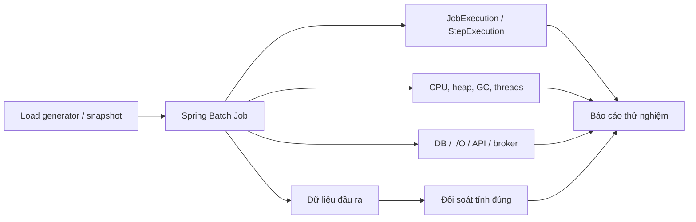
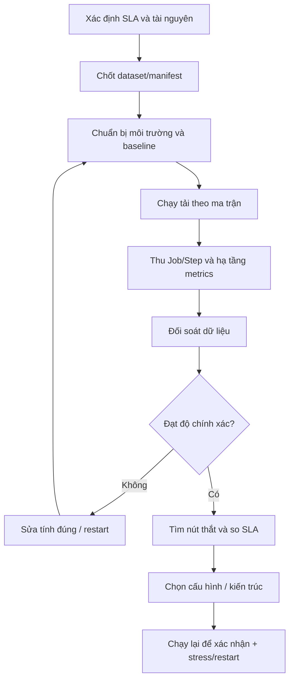

# Load test với dữ liệu thực tế cho Spring Batch

Một Spring Batch Job xử lý 10.000 bản ghi trong vài giây chưa chứng minh nó có thể xử lý 10 triệu bản ghi trong cửa sổ vận hành ban đêm. Khi dữ liệu tăng, thời gian chạy không chỉ phụ thuộc vào số dòng: kích thước bản ghi, phân phối khóa, số lần gọi API, giao dịch cơ sở dữ liệu, khóa cạnh tranh, dung lượng heap và độ lệch giữa các partition đều có thể quyết định thời gian hoàn thành.

**Load test với dữ liệu thực tế** là việc đưa Job chạy dưới tải *đại diện cho tình huống sẽ gặp khi vận hành*, đo cả tốc độ lẫn mức tiêu thụ tài nguyên, sau đó kiểm tra dữ liệu đầu ra và khả năng phục hồi. Đối với module **SPRING_BATCH_SCALING_OPERATIONS**, phương pháp này giúp quyết định khi nào cần multi-threaded step, parallel steps, partitioning, remote chunking hoặc remote partitioning, và khi nào chỉ cần tối ưu truy vấn, I/O hay cấu hình một Step tuần tự.

Bài học xây dựng một quy trình load test có thể lặp lại: đặt mục tiêu, chuẩn bị dữ liệu, tổ chức thử nghiệm, thu thập số đo, tìm nút thắt, thử song song hóa, kiểm tra restart và đưa ra quyết định dựa trên bằng chứng.

## 1. Mục tiêu học tập

Sau bài học, bạn có thể:

1. Phân biệt **load test**, **stress test**, **soak test** và kiểm thử đúng dữ liệu cho Batch Job.
2. Xây dựng bộ dữ liệu thử có quy mô, phân phối giá trị, lỗi đầu vào và phụ thuộc hạ tầng tương đương môi trường thật, đồng thời bảo vệ dữ liệu nhạy cảm.
3. Đặt SLA/SLO, tính throughput, tốc độ tăng quy mô, speedup và hiệu suất sử dụng worker.
4. Đo thời gian Job/Step, số bản ghi commit thành công, retry/rollback, CPU, heap, connection pool và độ trễ hệ thống phụ thuộc.
5. Thiết kế ma trận thử nghiệm có đối chứng cho multi-threaded steps, split flows, partitioning và các mô hình phân tán.
6. Kiểm tra tính đầy đủ, không trùng dữ liệu và restart khi lỗi xảy ra ở giữa tải lớn.
7. Trình bày kết quả đủ rõ để chọn cấu hình vận hành thay vì tăng thread theo cảm tính.

## 2. Load test một Batch Job khác gì load test HTTP?

Trong API trực tuyến, load test thường tăng request/s và theo dõi p95/p99 latency. Với Spring Batch, phần lớn công việc là **hữu hạn**: Job đọc một snapshot hoặc một đợt dữ liệu, xử lý rồi kết thúc.

Vì vậy, cần đo ít nhất ba góc nhìn:

| Góc nhìn | Câu hỏi chính | Đơn vị đo |
| --- | --- | --- |
| Hoàn tất công việc | Job có xong trong cửa sổ xử lý không? | Phút/Job; tỷ lệ Job đáp ứng SLA |
| Khả năng xử lý | Bao nhiêu bản ghi hợp lệ được ghi thành công? | Bản ghi/giây, GB/giờ |
| Ổn định khi tải tăng | Có lỗi, backlog, lock, rollback, thiếu dữ liệu không? | Tỷ lệ lỗi, retry, lag, tài nguyên, sai lệch kết quả |

**Phải đo thời gian từ đầu đến cuối Job**, bao gồm chuẩn bị dữ liệu cần thiết, Step tuần tự, chờ join, ghi dữ liệu và hoàn tất; nếu đo riêng thời gian `ItemProcessor`, bạn có thể bỏ qua nút thắt ở reader, writer hay JobRepository.

Các phép thử có mục đích khác nhau:

| Loại thử nghiệm | Mục đích | Ví dụ |
| --- | --- | --- |
| **Load test** | Xác nhận tải dự kiến và tải cao điểm trong điều kiện đại diện | 5 triệu đơn hàng/đêm, 2 Job chạy cùng lúc |
| **Stress test** | Tăng quá giới hạn dự kiến để tìm điểm gãy và hành vi suy giảm | Tăng worker tới khi DB pool cạn hoặc nhiều Job timeout |
| **Soak/endurance test** | Chạy nhiều đợt kéo dài để phát hiện leak, tích tụ backlog hoặc mất ổn định | 30 đợt liên tiếp, đo heap sau GC và kết nối còn giữ |
| **Spike test** | Đo tác động của đột biến trong thời gian ngắn | Cuối tháng có 3 Job khởi chạy đồng thời |
| **Failure/restart test** | Đo phục hồi sau lỗi mà vẫn bảo đảm dữ liệu đúng | Kill worker giữa Step, restart cùng JobInstance |

Các loại thử này có thể kết hợp, nhưng mỗi lần chạy phải ghi rõ *đang kiểm tra điều gì* để không nhầm một lần thử quá tải với kết quả đạt SLA tải thông thường.

## 3. Định nghĩa tiêu chí thành công trước khi chạy

Giả sử doanh nghiệp có Job nạp dữ liệu giao dịch mỗi đêm. Bộ mục tiêu dưới đây **chỉ là ví dụ minh họa**, cần thay bằng yêu cầu thực tế trước khi dùng:

| Nhóm tiêu chí | Mục tiêu thử nghiệm minh họa |
| --- | --- |
| Quy mô | 2 triệu giao dịch/đợt trong tình huống bình thường; 5 triệu khi cao điểm |
| Thời gian | Đợt bình thường hoàn thành không quá **20 phút**; đợt cao điểm không quá **45 phút** |
| Dữ liệu | Đầu ra khớp bản ghi hợp lệ, không mất, không ghi trùng khóa nghiệp vụ |
| Vận hành | Không deadlock kéo dài, không OOM, không lỗi pool connection |
| Restart | Sau lỗi giữa Job, hoàn tất lại mà không bỏ sót hay ghi trùng |
| Tài nguyên | Không gây nghẽn đáng kể cho workload cùng dùng DB/API; có headroom đã thỏa thuận |

Nếu Job chỉ chạy một lần mỗi đêm, cần ít nhất thời gian hoàn tất và giới hạn tài nguyên. Nếu nhiều Job được lập lịch trùng nhau, cần thêm mục tiêu về **số Job chạy đồng thời**, thời gian chờ hàng đợi và ảnh hưởng tới các Job khác.

**Nguyên tắc:** kết quả "nhanh hơn" chỉ được coi là cải thiện khi đầu ra đúng và giới hạn tài nguyên được tôn trọng. Một cấu hình có tốc độ ghi cao nhưng rollback, skip không kiểm soát hoặc làm nghẽn database chung không phải cấu hình tốt.

### Các công thức cần dùng

Gọi:

- `N_success`: số **bản ghi đầu ra hợp lệ, không trùng**, đã được ghi bền theo tiêu chí kiểm chứng.
- `T_job`: thời gian thực tế của toàn Job, tính bằng giây.
- `T_1`: thời gian chạy baseline một worker, với **cùng dữ liệu và điều kiện**.
- `T_p`: thời gian với `p` worker hiệu dụng.

Khi đó:

```text
Throughput (record/s) = N_success / T_job
Speedup(p)            = T_1 / T_p
Efficiency(p)         = Speedup(p) / p
```

Efficiency chỉ là chỉ số so sánh đơn giản khi mô hình worker thực sự tương đương và dữ liệu/tài nguyên giữ nguyên. Ví dụ, hai Flow độc lập không nhất thiết tương đương hai partition của cùng Step; không nên đem efficiency của hai kiến trúc khác nhau kết luận máy nào "lãng phí" chỉ từ công thức này.

**Đừng lấy `readCount` hoặc `writeCount` làm kết quả kinh doanh cuối cùng mà không đối chiếu:** một item có thể bị đọc lại sau rollback/restart; một writer có thể upsert hoặc ghi nhiều bảng; partition manager có thể tổng hợp counter của worker. Tính số bản ghi kết quả theo quy tắc nghiệp vụ và kiểm chứng trên nơi lưu dữ liệu đích.

## 4. Thiết kế dữ liệu thử đại diện cho production

Mục tiêu không nhất thiết là chép nguyên dữ liệu production. Một bộ dữ liệu **ẩn danh hoặc tổng hợp có thống kê tương đương** thường hữu ích và an toàn hơn. Điều quan trọng là giữ được các đặc điểm tác động đến hiệu năng.

### 4.1. Những đặc điểm cần bảo toàn

| Đặc điểm của dữ liệu | Vì sao ảnh hưởng hiệu năng | Gợi ý xây dựng |
| --- | --- | --- |
| Số lượng dòng, kích thước byte | Quyết định chi phí quét, truyền và ghi | Tạo các mức 0,1x; 1x; 2–3x và đỉnh dự báo |
| Phân phối độ dài bản ghi | Bản ghi dài làm tăng I/O và cấp phát heap | Giữ phân vị kích thước thay vì mọi dòng cố định |
| Độ chọn lọc của bộ lọc | Thay đổi lượng dữ liệu thật sự đi qua writer | Bảo toàn tỷ lệ bị filter và điều kiện truy vấn |
| Cardinality và phân phối key | Ảnh hưởng index, lock, phân vùng và cache | Có key phổ biến, key hiếm, vùng dữ liệu nóng |
| Quan hệ cha–con | Sinh join, lookup, khóa ngoại | Giữ tỷ lệ đơn hàng/khách hàng hoặc nghiệp vụ tương ứng |
| Trùng lặp, bản ghi lỗi, null | Kích hoạt validation, skip, retry | Mô phỏng tỷ lệ lỗi và các dạng lỗi thực |
| Thứ tự dữ liệu | Dữ liệu sắp xếp có thể thuận lợi hơn thực tế | Dùng thứ tự nguồn đã quan sát, kể cả out-of-order |
| Tính tập trung theo thời gian | Cuối tháng/cuối quý có burst, khối lượng không đều | Tái tạo distribution theo ngày và khung giờ |
| Độ trễ nguồn/đích | Có thể giới hạn throughput dù CPU rảnh | Dùng độ trễ, quota, kích thước pool gần thực tế |

Ví dụ, nếu 1% khách hàng đóng góp 40% đơn hàng thì dữ liệu ngẫu nhiên phân phối đều sẽ che mất **hot key**, tranh chấp lock và hiện tượng partition không cân bằng. Bộ dữ liệu thử cần tái hiện dạng phân phối này ở mức thống kê hợp lý.

### 4.2. Ba cách chuẩn bị dữ liệu

1. **Snapshot đã khử định danh từ production:** giữ thống kê và quan hệ nhưng loại bỏ/biến đổi thông tin cá nhân, bí mật, dữ liệu nhạy cảm. Đánh giá lại khả năng tái nhận dạng và quyền truy cập trước khi dùng.
2. **Sinh dữ liệu tổng hợp theo profile thực:** kiểm soát được seed, dung lượng, tỷ lệ lỗi và skew; có thể tái tạo chính xác giữa các lần thử. Không tự giả định dữ liệu đều nếu production bị lệch.
3. **Kết hợp hai nguồn:** lấy thống kê về số lượng, kích thước, phân phối và kiểu lỗi từ dữ liệu thật; tạo dữ liệu thử tổng hợp phù hợp và kiểm chứng profile bằng thống kê đối chiếu.

Khi làm sạch dữ liệu phải giữ **tính nhất quán khóa**. Nếu thay thế customer ID thì mọi đơn hàng tham chiếu khách hàng đó phải dùng cùng một ID giả. Dữ liệu thử bị lỗi quan hệ sẽ khiến chi phí xử lý lỗi cao bất thường và không còn đại diện cho tải thật.

Không trỏ load test vào hệ thống production hoặc kích hoạt side effect như gửi email, thu tiền, đồng bộ sang đối tác thật. Dùng môi trường và endpoint thử nghiệm, có giới hạn tải được phê duyệt; nếu cần đo API phụ thuộc, dùng sandbox với latency/quota đại diện.

### 4.3. Manifest để tái lập phép thử

Mỗi dataset nên kèm một **manifest** được quản lý ngoài nội dung Job:

```yaml
datasetId: orders-2026-11-profile-v3
generatorSeed: 812730
rowCount: 2000000
approximateBytes: 3200000000
profile:
  duplicateBusinessKeyRate: 0.002
  invalidRecordRate: 0.005
  hotKeyShare: 0.40
  hotKeyPopulationShare: 0.01
storage:
  inputSnapshot: "s3://batch-test/inputs/orders-v3/"
  expectedManifest: "s3://batch-test/expected/orders-v3.json"
```

Các con số trên là **minh họa**, không phải phân phối mặc định của hệ thống bất kỳ. Cần xác định rõ khái niệm tỷ lệ (theo bản ghi hay theo khóa) và kiểm tra kết quả sau khi sinh. Nếu đặt manifest lên object storage, lưu thêm hash, phiên bản sinh dữ liệu và thời gian tạo để tránh vô tình thay đổi input giữa hai lần thử.

Trong báo cáo, lưu phiên bản ứng dụng, cấu hình, manifest, seed và định danh lần chạy. Không lưu bí mật truy cập vào JobParameters hoặc log thử nghiệm.

## 5. Thiết kế môi trường thử nghiệm có thể so sánh

Chạy load test trên laptop rồi suy ra năng lực cụm máy production thường dẫn đến kết luận sai. Nên mô tả tối thiểu:

- **Ứng dụng:** phiên bản JDK/Spring Boot/Spring Batch, heap Xms/Xmx, cài đặt GC, số CPU/vCPU và memory limit của container.
- **Cơ sở dữ liệu:** engine/version, chỉ mục, thống kê, cấu hình transaction/isolation, buffer cache, connection pool, read replica nếu có.
- **Hạ tầng lưu trữ:** local disk, SSD/network volume, object storage, throughput và latency thực tế.
- **Hệ thống phụ thuộc:** API, broker, service tra cứu, giới hạn đồng thời và quota.
- **Thời điểm và nhiễu:** backup, cron job, báo cáo khác, batch job khác, autoscaling, network contention.

Tạo các run **cùng dữ liệu, cùng số nguồn lực và cùng điều kiện cache** để so cấu hình. Một lần thử sau khi cache DB được làm nóng có thể nhanh hơn vì cache, không phải vì tăng thread.

### Cold run và warm run

- **Cold run:** đo tình huống cache chưa được làm nóng; phù hợp nếu thực tế Job chạy hiếm hoặc dữ liệu mỗi ngày hoàn toàn mới.
- **Warm run:** đo sau khi JVM/JIT, connection pool hoặc cache đã hoạt động; hữu ích cho Job chạy lặp lại.
- Không trộn kết quả cold và warm trong cùng nhóm thống kê. Ghi rõ trạng thái cache, cách dọn output và điều kiện trước khi đo.

Nếu có thể, chạy **3–5 lần cho mỗi cấu hình** trong một môi trường ổn định, tách giai đoạn làm nóng và báo cáo median, khoảng biến thiên cùng các outlier. Với ít mẫu, đừng tuyên bố p95 Job duration là bằng chứng thống kê chắc chắn; thay vào đó cung cấp từng lần chạy và điều kiện thử.

## 6. Lập ma trận tải và một biến thay đổi mỗi lần

Hai trục tải rất khác nhau:

1. **Độ lớn của một Job:** số record, byte, độ phức tạp transform, kích thước partition.
2. **Mức đồng thời của hệ thống:** bao nhiêu JobExecution/Flow/partition/chunk đang dùng chung CPU, DB, thread pool, kết nối, broker.

Tăng `gridSize` trong partitioning chưa chắc tăng số worker thực thi đồng thời; số task đang chạy còn phụ thuộc `TaskExecutor` và tài nguyên. Nếu đồng thời 3 Job và mỗi Job sử dụng 4 worker thì năng lực cao điểm dự kiến là **tới 12 worker** tại tầng đó, chưa kể worker ở các tầng split/remote khác. Cần tính tổng, không chỉ xem cài đặt của một Step.

Ví dụ ma trận thử:

| Mã | Dataset | Job đồng thời | Worker/Job | Mục đích |
| --- | --- | --- | --- | --- |
| S0 | 20.000 dòng | 1 | 1 | Smoke test kết nối và tính đúng |
| B1 | 2 triệu dòng | 1 | 1 | Baseline tuần tự |
| P2 | Cùng 2 triệu dòng | 1 | 2 | Kiểm tra lợi ích song song ban đầu |
| P4 | Cùng 2 triệu dòng | 1 | 4 | Kiểm tra mở rộng |
| P8 | Cùng 2 triệu dòng | 1 | 8 | Phát hiện điểm bão hòa |
| L4 | 5 triệu dòng | 1 | 4 | Kiểm tra SLA đợt cao điểm |
| C2 | 2 triệu dòng/Job | 2 | 4 | Tranh chấp tài nguyên giữa Job |
| F4 | 2 triệu dòng | 1 | 4 | Lỗi giữa Job và restart |

**Mỗi run phải dùng output namespace/partition riêng** hoặc reset dữ liệu đích bằng quy trình rõ ràng. Nếu các run ghi chồng vào cùng bảng mà không dọn hoặc dùng khóa phân biệt, kết quả có thể bị ảnh hưởng bởi index phình to, unique constraint, cache và số liệu đã có từ run trước.

Khi so B1 với P2/P4/P8, giữ nguyên input snapshot, chính sách retry, chunk size, cấu hình DB và số tài nguyên. Nếu muốn đổi chunk size, tạo **loạt thử độc lập** với cùng worker count để tránh không biết cải thiện đến từ nguyên nhân nào.

### Tách profile workload

Không gộp mọi tình huống vào một dataset rất lớn rồi chỉ đo tổng:

- **CPU-heavy:** nhiều validate/transform/serialize, ít round-trip ngoài.
- **DB-heavy:** join/lookup, batch insert/update, index contention.
- **I/O-heavy:** file/object storage, nén/giải nén hoặc network.
- **Error-heavy:** tỷ lệ lỗi/skip/retry đại diện cho ngày xấu.
- **Skew-heavy:** các key hoặc partition có khối lượng không đều.

Một kiến trúc tối ưu cho dữ liệu đều và CPU-heavy có thể kém khi skew hoặc kết nối DB là nút thắt.

## 7. Thu thập số đo đúng cấp độ



### 7.1. Chỉ số Spring Batch

Từ `JobExecution` và `StepExecution`, ghi nhận:

| Chỉ số | Tác dụng |
| --- | --- |
| Job/Step start, end, status, exit status | Đo elapsed time và xác định chỗ dừng/lỗi |
| `readCount`, `writeCount`, `filterCount` | Xem pipeline tiêu thụ và lọc bao nhiêu item |
| `commitCount`, `rollbackCount` | Kiểm tra số transaction, lỗi và chi phí rollback |
| `readSkipCount`, `processSkipCount`, `writeSkipCount` | Phân loại bản ghi bị bỏ qua |
| StepExecution name và ID | Định vị partition hoặc nhánh chạy chậm |
| Retry và lỗi ứng dụng | Phân biệt thời gian xử lý thật với thời gian backoff/retry |

Spring Batch tích hợp quan sát qua Micrometer. Tùy phiên bản/cấu hình, các metric chuẩn với tiền tố `spring.batch` có thể gồm `spring.batch.job`, `spring.batch.step`, `spring.batch.item.read`, `spring.batch.item.process` và `spring.batch.chunk.write`. Các metric thời gian này **không thay thế** việc đối soát số bản ghi đầu ra hay đo thời gian chờ của hệ thống ngoài. Kiểm tra metric thực sự được đăng ký, exporter và nhãn trên phiên bản đang dùng.

**Không gắn `jobExecutionId` hoặc `customerId` làm label metric cho mọi điểm đo.** Cardinality quá cao gây tốn bộ nhớ và làm hệ thống metrics khó vận hành. Dùng nhãn tổng hợp như `job.name`/`step.name`/`status`; đặt execution ID trong structured log/tracing nơi phù hợp.

### 7.2. Ví dụ Java: log thời gian và counter từng Step

Ví dụ Spring Batch 5.x dưới đây đo ở `afterJob`; không lấy tổng `writeCount` của mọi Step làm "tổng bản ghi đúng" vì nhiều Step có thể xử lý cùng item, đặc biệt khi partition manager và các worker có số liệu tổng hợp.

```java
import java.time.Duration;
import java.time.LocalDateTime;

import org.slf4j.Logger;
import org.slf4j.LoggerFactory;
import org.springframework.batch.core.JobExecution;
import org.springframework.batch.core.JobExecutionListener;
import org.springframework.batch.core.StepExecution;
import org.springframework.stereotype.Component;

@Component
public class BatchPerformanceListener implements JobExecutionListener {
    private static final Logger log =
            LoggerFactory.getLogger(BatchPerformanceListener.class);

    @Override
    public void afterJob(JobExecution jobExecution) {
        long jobMillis = elapsedMillis(
                jobExecution.getStartTime(),
                jobExecution.getEndTime());

        log.info(
                "batch_job job={} executionId={} status={} durationMs={}",
                jobExecution.getJobInstance().getJobName(),
                jobExecution.getId(),
                jobExecution.getStatus(),
                jobMillis);

        for (StepExecution step : jobExecution.getStepExecutions()) {
            long stepMillis = elapsedMillis(
                    step.getStartTime(),
                    step.getEndTime());

            log.info(
                "batch_step executionId={} step={} status={} " +
                "durationMs={} read={} write={} filter={} " +
                "commits={} rollbacks={} readSkips={} " +
                "processSkips={} writeSkips={}",
                jobExecution.getId(),
                step.getStepName(),
                step.getStatus(),
                stepMillis,
                step.getReadCount(),
                step.getWriteCount(),
                step.getFilterCount(),
                step.getCommitCount(),
                step.getRollbackCount(),
                step.getReadSkipCount(),
                step.getProcessSkipCount(),
                step.getWriteSkipCount());
        }
    }

    private static long elapsedMillis(
            LocalDateTime started, LocalDateTime ended) {
        if (started == null || ended == null) {
            return -1L;
        }
        return Duration.between(started, ended).toMillis();
    }
}
```

Đăng ký listener khi xây dựng Job, ví dụ:

```java
return new JobBuilder("ordersLoadJob", jobRepository)
        .start(loadOrdersStep)
        .listener(batchPerformanceListener)
        .build();
```

Ví dụ này minh họa quan sát và không triển khai các Step cụ thể. Nếu Job có flow lồng nhau hoặc worker ở tiến trình khác, cần tổng hợp log/tracing theo execution ID và xem **StepExecution** của từng worker qua JobRepository hay hệ thống giám sát. Mã trên dùng các API thời gian của nhánh Spring Batch 5.x; hãy đối chiếu chữ ký API nếu dự án dùng nhánh khác.

### 7.3. Chỉ số tài nguyên bên ngoài Batch

| Thành phần | Cần đo | Tín hiệu nút thắt |
| --- | --- | --- |
| CPU | Mức dùng tổng và theo container, throttling, load average | CPU sát trần, throughput không tăng |
| Heap/GC | Used heap, allocation rate, GC pause, OOM | GC tăng mạnh khi tăng worker/chunk |
| Connection pool | Active, idle, pending, acquisition latency | Chờ connection nhiều, timeout dù CPU rảnh |
| Database | Query latency, CPU/IO, locks, deadlocks, wait events, WAL/log | Writer chậm, lock tăng, transaction kéo dài |
| Disk/object storage | Read/write bytes/s, IOPS, latency, request throttle | Thời gian chờ I/O cao |
| API phụ thuộc | p95/p99 latency, rate limit, timeout, retry, backoff | Nhiều 429/5xx, thread chờ |
| Broker (nếu có) | Queue depth, consumer lag, redelivery, throughput | Manager phát nhanh hơn worker tiêu thụ |
| JobRepository | Thời gian truy cập metadata, số StepExecution, lock | Khởi tạo/commit/điều phối chậm bất thường |

**Đồng bộ mốc thời gian** log, metric và dấu mốc Job/Step. Một biểu đồ CPU độc lập, không biết lúc nào Step nào chạy, khó giúp xác định nguyên nhân.

## 8. Đối soát dữ liệu là điều kiện bắt buộc của load test

Giả sử source có 2 triệu dòng, trong đó 0,5% không hợp lệ và 0,2% trùng khóa nghiệp vụ. Không thể suy đơn giản "2 triệu input → 2 triệu output" nếu quy tắc nghiệp vụ cho phép loại bản ghi, deduplicate hoặc cập nhật record đã tồn tại.

Hãy tạo **hợp đồng đối soát** rõ ràng:

1. Tổng input theo batch/run, số bản ghi hợp lệ, bị loại, bị trùng và lỗi theo từng lý do.
2. Tập khóa nghiệp vụ kỳ vọng sau transform và deduplicate.
3. Kiểm tra giá trị tổng hợp như tổng tiền, tổng số lượng, số bản ghi theo partition, ngày, loại giao dịch.
4. Chứng cứ mỗi bản ghi đích được ghi/điều chỉnh đúng một lần theo quy tắc đã chọn.
5. Kiểm tra lại sau lần chạy lỗi và restart; không chỉ sau happy path.

Mẫu truy vấn minh họa (điều chỉnh tên bảng, schema và cú pháp theo hệ quản trị DB):

```sql
-- Đếm đầu ra cho đúng run, không đếm dữ liệu cũ.
SELECT COUNT(*) AS row_count
FROM orders_staging
WHERE run_id = :runId;

-- Phát hiện khóa nghiệp vụ bị ghi trùng trong một run.
SELECT business_order_id, COUNT(*) AS copies
FROM orders_staging
WHERE run_id = :runId
GROUP BY business_order_id
HAVING COUNT(*) > 1;

-- Đối soát tổng giá trị theo ngày nghiệp vụ.
SELECT business_date, COUNT(*) AS row_count,
       SUM(amount) AS total_amount
FROM orders_staging
WHERE run_id = :runId
GROUP BY business_date;
```

Truy vấn `COUNT(*)` lớn có thể tốn tài nguyên; khi load test, lên lịch bước đối soát **sau khi đo Job** hoặc báo cáo riêng thời gian đối soát, tránh làm sai elapsed time. Với dataset rất lớn, có thể dùng checksum/tổng hợp theo partition kết hợp sample có kiểm soát, nhưng quy tắc kiểm chứng phải đủ mạnh để phát hiện mất/trùng dữ liệu. Không thay đối soát bằng việc Job trả về `COMPLETED`.

## 9. Đọc kết quả: speedup và dấu hiệu bão hòa

Ví dụ giả lập một phép thử cùng **2 triệu dòng hợp lệ**, cùng hạ tầng và chính sách retry. Các số dưới đây dùng để học cách phân tích, **không phải benchmark thực tế của Spring Batch**:

| Cấu hình | Thời gian Job | Throughput | Speedup so với 1 worker | Efficiency |
| --- | ---: | ---: | ---: | ---: |
| 1 worker | 32 phút | ~1.042 record/s | 1,00× | 100% |
| 2 worker | 20 phút | ~1.667 record/s | 1,60× | 80% |
| 4 worker | 14 phút | ~2.381 record/s | 2,29× | ~57% |
| 8 worker | 16 phút | ~2.083 record/s | 2,00× | 25% |

Từ 1 đến 4 worker, throughput tăng. Từ 4 đến 8 worker, Job lại **chậm hơn**: có thể do lock, connection pool, GC, I/O hoặc overhead điều phối. Để xác định nguyên nhân cần xem metric tài nguyên và timeline, không kết luận "Spring Batch không scale" chỉ từ một hàng trong bảng.

Nếu mục tiêu là 2 triệu dòng trong tối đa 20 phút, cả cấu hình 2 và 4 worker đều có vẻ đạt về thời gian. Cấu hình 2 worker có thể là lựa chọn tốt hơn khi tiết kiệm tài nguyên là ưu tiên và có đủ headroom; cấu hình 4 worker có thể cần thiết nếu nhiều Job cùng chạy hoặc SLA siết chặt. Hãy quyết định dựa trên **tải tổng thể, độ ổn định và chi phí**, không mặc định chọn thời gian ngắn nhất.

### Đọc đường cong tài nguyên

- Throughput tăng gần tuyến tính, CPU còn dư, DB chưa nghẽn: có thể thử tăng concurrency thêm một mức.
- Throughput đứng yên, CPU 100%: cần giảm xử lý dư thừa, tối ưu thuật toán/serialization hoặc tăng năng lực CPU; thêm thread thường không giải quyết.
- Throughput đứng yên, CPU rảnh, DB connection pending cao: kiểm tra pool và truy vấn; chỉ tăng pool khi DB còn sức.
- Lock wait/rollback tăng theo worker: xem lại transaction, key phân phối, thứ tự cập nhật và độ dài chunk.
- Một partition kéo dài gấp nhiều lần phần còn lại: dữ liệu phân bố không đều, cần phân vùng theo lượng công việc thực tế thay vì chỉ chia đều khoảng ID.
- API 429/503 tăng: giới hạn đồng thời và sử dụng retry có backoff; tăng worker sẽ làm tình hình xấu hơn.

## 10. Kiểm thử theo từng kiến trúc mở rộng Spring Batch

Không có cấu hình concurrency tối ưu chung cho mọi Job. Với mỗi kiến trúc, đặt câu hỏi đo lường khác nhau:

| Cách xử lý | Kiểm tra chính | Dấu hiệu cần cân nhắc thiết kế khác |
| --- | --- | --- |
| Step tuần tự | Thời gian reader/process/writer, batch insert, chunk size | Một tài nguyên gần trần hoặc SLA không đạt dù đã tối ưu |
| Multi-threaded step | Thread safety, mức xử lý item song song, hiệu quả CPU | Reader/writer/transaction là nút thắt hoặc component không an toàn |
| Parallel steps (split flow) | Hai Flow thực sự chồng thời gian không; join chờ nhánh nào | Nhánh quá mất cân bằng hoặc dữ liệu giữa Flow có phụ thuộc |
| Local partitioning | Throughput theo partition, chênh lệch thời gian lớn nhất/nhỏ nhất | Hot partition, DB lock, overhead chia/ghép |
| Remote partitioning | Thời gian dispatch, worker startup, phân bố tải, retry worker | Network/metadata overhead lớn hơn lợi ích xử lý |
| Remote chunking | Broker lag, kích thước message, redelivery, tốc độ manager/worker | Manager/reader, middleware hoặc hệ thống ghi là nút thắt |

Các điểm cụ thể:

**Parallel steps:** tổng thời gian vùng split thường gần thời gian của nhánh **chậm nhất** cộng overhead. Tối ưu một nhánh đã rất nhanh hầu như không giảm thời gian Job nếu nhánh kia vẫn dài. Đo timeline theo `Flow/StepExecution` để nhìn điểm join.

**Partitioning:** ghi thời gian, số record và số lỗi của **từng partition**. Khi chia theo range ID, khoảng có ít ID nhưng nhiều record liên quan có thể tốn hơn khoảng khác. Phân vùng theo ước lượng *work units* hoặc dùng key/hash hợp lý có thể tốt hơn chia đều số khoảng.

**Multi-threaded step:** hành vi thread đối với reader, processor, writer và transaction có thể khác giữa các phiên bản/cách cấu hình. Chỉ tăng `TaskExecutor` khi đã kiểm tra hợp đồng thread safety và luồng giao dịch của phiên bản đang sử dụng. Một bước chạy nhanh nhưng không restart được chính xác chưa đạt yêu cầu tải lớn.

**Mô hình phân tán:** đo riêng overhead kết nối/queue/serialization, idempotency khi redelivery và khả năng worker truy cập dữ liệu. Chi phí vận hành broker và nhiều process cũng là một phần chi phí kiến trúc.

Spring Batch khuyến nghị **đo một Job thực tế ở cấu hình đơn giản trước khi tăng mức song song**; đây là cách lập baseline và tránh thêm độ phức tạp không cần thiết.

## 11. Failure injection và restart dưới tải

Load test chỉ chạy thành công một lần chưa đủ. Khối lượng dữ liệu lớn khiến xác suất timeout, worker chết, mạng chập chờn hoặc DB failover tăng lên. Cần thử khôi phục có kiểm soát trong môi trường riêng.

Một kịch bản:

1. Chạy Job với snapshot **cố định**, dùng `JobParameters` định danh đúng một `JobInstance`.
2. Sau khi một số chunk đã commit, chủ động gây lỗi ở Step đọc/ghi hoặc kill một worker theo phương án thử được kiểm soát.
3. Ghi `JobExecution/StepExecution ID`, Step và partition lỗi, số commit/rollback và số record đã ghi bền.
4. Restart **cùng JobInstance** theo cơ chế Spring Batch, không vô tình tạo instance mới bằng tham số định danh khác.
5. Đối soát output cuối, bảo đảm bản ghi không mất/trùng và các Step/partition đã `COMPLETED` được xử lý đúng theo chính sách restart.
6. Đo **recovery time** và tổng thời gian từ lần launch đầu tiên đến lúc dữ liệu cuối sẵn sàng; so với mục tiêu vận hành.

**Lưu ý:** restart không tự bảo đảm *exactly-once* cho mọi hệ thống ngoài DB. ItemWriter có thể đã gửi request thành công nhưng tiến trình chết trước khi lưu checkpoint. Khi chạy lại, hệ thống đích có thể nhận request lần hai. Cần khóa idempotency, unique constraint, staging và reconciliation phù hợp.

Đừng đánh đồng các chỉ số:

- **Throughput của một lần chạy thành công:** chỉ đo thời gian run đã hoàn tất.
- **Recovery time:** từ khi phát hiện lỗi đến khi công việc tiếp tục/hoàn tất theo định nghĩa rõ ràng.
- **End-to-end elapsed có sự cố:** từ bắt đầu run đầu tiên đến khi có kết quả cuối, bao gồm phát hiện lỗi, chờ, restart và xử lý lại.

Một cấu hình nhanh hơn 10% trong happy path nhưng mỗi lần lỗi mất hàng giờ để sửa dữ liệu có thể tệ hơn cấu hình chậm hơn và restart an toàn.

## 12. Quy trình thực hiện load test có thể lặp lại



### Bước 1 — Chốt phạm vi thử

Ghi rõ Job nào, nguồn/đích nào, kích thước dữ liệu, tỷ lệ lỗi, concurrency, SLA và tài nguyên được phép dùng. Phân biệt các biến có thể thay đổi và các biến phải cố định trong nhóm thử.

### Bước 2 — Chuẩn bị dữ liệu và trạng thái đầu

Khóa dataset snapshot/seed, profile, expected count/checksum và output namespace. Chuẩn bị dữ liệu đã khử định danh hoặc dữ liệu sinh an toàn; đảm bảo các service thử nghiệm có quota phù hợp.

### Bước 3 — Đo baseline

Chạy phiên bản đơn giản nhất đáp ứng đúng chức năng, thường một Step/Job tuần tự. Thu thời gian theo Step và resource metrics trước khi quyết định thêm thread hoặc partition.

### Bước 4 — Thay một biến và chạy nhiều lần

Ví dụ thử số worker 1 → 2 → 4 → 8, cố định chunk size. Sau đó, nếu cần, chọn một mức worker rồi thử chunk size hoặc batch write size trên loạt thử riêng. Kết quả lần chạy phải gắn với cấu hình cụ thể.

### Bước 5 — Đối soát và kiểm thử lỗi

So số đầu ra, các tổng nghiệp vụ, uniqueness, số skip và retry. Chỉ khi đúng dữ liệu mới so tốc độ; sau đó chạy lại với failure injection và restart.

### Bước 6 — Chọn và xác nhận cấu hình

Chọn cấu hình đáp ứng SLA ở tải bình thường, tải cao điểm và khi nhiều Job đồng thời, với headroom phù hợp. Chạy lại trên môi trường gần production trước khi đưa vào vận hành; ghi nhận giới hạn áp dụng của kết quả.

## 13. Báo cáo load test để ra quyết định

Một báo cáo ngắn nhưng kiểm chứng được nên ghi:

| Mục | Nội dung cần có |
| --- | --- |
| Phiên bản | Commit/tag ứng dụng, JDK, Spring Batch, runtime/DB, cấu hình tài nguyên |
| Dữ liệu | Dataset ID, seed/hash, quy mô, profile skew/lỗi, expected result |
| Mục tiêu | SLA, throughput tối thiểu, tài nguyên tối đa, tiêu chí đúng dữ liệu |
| Cấu hình | Worker/thread, gridSize, chunk size, pool size, retry, isolation |
| Kết quả | Thời gian Job, throughput đối soát, Step chậm, số run thành công/thất bại |
| Hạ tầng | CPU, heap/GC, DB locks/wait, connection pool, I/O, broker/API |
| Tính đúng | Số đầu ra, trùng, thiếu, kiểm tra tổng giá trị, retry/restart |
| Quyết định | Cấu hình khuyến nghị, giới hạn tải, yếu tố phải giám sát, bước tiếp theo |

Ví dụ kết luận theo bảng thử ở mục 9:

> Với dataset minh họa 2 triệu dòng, mức 4 worker rút thời gian toàn Job từ 32 xuống 14 phút và không thấy lỗi đối soát trong các run đã thử. Mức 8 worker chậm hơn (16 phút), nên cần xem thêm connection/lock/GC trước khi tăng concurrency. Kết luận này chỉ áp dụng cho phiên bản, dataset và môi trường đã ghi nhận; chưa chứng minh khả năng đạt SLA khi nhiều Job chạy chung.

Đây là cấu trúc báo cáo, **không phải một kết quả đo thật**. Nếu cần kết luận cho production, phải kèm dữ liệu đo, số lần lặp và bằng chứng đối soát.

## 14. Các sai lầm phổ biến

1. **Dùng 10.000 dòng sạch, đồng đều để suy ra tải 10 triệu dòng:** không phát hiện skew, GC, IO, quota và key nóng.
2. **So hai cấu hình trên dataset khác nhau:** không biết khác biệt đến từ mã hay dữ liệu.
3. **Chạy trên DB chung có workload thay đổi mà không ghi nhiễu:** kết quả dễ đảo chiều do backup, cache hoặc Job khác.
4. **Chỉ xem số thread và readCount:** không chứng minh kết quả nghiệp vụ đã commit, không phản ánh bottleneck bên ngoài.
5. **Cứ tăng `gridSize` là kỳ vọng throughput tăng:** partition không đồng nghĩa số worker chạy đồng thời; partition quá nhỏ còn tăng overhead.
6. **Không kiểm tra thread safety:** tăng throughput bề ngoài nhưng làm sai checkpoint, ghi trùng hoặc hỏng file.
7. **Đặt connection pool vượt xa năng lực DB:** gây lock/thrash/timeout, làm hại dịch vụ khác.
8. **Không thử restart:** các tác dụng phụ không idempotent chỉ lộ ra khi job lỗi giữa chừng.
9. **Gộp cold run với warm run:** đánh giá sai hiệu quả thay đổi cấu hình.
10. **Chọn cấu hình nhanh nhất của một run duy nhất:** bỏ qua độ biến thiên, tải trùng lịch và chi phí tài nguyên.

## 15. Bài thực hành

Thiết kế một Job nạp dữ liệu đơn hàng với các Step: `readValidateOrdersStep` → `writeOrdersStep` → `summarizeStep` (có thể kết hợp đọc/ghi trong một Step chunk-oriented nếu hợp lý). Dùng DB và dataset thử nghiệm tách biệt.

**Yêu cầu:**

1. Sinh hai dataset cùng profile: **200.000 dòng** để kiểm tra tính đúng và **2 triệu dòng** để load test. Thêm các nhóm key nóng, bản ghi trùng và bản ghi lỗi theo tỷ lệ xác định.
2. Chạy baseline một worker; lưu `JobExecutionId`, thời gian, số record hợp lệ, số row trong bảng đích, số lỗi và số rollback.
3. Chạy cấu hình song song bằng **partitioning theo khoảng key hoặc một cơ chế phân vùng phù hợp**, thử 2, 4, 8 worker. Đảm bảo không có hai partition cùng sở hữu bản ghi.
4. Vẽ biểu đồ thời gian và throughput theo số worker; tìm thời điểm kết quả không còn tốt lên và đối chiếu CPU/DB/GC.
5. Gây lỗi giữa một partition, restart cùng JobInstance, xác nhận tính đầy đủ và không trùng theo khóa nghiệp vụ.
6. Viết một trang báo cáo nêu rõ **cấu hình đạt SLA**, bộ dữ liệu dùng đo, dấu hiệu nút thắt và giới hạn thử nghiệm.

**Câu hỏi để tự đánh giá:**

- Nếu tăng 4 lên 8 worker nhưng tốc độ giảm, bạn sẽ xem ba metric nào trước và tại sao?
- Vì sao một dataset có cardinality khác production có thể khiến kết quả partitioning quá lạc quan?
- Nếu `writeCount` bằng số dòng kỳ vọng nhưng bảng đích thiếu dòng, bạn cần kiểm tra điều gì?
- Làm thế nào để so hai lần thử mà không bị ảnh hưởng bởi cache DB, output còn sót và Job khác?
- Khi restart sau khi ghi dữ liệu một phần, điều kiện nào phải đúng để không tạo đơn hàng trùng?
- Khi nào nên tối ưu SQL/index/chunk trước khi áp dụng remote partitioning?

## Tài liệu tham khảo

- [Spring Batch Reference — Scaling and Parallel Processing](https://docs.spring.io/spring-batch/reference/scalability.html).
- [Spring Batch Reference — Micrometer support](https://docs.spring.io/spring-batch/reference/spring-batch-observability/micrometer.html).
- [Spring Batch Reference — Domain Language of Batch](https://docs.spring.io/spring-batch/reference/domain.html).
- [Spring Batch Reference — Configuring a Step for Restart](https://docs.spring.io/spring-batch/reference/step/chunk-oriented-processing/restart.html).
- [Spring Batch Reference — Testing](https://docs.spring.io/spring-batch/reference/testing.html).
