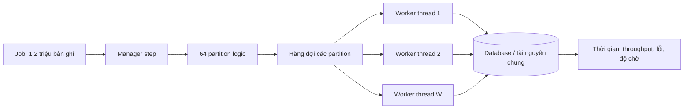
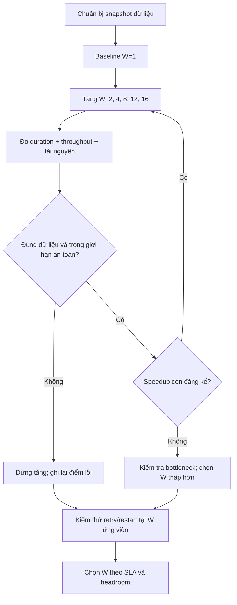

# Stress test số worker trong Spring Batch

Một job Spring Batch xử lý dữ liệu lớn thường được tăng tốc bằng cách chạy nhiều worker song song. Tuy nhiên, **tăng số worker không đồng nghĩa với tăng thông lượng mãi mãi**. Khi CPU, database, JDBC connection pool, disk I/O, mạng hoặc dịch vụ bên ngoài đạt giới hạn, thêm worker có thể làm job chậm hơn, tăng lock contention và làm lỗi retry nhiều hơn.

Trong phần **Performance testing** của module `SPRING_BATCH_SCALING_OPERATIONS`, bài này hướng dẫn **stress test số worker** để chọn mức song song có cơ sở đo đạc cho multi-threaded step, local partitioning và remote partitioning. Mục tiêu không phải tìm con số worker “chuẩn” áp dụng cho mọi môi trường, mà xác định **điểm bão hòa**, **điểm suy giảm**, mức tài nguyên dự phòng, khả năng hoàn thành đúng dữ liệu và restart/retry an toàn khi tải tăng.

## 1. Stress test số worker là gì?

Stress test số worker là thí nghiệm **tăng mức đồng thời có kiểm soát** (ví dụ `1 → 2 → 4 → 8 → 12 → 16` worker), giữ các yếu tố khác ổn định, để quan sát:

- Job hoàn thành nhanh tới đâu và throughput có còn tăng không?
- Worker bắt đầu chờ tài nguyên nào: CPU, pool kết nối, lock, I/O hay remote API?
- Điểm nào thời gian xử lý ngừng cải thiện, biến động mạnh hoặc job thất bại?
- Khi có timeout, retry, crash và restart, dữ liệu có được xử lý đủ và không phát sinh side effect trùng không?

Phân biệt ba hoạt động thường cùng xuất hiện:

| Loại thử nghiệm | Câu hỏi chính | Ví dụ |
| --- | --- | --- |
| Baseline | Một cấu hình hiện tại xử lý nhanh và đúng tới đâu? | `worker=1`, 1,2 triệu dòng |
| Load/scalability test | Tăng worker khi workload cố định đem lại speedup bao nhiêu? | `worker=1,2,4,8` |
| Stress test | Hệ thống chịu được đến ngưỡng nào, lỗi và hồi phục ra sao? | `worker=12,16,24`, có kiểm soát quá tải |

**Tăng worker là biến thử nghiệm; throughput, thời gian và áp lực tài nguyên là kết quả.** Cần đo cả mức tải bình thường lẫn vùng quá tải để tránh chọn cấu hình chỉ tốt trong một lần chạy lý tưởng.

## 2. Xác định “số worker” trong từng mô hình

Không nên đánh đồng `gridSize`, số partition, số thread và số process. Mỗi mô hình có điểm điều khiển concurrency khác nhau.

| Kiến trúc | Biến giới hạn đồng thời cần stress test | Phân biệt với |
| --- | --- | --- |
| Multi-threaded step | Số thread executor thực sự chạy chunk đồng thời | Chunk size, reader/writer thread safety |
| Parallel steps | Số nhánh step có thể chạy song song trong flow | Số step được khai báo và phụ thuộc luồng |
| Local partitioning | Số thread trong `TaskExecutor` của `PartitionHandler` | `gridSize`/số partition logic |
| Remote partitioning | Tổng worker consumer/process có thể xử lý đồng thời, cùng cấu hình prefetch/concurrency | Số message được gửi, số partition, số máy |

Ví dụ trong **local partitioning**:

- `P = 64` partition logic, mỗi partition có `ExecutionContext` và `StepExecution` riêng.
- Executor có tối đa `W = 8` thread thực thi đồng thời.
- Tối đa khoảng `min(P, W) = 8` partition có thể chạy cùng lúc, nếu chúng sẵn sàng và không bị giới hạn bởi handler hoặc tài nguyên khác.

`gridSize(64)` chỉ là kích thước lưới yêu cầu truyền cho `Partitioner`; **không đảm bảo** `Partitioner` luôn tạo đúng 64 partition. `TaskExecutor` mới là một giới hạn thực tế của local concurrency. Trong remote partitioning, còn cần xét số consumer, queue, prefetch, số partition chưa hoàn tất và giới hạn DB.



Để đo tác động của `W`, hãy **giữ nguyên cách chia dữ liệu và số partition logic `P`** giữa các lần chạy. Nếu thay cả `P` lẫn `W`, khó phân biệt hiệu năng thay đổi do cân bằng tải hay do số worker.

## 3. Thiết kế bài thử có thể lặp lại

Giả sử cần xử lý `1.200.000` bản ghi hóa đơn, chia thành **64 partition ổn định** theo dải primary key. Một cấu hình ví dụ:

| Thành phần | Giá trị trong thí nghiệm minh họa |
| --- | --- |
| Workload | 1.200.000 bản ghi hợp lệ giống nhau qua các lượt |
| Partition logic | 64 dải ID không chồng nhau |
| Chunk size | 500 item/chunk |
| Các mức worker | 1, 2, 4, 8, 12, 16 |
| Reader/writer | Cùng SQL, index, batch size, transaction và logic xử lý |
| Hạ tầng | Cùng máy ứng dụng, cấu hình JVM, DB instance, storage và network |
| JDBC pool | Giữ cố định trong sweep chính, theo dõi connection wait |
| Số lần lặp | Ít nhất 3 lượt/mức, cân nhắc 5–7 lượt nếu kết quả nhiễu |
| Đầu ra | Job duration, rows/s, speedup, CPU, memory/GC, DB wait, retry và tính đúng dữ liệu |

**Những điều phải chốt trước khi chạy:**

1. **Tập dữ liệu và trạng thái đầu vào giống nhau.** Dùng snapshot/restore hoặc một bộ dữ liệu test được chuẩn bị lại đúng cách; nếu job đã đánh dấu bản ghi `processed=true`, lần chạy sau phải phục hồi trạng thái ban đầu.
2. **Dữ liệu phản ánh production.** Không chỉ tạo ID tuần tự đẹp: giữ tỷ lệ bản ghi nhỏ/lớn, độ lệch partition, tỷ lệ lỗi và tình huống join/ghi thực tế.
3. **Job độc lập giữa các lần đo.** Dùng identifying `JobParameters` khác nhau cho mỗi lượt benchmark, nhưng không đổi business cutoff và logic đọc; khi đo *restart*, cố tình dùng lại cùng `JobInstance`.
4. **Cố định các biến ngoài worker count.** Giữ nguyên chunk size, `gridSize`, query plan/index, connection pool, JVM options và giới hạn remote API. Thay từng nhóm tham số trong thí nghiệm riêng.
5. **Không có tải nền khó kiểm soát.** Nếu chia sẻ DB với dịch vụ khác, ghi nhận mức tải nền và tránh kết luận cứng từ các lượt có biến động bất thường.
6. **Có giới hạn dừng và dữ liệu test cô lập.** Stress test có thể khiến DB hết connection hoặc trì hoãn ứng dụng khác; chạy ở môi trường test đủ giống production với giới hạn tài nguyên, thời gian và phương án phục hồi.

Một lượt benchmark gồm chuẩn bị/reset dữ liệu, warm-up JVM/pool khi cần, bắt đầu đo, chạy đến trạng thái cuối của job, thu metrics, kiểm tra tính đúng và lưu kết quả. **Không tính thời gian reset** vào thời gian xử lý job; ngược lại, phải tính startup/dispatch vào *end-to-end duration* nếu đó là tiêu chí SLA.

## 4. Các chỉ số bắt buộc và công thức

Không chỉ đo `COMPLETED` hay xem log “8 threads đang chạy”. Với mỗi cấu hình worker, thu thập tối thiểu:

| Nhóm | Chỉ số | Ý nghĩa |
| --- | --- | --- |
| Kết quả end-to-end | Job duration, job status | Có đạt deadline và hoàn tất thật không? |
| Thông lượng | Số bản ghi nghiệp vụ hoàn tất hợp lệ / giây | Tốc độ có tăng khi thêm worker? |
| Khả năng mở rộng | Speedup, efficiency | Thêm tài nguyên có còn hiệu quả? |
| Độ lệch partition | Duration, processed count từng `StepExecution` | Có worker bị “đuôi dài” kéo chậm cả job? |
| Ứng dụng | CPU, heap, allocation, GC pause, thread states | Nghẽn CPU/GC hay thread đang chờ? |
| Database | CPU, I/O, slow query, lock wait, deadlock, active connections | DB đã trở thành nút thắt chưa? |
| Connection pool | Active/idle/pending, connection acquire time | Worker có đợi lấy connection? |
| Reliability | Retry, rollback, timeout, failed partition, restart outcome | Khả năng hoàn thành đúng dưới áp lực |
| Remote (nếu có) | Queue depth, message age, consumer utilization, re-delivery | Nghẽn tại broker hoặc worker? |

Với `N` bản ghi hợp lệ thực sự đã được xử lý và `T_W` giây khi chạy `W` worker:

```text
Throughput(W)    = N / T_W                      (rows/second)
Speedup(W)       = T_1 / T_W
Efficiency(W)    = Speedup(W) / W
TotalDuration(W) = time(job_end) - time(job_start)
```

Trong phép đo này, `T_1` là thời gian baseline **cùng dữ liệu, cùng 64 partition**, chỉ khác số worker. `Efficiency` có ý nghĩa so sánh khi lấy 1 worker làm baseline và giữ phần còn lại tương đương.

Nếu các lần chạy có số bản ghi hoàn tất khác nhau, không thể so sánh speedup chỉ bằng thời gian. Hãy khắc phục nguyên nhân lệch workload trước; throughput phải đếm **đối tượng nghiệp vụ được xử lý thành công và duy nhất**, không lấy số attempt hoặc số lần retry làm kết quả.

**Phân biệt latency:** *job duration* là thời gian hoàn tất toàn job; *partition duration* là thời gian từng worker step; *DB connection acquisition latency* là thời gian chờ lấy kết nối. Chỉ số p95/p99 của partition hoặc connection wait có thể phát hiện nghẽn dù job duration trung bình chưa xấu rõ.

## 5. Cấu hình Spring Batch 5.x để thay đổi số worker

Trong local partitioning, tạo `ThreadPoolTaskExecutor` và truyền nó vào manager. Để stress worker count độc lập với số partition, cố định `gridSize=64` và để `Partitioner` luôn trả về 64 khóa với phạm vi dữ liệu nhất quán.

Đây là **đoạn cấu hình tập trung vào concurrency**; giả sử dự án đã có `invoicePartitioner`, `invoiceWorker`, `JobRepository` và các bean nghiệp vụ. Code tương thích với kiểu builder của Spring Batch 5.x.

```java
import org.springframework.batch.core.Step;
import org.springframework.batch.core.partition.support.Partitioner;
import org.springframework.batch.core.repository.JobRepository;
import org.springframework.batch.core.step.builder.StepBuilder;
import org.springframework.beans.factory.annotation.Qualifier;
import org.springframework.beans.factory.annotation.Value;
import org.springframework.context.annotation.Bean;
import org.springframework.context.annotation.Configuration;
import org.springframework.core.task.TaskExecutor;
import org.springframework.scheduling.concurrent.ThreadPoolTaskExecutor;

@Configuration
public class WorkerCountBenchmarkConfig {

    @Bean
    public ThreadPoolTaskExecutor benchmarkPartitionExecutor(
            @Value("${bench.worker-count:4}") int workerCount) {
        if (workerCount < 1) {
            throw new IllegalArgumentException("worker-count phải >= 1");
        }

        ThreadPoolTaskExecutor executor = new ThreadPoolTaskExecutor();
        executor.setCorePoolSize(workerCount);
        executor.setMaxPoolSize(workerCount);
        executor.setQueueCapacity(64);
        executor.setThreadNamePrefix("batch-worker-");
        return executor;
    }

    @Bean
    public Step invoiceManager(
            JobRepository jobRepository,
            @Qualifier("invoicePartitioner") Partitioner partitioner,
            @Qualifier("invoiceWorker") Step workerStep,
            @Qualifier("benchmarkPartitionExecutor") TaskExecutor executor) {
        return new StepBuilder("invoiceManager", jobRepository)
                .partitioner("invoiceWorker", partitioner)
                .step(workerStep)
                .gridSize(64)
                .taskExecutor(executor)
                .build();
    }
}
```

Ví dụ chạy ứng dụng Spring Boot với số worker chọn từ dòng lệnh:

```text
java -jar app.jar --bench.worker-count=1
java -jar app.jar --bench.worker-count=4
java -jar app.jar --bench.worker-count=8
java -jar app.jar --bench.worker-count=16
```

Các lệnh trên **chỉ minh họa cách cấp thuộc tính cấu hình**. Harness benchmark hoặc `JobLauncher` của ứng dụng phải tạo job execution với bộ `JobParameters` phù hợp và thu kết quả; việc tự chạy job lúc khởi động phụ thuộc cấu hình Spring Boot.

Trong ví dụ, `corePoolSize = maxPoolSize = workerCount` làm số thread hoạt động có giới hạn rõ, còn hàng đợi chứa partition chờ đến lượt. `ThreadPoolTaskExecutor` không tự biến `gridSize` thành giới hạn worker. Với remote partitioning, phải đặt knob tương đương ở cấu hình consumer/deployment và **đo tổng concurrency của cả cụm**, chứ không chỉ thread count của manager.

**Điều kiện đúng về thread safety:** nếu dùng stateful reader như `JdbcPagingItemReader` hoặc `FlatFileItemReader` ở từng partition, nên dùng `@StepScope` để mỗi `StepExecution` có instance và `ExecutionContext` riêng. Không chia sẻ reader mutable giữa các worker. Dù logic được parallelize đúng, kết quả benchmark không có giá trị nếu phát sinh lost update, double-processing hoặc checkpoint sai.

## 6. Quy trình tăng worker có kiểm soát

Có thể thực hiện hai lượt khảo sát. Lượt thứ nhất tìm vùng có speedup tốt; lượt thứ hai cố ý thử vượt vùng đó để quan sát failure mode.



**Mỗi mức worker thực hiện cùng một quy trình:**

1. Khôi phục dữ liệu hoặc tạo bộ dữ liệu tương đương, xác nhận số bản ghi đầu vào.
2. Khởi động ứng dụng cùng phiên bản và cấu hình, chỉ thay `bench.worker-count`; thực hiện warm-up nhất quán nếu có.
3. Ghi lại thời điểm `JobExecution` bắt đầu/kết thúc, số bản ghi thành công, số partition, tổng lỗi/retry và metrics ứng dụng/DB.
4. Đọc lại trạng thái nghiệp vụ để phát hiện bỏ sót/trùng tác dụng, không chỉ dựa vào `READ_COUNT` và `WRITE_COUNT` trong metadata.
5. Lặp lại nhiều lần, tính median duration và khoảng dao động/p95; ghi rõ các trường hợp timeout và thất bại.
6. Chỉ tăng mức tiếp theo khi hệ thống đã phục hồi về trạng thái ổn định. Giữ nhật ký tài nguyên và đầu vào để có thể giải thích kết quả.

Nếu số liệu nhiễu do JVM warm-up, DB buffer cache hoặc load nền, có thể xáo trộn thứ tự các mức `W` giữa những vòng lặp (ví dụ không luôn chạy `1` trước `16`) và tách riêng cold run với warm run. Không bỏ các lần chạy lỗi để báo một tốc độ “đẹp”; tỷ lệ thất bại cũng là một kết quả của stress test.

## 7. Đọc bảng kết quả và xác định điểm bão hòa

Bảng sau là **số liệu giả định để thực hành phân tích**, không phải kết quả benchmark của hệ thống thật. Giả sử mỗi cấu hình đều hoàn tất đúng `1.200.000` bản ghi với cùng 64 partition; thời gian là median qua các lượt chạy.

| Worker (W) | Duration (giây) | Throughput (rows/s) | Speedup so với W=1 | Efficiency | DB CPU trung bình | p95 chờ JDBC connection |
| ---: | ---: | ---: | ---: | ---: | ---: | ---: |
| 1 | 610 | 1.967 | 1,00× | 100% | 21% | 1 ms |
| 2 | 338 | 3.550 | 1,80× | 90% | 39% | 1 ms |
| 4 | 198 | 6.061 | 3,08× | 77% | 66% | 4 ms |
| 8 | 141 | 8.511 | 4,33× | 54% | 85% | 16 ms |
| 12 | 148 | 8.108 | 4,12× | 34% | 94% | 83 ms |
| 16 | 176 | 6.818 | 3,47× | 22% | 98% | 210 ms |

Ví dụ tính cho `W=8`:

```text
Throughput(8) = 1.200.000 / 141 ≈ 8.511 rows/s
Speedup(8)    = 610 / 141 ≈ 4,33x
Efficiency(8) = 4,33 / 8 ≈ 54%
```

**Diễn giải đúng bảng:**

- Từ `W=1` đến `W=8`, job chạy nhanh hơn nhưng efficiency giảm dần: thêm worker bắt đầu gặp giới hạn tài nguyên chung.
- Từ `W=8` sang `W=12`, thời gian lại tăng và p95 chờ kết nối cao hơn. Đây là dấu hiệu điểm bão hòa đã xuất hiện, cần kiểm tra DB CPU, số connection, lock và I/O thay vì tiếp tục tăng worker.
- `W=16` giảm throughput dù nhiều thread hơn: **stress test đã bộc lộ vùng quá tải**.
- Nếu yêu cầu xử lý xong trong **180 giây** và tài nguyên DB được phép sử dụng như trong thí nghiệm, `W=8` là một ứng viên; nếu deadline **220 giây** và DB cần thêm headroom cho dịch vụ khác, `W=4` có thể hợp lý hơn. Cả hai đều cần kiểm thử tải nền đồng thời và khả năng phục hồi trước khi chốt.

Đừng chọn `W=8` chỉ vì đó là điểm nhanh nhất của bảng mẫu. Trong hệ thống thật, cấu hình có thể thay đổi khi kích thước dữ liệu tăng, DB thay đổi index, nhiều job chạy đồng thời hoặc tăng số máy remote worker.

## 8. Khi nào tăng worker khiến hệ thống chậm hơn?

### 8.1. JDBC pool cạn

Nếu 16 worker đồng thời cần database connection nhưng pool chỉ có 10 kết nối, nhiều worker sẽ chờ. Quan sát connection acquire latency, số pending requests và timeout; chưa chắc tăng pool sẽ giải quyết được nếu DB server đã quá tải.

Kiểm tra **tổng số connection ở mọi instance ứng dụng**. Với remote partitioning, 8 worker process có pool 10 kết nối có thể tạo áp lực lớn hơn rất nhiều so với một JVM chạy 8 thread dùng chung pool.

### 8.2. CPU hoặc GC bão hòa

Nếu processor là CPU-bound, số worker vượt xa CPU core hiệu dụng có thể gây context switching, cache miss, allocation/GC và giảm throughput. Dùng CPU utilization theo core, Java Flight Recorder/JFR, GC logs và thread dump để phân biệt RUNNABLE làm việc thật với thread đang block.

### 8.3. Database lock và I/O tranh chấp

Nhiều partition đọc dải ID khác nhau vẫn có thể cùng cập nhật index, bảng audit, trigger hay một bản ghi tổng hợp. Khi đó, quan sát deadlock, lock wait, transaction duration, disk latency và actual query plan. Partition không overlap chỉ loại bỏ **một** nguồn tranh chấp; nó không chứng minh rằng cả transaction độc lập hoàn toàn.

### 8.4. Partition lệch tải, worker rảnh chờ worker cuối

Giả sử 63 partition hoàn tất nhanh nhưng một partition xử lý dữ liệu nặng gấp 20 lần. Dù `W=16`, job vẫn đợi partition chậm cuối cùng. Phân tích per-partition duration và số dòng thực, cân nhắc chia nhỏ range hoặc cân bằng theo row count/chi phí xử lý.

### 8.5. Chi phí điều phối và hệ thống phân tán

Tạo quá nhiều partition làm tăng số `StepExecution`, checkpoint, giao dịch metadata, message broker và log. Trong remote partitioning, queue lag, prefetch chưa phù hợp, redelivery và startup worker cũng tác động lên throughput. Đo cả phần **dispatch/coordination overhead** khi tăng số partition trong một thí nghiệm riêng.

## 9. Đo từ JobRepository và hệ thống giám sát

`JobRepository` cung cấp trạng thái của từng worker. Một truy vấn SQL chung để khảo sát partition của một `JobExecution`:

```sql
SELECT STEP_NAME,
       STATUS,
       READ_COUNT,
       WRITE_COUNT,
       COMMIT_COUNT,
       ROLLBACK_COUNT,
       START_TIME,
       END_TIME
FROM BATCH_STEP_EXECUTION
WHERE JOB_EXECUTION_ID = :jobExecutionId
ORDER BY STEP_NAME;
```

Tên worker partition thường có dạng `invoiceWorker:p000`, `invoiceWorker:p001`, ... khi manager dùng `SimpleStepExecutionSplitter`. Dữ liệu `START_TIME`/`END_TIME` giúp tìm partition “đuôi dài”; `READ_COUNT`/`WRITE_COUNT` hữu ích để so sánh sự phân phối tải nhưng **không được coi là bằng chứng duy nhất** rằng side effect đã chính xác, đặc biệt khi có retry, skip hoặc ghi ngoài transaction.

Có thể dùng Micrometer/Spring Boot Actuator để ghi:

- Timer cho thời gian job và step.
- Counter cho các sự kiện batch hoàn tất/thất bại, retry và lỗi kết nối.
- Gauge/metric của `ThreadPoolTaskExecutor`, HikariCP (nếu dùng), JVM CPU/heap/GC và bộ đo DBMS.
- Dashboard biểu diễn worker count, throughput và thời gian chờ kết nối trên cùng timeline.

**Lưu ý cardinality:** không đưa `jobExecutionId`, `stepExecutionId` hoặc từng partition key động thành tag metric dài hạn trong hệ thống nhiều job, vì sẽ tạo quá nhiều time series. Dùng chúng trong log/tracing có lưu trữ giới hạn; metric tổng hợp theo job, loại worker hoặc nhóm workload. Đồng bộ timestamp giữa ứng dụng, DB và broker để đọc timeline nhất quán.

Để giám sát remote partitioning, cần bổ sung queue depth, consumer count, message age, in-flight messages và redelivery; throughput của broker **không** đồng nghĩa với số dòng nghiệp vụ đã commit.

## 10. Không bỏ qua kiểm thử tính đúng đắn và khả năng phục hồi

Một cấu hình hoàn tất nhanh nhưng làm mất hoặc trùng dữ liệu **không đạt** stress test. Nên kiểm tra:

| Bất biến cần kiểm | Cách kiểm chứng |
| --- | --- |
| Bao phủ đủ đầu vào | Đối chiếu số ID thuộc snapshot với tập ID hoàn tất nghiệp vụ |
| Không xử lý trùng side effect | Dùng business key/idempotency key, unique constraint hoặc audit/outbox để kiểm |
| Không có vùng partition overlap | So sánh ranh giới hoặc danh sách khóa do `Partitioner` tạo |
| Writer và reader an toàn theo thread | `@StepScope` cho component stateful; không dùng shared mutable state |
| Job outcome phản ánh thực tế | So trạng thái `JobExecution` với kết quả DB và dịch vụ đích |
| Restart đáng tin cậy | Giữ cùng `JobInstance`, key partition, cutoff và `ExecutionContext` khi chạy lại |

Sau khi tìm được worker count ứng viên, thực hiện một lượt **failure-injection** có kiểm soát ở môi trường test: ngắt một worker sau khi một số chunk đã commit, tạo lỗi transaction có thể retry, giả lập kết nối DB chậm, rồi restart cùng `JobInstance`. Đối chiếu đầu ra, số bản ghi hoàn tất và side effect sau mỗi lượt.

Với **chunk-oriented step**, transaction thường bao trùm một chunk; khi worker chết sau commit nhưng trước khi mọi hệ thống kịp xác nhận trạng thái, việc chạy lại có thể gặp dữ liệu đã xử lý. Vì vậy, cần idempotent writer/transactional outbox hoặc thiết kế tương đương cho side effect ngoài DB. Không chọn worker count tối đa nếu tại mức đó retry gây retry storm, timeout dây chuyền hoặc recovery vượt deadline.

## 11. Ra quyết định cấu hình dựa trên phép đo

Chọn số worker ở mức đáp ứng **SLA, độ đúng dữ liệu và khả năng chịu lỗi** trong khi giữ tài nguyên dự phòng. Có thể ghi kết quả quyết định theo mẫu:

```text
Workload:             1.200.000 invoices / 64 partitions
Phiên bản ứng dụng:   <commit hoặc build-id>
Môi trường:           <CPU / RAM / DB / pool / topology>
Ứng viên:             W=4, W=8
SLA job:              <= 180 s (ví dụ)
Kết quả tham khảo:    W=8 median 141 s, W=12 median 148 s
Nút thắt quan sát:    DB CPU và JDBC connection wait tăng mạnh
Chọn sơ bộ:           W=8, kiểm chứng thêm tải nền và restart
Điều kiện xem xét lại: kích thước dữ liệu, DB, pool, logic hoặc SLA thay đổi
```

Đây là mẫu diễn giải, **không phải khuyến nghị đặt 8 worker cho mọi job**. Nếu workload chạy cùng những job khác, nên kiểm tra tổng số worker đồng thời ở cấp lịch vận hành. Khi giới hạn DB nghiêm ngặt, cần queue job hoặc cấp quota concurrency cho từng loại job thay vì để mọi job tự tăng pool.

### Những sai lầm thường gặp

| Sai lầm | Hệ quả | Cách làm đúng |
| --- | --- | --- |
| Tăng `gridSize` và gọi đó là tăng số worker | Không biết concurrency thực tế | Đo active threads/processes và handler concurrency |
| Benchmark trên tập dữ liệu đã xử lý từ lượt trước | Job sau “nhanh hơn” vì ít việc | Restore trạng thái đầu vào hoặc dataset snapshot |
| Chỉ đo duration | Bỏ qua DB overload, retry, dữ liệu lỗi | Đo correctness, contention và resource metrics |
| Thay chunk size, SQL, pool cùng lúc với worker count | Không xác định nguyên nhân biến động | Thay một nhóm biến mỗi vòng test |
| Lấy một lượt nhanh nhất làm chuẩn | Dễ chọn cấu hình không ổn định | Nhiều lượt, median, phân tán và failure rate |
| Đo tổng `READ_COUNT` khi có retry làm tổng nghiệp vụ | Có thể đếm attempt hoặc đọc lại | Kiểm chứng bằng dữ liệu business đã commit |
| Tăng worker vượt DB capacity | Timeout, lock, GC, throughput giảm | Tìm điểm bão hòa và giữ headroom |
| Chỉ chạy happy path | Restart thất bại khi worker chết | Failure-injection và kiểm tra idempotency |

## 12. Bài tập thực hành

**Bài 1 — Tính speedup.** Job dùng 1 worker mất 480 giây, dùng 4 worker mất 150 giây. Tính speedup và efficiency.

**Đáp án:** `speedup = 480 / 150 = 3,2×`; `efficiency = 3,2 / 4 = 80%`.

**Bài 2 — Đọc dấu hiệu bão hòa.** Dùng 8 worker mất 140 giây, 16 worker mất 175 giây; DB CPU tăng từ 82% lên 98%, p95 connection wait tăng 10 lần. Kết luận và bước kiểm tra tiếp theo?

**Gợi ý:** 16 worker nằm trong vùng suy giảm throughput. Kiểm tra pool/DB connection, slow queries, lock và I/O; so sánh 6–10 worker và chạy thêm tải nền để xác định mức tối ưu ổn định.

**Bài 3 — Phân biệt partition và worker.** `Partitioner` tạo 40 partition, executor có 5 thread. Có thể kết luận 40 partition đang chạy đồng thời không?

**Đáp án:** Không. Với local partitioning và executor cố định, tối đa khoảng 5 partition được chạy đồng thời (chưa kể giới hạn khác); 40 là lượng việc logic được chia.

**Bài 4 — Kiểm tra tính đúng.** Kết quả JobRepository có `WRITE_COUNT=1.200.000` nhưng bảng kết quả chỉ có `1.199.950` dòng hợp lệ. Stress test có đạt không?

**Đáp án:** Không. Cần tìm 50 bản ghi sai/lỗi (skip, rollback, duplicate key, logic ghi, side effect ngoài transaction, v.v.) rồi kiểm tra tính đúng trước khi so sánh hiệu năng.

## 13. Tài liệu đối chiếu

- [Spring Batch Reference — Scaling and Parallel Processing](https://docs.spring.io/spring-batch/reference/scalability.html): giới hạn và mô hình multi-threaded step, parallel steps, partitioning.
- [Spring Batch Reference — Partitioning](https://docs.spring.io/spring-batch/reference/scalability.html#partitioning): cấu hình `Partitioner`, `PartitionHandler`, `gridSize` và restart.
- [Spring Batch Reference — Monitoring and Metrics](https://docs.spring.io/spring-batch/reference/monitoring-and-metrics.html): cách Spring Batch tích hợp đo lường trong runtime.
- [Spring Batch API — TaskExecutorPartitionHandler](https://docs.spring.io/spring-batch/docs/current/api/org/springframework/batch/core/partition/support/TaskExecutorPartitionHandler.html): thực thi partition bằng `TaskExecutor`.
- [Spring Framework — ThreadPoolTaskExecutor](https://docs.spring.io/spring-framework/reference/integration/scheduling.html): executor, thread pool và hàng đợi.

**Ghi nhớ:** stress test số worker không kết thúc khi tìm được cấu hình nhanh nhất của một lượt chạy. Cần xác định **worker count đáp ứng deadline với hiệu năng ổn định, dữ liệu đúng, retry/restart an toàn và tài nguyên còn dư**. Khi throughput ngừng tăng, hãy tìm nút thắt chung trước khi nâng concurrency.
