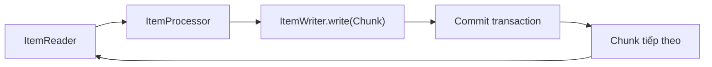
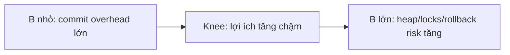
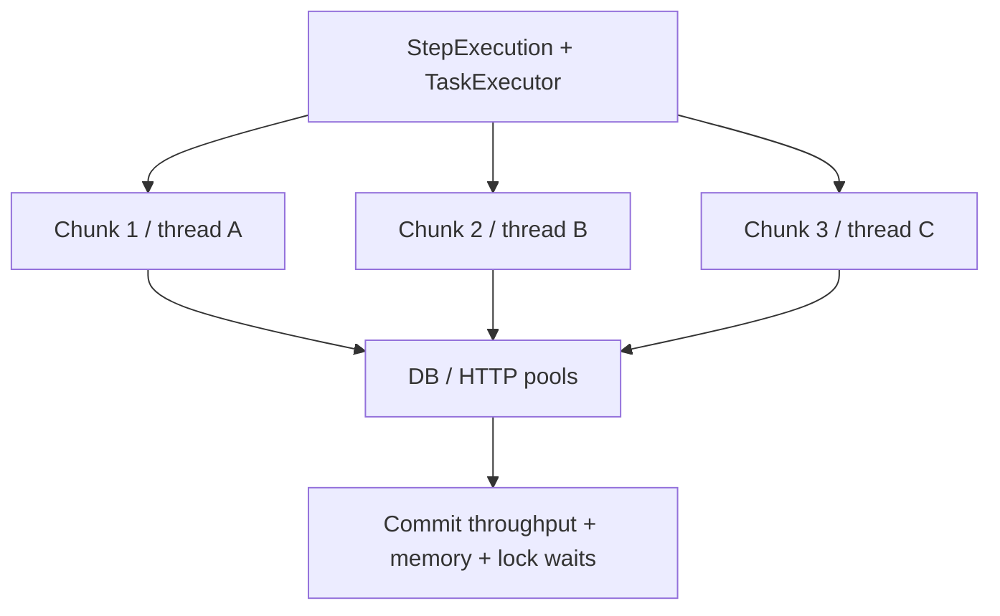
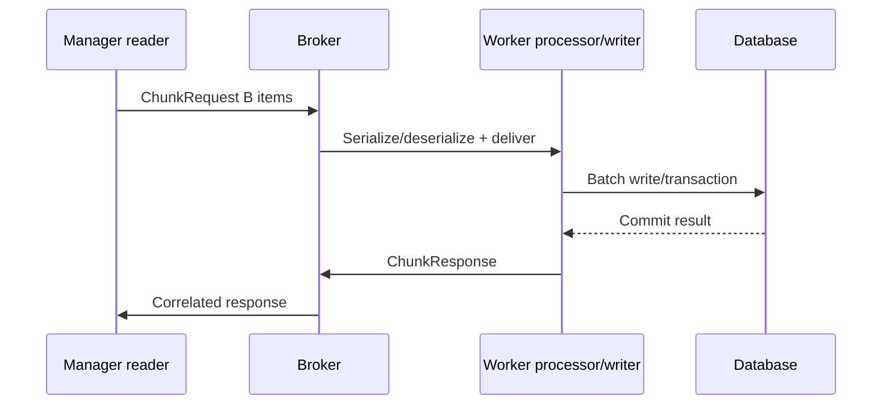
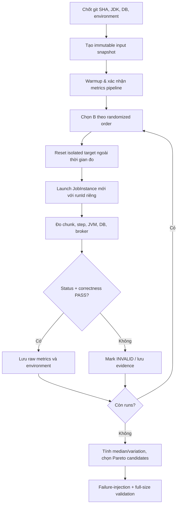

# Benchmark chunk size trong Spring Batch: đo đúng trước khi tăng throughput

Một job Spring Batch có thể tăng tốc đáng kể khi đổi `chunk(10)` thành `chunk(200)` vì số lần commit giảm. Nhưng nếu tiếp tục tăng lên `chunk(5000)`, throughput có thể giảm do batch SQL quá lớn, heap/GC tăng, thời gian giữ transaction dài và chi phí rollback/retry cao. Với multi-threaded step hoặc remote chunking, mỗi chunk còn có thể được **giữ đồng thời trong nhiều thread/message**, khiến memory peak tăng theo **chunk size × concurrency**. Do đó không tồn tại một kích thước chunk tối ưu áp dụng cho mọi workload.

Bài **“Benchmark chunk size”** thuộc chương **Performance testing** của module `SPRING_BATCH_SCALING_OPERATIONS`. Mục tiêu là thiết kế và diễn giải benchmark cho workload dữ liệu lớn, lựa chọn kích thước chunk bằng **số liệu có thể tái lập**, phân biệt bottleneck CPU, JDBC, transaction, I/O, broker, quản lý thread safety và kiểm chứng tính đúng khi retry/restart. Các ví dụ dùng **Java 17+, Spring Batch 5.2.x, Spring Framework 6.x, PostgreSQL và Micrometer**; phần đo phân tán áp dụng thêm cho partitioning/remote chunking. Mọi kết quả số trong bảng được ghi rõ là **ví dụ giả định**, không phải benchmark thực đã chạy.

## 1. Chunk size là gì?

Với step chunk-oriented:

```java
new StepBuilder("loadInvoices", jobRepository)
        .<Invoice, InvoiceResult>chunk(200, transactionManager)
        .reader(reader)
        .processor(processor)
        .writer(writer)
        .build();
```

`chunk(200, transactionManager)` thiết lập chính sách hoàn thành chunk theo **số item được đọc** trong trường hợp completion policy count thông thường, cùng ranh giới transaction cho chunk. Đường xử lý khái quát:



Trong luồng bình thường không lỗi:

1. Framework đọc các items đến khi đủ kích thước chunk hoặc gặp EOF.
2. Processor biến đổi hoặc lọc items (trả `null` nghĩa item bị filter).
3. Writer nhận **các kết quả sau processor** theo một `Chunk`.
4. Transaction được commit nếu không xảy ra lỗi.
5. Metadata/checkpoint được quản lý theo cơ chế Spring Batch.

**Chú ý:** `chunk(200)` **không hứa** mỗi lần `ItemWriter.write` luôn nhận đúng 200 items. EOF có thể tạo chunk cuối nhỏ; processor filter/skip có thể khiến số output ít hơn số input; retry/skip có thể khiến callback writer chạy nhiều lần theo fault-tolerance policy. Với completion policy tùy chỉnh, điều kiện kết thúc chunk có thể khác count thuần túy.

## 2. Những tham số dễ bị nhầm với chunk size

| Tham số | Tác động trực tiếp | Có đồng nhất với chunk size? |
| --- | --- | --- |
| `StepBuilder.chunk(B, txManager)` | Số item/chunk theo count completion policy; transaction boundary | **Đây là biến chính cần benchmark** |
| JDBC `fetchSize` | Gợi ý số rows driver lấy mỗi đợt từ database | **Không** |
| `JdbcPagingItemReader.pageSize` | Số rows một page query | **Không** |
| `JdbcBatchItemWriter` + driver batching | Cách gửi nhiều SQL operations | Liên quan nhưng **không phải mọi lúc 1:1** |
| Hibernate `hibernate.jdbc.batch_size` | Nhóm statements ở ORM layer | **Không** |
| Partition `gridSize` | Hint số partitions được tạo bởi partitioner | **Không** |
| Executor pool size/concurrency | Số chunk hoặc partitions có thể in-flight | **Không** |
| Broker consumer prefetch | Số messages chưa ACK consumer có thể nhận | **Không** |
| Retry limit / skip limit | Giới hạn xử lý lỗi | **Không** |

Khi benchmark **chỉ chunk size**, giữ nguyên `fetchSize`, `pageSize`, thread count, pool sizes, queue prefetch, partition plan và transaction policy. Sau khi chọn được vùng chunk hợp lý, có thể chạy **benchmark đa biến** để tìm phối hợp tốt hơn.

## 3. Vì sao chunk size tác động hiệu năng?

Số chunk danh nghĩa với `N` input items và `B` items/chunk:

```text
C ≈ ceil(N / B)
```

Đây là gần đúng cho **luồng không skip, không retry, không filter làm thay đổi cách chunk được xử lý**. Trong thực tế, thống kê `StepExecution.commitCount`, số rollback và số lần writer được gọi có thể khác phép đếm đơn giản.

Mô hình thời gian khái quát cho một worker:

```text
T_total(B) ≈ T_fixed_startup
           + N × T_per_item
           + ceil(N / B) × T_per_chunk_fixed
           + T_database_batch(B)
           + T_gc_and_memory(B)
           + T_lock_and_contention(B)
           + T_retry_and_recovery(B)
```

Mô hình này giúp **đặt giả thuyết**, không thay thế benchmark:

- `B` quá nhỏ: nhiều commit/checkpoint, SQL round-trips và transaction fixed overhead.
- `B` vừa: giảm overhead trên mỗi item mà vẫn giữ memory, lock duration và rollback cost chấp nhận được.
- `B` quá lớn: heap và writer buffers cao, transaction lâu, GC/locks tăng, một chunk lỗi phải retry/rollback nhiều công việc hơn.

Nếu công việc hoàn toàn CPU-bound và gần như không có fixed overhead theo chunk, thay đổi `B` có thể ít cải thiện throughput. Nếu writer là một API gọi **riêng từng item**, throughput có thể bị giới hạn bởi API quota hơn là số lần commit database.

## 4. Hàm mục tiêu: tối ưu điều gì?

Một cấu hình nhanh nhất theo tổng thời gian không nhất thiết tốt nhất cho production. Nên có **hệ tiêu chí**:

| Tiêu chí | Ý nghĩa | Ưu tiên |
| --- | --- | --- |
| Committed items/s | Items được xử lý và commit đúng trong mỗi giây | **Chính** |
| End-to-end job duration | Từ lúc bắt đầu đo tới khi step/job kết thúc thành công | Chính |
| Chunk duration p50/p95/p99 | Độ trễ từng chunk, tail latency | Quan trọng cho timeout/SLA |
| Commit/rollback counts | Overhead transaction và failure amplification | Quan trọng |
| CPU throttling và DB I/O | Chỗ nghẽn tài nguyên | Chẩn đoán |
| Peak heap/cgroup memory | Headroom, OOM risk | Điều kiện giới hạn |
| GC pause và allocation rate | Tác động lên throughput/latency | Điều kiện giới hạn |
| Lock wait/transaction duration | Ảnh hưởng tới DB và workload khác | Điều kiện giới hạn |
| Recovery time và duplicate effects | Restartability/correctness | **Bắt buộc** |
| Chi phí tài nguyên mỗi 1 triệu items | CPU-hours, DB I/O, mạng, worker replicas | Kinh tế vận hành |

**Định nghĩa throughput rõ ràng**: chia số **business items ghi thành công và đã đối soát** cho khoảng thời gian đo. `readCount` không bằng `writeCount` nếu processor filter hoặc skip; số message request cũng không bằng số business commits. Nếu một item cần sinh nhiều rows, phải định nghĩa đơn vị nghiệp vụ phù hợp (invoice, account, row, byte).

## 5. Một benchmark có thể trả lời câu hỏi nào?

Đặt giả thuyết trước khi chạy:

**H1 — Overhead commit:** tăng `B` từ 10 đến 200 làm giảm `commitCount` và tăng committed throughput.

**H2 — Điểm bão hòa DB:** từ một `B` nào đó, database WAL/fsync/lock duration hoặc driver batch behavior làm throughput đạt plateau.

**H3 — Memory/GC:** `B` lớn làm peak heap và p99 chunk duration tăng, ngay cả khi throughput trung bình nhích lên.

**H4 — Recovery:** khi worker crash sau commit một số chunk, `B` lớn có thể làm khối lượng cần replay lớn hơn và kéo dài recovery.

**H5 — Concurrency:** chunk size hợp lý ở single-thread **có thể không hợp lý** khi chạy 8 threads hoặc 20 partitions vì memory và DB pressure nhân lên.

**H6 — Distributed transport:** remote chunking còn có serialization/broker payload overhead; `B` lớn có thể đụng giới hạn kích thước message và consumer prefetch.

Một benchmark tốt cần **bác bỏ được** các giả thuyết này bằng metrics, thay vì chỉ chứng minh lựa chọn ban đầu là đúng.

## 6. Thiết kế thí nghiệm: thay một biến tại một thời điểm

Mục tiêu bước đầu: cô lập tác động của `chunk size`.

| Yếu tố | Cách cố định khi chạy benchmark một biến |
| --- | --- |
| Input | Cùng immutable snapshot, cùng số item, cùng phân phối payload |
| Business logic | Cùng processor, writer và error handling |
| Source/target DB | Cùng schema, indexes, transaction isolation và server configuration |
| JVM | Cùng Java version, heap/GC flags và container CPU/memory limits |
| Worker count | Giữ 1 worker cho thí nghiệm nền |
| Thread/partition concurrency | Giữ 1 active step/chunk cho baseline |
| JDBC/HTTP pools | Cùng max/min và timeout |
| Reader | Cùng fetchSize/pageSize/sort/WHERE |
| Broker | Không dùng cho baseline; khi thêm remote thì giữ cùng topology |
| Metrics/log level | Cùng instrumentation để tránh khác biệt overhead |
| Thời điểm chạy | Tránh load ngoài thay đổi; đo/tách warmup và steady-state |
| Retry/skip | Cố định chính sách và dữ liệu có lỗi; baseline nên tránh failure không chủ ý |

**Đừng chỉ tăng `chunk` sau khi job trước vừa chạy và dữ liệu target đã tồn tại.** Insert lần đầu, update những row đã có hoặc `ON CONFLICT DO NOTHING` là các workload khác nhau. Làm sạch/reset output **ngoài khoảng đo** hoặc dùng schema/partition riêng với trạng thái ban đầu tương đương.

## 7. Chọn workload đại diện

Không chỉ tạo 1 triệu item nhỏ giống hệt nhau nếu production có nhiều kích thước payload:

- **Small item:** 1–4 KiB sau deserialize, transform nhẹ, writer JDBC.
- **Medium item:** 10–100 KiB object graph, validation/formatting, vài indexes.
- **Large item:** 100 KiB–1 MiB hoặc nén/giải nén, allocation và GC đáng kể.
- **Mixed:** phân phối skew, một số items lớn hoặc phải gọi HTTP.
- **Failure-prone:** tỷ lệ transient DB/HTTP errors có kiểm soát để đo retry/rollback.

Nếu production thường có các bước **CPU-heavy + I/O-heavy** xen kẽ, nên benchmark ít nhất hai nhóm workload; “chunk size tối ưu” có thể khác giữa các step. Mọi kích thước sau deserialize cần **đo bằng profiler/sampling**, không suy từ kích thước CSV/JSON trên disk.

### 7.1. Input phải ổn định khi restart

Với DB, ưu tiên snapshot/identifying parameter và sort key **duy nhất, ổn định**. Với file, cố định checksum của input. Nếu writer đánh dấu `processed=true` rồi reader phân trang theo `WHERE processed=false` dùng offset paging, có thể **skip rows** khi tập kết quả bị thu hẹp. Đây là lỗi correctness, không phải tối ưu chunk size.

## 8. Tạo ma trận benchmark

Một danh sách candidate ban đầu có thể tăng theo bội số:

```text
chunkSizes = [10, 25, 50, 100, 200, 500, 1000, 2000]
```

Sau vòng sơ bộ, tập trung vào “knee” (điểm lợi ích tăng chậm lại), ví dụ `[200, 350, 500, 750]`. **Không benchmark mãi đến khi OOM**. Đặt hard safety budget cho memory, transaction duration, lock wait và broker message size. Nếu item rất lớn, bắt đầu bằng `[1, 5, 10, 25]` thay vì 1000.

Mỗi candidate nên chạy **nhiều lần** với warmup và thứ tự **được xáo trộn/cân bằng**, để giảm hiệu ứng DB cache/JIT và thời gian trong ngày. Ví dụ một vòng: `[500, 50, 200, 1000]`, vòng kế tiếp `[200, 1000, 500, 50]`, vẫn lưu seed và thứ tự.

## 9. Đặt ranh giới thời gian đo

Định nghĩa thống nhất:

```text
T_setup:        chuẩn bị schema/input, ngoài phép đo
T_warmup:       khởi động JVM, JIT/pools/cache, ghi nhận nhưng loại khỏi so sánh steady-state
T_measured:     từ trước khi step bắt đầu tới khi step có trạng thái cuối,
                đã flush/ack các điều kiện hoàn tất cần thiết
T_verify:       đối soát output, lưu riêng thời gian nếu không thuộc SLA xử lý
T_cleanup:      reset fixture, ngoài phép đo
```

Nếu SLA của người dùng yêu cầu **thời gian job từ lúc launch**, báo **cả cold end-to-end time** và **steady-state processing time**. Không chỉ đo `ItemWriter.write` rồi coi đó là tổng latency, vì reader, processor, transaction commit, metadata updates và broker reply đều góp vào thời gian.

Một phép đo nên tách:

- **Step duration:** thời gian từ step bắt đầu đến kết thúc.
- **Chunk latency:** một vòng chunk bao gồm đọc/xử lý/ghi/commit theo listener.
- **DB operation latency:** thời gian query/batch update ở database.
- **Per-item service time:** CPU hoặc I/O time, nếu có instrumentation.

Không cộng tùy tiện các duration lồng nhau thành tổng.

## 10. Công thức cơ sở để đánh giá

Với `N_valid` items có kết quả được xác minh và `T_seconds` thời gian:

```text
throughput_committed = N_valid / T_seconds
```

Với baseline `B0` và candidate `B1`:

```text
speedup(B1) = T(B0) / T(B1)
gain_percent = (throughput(B1) / throughput(B0) - 1) × 100%
```

Khi chạy `W` worker hoặc `C` active chunks, hiệu suất tăng thêm:

```text
parallel_speedup = throughput(W) / throughput(1)
parallel_efficiency = parallel_speedup / W
```

Hiệu suất song song là công cụ chẩn đoán, **không là KPI duy nhất**: 4 worker 50% efficiency có thể vẫn đạt SLA với chi phí hợp lý. Quan trọng là **công việc đã commit đúng trên tài nguyên/số tiền phải trả**.

### 10.1. Đo phân phối thay vì chỉ trung bình

Nếu có 2000 chunk, giữ phân phối duration để tính **median, p95, p99**, bởi vài chunk cuối rất lớn có thể quyết định end-to-end time. Các phần trăm vị phải có **đủ số mẫu** và quy trình thống kê rõ ràng. Khi chunk size tăng, **số chunk giảm**; p99 dựa trên 10 chunk không có ý nghĩa như p99 của 10.000 chunk.

## 11. Tạo bộ dữ liệu benchmark có thể reset

Schema PostgreSQL minh họa trong **database test**, không chạy trên production:

```sql
CREATE TABLE bench_invoice (
    invoice_id  BIGINT PRIMARY KEY,
    snapshot_id VARCHAR(64) NOT NULL,
    amount      NUMERIC(18, 2) NOT NULL
);

CREATE INDEX bench_invoice_snapshot_id_idx
    ON bench_invoice(snapshot_id, invoice_id);

CREATE TABLE bench_result (
    run_id             VARCHAR(64) NOT NULL,
    invoice_id         BIGINT NOT NULL,
    normalized_amount  NUMERIC(18, 2) NOT NULL,
    PRIMARY KEY (run_id, invoice_id)
);

-- Ví dụ 1.000.000 invoices, cố định cùng snapshot.
INSERT INTO bench_invoice(invoice_id, snapshot_id, amount)
SELECT n, 'S42', (n % 10000)::numeric / 100
FROM generate_series(1, 1000000) AS g(n);

ANALYZE bench_invoice;
```

Trước **mỗi lần thử**, tạo `runId` mới, đưa target về trạng thái tương đương và kiểm data shape. Có thể `TRUNCATE bench_result` **ngoài thời gian đo** trong môi trường test được phép; hoặc dùng schema test riêng từng run để tránh thay đổi size index/tables theo thời gian.

```sql
-- Chỉ ở môi trường benchmark cách ly; dừng mọi job dùng target trước khi reset.
TRUNCATE TABLE bench_result;

-- Sau khi job COMPLETED, xác nhận tổng unique business items.
SELECT COUNT(*) AS actual_rows,
       COUNT(DISTINCT invoice_id) AS distinct_ids
FROM bench_result
WHERE run_id = :runId;
```

**Lưu ý:** `TRUNCATE` là thao tác phá dữ liệu; chỉ sử dụng với fixture test đã được chuẩn bị và xác nhận đúng database/schema. Đếm row chưa chứng minh giá trị chuẩn; cần so thêm checksum, tập business keys và kết quả tính toán theo snapshot.

### 11.1. Để không benchmark cache như benchmark chunk

Vòng đầu có thể phải đọc pages từ disk, các vòng sau hưởng cache DB/OS. Đừng chủ động xóa cache kernel trên máy dùng chung. Có hai cách hợp lý:

- Benchmark **warm cache**, chạy warmup rồi chỉ so steady state.
- Benchmark **cold/near-cold cache** trên môi trường riêng, reset cache theo runbook có quyền, ghi điều kiện rõ ràng.

Không trộn số đo warm-cache của `chunk=500` với cold-cache của `chunk=50` rồi kết luận 500 nhanh hơn.

## 12. Cấu hình step thay đổi chunk bằng application property

Ví dụ Spring Batch 5.x, mặc định chạy **single-thread** để cô lập biến:

```java
import org.springframework.batch.core.Step;
import org.springframework.batch.core.repository.JobRepository;
import org.springframework.batch.core.step.builder.StepBuilder;
import org.springframework.batch.item.ItemProcessor;
import org.springframework.batch.item.ItemReader;
import org.springframework.batch.item.ItemWriter;
import org.springframework.beans.factory.annotation.Value;
import org.springframework.context.annotation.Bean;
import org.springframework.context.annotation.Configuration;
import org.springframework.transaction.PlatformTransactionManager;

@Configuration
public class ChunkBenchmarkStepConfig {

    @Bean
    Step benchmarkStep(
            JobRepository jobRepository,
            PlatformTransactionManager transactionManager,
            ItemReader<Invoice> reader,
            ItemProcessor<Invoice, InvoiceResult> processor,
            ItemWriter<InvoiceResult> writer,
            ChunkDurationListener chunkDurationListener,
            BenchmarkSummaryListener summaryListener,
            @Value("${bench.chunk-size:200}") int chunkSize) {

        if (chunkSize < 1) {
            throw new IllegalArgumentException("chunkSize must be positive");
        }

        return new StepBuilder("benchmarkStep", jobRepository)
                .<Invoice, InvoiceResult>chunk(chunkSize, transactionManager)
                .reader(reader)
                .processor(processor)
                .writer(writer)
                .listener(chunkDurationListener)
                .listener(summaryListener)
                .build();
    }
}
```

`Invoice`, `InvoiceResult` và hai listener được định nghĩa trong các mục tiếp theo. Đây là **snippet của ứng dụng đã có Job/JobRepository, DataSource, Spring Boot và Micrometer**, không phải một chương trình chạy độc lập chỉ bằng cách paste.

Chạy một process/app riêng cho mỗi candidate để đảm bảo `Step` được xây đúng `chunkSize`:

```bash
java -jar batch-benchmark.jar --bench.chunk-size=50
java -jar batch-benchmark.jar --bench.chunk-size=200
java -jar batch-benchmark.jar --bench.chunk-size=500
```

Các lệnh là **minh họa cấu hình**, chưa truyền đủ `JobParameters`, snapshot/fixture hoặc cơ chế launch thực; thay bằng workflow test của dự án. Không chỉnh giá trị property trên một singleton `Step` đang chạy rồi kỳ vọng chunk size thay đổi giữa transaction. **Không chạy ba câu lệnh đồng thời** nếu mục tiêu là benchmark single-worker.

### 12.1. Vì sao không gắn mọi thứ vào một vòng for trong ItemProcessor?

`for (int i=0; i<1000; i++)` trong processor không thay thế `chunk(1000)`. Framework mới là nơi quản lý chunk state, writer invocation, transaction boundaries và checkpoint. Benchmark tự nhóm items trong processor nhưng vẫn giữ `chunk(10)` là một thí nghiệm khác.

## 13. Ví dụ reader/processor/writer cố định cho tất cả candidates

Dữ liệu đơn giản để kiểm correctness:

```java
import java.math.BigDecimal;

public record Invoice(long invoiceId, BigDecimal amount) {}

public record InvoiceResult(
        String runId, long invoiceId, BigDecimal normalizedAmount) {}
```

Reader JDBC cursor đọc source theo snapshot; `fetchSize` giữ **1000** cho mọi lần benchmark:

```java
import javax.sql.DataSource;

import org.springframework.batch.core.configuration.annotation.StepScope;
import org.springframework.batch.item.database.JdbcCursorItemReader;
import org.springframework.batch.item.database.builder.JdbcCursorItemReaderBuilder;
import org.springframework.beans.factory.annotation.Value;
import org.springframework.context.annotation.Bean;

@Bean
@StepScope
JdbcCursorItemReader<Invoice> invoiceReader(
        DataSource dataSource,
        @Value("#{jobParameters['snapshotId']}") String snapshotId) {

    return new JdbcCursorItemReaderBuilder<Invoice>()
            .name("benchmarkInvoiceReader")
            .dataSource(dataSource)
            .sql("""
                SELECT invoice_id, amount
                  FROM bench_invoice
                 WHERE snapshot_id = ?
                 ORDER BY invoice_id
                """)
            .preparedStatementSetter(ps -> ps.setString(1, snapshotId))
            .rowMapper((rs, rowNum) -> new Invoice(
                    rs.getLong("invoice_id"),
                    rs.getBigDecimal("amount")))
            .fetchSize(1000)
            .saveState(true)
            .build();
}
```

`JdbcCursorItemReader` mặc định là **stateful**, không nên chia sẻ một instance cho nhiều thread trong multi-threaded step. `@StepScope` gắn bean với một `StepExecution`; **nó không tự làm reader thread-safe** nếu nhiều threads cùng đọc trong chính step ấy. Nếu cần benchmark multi-threaded, chọn reader strategy thread-safe hoặc partitioning với reader riêng/partition.

**Lưu ý restart:** cursor-based reader mở lại query và khôi phục vị trí đọc theo state; input phải giữ thứ tự và snapshot ổn định. `fetchSize` là **hint** của driver; PostgreSQL JDBC có điều kiện riêng liên quan autocommit/cursor fetch. Benchmark phải kiểm actual JDBC behavior, không suy rằng driver chắc chắn tải đúng 1000 rows mỗi network round-trip.

Processor tạo kết quả deterministic cho cùng item và `runId`:

```java
import java.math.BigDecimal;
import java.math.RoundingMode;

import org.springframework.batch.core.configuration.annotation.StepScope;
import org.springframework.batch.item.ItemProcessor;
import org.springframework.beans.factory.annotation.Value;
import org.springframework.context.annotation.Bean;

@Bean
@StepScope
ItemProcessor<Invoice, InvoiceResult> invoiceProcessor(
        @Value("#{jobParameters['runId']}") String runId) {

    BigDecimal factor = new BigDecimal("1.10");
    return invoice -> new InvoiceResult(
            runId,
            invoice.invoiceId(),
            invoice.amount()
                    .multiply(factor)
                    .setScale(2, RoundingMode.HALF_EVEN));
}
```

Writer dùng `JdbcBatchItemWriter`, giữ **cùng câu SQL** cho mọi lần chạy:

```java
import javax.sql.DataSource;

import org.springframework.batch.item.database.JdbcBatchItemWriter;
import org.springframework.batch.item.database.builder.JdbcBatchItemWriterBuilder;
import org.springframework.context.annotation.Bean;
import org.springframework.jdbc.core.namedparam.MapSqlParameterSource;

@Bean
JdbcBatchItemWriter<InvoiceResult> benchmarkWriter(DataSource dataSource) {
    return new JdbcBatchItemWriterBuilder<InvoiceResult>()
            .dataSource(dataSource)
            .sql("""
                INSERT INTO bench_result(
                    run_id, invoice_id, normalized_amount)
                VALUES (:runId, :invoiceId, :normalizedAmount)
                ON CONFLICT (run_id, invoice_id)
                DO UPDATE
                    SET normalized_amount = EXCLUDED.normalized_amount
                """)
            .itemSqlParameterSourceProvider(item ->
                    new MapSqlParameterSource()
                            .addValue("runId", item.runId())
                            .addValue("invoiceId", item.invoiceId())
                            .addValue("normalizedAmount",
                                    item.normalizedAmount()))
            .build();
}
```

Với JDBC writer này, đảm bảo `PlatformTransactionManager` dùng ở step **quản lý connection/transaction của target database**. Nếu reader và writer ở hai hệ thống khác nhau, cần xác định rollback semantics; việc `JobRepository` lưu checkpoint thành công không tự atomic với external API/DB riêng.

**Điểm cần giữ nguyên khi so chunk sizes:** source SQL, sort key, processor arithmetic, target indexes, driver version, isolation, writer SQL và khả năng driver rewrite/statement batching. Không bật một index mới chỉ cho candidate `B=500`.

### 13.1. Vì sao không bắt buộc dùng một transaction xuyên source và target?

Đọc từ immutable source có thể không cần cập nhật source transaction, trong khi target writer commit theo chunk. Tuy vậy nếu source là database thay đổi trong lúc chạy và reader restart bằng item count, dữ liệu có thể sai dù target transaction rollback đúng. Thiết kế production cần **input snapshot** hoặc chính sách claim/streaming phù hợp; benchmark nên bắt đầu với input cố định để cô lập vấn đề hiệu năng.

## 14. Instrument bằng ChunkListener và Micrometer

`ChunkListener` có các callback:

- `beforeChunk(ChunkContext)`: gọi trước khi xử lý chunk, trong vòng đời transaction.
- `afterChunk(ChunkContext)`: gọi khi chunk hoàn thành sau commit thành công theo lifecycle thông thường.
- `afterChunkError(ChunkContext)`: callback khi chunk gặp lỗi; không tự đồng nghĩa một rollback business operation có thể đối soát được.

Đo `beforeChunk → afterChunk` cho thời gian xử lý **thành công một chunk**, bao gồm phần read/process/write và đường commit liên quan. Đừng đặt tên metric này là **DB commit latency**: một chunk có thể tiêu 90% thời gian trong `ItemProcessor`.

```java
import java.util.concurrent.TimeUnit;

import io.micrometer.core.instrument.Counter;
import io.micrometer.core.instrument.MeterRegistry;
import io.micrometer.core.instrument.Timer;
import org.springframework.batch.core.ChunkListener;
import org.springframework.batch.core.scope.context.ChunkContext;
import org.springframework.stereotype.Component;

@Component
public class ChunkDurationListener implements ChunkListener {

    private final Timer successfulChunkTimer;
    private final Counter chunkErrorCounter;
    private final ThreadLocal<Long> startedNs = new ThreadLocal<>();

    public ChunkDurationListener(MeterRegistry registry) {
        this.successfulChunkTimer = Timer.builder("bench.chunk.wall")
                .description("Elapsed time for successful chunks")
                .publishPercentileHistogram()
                .register(registry);

        this.chunkErrorCounter = Counter
                .builder("bench.chunk.error.callback")
                .register(registry);
    }

    @Override
    public void beforeChunk(ChunkContext context) {
        startedNs.set(System.nanoTime());
    }

    @Override
    public void afterChunk(ChunkContext context) {
        Long start = startedNs.get();
        try {
            if (start != null) {
                successfulChunkTimer.record(
                        System.nanoTime() - start, TimeUnit.NANOSECONDS);
            }
        } finally {
            startedNs.remove();
        }
    }

    @Override
    public void afterChunkError(ChunkContext context) {
        chunkErrorCounter.increment();
        startedNs.remove();
    }
}
```

`ThreadLocal` ở đây chỉ giữ timestamp **trong thread xử lý chunk**, không đếm item hoặc giữ payload. Dọn trong cả hai callback để tránh giữ state khi worker pool tái sử dụng thread. Ví dụ giả định before/after callbacks của một chunk được gọi theo luồng xử lý phù hợp; với mô hình task execution tùy chỉnh, nên kiểm callback threading trong integration test.

**Metric semantics:**

- `bench.chunk.wall`: chỉ các chunks hoàn thành thành công và có đủ start/end.
- `bench.chunk.error.callback`: số lần callback lỗi, **không đồng nhất** với `StepExecution.rollbackCount` hoặc business failure count.
- Histogram có chi phí CPU/memory, phải giữ cách cấu hình giống nhau giữa các candidates.
- Nếu xuất Prometheus, percentile/histogram query cần đúng backend và tối thiểu đủ sample; không dùng `runId`/`itemId` làm metric labels.

## 15. Tóm tắt StepExecution ở cuối bước

`StepExecution` cung cấp `readCount`, `writeCount`, `filterCount`, `readSkipCount`, `processSkipCount`, `writeSkipCount`, `commitCount` và `rollbackCount`. Dùng chúng cùng business reconciliation để hiểu vì sao throughput thay đổi.

```java
import org.springframework.batch.core.ExitStatus;
import org.springframework.batch.core.StepExecution;
import org.springframework.batch.core.StepExecutionListener;
import org.springframework.stereotype.Component;

@Component
public class BenchmarkSummaryListener implements StepExecutionListener {
    @Override
    public ExitStatus afterStep(StepExecution step) {
        System.out.printf(
                "step=%s status=%s read=%d write=%d filter=%d "
                        + "readSkip=%d processSkip=%d writeSkip=%d "
                        + "commit=%d rollback=%d%n",
                step.getStepName(),
                step.getStatus(),
                step.getReadCount(),
                step.getWriteCount(),
                step.getFilterCount(),
                step.getReadSkipCount(),
                step.getProcessSkipCount(),
                step.getWriteSkipCount(),
                step.getCommitCount(),
                step.getRollbackCount());

        return step.getExitStatus();
    }
}
```

**Không dùng một mình `commitCount` để suy số transaction mà DB thực sự flush:** metadata/framework có các transaction nội bộ (start/end/repository), retry và implementation riêng. Ở luồng không lỗi, `ceil(N/B)` là mô hình sơ bộ nhưng không phải invariant tuyệt đối.

Đừng log một dòng cho **mỗi item** trong benchmark, vì I/O log có thể làm méo kết quả và tạo thêm garbage. Summary log sau step hoặc metrics được lấy mẫu đủ dùng.

## 16. Đo những gì ở JVM, process và database?

| Hệ thống | Metrics | Nếu số tăng bất thường |
| --- | --- | --- |
| Spring Batch | read/write/filter/skip/commit/rollback, step duration | Phát hiện retry, filter, commit overhead |
| Micrometer timer | chunk p50/p95/p99, count và total time | Tail latency, chunk outliers |
| JVM heap | used/committed/max, allocation, GC pause | Memory pressure / object retention |
| JVM threads | live/runnable/blocked, executor active/queue | Lock contention hoặc oversubscription |
| Container CPU | CPU usage, quota, throttling | Workload CPU-bound hoặc bị throttled |
| Container memory | `memory.current`, OOM events | Native/direct buffers + heap + cache |
| JDBC pool | active, idle, pending, acquisition latency | Pool cạn hoặc DB phản hồi chậm |
| PostgreSQL | transactions, WAL bytes/fsync, buffer hits, lock waits | DB bottleneck và transaction overhead |
| Network | bytes/packets, request rates, retransmits | Round-trip/writer hoặc broker bottleneck |
| Broker (nếu remote) | ready/unacked, redelivery, publish confirms, reply delay | Pending requests tăng, consumer chậm |

### 16.1. Ví dụ các lệnh chẩn đoán không phá dữ liệu

```bash
# Java 17 JVM đang chạy; cần quyền attach và JDK phù hợp.
PID=12345
jcmd "$PID" VM.flags
jcmd "$PID" GC.heap_info
jcmd "$PID" Thread.print

# Container dùng cgroup v2 khi đúng mount/path:
cat /sys/fs/cgroup/cpu.stat
cat /sys/fs/cgroup/memory.current
cat /sys/fs/cgroup/memory.events
```

Đường dẫn cgroup trên chỉ đúng nếu process được mount như ví dụ; phải kiểm `/proc/self/cgroup` và mount namespace, cgroup parent nếu có. Đừng dùng `kubectl top` snapshot để suy peak memory của một worker đã `OOMKilled` và restart.

### 16.2. PostgreSQL: quan sát, không can thiệp benchmark giữa run

```sql
SELECT datname, xact_commit, xact_rollback,
       blks_read, blks_hit, deadlocks
FROM pg_stat_database
WHERE datname = current_database();

SELECT pid, state, wait_event_type, wait_event, query_start
FROM pg_stat_activity
WHERE datname = current_database();
```

Các counters như `xact_commit` là **cấp database**, bao gồm workload khác và có thể reset; đo **delta trong cùng cửa sổ** trên DB test cách ly. PostgreSQL có thêm `pg_stat_wal` và `pg_stat_statements` nếu extension/quyền và version hỗ trợ; sử dụng chúng để tách cost transaction, I/O và SQL. Không coi một lần `EXPLAIN ANALYZE` của truy vấn bất kỳ là đại diện đầy đủ cho end-to-end batch job. `EXPLAIN ANALYZE` với DML còn **thực thi ghi dữ liệu**: chỉ chạy trong test khi biết hậu quả.

## 17. Warmup, lặp lại và random hóa thứ tự

Thời gian chạy lần đầu và lần sau có thể khác do:

- JIT compile và class loading.
- JVM heap expansion, GC ergonomics và thread pool warmup.
- DB shared buffers và OS page cache.
- Connection pool warmup, DNS/TLS handshakes.
- PostgreSQL checkpoints, autovacuum, WAL pressure.
- Tải ngoài từ process khác trên node.

Quy trình đề xuất:

1. **Ghi version/commit và environment:** Java/driver/PostgreSQL versions, CPU/memory limit, hardware, input snapshot.
2. **Chuẩn bị fixture:** reset target về cùng trạng thái trước từng candidate, kiểm count và checksum đầu vào.
3. **Warmup cùng workload đại diện:** không lấy số warmup vào so sánh steady-state; vẫn lưu làm diagnostic.
4. **Chạy ít nhất 3–5 measurement runs/candidate** (hoặc nhiều hơn nếu nhiễu lớn), cùng điều kiện nguồn.
5. **Đảo thứ tự candidates:** randomization có seed hoặc crossover order để giảm bias theo thời gian.
6. **Lưu raw metrics**, không chỉ một giá trị tốt nhất.
7. **So median và biến động**, không chọn chunk size chỉ vì một lần chạy nhanh bất thường.

Nếu job rất dài không thể chạy 5 lần trên 100% dữ liệu, chọn **representative fixed-size subset** có data skew/size distribution tương đương rồi xác minh finalist trên dữ liệu đầy đủ. Việc so candidate trên những subset **khác nhau** làm mất công bằng.

### 17.1. Kịch bản benchmark theo vòng

```text
Round 0: warmup (không so sánh)
Round 1: B=500 -> B=50 -> B=200 -> B=1000
Round 2: B=200 -> B=1000 -> B=500 -> B=50
Round 3: B=50  -> B=200 -> B=1000 -> B=500
Round 4: B=1000-> B=500 -> B=50 -> B=200

Mỗi run:
  reset fixture -> verify input -> launch unique JobInstance
  -> collect metrics -> verify COMPLETED + business output
  -> store raw report -> cleanup
```

Đây là lịch minh họa, không phải kết quả đã chạy. Không chạy các candidates đồng thời trên cùng DB benchmark khi mục tiêu là tìm hiệu ứng **một biến**.

## 18. Thiết kế log/result schema

Mỗi lần chạy ghi metadata đủ để tái lập:

```text
run_id,git_sha,jdk,db_version,input_snapshot,
chunk_size,fetch_size,worker_count,active_partitions,threads,
container_cpu_limit,container_memory_limit,
elapsed_seconds,read_count,write_count,filter_count,
read_skip_count,process_skip_count,write_skip_count,
commit_count,rollback_count,verified_business_count,
throughput_committed_per_second,
chunk_p50_ms,chunk_p95_ms,chunk_p99_ms,
heap_peak_mib,cgroup_memory_peak_mib,gc_pause_seconds,
cpu_throttled_period_ratio,db_lock_wait_p95_ms,
status,correctness_pass,notes
```

Nếu không thể thu metric nào, ghi **N/A** và giải thích, đừng tự sinh số. `status=COMPLETED` chưa đủ nếu `verified_business_count` sai. Benchmark lỗi hoặc thiếu output phải được đánh dấu **INVALID/FAILED**, không coi thời gian chạy ngắn vì đọc thiếu dữ liệu là chiến thắng.

### 18.1. Không trộn p99 của chunks với p99 của jobs

Một run có hàng nghìn chunks sẽ tạo phân phối **chunk duration**; năm runs chỉ tạo năm mẫu **job duration**. Không lấy p99 của 5 job durations rồi diễn giải nó đáng tin như p99 của hàng trăm runs. Khi chọn cấu hình theo SLA, xem tail của **cả chunk và toàn job**, và nêu số mẫu.

## 19. Bảng kết quả minh họa cho 1 triệu items

**Dữ liệu dưới đây hoàn toàn giả định để luyện phân tích**, không phải số đo của dự án. Giả sử 1 worker, 1 thread, PostgreSQL writer, không filter/skip/retry và dữ liệu test được reset giống nhau trước mỗi run:

| Chunk size | Elapsed (s) | Throughput (items/s) | Số chunk danh nghĩa | Chunk p95 (ms) | Peak heap (MiB) |
| ---: | ---: | ---: | ---: | ---: | ---: |
| 25 | 420 | 2.381 | 40.000 | 20 | 380 |
| 50 | 300 | 3.333 | 20.000 | 26 | 420 |
| 100 | 220 | 4.545 | 10.000 | 39 | 460 |
| 200 | 180 | 5.556 | 5.000 | 68 | 560 |
| 500 | 160 | 6.250 | 2.000 | 164 | 740 |
| 1.000 | 169 | 5.917 | 1.000 | 355 | 1.050 |
| 2.000 | 205 | 4.878 | 500 | 770 | 1.600 |

Ví dụ:

```text
N = 1,000,000 items
B=50:  N / 300 s ≈ 3,333 items/s
B=200: N / 180 s ≈ 5,556 items/s
B=500: N / 160 s = 6,250 items/s

Speedup B=500 so với B=50 = 300 / 160 = 1.875x
Tăng throughput B=200 -> B=500 ≈ 12.5%
Tăng chunk 500 -> 1000: thời gian 160 -> 169 s (chậm hơn)
```

**Giải thích giả định:** từ 25 đến 200, lợi ích có thể đến từ giảm số commit/roundtrips. Từ 200 đến 500 tiếp tục tăng throughput nhưng memory và chunk p95 tăng; từ 1000 trở lên có dấu hiệu batch quá lớn, lock contention, driver behavior hoặc GC, **cần metrics để xác nhận**, không suy nguyên nhân chỉ từ bảng.

### 19.1. Chọn 200 hay 500?

Nếu chỉ tối thiểu hóa elapsed time trong ví dụ, `B=500` nhanh nhất. Nhưng nếu có điều kiện:

```text
chunk_p95 <= 100ms
peak_heap <= 700MiB
step_status == COMPLETED
business_correctness == PASS
```

Thì `B=500` không đạt hai ràng buộc đầu; **`B=200`** là lựa chọn hợp lý hơn trong bảng này. Ngược lại, khi headroom lớn, p95 không ràng buộc và restart test đạt, `B=500` có thể phù hợp. **Không chọn tối ưu bằng một KPI đơn lẻ.**

## 20. Tìm “knee point” thay vì cố tối đa chunk size

Một đồ thị `throughput vs chunk size` thường có vùng tăng nhanh, sau đó plateau, thậm chí đi xuống. Với cùng một benchmark:



Knee point là nơi tăng thêm `B` **không còn cải thiện đáng kể throughput** tương ứng với chi phí/rủi ro tăng. Không có phép đo chung như “mọi batch có knee=500”; vị trí phụ thuộc:

- Fixed cost mỗi transaction/commit.
- SQL batching, index và WAL behavior.
- Payload size và Java object retention.
- Reader fetch/page size và network latency.
- CPU quota, GC, JDBC pool và downstream limits.
- Số concurrent chunks/partitions/remote workers.
- Retry rate, error distribution và SLA rollback/recovery.

Trong benchmark có nhiều nhiễu, thử một vùng gần knee bằng lưới nhỏ, lặp lại. Nếu chênh lệch giữa `B=350` và `B=500` nhỏ hơn biến động giữa các runs, coi đó là **tương đương theo bằng chứng hiện có** và ưu tiên cấu hình có headroom/recovery tốt hơn.

## 21. Tính memory peak theo chunk size × concurrency

Một mô hình dự báo bộ nhớ làm việc:

```text
M_chunk ≈ B × M_item_decoded × copy_factor

M_peak ≈ M_base_JVM
       + active_chunks × M_chunk
       + reader_writer_buffers
       + in_flight_messages
       + GC/native/headroom
```

`copy_factor` là hệ số giả định cho input, processed output, serialization/copy buffers và intermediate arrays; nó **không phải hằng số của Spring Batch**. Phải đo allocation/heap thực dưới workload.

Ví dụ item object graph trung bình `96 KiB`, `B=500`, `8 active chunks`, hệ số giữ bản sao `2.5`:

```text
500 × 8 × 96 KiB × 2.5
= 960,000 KiB
≈ 937.5 MiB chỉ riêng payload đang giữ
```

Với `B=200` dưới cùng giả định: khoảng **375 MiB**. Nếu container chỉ có 2Gi memory, thay đổi `B` và concurrency có thể quyết định OOM risk, dù baseline single-thread chạy rất nhanh.

**Không hiểu `M_peak` là giới hạn Java heap:** direct buffers, metaspace, thread stacks, network/TLS và cgroup file cache cũng dùng memory. Khi remote chunking, broker prefetch và request serialization có thể nhân thêm số bản sao.

### 21.1. Vì sao “CPU còn rảnh” không cho phép tăng chunk mãi?

Một job có thể chờ DB I/O hoặc GC; CPU usage chưa cao không nghĩa là có đủ heap. Nếu tăng B mà `memory.current` hoặc p99 GC pause tăng nhanh, cần giảm B, giảm concurrency hoặc tối ưu streaming/serialization trước khi bổ sung CPU.

## 22. Transaction, rollback và retry amplification

Chunk size quyết định **bao nhiêu công việc logic nằm trong một transaction** ở luồng chunk thông thường. Khi writer ném exception hoặc DB gặp deadlock:

- Các DB changes tham gia cùng transaction có thể rollback.
- Framework có thể đọc/xử lý/ghi lại các items theo retry/skip policy.
- Một chunk lớn có thể mất nhiều thời gian và tài nguyên khi replay.
- Lock duration, WAL/temp usage và transaction footprint có thể tăng.
- **External API/file side effects không tự rollback** chỉ vì transaction DB rollback.

Ví dụ `B=2000`, lỗi ở một item cuối chunk: tùy cấu hình và lỗi, một lượng công việc lớn có thể phải xử lý lại. Với `B=100`, đơn vị rollback nhỏ hơn nhưng commit overhead cao hơn. Không thể khẳng định mọi lỗi đều đọc lại **chính xác B item**; Spring Batch có cơ chế fault-tolerant step, retry/skip buffering và stateful restart phức tạp hơn.

### 22.1. Tỷ lệ lỗi nhỏ cũng có tác động lớn

Giả sử mỗi item có xác suất lỗi tạm thời `p` độc lập (mô hình đơn giản), xác suất **ít nhất một item lỗi trong một chunk B items**:

```text
P(chunk has >=1 transient error) = 1 - (1 - p)^B

p=0.001 (0.1% mỗi item)
B=100  -> khoảng 9.5% chunks có ít nhất 1 lỗi
B=1000 -> khoảng 63.2% chunks có ít nhất 1 lỗi
```

Đây là **mô hình xác suất**, không dự báo chính xác số rollback trong Spring Batch: lỗi có thể xảy ra độc lập/không độc lập, được retry thành công, được skip hoặc xảy ra ở writer mức chunk. Công thức minh họa vì sao chunk lớn có thể khiến failure locality kém hơn khi data có lỗi.

### 22.2. Thiết kế benchmark recovery riêng

Đo thêm:

```text
T_to_failure      = thời gian từ run start tới lỗi có kiểm soát
T_recovery_start  = thời gian từ xác định worker/step thất bại tới restart hợp lệ
T_resume          = thời gian xử lý phần còn lại
Replay_items      = số logical items xử lý lại
Duplicate_effects = số business side effects commit trùng
```

**Đừng dùng `commitCount` một mình** để suy dữ liệu nào đã được commit ngoài hệ thống. Cần so business IDs/idempotency keys, nhất là HTTP POST, remote chunking hoặc file writer.

## 23. Failure injection: benchmark phải có pha sự cố

Benchmark throughput lúc mọi thứ khỏe mạnh chỉ cho thấy **một nửa** câu chuyện. Với batch xử lý dữ liệu lớn và yêu cầu restart, còn phải thử lỗi giữa chunk và lúc manager/worker mất kết nối.

| Kịch bản trong test cách ly | Điều cần quan sát | Điều kiện đạt |
| --- | --- | --- |
| Ném transient exception ở writer trước commit | Rollback count, retry cost | Retry có giới hạn, không mất item |
| Lỗi tại item cuối một chunk lớn | Số logical items phải xử lý lại | Recovery trong budget, không ghi trùng |
| Worker crash sau commit nhưng trước reply | Broker redelivery, business output | Idempotent replay |
| Manager restart khi còn chunks pending | Reader checkpoint, reply correlation | Không bỏ sót/nhân đôi output |
| DB deadlock với concurrency cao | DB lock waits, retry/skip | Không retry storm |
| CPU throttling | p99 chunk duration, timeouts | Không false failover |
| Memory pressure, GC hoặc OOM test | Peak heap/cgroup memory, restarts | Candidate không vi phạm giới hạn |
| HTTP 429/503 burst | Backoff, rate limit, pool pending | Không giữ transaction quá lâu |
| Stop/restart `JobExecution` hợp lệ | `ExecutionContext`, business counts | Chỉ chạy lại phần còn thiếu |
| Input có item rất lớn/outlier | p99 chunk duration và peak memory | Headroom vẫn đạt |

Các phép thử có nguy cơ lỗi phải chạy trong **lab biệt lập**; không kill database/worker production. Ghi kết quả cho **từng B**, bởi candidate nhanh nhất ở happy path có thể có recovery time tệ nhất.

### 23.1. Correctness của giao dịch và side effect

Khi DB writer và Spring Batch checkpoint ở cùng transaction manager phù hợp, restart có thể phục hồi trạng thái nhất quán hơn. Nếu processor gửi payment/email hoặc ghi file ngoài DB, transaction rollback **không tự đảo ngược side effect**. Dùng business idempotency key, outbox hoặc reconciliation thay vì tin rằng chọn B nhỏ giải quyết mọi duplicate.

## 24. Benchmark multi-threaded step sau baseline single-thread

Ở Spring Batch 5.x, có thể thêm `TaskExecutor` cho step, cho nhiều chunk được xử lý bởi các thread trong cùng `StepExecution`. Điều này **thay đổi một biến lớn khác**: từ tuần tự sang đồng thời.



Ví dụ wiring khi **reader/writer đã được chứng minh thread-safe**:

```java
return new StepBuilder("threadedBenchmarkStep", jobRepository)
        .<Invoice, InvoiceResult>chunk(chunkSize, transactionManager)
        .reader(threadSafeReader)
        .processor(threadSafeProcessor)
        .writer(threadSafeWriter)
        .taskExecutor(batchTaskExecutor)
        .build();
```

Đoạn này chỉ minh họa khác biệt về executor. **Không dùng `JdbcCursorItemReader` stateful ở mục 13 làm `threadSafeReader` nếu chưa thiết kế cơ chế đọc đồng thời phù hợp**. `@StepScope` là scope theo `StepExecution`, không tự tạo instance khác cho mỗi chunk thread. Với stateful reader, partitioning với reader riêng/partition hoặc thiết kế reader đồng thời chuyên biệt thường rõ ràng hơn.

### 24.1. Chunk size × active chunks = in-flight working set

Nếu `chunkSize=500` và executor thật sự cho tối đa 8 chunks active, bộ nhớ item graph có thể tăng khoảng tám lần so với một chunk, chưa tính output/buffers. Số active chunks thực còn phụ thuộc queue, repeat operations và step infrastructure, không nhất thiết bằng `maxPoolSize`.

Theo Spring Batch 5.x, `throttleLimit` của multi-threaded step đã deprecated; nếu cần khống chế concurrency beyond defaults, xem contract `RepeatOperations` và executor/step theo phiên bản. Không cấu hình `TaskExecutor` với queue vô hạn mà không theo dõi `active/queued/rejected`.

### 24.2. Thread safety và thứ tự output

Multi-threaded step có thể xử lý chunks không theo thứ tự input; processor, writer, listeners và mutable caches phải thread-safe. Nếu writer yêu cầu **order total** hoặc một DB row được cập nhật bởi nhiều items, tăng concurrency có thể gây race/lock waits dù chunk size vẫn giữ nguyên.

Benchmark đa luồng phải xác minh **business output** và atomicity, không chỉ dùng tổng `writeCount`.

## 25. Benchmark local/remote partitioning

Ở partitioned step, mỗi `StepExecution` có context và reader/writer riêng. Tăng `gridSize` không đồng nghĩa tăng số active workers: concurrency thực phụ thuộc `PartitionHandler`/executor/consumer count.

| Biến | Ví dụ mức thử | Cần giữ cố định khi benchmark chunk |
| --- | --- | --- |
| Số partitions | 4 / 8 / 16 / 32 | Giữ một partition plan cho cùng so sánh B |
| Active partitions/worker | 1 / 2 / 4 | Giữ cố định ở vòng chunk một biến |
| Số worker JVM | 1 / 2 / 4 / 8 | Giữ cố định trước khi tối ưu W |
| Chunk size mỗi worker | 50 / 200 / 500 | **Biến chính** |
| Worker pool/JDBC/HTTP | Bounded | Không nhân thêm tài nguyên vô điều kiện |

**Ví dụ:** 16 partitions, 4 JVM, mỗi JVM xử lý tối đa 2 partitions ⇒ **tối đa danh nghĩa 8 active partitions**. Nếu các partitions cân bằng, work có thể đi qua hai waves; nhưng skew và worker startup/retries làm thực tế khác. Dùng **peak actual concurrency** từ metrics chứ không chỉ số `gridSize`.

### 25.1. Partition skew và tail latency

Partition theo dải PK có thể khác nhau về số rows và độ nặng transform. Một partition lớn chạy 20 phút trong khi 15 partition khác chỉ 2 phút khiến job end-to-end bị kéo dài, dù tổng throughput giai đoạn đầu cao. **Chunk size không tự sửa skew**. Cần đo per-partition duration/read/write counts và điều chỉnh partition plan cho run mới hoặc thiết kế adaptive work units có kiểm soát.

### 25.2. Restart khi partition đã có checkpoint

Benchmark partitioned job phải thử restart **cùng `JobInstance` với identifying parameters ổn định**, giữ partition names/bounds/snapshot. Không thay `gridSize`/partition ranges giữa lần chạy và lần restart chỉ để xem throughput thay đổi; như vậy thí nghiệm làm lẫn hiệu ứng restart với thay đổi dữ liệu.

## 26. Remote chunking: chunk size đồng thời là kích thước payload

Remote chunking có transport cost:



Với một payload đã serialize trung bình 16 KiB/item:

```text
B=200  -> khoảng 3.125 MiB request payload (chưa header/encoding)
B=2000 -> khoảng 31.25 MiB request payload
```

Giới hạn broker message size, JVM heap, consumer memory, network transfer, serializer/copy buffers, response timeout và retry đều ảnh hưởng. Chunk 2000 có thể giảm số request broker nhưng làm **mỗi message rất lớn**, tăng nguy cơ OOM hoặc chạm giới hạn broker.

### 26.1. Bản sao payload và prefetch

Nếu consumer prefetch=8 và mỗi message 31.25MiB, **các payload chưa ACK danh nghĩa** có thể tới 250MiB trên worker/broker path, chưa tính decoded object graph, output và các bản copy. Không giả định broker luôn cấp đủ prefetch hoặc application giữ đúng 8 payload trong heap; đo thực tế.

### 26.2. Không đồng nhất ChunkResponse với business commit

Broker có thể redeliver request nếu worker commit DB rồi mất connection trước ACK/reply. Manager có thể restart và gửi lại items từ checkpoint. Vì vậy benchmark `B` trong remote chunking cần:

- Kiểm ACK/reply correlation và timeout theo duration p99.
- Dùng worker writer **idempotent** theo business operation key.
- Thu số request, duplicate/redelivery, pending reply, bytes và response latency.
- Đối soát output sau restart, không coi reply count là đơn vị kết quả.

**Chỉ giảm chunk size** không đủ bảo vệ exactly-once side effects nếu protocol/business operation không idempotent.

## 27. Ma trận hai chiều: chunk size và concurrency

Sau khi benchmark nền một biến, thử `B × W` với workload cố định, ví dụ:

| B / Số active workers | 1 | 2 | 4 | 8 |
| ---: | ---: | ---: | ---: | ---: |
| 100 | 4.5k | 8.2k | 10.7k | 10.9k |
| 200 | 5.5k | 9.5k | 12.0k | 11.8k |
| 500 | 6.2k | 10.0k | 11.5k | 10.2k |

**Mọi giá trị là ví dụ giả định, đơn vị committed items/s toàn cụm**, không phải kết quả đo thực. Giả sử tại 8 workers, database bị bão hòa/lock contention: thêm worker không tăng throughput; `B=500` thậm chí giảm còn 10.2k items/s do transactions dài và memory/locks.

Hình dạng này gợi ý:

- `B` tối ưu ở 1 worker có thể không tối ưu ở 4–8 workers.
- Scale efficiency giảm khi DB hoặc HTTP quota là bottleneck.
- Cần benchmark từng worker CPU/memory và tổng downstream load.
- Không đặt cùng `maxPoolSize` cho mọi worker rồi nhân replicas mà không tính DB server max connections.

### 27.1. Chọn cấu hình nằm trên Pareto frontier

So ba chiều **throughput**, **memory/lock cost**, **recovery correctness**. Cấu hình `B=200, W=4` có thể tốt hơn `B=500, W=8` nếu throughput 12k vs 10.2k, dùng ít worker và đạt SLA. Đừng tối ưu riêng `B` sau khi biến concurrency đã đổi.

## 28. Database batching: giảm số commit khác giảm số SQL

Một giả thuyết thường gặp: “chunk 500 nghĩa writer chỉ gọi database một lần”. Không nhất thiết:

- `ItemWriter.write(Chunk)` có thể gọi JDBC batch APIs, nhưng driver vẫn có thể gửi nhiều frames/statements.
- `JdbcBatchItemWriter` thường dùng JDBC batch updates; hiệu quả phụ thuộc driver, câu SQL, indexes và server.
- PostgreSQL JDBC có optimization như `reWriteBatchedInserts` trong một số đường insert, nhưng behavior phụ thuộc version/SQL shape; không mặc định áp dụng cho `INSERT ... ON CONFLICT` hoặc mọi statement.
- Một chunk 500 vẫn có thể giữ DB transaction mở qua **500 reads/processes** trước write/commit.
- `fetchSize=1000` khác `chunkSize=500`: driver có thể fetch rows theo từng đợt trong lúc framework tạo hai chunks.
- Cấu hình `pageSize` bằng chunk size chỉ là một khả năng thử riêng; không phải điều kiện đúng đắn.

**Đo DB side**: SQL duration, WAL bytes, transaction commit/fsync behavior, locks, buffer hits, pool wait. Nếu throughput không tăng sau `B=200` trong khi CPU/GC còn headroom nhưng DB WAL đã sát giới hạn, tăng `B` tiếp khó giải quyết nguyên nhân.

### 28.1. Lưu ý transaction duration và lock scope

Chunk quá lớn có thể giữ row locks lâu hơn. Với bước cập nhật tài khoản hoặc kiểm soát số dư, lock duration dài làm các job khác chờ, dẫn tới timeout/deadlock. Benchmark nên chạy **vừa tải đơn lẻ vừa tải phối hợp** với workload DB thực tế, nhưng tách hai bộ kết quả để hiểu tác động.

## 29. API-bound processors: chunk lớn không tự giảm số HTTP calls

Giả sử mỗi `ItemProcessor` gọi HTTP REST riêng cho một item. Tăng B từ 100 lên 1000 vẫn có thể là **1000 HTTP calls trong một chunk**. Nếu ứng dụng giữ transaction DB suốt thời gian network call, B lớn làm transaction dài hơn, tăng lock/connection retention và retry exposure.

Nếu upstream có batch endpoint nhận 100 items/request, đó là **thay đổi thuật toán I/O batching**, không chỉ đổi Spring Batch chunk size. Nên benchmark riêng:

```text
Experiment A: Spring chunk B, per-item HTTP calls
Experiment B: Spring chunk B, API batching S requests
Experiment C: B và S cùng thay đổi theo ma trận
```

Không trình bày kết quả experiment B như bằng chứng “chỉ tăng chunk size là đủ”. Với HTTP 429/503, đo retry/backoff, rate quota, circuit breaker, pooled connections và tác động của side effects tới idempotency.

## 30. Benchmark tự động hóa nên có những bước nào?

Một test harness tốt không chỉ chạy `JobLauncher` liên tiếp; nó phải bảo đảm **cùng điều kiện đầu vào**, thu metric và đối soát. Quy trình gợi ý:



### 30.1. Job parameters phải phân biệt các runs

Cho `snapshotId=S42` cố định (identifying snapshot) và `runId` riêng cho từng measurement. Nếu `runId` là identifying parameter thì mỗi benchmark run là một **JobInstance mới**. Điều đó phù hợp **đo fresh run**, nhưng không phù hợp nếu muốn thử **restart một JobInstance đã lỗi**: trong bài test restart, giữ nguyên identifying parameters thay vì sinh `runId` mới.

Ví dụ:

```text
Baseline run:   snapshotId=S42, runId=B50-R1,  chunkSize=50
Candidate run:  snapshotId=S42, runId=B200-R1, chunkSize=200
Recovery test:  restart đúng failed JobExecution của B200-R1
```

Nếu code lấy chunk size từ property ngoài job parameters, cần lưu **cấu hình B đã dùng** cùng run metadata; khi restart cùng JobInstance, không âm thầm đổi B nếu chưa thử semantics của checkpoint và output. Các `JobParameters` không-identifying vẫn có thể mang config, nhưng phải bảo đảm giá trị logic được lấy nhất quán giữa lần khởi động và restart.

### 30.2. Pseudo-code test harness

```text
environment = freeze_runtime_and_input_snapshot()
warmup(environment)

for round in measurement_rounds:
    order = balanced_random_order(chunk_size_candidates, seed=round.seed)
    for B in order:
        reset_target_fixture_outside_timed_window()
        assert_source_snapshot_and_expected_count()

        runId = make_unique_benchmark_run_id(B, round)
        start_timing()
        job = launch_new_job_instance(snapshotId, runId, chunkSize=B)
        wait_until_final_job_state(job)
        stop_timing()

        correctness = reconcile_business_results(snapshotId, runId)
        collect_jvm_db_broker_metrics_and_step_execution(job)
        persist_report_even_if_failed()

summary = compare_medians_tail_latency_headroom_and_recovery()
select_candidates_meeting_all_acceptance_criteria(summary)
```

Đây là **pseudo-code**, không phải script Python/Gradle hoặc chức năng Spring Batch có sẵn. Trong benchmark thật cần timeouts cho harness, cleanup khi bị interrupt, snapshot logs, seed lưu bền vững, không tiếp tục candidate nếu fixture reset thất bại.

## 31. Chẩn đoán khi tăng B mà job chậm đi

| Quan sát | Giả thuyết ưu tiên | Phép đo/phản chứng |
| --- | --- | --- |
| Commit count giảm, elapsed gần như không đổi | CPU/item dominates; commit overhead nhỏ | CPU profiling, writer time, DB txn latency |
| Chunk p99 tăng mạnh, heap/GC tăng | B quá lớn hoặc item graph quá lớn | Heap peak, allocation/GC logs, object size |
| DB lock wait/deadlock tăng | Transaction dài và nhiều workers tranh dữ liệu | `pg_stat_activity`/locks, DB transaction duration |
| JDBC pool pending tăng | Concurrency và connection holding time quá cao | Hikari active/pending, chunk duration |
| HTTP 429/503 tăng | Upstream rate quota, burst amplification | API latency, retry/backoff, request rate |
| Reader chậm, writer không bão hòa | Fetch/page/source I/O bottleneck | Read latency, fetchSize, DB source query |
| Broker unacked và payload tăng | Remote chunk request lớn/prefetch cao | Message bytes, prefetch, consumer memory |
| CPU container sát limit/throttling | Nhiều work threads hơn CPU time | `cpu.stat`, CPU usage, GC CPU |
| Thời gian job giảm nhưng thiếu rows | Bug correctness/skip, không phải improvement | Input/output set diff, filter/skip counters |
| Worker OOMKilled khi B lớn | Heap/native + active chunks vượt budget | `memory.current/events`, GC, direct buffers |
| Sau restart nhiều duplicate | Idempotency/ACK/transaction boundary yếu | Operation keys, broker redelivery, checkpoint |

**Không chỉ nhìn `T_total` rồi kết luận nguyên nhân.** Cùng một đường throughput plateau có thể do DB WAL, HTTP quota hoặc reader throughput. Cần metrics của đúng chặng gây chờ.

### 31.1. Phân biệt “read bottleneck” và “write bottleneck”

Nếu reader chiếm 80% thời gian step, tăng chunk size để giảm số commit có thể cải thiện rất ít. Nếu `JdbcBatchItemWriter` chiếm 80% và DB có high fixed cost per transaction, tăng chunk có thể giúp đáng kể đến khi chạm WAL/index/lock limits.

Với remote chunking, thêm **serialize+broker+reply** vào cả hai phía khi phân tích; một chunk lớn có thể làm network ít message hơn nhưng response p99 dài hơn.

## 32. Quy tắc chọn chunk size có kiểm soát

Đề xuất chọn candidate theo **ràng buộc trước, tối ưu sau**:

```text
Eligible(B) =
    business_output_correct(B)
    AND restart_failure_injection_pass(B)
    AND peak_memory(B) < approved_limit_with_headroom
    AND chunk_p99(B) <= latency_budget
    AND DB_lock_wait(B) <= service_budget
    AND broker_payload(B) <= transport_budget_if_remote
    AND downstream_rate_limits_respected(B)
```

Trong tập `Eligible`, chọn B có **committed throughput/chi phí** tốt, có biến động thấp và có headroom trước các ràng buộc. Nếu hai candidates khác nhau ít hơn độ nhiễu của benchmark, nên ưu tiên chunk **nhỏ hơn/ít rủi ro hơn** thay vì khẳng định B lớn là tối ưu.

### 32.1. Một checklist chấp nhận (không phải số chuẩn)

| Điều kiện | Ví dụ tiêu chí nội bộ | Cách xác minh |
| --- | --- | --- |
| Throughput | ≥ mục tiêu SLA, có margin | Items/s đã commit sau reconciliation |
| Memory | Peak ≤ ngân sách được duyệt | Cgroup + JVM peak |
| Chunk p99 | Không vượt timeout/lock budget | Timer histogram |
| DB pool | Không có pending kéo dài | Pool metrics |
| Retry | Bounded, không storm | Rollback/retry/skip counters |
| Restart | Restart cùng JobInstance, không thiếu/trùng | Failure injection |
| Tính lặp lại | Kết quả giữa rounds không dao động bất thường | Median/IQR, raw run logs |
| Chi phí | CPU/DB/network/worker không tăng vô ích | Cost/resource per million items |

Không copy ngưỡng của một hệ thống sang hệ thống khác khi payload, SLA và hạ tầng không giống nhau.

## 33. Rollout chunk size đã chọn vào production

Benchmark lab không thay thế rollout có giám sát. Trình tự đề xuất:

1. **Chốt config version** cùng git SHA, Step name, B, worker count, transaction policy và driver.
2. **Canary trên workload an toàn**, không chạy hai versions chồng lên cùng business snapshot khi không có idempotency/ownership.
3. **So với baseline production:** committed throughput, step duration, GC, DB locks, CPU/memory, timeouts, recovery events.
4. **Đặt rollback condition:** memory headroom bị mất, DB lock waits vượt SLA, retries bão hòa, output mismatch.
5. **Kiểm job đang chạy:** không đổi B giữa chừng nếu code nhận cấu hình động chưa được thiết kế; tránh thay identifying params vô ý.
6. **Cập nhật runbook:** ngưỡng cảnh báo, restart behavior, candidate fallback và kiểm correctness.

Nếu nâng B làm tăng thời gian một chunk từ 5 giây lên 90 giây, cần rà lại **connection/read timeout, broker delivery ACK timeout, load balancer và graceful shutdown budget** tương ứng; nhưng không tăng tất cả timeout vô điều kiện để che bottleneck.

## 34. Runbook đầy đủ cho một đợt benchmark

### Bước 1 — Xác nhận câu hỏi

Ví dụ: “Với 1 triệu invoices `S42`, một worker JVM và một `JdbcBatchItemWriter`, B nào hoàn thành nhanh nhất mà `peak heap < 750MiB` và chunk `p95 < 200ms`?”. Nếu không có ngưỡng/câu hỏi, benchmark dễ biến thành thay tùy tiện các thông số.

### Bước 2 — Chốt workload/env

Ghi input checksum, số items, data skew, DB schema/index, isolation, JVM/driver versions, CPU/memory quota, pool settings và code SHA. Chặn workload khác trong lab nếu được phép, nhưng không can thiệp server dùng chung.

### Bước 3 — Thiết kế measurements

Chọn candidates và số repeats, định nghĩa elapsed time, committed item count, percentile sample size, correctness queries, instrumentation và failure injection. Đảm bảo metrics xuất liên tục ngay cả khi worker crash.

### Bước 4 — Reset fixture an toàn

Xác minh **đúng DB/schema test**, không có job đang dùng target. Reset bằng quy trình chuẩn ngoài timed window. Tạo `runId` mới nhưng giữ `snapshotId`; test restart riêng dùng cùng identity.

### Bước 5 — Chạy, thu metrics, kiểm output

Sau mỗi run, lấy raw StepExecution counters và JVM/DB metrics; không chỉ ghi mỗi tổng thời gian. Nếu `FAILED`, `STOPPED`, item thiếu hoặc side effect trùng: đánh dấu **INVALID** và thu root cause. Không coi số nhanh của run lỗi là kết quả tối ưu.

### Bước 6 — Phân tích thống kê và chọn finalists

So median throughput/elapsed, tail latency, memory/CPU, DB locks và độ biến động. Nếu thấy knee, thu hẹp vùng B và thử lại trên cùng workload.

### Bước 7 — Recovery drills, thử multi-worker

Với 2–3 finalists, thử kill worker, DB timeout, manager restart, redelivery, input outlier; sau đó benchmark lại với concurrency/partition plan dự kiến production.

### Bước 8 — Báo cáo decision

Nêu B được chọn **và vì sao**, candidates bị loại, các tradeoffs, chi phí worker/DB, ngưỡng cảnh báo và điều kiện rollback. Đính kèm raw runs và cách tái lập thay vì chỉ chụp một biểu đồ đẹp.

## 35. Những sai lầm phổ biến khi benchmark chunk size

| Sai lầm | Vì sao sai | Cách làm đúng |
| --- | --- | --- |
| “Chunk size càng lớn càng nhanh” | Memory/GC, locks và rollback tăng | Tìm knee point dựa trên số đo |
| “`chunk(1000)` nghĩa mỗi writer nhận đúng 1000 rows” | EOF, filter, skip/retry và completion policy | Kiểm `readCount/writeCount` và callbacks |
| “`chunkSize = fetchSize = pageSize` là bắt buộc” | Các tầng khác nhau | Cố định các knobs rồi thử riêng |
| “Chạy một lần mỗi B là đủ” | JIT/cache/load noise | Warmup, repeats, randomized order |
| “Vòng sau insert nhanh hơn nên B tốt hơn” | Target table/index/cache state khác | Reset fixture hoặc test schema tương đương |
| “Đếm `readCount` là throughput nghiệp vụ” | Items có thể filter, skip, rollback hoặc mất write | Đối soát committed business keys |
| “Lỗi run nhanh nhất vẫn đáng chọn” | Chạy thiếu dữ liệu có thể nhanh hơn | Loại invalid runs, validate output |
| “Đo mỗi `ItemWriter.write` đủ” | Thiếu read/process/commit/repository overhead | Đo step + chunk + DB |
| “`commitCount = ceil(N/B)` trong mọi trường hợp” | Retry/skip, EOF, framework overhead | Xem actual StepExecution + DB transactions |
| “B tối ưu single-thread áp cho 16 workers” | Memory/DB contention nhân theo concurrency | Benchmark matrix B×workers |
| “`@StepScope` làm reader thread-safe” | Scope theo StepExecution, không per chunk thread | Partition reader riêng, hoặc thread-safe reader |
| “Tăng B sẽ tự giảm HTTP requests” | Processor có thể gọi HTTP per item | Benchmark API batching độc lập |
| “Remote chunk request lớn luôn tốt” | Broker message size, serialization và prefetch | Đo bytes/in-flight/GC/reply p99 |
| “GC ổn tức container memory ổn” | Direct/native/cache nằm ngoài heap | Đọc JVM và cgroup metrics |
| “Cùng `JobParameters` cho mọi fresh benchmark run” | JobInstance `COMPLETED` có thể không chạy lại | Identifying `runId` mới cho fresh runs |
| “Sinh `runId` mới khi muốn test restart” | Tạo JobInstance mới, không đo restart | Restart đúng failed execution |
| “Chỉ đo p99 của 5 runs rồi tuyên bố tin cậy” | Số mẫu quá nhỏ | Report samples, distributions, uncertainty |
| “Một transaction rollback làm HTTP side effect rollback” | External system ngoài DB transaction | Idempotency/outbox/reconciliation |
| “Benchmark lúc 2AM đại diện giờ peak” | Tải thực có DB/HTTP contention | Tách lab baseline và load-mix scenario |
| “Thêm worker là nâng throughput tuyến tính” | Resource pools, quotas và locks bão hòa | Tính parallel efficiency/cost |
| “Tăng B sau khi deploy không cần cập nhật timeout” | Chunk duration và pending messages đổi | Rà SLA, broker ACK, restart grace |
| “Bảng có số đẹp nghĩa là đã benchmark” | Số ví dụ không phải đo thực | Lưu raw run IDs và evidence |

## 36. Bài tập tự kiểm tra

**Câu 1.** Với `N=1.000.000` và `B=100`, có bao nhiêu chunk danh nghĩa trong luồng không skip/retry?

**Đáp án:** `ceil(1.000.000/100)=10.000` chunks. Số lần commit thực phải kiểm ở metadata và DB.

**Câu 2.** `chunk(200)` và `JdbcCursorItemReader.fetchSize(200)` có giống nhau không?

**Đáp án:** Không. Chunk size gắn với processing/transaction boundary, fetchSize là hint tải rows của JDBC driver.

**Câu 3.** Tăng B từ 50 lên 500, thời gian giảm 300s xuống 160s trên cùng 1 triệu items. Speedup là bao nhiêu?

**Đáp án:** `300/160=1.875x`, throughput tăng từ ~3333 lên 6250 items/s — chỉ có ý nghĩa nếu cả hai run đều ghi đúng cùng output.

**Câu 4.** Vì sao cần reset target giữa benchmark candidates?

**Đáp án:** Insert dữ liệu mới và update/upsert rows có sẵn có chi phí DB khác nhau; index/cache/table size thay đổi khiến phép so không còn một biến.

**Câu 5.** `readCount` bằng 1 triệu nhưng target chỉ có 900.000 business keys. Có thể coi run thành công vì nhanh không?

**Đáp án:** Không. Phải phân loại filter/skip/duplicates hoặc lỗi reader/writer. Run chưa đạt correctness không được đưa vào bảng performance hợp lệ.

**Câu 6.** Một chunk p99 rất lớn có chắc do transaction commit không?

**Đáp án:** Không. `ChunkListener` đo cả read/process/write và commit lifecycle; cần instrumentation riêng cho DB/processor và GC/queue để xác định.

**Câu 7.** Giả sử item decoded 96KiB, `B=500`, 8 chunks active và copy_factor 2.5. Phần payload in-flight khoảng bao nhiêu?

**Đáp án:** Khoảng `937.5MiB`, chưa tính JVM baseline, native buffers, GC và broker.

**Câu 8.** Tại sao B lớn có thể làm restart mất nhiều thời gian hơn?

**Đáp án:** Transaction chứa nhiều items hơn, một chunk lỗi có thể phải replay nhiều work, lock/GC cost và side effect idempotency check lớn hơn. Tác động thực phụ thuộc retry/skip/checkpoint policy.

**Câu 9.** Khi benchmark multi-threaded, có được chia sẻ một `JdbcCursorItemReader` stateful chỉ vì bean có `@StepScope` không?

**Đáp án:** Không. `@StepScope` theo `StepExecution`, không cung cấp instance độc lập cho từng thread; chọn reader strategy thread-safe hoặc partitioning.

**Câu 10.** Remote chunking dùng B lớn hơn nhưng broker request/s giảm. Có thể kết luận throughput tốt hơn không?

**Đáp án:** Không. Cần đo committed items/s, serialized message bytes, pending/unacked, memory, latency và recovery; số message ít hơn chưa chứng minh business workload nhanh hơn.

**Câu 11.** B=500 nhanh hơn B=200 khoảng 12.5% trong bảng minh họa nhưng chunk p95 164ms vượt yêu cầu 100ms. Chọn gì?

**Đáp án:** Chọn trong tập cấu hình **đạt mọi ràng buộc**, ví dụ B=200 nếu correctness/restart/memory cũng đạt. Không tối ưu throughput bằng cách vi phạm SLA.

**Câu 12.** Một job `COMPLETED` nhưng sau remote worker retry có hai charges cho cùng invoice. Benchmark đạt không?

**Đáp án:** Không. `COMPLETED` không chứng minh side effects ngoài DB đúng một lần. Phải có idempotency/reconciliation và failure injection pass.

**Câu 13.** Vì sao không dùng cùng identifying `runId` cho mọi fresh-run candidate?

**Đáp án:** `JobInstance` đã hoàn thành có thể không được chạy lại cùng parameters; mỗi measurement fresh run cần identity mới. Test **restart** là ngoại lệ: giữ identity của JobInstance lỗi.

**Câu 14.** Tăng 4 workers lên 8 khiến throughput không đổi nhưng DB pool pending tăng. Nên làm gì?

**Đáp án:** Xem DB bottleneck, connection holding time, chunk/transaction duration, locks và downstream quota; không tăng worker/B mù quáng.

**Câu 15.** Mỗi candidate chạy ba lần với các thời gian 170s, 168s, 250s. Vì sao không chỉ lấy 168s?

**Đáp án:** Phải điều tra outlier 250s (GC, DB load, locks) và báo median/variation. Chọn lần nhanh nhất sẽ thiên lệch và che instability thực tế.

## 37. Một checklist ngắn trước khi kết luận

- [ ] Input snapshot, số lượng unique business items và checksum được xác minh.
- [ ] Source/target schema, indexes, isolation, SQL và JDBC driver cố định.
- [ ] Java/JVM flags, CPU/memory limit, executor/worker/partition count cố định.
- [ ] `fetchSize`, `pageSize`, HTTP/JDBC pools và broker prefetch cố định trong vòng một biến.
- [ ] Có warmup, nhiều repeat runs, thứ tự candidates được cân bằng.
- [ ] Mỗi run có identifying `runId` riêng và raw metrics lưu bền vững.
- [ ] Thời gian đo, metric unit và ý nghĩa percentile được định nghĩa rõ.
- [ ] `StepExecution` counters đi cùng đối soát business output, không chỉ đo `readCount`.
- [ ] Cgroup memory, JVM heap/GC, DB locks/WAL và broker metrics đã được thu.
- [ ] Có biểu đồ/ma trận throughput–memory–p95 và chọn vùng knee point.
- [ ] Candidate cuối được thử restart, redelivery và failure injection.
- [ ] Candidate cuối được benchmark lại với concurrency/worker count thực tế.
- [ ] Có canary/rollback plan, thay đổi chunk size không phá JobInstance identity đang chạy.

## 38. Tài liệu tham khảo

- [Spring Batch 5.2 — Chunk-oriented Processing](https://docs.spring.io/spring-batch/reference/5.2/step/chunk-oriented-processing.html): cơ chế chunk, commit interval và transaction.
- [Spring Batch 5.2 — Configuring a Step](https://docs.spring.io/spring-batch/reference/5.2/step/chunk-oriented-processing/commit-interval.html): cấu hình commit interval.
- [Spring Batch 5.2 — Scaling and Parallel Processing](https://docs.spring.io/spring-batch/reference/5.2/scalability.html): multi-threaded step, local/remote partitioning và remote chunking.
- [Spring Batch 5.2 — ItemStream](https://docs.spring.io/spring-batch/reference/5.2/readers-and-writers/item-stream.html): `open/update/close`, checkpoint và restart.
- [Spring Batch 5.2 — Skip Logic](https://docs.spring.io/spring-batch/reference/5.2/step/chunk-oriented-processing/configuring-skip.html): skip/fault-tolerant processing.
- [Spring Batch 5.2 — Retry Logic](https://docs.spring.io/spring-batch/reference/5.2/step/chunk-oriented-processing/retry-logic.html): cấu hình retry và tác động lên chunk.
- [Spring Batch 5.2 — ChunkListener API](https://docs.spring.io/spring-batch/docs/5.2.x/api/org/springframework/batch/core/ChunkListener.html): callbacks `beforeChunk`, `afterChunk` và `afterChunkError`.
- [Spring Batch 5.2 — StepExecution API](https://docs.spring.io/spring-batch/docs/5.2.x/api/org/springframework/batch/core/StepExecution.html): read/write/filter/skip/commit/rollback counters.
- [Spring Batch 5.2 — JdbcCursorItemReaderBuilder API](https://docs.spring.io/spring-batch/docs/5.2.x/api/org/springframework/batch/item/database/builder/JdbcCursorItemReaderBuilder.html): JDBC reader, fetch size, row mapper và state.
- [Spring Batch 5.2 — JdbcBatchItemWriterBuilder API](https://docs.spring.io/spring-batch/docs/5.2.x/api/org/springframework/batch/item/database/builder/JdbcBatchItemWriterBuilder.html): JDBC batch writer.
- [Micrometer — Timers](https://docs.micrometer.io/micrometer/reference/concepts/timers.html): latency distribution/percentile histogram và measurement.
- [PostgreSQL — Monitoring Database Activity](https://www.postgresql.org/docs/current/monitoring-stats.html): `pg_stat_database`, `pg_stat_activity` và transaction statistics.
- [PostgreSQL — EXPLAIN](https://www.postgresql.org/docs/current/sql-explain.html): query planning và thận trọng vì `EXPLAIN ANALYZE` thực thi câu lệnh.
- [RabbitMQ — Consumer Prefetch](https://www.rabbitmq.com/docs/consumer-prefetch): số deliveries in-flight/consumer.
- [Kubernetes — Resource Management](https://kubernetes.io/docs/concepts/configuration/manage-resources-containers/): CPU throttling, memory limits và resource budget cho worker.

**Ghi nhớ:** **Benchmark chunk size** là bài toán **đo throughput đã commit đúng dưới các ràng buộc transaction, memory, GC, DB, concurrency và restart**. Hãy bắt đầu từ single-thread, dùng input snapshot cố định, thay **một biến mỗi vòng**, đo StepExecution + chunk timers + JVM/DB metrics, chạy lại nhiều lần, tìm knee point và chỉ sau đó thử multi-threaded/partitioned/remote workload. Một chunk size “tối ưu” phải **đạt SLA, không mất/ghi trùng nghiệp vụ sau failure và có headroom vận hành**, không đơn thuần là giá trị lớn nhất hoặc lần chạy nhanh nhất.
