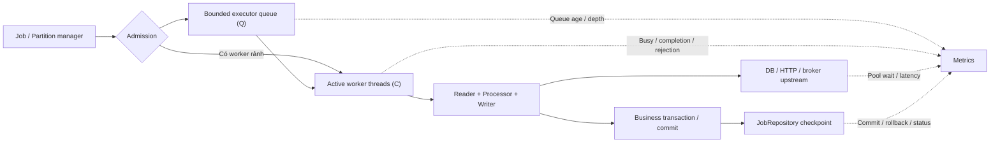
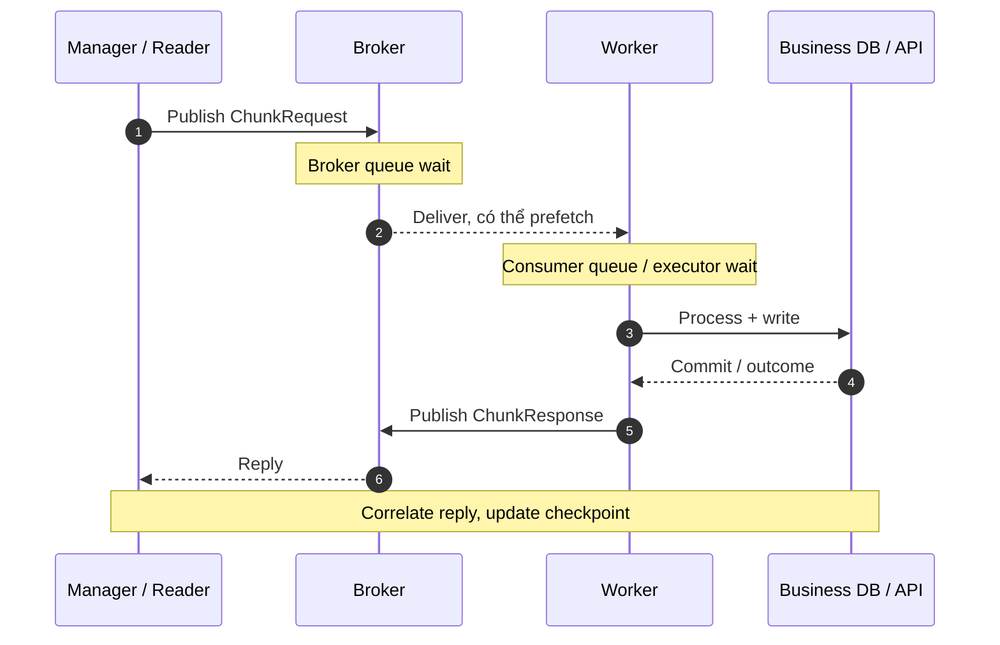

# Benchmark queue capacity trong Spring Batch: đo backlog, tail latency và ngưỡng quá tải

Khi chuyển một Spring Batch job từ xử lý tuần tự sang multi-threaded step hoặc partitioning, đội phát triển thường tăng `queueCapacity` từ 100 lên 10.000 với suy nghĩ “nhiều chỗ chờ hơn sẽ nhanh hơn”. Trong một load test, số task bị reject có thể giảm, nhưng job vẫn hoàn thành chậm, heap tăng, các partition cuối đợi rất lâu và khi database mất kết nối thì hàng nghìn task cùng retry. **Một hàng đợi lớn không tạo thêm công suất xử lý; nó chỉ thay đổi nơi và thời gian backlog tích tụ.**

**Benchmark queue capacity** là quy trình tạo tải có kiểm soát, thay đổi kích thước hàng đợi trong điều kiện tương đương, đo **thông lượng nghiệp vụ đã commit, thời gian đợi trong queue, độ trễ đầu-cuối, rejection, bộ nhớ, retry/restart và tác động lên dependency** để tìm mức queue hữu hạn phù hợp SLA. Kết quả đúng không nhất thiết là capacity lớn nhất hoặc queue luôn bằng 0, mà là khả năng hấp thụ burst **không đánh đổi tính đúng dữ liệu và khả năng khôi phục**.

Bài thuộc chương **Performance testing** của module **SPRING_BATCH_SCALING_OPERATIONS**: mở rộng Spring Batch với multi-threaded step, parallel steps, partitioning, remote partitioning và remote chunking cho workload lớn. Ví dụ nhắm tới **Spring Batch 5.x, Spring Framework 6.x, Java 17**, đồng thời nêu khác biệt giữa queue của `ThreadPoolTaskExecutor` và backlog trên broker. Phải kiểm tra phiên bản thật, transaction boundary, thread safety, số liệu tải và chính sách retry trước khi đưa cấu hình vào production.

**Sau bài này, bạn cần làm được:** xác định queue đang benchmark, tính công suất, dựng test có thể tái lập, đo P50/P95/P99 queue wait, tìm điểm bão hòa, chọn cấu hình có headroom và chứng minh không mất/trùng item khi rejection hoặc worker crash.

## 1. “Queue capacity” là capacity của hàng đợi nào?

Trong Spring Batch có nhiều điểm xếp hàng cùng xuất hiện. Chúng **không dùng chung một tham số**:

| Hàng đợi | Ai tạo việc? | Ai lấy việc? | Cấu hình/giới hạn tiêu biểu |
| --- | --- | --- | --- |
| **Local TaskExecutor queue** | Partition manager, split flow, application executor | Threads trong một JVM | `ThreadPoolTaskExecutor.setQueueCapacity(...)` |
| **Chunk scheduling / repeat** | Framework xử lý nhiều chunk | Chunk workers hoặc executor tùy Spring Batch version | Step executor, repeat policy và concurrency |
| **Remote partition request queue** | Manager/partition handler | Remote partition workers | Broker capacity, dispatch window, consumer concurrency |
| **Remote chunking request queue** | Manager reader tạo `ChunkRequest` | Workers process/write chunk | Broker backlog/retention/prefetch, in-flight cap |
| **Reply queue** | Remote workers | Manager reply consumer | Reply routing, consumer count, retention |
| **HTTP/JDBC pool wait queue** | Task cần connection | Connection pool | Max connections và checkout/lease timeout |
| **Scheduler backlog** | Cron/upstream producer | Job admission/coordinator | Run-level queue, priorities, business deadlines |

**Benchmark cần nêu chính xác queue mình đang thay đổi.** Một con số `queueCapacity=128` trong local executor không chứng minh broker có thể giữ 128 messages hay Hikari cho 128 connections.

Nếu task được gửi đồng bộ và caller có thể bị chặn, backpressure có thể tự xuất hiện ở nguồn phát việc. Nếu producer gửi không giới hạn sang broker, local consumer queue nhỏ có thể chỉ khiến backlog **di chuyển vào broker**; phải đo toàn tuyến.

## 2. Capacity, concurrency, backlog và throughput là bốn biến khác nhau

| Thuật ngữ | Đơn vị | Ý nghĩa |
| --- | --- | --- |
| **Queue capacity (Q)** | task/message chờ | Số phần việc có thể xếp hàng trước khi cần admission/rejection |
| **Active concurrency (C)** | task đang xử lý | Số phần việc thực sự dùng worker slots |
| **Arrival rate (λ)** | task/giây | Tốc độ nguồn gửi việc vào ranh giới đo |
| **Service/complete rate (μ_total)** | task/giây | Tốc độ hoàn tất của workers trong điều kiện đo |
| **Queue occupancy (Lq)** | task | Số task đang đợi, không bao gồm active |
| **Queue wait (Wq)** | ms/giây | Từ lúc submit/accept tới lúc worker bắt đầu |
| **End-to-end latency (W)** | ms/giây | Từ accept tới kết quả bền vững/response |
| **Rejection** | task/s và % | Task không được nhận do executor/admission đầy |
| **Backpressure** | điều khiển luồng | Tín hiệu ngược đến nguồn phát để giảm hoặc hoãn workload |

**Không nhầm `queueSize=0` với “không có việc”.** Workers có thể đang bận hết và source bị chặn, nên task mới chưa vào queue. Ngược lại, queue còn trống không loại trừ HTTP connection pool bên dưới đã cạn.

**Không nhầm `threadCount=16` với capacity 16 chunks/s.** Một worker hoàn tất chunk trung bình 400 ms lý tưởng có thể làm 2,5 chunks/s, nhưng nếu DB lock contention hoặc API throttling làm latency tăng đến 1 giây thì capacity giảm mạnh.

## 3. Sơ đồ: queue nằm trong chuỗi xử lý của partition step



Trong một `ThreadPoolExecutor`, việc nhận task và quyết định chạy ngay/xếp hàng còn phụ thuộc core size, max size và policy. Sơ đồ trình bày luồng logic, **không khẳng định tất cả task luôn phải qua queue trước khi có thread chạy**.

Khi queue đầy, hệ thống có thể reject, block producer, chạy trên caller hoặc lưu việc ở broker tùy implementation. Chính **hành vi đầy queue** là một đầu ra bắt buộc của benchmark; không được coi nó là chi tiết phụ.

## 4. Little's Law giúp gì và không giúp gì?

Theo Little's Law khi hệ ở trạng thái ổn định:

\[
L=\lambda W
\]

Ở queue, có thể dùng gần đúng:

\[
L_q=\lambda_q W_q
\]

Trong đó `Lq` là số task đang chờ trung bình, `λq` là rate task đi qua queue trong trạng thái ổn định, `Wq` là thời gian đợi trung bình. Phải dùng **cùng ranh giới quan sát và cùng cửa sổ**; không trộn arrival rate trước rejection với completed rate sau rejection.

Công suất lý tưởng khi `C` workers phục vụ mỗi task trong `S` giây:

\[
\mu_{\mathrm{ideal}}\approx\frac{C}{S}
\]

Ví dụ 12 worker, mỗi task trung bình 0,2 giây:

\[
\mu_{\mathrm{ideal}}\approx\frac{12}{0,2}=60\text{ task/s}
\]

Nếu producer liên tục gửi 80 task/s, backlog tích lũy trong mô hình đơn giản với capacity thực 60:

\[
\frac{dB}{dt}\approx80-60=20\text{ task/s}
\]

Với queue 200 và khởi đầu rỗng:

\[
T_{\mathrm{fill}}\approx\frac{200}{20}=10\text{ giây}
\]

Đây là **tình trạng quá tải không ổn định** nên Little's Law dạng steady state không dùng để suy latency giới hạn trong thời gian dài; `T_fill` chỉ là estimate từ rates cố định. Trong thực tế retries, tail latency, worker availability và dispatch burst làm thời điểm queue đầy biến động.

**Kết luận quan trọng:** Tăng queue từ 200 lên 2.000 chỉ trì hoãn thời điểm đầy khoảng 10 lần nếu arrival > service; nó không làm 60 task/s biến thành 80 task/s.

## 5. Queue capacity ảnh hưởng những gì?

Queue quá nhỏ có thể:

- Reject tasks khi có burst ngắn dù downstream còn khả năng xử lý sau burst.
- Làm manager/dispatcher fail sớm nếu handler không có backpressure thích hợp.
- Tạo overhead retry/redispatch không cần thiết.
- Kém hấp thụ jitter từ GC, network hay database.

Queue quá lớn có thể:

- Tạo **queue wait P99** rất cao, khiến job trễ SLA dù task không bị reject.
- Tăng memory footprint, GC pause và chi phí lưu pending futures/StepExecution references.
- Che nút thắt API/DB trong nhiều phút, làm operator phát hiện quá trễ.
- Tạo retry storm khi hàng nghìn task đang chờ được giải phóng cùng lúc.
- Làm shutdown/drain kéo dài; restart/checkpoint phức tạp hơn.
- Gây starvation cho job/flow khác dùng chung executor.

Queue capacity hợp lý là **điểm cân bằng**: đủ hấp thụ burst hợp lệ, nhưng vẫn truyền tín hiệu overload đủ sớm và không vượt memory, queue-age/SLA, dependency budget.

## 6. Hiểu chính xác ThreadPoolTaskExecutor trước khi benchmark

Với `ThreadPoolTaskExecutor` thông thường dùng JDK `ThreadPoolExecutor` và **queue capacity dương**:

1. Khi active threads dưới `corePoolSize`, executor thường tạo core thread cho task mới.
2. Khi core đã bận, task mới thường **xếp vào queue** cho đến khi queue đầy.
3. Khi queue đầy, executor có thể tăng threads tới `maxPoolSize`.
4. Khi max threads và queue đều không nhận được task, áp dụng rejection policy.

Ví dụ:

```text
corePoolSize = 4
maxPoolSize  = 12
queueCapacity = 32

Tại thời điểm đã có 4 tasks chạy:
- Những tasks tiếp theo có thể lấp 32 queue slots.
- Sau khi queue đầy, pool mới có thể mở rộng từ 4 đến 12.
- Nếu cả 12 threads đang bận và 32 tasks đang queue:
  task mới có thể bị reject.
```

**Điều dễ đo sai:** Đặt `core=4, max=12, queue=10.000` rồi benchmark với 200 tasks có thể chỉ dùng **4 threads**; vì queue chưa đầy nên maxPoolSize không phát huy hiệu lực. Tăng queue size lúc đó có thể **giảm throughput** so với queue nhỏ do không cho executor mở rộng lên max trong cùng tình huống.

Thêm các trường hợp cần ghi rõ:

- `queueCapacity=0` thường tạo kiểu handoff trực tiếp (`SynchronousQueue`); không có buffered queue, behavior tăng threads/reject khác queue dương.
- `queueCapacity` lớn nhưng không giới hạn có thể làm việc chờ rất lâu; tránh cấu hình vô hạn một cách vô ý.
- `SimpleAsyncTaskExecutor` không phải reusable thread pool; không áp các phép đo queue của `ThreadPoolTaskExecutor` cho nó.
- `TaskRejectedException` được Spring adapter dùng để báo rejection; không bắt rồi bỏ việc.
- `CallerRunsPolicy` có thể giảm tốc producer nhưng **thay đổi thread chạy task**, cần kiểm chứng thread-bound transaction và Spring Batch lifecycle.

Không so sánh `queueCapacity=16` với `queueCapacity=1024` mà giữ nguyên `core=4, max=12` rồi kết luận chỉ do memory/backlog: **effective concurrency có thể đã thay đổi**.

## 7. Viết giả thuyết đo lường trước khi chạy

Một benchmark đúng cần giả thuyết có thể bác bỏ, ví dụ:

> Với 8 active partition workers, chunk P95 khoảng 300 ms, burst kéo dài tối đa 2 giây và database còn headroom, tăng queue từ 16 lên 64 sẽ giảm rejection trong burst nhưng không làm queue wait P99 vượt 3 giây hoặc giảm committed throughput hơn 5%.

Đặt tiêu chí đo:

| Nhóm | Metric | Tiêu chí ví dụ |
| --- | --- | --- |
| Thông lượng | Unique business items committed/s | Không giảm đáng kể so với baseline |
| Queue | P50/P95/P99 queue wait, max age | P99 dưới deadline đã cấp cho waiting |
| Rejection | Rejected tasks/% | 0 ở tải mục tiêu; có hành vi rõ khi overload |
| Resource | Heap used, allocation/GC P99, CPU | Không vượt memory budget |
| Dependency | Hikari pending, HTTP 429/503, DB locks | Không đẩy overload xuống upstream |
| Correctness | Missing/duplicate operation keys | Không có sai lệch sau retry/restart |
| Recovery | Time to drain, restart successful | Trong RTO/runbook |
| SLA | End-to-end job elapsed | Đúng batch window |

**Đừng dùng tiêu chí “queue chưa từng đầy”**: một queue bounded cố ý có thể đầy dưới overload test, giúp hệ fail nhanh và tránh sụp đổ. Điều cần kiểm là **không mất work và hành vi quá tải theo policy**.

## 8. Phân biệt các pha tải phải benchmark

Một lần chạy 10 phút ở tốc độ đều không đủ. Cần ma trận:

1. **Baseline tuần tự:** Một worker, queue 0/nhỏ, xác nhận latency nội tại.
2. **Steady under capacity:** Arrival rate nhỏ hơn worker service rate.
3. **Near saturation:** Arrival rate khoảng 70–95% công suất đo được.
4. **Burst:** Tăng arrival đột ngột 2–10 lần trong khoảng ngắn.
5. **Sustained overload:** Arrival > service kéo dài tới lúc bounded queue đầy.
6. **Downstream slowdown:** Tăng API/SQL latency mà giữ nguyên input rate.
7. **Retry storm:** Tạo tỷ lệ lỗi transient và backoff đúng production.
8. **Worker crash/restart:** Có queued/in-flight tasks lúc JVM chết.
9. **Warm recovery/drain:** Dừng producer, đo thời gian queue được tiêu thụ.
10. **Scale-out/scale-in:** Đổi số worker/JVM, kiểm tra quota toàn cluster.

Quan trọng: Một batch hữu hạn thường có arrival dạng **“manager submit hàng loạt rồi chờ”**, khác một streaming producer liên tục gửi 80 tasks/s. Cần test cả **bulk dispatch** và **rate-controlled arrival** nếu hệ thật có cả hai.

## 9. Bộ biến đầu vào của benchmark

Ghi ít nhất:

| Biến | Giá trị ví dụ | Có giữ cố định khi so queue capacity? |
| --- | --- | --- |
| Dataset | 2,4 triệu records, cùng key distribution | Có |
| Chunk size | 200 items | Có |
| Partition count / gridSize | 16 / 32 | Có trong một series |
| Core/max threads | 8 / 16 | Có khi so riêng queue |
| Queue capacities | 0, 8, 32, 128, 512 | Biến chính |
| Input arrival shape | burst/steady/overload | Cùng profile |
| DB connection pool | 24 | Có |
| HTTP concurrency/rate limit | 16, quota đã biết | Có |
| Retry policy | 3 attempts với jitter | Có |
| JVM heap/GC/CPU | 2 GiB heap, 4 vCPU | Có |
| Worker replicas | 1, rồi 4 | Có trong từng topology |
| Logging/sampling | Low-cardinality metrics như nhau | Có |
| Failure injection | 429, DB slowdown, crash | Cùng lịch test |

Để so queue chính xác, đừng đồng thời đổi pool size, chunk size, worker replicas và HTTP latency. Đó là **4 thí nghiệm khác nhau**, nên kết quả không suy nguyên nhân được.

## 10. Mẫu cấu hình bounded ThreadPoolTaskExecutor

Trong Spring Framework 6.x / Spring Boot 3, có thể tạo executor riêng cho partition work:

```java
import java.util.concurrent.ThreadPoolExecutor;

import org.springframework.context.annotation.Bean;
import org.springframework.context.annotation.Configuration;
import org.springframework.scheduling.concurrent.ThreadPoolTaskExecutor;

@Configuration
public class PartitionExecutorConfig {

    @Bean(name = "partitionExecutor")
    public ThreadPoolTaskExecutor partitionExecutor() {
        ThreadPoolTaskExecutor executor = new ThreadPoolTaskExecutor();

        executor.setCorePoolSize(8);
        executor.setMaxPoolSize(16);
        executor.setQueueCapacity(32);
        executor.setThreadNamePrefix("partition-");
        executor.setRejectedExecutionHandler(
                new ThreadPoolExecutor.AbortPolicy());
        executor.setWaitForTasksToCompleteOnShutdown(true);
        executor.setAwaitTerminationSeconds(60);

        // Là bean Spring: framework khởi tạo/hủy theo lifecycle.
        return executor;
    }
}
```

**Giới hạn của mẫu:** Đoạn này chỉ tạo executor bean; còn Job, Step, Partitioner, DataSource và transaction manager phải do ứng dụng cung cấp. Spring Batch không tự bảo đảm mọi partition đều được nhận vào queue nếu manager phát quá nhiều và executor reject.

**Không dùng `CallerRunsPolicy` như mặc định bắt buộc**: nếu một partition task chạy trên manager thread, transaction/scheduling/timeout có thể khác đường thực thi bình thường. Nếu rejection xảy ra, job phải ghi trạng thái failure/recovery đúng, không catch rồi coi task đã xong.

## 11. Gắn executor vào local partitioning trong Spring Batch 5.x

Ví dụ một manager step với `TaskExecutorPartitionHandler` thông qua builder:

```java
import org.springframework.batch.core.Step;
import org.springframework.batch.core.repository.JobRepository;
import org.springframework.batch.core.step.builder.StepBuilder;
import org.springframework.batch.core.partition.support.Partitioner;
import org.springframework.beans.factory.annotation.Qualifier;
import org.springframework.context.annotation.Bean;
import org.springframework.scheduling.concurrent.ThreadPoolTaskExecutor;

@Bean
public Step partitionManagerStep(
        JobRepository jobRepository,
        Partitioner partitioner,
        @Qualifier("workerStep") Step workerStep,
        @Qualifier("partitionExecutor")
        ThreadPoolTaskExecutor partitionExecutor) {

    return new StepBuilder("partitionManagerStep", jobRepository)
            .partitioner("workerStep", partitioner)
            .step(workerStep)
            .gridSize(16)
            .taskExecutor(partitionExecutor)
            .build();
}
```

**Ý nghĩa:** `gridSize` được cung cấp cho partitioner/handler; partitioner quyết định số partitions thực tạo và active concurrency còn phụ thuộc executor. **Không coi gridSize là queue capacity** hoặc giả định mọi partition sẽ chạy đồng thời.

Ở benchmark, lưu cả số StepExecutions được tạo, partitions thực submit/complete, active threads, rejection và per-partition elapsed. Nếu `Partitioner` trả nhiều phần việc hơn dự kiến, queue có thể đầy ngay trong quá trình dispatch.

Với local partitioning, mỗi StepExecution nên có reader/writer state riêng hoặc thread-safe theo đúng cách dùng. Queue capacity **không giải quyết** vấn đề reader dùng chung cursor gây missing/duplicate records.

## 12. Test điều kiện đầy queue bằng một ví dụ tất định

Trước khi load-test Spring Batch thật, kiểm tra semantics của executor đơn thuần. Ví dụ Java/Spring, **chỉ dành cho môi trường test**, không chạy trên job production:

```java
import java.util.concurrent.CountDownLatch;
import java.util.concurrent.ThreadPoolExecutor;
import java.util.concurrent.TimeUnit;

import org.springframework.core.task.TaskRejectedException;
import org.springframework.scheduling.concurrent.ThreadPoolTaskExecutor;

public final class QueueSaturationProbe {

    public static void main(String[] args) throws Exception {
        ThreadPoolTaskExecutor pool = new ThreadPoolTaskExecutor();
        pool.setCorePoolSize(2);
        pool.setMaxPoolSize(4);
        pool.setQueueCapacity(3);
        pool.setRejectedExecutionHandler(
                new ThreadPoolExecutor.AbortPolicy());
        pool.initialize();

        CountDownLatch release = new CountDownLatch(1);
        CountDownLatch firstTwoStarted = new CountDownLatch(2);

        Runnable blockedTask = () -> {
            firstTwoStarted.countDown();
            try {
                if (!release.await(30, TimeUnit.SECONDS)) {
                    throw new IllegalStateException("Test timed out");
                }
            } catch (InterruptedException ex) {
                Thread.currentThread().interrupt();
            }
        };

        try {
            // Đảm bảo hai core workers thực sự đã bận.
            pool.execute(blockedTask);
            pool.execute(blockedTask);
            if (!firstTwoStarted.await(5, TimeUnit.SECONDS)) {
                throw new AssertionError("Core workers did not start");
            }

            // Queue có đúng 3 slot chờ.
            pool.execute(blockedTask);
            pool.execute(blockedTask);
            pool.execute(blockedTask);

            // Queue đầy nên executor có thể mở rộng lên max=4.
            pool.execute(blockedTask);
            pool.execute(blockedTask);

            // Bốn threads active + ba tasks queued; task thứ tám reject.
            try {
                pool.execute(blockedTask);
                throw new AssertionError("Expected task rejection");
            } catch (TaskRejectedException expected) {
                System.out.println("Rejection is bounded");
            }

            System.out.println("Active=" + pool.getActiveCount()
                    + ", queued=" + pool.getQueueSize());
        } finally {
            release.countDown();
            pool.shutdown();
        }
    }
}
```

Bài test minh họa hành vi khi các tasks chặn trên latch; nó **không đo throughput Spring Batch**. Trong môi trường cụ thể, nếu bị race với timeout 30 giây, kiểm tra test infrastructure trước. Không dùng sleep bất định thay cho latch khi muốn chứng minh queue đầy.

Với benchmark tích hợp, phải có thêm test **TaskRejectedException đi tới StepExecution FAILED/recoverable**, không bỏ task một cách âm thầm rồi báo job COMPLETED.

## 13. Instrument queue wait bằng TaskDecorator

Nếu chỉ đo queue occupancy, bạn không biết một task đợi bao lâu. `TaskDecorator` cho phép lấy timestamp khi submit và đo thời gian đến lúc runnable bắt đầu chạy trong executor.

```java
import java.util.concurrent.TimeUnit;

import io.micrometer.core.instrument.MeterRegistry;
import io.micrometer.core.instrument.Timer;
import org.springframework.core.task.TaskDecorator;

public final class QueueWaitTaskDecorator implements TaskDecorator {

    private final Timer queueWaitTimer;

    public QueueWaitTaskDecorator(MeterRegistry metrics) {
        queueWaitTimer = Timer.builder("batch.executor.queue.wait")
                .description("Submit-to-run scheduling delay")
                .tag("pool", "partition")
                .publishPercentileHistogram()
                .register(metrics);
    }

    @Override
    public Runnable decorate(Runnable delegate) {
        long submittedAtNanos = System.nanoTime();

        return () -> {
            queueWaitTimer.record(
                    System.nanoTime() - submittedAtNanos,
                    TimeUnit.NANOSECONDS);
            delegate.run();
        };
    }
}
```

Gắn vào executor **trước khi Spring khởi tạo bean**:

```java
executor.setTaskDecorator(new QueueWaitTaskDecorator(meterRegistry));
```

Trong đoạn config trên, truyền `MeterRegistry` như dependency của bean method hoặc dùng factory có DI; snippet gắn decorator chỉ minh họa **một dòng thay đổi**, không được copy ra ngoài context của executor.

**Biên giới đo:** Từ thời điểm decorator được tạo lúc task submitted đến lúc bắt đầu execute, bao gồm cả scheduling delay, không đo business work duration, broker queue wait hoặc metadata checkpoint. Với rejection, runnable không được chạy nên timer **không ghi một observation**; phải có rejected counter/event riêng.

Cần kiểm thử semantics decorator nếu task executor có future/callback hoặc custom wrapper vì task được decorate có thể không đúng runnable ban đầu. Không dùng TaskDecorator để sửa `ExecutionContext`/transaction state.

## 14. Gắn gauges và rejection metrics cho executor

Một `MeterBinder` quan sát đúng pool:

```java
import io.micrometer.core.instrument.Gauge;
import io.micrometer.core.instrument.binder.MeterBinder;
import org.springframework.beans.factory.annotation.Qualifier;
import org.springframework.context.annotation.Bean;
import org.springframework.scheduling.concurrent.ThreadPoolTaskExecutor;

@Bean
public MeterBinder partitionExecutorMetrics(
        @Qualifier("partitionExecutor")
        ThreadPoolTaskExecutor executor) {

    return registry -> {
        Gauge.builder("batch.executor.queue.size",
                        executor, ThreadPoolTaskExecutor::getQueueSize)
                .tag("pool", "partition")
                .register(registry);

        Gauge.builder("batch.executor.active",
                        executor, ThreadPoolTaskExecutor::getActiveCount)
                .tag("pool", "partition")
                .register(registry);

        Gauge.builder("batch.executor.pool.size",
                        executor, ThreadPoolTaskExecutor::getPoolSize)
                .tag("pool", "partition")
                .register(registry);
    };
}
```

Spring Boot có thể auto-bind `MeterBinder` khi Micrometer auto-configuration được kích hoạt; nếu tự quản lý registry, cần gọi `bindTo(registry)` qua đường cấu hình tương ứng. Kiểm tra metric name thực exporter xuất ra (Prometheus có thể đổi dấu chấm sang gạch dưới/đơn vị suffix).

**Rejection counter:** Bọc chỗ dispatch/TaskExecutor hoặc cài custom rejected handler có `Counter` low-cardinality và *rethrow*, không chỉ ghi metric rồi bỏ qua task. Không double-count khi handler và caller đều ghi. Trong Spring Batch, việc reject phải được phản ánh vào lifecycle/failure, không giấu lỗi dưới “queue đầy tạm thời”.

## 15. Multi-threaded chunk step và parallel flows cần benchmark khác local partition

Với multi-threaded step, thêm `TaskExecutor` vào step có thể thay đổi concurrency theo phiên bản Spring Batch; cần kiểm tra chính xác framework 5.x, thread safety của `ItemReader/ItemProcessor/ItemWriter` và cách repeat/chunk task được điều phối. **Không mặc định mỗi item sinh một task trong executor queue.**

Với parallel steps, executor có thể xếp hàng **flow/step tasks**, mỗi task rất dài so với chunk; queue capacity 16 không tương đương queue 16 chunks. Nếu flow A chiếm toàn bộ worker threads, flow B có thể chờ dù nghiệp vụ độc lập.

Với local partitioning, executor queue thường chứa phần việc **partition step**; một partition có thể chạy hàng phút. Vì vậy queue wait P99 có thể theo phút và tác động trực tiếp critical path.

| Mô hình | Đơn vị queue cần ghi nhãn | Latency kiểm tra |
| --- | --- | --- |
| Multi-threaded step | Chunk/repeat tasks theo implementation | Chunk scheduling wait và commit latency |
| Parallel steps | Flow/step execution | Flow-start delay, join time |
| Local partitioning | Partition StepExecution task | Dispatch-to-start, partition duration, manager elapsed |
| Custom async processor/writer | Item/callable/writer batch tùy cấu hình | Future wait, ordered writer behavior |

**Không trộn latency per-item với latency per-partition** trong cùng histogram; so sánh phải bảo toàn đơn vị và boundary.

## 16. Làm benchmark theo hai tầng: microtest và end-to-end job

**Tầng A: isolated executor microbenchmark**

- Dùng synthetic tasks có service time cố định hoặc phân phối kiểm soát.
- Đo task rejection, queue wait, active threads và behavior core/queue/max.
- Thay queue capacity độc lập với database/API.
- Dùng để xác minh semantics, memory và timer instrumentation.
- **Không kết luận từ đây rằng Spring Batch job sẽ nhanh tương ứng.**

**Tầng B: integrated Spring Batch workload**

- Chạy Job/Step thật với JDBC JobRepository và DataSource.
- Dùng dataset có size, skew, retries và update patterns giống production.
- Có source/target database, pool size, API/broker profile tương đương.
- Đo committed business outcomes và JobExecution/StepExecution status.
- Dựng failure/restart để chứng minh không mất/trùng item.
- Chạy mọi candidate cùng nguồn dữ liệu/version, hardware và thời lượng đủ dài.

**Tầng C (nếu remote): end-to-end topology**

- Manager → broker → workers → business target → reply/metadata.
- Đo queue ở **cả broker và local executor**, prefetch, consumer concurrency và unacked.
- Test worker pod crash, broker outage, redelivery, HPA/rolling deployment.
- Đánh giá durable backlog/disk, retention và quotas toàn cluster.

Một con số tối ưu ở tầng A chỉ là **ứng viên** để kiểm tra ở B/C, không phải cấu hình production đã đủ bằng chứng.

## 17. Ghi baseline và chuẩn hóa điều kiện đo

Mỗi lượt benchmark cần ghi:

```yaml
# Manifest thí nghiệm minh họa, do benchmark harness quản lý.
experimentId: queue-bench-2026-11-26-a
application: spring-batch-scaling
batchVersion: "5.2.x"
jdkVersion: "17"
topology: local-partitioning
datasetVersion: ledger-snapshot-17
expectedItems: 2400000
chunkSize: 200
partitions: 32
executor:
  corePoolSize: 8
  maxPoolSize: 16
  queueCapacity: 32
databasePool:
  maxConnections: 24
loadProfile: burst-plus-steady
retryLimit: 3
durationMinutes: 15
metrics:
  histogram: true
  warmupMinutes: 3
```

Đây là file mô tả do bài học minh họa, **không phải cấu hình được Spring Batch nạp tự động**. Ưu tiên ghi version code/image, JVM flags, CPU limits, data distribution, database indices, network latency, retry policy, seed ngẫu nhiên và thứ tự test.

**Không chạy tất cả candidates đồng thời trên cùng database** rồi so throughput: chúng sẽ tranh pool/locks và làm sai thí nghiệm. Nếu phải chia môi trường, cần chứng minh capacity và dữ liệu tương đương.

**Warmup và cache:** Một lượt đầu có thể chậm do JIT, connection establishment, DB buffer cache; cần warmup đủ, lặp thí nghiệm và đổi thứ tự ngẫu nhiên giữa các candidates để giảm bias.

## 18. Java: tạo một burst có kiểm soát và ghi rejection

Đây là microbenchmark **chỉ cho executor**, không thực thi Spring Batch job. Nó cố định `core=max=8` để so sánh queue capacity **không bị lẫn với thay đổi số worker**, tạo 200 task mô phỏng I/O 200 ms và kiểm tra không task nào biến mất mà không được đếm.

```java
import java.util.concurrent.CountDownLatch;
import java.util.concurrent.TimeUnit;
import java.util.concurrent.atomic.AtomicInteger;

import org.springframework.core.task.TaskRejectedException;
import org.springframework.scheduling.concurrent.ThreadPoolTaskExecutor;

public final class ExecutorBurstExperiment {

    public static void runOnce(int queueCapacity) throws Exception {
        ThreadPoolTaskExecutor executor =
                new ThreadPoolTaskExecutor();
        executor.setCorePoolSize(8);
        executor.setMaxPoolSize(8);
        executor.setQueueCapacity(queueCapacity);
        executor.initialize();

        int requests = 200;
        CountDownLatch accounted = new CountDownLatch(requests);
        AtomicInteger accepted = new AtomicInteger();
        AtomicInteger rejected = new AtomicInteger();
        AtomicInteger completed = new AtomicInteger();
        AtomicInteger peakQueue = new AtomicInteger();

        try {
            for (int i = 0; i < requests; i++) {
                try {
                    executor.execute(() -> {
                        try {
                            Thread.sleep(200); // Giả lập I/O, KHÔNG là DB thật.
                            completed.incrementAndGet();
                        } catch (InterruptedException ex) {
                            Thread.currentThread().interrupt();
                        } finally {
                            accounted.countDown();
                        }
                    });
                    accepted.incrementAndGet();
                    peakQueue.accumulateAndGet(
                            executor.getQueueSize(), Math::max);
                } catch (TaskRejectedException ex) {
                    rejected.incrementAndGet();
                    accounted.countDown();
                }
            }

            if (!accounted.await(30, TimeUnit.SECONDS)) {
                throw new IllegalStateException(
                        "Benchmark tasks did not settle");
            }
            System.out.printf(
                    "queue=%d accepted=%d rejected=%d completed=%d peakObserved=%d%n",
                    queueCapacity, accepted.get(), rejected.get(),
                    completed.get(), peakQueue.get());
        } finally {
            executor.shutdown();
        }
    }

    public static void main(String[] args) throws Exception {
        for (int capacity : new int[]{0, 8, 32, 64, 256}) {
            runOnce(capacity);
        }
    }
}
```

**Đừng hiểu sai kết quả:**

- `peakObserved` chỉ được lấy mẫu ngay sau submit, có thể bỏ qua đỉnh queue giữa hai mẫu; trong test nghiêm túc lấy sample định kỳ hoặc instrumentation.
- `Thread.sleep(200)` mô phỏng task giữ worker, không giả lập database lock, network jitter, GC hay commit.
- `accepted + rejected = requests` cần đúng; `completed` cũng phải được đối chiếu, nhưng trong mẫu task bị interrupt có thể không tăng completed, và cần tách aborted count nếu kiểm tra shutdown.
- Queue nhỏ có thể có nhiều rejected; mẫu **đếm** rejection thay vì bỏ qua. Với Spring Batch thật, **không được catch TaskRejectedException rồi âm thầm coi partition đã hoàn tất**.
- Một burst submit trong một loop không đo steady arrival rate; đừng suy kết quả microtest thành production throughput.

Để mô phỏng steady rate, dùng load driver với **open-loop arrival schedule** và đồng hồ monotonic, đồng thời ghi độ trễ submit (nếu source bị block). Dùng closed-loop driver riêng nếu workload production thực chất chỉ gửi task tiếp theo khi task trước đã hoàn thành.

## 19. Open-loop và closed-loop load driver cho hai kết luận khác nhau

| Load driver | Cách phát task | Thích hợp | Rủi ro phép đo |
| --- | --- | --- | --- |
| **Open-loop** | Gửi theo lịch/rate độc lập với completion | Test overload, backlog, burst, rate limiter | Phải xử lý và đếm rejection rõ |
| **Closed-loop** | Chỉ gửi task mới sau khi task cũ hoàn tất | Mô phỏng số user/producer hữu hạn, backpressure tự nhiên | Có thể che overload vì arrival rate tự giảm |
| **Bulk dispatch** | Manager submit hàng trăm partitions rất nhanh | Local partition manager, startup spike | Peak queue phụ thuộc số partitions và submission sequence |
| **Event-driven** | Một nguồn upstream/broker tạo message khi có dữ liệu | Remote chunking, messaging integration | Cần đo broker queue và sender backpressure |

**Coordinated omission:** Một closed-loop benchmark giảm tốc phát tác vụ khi service bị chậm, nên có thể đánh giá thấp độ trễ mà người dùng/task đến theo lịch thực phải chịu. Với open-loop cần giữ timestamp **scheduled arrival**, tính latency từ scheduled/accepted đến completion phù hợp SLO và ghi dropped/rejected.

Không tự tạo vô hạn futures trong load driver để đạt “100.000 tasks/s”: có thể khiến **driver chính là bottleneck**. Đo CPU/GC/memory của driver và xác nhận source đúng profile yêu cầu.

## 20. Đo hàng đợi đúng: queue size chưa đủ

Một bảng metric tối thiểu khi benchmark local executor:

| Số đo | Nguồn | Tại sao cần? |
| --- | --- | --- |
| `queue.size/current/peak` | Executor queue | Phát hiện mức chiếm queue |
| `queue.wait P50/P95/P99` | TaskDecorator/histogram | Đo tail latency trước khi task chạy |
| `active threads / pool size` | Executor | Thấy effective concurrency thật |
| `submitted/accepted/rejected/completed` | Dispatcher + executor | Hạch toán mọi task |
| `task service duration` | Runnable/partition listener | Phân biệt waiting với processing |
| `queue drain time` | Sau khi stop producer | Chi phí recovery/shutdown |
| `heap used/GC pauses/allocations` | JVM metrics/JFR | Queue memory/retention |
| `Hikari active/pending/acquire/usage` | Connection pool | Worker bị chậm ở database |
| `HTTP 429/503/in-flight/P99` | Client/upstream | Rate/concurrency limit thực |
| `JobRepository metadata latency` | DB/traces/metrics | Nhiều StepExecution/chunk gây contention |
| `committed items/s` | Business output/operation ledger | Thông lượng có ích sau rollback/retry |
| `duplicates/missing keys` | Reconciliation | Không đổi correctness lấy tốc độ |

**Hạch toán phải nhất quán** tại ranh giới quan sát:

\[
N_{\mathrm{submitted}}
=N_{\mathrm{accepted}}+N_{\mathrm{rejected}}
\]

Sau khi mọi task đã settled (hoặc có trạng thái rõ):

\[
N_{\mathrm{accepted}}
=N_{\mathrm{success}}+N_{\mathrm{failed}}+N_{\mathrm{cancelled}}
\]

Nếu không có trạng thái `cancelled/unknown` thì không được “điền số” để phương trình đẹp. Với Spring Batch, một task partition có thể fail và được restart sau đó; số attempts không bằng số unique partitions hay unique business records.

## 21. Prometheus: queue wait histogram, depth và rejection

Giả sử custom Micrometer Timer `batch.executor.queue.wait` được export dưới tên `batch_executor_queue_wait_seconds` và bật histogram buckets. Với Prometheus, ví dụ:

```promql
# P99 queue wait trên pool partition trong 5 phút:
histogram_quantile(
  0.99,
  sum by (le, pool) (
    rate(batch_executor_queue_wait_seconds_bucket{
      pool="partition"}[5m])
  )
)
```

Metric name thực tế có thể khác tùy registry, naming convention và exporter. Hãy **tra tên metric thực được xuất** trước khi copy query. Một P99 không ý nghĩa nếu chỉ có ba tasks trong 5 phút; xem count/volume và cả max/oldest age.

Ví dụ rate rejection khi ứng dụng có counter custom `batch_executor_task_rejected_total`:

```promql
sum by (pool) (
  rate(batch_executor_task_rejected_total{
    pool="partition"}[5m])
)
```

**Đừng kết luận queue không chờ chỉ vì histogram không có sample:** Nếu task bị reject trước khi chạy, TaskDecorator không quan sát queue wait cho task đó. Quan sát rejection và queue depth đồng thời.

Một dashboard tốt có hai dải: **queue occupancy + queue wait** và **committed throughput + resource saturation**. Nếu queue chờ tăng nhưng throughput vẫn bằng nhau, queue mới chỉ lưu backlog; nếu throughput giảm, tìm downstream bottleneck.

## 22. Memory benchmark: queue giữ lại những object gì?

Không phải task nào cũng tốn 100 bytes. Một Runnable có thể capture `List<Item>`, DTO, partition context, futures, logging context hoặc reference tới response lớn.

Ước lượng sơ bộ:

\[
M_{\mathrm{queue}}\approx
Q_{\mathrm{occupied}}\times M_{\mathrm{retainedPerTask}}
\]

Ví dụ trung bình một pending task giữ **16 KiB** qua object graph, queue đang chứa 4.000 tasks:

\[
M_{\mathrm{queue}}\approx4000\times16\text{ KiB}
\approx62{,}5\text{ MiB}
\]

Đây là *retained bytes* minh họa, không phải kích thước của reference trong `LinkedBlockingQueue`. Queue còn có node objects, futures, headers và overhead khác; đo bằng **JFR allocation, heap histogram/retained size** trên tải thật.

Nếu một Runnable vô ý capture một `Chunk` chứa 10.000 DTOs, memory footprint có thể lớn hơn nhiều. Không lấy kích thước serialized message trên broker làm kích thước Java object in-heap.

**Benchmark memory cần ghi:** JVM heap/GC, peak old-gen occupancy, full GC pauses, OOM events, executor queue occupancy và retained-size sample. Queue có `capacity=10000` không nhất thiết cấp phát 10.000 payload lúc khởi tạo; điều nguy hiểm là số task **được phép giữ lại** khi quá tải.

## 23. Local partitioning: gridSize, queued partitions và stragglers

Trong local partitioning, manager tạo `StepExecution` theo `Partitioner`; `gridSize` là input cho partitioner/handler, **không đồng nghĩa số worker threads hoặc queue slots**.

Một test với `gridSize=128` và executor max 8, queue 32 có thể gặp:

- Các partition được xếp hàng lâu, dù mỗi partition chạy nhanh.
- Manager submit nhiều hơn executor có thể nhận và gặp rejection.
- 128 StepExecutions tạo metadata overhead trong JobRepository.
- Partition cuối cùng có 10 lần dữ liệu so với median, quyết định thời điểm manager join.
- Một số partitions không được chạy nếu rejection bị bắt sai trong custom handler.

Vì vậy phải đo đồng thời:

```text
manager dispatch time
  + executor queue wait per partition
  + partition processing/commit time
  + manager aggregation/metadata update time
  = critical-path stage elapsed (mô hình đơn giản)
```

Không cộng queue wait của 128 partitions thành wall-clock; các phần việc chờ/running đồng thời và critical path nằm trên chuỗi phụ thuộc thực. Xem timeline start/finish từng partition và max/median skew.

**Chiến lược kiểm thử:** Giữ số partitions tạo ra cố định (ví dụ 32), thử Q=0/8/32/128. Sau đó giữ Q ổn định và thử partition count 16/32/64. Như vậy tách hiệu ứng queue capacity khỏi hiệu ứng số phần việc và metadata.

## 24. Multi-threaded step: kiểm tra thread safety trước khi tối ưu queue

Với multi-threaded step, khi Spring Batch thực hiện các tác vụ trên nhiều threads, phải kiểm tra version/cấu hình để biết **đơn vị work thực chạy trong executor** và transaction boundary. Reader hoặc writer không thread-safe có thể làm sai dữ liệu ngay cả khi queue P99 rất đẹp.

Cần test:

- Reader stateful có đọc mỗi source key đúng một lần trong điều kiện concurrency không?
- Processor có shared mutable cache, counter hoặc state race không?
- Writer có thread-confined transaction/buffer đúng không?
- `ExecutionContext` checkpoint có restart được sau crash giữa chunks không?
- Có bảo đảm không xử lý trùng remote side effect khi chunk rollback không?
- Timer đo queue wait có thuộc chunk task thực hay chỉ framework wrapper?

Trong Spring Batch 5.x, `throttleLimit` legacy bị deprecate cho multi-threaded step; không nên chỉ tinh chỉnh property này mà bỏ qua executor/repeat operations và thread safety. **Benchmark performance không được bỏ qua output reconciliation.**

## 25. Parallel steps: queue công bằng và shared executor

Hai flow song song có thể cùng mượn một executor hoặc gọi chung API/DB. Nếu một flow A submit 100 tasks dài, flow B chỉ có 2 tasks ngắn, B có thể chờ ở cuối queue dù business SLA của B quan trọng hơn.

Các câu hỏi benchmark:

1. Executor có đang dành riêng cho partition manager hay dùng chung với split flow/scheduler?
2. FIFO queue có gây **head-of-line blocking** cho task ngắn đứng sau task dài?
3. Có giới hạn job-level admission để job A không nuốt toàn bộ slots?
4. Có resource budget riêng cho flows có SLA khác nhau?
5. Giảm queue có tạo fairer scheduling hay chỉ tăng rejection?
6. Có cần tách executors, priority queues hoặc rate budget theo work class?

**Không mặc định một priority queue là an toàn cho Spring Batch**: thay đổi thứ tự dispatch có thể phá các giả định nghiệp vụ nếu steps/partitions phụ thuộc data order. Chỉ ưu tiên khi tasks độc lập và có cơ chế restart/ownership rõ ràng.

## 26. Remote partitioning: broker queue không giống executor queue

Trong remote partitioning, manager gửi request để worker thực thi **partition StepExecution**. Chỉ số local queue của một JVM không cho biết broker đang giữ bao nhiêu request chờ trên toàn cluster.

Cần đo:

| Lớp | Queue/capacity | Metric |
| --- | --- | --- |
| Manager | Request dispatch window, pending partition futures | Active partitions, dispatch-to-ack |
| Broker | Topic/queue depth, bytes, retention, partitions | Oldest age, lag, unacked |
| Worker consumer | Prefetch, consumer concurrency, executor queue | Delivered-but-not-running wait |
| Business DB/API | Connections, in-flight calls, rate budget | Checkout wait, 429/503, transaction P99 |
| Metadata DB | Shared JobRepository updates | StepExecution create/update latency |

Broker queue có thể **durable** và tiêu thụ disk/storage; local executor queue thường **volatile trong JVM**. Khi worker JVM crash, pending local tasks không tự được “phát lại” một cách đúng nghiệp vụ chỉ vì broker còn sống. Recovery phải dựa trên metadata, broker delivery/ack và idempotent writer.

**Thử nghiệm quan trọng:** Manager phát 200 partitions, workers 8 slots. Đo thời gian dispatch, broker oldest age, worker receive-to-start, partition execution P99 và manager finish. Sau đó đổi **broker prefetch** mà không đổi worker count để thấy backlog chuyển từ broker sang queue/unacked phía worker.

## 27. Remote chunking: giới hạn in-flight và prefetch quan trọng hơn queue depth đơn lẻ

Remote chunking thường có **manager đọc item**, gom `ChunkRequest` rồi gửi qua broker cho workers process/write và trả `ChunkResponse`. Manager có thể phát nhanh hơn worker xử lý.

Nếu broker prefetch=100 nhưng worker executor chỉ có 8 threads, phần lớn messages được nhận trước có thể nằm chờ **sau broker delivery**, làm broker queue depth giảm trong khi end-to-end latency tăng. Nếu reply path chậm, manager có thể giữ nhiều outstanding requests dù writer đã commit.

Khi benchmark, phải đo từng boundary:



Các biến riêng:

- `maxInFlightChunks` của manager nếu implementation hỗ trợ window/credit.
- Broker queue capacity **theo messages và bytes**, retention, TTL/DLQ.
- Consumer concurrency/prefetch và local executor queue.
- Reply queue age, correlation timeout và redelivery.
- Writer throughput, business transaction commit duration và API quota.

**Không có một property `queueCapacity` chuẩn duy nhất cho toàn bộ remote chunking pipeline.** Test phải mô tả rõ phần mềm/middleware nào giữ queue, giới hạn ở đâu và tín hiệu backpressure truyền ngược đến manager ra sao.

Nếu worker đã commit nhưng reply mất, replay có thể xử lý chunk lần nữa. Do đó mỗi candidate queue capacity phải qua test **idempotency + checkpoint/restart**, không chỉ đo “messages processed/s”.

## 28. Công thức sơ bộ để chọn capacity theo burst, latency và memory

Ba giới hạn nên xem đồng thời:

**(A) Burst absorption:** Với arrival peak `λ_peak`, sustainable service `μ_safe` và burst duration `T_burst`, backlog thêm gần đúng:

\[
Q_{\mathrm{burst}}\approx
\max(0,\lambda_{\mathrm{peak}}-\mu_{\mathrm{safe}})
\times T_{\mathrm{burst}}
\]

**(B) Queue wait budget:** Với FIFO, service rate ổn định `μ_safe` và queue wait cho phép `Wq_budget`:

\[
Q_{\mathrm{latency}}\lesssim
\mu_{\mathrm{safe}}\times W_{q,\mathrm{budget}}
\]

**(C) Memory budget:** Với retained bytes mỗi pending task `M_task` và memory được phép cấp cho queue `B_queue`:

\[
Q_{\mathrm{memory}}\lesssim
\frac{B_{\mathrm{queue}}}{M_{\mathrm{task}}}
\]

Ví dụ:

- Peak arrival 90 tasks/s, safe completion 60 tasks/s trong burst dài 2 giây.
- Backlog burst cần khoảng `(90-60)×2=60 tasks`.
- Queue wait budget 2 giây ⇒ `Q_latency≲120` theo mô hình đơn giản.
- Memory budget 1 MiB/task × 80 MiB ⇒ `Q_memory≲80`.
- Một ứng viên `Q=64` hấp thụ burst gần 60 và ở dưới hai bound còn lại.

Đây **không phải công thức chứng minh P99**: queues có arrivals/services ngẫu nhiên, task sizes khác nhau và retries; cần đo tải thật. Nếu `Q_burst` lớn hơn `min(Q_latency,Q_memory)`, **không có queue size nào đồng thời thỏa tất cả** — phải giảm admission/rate, tăng safe capacity, co giãn deadline hoặc thay đổi protocol.

## 29. Cách chọn winner từ một bảng benchmark

Ví dụ **số liệu giả định**, thí nghiệm dùng `core=max=16`, cùng workload, I/O latency và burst profile. Rejection được **hạch toán** và workload không tự coi rejected là completed:

| Queue cap | Burst rejection | Queue wait P99 | Peak queue | Committed throughput | Nhận xét |
| ---: | ---: | ---: | ---: | ---: | --- |
| 0 | 44 tasks | 0,01 s | 0 | 72 items/s | Không có buffer; nhiều lần reject |
| 16 | 28 tasks | 0,22 s | 16 | 72 items/s | Đỡ hơn nhưng chưa chịu được burst |
| 64 | 0 | 0,76 s | 60 | 72 items/s | Hấp thụ burst hợp lệ |
| 256 | 0 | 0,76 s | 60 | 72 items/s | Không cải thiện kết quả so với 64 |

Đây là một bảng **minh họa logic chọn candidate**, không phải số đo của Spring Batch hoặc thiết bị thực. Khi source có thể retry/requeue rejected operations, thông lượng business cuối cùng có thể cần một cửa sổ đo dài hơn; không so một bảng thiếu recovery semantics.

**Diễn giải:** Q=256 không giúp hơn Q=64 với burst chỉ tích lũy 60 tasks, còn cho phép backlog lớn hơn trong **outage kéo dài**. Q=64 đáng mang đi benchmark tải near-saturation/failure trước khi chốt. Nếu bộ xử lý tăng concurrency khác nhau khi queue thay đổi (core < max), phải test riêng để loại confounder.

**Không chọn winner chỉ vì rejected=0.** Nếu P99 queue wait 90 giây và SLA cần 10 giây, queue lớn có thể tạo kết quả tệ hơn fail-fast có kiểm soát.

## 30. Fault injection: khi queue đầy đúng lúc dependency hỏng

Một benchmark production-ready phải kiểm tra failure windows:

| Kịch bản | Điều tạo trong test | Điều phải assert |
| --- | --- | --- |
| Overload 2 phút | Producer nhanh gấp đôi workers | Queue bounded, overload observable, không OOM |
| Executor rejection | Tất cả worker slots và queue đầy | Job/Step ghi failure hoặc reschedule an toàn; không silent drop |
| Worker crash với queue non-empty | Kill JVM giữa 100 pending tasks | Work được xác định qua durable state, recovery không bỏ sót |
| DB pool exhaustion | Giữ connection trong test DB | Queue wait và Hikari pending phân biệt được |
| API 429 + backoff | Stub rate-limit 30% calls | Không retry storm; total attempts hữu hạn |
| Partition skew | Một partition lớn gấp 10 lần | Queue P99 và critical path được phân tích |
| Manager crash sau dispatch | Manager chết khi partitions chạy | Không reassign khi old owner còn side effect |
| Broker redelivery | Cùng ChunkRequest giao hai lần | Writer idempotent theo operation key |
| Reply loss sau commit | Worker đã ghi nhưng reply mất | Reconciliation tránh duplicate |
| Metadata DB outage | Checkpoint chậm hoặc fail | Không báo COMPLETED giả, restart có kiểm soát |
| HPA scale-out | 4→12 replicas dưới tải | Không vượt DB/API quota toàn cluster |
| Shutdown/drain | Stop producer, graceful shutdown | Queue drain trong deadline, không mất work |
| Long GC pause | Worker pause trong vài giây | Timeout/alert không đánh nhầm worker dead |
| Poison item | Một input fail vĩnh viễn | DLQ/quarantine theo rule, không retry vô hạn |

**Không cố tình tạo deadlock/kill database hoặc gửi workload quá quota vào production của đối tác.** Sử dụng isolated DB/broker, fake external API, fault-injection hooks/latches và data snapshot đại diện.

## 31. Rejection/backpressure phải có business semantics rõ

Với Spring Batch, một task bị reject **không được xem là đã xử lý**. Các chính sách phổ biến:

| Policy | Cách ứng xử khi queue đầy | Cần chú ý |
| --- | --- | --- |
| `AbortPolicy` / TaskRejectedException | Báo lỗi rõ cho caller | Propagate để manager/StepExecution thất bại và recovery đúng |
| `CallerRunsPolicy` | Caller trực tiếp chạy task | Có thể chặn manager, thay đổi transaction/thread affinity; test kỹ |
| Blocked submit với timeout | Đợi slot thay vì reject ngay | Tránh deadlock khi caller đang giữ lock/DB connection |
| `DiscardPolicy` / `DiscardOldestPolicy` | Có nguy cơ drop task | **Không thích hợp** cho batch bắt buộc xử lý đủ dữ liệu |
| Durable broker + bounded dispatch | Lưu work bền vững và giảm consumer dispatch | At-least-once, ACK/retry/replay/idempotency vẫn bắt buộc |

Nếu Java code catch `TaskRejectedException` rồi chỉ log warning, manager có thể đánh dấu một partition thành công dù chưa chạy; đó là **data loss**, không phải backpressure. Mọi rejection phải có một trong các outcome **rescheduled durably, failed/restartable hoặc quarantined with approval**.

Nếu dùng `CallerRunsPolicy` làm backpressure, một partition step có thể chạy trên thread manager/dispatch, ảnh hưởng critical path và lock/transaction semantics. Không mặc định policy đó là an toàn cho mọi handler.

## 32. Case study: hàng đợi lớn không cứu được sustained overload

Giả sử job xử lý **3.600.000 records**, chunk size 200, tương đương:

\[
N_{\mathrm{chunks}}=\frac{3.600.000}{200}=18.000
\]

Một manager có thể tạo `60 ChunkRequests/s`. Có 12 worker slots, thời gian xử lý trung bình một chunk là `0,25 s` khi downstream khỏe:

\[
\mu_{\mathrm{safe}}\approx
\frac{12}{0,25}=48\text{ chunks/s}
\]

Backlog tăng lý tưởng:

\[
\Delta B/\Delta t\approx60-48=12\text{ chunks/s}
\]

**Nếu queue broker/local thêm đang rỗng:**

| Queue capacity | Thời gian lấp đầy ước lượng | Queue wait gần đúng ở mức đầy |
| ---: | ---: | ---: |
| 12 | 1 giây | 12/48 = 0,25 s |
| 48 | 4 giây | 48/48 = 1,0 s |
| 240 | 20 giây | 240/48 = 5,0 s |
| 1.200 | 100 giây | 1.200/48 = 25,0 s |

Các con số là **mô hình FIFO, service/arrival cố định**, chưa bao gồm network, reply, retries và HTTP/DB degradation. Nếu manager dừng phát sau khi buffer đầy, backlog ở tầng trước có thể vẫn tiếp tục tăng. Nếu không có tín hiệu backpressure và quota broker vô hạn, vấn đề chỉ chuyển nơi.

### Có nên tăng worker từ 12 lên 24?

Nếu latency chunk vẫn 0,25 s và downstream có headroom, công suất lý tưởng 96 chunks/s, cao hơn arrival 60 ⇒ queue có thể xả dần.

Nhưng nếu tăng concurrency làm API/DB chậm thành 0,60 s mỗi chunk:

\[
\mu_{\mathrm{actual}}\approx
\frac{24}{0,60}=40\text{ chunks/s}
\]

**Còn thấp hơn 48 chunks/s ban đầu**, backlog tăng nhanh hơn. Chính benchmark dependency P95, pool pending, 429 và lock waits sẽ phân biệt hai kịch bản.

### Quyết định

- Chọn queue hữu hạn đủ cho burst hợp lệ, chẳng hạn 48 hoặc 64 **nếu queue wait budget và memory cho phép**.
- Thêm admission/rate limiter tại manager để steady dispatch không vượt safe completion.
- Nếu cần throughput >48 chunks/s, tối ưu downstream hoặc tăng capacity **đã được benchmark**, không chỉ tăng queue.
- Test rollback/reply loss sau business commit; không chạy lại 18.000 chunks mù quáng khi manager timeout.
- Xem mục tiêu cuối là **3,6 triệu unique business records committed** trong batch window, không phải chỉ “manager phát xong 18.000 messages”.

## 33. Runbook khi queue capacity benchmark cho kết quả bất thường

1. **Định danh queue:** Local executor, broker, HTTP/JDBC pool wait hay manager in-flight? Ghi cả đơn vị task/chunk/partition.
2. **Kiểm tra source:** Arrival profile, open-/closed-loop, submit latency, test driver CPU/GC.
3. **Chụp cấu hình:** Core/max threads, queue capacity, rejection policy, gridSize, chunk size, worker replicas.
4. **Đo thực thi:** Active threads, peak queue depth, queue wait histogram, task processing P95/P99, rejected.
5. **Hỏi có mở rộng pool không:** Với core < max, queue lớn có thể khiến pool không đạt max threads.
6. **Kiểm tra downstream:** Hikari acquire/usage, SQL locks, HTTP 429/503, API P99 và JobRepository contention.
7. **Xác nhận durability:** Local queue mất khi JVM chết; broker queue có retention/ACK như thế nào?
8. **Xem retry:** Có client retry, Spring Batch retry và broker redelivery nhân requests không?
9. **Đối soát output:** Accepted, rejected, failed, completed; unique business keys không thiếu/trùng.
10. **Xem tail latency:** P99 queue wait/oldest age và time-to-drain có vượt SLA/RTO không?
11. **Thay đúng một biến:** Queue capacity hoặc core/max hoặc prefetch/consumer concurrency, không tất cả cùng lúc.
12. **Lặp benchmark:** Warmup, nhiều run, dataset/seed giống nhau, randomize order, ghi confidence/variance.
13. **Chọn candidate:** Ưu tiên committed throughput bền vững, bounded wait/memory, khả năng phục hồi, không phải queue lớn nhất.
14. **Đóng vòng:** Ghi cấu hình, thresholds, alert, rollback plan và fault test regression.

Nếu queue rất lớn mà utilization thấp, xem **core threads, producer blocking, executor sharing và dependency wait** trước khi tăng capacity thêm. Nếu queue bằng 0 mà CPU/DB đã 100%, khả năng cao **capacity xử lý** mới là vấn đề.

## 34. Sai lầm phổ biến khi benchmark queue capacity

1. **So queue 16 với 1024 nhưng core < max**, làm số thread hoạt động khác nhau.
2. **Coi queue capacity là số workers**, nhầm buffering với concurrency.
3. **Coi queue lớn là tăng throughput**, trong khi service rate không đổi.
4. **Chỉ đo queue size trung bình**, bỏ P99 wait và oldest age.
5. **Không đếm rejected tasks**, chỉ đo những tasks đã chạy rồi kết luận 100% thành công.
6. **Catch TaskRejectedException rồi bỏ qua**, gây missing partitions/items.
7. **Dùng unbounded queue** vì sợ rejected, gây memory/GC và tail latency cao.
8. **So microbenchmark Thread.sleep với production DB workload**, không có lock/commit/checkpoint.
9. **Chạy nhiều candidates cùng DB**, khiến kết quả phụ thuộc các test đang cạnh tranh.
10. **Không warmup** hoặc chỉ đo một lượt, kết luận từ JIT/cache transient.
11. **Dùng closed-loop driver cho tải peak thật open-loop**, che overload.
12. **Không ghi source rate khi rejection**, throughput nhìn đẹp vì driver giảm tải.
13. **Cộng latency của parallel partitions** thành wall-clock job duration.
14. **Không đo JobRepository overhead**, bỏ contention nhiều StepExecutions.
15. **Đo writer latency per item từ writer call per chunk**, sai đơn vị.
16. **Tăng prefetch cho broker rồi kết luận queue giảm**, trong khi backlog chuyển thành unacked.
17. **Không tính reply queue và in-flight requests của remote chunking**.
18. **Thử queue mà không giữ chunk size/partition range cố định**, không biết biến nào tác động.
19. **Tăng gridSize và queue đồng thời**, confound cả metadata, skew và worker count.
20. **Chỉ nhìn CPU**, bỏ Hikari pending/HTTP 429/DB waits.
21. **Không kiểm tra retained objects**, pending task capture payload lớn gây OOM.
22. **Không test shutdown/crash với queue non-empty**, không biết work có thể replay không.
23. **Cho CallerRunsPolicy chạy partition manager task không kiểm chứng**, đổi thread/transaction behavior.
24. **Tin StepExecution COMPLETED là business output exactly-once**, bỏ unique-key reconciliation.
25. **Không quan tâm throughput sau retry/restart**, tối ưu job nhanh nhưng ghi trùng.
26. **Không đo queue age khi system idle**, báo stuck sai hoặc bỏ data lag.
27. **Lấy một P99 trên vài samples** rồi thay đổi production configuration.
28. **Không tính pool limit toàn cluster khi scale workers**, vượt quota upstream.
29. **Không có SLA bound**, lấy queue rejection=0 làm thành công dù chờ hàng phút.
30. **Không có backpressure đến nguồn phát**, chỉ chuyển backlog sang broker hoặc database.

## 35. Checklist benchmark queue capacity trước production

- [ ] Xác định chính xác queue đang đo: executor, broker, reply queue, connection wait hoặc scheduler.
- [ ] Xác định đúng đơn vị task/chunk/partition/message và boundary submit/receive/commit.
- [ ] Có baseline tuần tự và cấu hình production-current.
- [ ] Đã ghi core/max threads, queue capacity, rejection policy và gridSize/partition count.
- [ ] Khi so queue độc lập, giữ effective concurrency cố định hoặc đo rõ tác động core/queue/max.
- [ ] Dataset, partition distribution, chunk size và source snapshot được giữ nhất quán.
- [ ] Có open-loop burst, steady, near-saturation, overload và closed-loop profile phù hợp.
- [ ] Có warmup, lặp benchmark, thứ tự test không cố định và variation/confidence.
- [ ] Đo submitted, accepted, rejected, completed, failed và cancelled/unknown.
- [ ] Đo queue occupancy, peak, wait P50/P95/P99 và oldest age.
- [ ] Đo worker active/pool size, processing/commit/rollback latency.
- [ ] Có heap/GC/allocation/JFR để đánh giá retained memory của queue.
- [ ] Có Hikari active/pending/acquire/usage, SQL locks và upstream HTTP 429/503/P99.
- [ ] Có JobRepository metadata updates/StepExecution overhead.
- [ ] Có committed business records/s và reconciliation missing/duplicate keys.
- [ ] Rejection policy không âm thầm drop item/partition.
- [ ] Với local partitioning, đã test executor saturation và manager StepExecution FAILED/restart.
- [ ] Với multi-threaded step, reader/processor/writer thread-safe và restartable.
- [ ] Với parallel flows, kiểm tra fairness, head-of-line blocking và shared resources.
- [ ] Với remote partitioning, đo broker lag/unacked/prefetch và partition checkpoint.
- [ ] Với remote chunking, đo manager in-flight, ChunkRequest/Reply và lost response.
- [ ] Retry/rollback/redelivery, failure windows và idempotency đã được kiểm chứng.
- [ ] Đã test worker crash khi queue non-empty, JobRepository outage và shutdown/drain.
- [ ] Đã tính queue wait/memory budget, burst backlog và SLA window.
- [ ] Có alerts queue age/rejection/deadline risk, không chỉ queue depth.
- [ ] Có kết quả benchmark lưu lại cùng configuration/version/seed.
- [ ] Có rollback plan khi cấu hình mới làm throughput hoặc correctness xấu đi.

## 36. Tài liệu tham khảo

- [Spring Framework — Task Execution and Scheduling](https://docs.spring.io/spring-framework/reference/integration/scheduling.html): semantics của TaskExecutor, ThreadPoolTaskExecutor, TaskDecorator và rejection.
- [Spring Batch 5.2 — Scaling and Parallel Processing](https://docs.spring.io/spring-batch/reference/5.2/scalability.html): multi-threaded steps, parallel flows và partitioning/TaskExecutorPartitionHandler.
- [Spring Batch — Chunk-Oriented Processing](https://docs.spring.io/spring-batch/reference/step/chunk-oriented-processing.html): chunk transaction và item read/process/write.
- [Spring Batch — Monitoring and Metrics](https://docs.spring.io/spring-batch/reference/monitoring-and-metrics.html): job/step/chunk metric boundaries.
- [Spring Batch — Configuring a JobRepository](https://docs.spring.io/spring-batch/reference/job/configuring-repository.html): metadata checkpoint/transaction.
- [Spring Batch — Domain Language](https://docs.spring.io/spring-batch/reference/domain.html): JobExecution, StepExecution, ExecutionContext.
- [Spring Batch — Transactions and Retry](https://docs.spring.io/spring-batch/reference/transaction-appendix.html): retry/rollback và transaction boundaries.
- [Java SE — ThreadPoolExecutor](https://docs.oracle.com/en/java/javase/17/docs/api/java.base/java/util/concurrent/ThreadPoolExecutor.html): core threads, queueing, maximumPoolSize, rejection policy.
- [Java SE — BlockingQueue](https://docs.oracle.com/en/java/javase/17/docs/api/java.base/java/util/concurrent/BlockingQueue.html): queue capacity và producer/consumer contracts.
- [Java SE — CountDownLatch](https://docs.oracle.com/en/java/javase/17/docs/api/java.base/java/util/concurrent/CountDownLatch.html): benchmark/test concurrency có kiểm soát.
- [Micrometer — Timers](https://docs.micrometer.io/micrometer/reference/concepts/timers.html): histogram và percentile timing.
- [Micrometer — Gauges](https://docs.micrometer.io/micrometer/reference/concepts/gauges.html): quan sát queue depth và active worker.
- [Prometheus — Histogram Quantiles](https://prometheus.io/docs/practices/histograms/): tổng hợp P95/P99 nhiều instances.
- [PostgreSQL — Monitoring Database Activity](https://www.postgresql.org/docs/current/monitoring-stats.html): lock waits và database resource pressure.
- [HikariCP — About Pool Sizing](https://github.com/brettwooldridge/HikariCP/wiki/About-Pool-Sizing): connection limits, contention và throughput.
- [Spring Kafka Reference](https://docs.spring.io/spring-kafka/reference/): consumer lag, concurrency và redelivery.
- [Spring AMQP Reference](https://docs.spring.io/spring-amqp/reference/): consumer prefetch, ACK và RabbitMQ resource controls.
- [OpenTelemetry — Traces](https://opentelemetry.io/docs/concepts/signals/traces/): end-to-end latency manager/broker/worker.

> **Ghi nhớ:** Benchmark queue capacity không phải tìm hàng đợi càng lớn càng tốt. Phải đo **queue wait, rejection, concurrency thực, committed throughput, memory và khả năng retry/restart** trong cùng workload. Với `ThreadPoolTaskExecutor`, queue lớn có thể **ngăn pool mở rộng từ core đến max**, còn với remote chunking, backlog có thể chỉ chuyển từ broker sang unacked hoặc worker executor. Chọn queue **hữu hạn đủ hấp thụ burst**, dùng backpressure khi sustained arrival vượt service rate và chỉ nghiệm thu khi **SLA, JobRepository lifecycle và business output không thiếu/trùng** đều được kiểm chứng.
