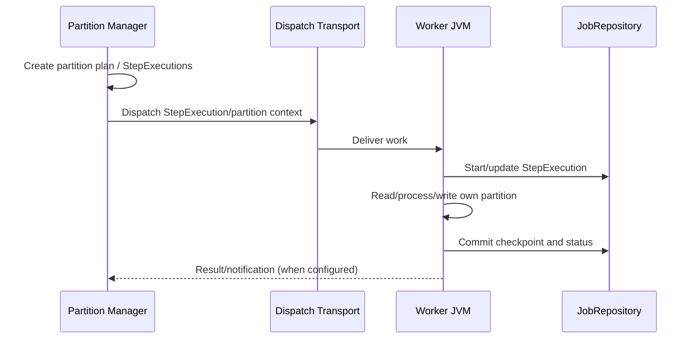
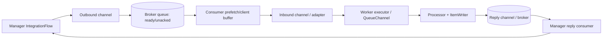
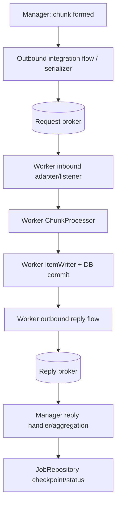

# Test middleware latency trong Spring Batch: đo đúng đường đi request, queue và reply

## 1. Bối cảnh: worker xử lý nhanh nhưng job vẫn chậm

Một job Spring Batch dùng **remote chunking** để làm sạch 10 triệu đơn hàng. Manager đọc dữ liệu, gom mỗi 200 items thành một `ChunkRequest`, gửi qua JMS, các worker nhận request, chạy `ItemProcessor`/`ItemWriter` và gửi `ChunkResponse` về manager.

Trong log worker, một chunk được xử lý trung bình 120 ms. Nhưng từ lúc manager gửi đến khi nhận reply mất 2–5 giây. Đội dự án muốn tăng số worker từ 4 lên 16 vì cho rằng CPU worker quá tải. Nếu nguyên nhân thực tế là broker queue wait, client prefetch, serialize payload hoặc reply channel nghẽn, tăng worker mù quáng có thể làm database kiệt connections và job còn chậm hơn.

Để chọn cấu hình đúng, ta cần **test middleware latency**: đo độ trễ do **transport và các tầng xếp hàng/điều phối** tạo ra, tách khỏi phần xử lý nghiệp vụ và tổng thời gian hoàn tất job.

Bài thuộc chương **Performance testing** của module `SPRING_BATCH_SCALING_OPERATIONS`. Phạm vi module bao gồm mở rộng Spring Batch trên workload dữ liệu lớn bằng **multi-threaded step, parallel steps, partitioning và mô hình phân tán**, đồng thời đo bottleneck, bảo đảm thread safety, retry/restart và chọn kiến trúc theo tài nguyên thực tế. Test middleware là phép thử cần thiết trước khi quyết định **JMS/Kafka broker, consumer concurrency, chunk size, grid size, pool connections, network topology và backpressure**.

### Sau bài học, bạn có thể

1. Xác định các mốc publish, broker enqueue, queue wait, dispatch, listener entry, worker processing, reply và manager accounting.
2. Phân biệt **send latency**, **one-way age**, **broker queue residence**, **request–reply round-trip**, **worker service time** và **JobExecution wall-clock**.
3. Xây phép thử **transport-only baseline**, phép thử có serialization, phép thử với worker giả lập và phép thử end-to-end Spring Batch.
4. Dùng Java/Jakarta JMS, Spring JMS, Micrometer và correlation IDs để tạo probe request–reply đúng ngữ nghĩa.
5. Chọn các kịch bản về payload size, request rate, consumers, prefetch, persistence, transaction, TLS, network và failover.
6. Đọc p50/p95/p99, throughput, saturation, queue age, redelivery, timeouts và business commits để xác định bottleneck.
7. Thiết kế test có **tính tái lập và kiểm chứng correctness**, không tạo số liệu “nhanh” bằng cách mất request/ACK sớm.

> **Phiên bản tham chiếu:** Spring Batch **5.2.x**, Spring Framework 6.x, Spring Boot 3.x, Java 17+, Spring Integration, Jakarta Messaging/JMS 3.1 và Micrometer. Các snippets là ví dụ ghép thành project có cấu hình broker thực, không phải benchmark đã được chạy. Với RabbitMQ/AMQP, Kafka hoặc broker khác, phải điều chỉnh metric names và acknowledgement semantics; không sao chép assumptions của JMS sang giao thức khác.

## 2. Middleware nằm ở đâu trong kiến trúc Spring Batch?

### 2.1. Remote chunking

```mermaid
sequenceDiagram
    participant M as Batch Manager
    participant Q as Request Broker Queue
    participant W as Worker
    participant DB as Business Database
    participant R as Reply Broker/Channel
    M->>M: Read + group items into chunk
    M->>Q: Publish ChunkRequest
    Note over Q: Ready/queued; may prefetch
    Q->>W: Deliver request
    W->>W: Deserialize + process
    W->>DB: Write/commit with local TX
    W->>R: Publish ChunkResponse
    R->>M: Deliver reply
    M->>M: Correlate response + update progress
```

Remote chunking thường đặt **reader ở manager** và **processing/writing ở worker**. Middleware không chỉ có một hướng: request qua broker đến worker, reply đi theo hướng ngược lại. Thời gian manager đợi reply có thể bao gồm:

- Serialize `ChunkRequest` và publish.
- Broker persistence, network và queue wait.
- Prefetch/client-buffer và listener scheduling.
- Deserialize, worker processing và DB transaction.
- Publish reply, reply broker wait và manager result aggregation.

**Không gán toàn bộ manager request→reply latency cho broker.** Nếu worker DB commit mất 4 giây thì request–reply chậm dù broker hoàn toàn khỏe.

### 2.2. Remote partitioning



Remote partitioning giao **một worker StepExecution** cho từng logical partition; worker tự đọc và xử lý phạm vi dữ liệu của mình. Một partition có thể chạy hàng phút hoặc hàng giờ. Nếu manager đo `dispatch→partition completed`, phần lớn thời gian là **worker processing**, không phải middleware transit.

Một probe transport riêng cần đo `dispatch publish→worker entry` và **reply/notification riêng nếu topology thực sự có**. Đừng giả định mọi remote-partitioning deployment đều có cùng request/reply channel hoặc ACK boundary.

### 2.3. So sánh với local partitioning

Ở local partitioning, `TaskExecutorPartitionHandler` gửi tasks vào executor trong **cùng JVM**, không cần message broker. Thời gian từ `execute(...)` tới khi worker task bắt đầu là **executor submit-to-start delay**, khác với JMS broker queue time.

Một bài kiểm tra kiến trúc nên có **local baseline** nếu cùng business logic có thể chạy tại chỗ. Chênh lệch giữa local và remote end-to-end có thể chứa **serialization + middleware + network + worker process differences**, không thể suy ngay mọi chênh lệch đều do broker.

## 3. Định nghĩa chính xác các mốc thời gian

Đặt các mốc trong một request–reply attempt:

| Mốc | Tên | Boundary |
| --- | --- | --- |
| `t0` | `producerSubmitStart` | Trước khi manager gọi send/publish |
| `t1` | `producerSendReturn` | Khi send API trả về theo provider semantics |
| `t2` | `brokerEnqueued` | Broker đã accept/commit và message ready |
| `t3` | `brokerDispatched` | Broker chuyển message cho consumer/client |
| `t4` | `listenerEntered` | Worker listener thực sự bắt đầu handler |
| `t5` | `workerProcessingStarted` | Worker bắt đầu deserialize/process nghiệp vụ theo đo |
| `t6` | `businessCommitConfirmed` | DB transaction commit có kết quả xác nhận |
| `t7` | `replyPublished` | Worker đã gửi reply qua send API |
| `t8` | `replyListenerEntered` | Manager nhận được reply ở inbound handler |
| `t9` | `managerAccounted` | Manager correlate/ghi nhận kết quả tiến độ |

### 3.1. Những phép đo khác nhau

\[
T_{\mathrm{sendApi}} = t_1-t_0
\]

\[
T_{\mathrm{brokerReadyWait}} = t_3-t_2
\]

\[
T_{\mathrm{clientPrefetchWait}} \approx t_4-t_3
\]

\[
T_{\mathrm{workerService}} = t_6-t_5
\]

\[
T_{\mathrm{requestReply}} = t_8-t_0
\]

Một số mốc chỉ có nếu broker/client cho phép quan sát trực tiếp. `t_2` và `t_3` **không phải trường bắt buộc của JMS message**; đó có thể là metric của broker cụ thể.

`T_requestReply` gồm cả worker processing và reply, nên **không bằng tổng một vài timers có tên giống nhau** nếu boundaries không khớp, transaction commit chưa được xác nhận, hoặc mỗi timer đo một attempt khác nhau.

### 3.2. Send return chưa chắc tương đương broker persistence bền vững

JMS producer có thể dùng transacted session, async send, persistent delivery hoặc provider batching. Khi `send()` trả về, bảo đảm được cung cấp phụ thuộc giao thức/provider và cấu hình transaction; **send return không tự chứng minh transaction gửi đã commit, broker fsync xong hoặc consumer sẽ thấy message ngay**.

Benchmark nên ghi rõ:

```text
JMS DeliveryMode: PERSISTENT / NON_PERSISTENT
Session: transacted / non-transacted
Producer confirms / broker durability semantics: provider-specific
Delivery delay/TTL: on/off and values
Acknowledgement mode: AUTO_ACKNOWLEDGE / CLIENT_ACKNOWLEDGE / transacted
```

So sánh cấu hình bền với không bền mà không chú thích sẽ dẫn đến khuyến nghị sai. **Tốc độ cao khi tắt persistence/ACK không tương đương một tuyến phân tán an toàn cho batch cần restart.**

### 3.3. Một request có thể có nhiều attempts

Ví dụ:

```text
requestId = chunk-501-0034
Attempt 1: worker commit DB, crash trước ACK/reply
Attempt 2: broker redeliver, writer thấy operation IDs đã commit → no-op
          reply lại cho manager
```

Một request có thể được giao nhiều lần. Cần phân biệt:

- **Logical request latency:** từ lần đầu được manager phát đến khi logical work được xác nhận thành công.
- **Attempt transport latency:** độ trễ của từng lần delivery.
- **Redelivery age:** tuổi message từ lần gửi đầu đến lần nhận lại (có thể gồm nhiều quãng chờ).
- **Business completion:** các logical operations đã commit đúng duy nhất trong DB.

Không cộng mỗi lần attempt như một unique chunk completed. Cũng không dùng JMS message ID làm **business idempotency key** duy nhất: message ID có thể thay khi message được gửi lại; operation ID phải được ứng dụng định nghĩa bền vững.

## 4. Đồng hồ: đo cùng JVM khác đo qua hai máy

### 4.1. Monotonic duration bên trong một process

Với một Java process, dùng:

```java
long startedAtNanos = System.nanoTime();
try {
    // publish request or execute worker operation
} finally {
    long elapsedNanos = System.nanoTime() - startedAtNanos;
    // Record elapsed with Micrometer Timer in NANOSECONDS.
}
```

`System.nanoTime()` phù hợp tính **elapsed time trong một JVM**; không đại diện epoch, không dùng so giữa hai JVM hoặc hai host.

### 4.2. Wall-clock giữa manager và worker

Muốn đo producer timestamp đến listener, có thể gửi `producerSentAtEpochMillis` trong header/metadata và tính:

\[
T_{\mathrm{producerToListenerObserved}}
= t_{\mathrm{listenerClock}}-t_{\mathrm{producerClock}}
\]

Nhưng cần **đồng bộ NTP/PTP**, đo offset và giới hạn sai số. Nếu manager và worker lệch 100 ms trong khi transit chỉ 10 ms, độ trễ đo được có thể sai đến một bậc độ lớn.

Quy ước:

- Duration trong cùng process: monotonic `nanoTime()`.
- Cross-process timestamps: epoch UTC + đồng bộ clock + offset/error budget.
- Nếu broker hỗ trợ enqueue/dispatch durations đo bằng **một đồng hồ broker**, ưu tiên metric đó cho broker residence.
- Giữ trace/span IDs, không tự trừ `nanoTime()` ở hai máy.
- Khi measured age âm hoặc metadata timestamp thiếu, **ghi invalid/skew counter**, không clamp về 0 làm số liệu đẹp giả.

### 4.3. `JMSTimestamp` không phải actual broker enqueue time

Theo Jakarta Messaging, `JMSTimestamp` thường được đặt vào lúc message được **giao cho provider để gửi**; nó không cam kết chính là thời điểm broker persist hoặc dequeue. Vì vậy:

```java
long timestampMs = message.getJMSTimestamp();
long listenerAgeMs = clock.millis() - timestampMs;
```

Đoạn này cho **producer-to-listener age** (kèm clock skew, network, broker, prefetch), **không phải broker-only queue residence**. `JMSTimestamp` có thể bằng 0 nếu timestamp bị disable. `JMSRedelivered` giúp phân loại deliveries lặp nhưng không xác định worker DB commit trước đó hay chưa.

Với một topic/queue có **client prefetch**, broker có thể báo ready queue depth gần 0 trong khi message đã dispatch còn nằm chờ trong client buffer trước khi listener chạy. Phải quan sát cả **ready, in-flight/unacked và consumer delay**.

## 5. Tầng latency nào là target của performance test?

Không nên chỉ viết “đo latency JMS” rồi bắt đầu load test. Hãy chọn rõ một trong bốn cấp:

| Test | Bao gồm | Loại trừ có chủ đích | Kết luận phù hợp |
| --- | --- | --- | --- |
| **A. Broker transport microbaseline** | Producer→broker→consumer với payload cố định; có thể echo | Business processor/DB | Overhead của topology transport/protocol dưới tải |
| **B. Serialization/deserialization** | DTO `ChunkRequest` → bytes → DTO | Broker/network (khi benchmark offline) | CPU, allocation và kích thước message |
| **C. No-op worker request–reply** | Manager send → broker → worker echo → reply → manager | DB và business rules | Tổng round-trip overhead của request/reply stack trong cấu hình test |
| **D. Full Spring Batch distributed job** | Manager read, chunk, messaging, worker processing/commit, reply, JobRepository | Không loại trừ | End-to-end job SLO và business correctness |

**So sánh A–D để giải thích bottleneck**, nhưng không trừ số đo p99(A) khỏi p99(D) và gọi kết quả là p99 worker: **percentiles không cộng/trừ trực tiếp**; mỗi test có population/tải/serialization/queueing khác nhau.

### 5.1. Một phép thử chỉ đo broker không đủ để chọn kiến trúc

Một broker có thể xử lý echo message 64 bytes ở tốc độ rất cao nhưng chậm với `ChunkRequest` chứa 2 MB serialized items, persistent delivery, transaction commit và reply. Ngược lại, một test end-to-end nhiều SQL locks chậm không chứng minh broker kém.

Để gắn kết A–D, hãy giữ chung các biến đã công bố (broker cluster, TLS, network, producer concurrency, persistence) rồi **thay từng yếu tố có chủ đích**.

### 5.2. “Middleware” có thể chứa nhiều hàng đợi



Đây là sơ đồ **khả năng tồn tại** các buffers, không khẳng định Spring Batch 5.2 mặc định tạo `QueueChannel` hay executor ở mọi remote worker. Khi thực hiện test, phải vẽ topology **thực tế**, biết message đi qua `DirectChannel`, `ExecutorChannel`, `QueueChannel`, JMS listener và các lớp nào.

`DirectChannel` thường gọi handler đồng bộ trên caller thread, trong khi `ExecutorChannel`/`QueueChannel` thay đổi boundary và có thể thêm queue wait. Vì vậy **chỉ đổi một Spring Integration channel type** cũng có thể đổi latency dù broker, worker code và chunk size giữ nguyên.

## 6. Thiết kế phép thử: giả thuyết, SLO và baseline

Một benchmark đáng tin bắt đầu bằng **câu hỏi có thể bác bỏ**. Ví dụ:

> Với JMS persistent delivery và bốn workers, 95% request/reply nhỏ hơn 500 ms tại 80 `ChunkRequest`/s, request timeout dưới 0,1%, không có logical operation bị mất; p99 không vượt 2 giây trong 30 phút steady state.

Con số chỉ là **ví dụ SLO**. SLO của một job chạy ban đêm có thể ưu tiên throughput và recovery; một job gần real-time có thể cần tail latency thấp.

### 6.1. Bộ câu hỏi thí nghiệm

| Giả thuyết | Chỉ số chứng minh hoặc bác bỏ | Biến thay đổi |
| --- | --- | --- |
| Broker persistence là bottleneck | Send API p95, broker enqueue/commit latency, disk I/O, throughput | Persistent vs non-persistent **trong test biệt lập** |
| Serialized chunk quá lớn | Bytes/message, serialize CPU, heap/GC, publish p99, consumer deserialization p99 | 1 KB, 64 KB, 512 KB, 2 MB payload |
| Worker concurrency thiếu | Broker ready age tăng, CPU/DB còn headroom, worker busy 100% | Consumer 1, 2, 4, 8 |
| Broker prefetch giấu backlog | Broker ready giảm nhưng producer→listener age tăng | Prefetch/credit 1, 10, 100 |
| Reply channel đang nghẽn | Worker processing xong nhanh, manager receive reply chậm | Reply consumers, queue limits, broker routing |
| Network/TLS tăng latency | RTT, retransmits, TLS CPU, request–reply p99 | Same-host/same-zone/cross-zone; TLS on/off khi test cho phép |
| DB chậm, không phải middleware | Worker DB wait chiếm phần lớn RTT, broker ready age nhỏ | No-op echo so với real worker |
| Manager admission vượt service capacity | Offered rate lớn hơn completed rate, queue age và timeouts cùng tăng | Open-loop rate / inflight cap |

Không đồng thời thay persistence, payload, consumer count và network route trong một phép so A/B rồi kết luận “JMS có thể xử lý 1000 chunks/s”; kết quả sẽ không chỉ ra yếu tố quyết định.

### 6.2. Chốt một measurement contract

```yaml
experimentId: middleware-latency-v1
stack: spring-batch-5.2 / spring-integration / jakarta-jms
scenario: request-reply-noop
measurement: producer-call-start-to-reply-receive
clock: System.nanoTime within manager JVM
population: all accepted logical requests, including timeouts
payloadBytes: measured after serialization
persistence: persistent
transactionMode: explicit in experiment manifest
consumerConcurrency: 4
inflightLimit: 64
targetOfferedRatePerSecond: 80
warmupSeconds: 120
steadyStateSeconds: 900
drainSeconds: 120
reported:
  - p50/p95/p99/max latency of completed requests
  - total/offered/accepted/completed/timed-out/rejected
  - throughput of unique business completions
  - broker ready/unacked/oldest age
  - worker CPU/heap/DB connections
```

Đây là **mẫu tài liệu mô tả thử nghiệm**, không phải cấu hình Spring Boot tự hiểu. Nếu broker thay implementation hoặc version, cần lưu tên provider, protocol, topology cluster, durable mode, disk/storage class, network RTT và các giới hạn do nhà cung cấp đặt ra.

### 6.3. Baseline phải có cả tải thấp và tải cao

Nên chạy theo thứ tự:

1. **Idle/no contention:** một producer, một consumer, payload nhỏ; xác lập floor latency.
2. **Warm steady state:** kết nối đã khởi tạo, caches đã ổn định, có tỷ lệ publish đều; xác lập latency bình thường.
3. **Ramp-up:** tăng offered rate từng bậc cho tới gần capacity.
4. **Saturation:** duy trì offered rate vượt service rate trong một khoảng **được kiểm soát**.
5. **Drain:** ngừng gửi mới, đo thời gian xử lý backlog tồn tại.
6. **Recovery/failover:** kill một worker, lỗi broker hoặc network, sau đó xác minh replay/idempotency.

Không dùng chỉ một lần gửi message đầu tiên làm p99 production; lúc cold start có class loading, TLS handshake, connection setup, JVM JIT, broker metadata cache và queue initialization.

### 6.4. Open-loop và closed-loop khác nhau

**Closed-loop**: có `N` clients, mỗi client gửi request rồi chờ reply mới gửi tiếp. Khi response chậm, tốc độ gửi tự giảm. Đây là một loại **backpressure tự nhiên**, nhưng có thể **che sự sụp đổ năng lực** vì offered load thấp đi đúng lúc latency tăng.

**Open-loop**: producer phát request theo **tốc độ mục tiêu độc lập với reply time**. Nó giúp kiểm tra saturation, nhưng phải có bounded admission/inflight limit và chính sách khi không thể gửi đủ nhịp. Nếu generator bị quá tải, ghi **scheduled vs actual submit timestamps** và offered/sent/rejected; không lặng lẽ bỏ request để biểu đồ trông đẹp.

Với bài toán Batch, nên chạy **cả hai**:

- Closed-loop để mô phỏng số manager requests in-flight hữu hạn.
- Open-loop có rate control để tìm điểm bắt đầu queue tăng không ổn định.

**Coordinated omission:** nếu request generator chỉ đo những request đã được phát sau khi request trước xong, một khoảng stall dài có thể **không tạo những samples cho công việc đáng lẽ đã được gửi**. Cần báo scheduled arrival rate, queued/rejected/timeouts và duration cả population, không chỉ completed histogram.

## 7. Tạo môi trường test có giá trị so sánh

### 7.1. Tách các thành phần

Một môi trường tối thiểu:

```text
Load generator(s) ──> broker request destination
                             |
                   no-op worker / real worker
                             |
                    broker reply destination
                             |
                      response collector

Metrics sidecar:
  broker metrics + consumer metrics + JVM metrics
  DB metrics (chỉ ở kịch bản real worker)
  clocks/NTP monitoring
```

Load generator không được chạy trên cùng CPU bị giới hạn với broker rồi vô tình **tranh CPU** và tạo latency giả. Nếu phải chạy cùng máy cho microbaseline, ghi rõ “same-host diagnostic” và không dùng kết quả đó dự báo production multi-node.

### 7.2. Ghi lại sự tương đương và khác biệt

| Khía cạnh | Baseline cần ghi rõ |
| --- | --- |
| Manager/worker versions | Java/JDK, Spring Batch/Integration, driver JMS |
| Broker | Product, version, số nodes, replication/quorum, storage class |
| Topology | Queue names, routing, partitions/groups, consumer count |
| Security | TLS, authentication, certificates, encryption overhead |
| Producer | Persistent mode, transactions, confirms, pooling, concurrency |
| Consumer | Sessions, concurrency, prefetch, ACK semantics, retry/DLQ |
| Serialization | JSON/Avro/Java serialization, compression, schema version |
| Data | Item size distribution, number of items/chunk, item nesting |
| Network | Bandwidth, RTT, MTU, cross-AZ/region, packet loss |
| DB | DB type/version, pool, indexes, lock profile, isolation |
| Resource | vCPU, memory, JVM heap/GC, cgroup CPU throttling |
| Observation | Clock sync, exporter scrape intervals, metrics tags |

Benchmark trên laptop dùng in-memory broker với message 100 bytes chỉ trả lời **microbenchmark của laptop**. Nó không cho biết performance của một broker persistent có replication và payload 2 MB trong Kubernetes.

### 7.3. Dữ liệu test phải giống hình dạng production

Với remote chunking, một request chứa nhiều **items**, contribution metadata và headers. Hãy chuẩn bị:

- Payload **nhỏ / trung bình / lớn / p99** theo phân phối production.
- Fields null, Unicode, nested DTO, optional fields và versioned schema.
- Chunks nhiều items nhưng bytes nhỏ, và chunks ít items nhưng bytes lớn.
- Dữ liệu có thể compress mạnh so với dữ liệu entropy cao.
- Một phần requests lỗi/timeout/retry theo tỷ lệ đại diện.

Một benchmark chỉ thử `chunkSize=500` nhưng không đo serialized bytes không thể so sánh workload: 500 DTO đơn giản có thể 50 KB, còn 500 JSON records nhiều fields có thể 5 MB.

### 7.4. Không gửi dữ liệu production nhạy cảm tới test broker

Dùng dữ liệu tổng hợp hoặc đã ẩn danh **đúng quy định**, tránh đưa PII/secrets vào payload, logs/traces hoặc DLQ. Khi cần giống phân phối thực, tái tạo histogram kích thước và field structure chứ không copy nguyên records khách hàng.

## 8. Thực hành Java: đo JMS request–reply với một no-op worker

Để đo **transport request–reply baseline**, dựng một destination test riêng như `bench.echo.requests`. Worker phản hồi payload nhỏ, không gọi DB. Thực nghiệm này đo **JMS request→reply path**, không chứng minh throughput của Spring Batch remote chunking thực tế.

### 8.1. Dependencies và thành phần cần có

Một ứng dụng Spring Boot 3.x có thể dùng:

- `spring-boot-starter-activemq` hoặc broker-specific JMS starter tương thích Jakarta Messaging; lựa chọn phụ thuộc broker.
- `spring-boot-starter-actuator` và `micrometer-registry-prometheus` để xuất metrics.
- `spring-jms` (thường được starter JMS kéo vào).
- JUnit 5 và broker tích hợp/container ở phần test.

Không có một starter nào tự tạo một **production-like broker cluster**; phải cấu hình `ConnectionFactory` tới môi trường test. `@EnableJms` hoặc Boot auto-configuration cùng listener factory hợp lệ là điều kiện để `@JmsListener` thực sự nhận messages.

### 8.2. Cấu hình `JmsTemplate` cho probe

```java
// MiddlewareProbeConfig.java
package example.batch.perftest;

import jakarta.jms.ConnectionFactory;
import org.springframework.context.annotation.Bean;
import org.springframework.context.annotation.Configuration;
import org.springframework.jms.annotation.EnableJms;
import org.springframework.jms.core.JmsTemplate;

@Configuration
@EnableJms
public class MiddlewareProbeConfig {

    @Bean("probeJmsTemplate")
    public JmsTemplate probeJmsTemplate(ConnectionFactory connectionFactory) {
        JmsTemplate template = new JmsTemplate(connectionFactory);
        template.setReceiveTimeout(5_000L);
        template.setExplicitQosEnabled(true);
        template.setDeliveryPersistent(true);
        return template;
    }
}
```

Các giá trị trên **chỉ mô tả probe**. `setExplicitQosEnabled(true)` bảo đảm cấu hình quality-of-service của `JmsTemplate` được áp dụng khi gửi; `setDeliveryPersistent(true)` của producer không cấu hình consumer ACK/transacted session hoặc broker replication. Các yếu tố ấy cần cấu hình riêng theo provider. Spring Boot/connection factory có thể có pooling và caching khác nhau, cần ghi lại khi benchmark.

### 8.3. Echo worker

```java
// JmsEchoProbeWorker.java
package example.batch.perftest;

import jakarta.jms.Destination;
import jakarta.jms.JMSException;
import jakarta.jms.Message;
import jakarta.jms.TextMessage;
import org.springframework.beans.factory.annotation.Qualifier;
import org.springframework.jms.annotation.JmsListener;
import org.springframework.jms.core.JmsTemplate;
import org.springframework.stereotype.Component;

@Component
public final class JmsEchoProbeWorker {

    private final JmsTemplate template;

    public JmsEchoProbeWorker(
            @Qualifier("probeJmsTemplate") JmsTemplate template) {
        this.template = template;
    }

    @JmsListener(destination = "bench.echo.requests",
                 concurrency = "1-4")
    public void echo(Message request) throws JMSException {
        if (!(request instanceof TextMessage text)) {
            throw new JMSException("Probe expects TextMessage");
        }

        Destination replyTo = request.getJMSReplyTo();
        if (replyTo == null) {
            throw new JMSException("Missing JMSReplyTo");
        }

        String correlationId = request.getJMSCorrelationID();
        String input = text.getText();
        if (correlationId == null || correlationId.isBlank()) {
            throw new JMSException("Missing correlation ID");
        }

        template.send(replyTo, session -> {
            TextMessage reply = session.createTextMessage(
                    "ACK:" + input);
            reply.setJMSCorrelationID(correlationId);
            return reply;
        });
    }
}
```

Worker này chỉ phản hồi message. Nó **không mô phỏng rollback của business DB**, không chứng minh reply send và request ACK cùng transaction, cũng không mô phỏng ordering/partition scope của Spring Batch. Với benchmark có durability yêu cầu cụ thể, cấu hình listener session, redelivery và reply persistence theo broker; không suy từ mã echo rằng tồn tại distributed transaction.

### 8.4. Producer đo round-trip bằng monotonic clock

```java
// JmsRoundTripProbe.java
package example.batch.perftest;

import io.micrometer.core.instrument.Counter;
import io.micrometer.core.instrument.MeterRegistry;
import io.micrometer.core.instrument.Timer;
import jakarta.jms.Message;
import jakarta.jms.TextMessage;
import java.util.UUID;
import java.util.concurrent.TimeUnit;
import org.springframework.beans.factory.annotation.Qualifier;
import org.springframework.jms.core.JmsTemplate;
import org.springframework.stereotype.Component;

@Component
public final class JmsRoundTripProbe {
    private final JmsTemplate template;
    private final Timer success;
    private final Counter timeout;
    private final Counter errors;

    public JmsRoundTripProbe(
            @Qualifier("probeJmsTemplate") JmsTemplate template,
            MeterRegistry registry) {
        this.template = template;
        this.success = Timer.builder("batch.middleware.rtt")
                .tag("scenario", "echo")
                .tag("outcome", "success")
                .publishPercentileHistogram()
                .register(registry);
        this.timeout = Counter.builder("batch.middleware.timeout")
                .tag("scenario", "echo")
                .register(registry);
        this.errors = Counter.builder("batch.middleware.error")
                .tag("scenario", "echo")
                .register(registry);
    }

    public void sample() {
        String requestId = UUID.randomUUID().toString();
        long startedAt = System.nanoTime();

        try {
            Message response = template.sendAndReceive(
                    "bench.echo.requests", session -> {
                TextMessage request =
                        session.createTextMessage("ping");
                request.setJMSCorrelationID(requestId);
                request.setStringProperty(
                        "probeVersion", "echo-v1");
                return request;
            });

            if (response == null) {
                timeout.increment();
                return;
            }
            if (!(response instanceof TextMessage body)
                    || !requestId.equals(response.getJMSCorrelationID())
                    || !"ACK:ping".equals(body.getText())) {
                errors.increment();
                return;
            }

            success.record(
                    System.nanoTime() - startedAt,
                    TimeUnit.NANOSECONDS);
        } catch (Exception ex) {
            errors.increment();
            throw new IllegalStateException(
                    "JMS probe request failed", ex);
        }
    }
}
```

**Giới hạn lớn cần ghi trên báo cáo:** `JmsTemplate.sendAndReceive(...)` sử dụng **temporary reply destination** trong cơ chế request–reply của Spring JMS. Đây là một **diagnostic probe**, có thể phát sinh chi phí tạo temporary queue/consumer cho mỗi request và khác topology production, nơi manager Spring Batch thường dùng **reply destination/channel tồn tại lâu** cùng correlation mechanism riêng.

**Không lấy RTT của probe rồi khẳng định đó là middleware latency production**. Khi chuyển sang benchmark production topology, dùng **chính outbound/inbound Spring Integration flows, conversion, durable reply channel, correlation và consumer sessions thực tế**. Mục tiêu của snippet là đo được một baseline dễ lý luận và có error/timeout counters.

### 8.5. Đừng chỉ đo success samples

Mẫu Java trên ghi `success Timer` **chỉ cho reply hợp lệ**. Timeout và lỗi được đếm tách riêng. Khi tổng hợp báo cáo, phải có:

```text
submittedRequests / targetScheduledRequests
successfulResponses
timedOutRequests
invalidResponses
sendFailures
rejectedAttempts
remainingInFlight
```

Nếu 10% requests timeout, histogram latency của 90% thành công **không được công bố như p99 của toàn bộ requests**. Có thể đo thêm elapsed-to-timeout histogram và deadline violation counter với quy tắc riêng; không thay giá trị timeouts bằng 0 để kéo mean xuống.

### 8.6. Tránh làm probe trở thành nguyên nhân nghẽn

Mỗi call `sendAndReceive` ở trên là synchronous, một thread chờ một reply. Muốn kiểm tra tải cao, dùng bounded number of sender threads/in-flight slots hoặc một async correlation collector. **Không spawn một thread mới cho mỗi request**, không tự tạo hàng triệu `Future` rồi nhận OOM trước khi broker quá tải.

## 9. Load generator: bounded concurrency, arrival rate và phép đo chính xác

Một load generator tốt phải có **khả năng điều chỉnh tải độc lập, giới hạn tài nguyên, đếm tất cả outcomes** và không che độ trễ bằng chính giới hạn client.

### 9.1. Ví dụ Java closed-loop có backpressure rõ

Đoạn test dưới chạy một lượng requests hữu hạn tới probe ở mục 8. Nó là **closed-loop harness** vì khi đã hết permits, producer dừng tạo request cho tới khi request trước kết thúc.

```java
// BoundedJmsProbeHarness.java
package example.batch.perftest;

import java.time.Duration;
import java.util.concurrent.CountDownLatch;
import java.util.concurrent.ExecutorService;
import java.util.concurrent.Executors;
import java.util.concurrent.Semaphore;
import java.util.concurrent.TimeUnit;
import java.util.concurrent.atomic.AtomicInteger;

public final class BoundedJmsProbeHarness {
    private final JmsRoundTripProbe probe;

    public BoundedJmsProbeHarness(JmsRoundTripProbe probe) {
        this.probe = probe;
    }

    public Result run(int requestCount, int concurrency)
            throws InterruptedException {
        if (requestCount <= 0 || concurrency <= 0) {
            throw new IllegalArgumentException(
                    "requestCount and concurrency must be positive");
        }

        ExecutorService senders =
                Executors.newFixedThreadPool(concurrency);
        Semaphore slots = new Semaphore(concurrency);
        CountDownLatch done = new CountDownLatch(requestCount);
        AtomicInteger errors = new AtomicInteger();
        long started = System.nanoTime();

        try {
            for (int i = 0; i < requestCount; i++) {
                // Đây là closed-loop backpressure: admission wait
                // không nằm trong RTT của probe.sample().
                slots.acquire();
                try {
                    senders.execute(() -> {
                        try {
                            probe.sample();
                        } catch (RuntimeException ex) {
                            errors.incrementAndGet();
                        } finally {
                            slots.release();
                            done.countDown();
                        }
                    });
                } catch (RuntimeException rejection) {
                    slots.release();
                    done.countDown();
                    errors.incrementAndGet();
                    throw rejection;
                }
            }

            if (!done.await(2, TimeUnit.MINUTES)) {
                throw new IllegalStateException(
                        "Load generator did not drain in time");
            }

            return new Result(
                    requestCount,
                    errors.get(),
                    Duration.ofNanos(
                            System.nanoTime() - started));
        } finally {
            senders.shutdownNow();
        }
    }

    public record Result(
            int submitted, int harnessErrors, Duration elapsed) {}
}
```

Mẫu harness chỉ để học **bounded in-flight**. Nó **không tạo arrival rate độc lập**, không có warmup, không hỗ trợ nhiều generators và không đủ để xác định p99 chính xác ở saturation. `JmsRoundTripProbe.sample()` hiện chỉ ném exception với những lỗi transport; timeout hoặc invalid reply được đếm **trong probe** và trả bình thường, nên `harnessErrors` không phải tổng lỗi nghiệp vụ. Báo cáo phải lấy cả counters `timeout`/`error` từ Micrometer.

Nếu `senders.execute(...)` bị từ chối, ví dụ ném lỗi sau khi một số tasks đã được schedule. `finally` gọi `shutdownNow()` có thể bỏ tasks đang chờ, không phát ra đủ callback `done.countDown()`. Trong harness minh họa này `newFixedThreadPool` thường nhận tasks vào queue nội bộ; **không dùng nó làm cơ chế bảo đảm durable handoff**. Một load harness production-grade cần quản lý drain/abort/cancellation và số request đã submit/accepted riêng.

### 9.2. Thay open-loop rate bằng scheduler có đồng hồ riêng

Open-loop test cần khái niệm:

```text
scheduledAtNano          : thời điểm theo lịch muốn phát request
actualSubmitAtNano       : thực tế producer đã gọi send
producerSchedulingDelay  : actualSubmit - scheduledAt
requestReplyRTT          : replyReceive - actualSubmit
```

Nếu generator chậm, `actualSubmitAtNano` có thể lệch lịch hàng giây. Không chỉ đo RTT của những request phát được; phải báo **offered/scheduled**, **accepted**, **rejected/drop** và **generator scheduling lag**.

Một rate limiter token bucket có thể tạo nhịp, nhưng nếu task send bị block và generator không bắt kịp, số requests thực tế sẽ giảm. Có thể dùng một load tool có hỗ trợ **constant arrival rate** và histogram, nhưng phải xác nhận nó có instrumentation/correlation cho middleware và payload logic cần đo.

### 9.3. In-flight limit và deadline là hai tham số riêng

Nếu producer cho tối đa 100 requests đang chờ reply và deadline 10 giây:

- `inflightLimit=100`: giới hạn số request được gửi nhưng chưa kết thúc ở client.
- `replyTimeout=10s`: deadline chờ reply của một request.
- `offeredRate=50req/s`: lượng công việc định phát mỗi giây.

Chúng không tương đương. Khi RTT tăng tới 10 giây, với 100 inflight slots, closed-loop producer có thể chỉ đạt khoảng 10 req/s dù offered target là 50; đây là **hệ quả của backpressure**, không chứng minh broker chỉ hỗ trợ đúng 10 req/s.

Một bài test công bằng cần báo đủ cả ba và lý do không gửi được target rate.

## 10. Đo riêng serialization và message size

Với remote chunking, request size thường tăng theo **chunk size × serialized item size** cộng headers/metadata:

\[
S_{\mathrm{request}}\approx
C \times S_{\mathrm{serializedItem}}
+ S_{\mathrm{chunkMetadata}}
+ S_{\mathrm{headers}}
\]

`C` là số input items trong một request theo commit interval/điều phối thực tế; số output items có thể khác khi processor filter. Compression, fields null, nested objects và protocol framing làm serialized bytes phi tuyến.

### 10.1. Phép đo offline bằng Jackson

Nếu production dùng JSON và Jackson:

```java
// SerializationProbe.java
package example.batch.perftest;

import com.fasterxml.jackson.core.JsonProcessingException;
import com.fasterxml.jackson.databind.ObjectMapper;
import java.util.concurrent.TimeUnit;
import io.micrometer.core.instrument.MeterRegistry;
import io.micrometer.core.instrument.Timer;

public final class SerializationProbe {
    private final ObjectMapper mapper;
    private final Timer serialize;
    private final Timer deserialize;

    public SerializationProbe(
            ObjectMapper mapper, MeterRegistry registry) {
        this.mapper = mapper;
        this.serialize = Timer.builder(
                    "batch.middleware.serialize.duration")
                .tag("codec", "json")
                .register(registry);
        this.deserialize = Timer.builder(
                    "batch.middleware.deserialize.duration")
                .tag("codec", "json")
                .register(registry);
    }

    public byte[] roundTrip(Object original, Class<?> type)
            throws JsonProcessingException {
        long t0 = System.nanoTime();
        byte[] bytes;
        try {
            bytes = mapper.writeValueAsBytes(original);
        } finally {
            serialize.record(
                    System.nanoTime() - t0,
                    TimeUnit.NANOSECONDS);
        }

        long t1 = System.nanoTime();
        Object restored;
        try {
            restored = mapper.readValue(bytes, type);
        } finally {
            deserialize.record(
                    System.nanoTime() - t1,
                    TimeUnit.NANOSECONDS);
        }

        if (restored == null) {
            throw new IllegalStateException(
                    "Deserialization produced null");
        }
        return bytes; // Dùng bytes.length khi ghi kết quả.
    }
}
```

`Class<?>` và DTO typed deserialization ở đây đủ để minh họa nhưng với payload generic `ChunkRequest<T>` có type erasure, cần `JavaType`/`TypeReference` hoặc message converter **giống production**. Không dùng Jackson offline rồi kết luận serialization của JMS `ObjectMessage`/Avro/Kafka serializer có cùng độ trễ.

### 10.2. Đo đúng “bytes on wire”

`bytes.length` sau Jackson là **application payload bytes**, chưa chắc là **wire bytes**. JMS có message headers/properties, broker framing, TLS records, optional compression và binary encoding. Cần:

- Đo trước compression và sau compression nếu pipeline có compression.
- Dùng broker/network metrics để ước lượng bytes trên mạng, không nhầm Java string character count với bytes UTF-8.
- Đo client allocation/GC và worker deserialization time.
- Ghi cả p50/p95/p99 **payload bytes distribution**, không chỉ average.
- Kiểm tra broker max message size/policy và DLQ với payload oversized.

Ví dụ nếu mỗi serialized item khoảng 1 KiB:

| Chunk size | Payload gốc xấp xỉ | Ảnh hưởng có thể |
| ---: | ---: | --- |
| 20 | 20 KiB | Nhiều messages, overhead/header tỉ lệ lớn |
| 100 | 100 KiB | Có thể là điểm khởi đầu cân bằng |
| 500 | 500 KiB | Ít request hơn, nhưng serialize/GC tăng |
| 2.000 | 2 MiB | Message size, network, retry/replay phải kiểm tra |

Đây là **phép tính minh họa**, không phải kích thước chính xác của `ChunkRequest`: object graph, headers, encoding và filtering quyết định thực tế.

### 10.3. Không nhầm serialization bottleneck với CPU business

Một test no-op worker + production DTO có p99 cao, còn echo 64-byte payload nhanh, cho thấy **payload/codec/broker framing** đáng điều tra. Nhưng cần thêm CPU profile của manager/worker để biết thời gian nằm ở Jackson, GC, copying, compression hay network. Không kết luận codec chậm chỉ từ message lớn.

## 11. Instrumentation tại manager và worker thực tế

Đối với end-to-end test, nên gắn span/metric ở những **ranh giới hiện hữu**, không thay đổi business logic:



### 11.1. Metric names và boundaries đề xuất

| Metric ứng dụng | Start → end | Ý nghĩa |
| --- | --- | --- |
| `batch.middleware.producer.send` | Trước → sau outbound send API | Thời gian của producer API; có thể bao gồm blocking/pool wait |
| `batch.middleware.request.age` | Producer stamped timestamp → worker listener entry | Age xuyên process, chịu clock skew |
| `batch.middleware.broker.queue.residence` | Broker enqueue → dispatch | Chỉ dùng khi broker cung cấp semantics đáng tin |
| `batch.middleware.worker.deserialize` | Bắt đầu → kết thúc decode payload | Codec/alloc overhead |
| `batch.middleware.worker.service` | Worker xử lý request → kết thúc business DB commit | Processing, không thuần middleware |
| `batch.middleware.reply.publish` | Trước → sau send reply | Reply outbound latency |
| `batch.middleware.request.reply.rtt` | Manager dispatch → manager reply handler | Tổng round-trip, bao gồm worker |
| `batch.middleware.reply.accounting` | Manager nhận reply → update progress/checkpoint | Manager callback/metadata |
| `batch.middleware.request.timeout` | Counter khi deadline hết | Outcome, **không phải duration sample thành công** |
| `batch.middleware.request.redelivered` | Counter khi nhận delivery lặp | Kiểm tra durability/restart và noise |
| `batch.middleware.broker.pending.age` | Oldest message chưa xử lý, ở broker | Bắt các request chưa đến listener |

Đây là **tên metric gợi ý**, không phải Spring Batch 5.2 mặc định xuất tất cả các metric ấy. Spring Batch có metrics `spring.batch.job`, `spring.batch.step`, `spring.batch.chunk.write`... nhưng chúng không tự phân rã transport/broker latency.

### 11.2. Code gắn một handler quan sát trong Spring Integration

Với message có header `probeSentAtEpochMs`, một interceptor/handler có thể đo độ tuổi tại worker **ngay khi ingress**:

```java
// WorkerIngressAgeProbe.java
package example.batch.perftest;

import io.micrometer.core.instrument.Counter;
import io.micrometer.core.instrument.MeterRegistry;
import io.micrometer.core.instrument.Timer;
import java.time.Clock;
import java.util.concurrent.TimeUnit;
import org.springframework.messaging.Message;

public final class WorkerIngressAgeProbe {
    private final Clock clock;
    private final Timer age;
    private final Counter invalid;

    public WorkerIngressAgeProbe(
            Clock clock, MeterRegistry registry) {
        this.clock = clock;
        this.age = Timer.builder(
                    "batch.middleware.request.age")
                .tag("boundary", "producer-to-worker-ingress")
                .publishPercentileHistogram()
                .register(registry);
        this.invalid = Counter.builder(
                    "batch.middleware.timestamp.invalid")
                .register(registry);
    }

    public void observe(Message<?> message) {
        Object raw = message.getHeaders()
                .get("probeSentAtEpochMs");
        if (!(raw instanceof Number sentAt)) {
            invalid.increment();
            return;
        }

        long milliseconds = clock.millis() - sentAt.longValue();
        if (sentAt.longValue() <= 0 || milliseconds < 0) {
            invalid.increment();
            return;
        }
        age.record(milliseconds, TimeUnit.MILLISECONDS);
    }
}
```

**Đây là fragment probe**, cần gọi ở **đầu inbound IntegrationFlow thực tế** (trước khi giao việc cho executor). Cần bảo đảm header được message converter/broker adapter giữ lại; Spring Messaging headers không nhất thiết ánh xạ 1–1 sang JMS properties.

Phép đo này **không đại diện broker-only queue residence**; nó bao gồm producer send/network/broker/prefetch và clock offset. Nếu có broker-native queue-time, giữ **hai metric riêng**, không trừ để tạo số âm hoặc gắn nhãn không đúng.

### 11.3. Correlation và trace không phải business operation ID

Một `ChunkRequest` cần có thông tin đủ để manager ghép `ChunkResponse` tương ứng theo Spring Batch Integration. Hãy phân biệt:

| ID | Dùng cho | Không suy ra |
| --- | --- | --- |
| `jobExecutionId` | Lần chạy job | Business operation duy nhất |
| `stepExecutionId` | Attempt của partition step | Reply sequence của remote chunking mặc định |
| `requestSequence`/chunk sequence | Ghép request/reply trong job context | Event sequence toàn hệ |
| `JMSCorrelationID` | Transport request/reply correlation | Idempotency business bên DB |
| `traceId/spanId` | Quan sát đường đi | Mức đảm bảo exactly-once |
| `businessOperationId` | Chống double effect/đối soát | Broker receipt hoặc worker ownership |

Các ID để trace có thể thay khi redelivery/retry; nếu muốn xác định **một logical request qua nhiều attempts**, thêm application request identity ổn định. Không dùng `JMSMessageID` đơn thuần làm source of truth cho nghiệp vụ.

### 11.4. Tránh metrics làm chậm chính middleware

Không gọi remote HTTP monitoring endpoint **mỗi message** từ listener trước ACK. Dùng Micrometer in-process + scrape/export bất đồng bộ, sampling spans có kiểm soát, bounded telemetry queues và low-cardinality tags.

Tags tốt: `scenario`, `channel=request/reply`, `outcome`, `workerGroup`, `payloadBand`. Tags nguy hiểm: mỗi `messageId`, `traceId`, `orderId`, `JobExecutionId` trong time-series dài hạn.

Để debug một request cụ thể, IDs nên nằm trong **structured logs/traces**, không tạo một Prometheus time series mới cho từng request.

## 12. Ma trận test middleware latency

Một test đầy đủ phải bao phủ các trục quan trọng **mà không thử mù mọi tổ hợp**. Chọn baseline rồi đổi một trục, sau đó thử các tổ hợp có tương tác đáng ngờ.

### 12.1. Ma trận cấu hình

| Trục | Giá trị cần thử (minh họa) | Rủi ro muốn phát hiện |
| --- | --- | --- |
| Payload size | 1 KiB / 64 KiB / 512 KiB / 2 MiB | Serialization, max message size, allocation, GC |
| Items/chunk | 10 / 100 / 500 / 2.000 | Messages/job, broker overhead và replay window |
| Producer concurrency | 1 / 4 / 8 / 16 | Connection/session contention |
| Consumer concurrency | 1 / 2 / 4 / 8 / 16 | Queue drain vs DB contention |
| In-flight requests | 16 / 64 / 256 | Bounded admission, manager memory |
| Prefetch/credit | 1 / 10 / 100 | Consumer buffer, fairness, hidden backlog |
| Broker durability | Persistent / non-persistent | Latency vs durability trade-off |
| Producer/consumer transaction | Non-transacted / local transacted | Commit/ACK overhead, redelivery |
| Routing | Request-only / request–reply | Reply queue bottleneck |
| Network | Same-zone / cross-zone / link with delay | RTT and packet loss sensitivity |
| TLS | On / off trong test cho phép | Handshake vs steady-state encryption overhead |
| Broker topology | Single-node / replicated cluster | Quorum/storage/network overhead, availability |
| Worker behavior | No-op / CPU-bound / DB-bound | Transport floor vs real service time |
| Input distribution | Uniform / bursts / skew / poison requests | Queue starvation, tail latency |
| Failure mode | Worker kill / broker restart / network partition | Redelivery, unknown commit, recovery |

**Không gộp tất cả 14 trục thành một full Cartesian product** nếu không có mục tiêu rõ; số runs sẽ rất lớn và khó diễn giải. Thực hiện screening theo từng trục, sau đó focused experiments vào những điểm có tương tác.

### 12.2. Một lịch thử nghiệm cụ thể

Ví dụ đối với JMS remote chunking sử dụng persistent delivery:

| Run | Payload | Workers | Offered rate | Thời lượng | Mục đích |
| --- | --- | ---: | ---: | --- | --- |
| A | 1 KiB | 1 | 1 req/s | 5 phút | Floor latency, warm/cold |
| B | 64 KiB | 4 | 40 req/s | 15 phút | Baseline under normal load |
| C | 64 KiB | 4 | 80 req/s | 15 phút | Tìm knee point |
| D | 64 KiB | 4 | 120 req/s | 10 phút | Bounded saturation |
| E | 512 KiB | 4 | 40 req/s | 15 phút | Payload sensitivity |
| F | 64 KiB | 8 | 80 req/s | 15 phút | Worker concurrency |
| G | 64 KiB | 8 | 80 req/s | 15 phút | Prefetch giảm, giữ biến khác |
| H | 64 KiB | 4 | 80 req/s | 15 phút | Worker/broker failover |
| I | Production-like | 4 | Theo plan | Đủ một JobInstance | Full Spring Batch correctness |

Run G phải có **giá trị prefetch mới được ghi cụ thể**; chỉ đặt nó trong cùng bảng với F không đủ để tái lập. Run H cần runbook failure injection định nghĩa kill vào giây nào, request nào đang in-flight, và broker durable policy nào có hiệu lực.

### 12.3. Đo ít nhất ba trạng thái tải

**Tải thấp:** latency chủ yếu do protocol, serialization, network, listener scheduling.

**Tải gần bão hòa:** queue wait và resource contention bắt đầu tăng; tìm điểm gối giữa throughput và p99.

**Tải quá khả năng phục vụ:** offered rate lớn hơn service capacity kéo dài; queue tăng, timeout/rejection xuất hiện và latency của requests thành công có thể bị **survivor bias**.

Đừng gọi cấu hình “sẵn sàng production” nếu nó chỉ nhanh tại tải thấp, hoặc nếu bài test stopped producer khi broker chậm nhưng báo throughput “mỗi request hoàn thành” vẫn ổn.

## 13. Đọc latency distribution và throughput đúng cách

### 13.1. Mean, p50, p95, p99 và maximum

Giả sử có 100.000 valid request–reply successes:

| Chỉ số | Ý nghĩa |
| --- | --- |
| Mean 80 ms | Thời gian trung bình trong population đo |
| p50 50 ms | Một nửa sample không quá 50 ms |
| p95 170 ms | Khoảng 95% sample không quá 170 ms |
| p99 450 ms | Khoảng 99% sample không quá 450 ms |
| Max 3,2 s | Có một số lần cực chậm |
| Timeout 200/100.200 offered | Những requests không có reply hợp lệ trước deadline |

**Đây là số liệu giả định** và p95/p99 chỉ tính **các successes được ghi Timer**. Nếu timeout được tách riêng, câu “p99 của toàn bộ requests là 450 ms” không chính xác: các requests timeout không có latency hoàn tất quan sát.

### 13.2. Vì sao phải có sample count và nhiều runs?

Với chỉ 100 samples, p99 chủ yếu phản ánh một trong vài quan sát cuối, dễ dao động. Muốn kiểm tra tail latency, cần:

- Đủ samples trong từng tổ hợp (ví dụ **10.000–100.000 hoặc hơn** tùy SLO, tải và độ chính xác mong muốn).
- Nhiều repetitions để nhìn variance giữa runs.
- Phân biệt warmup/cold-start và steady-state.
- Khoảng confidence/uncertainty nếu dùng thống kê đưa ra quyết định.
- Error/timeout counts cùng số samples trong histogram.

Không tự tạo “p99=20 ms chính xác” từ một lần chạy 30 requests. Một test có 100.000 responses nhưng chỉ 20 errors vẫn cần báo cả hai, không loại errors mà không có lý do.

### 13.3. Little's Law chỉ dùng khi ổn định

Với queue ở trạng thái cân bằng:

\[
L_q \approx \lambda_{\mathrm{throughput}} W_q
\]

Nếu consumer bắt đầu xử lý khoảng **100 requests/s** và broker queue ready trung bình có **200 messages**, thời gian chờ trung bình có thể xấp xỉ **2 giây** trong điều kiện population/boundary nhất quán.

Nhưng:

- Nó là **average**, không phải p99.
- Queue length có thể chỉ đếm ready, còn messages đã prefetch/unacked nằm ngoài.
- Khi broker backlog tăng liên tục, hệ chưa có trạng thái cân bằng.
- Retry/redelivery có thể làm `λ` của *delivery attempts* khác unique logical requests.

Do đó, trong overload hãy xem **arrival vs completion rate, slope queue depth, oldest pending age, DLQ, timeouts**. Đừng dùng Little's Law trên hai counters không cùng population.

### 13.4. Bounded backlog và thời gian trước khi đầy queue

Giả sử offered rate `λ=180 req/s`, service rate `μ=120 req/s` trong 20 giây:

\[
\Delta Q \approx (\lambda-\mu)\times 20 = 1200\ \text{requests}
\]

Nếu queue/admission capacity là 600 và bắt đầu rỗng, nó có thể đạt trần sau khoảng:

\[
t_{\mathrm{full}} \approx \frac{600}{180-120}=10\ \text{s}
\]

Đây là mô hình **xấp xỉ**, không phải dự báo tất định. Broker có nhiều loại queue, backpressure và in-flight states. Mục tiêu của test là phát hiện **điều gì xảy ra khi đầy**: producer bị block, send timeout, bị reject, spill to disk, broker memory pressure hay crash.

### 13.5. Throughput message khác throughput nghiệp vụ

`requests/s` có thể tăng khi request bị gửi lại nhiều lần. `reply/s` cũng có thể bao gồm duplicate responses hoặc request thất bại ở worker.

Với full Batch test, metric quan trọng:

\[
R_{\mathrm{useful}} =
\frac{\text{unique business operations committed}}
{\text{elapsed seconds}}
\]

Tập logical operation IDs có thể nằm trong **manifest nguồn** và **ledger DB đích**. Không lấy `SUM(WRITE_COUNT)` qua tất cả `StepExecution` attempts hoặc `JMS deliveries` làm số unique completed.

### 13.6. Latency budget end-to-end

Ví dụ một request có target p99 **2 giây**:

```text
Manager serialization/send       budget  100 ms
Broker + prefetch wait           budget  350 ms
Worker deserialize + process/DB  budget 1200 ms
Reply path                       budget  200 ms
Manager accounting               budget  150 ms
Total illustrative budget               2000 ms
```

**Đây là ngân sách thiết kế**, không phải công thức xác suất. `p99(A)+p99(B)` không nhất thiết bằng `p99(A+B)` vì phân phối/correlation khác nhau. Hãy đo **p99 end-to-end của từng logical request** rồi phân tích các spans con trong những slow traces để biết tầng nào chiếm đa số.

## 14. Prometheus/Grafana: bộ metric nên đứng cạnh nhau

| Panel | Metric | Ý nghĩa |
| --- | --- | --- |
| Producer | `sent/s`, `send errors/s`, send latency p95/p99 | Manager có bị block khi publish? |
| Broker ready | Queue depth, oldest ready age, enqueue/dequeue rate | Broker đã xếp hàng chưa xử lý? |
| Broker in-flight | Unacked/delivered/prefetched, redelivery, DLQ | Queue ready=0 có che client backlog? |
| Request ingress | Producer→listener age p50/p95/p99 | Độ trễ tới khi listener bắt đầu |
| Worker | Process+DB commit p95/p99, CPU/GC, active workers | Service time và năng lực tiêu thụ |
| JDBC | Hikari active/pending, acquire latency, lock wait | Worker chậm do DB chứ không phải broker? |
| Reply | Reply queue age, manager inbound latency, pending correlations | Manager có nhận replies kịp không? |
| End-to-end | Request–reply p50/p95/p99, timeout ratio | Trải nghiệm của toàn request |
| Job | Job wall-clock, partitions/chunks completed, unique commits/s | SLO nghiệp vụ |
| Reliability | Rejected, expired, requeued, DLQ, missing/duplicate logical IDs | Có đánh đổi tính đúng để tăng throughput? |

### 14.1. PromQL minh họa RTT p95

Nếu Micrometer Timer `batch.middleware.rtt` ở mục 8 được Prometheus exporter xuất với histogram buckets:

```promql
histogram_quantile(
  0.95,
  sum by (le) (
    rate(batch_middleware_rtt_seconds_bucket{
      scenario="echo", outcome="success"
    }[5m])
  )
)
```

Với Counter:

```promql
sum(
  rate(batch_middleware_timeout_total{
    scenario="echo"
  }[5m])
)
```

Metric names và suffix sau exporter có thể khác theo registry/naming convention. **Kiểm tra thực tế `/actuator/prometheus`**, đừng giả định có `_bucket` nếu histogram không được bật hoặc exporter không hỗ trợ. Histogram của echo chỉ là **baseline**, không là metric production của Spring Batch nếu không instrument thực tế.

### 14.2. Tag design

Tags có cardinality thấp:

```text
scenario = echo | serialization | real-worker
channel  = request | reply
outcome  = success | timeout | error
payload  = tiny | small | medium | large
workerGroup = orders-v2
brokerCluster = perf-az1
```

Không gắn `requestId`, `JMSMessageID`, `traceId`, `accountId`, `jobExecutionId` của mọi lần chạy vào mỗi Timer/Gauge; đó là **cardinality explosion**. Muốn xem một request cụ thể, dùng tracing/logs và Correlation ID với retention/quyền truy cập.

### 14.3. Đừng để Grafana hiển thị latency thấp giả khi tất cả requests đứng chờ

Histograms chỉ ghi những requests **đã nhận reply**. Khi queue bị nghẽn, một số requests có thể chưa có sample RTT trong cửa sổ hiện tại. Vì vậy luôn kèm:

- `inflightRequests` và tuổi request lâu nhất.
- Broker ready/unacked, consumer backlog.
- Timeout/error/rejected ratio.
- Successful sample count.
- Unique logical operation completion rate.

Nếu histogram không có sample mới, hiển thị **no data**, không tự kéo đường p99 xuống 0 ms hoặc giữ giá trị cũ mà không có freshness indicator.

## 15. Kiểm thử Spring Batch end-to-end không đánh mất tính đúng

Sau khi có broker baseline và no-op worker RTT, cần đưa phép đo vào **một JobInstance thật** với manager/worker có `ChunkRequest`, `ChunkResponse`, `JobRepository` và DB transactions.

### 15.1. Lập manifest dữ liệu

Ví dụ test run:

```text
experimentId = remote-chunking-2026-11-26-A
jobName = normalizeOrders
inputSnapshot = orders-perf-v5 (immutable)
uniqueSourceOperations = 200,000
chunkSize = 200
plannedRequestsIdeal = 1,000
workers = 4
consumerConcurrency = 4
broker = JMS persistent request+reply
businessDB = PostgreSQL staging
idempotency = (tenantId, orderEventId) unique ledger
```

`plannedRequestsIdeal=1.000` là **con số lý tưởng nếu không filter, không lỗi và mỗi chunk có 200 items**. Spring Batch thực tế có thể xử lý chunk cuối nhỏ hơn, retry/redelivery hoặc thêm control messages tùy integration. Không lấy số requests lý tưởng làm ground truth cho broker traffic.

Để so sánh các chunk sizes, đảm bảo cùng **input snapshot**, định nghĩa business effect, reader/processor/writer versions, SQL indexes, transaction manager và skip policy. Mỗi run benchmark nên dùng dataset/tenant target riêng hoặc reset DB có kiểm soát; nếu run thứ hai toàn bị writer dedup thì throughput không còn so sánh công bằng.

### 15.2. Tách bốn mốc trong manager

Với remote chunking:

```text
Manager:
  T0 create chunk and ChunkRequest
  T1 integration outbound send called
  T2 outbound send returns
  T3 correlated ChunkResponse received
  T4 manager has accounted for response/checkpoint
```

Đo `T2-T1` để biết outbound send API, `T3-T1` cho manager request/reply round-trip, `T4-T3` cho result accounting. Nếu manager đang chờ nhiều replies, không đo một `ChunkResponse` bằng `System.nanoTime` từ request khác; phải dùng **correlation context đúng logical request** và cleanup pending entries khi timeout/cancel.

**Không lưu raw `ChunkRequest<T>` lớn trong timer map** chỉ để chờ response: object retention có thể tự tạo memory pressure. Lưu một small metadata record: logical request ID, start `nanoTime` (chỉ cùng manager JVM), payload byte band và attempt number.

### 15.3. Tách ba mốc trong worker

```text
Worker:
  W0 listener enters / message received
  W1 deserialization completes; ChunkProcessor starts
  W2 ItemWriter / business transaction commits
  W3 reply publication attempted / confirmed by API
```

Nếu worker xử lý asynchronously sau `listener entry`, cần đo thêm **internal executor queue wait**, không coi `W1-W0` hoàn toàn là serialization. Với DB, tách **connection acquire wait, SQL/lock wait và commit latency**.

**Một reply về manager thành công không đồng nghĩa tất cả business items đã được commit đúng** nếu writer có skip/filter, partial external effects hoặc business DB khác transaction với broker. Phải đối soát operation IDs.

### 15.4. SQL đối soát logical operations

Ví dụ có bảng nguồn:

```sql
CREATE TABLE perf_source_operation (
    experiment_id VARCHAR(120) NOT NULL,
    tenant_id BIGINT NOT NULL,
    operation_id VARCHAR(120) NOT NULL,
    PRIMARY KEY (experiment_id, tenant_id, operation_id)
);

CREATE TABLE perf_applied_operation (
    experiment_id VARCHAR(120) NOT NULL,
    tenant_id BIGINT NOT NULL,
    operation_id VARCHAR(120) NOT NULL,
    committed_at TIMESTAMPTZ NOT NULL DEFAULT CURRENT_TIMESTAMP,
    PRIMARY KEY (experiment_id, tenant_id, operation_id)
);
```

Trong **thực nghiệm**, writer nên ghi marker `perf_applied_operation` **cùng DB transaction với business effect** hoặc có một nguồn xác nhận tương đương. Đừng insert marker trước business commit ở một transaction khác, vì sau crash nó sẽ falsely report completed.

SQL tìm operations chưa commit:

```sql
SELECT s.experiment_id, s.tenant_id, s.operation_id
FROM perf_source_operation s
LEFT JOIN perf_applied_operation a
  ON a.experiment_id = s.experiment_id
 AND a.tenant_id = s.tenant_id
 AND a.operation_id = s.operation_id
WHERE s.experiment_id = :experimentId
  AND a.operation_id IS NULL;
```

Kết quả kỳ vọng **rỗng** nếu test policy không cho skip hợp lệ. Nếu cho skip, manifest cần định nghĩa expected-success set riêng và lưu lý do skip; không coi item thiếu là success.

Một primary key ngăn marker duplicate nhưng **không tự ngăn double side effect** nếu business write làm trước khi marker insert/unique check hoặc dùng transaction manager khác. Test phải kiểm chứng business effect và marker **atomic**.

### 15.5. Metadata về attempts

Với Spring Batch 5.2, `BATCH_JOB_EXECUTION`/`BATCH_STEP_EXECUTION` cung cấp job/step status/counters:

```sql
SELECT je.JOB_INSTANCE_ID,
       je.JOB_EXECUTION_ID,
       je.STATUS AS job_status,
       se.STEP_NAME,
       se.STATUS AS step_status,
       se.READ_COUNT,
       se.WRITE_COUNT,
       se.FILTER_COUNT,
       se.COMMIT_COUNT,
       se.ROLLBACK_COUNT,
       se.READ_SKIP_COUNT,
       se.PROCESS_SKIP_COUNT,
       se.WRITE_SKIP_COUNT,
       se.START_TIME,
       se.END_TIME
FROM BATCH_JOB_EXECUTION je
JOIN BATCH_STEP_EXECUTION se
  ON se.JOB_EXECUTION_ID = je.JOB_EXECUTION_ID
WHERE je.JOB_INSTANCE_ID = :jobInstanceId
ORDER BY je.JOB_EXECUTION_ID, se.STEP_NAME;
```

**Không cộng `READ_COUNT`/`WRITE_COUNT` của mọi StepExecution attempts rồi kết luận số logical operations unique**. Khi restart, một chunk/request có thể được replay. Các counters phản ánh framework attempts, còn business ledger phản ánh committed unique effects.

## 16. Fault injection: middleware đúng khi có lỗi, không chỉ khi nhanh

Middleware latency trong hệ phân tán có liên hệ trực tiếp với **redelivery, ACK, retry, out-of-order reply và recovery**. Bài test performance phải có các failure windows đại diện.

### 16.1. Ma trận sự cố

| Lỗi mô phỏng | Thời điểm inject | Cần đo | Correctness invariant |
| --- | --- | --- | --- |
| Worker kill trước DB commit | Request đã tới worker, chunk chưa commit | Redelivery delay, restart time, DLQ | Không có partial business effect ngoài TX |
| Worker kill sau DB commit trước ACK | DB đã commit, broker chưa ghi nhận ACK | Duplicate delivery, response timeout | Writer idempotent, không double commit |
| Worker reply bị mất | DB commit xong nhưng manager chưa nhận response | Pending correlation age, retry/timeout | Reconciliation trước blind replay |
| Broker restart | Có ready/in-flight messages | Recovery time, backlog drain, persistence | Durable requests còn hoặc lỗi được báo rõ |
| Broker leader/quorum failover | During persistent publish | Send tail latency, producer timeout | Unknown outcome được đối soát, không assume rollback |
| Network partition manager→broker | Một phần send fails/timeouts | Reconnect, producer inflight memory | Không bỏ request âm thầm |
| Network partition worker→reply broker | Business DB đã commit | Reply retry, manager timeout | Không apply business effect lần hai |
| Consumer prefetch quá cao | Một worker chậm/treo | Ready vs unacked, listener age | Không starvation vô hạn, bounded recovery |
| Poison message | Deserialize/validation fail | Redeliver attempts, DLQ time | Quarantine/audit, không block toàn job vô hạn |
| Business DB deadlock | Worker writer rollback | Retry overhead, request RTT p99 | Transaction rollback, bounded retry |
| Hikari pool exhausted | Worker chờ JDBC connection | DB acquire wait, broker unacked | Không ACK sớm mất việc |
| Manager crash | Request đã được broker nhận | Restart, reply correlation, pending state | Đúng JobInstance và checkpoint |
| Duplicate response | Reply được giao lại | Duplicate reply count, aggregator behavior | Không cộng chunk completion hai lần |
| Out-of-order response | Request #12 nhanh hơn #11 | Reply ordering, manager correlation | Đúng chunk contribution và business ordering |
| Clock skew | Consumer epoch clock lệch | Invalid timestamp counters | Không clamp âm thành latency tốt giả |
| Payload vượt limit | Broker reject oversized message | Send error, DLQ/message size | Request không bị drop âm thầm |

Lỗi *sau DB commit trước ACK/reply* đặc biệt quan trọng: khi broker redeliver, worker có thể xử lý lại **cùng logical operation**. Với một đơn hàng phải thanh toán một lần, phép thử chỉ pass nếu **DB ledger hoặc downstream idempotency** bảo đảm không trừ tiền hai lần.

### 16.2. Kiểm soát phạm vi fault injection

Chỉ chạy trong môi trường staging/chaos có dữ liệu test:

1. Snapshot nguồn và DB target được cô lập.
2. Broker queues/destinations được đặt tên riêng, TTL/retention kiểm soát.
3. Có điểm dừng, khôi phục và cleanup test artifacts.
4. Có monitoring broker health, disk usage, DLQ và connection count.
5. Có khả năng xác minh old worker đã dừng/fenced trước khi replay.

Không restart một broker production đang xử lý dữ liệu thật chỉ để có một con số latency, không purge queue làm mất request và không xóa `BATCH_*` metadata để chạy lại từ đầu.

### 16.3. Expected latency trong failover

Khi worker chết, một request có thể chờ tới **visibility/consumer redelivery timeout** rồi mới được giao lại. Thời gian đó **không nên bị ẩn** khỏi end-to-end job SLO. Nhưng phải tách **steady-state latency** và **recovery latency** trong báo cáo, vì phân phối của hai tình huống có mục đích khác nhau.

Một SLO có thể quy định:

```text
Steady-state request/reply p99: <= 2s
Failure recovery:
  no missing operations
  no duplicate business effects
  job resumes within specified RTO
  DLQ stays within reviewed policy
```

Con số chỉ là **minh họa**. Nếu no-op worker đáp ứng 2 giây nhưng real worker không, kiểm tra service/DB; nếu cả no-op worker đều chậm khi broker failover, kiểm tra transport/quorum/reconnect và producer retry behavior.

## 17. JUnit và integration tests cho phép đo

### 17.1. Unit test: timeout không bị ghi thành success latency

Một lỗi observability dễ gặp: `JmsTemplate.sendAndReceive(...)` timeout trả `null`, code vẫn ghi Timer “success” với duration 5 giây. Điều đó làm tỷ lệ thành công giả và histogram không còn rõ semantics.

Với JUnit 5 và Mockito từ Spring Boot test starter:

```java
// JmsRoundTripProbeTest.java
package example.batch.perftest;

import io.micrometer.core.instrument.simple.SimpleMeterRegistry;
import org.junit.jupiter.api.Test;
import org.springframework.jms.core.JmsTemplate;
import org.springframework.jms.core.MessageCreator;

import static org.junit.jupiter.api.Assertions.assertEquals;
import static org.mockito.ArgumentMatchers.any;
import static org.mockito.ArgumentMatchers.eq;
import static org.mockito.Mockito.mock;
import static org.mockito.Mockito.when;

class JmsRoundTripProbeTest {

    @Test
    void timeoutDoesNotInflateSuccessTimer() {
        JmsTemplate template = mock(JmsTemplate.class);
        when(template.sendAndReceive(
                eq("bench.echo.requests"),
                any(MessageCreator.class)))
                .thenReturn(null);

        try (SimpleMeterRegistry registry = new SimpleMeterRegistry()) {
            JmsRoundTripProbe probe =
                    new JmsRoundTripProbe(template, registry);

            probe.sample();

            assertEquals(1.0,
                    registry.get("batch.middleware.timeout")
                            .counter().count());
            assertEquals(0L,
                    registry.get("batch.middleware.rtt")
                            .tag("outcome", "success")
                            .timer().count());
        }
    }
}
```

Test này chứng minh **định nghĩa outcome metric ở probe**, không chứng minh JMS latency, broker availability hay delivery guarantees. Cần thêm các kịch bản **reply correlation mismatch**, send exception và duplicate replies.

### 17.2. Integration test với broker thực

Một integration test hợp lý (Testcontainers hoặc broker staging) nên:

1. Bật broker tương thích Jakarta JMS với **persistent storage**, không chỉ mock `JmsTemplate`.
2. Tạo `bench.echo.requests`/reply destination theo topology test, không can thiệp production queue.
3. Khởi động một producer và ít nhất hai consumers, xác minh reply correlation.
4. Warm-up rồi gửi 10.000 requests với giới hạn concurrency.
5. Thu Timers/counters của client, broker metrics và actual message ages.
6. Kiểm chứng mọi request đã accepted đều có reply, timeout hoặc error outcome được ghi; **không mất khỏi accounting**.
7. Kill một consumer giữa lượt, kiểm tra redelivery và duplicate handling.
8. Đóng contexts/kết nối, verify không còn orphan queues/temp destinations.

Không đặt assertion kiểu `assert(p99 < 10ms)` trong CI chạy chung nhiều jobs/containers: kết quả bị noise/JIT/host contention. Unit tests kiểm tra **logic instrumentation**; integration tests kiểm tra **correctness/durability**; performance thresholds phải chạy trên môi trường được kiểm soát với khoảng sai số và baseline đã biết.

### 17.3. Full Spring Batch scenario

Một job demo có:

- `ItemReader` từ immutable input 10.000 operations.
- Manager remote chunk step, `chunkSize=100`.
- Worker `ItemProcessor` thuần túy và idempotent DB writer.
- JMS request/reply queues đúng cách cấu hình production.
- `JobRepository` JDBC (có restart).
- Một bước reconciliation sau worker results.

Chạy baseline thành công, sau đó crash worker **trước** và **sau** business commit, restart đúng JobInstance, xác minh **10.000 logical operations** đã được áp dụng chính xác một lần về hiệu ứng, dù number of deliveries có thể lớn hơn 100.

Nếu data correctness không đạt, **không chọn cấu hình middleware vì nó nhanh nhất**. Performance optimization không được làm thay đổi ACK semantics, deduplication hay restartability một cách không kiểm soát.

## 18. Case studies: cách nhận ra middleware có thật sự là bottleneck

Các tình huống và số liệu dưới đây là **minh họa giả định**, dùng để tập diễn giải. Không phải phép đo đã thực hiện trên hệ thống cụ thể.

### 18.1. Case A — Broker queue wait tăng, worker DB còn rảnh

Thông số:

```text
Chunk size              : 100
Request arrival         : 120 requests/s
Worker completed        : 70 requests/s
Broker ready            : tăng đều
Oldest message age      : tăng từ 0.2s lên 15s
Worker CPU              : 35%
Business DB connections : 30% used
Reply queue             : gần rỗng
```

Chẩn đoán sơ bộ:

1. Arrival lớn hơn completion → queue backlog tăng là phù hợp.
2. Nhưng worker CPU thấp/DB còn rảnh → cần kiểm tra **consumer concurrency, listener sessions, broker delivery restrictions, prefetch và executor queue**.
3. Có thể worker bị giới hạn chỉ hai consumers trong khi số pod nhiều.
4. Tăng consumers **có kiểm soát** có khả năng giúp, nhưng phải kiểm tra lock/thread safety/DB pool và throughput hữu ích sau chỉnh.

Không kết luận “tăng consumer lên 32” chỉ dựa trên CPU trung bình. Một hot key hoặc partition ordering requirement có thể hạn chế concurrency hợp lệ.

### 18.2. Case B — JMS RTT lớn nhưng broker queue age gần 0

```text
Echo no-op RTT p99          : 25 ms
Production worker RTT p99  : 4.1 s
Broker ready age p99       : 8 ms
Worker DB acquire p99      : 2.5 s
Worker DB lock wait p99    : 1.1 s
```

Phép thử cô lập cho thấy **transport floor thấp hơn đáng kể** so với real worker RTT, còn JDBC/DB wait lớn. Đừng đổi JMS broker chỉ để xử lý triệu chứng này. Tập trung:

- Connection pool budget trên tất cả worker JVMs.
- SQL lock contention, hot aggregates, transaction duration.
- Chunk size làm transaction lớn và giữ lock lâu.
- Worker concurrency so với DB capacity.

**Không cộng p99 2,5 s + p99 1,1 s rồi khẳng định 3,6 s là p99 DB**; cần trace thực của slow requests để thấy correlation.

### 18.3. Case C — Broker ready thấp nhưng client prefetch quá lớn

```text
Broker ready queue depth   : 0-10
Consumer unacked messages  : 2,000
Worker processing threads  : 8
Prefetch per consumer      : 250
Producer→listener age p99  : 11 s
```

Broker đã dispatch messages vào buffers trên client, nên broker ready không phản ánh tổng pending. Những messages chưa thực sự xử lý có thể nằm ở client quá lâu, và failover làm chúng bị redeliver hàng loạt.

Thử **giảm prefetch**, quan sát fairness, unacked count, age và actual throughput. Đừng mặc định prefetch nhỏ nhất luôn nhanh: khi network RTT cao, prefetch quá nhỏ có thể làm consumers đói việc. Đây là **trade-off** cần benchmark với payload và concurrency thực.

### 18.4. Case D — Reply path nghẽn, request path vẫn khỏe

```text
Worker request ingress p95 : 35 ms
Worker business commit p95 : 150 ms
Worker reply send p95      : 15 ms
Manager reply receive age  : 3 s
Manager pending correlation: tăng đều
```

Kiểm tra:

- Reply broker ready/unacked, listener concurrency và channel capacity.
- Manager reply IntegrationFlow có dùng `QueueChannel`/executor quá nhỏ không.
- Correlation aggregator có đang chờ lock, JobRepository connection hoặc xử lý reply theo thứ tự không cần thiết không.
- Messages bị duplicate/unmatched khiến pending map giữ state mãi không.

**Không tăng số worker** nếu reply manager mới là điểm nghẽn: thêm workers có thể bơm reply nhanh hơn và khiến backlog tăng.

### 18.5. Case E — Persistent broker tail latency cao khi storage bão hòa

```text
Non-persistent echo p99 : 12 ms
Persistent echo p99     : 450 ms
Broker storage fsync    : tăng, write queue dài
Network RTT             : ~2 ms
Business DB             : không tham gia
```

Đây là tín hiệu hợp lý để điều tra broker journal/fsync, replication quorum, disk IOPS và producer transaction batching. Nhưng không kết luận “nên tắt persistence để nhanh”: production có yêu cầu durable at-least-once cần bảo toàn yêu cầu. Có thể cân nhắc:

- Storage/cluster capacity, partition/shard hợp lý.
- Publisher batching phù hợp **delivery semantics**.
- Giảm payload hoặc tối ưu compression.
- Thay topology với đủ khả năng phục hồi, dựa trên benchmark và yêu cầu bảo đảm dữ liệu.

### 18.6. Case F — “Nhanh hơn” chỉ vì giảm durability

Hai cấu hình A/B:

| Cấu hình | RTT p95 | Lost messages khi kill broker | Kết luận |
| --- | ---: | --- | --- |
| A: persistent, transacted, bounded retry | 80 ms | Không mất trong test đã thiết kế | Có thể đạt yêu cầu durability |
| B: non-persistent, auto-ack sớm | 20 ms | Mất một số request | **Không tương đương yêu cầu nghiệp vụ** |

Vì hai cấu hình khác nhau về **hợp đồng dữ liệu**, không nên tuyên bố B “tối ưu hơn 4 lần” và thay A trực tiếp. Kết quả test đúng phải ghi **performance/correctness/durability** cùng nhau.

## 19. Kafka, RabbitMQ và các middleware khác: đo theo semantics riêng

JMS là một ví dụ tiện để minh họa request/reply; không phải mọi giải pháp distributed Spring Batch dùng JMS. Khi dùng adapter/connector khác, hãy giữ nguyên nguyên tắc định nghĩa mốc nhưng đổi cách thu thập.

### 19.1. Kafka

Kafka thường là một **append-only log** chia topic partitions, có producer batching, acknowledgements, consumer poll và commit offsets. Một ứng dụng có thể dùng Kafka làm transport cho remote chunking qua Spring Integration/custom bridge, nhưng **không mặc định có JMS-style reply queue**.

Những phép đo hữu ích:

- Producer `record-send-rate`, request latency, error/retry metrics theo client version.
- Broker/topic partition end-to-end append/replication latency nếu provider hỗ trợ.
- Consumer lag theo offsets **khác** với queue waiting time bằng giây.
- Record timestamp→listener time, có quy tắc timestamp type và clock skew.
- Consumer processing latency và commit/transaction latency.
- Request→reply correlation chỉ khi ứng dụng thật sự cấu hình reply topic/channel.

Một topic partition có offset lag 10.000 records **không tự cho biết** 10 giây hay 10 phút backlog. Cần service rate, timestamps/age và partition-level skew. Nếu tăng partitions hoặc đổi producer partitioner, các key có yêu cầu ordering có thể chuyển partition; đó là một ràng buộc correctness khi tuning.

### 19.2. RabbitMQ/AMQP

Các yếu tố cần đo theo provider/plugin thực tế:

- Ready vs unacked messages, consumer delivery rate và prefetch.
- Publisher confirms/returns, routing và mandatory delivery failures.
- Quorum/durable queue persistence và replication.
- Message size, TTL, DLQ, redelivery và reply routing.
- Queue age chỉ khi có metric đủ semantics rõ; đừng nhầm AMQP application `timestamp` với broker enqueue time nếu broker không đảm bảo.

`Publisher confirm` xác nhận theo contract của RabbitMQ/queue type, không phải chứng minh worker database đã commit. Một request có thể durable ở broker nhưng worker fail rồi bị giao lại, vẫn cần business idempotency.

### 19.3. Broker-managed cloud queue

Nếu transport là SQS, Azure Service Bus hay dịch vụ tương tự, cần xem:

- Visibility timeout / lock duration / receive count.
- Approximate age of oldest message, ready/inflight definitions.
- Long polling, batch receive, delete/ACK semantics.
- Quota/throttling, request charges, cross-region network latency.
- Retry/DLQ delay và clock/eventual consistency của metrics.

Không lấy metric age “approximate” làm timestamp tuyệt đối của từng request. Muốn performance data đáng tin, ghép provider metrics với ứng dụng instrumentation và đối soát logical operation IDs.

### 19.4. Chọn middleware phải dựa trên workload và vận hành

| Yếu tố | Vì sao ảnh hưởng quyết định |
| --- | --- |
| Payload/chunk size | Max message size, serialization, network bandwidth |
| Durability | Persistent queue, replication, ACK/offset semantics |
| Reply pattern | Request/reply dễ hay phải tự xây correlation topic/channel |
| Ordering | Per-key/partition order, consumer concurrency và redelivery |
| Worker scale | Competing consumers, partitions, prefetch/credit |
| Recovery | Replay, DLQ, visibility timeout, fencing và idempotency |
| Observability | Broker-native queue age, lag, trace/metrics integration |
| Operations | Cluster cost, storage, failover, quotas, security |

Một broker nhanh trong echo benchmark không nhất thiết là broker tốt nhất cho **Spring Batch restart, correctness và vận hành nhiều partitions**. Benchmark chỉ là một nguồn bằng chứng; chọn theo toàn bộ hợp đồng.

## 20. Từ kết quả test sang quyết định tuning

### 20.1. Bảng quyết định

| Quan sát | Nút thắt khả dĩ | Điều chỉnh nên thử | Không nên làm ngay |
| --- | --- | --- | --- |
| Send API p99 tăng, broker storage busy | Persistence/producer | Storage, batching, publish path | Tắt durability |
| Serialize CPU/GC cao khi payload lớn | Codec/DTO | Giảm bytes, tối ưu codec/compression | Tăng workers vô hạn |
| Broker ready age tăng, consumers thiếu | Dispatch/worker capacity | Tăng consumer hợp lệ từng bước | Chỉ tăng queue limit |
| Ready≈0, unacked cao, listener age tăng | Prefetch/client buffer | Giảm prefetch/credit, tăng fair processing | Tin queue trống là khỏe |
| Worker DB acquire wait cao | JDBC pool/DB | Giảm concurrency, tối ưu transaction/index | Tăng consumer threads |
| Reply queue tăng, worker commit nhanh | Reply channel/manager | Scale/giải nghẽn reply handler | Tăng request producer |
| Too many retries/DLQ | Poison data/timeout/ACK config | Fix error policy, bounded backoff, idempotency | Bỏ errors khỏi báo cáo |
| p99 RTT tăng chỉ ở cross-zone | Network/TLS/region | Giảm cross-zone hops, inspect RTT, placement | Đổ lỗi DB |
| Queue latency tăng sau tăng chunk | Payload và worker service time | Benchmark chunk size, bytes, processing | Chỉ tăng request queue |
| Unique commits/s không tăng nhưng deliveries/s tăng | Redelivery/duplicate | Ledger/correlation/recovery debug | Tuyên bố throughput tăng |

### 20.2. Trình tự tuning từng biến

1. Giữ **broker topology/durability** và workload cố định; đo baseline.
2. Xác định bottleneck là **send, broker wait, prefetch, worker service, DB hay reply**.
3. Chọn đúng tham số: payload/chunk size, consumer concurrency, prefetch, connection pool, worker CPU/DB, reply handler.
4. Chỉ thay một biến chính; lưu config version, warmup, offers, outcomes.
5. Đo **RTT p95/p99 + queue age + errors + useful commits/s + recovery**.
6. Nếu cải thiện nhỏ nhưng resource usage/tail latency tăng nhiều, quay về cấu hình nhỏ hơn gần knee point.
7. Chạy failure injection ở cấu hình đã chọn, không dừng ở happy path.

**Tối ưu middleware không có nghĩa làm mọi queue luôn bằng 0.** Một hàng đợi hữu hạn giúp hấp thụ burst; mục tiêu là backlog có thể kiểm soát, tail latency trong SLO và một đường phục hồi an toàn khi consumer bị chậm.

### 20.3. Cân nhắc cost per useful operation

Giả sử broker persistent nâng dung lượng storage hoặc worker count giúp throughput tăng. Khi đánh giá production, xem:

\[
\mathrm{costPerUsefulOperation} =
\frac{\mathrm{totalOperationalCost}}
{\mathrm{uniqueCorrectlyCommittedOperations}}
\]

Nếu cấu hình B gửi 2× số messages/s nhưng 40% messages là redelivery, **cost per useful operation** có thể không tốt hơn. Không xem “rẻ hơn vì ít CPU” khi số dead-letter retries, lost replies hoặc RTO cao làm tăng chi phí trực ca và recovery.

## 21. Runbook thực hiện và phân tích middleware latency test

### Pha A — Chuẩn bị

1. Chốt một câu hỏi có thể kiểm chứng, ví dụ **“request–reply p99 tăng từ 500 ms lên 3 giây khi offered rate vượt 120 req/s có phải do broker không?”**.
2. Ghi experiment manifest gồm source revision, Java/Spring versions, broker product/version, storage/replication, TLS, queues/topics, worker concurrency, prefetch, chunk size và dataset snapshot.
3. Chuẩn bị **benchmark-only destinations**, không chia chung queue production với traffic thật.
4. Kiểm tra clock synchronization, telemetry exports, broker metrics và quyền truy cập cần thiết.
5. Xác minh có thể đo **offered/accepted/started/success/timeout/rejected/in-flight**; nếu thiếu, không đặt kết luận về p99 toàn population.
6. Tạo writer/ledger kiểm chứng end-to-end, tách khỏi echo baseline.
7. Tạo rollback/cleanup plan và giới hạn max backlog/disk/memory cho kịch bản overload.

### Pha B — Chạy baseline và ramp-up

1. Warm-up JVM, JMS connections, broker routes, destination caches.
2. Chạy no-op echo với small payload; đo request–reply RTT, send API p99, broker ready/unacked.
3. Chạy serialization benchmark theo kích thước DTO thực tế.
4. Chạy real worker với **same offered load**, ghi worker DB/CPU wait và unique business commits.
5. Tăng offered rate theo bậc **có giới hạn**, mỗi bậc đủ lâu để thấy queue có ổn định hay không.
6. Dừng ở mức saturation đã định, không để broker đầy disk hoặc client OOM chỉ để tìm cực đại.

### Pha C — Phân tích latency

1. RTT p95/p99 tăng cùng broker-native queue residence và ready backlog? Kiểm tra dispatch/persistence.
2. RTT tăng nhưng broker age thấp? Kiểm tra worker service time, client prefetch, internal executor và DB.
3. Worker xử lý xong nhanh nhưng manager reply chậm? Kiểm tra reply channel/correlation.
4. No-op echo chậm nhưng payload lớn mới chậm? Kiểm tra serialization, message bytes, broker limits và GC.
5. p99 thấp nhưng timeout/rejection tăng? Đây có thể là **selection bias**; xét toàn population.
6. Unique business commits/s có tăng cùng accepted requests/s không? Nếu không, kiểm tra retries/duplicates/rollbacks.

### Pha D — Kiểm thử lỗi và phục hồi

1. Dùng failure injection trên **test brokers/workers**, không đụng production.
2. Gây worker crash trước commit, sau commit trước ACK/reply, broker restart và lost reply.
3. Xác minh bounded retries, DLQ policy, idempotent writer và JobRepository restart.
4. Đo **recovery latency**, backlog drain time và số logical operations đã commit đúng.
5. Không coi worker timeout là đã chết khi còn khả năng process cũ đang ghi; xác minh fencing/owner state.

### Pha E — Báo cáo và rollout

1. Công bố số liệu **tách theo scenario**, warmup, steady-state, overload và recovery.
2. Tách **broker-only, producer-to-listener age, no-op RTT, real RTT và job wall-clock**.
3. Chọn knee point theo SLO, error rate, broker/DB resource headroom, recovery và cost per useful operation.
4. Trước khi dùng production, canary một workload có input snapshot/target cô lập, metric cardinality và rollback policy phù hợp.
5. Nếu metric xấu hoặc correctness không đạt, quay lại cấu hình cũ; không “fix” bằng cách xóa queue/metadata.

### 21.1. Mẫu report tối thiểu

```text
Experiment ID          : middleware-latency-v1
Service/step           : normalizeOrders/remoteChunkingManagerStep
Spring Batch           : 5.2.x
Broker                 : JMS broker, vendor/version recorded
Topology               : 2 broker nodes, persistent requests+replies
Worker JVMs            : 4
Consumer concurrency   : 4
Prefetch/credit        : 10
Payload p50/p99        : 64 KiB / 800 KiB
Chunk size             : 200
Offered                : 80 logical requests/s
Accepted               : 80 logical requests/s
Succeeded              : 79.8 logical requests/s
Timeout ratio          : 0.2% (illustrative)
Echo RTT p50/p95/p99   : 20 / 40 / 90 ms
Real RTT p50/p95/p99   : 180 / 450 / 900 ms
Broker queue age p95   : 25 ms, broker-native measurement
Worker DB acquire p95  : 150 ms
Job wall-clock         : measured for fixed input snapshot
Unique operations      : all expected IDs reconciled
Failover recovery      : bounded, validated with failure injection
Decision               : investigate worker DB before broker replacement
```

Đây là **report giả định minh họa**; các con số không phải phép đo đã chạy. Khi có timeout 0,2%, histogram p99 của successful RTT không đại diện cho toàn bộ offered requests. Luôn ghi **mẫu số và outcome accounting** trong báo cáo thật.

## 22. Anti-pattern trong test middleware latency

| Anti-pattern | Hậu quả | Cách tránh |
| --- | --- | --- |
| **Đo `ChunkRequest send→ChunkResponse` rồi gọi tất cả là broker time** | Đổ nhầm lỗi DB/worker cho middleware | Tách ingress, processing, reply và broker residence |
| **Lấy `JMSTimestamp` làm thời điểm broker enqueue chính xác** | Sai khi provider/network/transacted send có trễ | Gọi đúng producer-to-listener age, dùng broker-native metric khi có |
| **Trừ `System.nanoTime()` giữa hai JVM** | Duration vô nghĩa | Dùng same-JVM monotonic clock hoặc epoch có đồng bộ |
| **Ghi timestamp âm thành 0 ms** | Che clock skew và làm số liệu đẹp giả | Counter invalid/skew, loại sample lỗi có công bố |
| **Chỉ benchmark 1 byte echo message** | Không đại diện `ChunkRequest` lớn | Đo payload bytes/codec và production-like distribution |
| **So test persistent với non-persistent như nhau** | Đổi durability để lấy speed | Báo contracts và test failure/restart |
| **Chỉ thử tải thấp** | Không thấy broker/backpressure knee point | Ramp-up, saturation ngắn và drain |
| **Chỉ dùng closed-loop** | Client tự giảm offered rate, che coordinated omission | Thêm open-loop có schedule/actual tracking |
| **Open-loop không có bounds** | OOM hoặc broker disk full trước khi phân tích | Inflight cap, rate controls, stop conditions |
| **Chỉ tính successes trong p99, giấu timeouts** | Report tail latency sai | Publish timeout/rejected/censored counts |
| **Lấy reply RTT p99 trừ worker p99 để ra broker p99** | Percentiles không cộng/trừ | Dùng cùng trace/span samples và phân tích distributions |
| **Đếm redelivery thành unique throughput** | Số messages/s tăng nhưng nghiệp vụ không tăng | Unique operation ledger/manifest |
| **Gắn mỗi message ID thành metric tag** | Cardinality explosion, monitoring quá tải | Low-cardinality tags, IDs trong traces/logs |
| **Dùng JmsTemplate temporary reply queue làm benchmark production** | Topology reply khác thật | Probe chỉ là diagnostic baseline; benchmark actual flows |
| **Thêm một competing consumer chỉ để đo** | Consumer probe lấy mất request của worker thật | Intercept/observe existing listener hoặc broker metrics |
| **Broker ready=0 nên coi không còn backlog** | Prefetched/unacked/client buffer bị ẩn | Theo dõi ready + unacked + listener age |
| **Đổi chunk size và consumers đồng thời** | Không biết biến nào gây thay đổi | Controlled experiments và manifest version |
| **Tăng workers khi DB chạm trần** | Contention/lock/deadlock tăng | Đo Hikari/DB, điều tiết upstream |
| **Không warm-up hoặc không ghi cold-start** | Kết quả bị JIT/handshake lẫn | Tách cold, warm, steady-state |
| **Mặc định send return = durable broker commit** | Mất request sau broker crash | Kiểm tra delivery/transaction/confirm semantics |
| **ACK sớm để tăng throughput rồi coi job an toàn** | Crash sau ACK trước DB commit gây missing work | Transaction/ACK policy và end-to-end reconciliation |
| **Xóa queue trước mỗi repeat mà không đối soát** | Che orphan/in-flight messages | Isolated destinations, drain, manifest accounting |
| **Chạy load trên cùng CPU của broker rồi suy production** | Generator tranh tài nguyên làm tăng tail latency | Tách resources/ghi rõ same-host diagnostic |
| **Dùng average latency để bảo đảm SLA** | Tail rất chậm vẫn lọt | p95/p99, max, timeout và oldest pending |
| **Kết luận p99 từ quá ít samples** | Tail estimate không ổn định | Nhiều repetitions, đủ samples và variance |
| **Không test crash sau DB commit trước reply** | Không phát hiện duplicate replay | Failure injection + idempotency ledger |
| **So sánh hai runs dùng data sources khác nhau** | DB/cache/data skew che hiệu ứng middleware | Snapshot/targets/config nhất quán |
| **Tối ưu middleware nhưng không đo Job wall-clock** | Có thể nhanh từng request nhưng job chậm do manager/DB | Full Spring Batch benchmark cùng correct output |

## 23. Checklist trước khi chốt kết quả middleware latency

- [ ] Xác định rõ mục tiêu: transport-only, codec-only, no-op request/reply hay full Spring Batch job.
- [ ] Vẽ topology thực tế: manager channel, request broker, prefetch, listener, worker executor, DB, reply channel.
- [ ] Với remote partitioning, phân biệt `dispatch→worker start` và `dispatch→partition completed`.
- [ ] Với remote chunking, phân biệt `ChunkRequest`, `ChunkResponse`, broker ACK, business DB commit và JobRepository progress.
- [ ] Có giả thuyết và SLO đo được, gồm throughput, p95/p99, timeouts, recovery và correctness.
- [ ] Measurement contract ghi **start/end boundaries, clock domain, unit, population, exclusions**.
- [ ] Java intra-JVM duration dùng `System.nanoTime()`; không trộn nano giữa processes.
- [ ] Cross-process timestamps được đồng bộ hoặc có offset budget; invalid/skew được đếm, không clamp về 0.
- [ ] `JMSTimestamp` được gọi đúng producer-to-listener age, không gán nhãn broker residence.
- [ ] Broker queue residence dựa vào metric broker có semantics/version rõ ràng khi có.
- [ ] Có counters offered, scheduled, accepted, successful, timed out, errored, rejected, in-flight và redelivered.
- [ ] Histogram chỉ từ success samples được công bố đúng, có timeout/censored tasks và sample count kèm theo.
- [ ] Có warmup, steady-state, ramp-up, bounded overload và drain; kết quả tách từng phase.
- [ ] Có open-loop hoặc phương án tránh coordinated omission, cùng generator scheduling delay.
- [ ] Concurrency và inflight limit có trần, không làm load generator OOM.
- [ ] Payloads mô phỏng phân phối bytes/chunk/items, có p99 large message case.
- [ ] Ghi codec/converter và type schema, không nhầm JSON bytes với wire bytes.
- [ ] Có persistent/non-persistent, transacted/non-transacted test **được đánh dấu khác contract**.
- [ ] Broker version/topology, replication/quorum, storage, network RTT, TLS, session/cache/pooling được ghi vào manifest.
- [ ] Có phép so request-only vs request–reply; manager reply handler được instrument.
- [ ] Có broker ready/unacked, prefetch, DLQ, oldest age và listener scheduling time.
- [ ] Có JDBC pool, DB lock wait/commit, worker CPU/GC và transaction duration cạnh middleware metrics.
- [ ] Với Kafka/AMQP, metrics/ACK/order semantics được định nghĩa theo đúng protocol/provider.
- [ ] Không gắn message IDs/business IDs làm unbounded Prometheus tags.
- [ ] No-op echo dùng `JmsTemplate.sendAndReceive` được ghi rõ là diagnostic temporary reply topology.
- [ ] Đã chạy full Batch job với immutable input snapshot và idempotent writer/ledger.
- [ ] `JobInstance`/`JobExecution` restart được theo Spring Batch, không đổi identifying params vô tội vạ.
- [ ] Đã thử worker chết trước DB commit và sau DB commit trước broker ACK/reply.
- [ ] Đã thử broker failover, reply timeout, poison message, redelivery và DLQ/backoff.
- [ ] Có đối soát **expected logical operations = unique correctly committed operations** sau test.
- [ ] Phân tích tail theo raw samples/traces, không cộng/trừ percentile mỗi tầng.
- [ ] Có nhiều repetitions/variance, sample count đủ và báo cáo riêng performance vs recovery.
- [ ] Quyết định tuning giữ durability, correctness và resource headroom, không chọn chỉ theo messages/s.
- [ ] Có rollout/canary, rollback plan và post-change monitoring trong production.

## 24. Tổng kết

**Test middleware latency** trong Spring Batch không phải bấm đồng hồ từ lúc manager gửi request đến lúc worker xong rồi quy toàn bộ cho broker. Phải **định nghĩa từng boundary**: producer publish, broker enqueue/queue residence, dispatch/prefetch, worker listener, deserialization, business transaction, reply và manager accounting.

Một phép thử đáng tin thường có **bốn tầng so sánh**: broker transport microbaseline, serialization benchmark, no-op request–reply probe và **full Spring Batch job** trên input snapshot cố định. Khi tải tăng, đo **p95/p99 cùng accepted/rejected/timeouts, queue age, worker/DB resources và useful business throughput**; một histogram chỉ chứa requests thành công có thể bỏ sót backlog đang nghẽn.

Cuối cùng, middleware được chọn không chỉ vì RTT thấp. Một mô hình phân tán phải giữ **durability, idempotency, retry/restart, ACK semantics, ordering và khả năng quan sát** ngay cả khi broker, worker hoặc database thất bại. Giá trị tuning tốt là cấu hình đáp ứng deadline với headroom, có thể phục hồi và **không mất hay nhân đôi logical operations**.

### Tài liệu tham khảo chính thức

- [Spring Batch 5.2 — Scaling and Parallel Processing](https://docs.spring.io/spring-batch/reference/5.2/scalability.html) — multi-threaded step, parallel steps, remote chunking và partitioning.
- [Spring Batch 5.2 — Spring Batch Integration](https://docs.spring.io/spring-batch/reference/5.2/spring-batch-integration/externalizing-execution.html) — remote processing, message channels và request/reply.
- [Spring Batch 5.2 — Monitoring and Metrics](https://docs.spring.io/spring-batch/reference/5.2/monitoring-and-metrics.html) — Micrometer metrics của Job/Step/Item.
- [Spring Batch 5.2 — Job Repository Metadata Schema](https://docs.spring.io/spring-batch/reference/5.2/schema-appendix.html) — `JobExecution`/`StepExecution` counters và restart metadata.
- [Spring Integration — JMS Support](https://docs.spring.io/spring-integration/reference/jms.html) — JMS adapters, Spring Integration flows và transaction.
- [Spring Integration — Messaging Channels](https://docs.spring.io/spring-integration/reference/channel.html) — `DirectChannel`, `ExecutorChannel`, `QueueChannel`.
- [Spring Framework — Using Spring JMS](https://docs.spring.io/spring-framework/reference/integration/jms/using.html) — `JmsTemplate`, send/receive và request/reply.
- [Spring Framework — `JmsTemplate` API](https://docs.spring.io/spring-framework/docs/6.2.14/javadoc-api/org/springframework/jms/core/JmsTemplate.html) — `sendAndReceive`, `receiveTimeout` và temporary reply destination.
- [Spring Framework — `@JmsListener` API](https://docs.spring.io/spring-framework/docs/6.2.14/javadoc-api/org/springframework/jms/annotation/JmsListener.html) — listener concurrency.
- [Jakarta Messaging 3.1 — Specification](https://jakarta.ee/specifications/messaging/3.1/jakarta-messaging-spec-3.1.html) — `JMSTimestamp`, `JMSReplyTo`, `JMSCorrelationID`, delivery và acknowledgement.
- [Micrometer — Timers](https://docs.micrometer.io/micrometer/reference/concepts/timers.html) — histogram, percentiles, duration measurement.
- [Micrometer — Counters](https://docs.micrometer.io/micrometer/reference/concepts/counters.html) — counters cho lỗi, timeouts và redelivery.
- [Spring Boot 3.4 — Metrics and Observability](https://docs.spring.io/spring-boot/3.4/reference/actuator/metrics.html) — Actuator và Prometheus exporter.
- [Apache Kafka — Documentation](https://kafka.apache.org/documentation/) — producers, consumer groups, offsets và per-partition behavior.
- [PostgreSQL — Transaction Isolation](https://www.postgresql.org/docs/current/transaction-iso.html) — DB transaction guarantees khi writer/replay.
