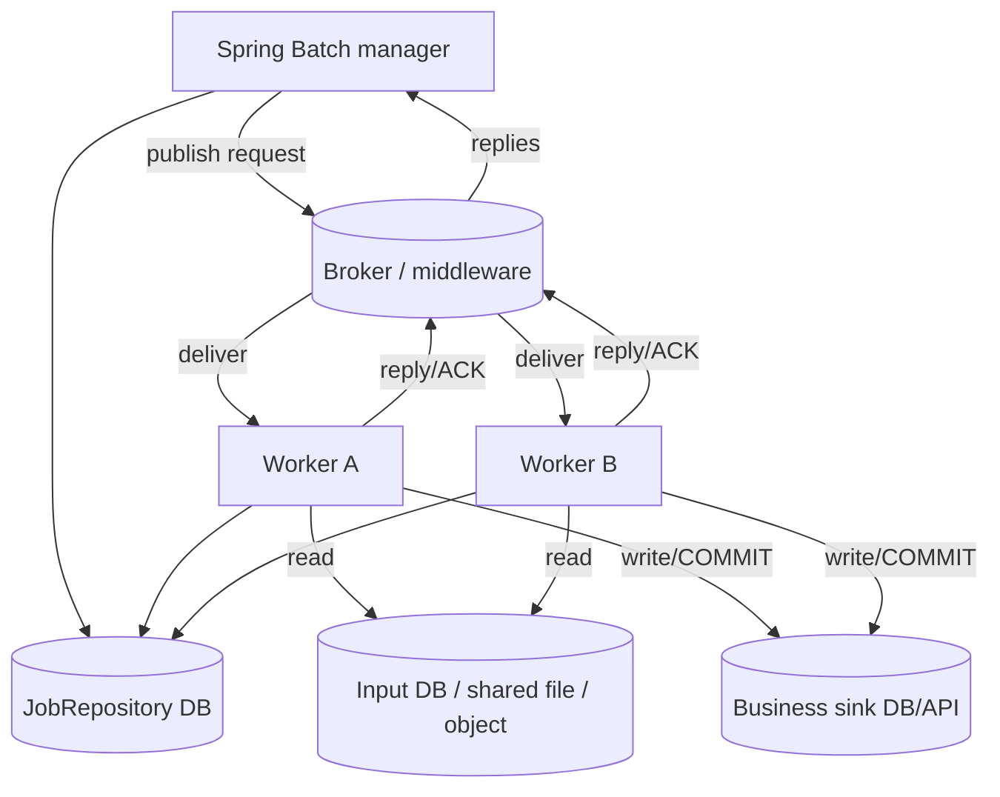
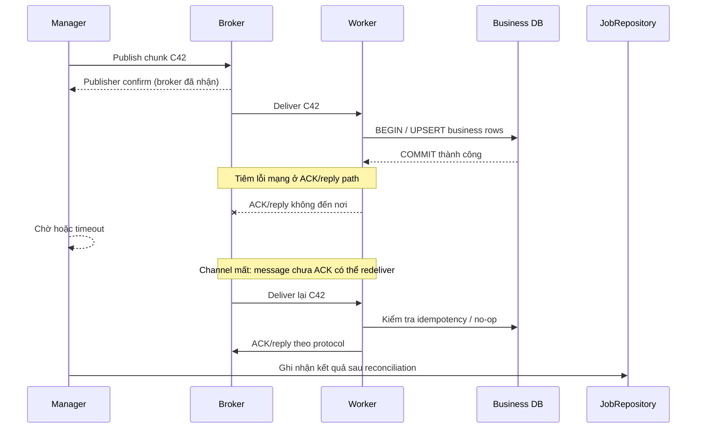
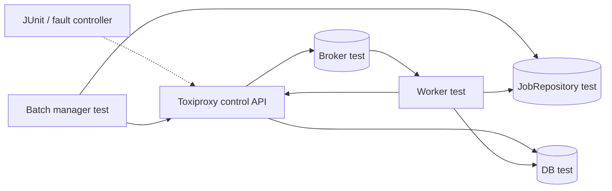
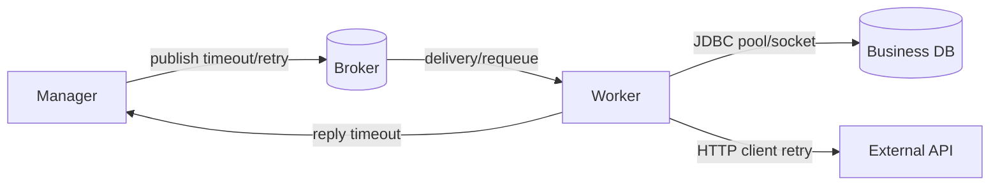

# Test network interruption

## 1. Vì sao phải chủ động kiểm thử mất kết nối mạng?

Một hệ thống Spring Batch xử lý dữ liệu đơn hàng trên một manager, một broker và tám worker. Manager phát một chunk chứa 250 item; worker đã ghi thành công vào database, nhưng **mạng từ worker đến broker bị ngắt ngay trước khi gửi reply**. Trên dashboard:

- Database đã có dữ liệu của chunk.
- Manager vẫn chờ kết quả, hoặc timeout và đánh dấu step lỗi.
- Broker có thể giao lại request nếu consumer chưa ACK.
- Worker mới có thể nhận cùng chunk và cố ghi **lần thứ hai**.
- Khi khởi động lại job, checkpoint và kết quả đã commit có thể không nằm trong cùng một transaction.

Một lần mất kết nối vài giây có thể biến thành **duplicate business effect**, backlog lớn, retry storm hoặc `STARTED` mồ côi trong `JobRepository`. Trong Spring Batch scaling, nguy cơ lớn nhất không chỉ là job `FAILED` mà là **job tưởng đã thành công nhưng thiếu/trùng dữ liệu**.

Bài **“Test network interruption”** nằm trong chương **Performance testing** của module **SPRING_BATCH_SCALING_OPERATIONS**. Phạm vi module là mở rộng Spring Batch trên workload lớn qua multi-threaded step, parallel steps, partitioning và xử lý phân tán, đồng thời đo bottleneck, thread safety, retry/restart và khả năng vận hành. Vì vậy kiểm thử mất mạng phải đồng thời đánh giá **hiệu năng, phục hồi và tính đúng dữ liệu**.

> **Nguyên tắc cốt lõi:** không đánh giá resilience bằng câu “worker tự reconnect” hoặc “job cuối cùng COMPLETED”. Cần biết chính xác mất mạng **ở kết nối nào, trước/sau mốc commit nào**, sau đó chứng minh **không mất/trùng business effects**, checkpoint tương thích và backlog được tiêu trong SLA.

### Kết quả cần đạt

Sau bài học, bạn có thể:

1. Phân biệt **latency, packet loss, TCP reset, blackhole, partition bất đối xứng, timeout, DNS/TLS failure** và **process crash**.
2. Lập **failure-window timeline** từ request publish tới broker ACK, worker DB COMMIT, StepExecution update và manager nhận reply.
3. Dùng **Toxiproxy**, **Testcontainers** hoặc **`tc netem` trong môi trường thử nghiệm** để tiêm lỗi có thể tái lập.
4. Kiểm thử đúng các luồng của **remote chunking**, **remote partitioning**, **local partitioning dùng tài nguyên mạng**, cùng `JobRepository`/DB/file/object storage.
5. Xác định timeout/retry/backoff, redelivery, idempotency, checkpoint, worker fencing và restart.
6. Thiết kế benchmark với RTO, throughput degradation, queue age, recovery time và reconciliation.
7. Viết test scenario và runbook xử lý network interruption trong môi trường production mà không tự làm hỏng dữ liệu.

## 2. “Network interruption” không chỉ có một kiểu

| Tình trạng | Hành vi điển hình | Điều cần kiểm chứng |
| --- | --- | --- |
| **Tăng latency** | Request/reply vẫn đi được nhưng chậm | Timeout giả, tail latency và backlog |
| **Jitter** | Độ trễ biến động lớn | Retry vô ích, timeout không ổn định |
| **Packet loss nhỏ** | TCP retransmit, throughput giảm | Connection pool/retry budget |
| **Packet loss nặng** | Stalls, broken connections | Phục hồi, không mất message |
| **TCP reset (RST)** | Kết nối bị đóng rõ ràng | Reconnect nhanh, rollback/ack semantics |
| **TCP blackhole** | Không có phản hồi, socket có thể treo | Bounded timeouts, heartbeat, không chờ vô hạn |
| **Chỉ cắt một chiều** | Request đi nhưng reply/ACK bị kẹt | Ambiguous completion, redelivery |
| **DNS resolution failure** | Không tìm được endpoint mới | Retry/cached DNS, alternate endpoint |
| **TLS handshake failure** | Không tạo được connection an toàn | Error classification, không fallback insecure |
| **Mất route tới một node** | Một worker lỗi, node khác vẫn tốt | Work ownership, failover và skew |
| **Broker/backend restart** | TCP và service state đều thay đổi | Persistence/consumer recovery, không đồng nhất với network-only |
| **Process/node crash** | Mất cả runtime, memory và socket | Stale StepExecution, worker generation/fencing |

**Một test `sleep(1000)` hoặc `throw new IOException` bên trong processor không tái tạo được tất cả tình huống trên.** Lỗi nội bộ thường xảy ra trước khi side effect commit; mất mạng có thể xảy ra **sau commit nhưng trước khi đối tác nhìn thấy xác nhận**.

### 2.1. TCP reset khác blackhole

- **RST:** client thường biết kết nối không còn dùng được sau khi thao tác I/O thất bại; pooling/reconnect logic được kích hoạt.
- **Blackhole:** packet bị bỏ mà không gửi lỗi; client có thể chờ tới khi timeout/heartbeat phát hiện. Tùy OS/JDBC/broker client, thời gian phát hiện có thể dài hơn thời gian mạng bị cắt.
- **Half-open:** một phía tưởng connection còn sống trong khi phía kia đã mất state; khả năng tự phát hiện phụ thuộc keepalive, heartbeat và ứng dụng.
- **Latency + jitter:** request vẫn thành công nhưng P95/P99 có thể vượt timeout cấu hình, tạo **lỗi giả và retry amplification**.

Không gộp tất cả thành “network error” trong metrics; phân loại lỗi giúp tìm đúng cơ chế phục hồi.

## 3. Điểm có thể đứt mạng trong kiến trúc Spring Batch



Các liên kết quan trọng cần test **riêng**, không chỉ cắt toàn bộ network của một pod:

| Kết nối | Cắt tại đây có thể gây gì? |
| --- | --- |
| Manager → broker | Request publish status không rõ; publisher confirm mất |
| Broker → worker | Worker ngừng nhận job; backlog tăng |
| Worker → broker ACK | Message có thể redeliver sau channel mất |
| Worker → reply broker → manager | Worker commit nhưng manager không biết kết quả |
| Worker → business database | Transaction bị rollback hoặc **commit outcome ambiguous** |
| Manager → JobRepository | Không persist/checkpoint/aggregate được step |
| Worker → JobRepository | Worker đã xử lý nhưng metadata update thất bại |
| Worker → source DB | Reader timeout, cursor/snapshot không còn hợp lệ |
| Worker → NFS/object store | Stream giữa file lỗi, phải reopen đúng input version |
| Client → DNS/service discovery | New connections lỗi trong khi pooled connections cũ vẫn chạy |
| Manager ↔ coordinator/HA | Hai generations có thể cùng tin mình được giao việc |

**Network fault domain** phải được vẽ theo đường đi mạng thực, gồm service mesh/sidecar, load balancer, security group, proxy, NAT, DNS và storage endpoint. Nếu test chỉ đi qua một proxy nhưng ứng dụng âm thầm có đường kết nối trực tiếp, kết quả “PASS” không có giá trị.

## 4. Khác biệt ba mô hình scaling khi mất mạng

| Mô hình | Work unit | Kết nối mạng dễ lỗi | Điều không được giả định |
| --- | --- | --- | --- |
| **Multi-threaded step** | Nhiều chunks/threads trong một StepExecution | Reader DB, writer DB, API, shared storage | Vì cùng JVM nên không chịu network errors |
| **Local partitioning** | Worker StepExecution trong cùng JVM | DB/source/sink qua mạng | TaskExecutor queue là broker phân tán |
| **Parallel steps** | Các StepExecutions/flows độc lập | Nguồn/sink riêng hoặc chung | Một flow thành công làm flow khác thành công |
| **Remote chunking** | Manager đọc, gửi chunk payload; workers xử lý/ghi | Broker request/reply, sink DB | Publisher confirm = business COMMIT |
| **Remote partitioning** | Worker StepExecution đọc/ghi một partition độc lập | Dispatch, JobRepository, worker source/sink | Một message delivery bảo đảm exactly-once business effect |
| **Remote step** ở Spring Batch 6.x | Step chạy từ xa theo remote-step contract | Transport request/reply, worker metadata | Cấu hình giống hệt remote chunking/partitioning |

Trong **local partitioning**, có thể mô phỏng network interruption tới database dù không có message broker. Với **remote chunking**, mất reply sau commit là trọng tâm. Với **remote partitioning**, trạng thái worker StepExecution trong `JobRepository` và manager aggregation/restart cần được đối chiếu.

**Lưu ý phiên bản:** Spring Batch 5.x và 6.x có khác biệt API/configuration; Spring Batch 6 bổ sung cơ chế **local chunking** và **remote step**. Luôn đối chiếu dependency cụ thể trước khi copy code mẫu.

## 5. Timeline lỗi nguy hiểm nhất: “commit rồi mất xác nhận”



**Hai sự thật đồng thời có thể đúng:**

- DB đã COMMIT thành công.
- Manager không biết đã COMMIT và cần thử lại hoặc recovery.

Đây là **ambiguous outcome**. Không thể giải quyết chỉ bằng “retry thêm lần nữa” nếu writer có side effect không idempotent.

### 5.1. Bảng failure windows

| Điểm tiêm lỗi | Điều có thể đã xảy ra | Rủi ro nếu retry ngây thơ | Bằng chứng cần thu |
| --- | --- | --- | --- |
| **F1. Trước publish** | Request chưa đi vào broker | Request bị bỏ mất | Durable source/outbox, retry logic |
| **F2. Publish nhưng mất confirm** | Broker có thể đã lưu request | Publish lại tạo duplicate request | Stable work ID, confirm/reconciliation |
| **F3. Sau delivery, trước xử lý** | Consumer giữ message chưa ACK | Redelivery, queue wait | Delivery/ACK state |
| **F4. Trước DB COMMIT** | Transaction có thể rollback | Retry thường cần thiết | DB transaction outcome |
| **F5. Sau DB COMMIT, trước ACK** | Business write đã bền vững | Ghi trùng khi redelivery | Business idempotency ledger |
| **F6. Sau ACK nhưng trước reply** | Broker có thể bỏ request; manager vẫn chờ | Missing reply và manager timeout | Reply correlation + DB audit |
| **F7. Sau reply publish, trước manager consume** | Reply có thể tồn tại nhưng chưa xử lý | Duplicate/late reply | Reply queue, persisted correlations |
| **F8. Sau worker completed, trước manager aggregate** | Worker metadata có thể đúng | Manager báo lỗi/đợi vô hạn | JobRepository state + handler logs |
| **F9. Sau sink COMMIT, trước checkpoint** | Row đã ghi nhưng state chưa bền | Replay chunk khi restart | Unique keys/ledger + repository history |
| **F10. Mạng hồi lại trong khi worker cũ vẫn chạy** | Hai generations có thể tác động cùng input | Double writes, lock conflict | Fencing/lease/ownership |

Không áp đặt một ACK/commit order cho mọi adapter: JMS transaction, RabbitMQ manual ACK, Spring Integration gateway và custom partition handler có hành vi khác nhau. **Bản test phải mô tả thứ tự thực tế của chính ứng dụng**, không chỉ một sơ đồ lý tưởng.

## 6. Phân biệt ba kiểu “xác nhận”

Trong RabbitMQ và các broker tương tự, có ít nhất ba lớp kết quả:

1. **Publisher confirm**: publisher biết broker đã xử lý việc nhận publish theo cơ chế của broker.
2. **Consumer acknowledgement**: consumer báo message delivery đã được xử lý đến điểm mà ứng dụng chọn.
3. **Business reply / StepExecution result**: manager nhận kết quả từ worker, sau đó cập nhật metadata hay hoàn tất workflow.

**Publisher confirm không có nghĩa worker đã đọc request.** **Consumer ACK không tự chứng minh database đã commit**, trừ khi app triển khai đúng contract và có bằng chứng. **Worker reply không thay thế database reconciliation** khi network có thể đứt ở mọi điểm.

Với manual ACK của RabbitMQ, deliveries chưa ACK thường được requeue khi channel/connection mất. Việc phát hiện connection loss có thể mất thời gian, và **redelivery là hành vi bình thường**, không phải bug cần che đi. Nếu ACK **trước khi commit**, message có thể mất khỏi queue dù sink chưa nhận dữ liệu. Nếu ACK **sau commit**, redelivery có thể xảy ra, nên sink phải **idempotent**.

### 6.1. Không nhầm reply timeout với processing timeout

Một request bị manager timeout sau 30 giây có thể đang:

- Đợi trong broker queue 25 giây;
- Worker gọi DB chậm;
- Worker đã COMMIT nhưng reply bị chặn;
- Broker giữ reply mà manager chưa đọc;
- Worker đã chết thật sự.

Từ một `TimeoutException` **không thể** kết luận request chưa được thực thi. Thử nghiệm phải dùng event markers và audit ledger để xác định sự thật, không đoán từ thời gian timeout.

### 6.2. Kafka và offsets

Với Kafka-based transport, nhận record từ `poll()`, commit consumer offset và commit business DB là **những thao tác khác nhau** nếu không có protocol giao dịch liên quan. Sau crash, offset chưa commit có thể làm record được phát lại; nếu commit offset quá sớm thì có thể bỏ sót business effect. Kafka transactions hỗ trợ một số bảo đảm **trong Kafka**, nhưng không tự tạo atomic transaction với mọi external DB/API.

Không dùng `max.poll.records` như một giới hạn toàn bộ in-flight writes. Cần test pause/resume, rebalance, `max.poll.interval.ms`, retry topic/DLT và offset replay trong chính topology.

## 7. Đặt giả thuyết và tiêu chí PASS trước khi tiêm lỗi

Một performance/fault test tốt phải có **thông số đầu vào**, **mốc lỗi**, **kết quả mong đợi** và **chứng cứ có thể kiểm tra**.

Ví dụ hợp đồng thử nghiệm:

```text
Job: settlementImportJob
Identifying JobParameter: manifestId=settlement-fixture-v1
Input: 100.000 logical records, immutable
Partitions: 20 fixed ranges, stable names
Chunk size: 250
Worker concurrency: 4
Sink: PostgreSQL primary, business key = (manifestId, recordId)
Expected unique output rows: 100.000
Expected business total: known test fixture checksum/sum
Network fault: block worker -> broker reply path for 45 s
Restore time: t_restore
Recovery target: resume useful progress <= 90 s after restore
Job target: finish + reconcile within 10 minutes (minh họa)
Unexpected duplicate business effects: 0
Missing business records: 0
Unexpected status COMPLETED while data mismatch: 0
```

**Những ngưỡng trên chỉ minh họa**. SLA, concurrency, timeout, nguồn, dữ liệu và DB capacity cần hiệu chỉnh theo môi trường và business objective.

### 7.1. Tính đúng quan trọng hơn số “job thành công”

Các assertions tối thiểu:

- Có đủ **100.000 distinct business keys** trong sink.
- Mọi key thuộc **đúng snapshot/manifest** đã seal.
- Với dữ liệu cần tổng hợp, sum/checksum đúng expected fixture.
- Side effects kiểu cộng tiền/gọi API **không bị thực hiện hai lần**.
- Các partitions kỳ vọng được xác nhận hoàn tất hoặc job báo failure rõ.
- Sau restart, JobInstance/partition mapping không đổi; không sinh các input batches khác ngoài ý muốn.
- Không ACK/drop request khi chưa có nơi giữ công việc bền vững phù hợp.
- Không có worker cũ và mới cùng write trái ownership/fencing policy.

**Nếu không đo được điều gì đã thực sự commit, kết quả phải là `INCONCLUSIVE`**, không phải PASS chỉ vì exception biến mất.

### 7.2. Hiệu năng cần chứng minh thêm

- Độ suy giảm **committed business throughput** trong lúc mất mạng.
- Thời gian phát hiện lỗi và timeouts theo tầng.
- Queue depth, oldest message age và số in-flight work.
- Mức retry amplification, redelivery và backoff.
- Thời gian bắt đầu xử lý hữu ích lại sau mạng hồi (recovery latency).
- Thời gian tiêu hết backlog, job makespan và SLA publish.
- CPU, heap, thread pool, DB connections và broker disk/quota trong giai đoạn lỗi và phục hồi.
- RTO theo định nghĩa nghiệp vụ và RPO (nếu có mất dữ liệu được phép trong hợp đồng).

## 8. Thiết kế môi trường test cô lập và tái lập

Không tạo một bài thử mất mạng bằng cách cắt route của production manager, production broker hay database đang được chia sẻ. Fault injection phải có **phạm vi và rollback được xác minh**.

### 8.1. Topology tối thiểu



Sơ đồ đơn giản hóa: thực tế muốn cắt **riêng manager→broker** và **worker→broker** phải tạo **proxy endpoint và đường route riêng**. Nếu cả hai bên cùng dùng một proxy, fault trên proxy có thể làm mất cả hai luồng, khiến khó phân lập failure window.

### 8.2. Các nguyên tắc cô lập

1. Dùng fixture không chứa PII/secret thật, database/schema và queue riêng.
2. Mọi worker/client test phải trỏ tới **đúng proxy endpoint**, không bypass trực tiếp broker/DB.
3. Chỉ cho phép inject fault vào **network test/container**; không đổi global host route nếu không kiểm soát.
4. Đặt timeout trên test harness để test không treo vô hạn.
5. Ghi đầy đủ image/version, JVM, Spring Batch, broker/DB, network topology và fault parameters.
6. Đo trạng thái **trước**, **trong** và **sau** mỗi fault; không chỉ một final query.
7. Khôi phục network bằng `finally`/test teardown, dù assertion thất bại.
8. Nếu worker cũ còn sống, test recovery phải có quiescence/fencing trước khi phát lại work.
9. Cleanup only test artifacts; không xóa chung DB/table/queue của người khác.
10. Test network fault riêng với test process crash, broker restart và database restart để phân tích nguyên nhân.

### 8.3. Chuẩn bị nguồn bất biến

Một reader có thể restart đúng chỉ nếu input nguồn được **pin**:

```text
manifestId = fixture-20261126-001
snapshotId = immutable-set-001

partition-0000 -> [0, 5000)
partition-0001 -> [5000, 10000)
...
partition-0019 -> [95000, 100000)
```

Không dùng `SELECT * FROM orders` trên dữ liệu live rồi kết luận “replay đúng” sau khi nguồn đã được sửa. Với file/object storage, dùng manifest + checksum/generation; với DB, dùng sealed snapshot/staging. Sau mạng hồi và restart, **không tái phân vùng cùng JobInstance theo danh sách dữ liệu mới nhất**.

## 9. Toxiproxy: tiêm lỗi trên đường TCP một cách có kiểm soát

**Toxiproxy** là TCP proxy hỗ trợ các “toxic” như latency/jitter, bandwidth, timeout và reset. Nó thích hợp cho integration test vì điều khiển được qua HTTP API; một proxy có thể đặt giữa worker và PostgreSQL/broker test.

**Giới hạn:** Toxiproxy thao tác ở **luồng TCP**, không mô phỏng chính xác mọi hành vi DNS, routing đa vùng, packet-level scheduling hay TLS certificate failure. Để test packet loss ở tầng mạng thực, có thể bổ sung `tc netem` trong namespace riêng.

### 9.1. Ví dụ tạo proxy bằng REST API

Giả sử Toxiproxy chạy trên **máy/namespace test** có control API `http://127.0.0.1:8474` và có thể kết nối service `rabbitmq-test:5672` ở cùng test network.

```bash
# CHỈ chạy với Toxiproxy test đã được cấp riêng.
# Control API ở 8474 không được expose public/production.
curl -fsS -X POST 'http://127.0.0.1:8474/proxies' \
  -H 'Content-Type: application/json' \
  -d '{
    "name": "worker_to_broker_test",
    "listen": "0.0.0.0:8666",
    "upstream": "rabbitmq-test:5672"
  }'
```

Worker test ở cùng Docker network kết nối tới `toxiproxy-test:8666` thay vì `rabbitmq-test:5672`. Nếu test JVM chạy từ host, dùng mapped host port được container runtime công bố. **Không** kết nối vào `8474` để gửi AMQP — đó là **control API**, không phải proxy data port.

Đảm bảo mã test in/ghi nhận **thực tế nó đang dùng hostname/port proxy**; chỉ tạo proxy mà vẫn để worker dùng broker URL gốc nghĩa là chưa có test fault injection.

### 9.2. Tiêm latency và jitter có hướng

```bash
# Downstream theo Toxiproxy: server -> client.
curl -fsS -X POST \
  'http://127.0.0.1:8474/proxies/worker_to_broker_test/toxics' \
  -H 'Content-Type: application/json' \
  -d '{
    "name": "reply_latency",
    "type": "latency",
    "stream": "downstream",
    "attributes": {"latency": 500, "jitter": 150}
  }'
```

Ở đây delay mô phỏng 500 ms ± jitter trên **server → client**. Nếu muốn mô phỏng độ trễ **hai chiều**, cần toxic riêng với `stream="upstream"`; đừng cho rằng một toxic downstream tạo thêm đúng 1 giây RTT. Quan sát timeout, backlog và throughput khi delay vượt ngưỡng client.

### 9.3. Tạo blackhole rồi phục hồi

```bash
# Chặn dữ liệu downstream: không truyền bytes và không đóng connection
# ngay; chỉ dùng test namespace và nhớ gỡ toxic.
curl -fsS -X POST \
  'http://127.0.0.1:8474/proxies/worker_to_broker_test/toxics' \
  -H 'Content-Type: application/json' \
  -d '{
    "name": "blackhole_down",
    "type": "timeout",
    "stream": "downstream",
    "attributes": {"timeout": 0}
  }'

# Sau khi đã ghi nhận lỗi, LUÔN restore:
curl -fsS -X DELETE \
  'http://127.0.0.1:8474/proxies/worker_to_broker_test/toxics/blackhole_down'

# Gỡ latency toxic nếu còn:
curl -fsS -X DELETE \
  'http://127.0.0.1:8474/proxies/worker_to_broker_test/toxics/reply_latency'
```

`timeout=0` của Toxiproxy timeout toxic mô phỏng chặn luồng mà không đóng ngay; nó có thể khiến client **treo tới timeout/heartbeat của ứng dụng**. Test phải có watchdog và guaranteed cleanup. Nếu muốn chặn cả hai hướng, tạo toxic upstream/downstream phù hợp; nhưng tránh cắt hai phía khi đang cố chứng minh một **failure window đơn hướng**.

### 9.4. Reset connection và giảm bandwidth

Các toxic `reset_peer` và `bandwidth` giúp thử:

- RST giữa chunk request hoặc DB transaction.
- Throughput thấp kéo dài, backlog tích tụ.
- Reconnection pressure khi nhiều workers đồng thời mất TCP.
- Response chậm tới mức manager timeout nhưng worker vẫn đang commit.

API parameters phụ thuộc Toxiproxy version. **Pin image version** và ghi lại toxic configuration trong test report. Không gắn thêm toxic ngẫu nhiên nếu test đang cố xác định nguyên nhân của một failure window.

### 9.5. Lưu ý về điều khiển test

Một request HTTP tới Toxiproxy thành công chỉ chứng minh **fault config được chấp nhận**. Phải có phép quan sát xác minh:

- Đường kết nối thực sự đi qua proxy.
- Kết nối đang mở chịu ảnh hưởng như mong đợi hay cần reconnect.
- Client phát error/timeout đúng lúc, không âm thầm fallback direct endpoint.
- Sau gỡ toxic, traffic được khôi phục và metrics return to baseline.
- Không còn test-only proxy sai trong cấu hình deploy production.

## 10. Testcontainers: cô lập broker/DB/proxy theo mỗi test suite

Với Java, **Testcontainers** có module Toxiproxy. Có thể khởi chạy PostgreSQL, RabbitMQ và Toxiproxy trên một **Docker Network riêng**, gán network alias cho target và cấu hình ứng dụng test đi qua proxy.

### 10.1. Pseudocode test harness

```java
// PSEUDOCODE / kiến trúc, không phải class Java hoàn chỉnh.
// API container và proxy phụ thuộc version Testcontainers/Toxiproxy.

try (var network = createIsolatedDockerNetwork();
     var postgres = startTestPostgres(network);
     var broker = startTestRabbitMq(network);
     var proxy = startToxiproxy(network)) {

    var workerBrokerProxy = proxy.createProxy(
            "worker_to_broker", "rabbitmq-test", 5672);

    var workerDbProxy = proxy.createProxy(
            "worker_to_db", "postgres-test", 5432);

    var batch = startManagerAndWorkers(
            network,
            workerBrokerProxy.getClientAddress(),
            workerDbProxy.getClientAddress(),
            "fixture-immutable-v1");

    assertBaselineCanCommit(batch);

    try {
        workerBrokerProxy.cutDownstream();
        awaitBoundedTimeoutOrHealthSignal(batch);
    } finally {
        workerBrokerProxy.restore();
    }

    awaitBoundedRecovery(batch);
    assertBusinessReconciliation(batch);
}
```

Ở phiên bản Testcontainers Java khác nhau, `ToxiproxyContainer.getProxy(...)` và helper như `setConnectionCut(...)` có thể **deprecated/thay đổi**. Vì thế snippet trên dùng interface **mô tả** (`createProxy`, `cutDownstream`, ...) chứ **không được coi là API có sẵn để copy compile**. Khi triển khai thật, dùng documentation của **version đã pin** và client HTTP của Toxiproxy để điều khiển proxy.

### 10.2. Phân lập từng kết nối

Nên tạo các proxies khác nhau:

```text
manager -> broker-requests-proxy -> broker
worker  -> broker-worker-proxy   -> broker
manager -> metadata-db-proxy     -> JobRepository
worker  -> business-db-proxy     -> business database
worker  -> source-db-proxy       -> source database
```

Nếu metadata DB và business DB cùng PostgreSQL instance, vẫn có thể dùng **hai listener/proxy endpoints khác nhau** để test failover từng đường kết nối, nếu application pools được cấu hình tương ứng.

Một số frameworks có pooled connections: inject proxy sau khi app đã kết nối và kiểm tra thao tác **trên existing connection**, không chỉ test mỗi lần tạo connection mới. Ngược lại, nếu fault chỉ ảnh hưởng connection mới, phải buộc test tạo connection mới để quan sát đúng.

## 11. `tc netem`: thử latency/loss/jitter ở network namespace test

Trên Linux, `tc netem` mô phỏng delay, loss, reorder, duplication và rate-limiting ở tầng network interface. Công cụ này hữu ích khi cần hành vi packet-level mà Toxiproxy TCP-stream không diễn tả sát.

**Cảnh báo phạm vi:** chỉ chạy trong **container/network namespace cô lập có `CAP_NET_ADMIN`** hoặc máy staging được phép. **Không** gõ lệnh lên `eth0` của production server, node Kubernetes dùng chung hoặc VPN/corporate host.

### 11.1. Ví dụ trong container kiểm thử riêng

```bash
# CHỈ TRONG TEST CONTAINER/NAMESPACE ĐƯỢC PHÉP.
# IFACE phải là interface của test path; ví dụ "eth0" chỉ minh họa.
IFACE=eth0

# Thêm 200ms delay ± 50ms jitter và random loss 2% ở chiều egress.
sudo tc qdisc add dev "$IFACE" root \
  netem delay 200ms 50ms loss 2%

# Xem qdisc đang hoạt động và counters.
sudo tc -s qdisc show dev "$IFACE"

# RESTORE: xóa qdisc test, thường đặt trong trap/finally của harness.
sudo tc qdisc del dev "$IFACE" root
```

Trước khi chạy, test harness phải xác minh interface chỉ nối tới **test network** và chưa có qdisc quan trọng; `tc qdisc add root` có thể fail nếu đã có cấu hình. Đừng dùng `replace` và xóa qdisc tùy tiện trên network host của người khác.

### 11.2. Giới hạn của netem

- Netem thường tác động vào **egress** của interface đã chọn; làm mất mạng một chiều cần kiểm soát hướng lưu lượng.
- TCP có retransmission/congestion control, nên 2% packet loss **không tương đương 2% item loss**.
- Delay/loss/reorder có thể bị ảnh hưởng kernel timers, MTU, offloading, qdisc và topology.
- Tăng delay ở chiều gửi chưa chắc mô phỏng được **server → client response** nếu đặt sai interface.
- Kết quả trên loopback/LAN không đại diện hoàn toàn cho cloud cross-AZ network.
- Fault injector có thể tự trở thành bottleneck; đo baseline qua proxy/netem **không inject** trước khi so sánh.

## 12. Xác định điểm tiêm lỗi theo giai đoạn của chunk

Một test “tắt mạng khi job đang chạy” thường tạo kết quả **không tái lập** vì không biết request nào đang ở đâu. Thay vào đó cần **barrier/fault hooks** ở các mốc đã chọn.

### 12.1. Các mốc có thể quan sát

```text
EVENT_REQUEST_PUBLISHED
EVENT_BROKER_CONFIRMED
EVENT_WORKER_DELIVERED
EVENT_BEFORE_SINK_COMMIT
EVENT_SINK_COMMITTED
EVENT_BEFORE_ACK_OR_REPLY
EVENT_REPLY_RECEIVED
EVENT_STEP_METADATA_UPDATED
EVENT_JOB_FINALIZED
```

Đây là **tên sự kiện do test harness định nghĩa**, không phải events mặc định Spring Batch/broker đồng loạt có sẵn. Với những mốc khó quan sát, có thể dùng transaction hook trong ứng dụng test, DB audit, broker proxy và bounded latch.

### 12.2. Vì sao `Thread.sleep` dễ gây test flaky?

```java
// Không đáng tin:
Thread.sleep(1000);
network.cut();
```

Một giây sau launch, worker có thể chưa kết nối, đang đọc, vừa commit hoặc đã gửi reply. Kết quả nhiều lần khác nhau nhưng đều được gắn nhãn “post-commit failure”.

**Cách tốt hơn:** đặt latch sau khi một transaction test đã **COMMIT thành công**, chờ tín hiệu bằng timeout rõ, rồi cắt **đúng reply/ACK path** trước khi cho worker gửi confirmation. Test này thường cần hook được cấu hình **chỉ trong test**, không nên đưa cơ chế chặn thread không giới hạn vào production.

### 12.3. Không tự tạo “ACK sau commit” giả

Nếu mock messenger trả success trong khi DB chưa commit, test có thể pass giả. Cần kiểm chứng state thật trên test database và transport metadata/reply. Nếu dùng một test double cho broker, nó phù hợp unit test logic retry, **không thay thế integration test transport thực**.

## 13. Kịch bản 1: manager mất kết nối khi publish request

**Giả thuyết:** manager không nhận publisher confirm nhưng broker có thể đã nhận request. Khi reconnect, retry phải giữ **logical work ID** ổn định và không tạo duplicate business effect.

**Các bước:**

1. Tạo immutable manifest và launch một JobInstance test.
2. Cho manager publish chunk/partition request thông qua proxy.
3. Cắt đường **broker → manager confirm** ngay sau khi broker đã nhận (dùng hook/transport trace nếu cần).
4. Giữ fault vài giây, đo publish timeout và in-flight.
5. Restore link, cho manager retry/reconcile theo policy.
6. Đo tổng số delivery attempts và **unique business output**.
7. Kiểm tra manager không silently mark successful trước khi có kết quả hợp lệ.

**PASS:** source work không mất; nếu request được publish hai lần, sink dedup an toàn; không có sự kiện thiếu và timeout/backoff bounded.

**FAIL:** một request được bỏ vì manager nghĩ broker đã nhận, hoặc duplicate side effect vì retry tạo một business operation mới.

### 13.1. Chặn publish không giống broker crash

Nếu Toxiproxy không chuyển một frame tới broker, broker chưa từng thấy frame. Nếu frame đã đến nhưng **confirm bị mất**, outcome mơ hồ hơn. Cần test **cả hai mốc**, không kết luận từ một “connection refused” đơn lẻ.

## 14. Kịch bản 2: worker mất network tới business database

**Giả thuyết:** cắt kết nối DB trong và quanh chunk transaction không làm job báo success giả hoặc gây duplicate.

Test các thời điểm khác nhau:

| Thời điểm | Trạng thái kỳ vọng | Cần chứng minh |
| --- | --- | --- |
| Trước bắt đầu transaction | Chưa write | Worker retry/fail bounded |
| Giữa batch of statements | Transaction có thể rollback | Không commit một nửa không được phép |
| Trong lúc COMMIT đang gửi | **Outcome ambiguous** | Query/ledger đối soát trước re-drive |
| Sau COMMIT, trước nhận response | DB có thể đã commit | Business dedup trên replay |
| Sau COMMIT response, trước checkpoint | Sink thành công, metadata có thể cũ | Idempotent restart |
| DB chậm 30s rồi hồi | Timeouts có thể xảy ra | No retry storm, pool phục hồi |

**Không dựa vào JDBC exception một mình để khẳng định transaction đã rollback.** Nếu socket mất khi COMMIT response đang bay về, client không biết chắc server đã commit hay chưa. Để chứng minh, dùng độc lập **database audit / idempotency table** trên test DB sau khi kết nối phục hồi.

### 14.1. Vì sao transaction rollback không giải quyết mọi side effect?

Một `chunk(250)` có DB transaction, nhưng worker có thể còn gọi:

- HTTP API thanh toán;
- Gửi message vào broker khác;
- Ghi file/shared object storage;
- Cập nhật một database khác;
- Phát email/notification.

Transaction manager của Spring Batch **không tự bao trùm tất cả hệ thống này**. Chặn DB trước commit rồi retry có thể làm HTTP side effect đã xảy ra được gọi lại; cần idempotency keys/outbox/saga hoặc compensation theo nghiệp vụ.

## 15. Kịch bản 3: worker COMMIT rồi mất broker reply

Đây là một trong những test **bắt buộc** của remote chunking.

### 15.1. Quy trình

1. Worker nhận một chunk có **stable logical chunk ID** hoặc tập record IDs xác định.
2. Chờ DB khẳng định đã COMMIT business writes.
3. Cắt **reply path**, không cắt DB path.
4. Cho worker cố gửi reply/ACK và xác minh manager chưa nhận.
5. Chờ bounded timeout, quan sát broker unacked count/redelivery.
6. Restore reply path.
7. Nếu request được redeliver, worker đối chiếu business ledger rồi **no-op duplicate**.
8. Chỉ ghi nhận job completed theo protocol sau khi manager có đủ kết quả và data reconciliation đạt.

### 15.2. Những assertions cần ghi rõ

```text
input logical records:             250
worker processing attempts:        >= 1
sink unique records committed:     250
sink unexpected duplicate effects: 0
reply missing/late counter:        >= 1 khi fault thực sự tác động
logical chunk result:              handled or safely failed
manager StepExecution:             final state consistent with sink
```

Số attempts có thể lớn hơn một, nhưng **business effect** đúng một lần. Không ép assertions rằng broker nhất định redeliver trong đúng 1 giây — tùy heartbeat, connection failure detection, ACK mode và broker settings.

### 15.3. Lost reply có thể không làm message redeliver

Nếu worker đã **ACK request trước khi gửi reply** theo adapter contract, chặn riêng reply channel có thể khiến **không có redelivery**. Manager cần correlation timeout/recovery rõ, có thể phải đối soát DB và re-drive có kiểm soát. Test phải quan sát **ACK timing thực tế** thay vì chỉ kỳ vọng mọi reply loss sẽ sinh redelivery.

### 15.4. JMS reply header mapping

Ở các tổ hợp Spring Batch Integration/Spring Integration có JMS reply adapters, headers `correlationId`, `sequenceNumber`, `sequenceSize` có thể cần được map inbound rõ ràng. Tài liệu Spring Batch Integration lưu ý thay đổi allowlist mặc định của `DefaultJmsHeaderMapper` từ Spring Integration **7.0.6+**. Missing correlation có thể làm manager treo **ngay cả khi mạng khỏe**.

Đây là **control test quan trọng**: trước khi tiêm network fault, xác minh reply mapping hoạt động bình thường. Nếu không, bạn sẽ nhầm lỗi cấu hình message headers với network resilience.

## 16. Kịch bản 4: remote partitioning mất JobRepository

Khác remote chunking, remote partitioning giao việc theo **StepExecution** và worker có thể tự đọc source, tự ghi sink, cập nhật metadata JobRepository theo topology.

### 16.1. Failure windows

```text
Manager:
    create partition StepExecutions / ExecutionContexts
    dispatch workers

Worker:
    read partition source
    write chunk(s), commit
    update StepExecution state/checkpoint
    mark completion and reply/polling visibility
```

Nếu cắt **worker→JobRepository** sau sink COMMIT:

- Một số business rows có thể đã ghi thành công.
- Checkpoint chưa persist; restart có thể replay chunk.
- Worker có thể fail step hoặc metadata bị stale.
- Manager có thể chờ kết quả hoặc nhìn trạng thái cũ.

Nếu cắt **manager→JobRepository** sau workers đã completed:

- Worker metadata có thể đúng, manager không tổng hợp/finalize được.
- JobExecution có thể `STARTED` lâu sau khi workers ngừng.
- Restart cần xác minh ownership trước khi chạy lại.

### 16.2. PASS không chỉ là “mọi workers chạy lại”

Sau restore, cần kiểm tra:

1. Mỗi logical partition có ID/range **không đổi**.
2. Các partitions đã `COMPLETED` không bị chạy lại ngoài policy.
3. Những partitions cần restart chạy lại trên đúng immutable input.
4. Sink idempotent và business totals đúng.
5. Stale `STARTED` được phát hiện và xử lý bằng recovery procedure hỗ trợ.
6. Không có **hai worker generations** đồng thời ghi cùng logical partition ngoài isolation/fencing contract.
7. Manager nhận lại trạng thái/aggregate đúng, không giả reply thành công.

**Không chỉnh `BATCH_*` thủ công** chỉ để xoá `STARTED` trong một test. Làm như vậy che mất failure mode thực và dễ làm hỏng repository.

## 17. Kịch bản 5: mạng tới source database hoặc file storage bị ngắt

Mất kết nối nguồn khác mất kết nối sink.

### 17.1. JDBC reader

- Một cursor/connection đang đọc có thể đóng khi network lỗi.
- `JdbcPagingItemReader` có thể mở query lại theo page/sort key trên restart, nhưng nguồn phải **ổn định và có unique deterministic sort**.
- `JdbcCursorItemReader` phụ thuộc connection/cursor; reconnect giữa transaction không có nghĩa resume chính xác từ dòng đang đọc.
- Nếu source data mutable, reader chạy lại cùng range có thể đọc record mới hoặc bỏ record cũ.
- Nếu dùng **read replica**, failover sang replica chậm hơn có thể trả snapshot thiếu dữ liệu đã commit; cần source version/replay barrier.

### 17.2. Shared filesystem/NFS

- Một file đang đọc có thể trả `IOException`, timeout hoặc stale file handle, tùy client/protocol.
- Nếu source bị overwrite trong lúc mạng gián đoạn, checkpoint byte offset/line number không đủ để resume chính xác.
- Với file/manifest bất biến, worker có thể reopen **cùng version** và re-validate theo policy.
- Với compressed stream không splittable, restart có thể phải đọc lại từ đầu/điểm hỗ trợ của reader; benchmark **re-read cost**.

### 17.3. Object storage

- Object requests có thể timeout, trả 5xx hoặc stream ngắt giữa range read.
- Dùng **immutable object key/version/generation** hoặc checksum/source snapshot.
- Retry HTTP range request chỉ khi reader format/range alignment hợp lệ.
- Không giả định multipart upload chưa hoàn tất là một object input ready.
- Network hồi lại nhưng object version đã bị xóa theo retention: phải fail rõ, không đọc “latest” cùng key rồi dùng checkpoint cũ.

### 17.4. Kết quả PASS

Bất kể nguồn nào, **expected input manifest** phải được giữ, reader restart tại điểm tương thích, không skip/duplicate business records ngoài policy, và lỗi khi không khôi phục được source version phải được báo rõ.

## 18. Java: cấu hình reader và worker Step dễ kiểm thử restart

Ví dụ theo **Spring Batch 5.x**, Java 17+, PostgreSQL. Đây là cấu hình minh họa, không phải một ứng dụng hoàn chỉnh; imports/beans, manifest repository, partition handler/remote messaging setup được rút gọn.

### 18.1. Dữ liệu nguồn bất biến và unique sort key

```sql
CREATE TABLE immutable_batch_input (
    manifest_id TEXT NOT NULL,
    record_id BIGINT NOT NULL,
    amount NUMERIC(18, 2) NOT NULL,
    source_version BIGINT NOT NULL,
    PRIMARY KEY (manifest_id, record_id)
);
```

Khi manifest được seal, writer upstream **không được INSERT/UPDATE/DELETE** bất kỳ record nào trong snapshot cũ. Nếu nguồn thay đổi, cần một JobInstance/correction flow riêng thay vì silently thay data khi restart.

### 18.2. Step-scoped paging reader theo partition

```java
record BatchInputRow(
        long recordId,
        long sourceVersion,
        BigDecimal amount) {}

@Bean("immutableInputReader")
@StepScope
JdbcPagingItemReader<BatchInputRow> immutableInputReader(
        @Qualifier("sourceDataSource") DataSource sourceDataSource,
        @Value("#{stepExecutionContext['manifestId']}") String manifestId,
        @Value("#{stepExecutionContext['fromId']}") Long fromId,
        @Value("#{stepExecutionContext['toId']}") Long toId) {

    return new JdbcPagingItemReaderBuilder<BatchInputRow>()
            .name("immutableInputReader")
            .dataSource(sourceDataSource)
            .selectClause(
                    "SELECT record_id, source_version, amount")
            .fromClause("FROM immutable_batch_input")
            .whereClause(
                    "WHERE manifest_id = :manifestId " +
                    "AND record_id >= :fromId " +
                    "AND record_id < :toId")
            .parameterValues(Map.of(
                    "manifestId", manifestId,
                    "fromId", fromId,
                    "toId", toId))
            .sortKeys(Map.of("record_id", Order.ASCENDING))
            .rowMapper((rs, rowNum) -> new BatchInputRow(
                    rs.getLong("record_id"),
                    rs.getLong("source_version"),
                    rs.getBigDecimal("amount")))
            .pageSize(250)
            .saveState(true)
            .build();
}
```

**Giới hạn/điểm cần biết:**

- `@StepScope` tạo reader cho từng worker `StepExecution`; không tự đảm bảo thread safety nếu bạn lại chạy **multi-threaded chunks bên trong cùng worker step**.
- `record_id` unique trong `manifest_id`, nên sort key ổn định và phù hợp paging/restart.
- `@StepScope` không giải quyết network retry của JDBC driver; connection pool timeouts và reader/restart policy cần cấu hình riêng.
- `pageSize=250` là query paging size, không phải số worker.
- Nếu nguồn không bất biến hoặc keyset không đầy đủ, một test network restart có thể thất bại vì **data consistency**, không phải chỉ do socket.
- Trên Spring Batch 6.x, một số builder API thay đổi; đối chiếu version.

### 18.3. Worker step không tự giả định “exactly-once”

```java
@Bean("networkTestWorkerStep")
Step networkTestWorkerStep(
        JobRepository jobRepository,
        @Qualifier("businessTransactionManager")
            PlatformTransactionManager businessTransactionManager,
        @Qualifier("immutableInputReader")
            ItemStreamReader<BatchInputRow> reader,
        @Qualifier("idempotentBatchWriter")
            ItemWriter<BatchInputRow> writer) {

    return new StepBuilder("networkTestWorkerStep", jobRepository)
            .<BatchInputRow, BatchInputRow>
                    chunk(250, businessTransactionManager)
            .reader(reader)
            .writer(writer)
            .build();
}
```

Trong code, `idempotentBatchWriter` là bean do ứng dụng phải triển khai. `chunk(250, ...)` đặt transaction chunk size, **không** phải 250 mạng connections hoặc 250 workers. Nếu reader source DB, writer sink DB và JobRepository nằm ở **ba DataSources khác nhau**, local transaction manager của sink không tự bao trùm ba hệ thống.

**Không biến `retry(IOException.class)` thành catch-all**: socket timeout, unique constraint, invalid payload, authentication và source-version mismatch cần chính sách retry khác nhau, giới hạn attempts và thời gian.

## 19. Idempotency thực tế tại sink: xử lý retry an toàn

Giả sử business operation có `manifestId + recordId` làm identity. Một cách bảo vệ là ledger trong **cùng transaction với business update**.

### 19.1. Schema PostgreSQL minh họa

```sql
CREATE TABLE applied_batch_record (
    manifest_id TEXT NOT NULL,
    record_id BIGINT NOT NULL,
    source_version BIGINT NOT NULL,
    payload_hash TEXT NOT NULL,
    applied_at TIMESTAMPTZ NOT NULL DEFAULT now(),
    PRIMARY KEY (manifest_id, record_id)
);

CREATE TABLE business_projection (
    record_id BIGINT PRIMARY KEY,
    latest_source_version BIGINT NOT NULL,
    amount NUMERIC(18, 2) NOT NULL
);
```

Một transaction writer logic có thể:

```text
BEGIN;
  1. INSERT INTO applied_batch_record(manifest_id, record_id, ...)
     VALUES (...)
     ON CONFLICT (manifest_id, record_id) DO NOTHING
     RETURNING record_id;

  2. Nếu INSERT thực sự tạo row:
       - áp business effect tương ứng theo chính sách nguồn,
       - update projection / ledger totals trong CÙNG transaction.

  3. Nếu không INSERT:
       - đọc row hiện tại và đối chiếu sourceVersion/payloadHash;
       - trùng chính xác -> duplicate no-op;
       - khác payload cho cùng key -> CONFLICT, fail/quarantine.

COMMIT;
Chỉ sau khi commit được xác nhận/đối soát mới ACK business work
theo contract của transport.
```

Đây là **transaction pseudocode**, không phải một statement SQL nguyên khối. Với nhiều workers cùng key, primary-key constraint sẽ đảm bảo chỉ một insert hợp lệ, nhưng kiểm chứng hash/conflict và side-effect update cần thực thi trong transaction đúng.

### 19.2. Không ghi tiền bằng phép cộng lặp lại vô điều kiện

```sql
-- KHÔNG AN TOÀN nếu cùng event bị replay:
UPDATE account_balance
SET balance = balance + :amount
WHERE account_id = :accountId;
```

Nếu worker COMMIT xong mất reply, lần retry có thể cộng tiền **hai lần**. Dùng event ledger/unique business operation ID cùng transaction, hoặc hệ thống thanh toán có idempotency key đã được kiểm chứng.

### 19.3. Phân biệt at-least-once với exactly-once effect

Network có thể làm item/chunk được xử lý **nhiều attempts**; với idempotent sink, những attempts đó vẫn có thể tạo **một business effect**. Không nói transport “chỉ giao đúng một lần” nếu broker/redelivery không có bảo đảm như vậy.

Nếu business effect ở **external API**, unique DB ledger riêng chưa chắc chặn được double call khi crash giữa API success và ledger commit. Cần idempotency key ở API, outbox/saga/compensation hoặc đối soát sau crash.

## 20. Test timeout và retry theo tầng, không chỉ tổng attempts

Một pipeline có thể có:



Nếu mỗi tầng retry độc lập ba lần, tổng business attempts có thể tăng rất nhanh. Một failure có thể bị amplify qua:

- TCP retransmission/connection retry;
- JDBC driver/pool connection acquisition timeout;
- Spring Batch retry/skip policy;
- Spring Integration gateway/channel timeout;
- Broker redelivery/requeue;
- Manager chunk/partition reply timeout;
- Scheduler/JobOperator restart toàn JobInstance;
- Autoscaler thêm workers khi downstream đã bão hòa.

**Không cộng/multiplier cứng các lần retry nếu chưa đo**: không phải mọi tầng đều xảy ra nối tiếp, nhưng phải có **end-to-end retry budget** và backpressure để tránh retry storm.

### 20.1. Ma trận timeout cần document

| Tầng | Timeout tương ứng | Nếu không cấu hình rõ |
| --- | --- | --- |
| DNS/connect | Name lookup/connect timeout | Khởi tạo connection treo/lỗi chậm |
| TLS handshake | Handshake timeout | Không phân biệt lỗi TLS với socket lỗi |
| Socket/read | Read/write timeout | Blackhole có thể chờ rất lâu |
| Hikari/DB pool | Connection acquisition timeout | Threads tích hàng chờ |
| SQL statement | Query/statement timeout | Worker giữ transaction dài |
| Broker heartbeat | Phát hiện peer không còn sống | Unacked deliveries chưa được requeue kịp |
| Messaging gateway | Send/reply timeout | Manager treo hoặc retry sớm |
| Step/job policy | Step timeout/stop/restart runbook | Stale `STARTED` và RTO cao |
| Test harness | `await` timeout/`finally` restore | Fault giữ mãi và test pipeline treo |

**Timeout chồng nhau phải hợp lý**. Ví dụ nếu business transaction có thể hợp lệ mất 90 giây, đặt reply timeout 10 giây không có idempotency/reconcile sẽ sinh retries giả. Ngược lại, 30 phút socket timeout khiến job không phát hiện blackhole kịp SLA.

### 20.2. Backoff và jitter

Khi mạng vừa phục hồi, cả trăm workers có thể đồng thời reconnect và retry, gây áp lực broker/DB. Dùng:

- Bounded exponential backoff + jitter;
- Phân loại transient/permanent failures;
- Giới hạn in-flight requests và per-DB connection budget;
- Quota/TTL cho durable queue;
- Circuit breaker hoặc pause new dispatch khi lỗi tăng;
- Worker startup staggering, không “thundering herd” sau outage.

**Mục tiêu là sustained committed throughput sau phục hồi**, không phải số lượng retry requests/giây.

## 21. Đo RTO, backlog drain và throughput dưới fault

### 21.1. Định nghĩa thời gian rõ ràng

```text
t0 = bắt đầu baseline
t1 = inject fault được xác nhận có tác động
t2 = client/manager phát hiện lỗi
t3 = restore network, kết nối có thể tạo lại
t4 = lần đầu có business commit hữu ích sau restore
t5 = throughput trở lại ngưỡng ổn định theo SLA
t6 = mọi backlog dự kiến được tiêu và output được publish
```

Có thể báo các phép đo khác nhau:

| Metric | Công thức | Ý nghĩa |
| --- | --- | --- |
| **Failure detection latency** | `t2 - t1` | Bao lâu mới biết lỗi |
| **Reconnect / first progress latency** | `t4 - t3` | Bao lâu mới có commit hữu ích sau restore |
| **Sustained recovery time** | `t5 - t3` | Thời gian phục hồi service rate |
| **Backlog drain time** | `t6 - t3` (nếu publish tại t6) | Tổng thời gian tiêu backlog và công bố |
| **End-to-end job duration** | `t6 - jobStart` | SLA business |
| **Throughput degradation** | So committed records/s baseline vs fault | Mức suy giảm |
| **Retry amplification** | Total attempts / distinct logical work units | Chi phí replay |
| **Missing/duplicate effects** | Source vs sink reconciliation | Correctness |

**RTO có thể được định nghĩa theo nhiều cách trong tổ chức**: “từ t1 đến khi service khôi phục” hoặc “từ t3 tới khi tiến độ trở lại”. Khi báo RTO, phải nêu **điểm bắt đầu/kết thúc**, đừng trộn hai số đo.

### 21.2. Một ví dụ tính backlog (giả định)

Một producer nguồn gửi `2.000 records/s` vào durable queue, worker xử lý ổn định `3.000 records/s`. Một outage 60 giây khiến completion rate bằng 0; producer vẫn đưa vào queue thành công:

```text
Backlog tạo trong outage ≈ 2.000 × 60 = 120.000 records

Sau restore:
  committed rate = 3.000 records/s
  arrival rate   = 2.000 records/s
  net drain      = 1.000 records/s

Lý thuyết drain time ≈ 120.000 / 1.000 = 120 giây
```

**Con số minh họa** chưa tính reconnect/warm-up, redelivery, retry, burst, storage contention hoặc message bytes. Nếu producer cũng bị ngừng và không thể enqueue, backlog có thể nằm ở **source** chứ không ở broker. Phải đo vị trí backlog đúng thay vì chỉ nhìn queue depth.

### 21.3. Throughput phải đếm theo business outcome

Một người có thể thấy `processed_items_total` tăng gấp đôi vì cùng chunk bị retry. Do đó báo cáo cần ít nhất:

- `item_attempts_total`, `chunk_attempts_total`;
- `unique_committed_records_total` hoặc business audit count;
- `retry_attempts_total`, `redelivery_total`;
- `queue_oldest_message_age_seconds` và in-flight;
- `business_reconciliation_mismatch_total`;
- `job_execution_duration_seconds` và `recovery_time_seconds`.

**Không lấy manager publish rate làm output throughput.** Một broker message có thể đã durable nhưng worker chưa commit.

## 22. Observability khi mạng đang lỗi cũng có thể bị ngắt

Khi mất mạng, logs, traces và metrics exporter cũng có thể mất đường về collector. Những khoảng trống trên dashboard **không nhất thiết** phản ánh worker không làm việc.

### 22.1. Cần ít nhất ba nguồn sự thật

| Nguồn | Cho biết | Giới hạn |
| --- | --- | --- |
| **JobRepository** | JobExecution/StepExecution, checkpoints, status | Metadata có thể stale nếu DB link mất |
| **Business sink/audit** | Điều gì thực sự đã commit | Không tự biết manager nhận reply chưa |
| **Broker metrics** | Ready/unacked, redelivery, confirms, queue age | Không chứng minh side effect nghiệp vụ |
| **App logs/traces** | Error timeline, correlation và node details | Export có thể ngắt; sampling/missing traces |
| **Source manifest** | Expected work/bounds | Không nói đã commit bao nhiêu |
| **Control-plane/pod health** | Worker process còn sống? | Không đồng nghĩa transaction đã hoàn tất |

**Không sửa StepExecution status trực tiếp** chỉ để khớp với business DB. Phải theo supported recovery procedure và đối soát khi có chênh giữa metadata và side effects.

### 22.2. Log theo correlation, không log payload

Log event nên có:

```json
{
  "event": "network_fault_observed",
  "job_type": "settlement-import",
  "worker_step_type": "settlementWorker",
  "fault_scenario": "reply_blackhole",
  "fault_run_id": "synthetic-fixture-run-001",
  "transport": "amqp",
  "error_category": "reply_timeout",
  "retry_attempt": 2,
  "duration_ms": 30000,
  "result": "pending_reconciliation"
}
```

Không dump full `ChunkRequest`, dữ liệu tài chính, SQL bind values, token hoặc response body để debug fault. Dùng trace/correlation ID opaque và truy business audit theo quyền riêng.

### 22.3. Metric tags phải low cardinality

Không dùng mỗi `recordId`, `partitionId`, `messageId` hay `faultRunId` làm Prometheus label cho tất cả records; cardinality có thể tăng khổng lồ. Dùng labels cố định như `fault_type=blackhole`, `operation=publish`, `step_type=worker`, `status=failure`; chi tiết từng attempt nằm ở logs/test report/JobRepository.

## 23. Test matrix: từ kết nối đơn lẻ đến network partition thực

| ID | Failure target | Tiêm lỗi | Kiểm chứng chính |
| --- | --- | --- | --- |
| N01 | Manager→broker | Connection refused trước publish | Không mất logical request |
| N02 | Broker→manager confirm | Chặn confirm sau nhận | Publish ambiguous không gây double effect |
| N03 | Broker→worker | Mất delivery trong 60s | Backlog tăng có giới hạn, drain sau restore |
| N04 | Worker→broker ACK | Cắt sau DB COMMIT | Redelivery/idempotency đúng |
| N05 | Worker→manager reply | Reply blackhole | Manager không fake success, recover missing reply |
| N06 | Worker→DB trước COMMIT | TCP reset | Rollback/retry đúng |
| N07 | Worker→DB tại COMMIT | Connection drop | Ambiguous outcome được đối soát |
| N08 | Worker→JobRepository | Mất mạng sau chunk COMMIT | Checkpoint replay an toàn |
| N09 | Manager→JobRepository | Đứt khi aggregate | Không tuyên bố complete sai |
| N10 | Worker→source DB | Read timeout giữa page | Reopen đúng sealed source/unique sort |
| N11 | Worker→NFS | Ngắt trong file stream | Restart đúng version/offset |
| N12 | Worker→object store | Stream EOF sớm/timeout | Range/read retry không bỏ record |
| N13 | Một worker duy nhất | Node bị cô lập | Không block toàn cluster, ownership đúng |
| N14 | Network bất đối xứng | Request đi, reply không | Ambiguous completions, bounded timeout |
| N15 | Packet loss 2% | Netem | Retransmission không làm mất business records |
| N16 | Latency 500±150ms | Toxiproxy | P95 và timeout/error budget |
| N17 | Bandwidth thấp | Toxiproxy bandwidth toxic | Backpressure, không heap/queue vô hạn |
| N18 | Blackhole 60s | Timeout toxic | Phát hiện lỗi có bound, restore có tiến độ |
| N19 | DNS failure | Cắt/test resolver trong staging | Không fallback endpoint sai/insecure |
| N20 | TLS handshake failure | Wrong cert/test CA | Fail an toàn, không tắt TLS để “cho chạy” |
| N21 | Broker process restart | Restart service thật trong test | Durable messages/confirm/recovery |
| N22 | DB failover | Promote DB test topology | Writer không giả COMMIT, connection routing đúng |
| N23 | Worker kill -9 | Crash giữa chunk | Stale metadata được nhận diện, replay idempotent |
| N24 | Manager kill -9 | Crash trước reply aggregation | Không tạo hai managers cùng ownership |
| N25 | Outage rồi traffic burst | Restore sau backlog lớn | Không retry storm; drain trong SLA |
| N26 | Repeated flaps | 5s up/5s down | Không leak sockets/threads, retries bounded |
| N27 | Scale-in trong outage | Terminate một worker | Broker redelivery, fencing/lease đúng |
| N28 | Partial network to broker cluster | Chỉ một broker endpoint lỗi | HA/router failover đúng semantics |
| N29 | Mất metrics exporter | Chặn collector | Job/sink audit vẫn cho phép kết luận |
| N30 | Đồng thời lỗi broker + DB | Hai faults tách thời điểm | Có runbook, không claim atomicity giả |

**Không cần chạy cả 30 kịch bản cho mọi pull request**; phân lớp smoke, CI integration, nightly chaos và pre-release rehearsal. Nhưng những failure windows **sau COMMIT trước ACK/reply** phải có test thường xuyên ở pipeline xử lý dữ liệu quan trọng.

### 23.1. Định nghĩa test ID và dữ liệu tái lập

Mỗi test cần ghi:

```text
testId / build SHA / Spring Batch version
businessBatchId / immutable manifest ID
network topology (client -> proxy -> target)
fault type + direction + intensity
fault start/end timestamps (monotonic where possible)
timeout/retry/prefetch/pool settings
expected item IDs and business totals
actual DB ledger and sink totals
JobInstance / JobExecution / StepExecution history
broker ready/unacked/dead-letter/reply metrics
worker generations and crash/restart events
pass/fail/inconclusive + evidence links
```

Không lưu secrets, PII hoặc raw payload vào test artifacts hay các alert được chia sẻ rộng. Dùng synthetic dataset và opaque IDs.

## 24. Java: integration test contract cho mạng bị cắt

Trong unit test, có thể mock exception để kiểm tra retry classification. Nhưng **integration test** nên sử dụng broker/DB thật trong môi trường cô lập và fault injector điều khiển đúng thời điểm.

### 24.1. Test interface theo event markers

```java
// PSEUDOCODE: các interface thuộc test harness tự triển khai,
// không phải API có sẵn của Spring Batch.
interface TestFaultController {
    void cutWorkerReplyPath();
    void restoreWorkerReplyPath();
}

interface TestProbe {
    boolean targetBusinessCommitObserved();
    boolean replyTimeoutObserved();
    boolean jobTerminal();
    long uniqueCommittedRows();
    long unexpectedDuplicateEffects();
    long expectedInputRows();
    boolean allLogicalPartitionsCovered();
    boolean sameManifestOnRestart();
}

@Test
void lostReplyAfterCommit_doesNotDuplicateBusinessEffects() {
    TestProbe probe = startIsolatedFixture(
            "manifest-network-fixture-v1");

    try {
        await().atMost(Duration.ofSeconds(90))
               .until(probe::targetBusinessCommitObserved);

        faultController.cutWorkerReplyPath();

        await().atMost(Duration.ofSeconds(60))
               .until(probe::replyTimeoutObserved);
    } finally {
        faultController.restoreWorkerReplyPath();
    }

    resumeOrRestartBySupportedProcedure();

    await().atMost(Duration.ofMinutes(5))
           .until(probe::jobTerminal);

    assertThat(probe.uniqueCommittedRows())
            .isEqualTo(probe.expectedInputRows());
    assertThat(probe.unexpectedDuplicateEffects()).isZero();
    assertThat(probe.allLogicalPartitionsCovered()).isTrue();
    assertThat(probe.sameManifestOnRestart()).isTrue();
}
```

Đây **không phải code Java copy-compile nguyên vẹn**: `startIsolatedFixture`, `faultController`, `resumeOrRestartBySupportedProcedure`, `await` và `assertThat` cần được dự án/test framework cung cấp. Nó minh họa **contract của test**, không phải API Spring Batch.

**Cảnh báo về race:** chờ “DB COMMIT observed” rồi mới cắt reply **không bảo đảm** reply chưa gửi trong vài milliseconds kế tiếp. Test có độ chính xác cao phải có **hook/barrier sau commit và trước ACK/reply** trong worker test fixture hoặc proxy xác minh reply chưa đi; nếu không, gọi test là **best-effort**, không khẳng định đã trúng failure window.

### 24.2. Tách assertion theo tầng

```text
Transport:
  Message publish confirm? request delivered? ACK? reply? redelivery?

Batch metadata:
  JobInstance? JobExecution? StepExecution names/status/attempts?

Business:
  Unique keys? Version/hash? No duplicate side effects? Totals?

Performance:
  Detection latency? Reconnect? Drain time? P95? Error budget?

Observability:
  Logs/traces visible after restore? Alert? No sensitive payload?
```

Một test có thể PASS về dữ liệu nhưng FAIL về SLO (hồi phục quá chậm), hoặc PASS throughput nhưng FAIL correctness (nhân đôi business records). Phải có kết luận **độc lập cho từng chiều**.

## 25. JobRepository và restart sau network interruption

### 25.1. JobInstance khác JobExecution

Trong Spring Batch:

- **JobInstance** được xác định bởi job name và identifying JobParameters.
- **JobExecution** là một lần chạy/restart cụ thể của JobInstance.
- **StepExecution** lưu trạng thái một lần chạy step/partition.
- **ExecutionContext** lưu checkpoint phục vụ restart.

Nếu mạng đứt và `JobExecution` bị `FAILED`, có thể restart **cùng JobInstance** khi hợp lệ. Nếu tự tăng `run.id` rồi chạy lại, bạn có thể tạo **JobInstance mới** xử lý lại toàn bộ input; đó không phải một phép đo restart tương đương.

### 25.2. Completed partitions và failed partitions

Trong mô hình partitioned step thông thường, các partitions đã `COMPLETED` ở lần trước **không tự chạy lại** khi restart, trong khi các partitions cần thiết được thực hiện lại; manager aggregation vẫn cần tính cả kết quả cũ. Tuy nhiên configuration `allowStartIfComplete`, custom splitter/handler và business recovery policy có thể thay đổi behavior.

**Không đổi `partitionName → input/range` của cùng JobInstance** để “tận dụng worker mới” sau outage. Checkpoint được gắn với logical partition identity và state; đổi mapping có thể khiến reader skip nhầm record.

### 25.3. Stale STARTED và worker fencing

Nếu manager hoặc worker bị kill/đứt network, repository có thể giữ `STARTED` mà không có end timestamp. Không tự:

- `UPDATE BATCH_JOB_EXECUTION SET STATUS='FAILED'` vô điều kiện;
- Launch một manager mới trước khi chắc manager cũ đã quiesce;
- Nhận mọi request redelivery và ghi cùng output path không có fencing;
- Tuyên bố success vì broker queue rỗng;
- Xóa ExecutionContext rồi restart để “đọc lại sạch”.

Trước recovery: xác định process/worker generation còn sống, xem DB sink/outbox ledger, kiểm tra source version, stop/fence writers cũ, rồi dùng **quy trình recovery phù hợp Spring Batch version và topology**.

### 25.4. Sự thật về “exactly once” trong tài liệu framework

Spring Batch sử dụng `JobRepository` để quản lý step executions và hỗ trợ restart. Điều đó giúp tránh **chạy lại một logical step đã hoàn tất theo trạng thái metadata**. Nhưng nó **không bảo đảm exactly-once end-to-end** với mọi external database, broker, file, API hoặc side effect khi transaction boundaries khác nhau.

Test network interruption phải chứng minh **business-level exactly-once effect** nếu đó là yêu cầu, thông qua idempotency/ledger/reconciliation; không suy ra nó chỉ từ một mô tả “once” ở mức StepExecution.

## 26. Kết hợp throughput test với fault injection

Một fault test trên job rảnh và một client có thể pass, trong khi outage thực tế ở giờ cao điểm gây **backlog + reconnect storm**.

Nên chạy theo ít nhất bốn profile:

| Profile | Trước fault | Trong fault | Sau restore |
| --- | --- | --- | --- |
| **Idle connection** | Ít work, kiểm tra heartbeat | Cắt 30–60s | Client phát hiện và reconnect |
| **Steady load** | Throughput ổn định | Tăng latency/loss hoặc cut | Service rate hồi phục |
| **Peak/burst** | Queue và workers gần capacity | Cắt worker→DB/broker | Backpressure, không OOM/retry storm |
| **Long-running partition** | Một step đọc file/DB stream lớn | Cut giữa reader | Restart từ checkpoint đúng |
| **Repeated flaps** | Lặp disconnect/reconnect | 5–10 chu kỳ | Không leak connections, tasks, memory |
| **Failover + load** | Broker/DB replica bị lỗi | Route sang node khác | Source consistency và idempotency |

### 26.1. Benchmark có các mốc control

Để tránh nhầm do network proxy overhead:

1. **Baseline không proxy**, cùng fixture.
2. **Baseline đi qua proxy nhưng không inject fault**.
3. **Toxiproxy/netem inject latency/loss**.
4. **Hard interruption** trong fixed window.
5. **Restore + backlog drain**.
6. **Repeat** với cùng data shape, chunk size, worker count và DB capacity.
7. **Fault recovery** với same JobInstance.
8. **Reconciliation** ở business sink.

Nếu proxy baseline đã chậm 20%, đó cũng là một phần của đo đạc; không gán toàn bộ chênh lệch cho toxic.

### 26.2. Ví dụ benchmark minh họa

Giả sử immutable manifest chứa 1 triệu records, bốn workers:

| Kịch bản | Job runtime | Failed/replayed attempts | Unique sink rows | Kết luận sơ bộ |
| --- | ---: | ---: | ---: | --- |
| Baseline trực tiếp | 5m00s | 0 | 1.000.000 | Baseline |
| Qua proxy, không fault | 5m05s | 0 | 1.000.000 | Proxy overhead nhỏ |
| Delay 200ms | 6m20s | 0 | 1.000.000 | Chậm nhưng đúng |
| Blackhole 45s | 7m15s | 12 | 1.000.000 | Cần xem SLA/recovery |
| DB COMMIT reply lost | 7m40s | 3 | 1.000.000 | Chỉ PASS nếu duplicate effects=0 |
| Flap 5 lần | 9m10s | 24 | 1.000.000 | Có thể vượt SLA |

**Toàn bộ số liệu trong bảng là giả định**, không phải benchmark Spring Batch/Toxiproxy. `unique sink rows=1.000.000` chưa đủ để phát hiện side effect ngoài DB (gửi email, thanh toán, cộng tiền hai lần), nên test thực cần audit những hiệu ứng đó.

### 26.3. Phân biệt degraded và failed

Một hệ thống có thể:

- **Degraded nhưng đúng:** runtime tăng 40% nhưng vẫn đạt recovery SLA và không mất/trùng dữ liệu.
- **Failed fast và đúng:** job báo `FAILED`, không publish đầu ra sai; operator có thể restart hợp lệ.
- **Incorrect success:** job `COMPLETED` nhưng thiếu records; thất bại nghiêm trọng nhất.
- **Inconclusive:** telemetry không đủ phân biệt DB commit rồi mất reply hay chưa commit; không được đánh dấu PASS.

## 27. Dashboard cần có những gì khi chạy test?

| Nhóm | Metric đề xuất | Ý nghĩa |
| --- | --- | --- |
| Network | `network_fault_active`, `proxy_connection_resets_total` | Chứng minh fault thực sự hoạt động |
| Transport | `publish_confirm_latency_seconds`, `consumer_unacked_count` | Ambiguous publish/ACK |
| Messaging | `broker_queue_depth`, `oldest_message_age_seconds` | Backlog và tuổi công việc |
| Manager | `chunk_reply_timeout_total`, `pending_replies` | Kết quả worker chưa được ghi nhận |
| Worker | `worker_active_tasks`, `task_rejected_total` | Concurrency/queue saturation |
| DB | `db_pool_pending`, `db_commit_p95_seconds` | Downstream và commit latency |
| Batch | `step_failed_total`, `job_restart_total` | Fault/recovery events |
| Business | `unique_committed_records_total` | Throughput thực |
| Business | `reconciliation_mismatch_total` | Mất/trùng dữ liệu |
| Recovery | `time_to_first_commit_after_restore_seconds` | Tốc độ hồi phục |
| Recovery | `backlog_drain_seconds` | SLA sau outage |
| Reliability | `redelivery_total`, `retry_attempts_total` | Retry amplification |
| Observability | `missing_telemetry_window_seconds` | Dashboard có blind spots |

Tên metrics chỉ **gợi ý**, không phải mặc định framework. Ghi thêm các thông tin: fault ID, direction, manifest, worker count, Java/app versions, baseline throughput và exact SLA.

### 27.1. Không đo toàn bộ từ một host clock

Manager/worker/broker/database có thể dùng clock khác nhau. Khi trừ `workerCommitTime - managerDispatchTime`, clock skew có thể khiến latency âm hoặc lệch. Dùng monotonic timers trong cùng process, distributed trace với clock discipline và broker-side queue age theo semantics chính xác. Ghi rõ mốc mà metric dùng.

### 27.2. Metrics exporter cũng chịu network fault

Nếu Prometheus scrape thất bại trong outage, “không có throughput metric” không chứng minh worker không commit. Đối chiếu business sink/JobRepository/broker và ghi trạng thái missing observability thay vì nội suy 0 không có bằng chứng.

## 28. Runbook khi network interruption xảy ra ngoài production test

### Bước 1 — Xác định fault domain

Manager/broker/worker/sink/source/JobRepository kết nối nào lỗi? Chỉ một AZ hay toàn region? Có DNS, TLS, socket timeout, RST, network packet loss hoặc service down thật? Không tự gọi mọi `IOException` là network outage.

### Bước 2 — Giảm áp lực tức thời

Nếu downstream không phản hồi, **pause admission** job/chunk mới, hạn chế concurrency và retry storm. Không kill tất cả workers trước khi biết transactions nào đang commit; có thể làm tăng ambiguous outcomes.

### Bước 3 — Kiểm tra nguồn công việc bền vững

Manifest/snapshot đã seal chưa? Broker durable queue/request persisted và source retention còn không? Có data sẽ hết hạn ở DLQ/retention khi chờ lâu không?

### Bước 4 — Xác định sự thật về commit

Đối chiếu business sink ledger, unique keys, totals và external API idempotency status. Đừng quyết định replay chỉ từ “reply chưa thấy”.

### Bước 5 — Xác minh ownership và thế hệ worker

Worker cũ có còn chạy/ghi không? Có manager failover split-brain không? Nếu có, quiesce/fence trước khi reassign logical partitions.

### Bước 6 — Restore network và tăng capacity có kiểm soát

Xác minh DNS/routing/TLS, DB/broker health và pool reconnect. Mở admission theo quota thay vì thả toàn bộ backlog ngay lập tức; theo dõi CPU, memory, connections, retry rate và queue age.

### Bước 7 — Phục hồi qua JobRepository

Kiểm tra `JobInstance`, mọi `JobExecutions`, partition StepExecutions và trạng thái `STARTED` stale. Thực hiện stop/recovery/restart theo supported Spring Batch APIs và runbook. Giữ identifying `manifestId` và partition mapping.

### Bước 8 — Đối soát rồi mới công bố

Mọi source IDs/record versions và business totals có khớp không? Duplicate side effects có phát sinh không? Nếu chưa xác định, giữ trạng thái job/publish ở **FAILED/PENDING_RECONCILIATION** theo workflow; không fake successful StepExecution.

### Bước 9 — Ghi RTO và hậu kiểm

Báo exact outage window, detection latency, reconnect time, backlog drain, lost replies, redelivery, retries, RTO và ảnh hưởng business. Từ đó điều chỉnh timeout/backoff/idempotency test để ngăn tái phát.

## 29. Case study: 8 workers, broker flap và DB commit không rõ kết quả

Một nền tảng nhập dữ liệu thanh toán dùng remote chunking:

- Manager đọc 4 triệu records đã seal.
- `chunk=200`, bốn workers thường xử lý cùng lúc; traffic burst tăng lên tám workers.
- RabbitMQ vận chuyển requests/replies.
- PostgreSQL lưu sink, JobRepository ở database metadata có transaction riêng.
- Có một HTTP API bổ sung trạng thái giao dịch.
- SLA publish báo cáo là 40 phút.

### 29.1. Hiện trạng

Trong test staging, broker kết nối chập chờn 3 lần, mỗi lần 20 giây. Worker đôi khi COMMIT SQL rồi không gửi được reply. Manager chờ tới timeout, scheduler tạo JobInstance mới bằng `run.id` thay vì restart đúng instance. Một số giao dịch bị gửi lại API hai lần.

Dấu hiệu:

```text
Broker redelivery ↑
Manager pendingReplies ↑
DB unique rows ≈ expected
External HTTP calls > expected
Worker count ↑, committed throughput không tăng tương xứng
JobRepository chứa nhiều JobInstances cùng logical snapshot
```

**Số unique DB rows bằng expected chưa đủ để nói hệ thống đúng**: HTTP side effects đã bị gọi lặp.

### 29.2. Thiết kế lại fault test

1. Chỉ dùng **một immutable manifestId identifying**, không tạo `run.id` mới cho mỗi retry.
2. Đặt proxy giữa **worker↔broker**, thêm proxy riêng giữa worker↔sink DB.
3. Chạy baseline qua proxy không fault để biết proxy overhead.
4. Tiêm reply blackhole sau khi worker đã COMMIT, dùng barrier test chính xác.
5. Đối soát bảng DB ledger, external API idempotency keys và broker reply statuses.
6. Kiểm tra JobRepository trạng thái worker steps; không tự sửa `BATCH_*`.
7. Restore network, quiesce/fence workers stale trước khi restart nếu cần.
8. Dùng retries bounded/backoff/jitter và cap broker in-flight.
9. Chạy test tiếp ở peak traffic, đo reconnect storm và drain ETA.
10. Bắt buộc pass đủ **business uniqueness, completeness, publish SLA và RTO**.
11. Theo dõi connection pool leakage/threads/heap sau năm chu kỳ flap.
12. Đưa kịch bản commit-before-reply vào CI integration/nightly suite.

### 29.3. Kết quả cần báo cáo

| Thuộc tính | Giá trị minh họa |
| --- | --- |
| Snapshot | `settlement-2026-11-26-v1` |
| Expected records | 4.000.000 |
| Actual unique sink records | 4.000.000 |
| Unexpected duplicate external API effects | 0 |
| Number of network flaps | 3 |
| Longest interruption | 20 giây |
| Max reconnect delay | 28 giây |
| Backlog drain | 6 phút sau restore |
| Job publish duration | 37 phút |
| Wrong JobInstance reruns | 0 |
| Verdict | PASS **chỉ nếu** test bằng chứng đầy đủ |

Bảng là **minh họa kết quả mong đợi sau sửa**, không phải báo cáo chạy thật. Nếu không biết API có thực sự áp dụng giao dịch hai lần hay không, verdict phải là **INCONCLUSIVE** cho correctness dù DB ledger đã đối soát.

## 30. Những hiểu lầm thường gặp

| Nhận định | Điều đúng |
| --- | --- |
| “`throw new IOException` tương đương network cut.” | Không tái tạo TCP blackhole, ACK loss và commit outcome ambiguous. |
| “Cắt một pod là test đủ mọi network failures.” | Mỗi edge có semantics khác nhau; cần fault domain rõ. |
| “Broker publisher confirm chứng minh DB đã ghi.” | Confirm chỉ chứng minh broker accepted publish theo contract. |
| “Consumer ACK nghĩa manager đã nhận reply.” | ACK delivery khác business reply và repository metadata. |
| “Lost reply chắc chắn làm broker redeliver.” | Tùy thời điểm request ACK/consumer adapter. |
| “DB socket timeout nghĩa COMMIT đã rollback.” | Commit outcome có thể ambiguous. |
| “Manual ACK loại trừ duplicate.” | Redelivery sau channel loss có thể xảy ra. |
| “Retry thật nhanh sẽ hồi phục tốt nhất.” | Có thể tạo retry storm và bão hòa sink. |
| “Network hồi là job tự tiếp tục mọi thứ.” | Stale execution, timeouts, ownership và restart policy cần xử lý. |
| “Cùng `JobInstance` có thể đổi ranges khi restart.” | Checkpoint/partition identity có thể sai. |
| “Job `COMPLETED` nghĩa nghiệp vụ không bị nhân đôi.” | Cần ledger, unique keys và đối soát side effects. |
| “Source file cùng tên nghĩa cùng dữ liệu.” | Input phải immutable/version-pinned. |
| “Toxiproxy tự động ảnh hưởng mọi traffic cùng service.” | Chỉ các connections được route qua proxy chịu fault. |
| “Toxiproxy latency downstream là RTT hai chiều.” | Downstream chỉ một hướng; upstream có stream riêng. |
| “`tc loss 2%` nghĩa mất 2% business records.” | TCP retransmission và app retries có thể che/làm khác tỷ lệ. |
| “`tc qdisc del` an toàn trên mọi interface.” | Có thể xóa network scheduling của hệ thống khác; chỉ trong test namespace. |
| “`Thread.sleep` cho biết đúng thời điểm post-commit.” | Race; cần barrier/fault hook. |
| “Testcontainers pseudocode có thể copy compile mọi version.” | Container/proxy API thay đổi, cần version pin. |
| “DB và JobRepository khác nhau vẫn có một transaction.” | Local transaction manager không tự bao trùm cả hai. |
| “Cắt mạng production để thử lần đầu là tốt.” | Chỉ inject fault ở môi trường cô lập, rồi triển khai quy trình được phê duyệt. |
| “Metric im lặng có nghĩa worker im lặng.” | Telemetry exporter cũng có thể bị ngắt. |
| “Queue depth=0 chứng minh job xong.” | Có thể còn unacked, in-flight hoặc lost replies. |
| “Nhiều worker hơn luôn giảm recovery time.” | DB/broker có thể bão hòa trong reconnect storm. |
| “Chỉ cần test success path, network fault tự tương tự.” | Failure windows làm thay đổi commit/ack/retry semantics. |

## 31. Câu hỏi tự kiểm tra

**Câu 1.** Broker đã confirm chunk, nhưng manager không có worker reply. Có được đánh dấu business records là đã commit không?

*Gợi ý:* Không. Publisher confirm chỉ chứng minh publish được broker xử lý; phải xác minh worker/sink result và correlation.

**Câu 2.** Worker COMMIT DB thành công rồi mất TCP trước ACK. Broker giao lại message. Cơ chế nào bảo vệ không cộng tiền hai lần?

*Gợi ý:* Stable business operation ID, ledger/unique constraint/idempotent writer trong transaction phù hợp, đối soát external side effects.

**Câu 3.** Toxiproxy được tạo nhưng worker vẫn trỏ thẳng tới `rabbitmq:5672`. Test blackhole có ý nghĩa không?

*Gợi ý:* Không; worker đã bypass proxy, fault không tác động traffic mục tiêu.

**Câu 4.** Tại sao TCP blackhole khác RST khi đo RTO?

*Gợi ý:* Blackhole có thể chờ heartbeat/socket timeout, trong khi RST đóng connection rõ; detection latency khác nhau.

**Câu 5.** Có 120.000 records backlog; sau restore arrival 2.000/s và committed throughput 3.000/s. Drain time lý thuyết?

*Gợi ý:* `120.000 / (3.000−2.000) = 120 giây`, nếu throughput ổn định và không retry overhead.

**Câu 6.** Một JobInstance có 20 partitions, 17 completed rồi manager crash. Restart bằng `run.id` mới có còn là restart cùng JobInstance không?

*Gợi ý:* Không. Phải giữ identifying parameters để framework sử dụng lại logical JobInstance theo policy.

**Câu 7.** Tại sao chờ DB COMMIT rồi `sleep(10)` mới cắt reply vẫn có thể không trúng failure window?

*Gợi ý:* Worker có thể đã gửi reply trong 10 ms; cần barrier trước ACK/reply hoặc proxy chứng minh chưa có frame đi.

**Câu 8.** JobRepo status `STARTED` sau kill -9 có chứng minh worker còn chạy không?

*Gợi ý:* Không. Metadata có thể stale; xác minh process/generation, sink và fencing trước recovery.

**Câu 9.** Test HTTP side effects chỉ đối soát số rows trong PostgreSQL có đủ không?

*Gợi ý:* Không. API có thể đã được gọi lặp ngoài DB transaction; cần idempotency key/audit hoặc independent reconciliation.

**Câu 10.** Khi mất kết nối metrics collector, committed throughput dashboard bằng 0. Có chắc sink không xử lý record nào không?

*Gợi ý:* Không. Phải so với JobRepository, broker metrics và business DB audit khi telemetry path được phục hồi.

## 32. Checklist trước khi chạy test network interruption

- [ ] Chỉ dùng staging/container namespace cô lập hoặc môi trường đã được phê duyệt, không cắt mạng production vô tình.
- [ ] Nêu rõ remote chunking, remote partitioning, local partitioning hay parallel steps.
- [ ] Có sơ đồ traffic thật cho manager, worker, broker, source, sink và JobRepository.
- [ ] Mỗi fault mô tả đúng **network edge, direction và thời điểm**.
- [ ] Đã kiểm tra tất cả clients dùng proxy, không có route bypass.
- [ ] Test network fault tách khỏi process crash và broker/DB service restart.
- [ ] Toxiproxy/netem version, toxic, image, port và control API được giới hạn.
- [ ] Có `finally`/teardown restore network và watchdog test timeout.
- [ ] Dữ liệu test synthetic, immutable manifest và expected IDs/amounts/checksum rõ.
- [ ] Identifying JobParameters/partition names/ranges ổn định qua restart.
- [ ] Đã xác nhận timeout/heartbeat/connect/read/reply/retry settings của từng tầng.
- [ ] Có bounded retries, exponential backoff/jitter, quarantine và broker retention.
- [ ] Không ACK/delete business work trước khi persist bền vững theo contract.
- [ ] Phân biệt broker confirm, consumer ACK, worker reply, sink COMMIT và repository status.
- [ ] Có trường hợp pre-COMMIT rollback và post-COMMIT ambiguous outcome.
- [ ] Có fault hook/barrier cho **commit-before-ACK/reply**, không chỉ `sleep`.
- [ ] Writer có business idempotency ledger hoặc mechanism tương đương, kiểm tra payload conflict.
- [ ] External API/email/file effects có kiểm soát duplicate độc lập với DB.
- [ ] Mỗi worker generation có ownership/fencing khi manager failover hoặc redelivery.
- [ ] Có runbook xử lý stale `STARTED` bằng supported operations; không sửa `BATCH_*` bừa bãi.
- [ ] Đối soát mọi logical partitions/expected manifest, không chỉ số StepExecution rows.
- [ ] Đã test source DB/file/object version khi network cut giữa read.
- [ ] Với remote chunking, test missing/late replies, header correlation mapping và DLQ.
- [ ] Với remote partitioning, test manager↔JobRepository và worker↔JobRepository riêng.
- [ ] Với Kafka/RabbitMQ, test redelivery/ACK, reconnect, prefetch và retention.
- [ ] Có profile steady load, peak/burst, long-running partition và repeated flaps.
- [ ] Đo detection latency, recovery time, backlog drain, P95 và committed throughput.
- [ ] Giám sát queue age, unacked, connections, DB pool, retries và job status.
- [ ] Kiểm chứng metrics/logs không rò raw business payload hoặc secrets.
- [ ] Không coi missing telemetry là 0 throughput.
- [ ] Có phân loại PASS/FAIL/INCONCLUSIVE theo **business correctness** và **SLO** độc lập.
- [ ] Lưu report có phiên bản build/topology/fault parameters cùng evidence links.
- [ ] Chạy lại baseline không fault trước/sau để phát hiện proxy overhead hoặc test artifact leakage.
- [ ] Mọi kết quả cuối cần reconciliation, đúng unique keys/totals và không duplicate side effects.

## Tài liệu tham khảo

- [Spring Batch — Scaling and Parallel Processing](https://docs.spring.io/spring-batch/reference/scalability.html): local/remote partitioning, remote chunking, `PartitionHandler` và restart.
- [Spring Batch 5.2 — Scaling and Parallel Processing](https://docs.spring.io/spring-batch/reference/5.2/scalability.html): cấu hình Spring Batch 5.x, worker StepExecution và concurrency.
- [Spring Batch Integration — Externalizing Batch Process Execution](https://docs.spring.io/spring-batch/reference/spring-batch-integration/externalizing-execution.html): manager/worker chunk requests, replies, remote partitioning và JMS correlation.
- [Spring Batch — Domain Language of Batch](https://docs.spring.io/spring-batch/reference/domain.html): `JobInstance`, `JobExecution`, `StepExecution` và checkpoint.
- [Spring Batch — Configuring a Step for Restart](https://docs.spring.io/spring-batch/reference/step/chunk-oriented-processing/restart.html): `ItemStream`, `ExecutionContext` và restart.
- [Spring Batch — Configuring a JobRepository](https://docs.spring.io/spring-batch/reference/job/configuring-repository.html): metadata persistence, transactions và DB.
- [RabbitMQ — Consumer Acknowledgements and Publisher Confirms](https://www.rabbitmq.com/docs/confirms): publisher confirms, ACK, redelivery và data safety.
- [RabbitMQ — Consumer Prefetch](https://www.rabbitmq.com/docs/consumer-prefetch): in-flight unacked deliveries và concurrency.
- [RabbitMQ — Reliability Guide](https://www.rabbitmq.com/docs/reliability): network partitions, connection recovery và broker durability.
- [Apache Kafka — Consumer Configuration](https://kafka.apache.org/documentation/#consumerconfigs): poll/rebalance/offset settings.
- [Testcontainers for Java — Toxiproxy Module](https://java.testcontainers.org/modules/toxiproxy/): proxy container, network isolation và fault tests.
- [Toxiproxy — Project README](https://github.com/Shopify/toxiproxy): REST API, toxics `latency`, `timeout`, `reset_peer`, `bandwidth`.
- [Linux netem(8)](https://man7.org/linux/man-pages/man8/netem.8.html): packet delay, loss, reorder và limitation.
- [PostgreSQL — INSERT / ON CONFLICT](https://www.postgresql.org/docs/current/sql-insert.html): transaction-safe uniqueness/dedup ledger.
- [PostgreSQL — Transaction Isolation](https://www.postgresql.org/docs/current/transaction-iso.html): commit behavior và isolation.
- [Kubernetes — Pod Lifecycle](https://kubernetes.io/docs/concepts/workloads/pods/pod-lifecycle/): termination, restart và worker lifecycle.

**Điểm cần nhớ:** **Test network interruption** không phải một lần rút cáp rồi xem Spring Batch có chạy tiếp hay không. Đó là một bộ thí nghiệm kiểm chứng **mỗi cửa sổ request–ACK–reply–COMMIT–checkpoint**, trong topology thật nhưng môi trường cô lập. Hãy kết hợp **fault injector có thể restore, snapshot bất biến, bounded retry, idempotent sink, worker fencing, JobRepository audit, backlog/RTO metrics và business reconciliation**. Chỉ khi không mất/trùng dữ liệu, khôi phục có kiểm soát và đạt SLA mới có cơ sở kết luận hệ thống Spring Batch đã sẵn sàng chịu mất mạng.
