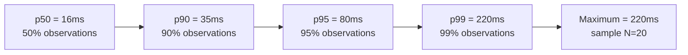
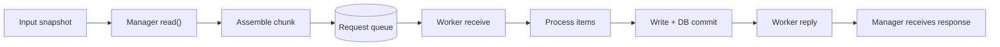

# Đọc kết quả bằng percentile latency khi kiểm thử hiệu năng Spring Batch

## 1. Bài toán: throughput cao nhưng một số chunk rất chậm

Trong chương **Performance testing** của module **SPRING_BATCH_SCALING_OPERATIONS**, mục tiêu không chỉ là đẩy nhiều bản ghi mỗi giây. Ta còn phải kiểm chứng rằng hệ thống Spring Batch mở rộng bằng **multi-threaded step, parallel steps, partitioning hoặc remote chunking** có thời gian xử lý ổn định, không gây backlog, giữ checkpoint đúng và vẫn an toàn khi retry/restart.

Hãy xét một job chuyển 10 triệu giao dịch:

- Cấu hình A xử lý **1.400 giao dịch/giây**; phần lớn chunk nhanh, một số chunk chậm.
- Cấu hình B xử lý **1.800 giao dịch/giây**; throughput tăng nhưng một số chunks phải chờ database locks hoặc broker reply rất lâu.
- Average duration của B thậm chí có thể thấp hơn A, trong khi các chunk chậm nhất khiến job vượt cửa sổ xử lý hoặc worker timeout.
- Một lần test chỉ đọc `mean` hoặc một con số `p99` không có định nghĩa boundary có thể đưa ra quyết định sai.

**Percentile latency** cho biết một mốc của **phân phối thời gian quan sát**, giúp phát hiện phần đuôi chậm (tail latency) mà giá trị trung bình dễ che khuất. Tuy nhiên cần đo ở **đúng boundary**, đủ samples, đúng loại histogram và trong cùng chế độ tải.

Sau bài học, bạn có thể:

1. Giải thích `p50`, `p90`, `p95`, `p99`, `p99.9` và phân biệt average, max, throughput.
2. Tính percentile từ mẫu thực và giải thích giới hạn khi chỉ có vài chục observations.
3. Chọn boundary latency: `read()`, `process()`, `write(Chunk)`, DB commit, queue wait, remote request/reply, StepExecution và JobExecution.
4. Biết khi nào có thể **gộp histogram** qua workers/jobs và vì sao không được **lấy trung bình các p99**.
5. Cấu hình Micrometer `Timer`, percentile histogram và SLO buckets cho Spring Batch 5.2.
6. Viết PromQL `histogram_quantile`, ratio SLO và average từ đúng counter/histogram series.
7. Đọc đồng thời percentile, sample counts, throughput, queue depth, retry, rollback, GC và resource utilization.
8. Phát hiện sai lệch do warm-up, coordinated omission, timeout bị loại khỏi mẫu, retry mix, data skew và metric cardinality.
9. Thiết kế benchmark so sánh local/remote scaling trên **cùng snapshot và correctness invariants**.
10. Chọn action phù hợp dựa trên percentile pattern thay vì tăng thread count một cách mù quáng.

> **Phạm vi:** Java 17+, Spring Batch **5.2.x**, Micrometer, Prometheus, Spring Boot Actuator nếu được cài đặt. Các snippet là ví dụ tích hợp cần context, dependencies và datasource phù hợp; không khẳng định tất cả metrics đều tự xuất hiện trên mọi deployment. Với Prometheus, phần truy vấn chính sử dụng **classic histograms**; native histogram có cú pháp khác, được giải thích riêng.

## 2. Percentile latency là gì?

Với một tập `N` observations có cùng đơn vị đo và cùng boundary, **percentile p** diễn tả một mốc mà xấp xỉ `p%` observations nằm tại hoặc phía dưới mốc đó.

- **p50 / median:** mốc ở trung tâm phân phối.
- **p90:** khoảng 90% observations không vượt quá mốc này.
- **p95:** khoảng 95% observations không vượt quá mốc này.
- **p99:** khoảng 99% observations không vượt quá mốc này.
- **p99.9:** khoảng 99,9% observations không vượt quá mốc này.

**p99 không có nghĩa** “1% requests chắc chắn timeout” hoặc “mọi requests dưới p99 đều thành công”: percentile chỉ mô tả **những lần đo được đưa vào quần thể**, không tự nói về success/failure, timeout, mất dữ liệu hay correctness.

Nếu metric chỉ ghi durations của attempts **SUCCESS**, phần lỗi/timeout bị loại có thể khiến p99 trông rất đẹp dù hệ thống mất nhiều giao dịch.

### Ký hiệu quần thể là bắt buộc

So sánh:

```text
p99(process_item_attempt)  ≠  p99(chunk_write_call)
p99(chunk_write_call)      ≠  p99(chunk_end_to_end)
p99(worker_DB_commit)      ≠  p99(manager_request_reply)
p99(job_execution)         ≠  p99(business_work_order)
```

Hai p99 chỉ so được trực tiếp khi cùng **boundary, event population, units, load profile và statistical method**.

## 3. Ví dụ tính percentile từ dữ liệu nhỏ

Giả sử có 20 lần gọi processor, durations đã sort tăng dần (ms):

```text
10, 11, 12, 12, 13,
14, 14, 15, 15, 16,
17, 18, 19, 20, 21,
25, 30, 35, 80, 220
```

Một quy ước đơn giản là **nearest-rank**:

```text
rank(p) = ceil(p × N), với 0 < p <= 1
pXX = observation tại rank(p) trong danh sách đã sort
```

Với `N=20`:

| Chỉ số | Rank theo nearest-rank | Giá trị |
| --- | ---: | ---: |
| p50 | `ceil(0,50×20)=10` | **16 ms** |
| p90 | `ceil(0,90×20)=18` | **35 ms** |
| p95 | `ceil(0,95×20)=19` | **80 ms** |
| p99 | `ceil(0,99×20)=20` | **220 ms** |
| Max | Phần tử lớn nhất | **220 ms** |
| Mean | `617/20` | **30,85 ms** |

Đây là cách tính **nearest-rank**, không phải định nghĩa duy nhất của quantile. `percentile_cont` trong PostgreSQL, các thư viện thống kê, `histogram_quantile` hay Micrometer client-side percentiles có thể sử dụng **nội suy hoặc ước lượng** nên đưa ra giá trị hơi khác cho cùng dữ liệu.

### Điều gì quan trọng ở đây?

- Median chỉ 16 ms nhưng có một lần mất 220 ms.
- Average 30,85 ms bị kéo lên bởi outlier, song vẫn không diễn đạt đầy đủ tail.
- Khi `N=20`, p99 bằng max theo nearest-rank: **không có cơ sở suy ra tail p99 thật của production** từ mẫu nhỏ như vậy.
- Nếu duration 220 ms thuộc một failure bị bỏ khỏi measurement, p99 chỉ còn đo trên một tập chọn lọc, tạo sai lệch nghiêm trọng.

## 4. Trực quan hóa distribution và long tail



Sơ đồ biểu diễn thứ tự các mốc **ở ví dụ `N=20`**, không phải các khoảng cách trên trục thời gian có tỷ lệ chính xác. Phân phối thật thường có một cụm lớn observations nhanh và phần đuôi dài do I/O wait, GC, lock contention, retries hoặc network.

### Một boxplot có đủ không?

Boxplot hữu ích để thấy median, quartiles và outliers, nhưng **p99/p99.9 cần nhiều dữ liệu tail hơn**. Đối với một job có millions items, xem thêm histogram hoặc distribution quantiles theo từng window/slice, không chỉ một boxplot của trung bình hàng ngày.

**Khuyến nghị:** Trong báo cáo benchmark, luôn hiển thị **N observations**, mean, p50, p95, p99, maximum, error/timeout rate, throughput và khoảng thời gian lấy mẫu.

## 5. Tail latency có ý nghĩa gì với batch workload?

Batch khác một REST API:

- Một **JobExecution** có thể kéo dài 40 phút, gồm hàng triệu item attempts.
- Một chunk có p99 lâu hơn nhiều thường làm **worker concurrency bị giữ** và tăng end-to-end completion time.
- Trong **partitioning**, job chờ worker/partition cuối; phần đuôi của partition durations có thể quyết định makespan.
- Trong **remote chunking**, manager chờ replies và có thể giới hạn số pending chunks; một vài chunks chậm kéo dài thời gian đợi hoặc gây timeout.
- Nếu có deadline phát hành dữ liệu trước 06:00, **job end-to-end duration** mới là SLA cuối, còn p99 chunk là chẩn đoán nguyên nhân.

### Tail amplification: nhiều bước làm tăng xác suất gặp chậm

Ví dụ xác suất một step latency vượt ngưỡng riêng là 1%, và ta có 100 steps độc lập:

```text
P(không step nào vượt ngưỡng) ≈ 0,99^100 ≈ 36,6%
P(ít nhất một step vượt ngưỡng) ≈ 63,4%
```

**Đây là minh họa xác suất với giả định độc lập**, không phải công thức tính p99 của một job bằng cách cộng p99 các steps. Correlation, concurrency, retry và lịch điều phối làm distribution của whole job phức tạp hơn. Vấn đề là **một luồng công việc nhiều stages có thể nhạy cảm với tail latency ở mỗi stage**.

## 6. Cần đo đúng latency boundary nào?

Một sơ đồ remote chunking:



| Boundary | Bắt đầu | Kết thúc | Phản ánh |
| --- | --- | --- | --- |
| **Item read** | Trước `ItemReader.read()` | Sau return/throw | Reader storage/query/parse |
| **Item process attempt** | Trước `process(item)` | Return/throw | CPU/API + retry attempts |
| **Chunk writer call** | Trước `ItemWriter.write(Chunk)` | Return/throw | Writer logic/batching; **chưa chắc gồm commit** |
| **Chunk transaction/commit** | Transaction begin | Commit/rollback terminal | DB lock, I/O, durability |
| **Local executor queue wait** | Task accepted/enqueued | Task bắt đầu | Scheduling/backpressure |
| **Broker queue wait** | Broker nhận request | Worker nhận delivery | Transport + backlog wait |
| **Worker service** | Receive handler bắt đầu | Business commit/terminal handler | Worker capacity |
| **Remote request/reply** | Manager gửi/chấp nhận request | Correlated reply cuối đã nhận | Queue + worker + reply transport |
| **StepExecution elapsed** | Step bắt đầu | Step kết thúc | Step lifecycle tổng thể |
| **JobExecution elapsed** | Job bắt đầu | Job kết thúc | End-to-end job run |
| **Business work-order elapsed** | Input/work order được admit | Kết quả nghiệp vụ cuối cùng visible | SLA thật, có thể gồm nhiều job attempts |

**Không kết luận `spring.batch.chunk.write` là “commit p99”** nếu timer chỉ đo invocation của writer. Commit DB có thể nằm ngoài thời điểm writer trả về, tùy transaction boundary.

### Time-to-first-item, time-to-last-item

Với batch file rất lớn, chỉ `p99(item.process)` không mô tả:

- Job startup, loading manifest.
- Reader restart phải skip lại hàng triệu dòng đầu.
- Partition distribution/skew.
- Final merge/export và publication.
- External backlog/queue wait trước JobLauncher.

Nên ghi **end-to-end job time**, **time to first output**, **time to last committed/published output** cùng stage percentiles.

## 7. Thứ tự measurement phải thống nhất

Một phép đo đúng cần:

1. Xác định một operation và correlation/business ID ổn định.
2. Chọn start/end đúng sự kiện quan trọng.
3. Dùng monotonic clock **trong cùng process** để đo duration.
4. Lưu kết quả theo một đơn vị (ví dụ nanoseconds rồi export seconds).
5. Gắn outcome `SUCCESS/FAILURE/TIMEOUT` hoặc lý do terminal.
6. Không vô tình đo cả logging, metrics publication hoặc test harness setup.
7. Không làm cho mỗi item tạo high-cardinality tags.
8. Khi dùng clocks từ nhiều processes để đo broker wait, kiểm tra **clock synchronization/skew** hoặc tận dụng timestamp cùng clock domain/broker observations.

### Thời gian chờ giữa processes khó hơn một Stopwatch

Một manager timestamp `t_send` trên host A và worker timestamp `t_receive` trên host B:

```text
t_receive - t_send
```

có thể âm nếu clocks lệch. Để tách transport latency trên nhiều hosts, cần NTP/PTP clock sync, tracing có caveat về skew, broker-native metrics hoặc measurements đặt trong cùng clock domain. **Dùng `System.nanoTime()` để tính duration trong một JVM, không so absolute `nanoTime` của hai JVMs.**

## 8. Mean, median, p95, p99 và max trả lời các câu hỏi khác nhau

| Chỉ số | Câu hỏi | Hạn chế |
| --- | --- | --- |
| **Mean/average** | Chi phí thời gian trung bình một attempt? | Outliers ảnh hưởng mạnh |
| **p50/median** | Item/chunk điển hình nhanh đến đâu? | Bỏ qua phần đuôi chậm |
| **p90/p95** | Nhóm 5–10% chậm có tệ không? | Không thấy hết outliers hiếm |
| **p99** | Khoảng 1% observations chậm nhất bắt đầu từ đâu? | Cần nhiều samples và đo đúng population |
| **p99.9** | Tail rất hiếm đang thay đổi thế nào? | Nhiễu lớn, cần nhiều observations hơn |
| **Max** | Slowest recorded observation? | Nhạy với một outlier, test duration |
| **Failure/timeout rate** | Những operations không hoàn thành có nhiều không? | Không được che bởi histogram chỉ ghi success |
| **Throughput** | Bao nhiêu business items hoàn tất trên đơn vị thời gian? | Có thể tốt dù tail quá chậm hoặc output sai |
| **Queue age/depth** | Công việc đang chờ bao lâu/nhiều? | Không tự suy worker là bottleneck |

**Bộ ba hữu ích:** throughput + tail latency + failure rate; thêm data correctness và resource utilization để kết luận có thể scale an toàn.

## 9. Không thể lấy trung bình các percentile

Hai worker có phân phối khác nhau:

```text
Worker A: 10.000 attempts, p99 = 20 ms
Worker B:     10 attempts, p99 = 900 ms
```

Tính:

```text
(20 + 900) / 2 = 460 ms
```

**Không phải p99 toàn cluster.** Percentile không có tính chất cộng/average như `sum` hoặc `count`; p99 toàn cluster phải tính trên **tập observations gộp**, hoặc ước lượng từ các histogram buckets tương thích.

Ngay cả **weighted average** của p99 bằng sample counts cũng không tạo quantile toàn cục. Worker A và B có hình dạng phân phối khác nhau; cần distribution đầy đủ hoặc histogram.

### Một ví dụ khác về lỗi aggregate

```promql
# Sai: không lấy trung bình p99 client-side của nhiều instances.
avg(batch_worker_latency_seconds{
  quantile="0.99"
})
```

Dùng histogram để Prometheus tổng hợp buckets theo đúng phạm vi.

## 10. Ba cách thu thập distribution

| Phương án | Cách hoạt động | Có tổng hợp percentile qua workers được? | Đổi lại |
| --- | --- | --- | --- |
| **Raw observations** | Lưu mỗi duration trong trace/log/benchmark result | Có, nếu thu đúng population và sort/tính lại | Tốn dung lượng, sampling/PII |
| **Client-side percentile/summary** | Agent/JVM ước lượng p95/p99 trước khi export | **Không nên aggregate trực tiếp quantiles** | Ít buckets hơn nhưng thiếu linh hoạt |
| **Classic histogram** | Export cumulative buckets theo ranh giới `le` | **Có**, nếu bucket schemes tương thích | Ước lượng phụ thuộc bucket width |
| **Native histogram** | Export histogram dạng native có resolution scheme | **Có**, với Prometheus hỗ trợ | Cần exporter/backend/config phù hợp |

Micrometer hỗ trợ `Timer.publishPercentileHistogram()` và `Timer.publishPercentiles(...)` với semantics khác nhau:

- `publishPercentileHistogram()` cung cấp histogram để backend như Prometheus tính quantile và **aggregate across dimensions**.
- `publishPercentiles(0.5,0.95,0.99)` tính client-side percentiles ở từng meter, **không được average thành global percentile**.
- `serviceLevelObjectives(Duration...)` tạo thêm bucket boundaries hữu ích cho đo tỷ lệ đạt SLO.
- `minimumExpectedValue` / `maximumExpectedValue` giúp giới hạn phạm vi sinh buckets và chi phí memory/cardinality.

Không bật histogram cho mọi Timer với hàng nghìn tags nếu không có nhu cầu: **số buckets × số tag combinations × số instances** quyết định chi phí time series.

## 11. Histogram classic và nội suy ảnh hưởng số p99

Một classic histogram xuất các **bucket tích lũy**:

```text
le="0.01" : 40 observations <= 10 ms
le="0.05" : 87 observations <= 50 ms
le="0.10" : 95 observations <= 100 ms
le="0.50" : 99 observations <= 500 ms
le="+Inf" : 100 observations tổng cộng
```

Nếu p99 nằm trong bucket `100–500 ms`, Prometheus phải **ước lượng** trong khoảng đó thay vì biết chính xác từng observation. Histogram rộng ở vùng SLO có thể tạo p99 khá sai.

**Quan trọng:** Các buckets là cumulative. `le="0.5"` đã bao gồm các observations của `le="0.1"`, không được cộng số observations các buckets lại như những nhóm độc lập.

### SLO buckets giúp đo target chính xác hơn

Giả sử mục tiêu `95% worker service durations <= 200 ms`, đặt bucket `le="0.2"`. Dùng đúng bucket này đo **ratio observations đạt ngưỡng** mà không cần nội suy quantile.

Nếu toàn bộ bucket scheme chỉ có `le="0.1"` và `le="0.5"`, không thể lấy chính xác tỷ lệ `<=0.2s` từ classic histogram; `histogram_quantile` sẽ chỉ cho ra ước lượng quantile, không phục hồi raw data.

## 12. Spring Batch 5.2 cung cấp sẵn những Timer nào?

Spring Batch 5.2 đăng ký các built-in metrics dưới tiền tố `spring.batch` thông qua Micrometer global registry:

| Meter Micrometer | Loại | Phạm vi |
| --- | --- | --- |
| `spring.batch.job` | Timer | Duration JobExecution |
| `spring.batch.job.active` | Long-task timer | Job đang chạy |
| `spring.batch.step` | Timer | Duration StepExecution |
| `spring.batch.step.active` | Long-task timer | Step đang chạy |
| `spring.batch.item.read` | Timer | Duration `ItemReader.read()` |
| `spring.batch.item.process` | Timer | Duration `ItemProcessor.process()` |
| `spring.batch.chunk.write` | Timer | Duration `ItemWriter.write(Chunk)` |

Timer tags khác nhau theo metric: `spring.batch.job` có `name`, `status`; `spring.batch.step` có `name`, `job.name`, `status`; read/process/write có `job.name`, `step.name`, `status`. `status` ở các item/write timers có thể là `SUCCESS` hoặc `FAILURE`.

**Không** cho rằng các timers này đều tự bật percentile histogram. Micrometer Timer có thể ghi `count/sum/max` nhưng thiếu `_bucket` nếu chưa bật distribution histogram hoặc registry tương ứng.

### Cần đọc semantics của từng timer

- Item process timer đo **một lần gọi processor**; retries có thể tạo thêm observations.
- Chunk write timer đo **một lần gọi writer**, không tự đo toàn bộ queue wait, middleware reply hay commit.
- Step timer đo cả thời gian step, nhưng **mỗi StepExecution chỉ là một observation**; một job có vài step không đủ để suy p99 đáng tin cậy.
- Job timer đo từng execution, **không tự gộp restart attempt** thành duration của business work order qua nhiều lần chạy.
- Long-task timer cho active jobs/steps phục vụ quan sát đang chạy, **không dùng giống percentile histogram thông thường của completed Timer**.

## 13. Spring Boot Actuator / Micrometer configuration

Nếu ứng dụng dùng Spring Boot + Actuator + Prometheus registry, cấu hình tham khảo:

```yaml
management:
  endpoints:
    web:
      exposure:
        include: "health,info,prometheus"
  metrics:
    tags:
      application: "scaling-batch"
    distribution:
      percentiles-histogram:
        "spring.batch.item.process": true
        "spring.batch.chunk.write": true
      slo:
        "spring.batch.item.process": "10ms,50ms,200ms,1s"
        "spring.batch.chunk.write": "50ms,200ms,1s,5s"
```

**Điều kiện sử dụng:**

- Đây là **ví dụ cấu hình Boot 3.x-style**; property binding và registry phải được kiểm tra theo phiên bản thực.
- Để có `/actuator/prometheus`, cần dependencies Actuator + Prometheus registry, endpoint exposure và security phù hợp; không mặc định do Spring Batch thuần tạo ra.
- `spring.batch.chunk.write` có nghĩa writer-call latency, **không phải job completion SLA**.
- Percentile histograms làm tăng số series và memory; chỉ bật cho những timers cần phân tích.
- Một số tags/status làm cùng một metric tách thành các quần thể `SUCCESS` và `FAILURE`; PromQL phải nhóm/ lọc có chủ đích.
- Không public metrics endpoint không bảo vệ; dùng authentication/network policies/TLS nội bộ.

**Kiểm tra thực tế:** Quan sát endpoint/exporter xem `spring_batch_item_process_seconds_bucket` có xuất hiện không; nếu không có, đừng vội kết luận mọi p99 bằng zero.

## 14. Java: instrument processor bằng Timer có histogram

Dùng một wrapper không thay đổi business transformation:

```java
public final class TimedProcessor<I, O>
        implements ItemProcessor<I, O> {

    private final ItemProcessor<I, O> delegate;
    private final MeterRegistry registry;
    private final Timer success;
    private final Timer filtered;
    private final Timer failure;

    public TimedProcessor(
            ItemProcessor<I, O> delegate,
            MeterRegistry registry) {

        this.delegate = delegate;
        this.registry = registry;

        success = createTimer("success");
        filtered = createTimer("filtered");
        failure = createTimer("failure");
    }

    private Timer createTimer(String outcome) {
        return Timer.builder("batch.worker.process.attempt")
                .description("One ItemProcessor invocation")
                .tag("outcome", outcome)
                .publishPercentileHistogram()
                .serviceLevelObjectives(
                        Duration.ofMillis(10),
                        Duration.ofMillis(50),
                        Duration.ofMillis(200),
                        Duration.ofSeconds(1))
                .minimumExpectedValue(Duration.ofMillis(1))
                .maximumExpectedValue(Duration.ofSeconds(10))
                .register(registry);
    }

    @Override
    public O process(I item) throws Exception {
        Timer.Sample sample = Timer.start(registry);
        Timer target = failure;

        try {
            O result = delegate.process(item);
            target = result == null ? filtered : success;
            return result;
        } finally {
            sample.stop(target);
        }
    }
}
```

### Đúng và chưa đủ

**Đúng:**

- Mọi lần gọi `process` đều được đo bằng cùng clock domain.
- Có quần thể `success/filtered/failure` riêng để không che failures.
- `Timer.Sample` là per-call local state, không dùng một mutable stopwatch toàn singleton.
- Tags `outcome` có đúng ba giá trị hữu hạn, không dùng `itemId`/correlation ID.
- `Timer` được tạo một lần khi bean khởi tạo, không tạo meter mới mỗi item.

**Chưa đủ:**

- Timer đo **processor attempts**, không phải unique business items đã commit.
- Exception ném từ processor có thể dẫn đến retry, nên cùng item có thể tạo nhiều failure/success observations.
- `filtered` có nghĩa processor trả `null`, không phải business successfully published.
- Timer không đo DB commit, broker wait hay queue time.
- Counter metrics trong JVM có thể reset khi process restart; không thay business audit.
- `minimumExpectedValue` và `maximumExpectedValue` là cấu hình bucket range, **không phải timeout hay automatic reject**; durations vượt range vẫn cần được xử lý/đánh giá đúng ở exporter.

## 15. Java: instrument writer-call nhưng không đặt nhầm tên commit timer

```java
public final class TimedWriter<T> implements ItemWriter<T> {

    private final ItemWriter<T> delegate;
    private final MeterRegistry registry;
    private final Timer writerCallTimer;

    public TimedWriter(
            ItemWriter<T> delegate,
            MeterRegistry registry) {

        this.delegate = delegate;
        this.registry = registry;

        writerCallTimer = Timer.builder("batch.worker.chunk.write.call")
                .description("ItemWriter.write invocation duration")
                .publishPercentileHistogram()
                .serviceLevelObjectives(
                        Duration.ofMillis(50),
                        Duration.ofMillis(200),
                        Duration.ofSeconds(1),
                        Duration.ofSeconds(5))
                .register(registry);
    }

    @Override
    public void write(Chunk<? extends T> chunk) throws Exception {
        Timer.Sample sample = Timer.start(registry);
        try {
            delegate.write(chunk);
        } finally {
            sample.stop(writerCallTimer);
        }
    }
}
```

**Ranh giới đo:** `write-call` **có thể kết thúc trước transaction commit**: muốn đo commit p95/p99 phải đo ở transaction boundary thật (transaction instrumentation, DB driver/observability, hoặc một wrapper đã xác minh bao commit). Đừng đổi tên metric rồi giả định nó bao gồm DB commit. `TimedWriter` chỉ đo thời gian gọi delegate, kể cả trường hợp delegate ném exception; nó không có `outcome` tag nên muốn phân tích riêng failure phải bổ sung metric/counter phân loại.

## 16. Timing của DB commit cần một boundary khác

Ví dụ:

```text
Chunk:
  read/process 500 items         50 ms
  ItemWriter.write(...)          80 ms
  Transaction commit             420 ms
  JobRepository/context update   10 ms

Writer-call p99 có thể ~80 ms
Transaction p99 có thể ~420 ms
Chunk end-to-end ~560 ms
```

Đây là số liệu giả định để minh họa **khác biệt về phạm vi đo**, không phải một cam kết thứ tự transaction events trong mọi cấu hình Spring Batch. Framework/transaction manager có thể ghi metadata trong cùng transaction và thứ tự cụ thể phụ thuộc thiết lập.

Để biết commit thực sự là bottleneck:

- Đo JDBC transaction commit latency qua instrumentation phù hợp.
- Quan sát DB lock waits, connection pool pending, WAL/fsync và query p95.
- Lập span/timer bao **chunk transaction** khi kiểm soát được lifecycle chuẩn.
- So với `spring.batch.chunk.write` để tìm phần latency không nằm trong writer call.
- Nếu sink là API hoặc multiple datasources, định nghĩa boundary commit/publish tương ứng.

**Không thêm custom transaction wrapper ngoài framework chunk lifecycle một cách tùy tiện**, vì có thể phá checkpoint và rollback/retry semantics.

## 17. PromQL: p95/p99 đúng cách cho classic histogram

Giả sử series `batch_worker_process_attempt_seconds_bucket` tồn tại nhờ custom Timer hoặc exporter:

```promql
# p95 process-attempt latency, tổng hợp qua JVM instances,
# chỉ lấy outcome=success.
histogram_quantile(
  0.95,
  sum by (le) (
    rate(batch_worker_process_attempt_seconds_bucket{
      outcome="success"
    }[5m])
  )
)

# p99 process-attempt latency, theo role/step đã gắn tags.
histogram_quantile(
  0.99,
  sum by (le, step_name) (
    rate(batch_worker_process_attempt_seconds_bucket{
      outcome="success"
    }[5m])
  )
)
```

**Cần sửa query cho đúng tags thực**: wrapper `TimedProcessor` phần 14 chỉ gắn `outcome`, chưa có `step_name`; ví dụ thứ hai **chỉ có ý nghĩa nếu ứng dụng thật sự gắn tag `step_name`**. Nếu không, query theo `step_name` không phân nhóm đúng như mong đợi. Không giả định có tags do tên variable ngụ ý.

### Quy tắc aggregate classic histogram

- Dùng `rate(..._bucket[5m])` **trước** khi `sum`.
- Giữ label `le` trong `sum by` để `histogram_quantile` đọc ranh giới bucket.
- Chỉ gộp các series có **cùng measurement boundary/unit và bucket layout tương thích**.
- Với Spring Batch built-in timers, có tag `status`; chọn `status="SUCCESS"` hoặc báo cả success và failure đúng mục đích.
- Không tổng hợp item process durations với chunk write durations thành một “p99 job”.
- Query kết quả là **ước lượng** theo histogram buckets và 5-minute window, không phải percentile exact của mọi records.

**Không dùng:**

```promql
# Sai: client-side percentiles không thể lấy trung bình.
avg(batch_worker_process_attempt_seconds{
  quantile="0.99"
})
```

## 18. PromQL: percentile và mean là hai phép toán khác nhau

Với cùng histogram:

```promql
# p50
histogram_quantile(
  0.50,
  sum by (le) (
    rate(batch_worker_process_attempt_seconds_bucket{
      outcome="success"
    }[5m])
  )
)

# p99
histogram_quantile(
  0.99,
  sum by (le) (
    rate(batch_worker_process_attempt_seconds_bucket{
      outcome="success"
    }[5m])
  )
)

# Mean, qua tổng durations / số lần đo.
sum(rate(batch_worker_process_attempt_seconds_sum{
  outcome="success"
}[5m]))
/
sum(rate(batch_worker_process_attempt_seconds_count{
  outcome="success"
}[5m]))
```

Mean lấy từ `sum/count` là **mean of observations** trong cửa sổ; khác percentile. Ở Prometheus, classic histogram Timer durations thường được export bằng **seconds**, không phải milliseconds. Khi hiển thị Grafana, chọn unit seconds hoặc nhân `1000` để thành milliseconds — đừng đọc 0,35 seconds thành 0,35 ms.

### Sample count trong cửa sổ

```promql
sum(increase(batch_worker_process_attempt_seconds_count{
  outcome="success"
}[5m]))
```

`increase` có thể trả **giá trị ngoại suy/fractional** do cơ chế scrape window, không phải exact integer counter delta tại từng event. Dùng làm chỉ báo volume; khi cần số samples chính xác của một benchmark offline, thu raw result/count ở nguồn test tương ứng.

## 19. PromQL: tính trực tiếp tỷ lệ đạt ngưỡng SLO

Nếu custom Timer xuất bucket tại `le="0.2"` (200 ms), ta có thể tính:

```promql
# Fraction of successful process attempts <= 200ms
sum(rate(batch_worker_process_attempt_seconds_bucket{
  outcome="success",
  le="0.2"
}[5m]))
/
sum(rate(batch_worker_process_attempt_seconds_count{
  outcome="success"
}[5m]))
```

**Điều kiện:** Bucket `le="0.2"` thực sự được publish. Nếu không, query mẫu không hoạt động — không thay bừa bằng `le="0.25"` nếu SLA yêu cầu 200ms.

### Coi failures/timeouts là vi phạm SLA thế nào?

Nếu mục tiêu là **95% business operations hoàn tất thành công trong 200ms**, mẫu số **không được chỉ gồm success attempts**. Cần một measurement theo **logical operations**, ghi cả successful latency và failed/timed-out outcomes, hoặc một bộ counter `total admitted`, `successful before deadline` để tính success-under-deadline ratio.

Ví dụ business SLI:

```text
good_operations = số unique accepted work orders
                  completed successfully <= deadline

eligible_operations = số unique accepted work orders
                      thuộc SLO scope

SLI = good_operations / eligible_operations
```

Tỷ lệ này khác “95th percentile của `ItemProcessor.process` success latency”. Một job có p95 processor 50ms nhưng mất 30% requests vẫn **không đáp ứng** SLO business.

## 20. Native histogram và client-side summary: đừng trộn cú pháp

Với **classic histogram**:

```promql
histogram_quantile(
  0.99,
  sum by (le) (
    rate(batch_worker_process_attempt_seconds_bucket[5m])
  )
)
```

Với **native histogram** thực sự được ingest và lưu dưới metric base name có histogram samples:

```promql
histogram_quantile(
  0.99,
  sum(rate(batch_worker_process_attempt_seconds[5m]))
)
```

**Không thay `_bucket` bằng base name nếu registry/exporter không bật native histograms**. Cú pháp thứ hai chỉ dùng khi Prometheus và exporter đã hỗ trợ native histogram tương ứng.

Với **client-side quantile** (`quantile="0.99"`), có thể xem p99 của **một meter/instance**, nhưng không aggregate bằng `avg` across pods. Cần chọn hướng thu thập dựa trên mục đích phân tích và chi phí observability.

## 21. Đọc kết quả theo cửa sổ thời gian thay vì chỉ một con số

Histogram query trên `[5m]` cho một phân phối **các observations được ghi trong khoảng đó**. Một bảng dashboard tốt:

| Khoảng | Số observations | p50 | p95 | p99 | Kết luận |
| --- | ---: | ---: | ---: | ---: | --- |
| 00:00–00:05 | 50.000 | 18 ms | 70 ms | 210 ms | Ổn định |
| 00:05–00:10 | 52.000 | 20 ms | 95 ms | 450 ms | Tail xấu dần |
| 00:10–00:15 | 49.000 | 20 ms | 200 ms | 1.800 ms | DB lock/GC/retry cần xem |
| 00:15–00:20 | 49.500 | 18 ms | 80 ms | 260 ms | Có phục hồi |

Số liệu **giả định**. Không suy từ p99 1.800ms rằng 1% items bị timeout nếu timeout threshold và outcome không được ghi. Cần đối chiếu data source, retries, timeouts và output.

### Vì sao tổng hợp cả job khác 5-minute window?

p99 trên từng cửa sổ 5 phút không nhất thiết có trung bình bằng p99 cả 20 phút. Để tính global p99, dùng buckets được gộp qua toàn interval với compatible bucket layout hoặc raw benchmark samples. **Không trung bình bốn p99 trong bảng**.

Một job ngắn 90 giây có thể không có đủ samples cho một biểu đồ `rate(...[5m])` có ý nghĩa nếu phần lớn thời gian cửa sổ là idle; điều chỉnh window và collection method phù hợp.

## 22. Sai lệch do warm-up, JIT, connection và cache

Java benchmark có thể thấy:

- Lần đọc đầu mở file/connection chậm.
- JVM JIT compilation, class loading và bean initialization.
- DB buffer cache lạnh, query plan mới, object store cold fetch.
- Broker consumer chưa subscribe hoặc connection chưa warmed.
- Sau vài phút, CPU/GC ổn định, service latency đổi.

### Hai phép đo khác nhau đều có giá trị

1. **Cold-start latency:** thời gian khởi động JobExecution và hoàn tất những chunk đầu tiên khi service mới deploy hoặc after restart.
2. **Steady-state latency:** phân phối `process`/`write`/`reply` khi workload và tài nguyên đã đạt trạng thái tương đối ổn định.

Không tự động loại cold start ra khỏi SLA khi production phải chạy những job ngắn hoặc cold start là phần quan trọng của deadlines. Khi báo cáo steady-state, ghi rõ warm-up duration và tiêu chí cắt samples; công khai thêm cold-start results.

### Không chạy benchmark bằng unit-test stopwatch đơn lẻ

Một `System.nanoTime()` đo một `process()` trên laptop **không đủ** để kết luận p99 Spring Batch production. Cần một test harness đo nhiều observations, cùng input snapshot, concurrency, DB/broker và resource quotas, với statistical reporting.

## 23. Coordinated omission: hệ thống ngừng nhận việc nên p99 trông đẹp

Đây là một bẫy quan trọng khi benchmark throughput và latency.

**Closed-loop load generator** có thể làm:

```text
send request
wait until complete
send next request
```

Nếu một request mất 5 giây, generator không gửi thêm việc trong 5 giây. Histogram chỉ ghi **một lần chậm**, không ghi các work orders đáng lẽ đã tới trong thời gian bị stall. Vì vậy p99 quan sát có thể **đánh giá thấp trải nghiệm ở arrival rate cố định**.

**Open-loop/arrival-controlled load** cố tạo work theo một lịch định trước (ví dụ 1.000 item/s), đồng thời ghi `scheduledAt` và `completedAt`. Khi server chậm, backlog/queue wait tăng và latency từ **scheduled/admitted work** thể hiện đúng tác động hàng đợi.

### Với Spring Batch

- Khi worker chậm, manager remote chunk có thể tự giới hạn số request in-flight và **giảm dispatch**.
- Nếu benchmark chỉ đo `worker process()` trên những chunks được nhận, có thể thấy p99 ổn định dù business work orders tồn đọng ở upstream.
- Với local sequential step, source reader chỉ đọc khi downstream xử lý xong, nên **không có queue reader→processor** như pipeline nhiều stage.
- Cần ghi cả **logical input arrival time**, start processing, commit time và end-to-end JobExecution/business work-order completion.

Không ép hệ thống ingest vô hạn để tránh coordinated omission: giới hạn queue/admission vẫn phải bảo vệ tài nguyên. Nhưng benchmark cần báo cáo **rejected/deferred arrivals** thay vì che chúng.

## 24. Percentile bị lệch khi timeout, fail và retry không được tính

Giả sử 1.000 chunks:

```text
900 chunks thành công dưới 200ms
50 chunks thành công sau 1–5s
50 chunks timeout hoặc không có terminal response
```

Nếu histogram chỉ ghi `SUCCESS`, sample size là **950**, p99 chỉ xét 950 observations. **50 chunks không có duration terminal đã biến khỏi mẫu** — nếu mục tiêu là end-to-end success trong 2s, chúng phải được tính là failure/breach.

### Hướng đo đúng

- Có counter tất cả `accepted/admitted logical operations`.
- Có counter `success / failure / timeout / cancellation` theo policy.
- Ghi duration từ accepted đến terminal khi có kết quả, bao gồm failure durations nếu phù hợp.
- Đối với request chưa terminal, theo dõi **in-flight age/oldest work age** để chúng không biến mất khỏi báo cáo.
- Khi một business item được retry ba lần, phân biệt **attempt latency distribution** và **logical item completion latency** qua các attempts.
- Không biến `JobExecution FAILED` thành số 0 ms hoặc bỏ khỏi toàn bộ benchmark mà không báo.

### Retry amplification

```text
Input unique work orders: 1000
Process attempts:         1500
Final committed outputs:  980
Unresolved/failed:        20
```

`p99(process_attempt)` trên 1500 attempts khác với `p99(business_complete)` trên 980 completed items. Phân phối attempts có thể tốt dù end-to-end công việc phải retry nhiều và mất phút mới xong.

## 25. Sample size: p99.9 cần nhiều observations hơn p95

Đối với một mẫu độc lập cùng phân phối:

- p99 mô tả phần **1% chậm nhất**.
- p99.9 mô tả phần **0,1% chậm nhất**.
- Với 100 observations, phần tail p99 có khoảng một observation; p99.9 hầu như chỉ tương đương max.
- Với 1.000 observations, phần tail 0,1% chỉ cỡ **một** observation.
- Với 100.000 observations, phần tail 0,1% có khoảng **100** observations — ổn hơn nhưng vẫn cần xem correlation, nonstationarity và histogram resolution.

Đây là **trực giác về lượng dữ liệu phần đuôi**, không phải công thức confidence interval chính xác. Nếu latency autocorrelated, 100.000 attempts liên tiếp từ một burst không tương đương 100.000 samples độc lập.

### Thiết kế benchmark cho p99/p99.9

- Thu đủ observations từ cùng load profile và representative input distribution.
- Ghi test duration, arrivals, completions và counts từng outcome.
- Lặp benchmark nhiều lần để xem biến thiên theo run.
- Dùng confidence interval/bootstrap trên **raw samples** hoặc phương pháp phù hợp nếu muốn kết luận thống kê.
- Với chunk sizes khác nhau, số **chunk samples** khác nhau dù tổng items bằng nhau; đừng so độ ổn định p99 giữa `N=200` và `N=100.000` một cách ngây thơ.
- Tránh tuyên bố “p99.9 đã giảm 2%” khi histogram buckets quá thô hoặc chỉ có vài observations tail.

## 26. Throughput và latency có thể đi ngược chiều

Giả sử cùng snapshot, cùng rules và đúng business output:

| Cấu hình | Committed items/s | p50 chunk total | p95 chunk total | p99 chunk total | Error rate |
| --- | ---: | ---: | ---: | ---: | ---: |
| A: 4 workers | 1.400 | 35 ms | 130 ms | 480 ms | 0,01% |
| B: 8 workers | 1.800 | 25 ms | 180 ms | 1.200 ms | 0,15% |
| C: 6 workers | 1.650 | 30 ms | 145 ms | 510 ms | 0,02% |

Dữ liệu **giả định**, mỗi pXX ở đây cùng boundary **chunk total** và phương pháp đo.

- B có throughput cao nhất nhưng p99/error rate tệ hơn nhiều.
- A có p99 thấp hơn nhưng throughput thấp hơn.
- C là lựa chọn cân bằng **nếu SLA/chi phí/tài nguyên cho phép**.
- Không thể chọn tốt nhất nếu chưa biết business deadlines, max backlog age, cost và correctness.

**Quy tắc chọn:** Đầu tiên lọc cấu hình **PASS business correctness + restart**, sau đó kiểm tra SLO, rồi tối ưu throughput và tài nguyên trong các phương án hợp lệ.

## 27. Latency theo stage: định vị bottleneck

Một benchmark cho thấy:

```text
p50(process) = 5ms,       p99(process) = 30ms
p50(write)   = 25ms,      p99(write)   = 80ms
p50(commit)  = 40ms,      p99(commit)  = 1.200ms
p50(reply)   = 75ms,      p99(reply)   = 1.800ms
```

**Không cộng bốn p99 để tạo p99 toàn pipeline.** Các tail events có thể xảy ra ở observations khác nhau, measurements có thể chồng lấn, và reply latency có thể **đã bao gồm** process/write/commit.

Phân tích theo dấu hiệu:

| Dấu hiệu | Giả thuyết | Bằng chứng bổ sung |
| --- | --- | --- |
| p99 `read()` cao | DB query/file/network chậm | Storage latency, index, GC, page faults |
| p99 `process()` cao, CPU bão hòa | CPU algorithm/JIT/serialization | JFR CPU samples, allocation profile |
| p99 `process()` cao, CPU thấp | External API wait | HTTP p99, quota, timeout |
| p99 writer call cao | JDBC batch/write locks | DB plan, rows per chunk, lock waits |
| p99 commit cao, writer call thấp | Transaction/WAL/fsync/locks | DB logs, transaction instrumentation |
| p99 reply cao, worker service thấp | Broker queue/reply transport | Ready/unacked/in-flight, lag age |
| p99 chunk tốt, JobExecution rất dài | Source bottleneck, skew, final merge, scheduling | Step/partition makespan, Job startup/restart |
| p50 ổn, p99 tăng khi tăng threads | Lock contention, DB pool, GC | Pool pending, BLOCKED threads, throttling |
| p99 thấp, throughput thấp và backlog tăng | Producer throttled hoặc attempts được chọn lọc | Admission/rejected, deferred work, queue age |

## 28. Queue wait và service time: đừng nhầm

Trong một pipeline bất đồng bộ:

```text
T_end_to_end = T_queue_wait + T_worker_service + T_reply_wait
              + các boundary khác nếu có

T_worker_service = T_process + T_write + T_commit + overhead
                   với phạm vi do instrumentation định nghĩa
```

**Đây là decomposition ở mức một observation cụ thể**, không phải công thức cho percentile. Nói chung:

```text
p99(A + B) ≠ p99(A) + p99(B)
```

Nếu `p99(queue_wait)` tăng từ 100ms lên 5s nhưng `p99(worker_service)` giữ 100ms, bottleneck có thể là thiếu worker, prefetch/backpressure hoặc backlog cũ, không phải processor chậm.

### Little's Law ở steady-state

```text
L = λ × W

L: trung bình work outstanding trong đúng phạm vi
λ: throughput ổn định của cùng work units
W: thời gian trung bình work nằm trong phạm vi
```

Little's Law nói về **mean**, **không trực tiếp suy p99 từ queue depth**. Một queue trung bình 1.000 items, output 500 items/s gợi ý mean residence ~2s trong điều kiện ổn định, nhưng không chứng minh p99=2s.

## 29. Multi-threaded step: percentiles cần kèm thread safety

Nếu thêm `TaskExecutor` vào chunk step, concurrency tăng nhưng reader/processor/writer có thể chia sẻ state ở **cùng StepExecution**. `@StepScope` không đồng nghĩa một reader riêng mỗi chunk thread.

Một benchmark A/B nên có:

- Cùng item set, chunk size, input snapshot và processor rules.
- `read/process/write` p50/p95/p99, throughput và thread utilization.
- DB connection pool, lock waits và rollback.
- `StepExecutionContext` checkpoint/restart tests.
- Data completeness và duplicate-business-key checks.
- Output ordering nếu hợp đồng yêu cầu.

**Không chấp nhận cấu hình p99 tốt hơn nhưng làm thiếu hoặc trùng items khi restart.** Đó không còn là một optimization hợp lệ.

### Hình dạng tail khi lock contention

Một nhóm threads lấy cùng monitor:

```text
95% acquisitions:   <5 ms
 4% acquisitions:  50–200 ms
 1% acquisitions:  >1 s
```

p50 vẫn thấp nhưng p99 tăng mạnh; thread dumps/JFR monitor contention giúp xác nhận. Tăng thread count có thể làm phần đuôi tệ hơn.

## 30. Parallel steps và partitioning: latency của partition chậm nhất

Với local/remote partitioning, mỗi worker có `StepExecution` riêng. Job hoàn tất khi các partitions bắt buộc đạt trạng thái terminal phù hợp.

Ví dụ:

```text
P0:  80 s
P1:  82 s
P2:  78 s
P3: 440 s
```

Average partition time là 170s, nhưng **manager makespan không thấp hơn ~440s** nếu phải chờ P3. Với chỉ bốn partitions, **p99 partition duration không có ý nghĩa thống kê vững chắc**; điều cần xem là **slowest partition, skew, rows processed, bytes và resource wait**.

### Khi nào p99 partition hữu ích?

Khi job lặp lại qua nhiều snapshots hoặc có rất nhiều partitions, ta có thể dùng distribution partition duration để phát hiện skew. Nhưng phải phân biệt:

- p99 trên toàn bộ partitions nhỏ/lớn khác nhau có thể phản ánh size distribution.
- p99 của StepExecutions tính gồm retries/failures theo cách nào?
- p99 của các jobs có partition counts khác nhau không tự so được.
- Thời gian job còn gồm manager overhead, merge/publish và reader startup.

**Không lấy p99 của bốn partitions để tuyên bố SLA job trong một ngày đã được chứng minh**. Bổ sung makespan và max partition duration.

## 31. Remote chunking: percentile của request/reply và late responses

Remote chunking có manager giữ reader và dispatch chunks; remote workers process/write rồi trả `ChunkResponse`. Các request có thể hoàn tất khác thứ tự gửi.

Cần có **ba phân phối riêng**:

1. **Manager dispatch-to-reply duration:** chứa queue wait, worker processing, DB commit và reply transport theo boundary được định nghĩa.
2. **Worker service duration:** receive → write/commit terminal ở worker.
3. **Business work-order duration:** từ khi input được admit đến khi output hoàn tất, có thể gồm manager waiting và nhiều retries.

Ví dụ:

```text
Manager request/reply p99 = 5 s
Worker service p99        = 300 ms
Broker ready age          = vài giây
```

Khả năng backlog/transport wait đóng góp lớn. Nhưng để kết luận, phải kiểm tra **correlation** từng chunk, queue ready/unacked, manager in-flight và timeout.

### Timeout không chứng minh worker chưa commit

Nếu manager timeout ở 3s nhưng worker đã commit sau 2s và reply bị mất, request chưa xác nhận có thể được replay. Đừng dùng duration timeout như một success latency, và đừng cho manager ghi completion giả.

Test cần:

- Lost/late/duplicate reply.
- Worker commit xong trước khi ack/reply.
- Manager restart khi worker còn in-flight.
- Writer idempotent và JobRepository reconciliation.
- Request/reply latency kèm failure/timeout rate.

## 32. Failures, skip và restart làm phân phối biến dạng

Trong Spring Batch:

- `retry` có thể gọi `ItemProcessor`/`ItemWriter` nhiều lần cho cùng work.
- `skip` cho phép bỏ item không hợp lệ nếu nghiệp vụ cho phép; output count khác input count.
- `rollback` có thể làm một số items được xử lý lại.
- `restart` tạo JobExecution mới cho **cùng JobInstance** khi đủ điều kiện.
- Worker đã commit external side effect nhưng manager chưa ghi metadata có thể dẫn tới replay.

**Hai quần thể phải tách:**

| Quần thể | Đơn vị observation | Tại sao cần? |
| --- | --- | --- |
| `process_attempt_latency` | Mỗi lần gọi processor | Chẩn đoán CPU/API |
| `chunk_write_attempt_latency` | Mỗi invocation writer | Chẩn đoán batching |
| `chunk_terminal_latency` | Mỗi logical chunk terminal | Đo service/request |
| `business_item_completion_latency` | Mỗi unique business item từ admit tới committed | SLA nghiệp vụ |
| `job_execution_duration` | Một JobExecution | Khảo sát attempts |
| `job_instance_completion_duration` | Một logical JobInstance qua retries/restart | SLA toàn workflow |

Nếu metadata chỉ có JobExecution timer, nó **không tự** tính end-to-end time của work order qua vài JobExecutions. Khi cần, audit `work_order.accepted_at` và `published_at` ở nguồn bền vững.

## 33. Instrumentation overhead và metric cardinality

Bật histogram cho mỗi `process()` trên job 20 triệu items là khả thi nếu metric IDs ít, nhưng:

- Mỗi label combination tạo một bộ histogram buckets/time series.
- Nếu gắn `paymentId`, `jobExecutionId` hoặc `correlationId` làm tag, số series có thể tăng khổng lồ.
- Scrape/export/storage cũng dùng CPU/RAM, có thể ảnh hưởng benchmark.
- Instrumentation per-item tạo overhead; phải đo overhead ở load thật.
- Observability backends có retention/series limits.

### Tags nên dùng

```text
job_name = "settlementJob"
step_name = "remotePaymentManager"
worker_role = "manager" | "worker"
stage = "process" | "writer" | "reply"
outcome = "success" | "failure" | "timeout"
pool = "payment-writer"
```

**Không** gắn item-level IDs hoặc mỗi JobExecution ID thành time-series tag. Correlation IDs, run keys, exception stack và individual timings nên đưa vào **traces, structured logs hoặc database audit** với sampling và controls thích hợp.

## 34. Benchmark scenario: giữ input và điều kiện giống nhau

Một performance test có thể dùng:

```text
Input snapshot:       2.000.000 business items
Item distribution:    95% simple, 5% complex
Chunk size:           500
Writer:               PostgreSQL upsert
Broker:               RabbitMQ nếu remote
Run version:          immutable rules v1
Acceptance:           đủ unique keys; đúng values/version
Service SLO:          p95 chunk reply <= 500ms
Business deadline:    JobInstance completed <= 35 minutes
```

**SLO minh họa**, không phải chuẩn chung của Spring Batch.

### Phải giữ cố định

- Input snapshot và tỷ lệ simple/complex records.
- CPU quota/limits, memory, GC, JDK và Spring Batch version.
- DB indexes, connection pool và dữ liệu nền.
- Broker delivery/ack/prefetch/queue types nếu remote.
- Processor behavior, timeout và retry policy.
- Chunk size (trừ bài thử riêng về chunk size).
- Sort/partition strategy và số bytes/items thực.
- Warm-up/cold-start policy, test duration và sample count.
- Failure injection/traffic arrival model, hệ thống khác cùng tài nguyên.

Nếu thay chunk size từ 100 lên 1.000, **p99 chunk duration không thể so như cùng amount of work**: mỗi chunk có gấp mười items danh nghĩa. Khi đó cần thêm **per-item metrics, throughput và commit overhead**.

## 35. Báo cáo A/B cho local versus remote scaling

| Thông số | A: local partition, 4 workers | B: remote chunk, 8 workers |
| --- | ---: | ---: |
| Input | Cùng 2.000.000 items | Cùng 2.000.000 items |
| Committed items/s | 1.300 | 1.850 |
| p50 process attempt | 12 ms | 12 ms |
| p95 process attempt | 40 ms | 42 ms |
| p99 process attempt | 95 ms | 100 ms |
| p95 chunk write call | 180 ms | 185 ms |
| p99 request/reply | Không áp dụng | 1.800 ms |
| Oldest pending work age | 0,3 s | 4,5 s |
| Job total duration | 26 phút | 19 phút |
| Error/retry attempts | 0,1% | 0,8% |
| Output correctness | PASS | PASS |

Số liệu **giả định**; hai dòng `p99 request/reply` không có cùng counterpart ở local partitioning, nên **không được so trực tiếp** như một apples-to-apples latency.

Kết luận đúng là B có throughput/end-to-end tốt hơn ở snapshot này, nhưng remote request/reply tail và retry rate cần theo dõi. Quyết định tùy SLA, broker capacity, chi phí và failure tolerance.

## 36. Latency và capacity: tìm điểm bão hòa

Một load sweep:

| Active workers | Committed items/s | p50 stage | p95 stage | p99 stage | DB pool pending |
| --- | ---: | ---: | ---: | ---: | ---: |
| 1 | 350 | 12 ms | 40 ms | 85 ms | 0 |
| 2 | 670 | 12 ms | 45 ms | 100 ms | 0 |
| 4 | 1.210 | 14 ms | 60 ms | 160 ms | 1 |
| 8 | 1.620 | 18 ms | 160 ms | 900 ms | 8 |
| 16 | 1.500 | 22 ms | 400 ms | 3.000 ms | 25 |

Số liệu **giả định** của cùng stage và load profile.

- 8 workers tăng throughput nhưng p99 đột biến; cần xem DB pending/locks.
- 16 workers làm throughput giảm và p99 xấu hơn — dấu hiệu capacity đã quá mức tối ưu.
- Nếu SLA yêu cầu p99 dưới 250ms, cấu hình 4 workers có thể phù hợp hơn dù throughput thấp hơn.
- Nếu deadline job quan trọng hơn per-chunk tail và có backlog budget, cần phân tích tổng thể.

**Không chỉ tăng `maxPoolSize`:** Trong `ThreadPoolTaskExecutor`, core→queue→max behavior có thể khiến pool không chạy đúng số threads bạn tưởng. Đo active, current pool, queue depth, rejected tasks và business committed rate.

## 37. JUnit: tính nearest-rank percentile từ raw samples

Một helper đơn giản dùng cho **test dữ liệu nhỏ** (không dùng `List` hàng triệu latency trong production JVM):

```java
public final class PercentileMath {

    private PercentileMath() {}

    public static double nearestRank(
            List<Double> observations, double quantile) {

        if (observations.isEmpty()
                || !Double.isFinite(quantile)
                || quantile <= 0.0
                || quantile > 1.0) {
            throw new IllegalArgumentException(
                    "Invalid input or quantile");
        }

        List<Double> sorted = new ArrayList<>(observations);

        if (sorted.stream().anyMatch(value ->
                value == null
                || !Double.isFinite(value)
                || value < 0.0)) {
            throw new IllegalArgumentException(
                    "Durations must be finite non-negative values");
        }

        sorted.sort(Double::compare);
        int rank = (int) Math.ceil(quantile * sorted.size());
        return sorted.get(Math.max(0, rank - 1));
    }
}
```

JUnit 5:

```java
@Test
void calculatesNearestRankOnTwentySamples() {
    List<Double> millis = List.of(
            10.0, 11.0, 12.0, 12.0, 13.0,
            14.0, 14.0, 15.0, 15.0, 16.0,
            17.0, 18.0, 19.0, 20.0, 21.0,
            25.0, 30.0, 35.0, 80.0, 220.0);

    assertEquals(16.0,
            PercentileMath.nearestRank(millis, 0.50));
    assertEquals(35.0,
            PercentileMath.nearestRank(millis, 0.90));
    assertEquals(80.0,
            PercentileMath.nearestRank(millis, 0.95));
    assertEquals(220.0,
            PercentileMath.nearestRank(millis, 0.99));
}
```

**Đây không phải “kiểm thử thuật toán Prometheus”**. Nearest-rank dùng raw samples, còn Prometheus `histogram_quantile` ước lượng từ bucket distribution; các giá trị có thể khác.

### Khi nào không dùng nearest-rank helper?

Với hàng triệu observations hoặc streaming metric server, lưu all samples trong Java `List` để sort có thể tốn RAM và ảnh hưởng benchmark. Sử dụng histogram/TDigest/HdrHistogram/monitoring backend phù hợp, cùng nhận thức về sai số.

## 38. JUnit: Micrometer Timer count và duration boundaries

`SimpleMeterRegistry` giúp test instrumentation không cần Prometheus server:

```java
@Test
void timerCountsSuccessfulProcessorAttempts() throws Exception {
    SimpleMeterRegistry registry = new SimpleMeterRegistry();

    ItemProcessor<Integer, Integer> delegate =
            item -> item * 2;

    ItemProcessor<Integer, Integer> timed =
            new TimedProcessor<>(delegate, registry);

    assertEquals(4, timed.process(2));
    assertEquals(8, timed.process(4));

    Timer success = registry.find(
            "batch.worker.process.attempt")
            .tag("outcome", "success")
            .timer();

    assertNotNull(success);
    assertEquals(2L, success.count());
    assertTrue(success.totalTime(TimeUnit.NANOSECONDS) >= 0.0);

    registry.close();
}
```

Test xác nhận metric **đếm hai processor invocations**, nhưng không chứng minh histogram buckets đã xuất ra Prometheus hoặc rằng đo p99 đáng tin. Với `SimpleMeterRegistry`, dùng `Timer.count()/totalTime()` để test wiring; để kiểm tra classic buckets/PromQL phải dùng Prometheus registry hoặc exporter integration test.

### Test exception vẫn được đo

```java
@Test
void timerRecordsFailedAttempt() {
    SimpleMeterRegistry registry = new SimpleMeterRegistry();

    ItemProcessor<Integer, Integer> delegate = item -> {
        throw new IllegalStateException("injected");
    };

    ItemProcessor<Integer, Integer> timed =
            new TimedProcessor<>(delegate, registry);

    assertThrows(IllegalStateException.class,
            () -> timed.process(42));

    Timer failure = registry.find(
            "batch.worker.process.attempt")
            .tag("outcome", "failure")
            .timer();

    assertNotNull(failure);
    assertEquals(1L, failure.count());
    registry.close();
}
```

**Không thay đổi processor production chỉ để gây lỗi trong CI**; fault injector là thành phần test profile.

## 39. Test percentile bằng JUnit có nên assert `p99 < 100ms`?

Đối với unit test nhỏ, **không nên hard-code absolute p99 từ wall-clock**:

```java
// Dễ flaky, bị CPU quota / GC / CI machine ảnh hưởng:
assertTrue(elapsedP99Millis < 100);
```

Một test chạy trên laptop và trên shared CI runner có thể ra latency rất khác.

Thay vào đó:

- **Unit tests:** assertions deterministic về logic, measurement count, timeout handling, histogram configuration và tag set.
- **Integration tests:** correctness/retry/restart trên broker/DB; timeouts đủ bảo vệ CI khỏi hang, không dùng như benchmark.
- **Performance test riêng:** cùng môi trường đã chuẩn hóa; chạy warm-up/steady-state, đủ observations và repeat runs; báo cáo percentile + confidence/variance.
- **Release gates:** SLO percentile/success rate dựa trên cùng load profile, sample-count floor và correctness, có control chart/baseline tolerance hợp lý.

Không biến một run duy nhất có p99 vừa vượt ngưỡng 1ms thành kết luận chắc chắn “regression” nếu sample noise/precision không được đánh giá.

## 40. So sánh trước/sau thay đổi có cơ sở

Một quy trình:

1. Chụp commit/JDK/Spring Batch version và input snapshot hash.
2. Chạy baseline nhiều lần trong môi trường cách ly.
3. Đo p50/p95/p99, throughput, failures, queue age, CPU/GC/DB metrics.
4. Thực hiện **một thay đổi chính**: chunk size hoặc workers hoặc DB index.
5. Chạy lại cùng conditions, giữ statistical metadata.
6. So phần đuôi và quần thể outcomes, không chỉ median.
7. Kiểm tra DB resource saturation, retry/rollback và JobRepository overhead.
8. Chạy fault-injection/restart correctness tests trên cấu hình candidate.
9. Chỉ chấp nhận khi lợi ích có ý nghĩa và SLA/correctness vẫn PASS.
10. Lưu raw results/histogram snapshots cùng benchmark metadata để tái kiểm chứng.

### Ví dụ “cải thiện” gây nhầm

Bản mới **skip những items chậm** và vì vậy p99 processor giảm từ 800ms xuống 80ms. Nếu 1.000 payments bắt buộc không có output, đây là **regression nghiêm trọng**, không phải optimization.

Luôn kiểm tra `expected input keys` so với `committed output keys`, skip/filter policy và DLQ trước khi so percentile.

## 41. Fault-injection test giúp giải thích tail latency

| Kịch bản | Tiêm lỗi/tải | Tín hiệu nên tăng | Invariant cần giữ |
| --- | --- | --- | --- |
| DB lock | Giữ transaction lock có thời hạn | Commit/write p99, DB wait | No duplicate/missing |
| External API slow | Stub latency 50ms→2s | Process p95/p99 | Timeout/retry bounded |
| GC pressure | Record payload lớn, chunk size cao | GC pauses, tail | No OOM / safe fail |
| CPU throttling | Giảm container quota | Process p95/p99, throttling | Same committed keys |
| Broker backlog | Giảm active consumers | Queue wait/request-reply p99 | Durable ownership |
| Poison item | Một record luôn fail | Retry attempts, timeouts/DLQ | Business policy đúng |
| Worker commit rồi mất reply | Chặn reply | In-flight age/manager timeout | Idempotent output |
| Manager restart | Kill after dispatch | JobInstance completion time | Same instance, checkpoint/reconcile |
| Partition skew | Một shard rất lớn | Slowest partition/makespan | No overlapping ranges |
| Queue overflow | Producer > consumer | Rejections/deferred work | Không silently drop |
| DNS/network jitter | Delay transport | Reply p99, retransmissions | No data corruption |
| Late reply | Deliver response sau timeout | Unknown/pending states | Không double count |

Không phải mọi failure làm p99 **tăng**: nếu lỗi khiến requests **không có observations** trong histogram, percentile có thể thấp giả. Vì vậy luôn đo **failure/timeout rate và outstanding age** cùng latency.

## 42. Percentile và dữ liệu cho restartability

Giả sử JobInstance `settlement-2026-11-25-v1`:

```text
JobExecution A:
  800.000 items committed
  một chunk FAILED
  status FAILED

JobExecution B (restart):
  200.000 items còn lại
  status COMPLETED
```

Nếu muốn đo end-to-end SLA từ khi work order được nhận tới final publish, phải bao gồm **thời gian chờ sửa lỗi và hai JobExecutions**. `spring.batch.job` timer chỉ cho durations của những **JobExecutions được quan sát**; percentile của job timer qua nhiều execution không tự cộng thành một business order duration.

### Những điều cần bảo toàn khi benchmark restart

- Job name + identifying JobParameters giữ nguyên khi restart.
- Snapshot/partition plan/schema/rules version bất biến theo logical run.
- `ExecutionContext` checkpoint của reader/writer phục hồi đúng.
- Worker old in-flight phải được drain/fence/reconcile trước khi restart.
- Writer idempotent với stable business key.
- Không dùng random `run.id` để “fix” FAILED và vô tình bắt đầu instance mới.
- Business output complete/consistent trước khi gọi job completed.
- Bảo toàn observed attempt count và total processing CPU cost để báo cáo retry overhead.

**Không report p99=0 cho execution FAILED không có terminal output.** Thất bại là một outcome phải xuất hiện trong báo cáo.

## 43. Runbook khi p99 tăng đột biến

1. **Xác định metric:** `process()`, `chunk.write`, DB commit, reply hay JobExecution? Đơn vị seconds/ms? Status tag nào?
2. **Kiểm tra N samples:** Histogram có đủ volume không? Window có quá nhỏ không?
3. **Xem failures/timeouts:** Có request bị loại khỏi histogram và không terminal không?
4. **Đối chiếu median/p95/p99/max:** Chỉ tail tăng hay toàn phân phối dịch sang phải?
5. **Đo throughput và backlog:** Business committed/s, queue ready/unacked, oldest work age, manager in-flight.
6. **Đo CPU/GC/threads:** JVM CPU, memory, GC pauses, pool active/queue, blocked threads.
7. **Đo DB/API:** Connection pending, locks, disk I/O, API quota/p99.
8. **Phân loại change:** Vừa tăng workers/chunk size, thay query/index, deploy mới hay có arrival burst?
9. **Xác minh export:** Histogram buckets tương thích, labels đúng, không average client percentiles, không counter reset làm hiểu sai.
10. **Khống chế overload:** Giảm concurrency nếu DB nghẽn, backpressure/admission để không làm queue vô hạn.
11. **Thử thay đổi một biến:** Tuning chunk/workers/DB rồi benchmark lại cùng snapshot.
12. **Kiểm tra restart:** Failed/late messages có tạo duplicate side effects không?
13. **Đối soát:** Expected unique business keys và payload, không tin `writeCount` là số insert mới.
14. **Theo dõi hồi phục:** p99, oldest work age và committed/s có ổn định dài hơn một window không?
15. **Ghi incident:** source, boundary, sample count, p99 trước/sau, failures, tài nguyên, action và correctness evidence.

## 44. Các anti-pattern phổ biến

| Sai lầm | Hậu quả | Cách sửa |
| --- | --- | --- |
| “p99=100ms” mà không nêu measurement boundary | Không thể biết đang tối ưu gì | Đặt tên phase/unit/population |
| Trộn item, chunk và job durations | Distribution vô nghĩa | Separate timers và tags hữu hạn |
| Average các p99 worker | Không phải global quantile | Gộp compatible histograms |
| Bật `publishPercentiles` rồi gộp qua pods | Quantiles client-side không aggregatable | Server-side histogram |
| Dùng `_bucket` mà chưa bật histogram | No data/false zero | Verify exporter/registry |
| Bỏ label `le` trong `sum by` | `histogram_quantile` không xác định buckets | Giữ `le` |
| Dùng `rate` cho latency gauge | Sai metric semantics | Phân biệt counter/gauge/timer |
| Đọc duration seconds thành milliseconds | Sai 1.000 lần | Ghi/convert unit |
| Không có SLO bucket tại deadline | SLO ratio đo sai | Cấu hình boundary thích hợp |
| Bật buckets cho per-item dynamic tags | Series explosion/monitoring overhead | Low-cardinality dimensions |
| p99 tính trên 20 observations rồi kết luận production | Mẫu không đại diện | N lớn, repeated runs |
| So p99 của chunk 10 items với chunk 1000 items | Không cùng work unit | Normalized/per-item and total metrics |
| Chỉ ghi successful attempts | Timeouts/failures bị biến mất | Separate outcome/SLI |
| Benchmark closed-loop không báo arrivals bị hoãn | Coordinated omission | Arrival-controlled measurement |
| Đo CPU hotspot khi job idle | Profile vô nghĩa | Representative load |
| Cộng các stage p99 | Quantile không cộng trực tiếp | Đo end-to-end riêng |
| Coi `chunk.write` timer là DB commit latency | Sai boundary | Commit-specific instrumentation |
| Step p99 với ba partitions | N quá nhỏ | Slowest partition/makespan |
| Coi queue ready=0 là hết outstanding | In-flight/unacked/retry vẫn tồn tại | Full lifecycle metrics |
| Tăng threads khi DB pool nghẽn | Tail/rollback tệ hơn | Tune downstream/concurrency |
| Không kiểm tra payload sau retry | Performance tốt giả nhưng sai dữ liệu | Idempotency + reconciliation |
| Chỉ dùng `JobExecution` duration cho SLA qua restart | Bỏ mất outage/recovery time | Work-order end-to-end time |

## 45. Checklist thiết kế performance test

- [ ] Xác định **logical work unit** và latency boundary rõ ràng.
- [ ] Ghi đơn vị seconds/ms và quy ước start/end.
- [ ] Dùng monotonic clock trong một process; cross-host timestamps có chính sách clock sync.
- [ ] Có throughput **unique committed business items/s**.
- [ ] Có p50/p95/p99, sample count, max, average và failure/timeout rate.
- [ ] Có SLO business với accepted-vs-successful operations, không chỉ successful processor attempts.
- [ ] Dùng histogram aggregatable khi cần tổng hợp workers/pods.
- [ ] Không average client-side percentiles; histogram bucket schemas tương thích.
- [ ] PromQL `histogram_quantile` dùng `rate(..._bucket)`, `sum by(le)`.
- [ ] Có buckets tại SLO deadline nếu cần đo tỷ lệ `<=threshold`.
- [ ] Đã xác nhận `_bucket`/`_count`/`_sum` thật sự xuất ra.
- [ ] Không nhầm `spring.batch.chunk.write` với DB commit timer.
- [ ] Không nhầm StepExecution timer với JobInstance business SLA qua restarts.
- [ ] Histogram sample counts đủ cho percentile muốn báo cáo.
- [ ] Báo cáo warm-up/cold-start và steady-state theo yêu cầu nghiệp vụ.
- [ ] Kiểm soát coordinated omission và arrivals/deferred work.
- [ ] Ghi retry attempts, rollbacks, skips, DLQ và non-terminal requests.
- [ ] Đo queue wait, worker service, broker reply và business completion tách biệt.
- [ ] Với partitioning, đo slowest partition và skew, không chỉ p99 từ ít partitions.
- [ ] Với remote chunking, theo dõi pending chunks, reply timeouts và idempotency.
- [ ] Input snapshot, rules, JDK, Spring Batch, DB/broker và resources tương đương giữa runs.
- [ ] Chạy benchmark ở nhiều mức workers/chunk size, thay một biến mỗi lần.
- [ ] Có CPU/GC/thread/DB pool/lock metrics để chẩn đoán tail.
- [ ] Monitoring tags low-cardinality; không gắn runKey/paymentId vào mọi time series.
- [ ] Benchmark assertions có tolerance/statistical confidence, không dùng unit-test p99 wall clock flaky.
- [ ] Có fault-injection tests cho DB lock, API timeout, broker backlog và worker restart.
- [ ] Không xóa JobRepository giữa FAILED và restart test cùng JobInstance.
- [ ] Mọi cấu hình candidate PASS completeness, duplicate/idempotency và payload correctness.
- [ ] Có runbook khi percentile tăng, nhưng committed/s không tăng tương ứng.
- [ ] Chọn cấu hình dựa trên **SLO + throughput + resource cost + correctness**.

## 46. Câu hỏi tự kiểm tra

**1. p99=200ms nghĩa gì?** Trong distribution và phương pháp ước lượng đã định, khoảng 99% observations không vượt mốc 200ms. Không khẳng định 1% đã timeout hay job end-to-end dưới 200ms.

**2. Tại sao p99 của processor không phải p99 của JobExecution?** Vì processor timer đo mỗi attempt; job duration còn các giai đoạn khác, waits, retries, startup, checkpoint và publication.

**3. Có được lấy trung bình p99 trên 8 worker pods không?** Không. Phải gộp raw observations hoặc compatible histograms rồi tính quantile.

**4. Mean khác median thế nào?** Mean là tổng durations/số samples, bị outliers kéo mạnh; median là mốc 50% theo phân phối.

**5. Với 20 observations, nearest-rank p99 có đáng tin cho production không?** Không. Nó thường bằng sample max, thiếu dữ liệu tail.

**6. Vì sao `spring.batch.chunk.write` p99 thấp mà DB commit p99 rất cao?** Timer writer call có thể kết thúc trước transaction commit; đó là hai measurement boundaries khác nhau.

**7. `histogram_quantile(0.99, sum(rate(metric_bucket[5m])))` thiếu gì với classic histogram?** Cần giữ label `le`: `sum by(le)(...)`.

**8. `publishPercentiles(0.99)` đã đủ để tổng hợp p99 toàn cluster chưa?** Chưa. Đó là client-side percentile per meter; dùng `publishPercentileHistogram()` với backend phù hợp để aggregate.

**9. Chỉ có p99 success latency, bỏ requests timeout, SLO có chính xác không?** Không. Timeout/failure là outcomes cần tính trong business SLI.

**10. Vì sao không cộng p99 read+process+write thành p99 chunk?** Percentile không cộng trực tiếp, các tail events không trùng samples và boundaries có thể chồng lấn; phải đo chunk end-to-end riêng.

**11. Thế nào là coordinated omission?** Generator ngừng/giảm phát work khi hệ thống chậm khiến histogram bỏ qua delays của arrivals đáng lẽ đã xảy ra.

**12. Queue depth tăng nhưng worker p99 process không đổi, đang nghẽn ở đâu?** Có thể upstream queue, worker concurrency, broker delivery hoặc DB commit; cần đo queue wait, active, DB và throughput.

**13. Khi nào p99.9 có ý nghĩa hơn?** Khi có đủ samples tail, histogram resolution và SLO cần quan tâm tới chậm hiếm; không thay thế error/timeout rate.

**14. Job có 4 partitions, dùng p99 partition duration làm SLA chuẩn được không?** Mẫu quá ít; nên xem slowest partition, makespan và kết quả qua nhiều runs.

**15. Chunk size tăng 10 lần nhưng p99 chunk cũng tăng: có nhất thiết regression không?** Không thể kết luận nếu không chuẩn hóa units/work per chunk, committed throughput và SLO.

**16. Tại sao Time-to-first-output quan trọng với file lớn?** Startup/restart có thể cần mở/skip file và không được phản ánh trong `process()` percentiles.

**17. Retry làm histogram processor lệch thế nào?** Mỗi attempt tạo observation, có thể nhiều attempts cho một item; logical completion latency khác.

**18. Khi nào kết luận tuning thành công?** Khi cùng snapshot và conditions, **business correctness/restart PASS**, SLO latency và failure rate đạt, throughput/resource efficiency cải thiện bền vững.

## Tài liệu tham khảo

- [Spring Batch 5.2 — Monitoring and Metrics](https://docs.spring.io/spring-batch/reference/5.2/monitoring-and-metrics.html): danh sách built-in job/step/read/process/write timers, tags và Micrometer.
- [Spring Batch 5.2 — Scaling and Parallel Processing](https://docs.spring.io/spring-batch/reference/5.2/scalability.html): multi-threaded, parallel steps, remote chunking và partitioning.
- [Spring Batch 5.2 — Chunk-oriented Processing](https://docs.spring.io/spring-batch/reference/5.2/step/chunk-oriented-processing.html): reader/processor/writer, transaction/commit interval.
- [Spring Batch 5.2 — ItemStream](https://docs.spring.io/spring-batch/reference/5.2/readers-and-writers/item-stream.html): checkpoint, restart và `ExecutionContext`.
- [Spring Batch 5.2 — Testing](https://docs.spring.io/spring-batch/reference/5.2/testing.html): `@SpringBatchTest`, `JobLauncherTestUtils` và integration tests.
- [Micrometer — Histograms and Percentiles](https://docs.micrometer.io/micrometer/reference/concepts/histogram-quantiles.html): client-side percentiles, histogram buckets, SLO và aggregation.
- [Micrometer — Timers](https://docs.micrometer.io/micrometer/reference/concepts/timers.html): Timer API, `Timer.Sample`, count/sum/time units.
- [Spring Boot — Production-ready Metrics](https://docs.spring.io/spring-boot/reference/actuator/metrics.html): Actuator integration và metrics distribution configuration.
- [Prometheus — Histograms and Summaries](https://prometheus.io/docs/practices/histograms/): histogram semantics, aggregating quantiles và SLA buckets.
- [Prometheus — Query Functions](https://prometheus.io/docs/prometheus/latest/querying/functions/): `rate`, `increase`, `histogram_quantile` cho classic/native histograms.
- [Prometheus — Histograms and Summaries Practice](https://prometheus.io/docs/practices/histograms/): mean, buckets và quantiles across replicas.
- [PostgreSQL — Aggregate Functions](https://www.postgresql.org/docs/current/functions-aggregate.html): `percentile_cont`, `percentile_disc` và cách diễn giải.
- [Java 17 — System.nanoTime](https://docs.oracle.com/en/java/javase/17/docs/api/java.base/java/lang/System.html#nanoTime()): elapsed duration trong một process.

**Điều cần nhớ:** **Percentile latency chỉ có ý nghĩa khi xác định rõ observation, measurement boundary, outcome, số samples và cách ước lượng.** Đừng nhầm `p99(process())` với `p99(chunk commit)` hay SLA `JobInstance`; đừng average p99 giữa workers hoặc che timeouts. Với Spring Batch workload lớn, hãy đo **p50/p95/p99 cùng throughput, queue wait, failures/retries, DB/CPU/GC, correctness và restart**, ưu tiên histogram aggregatable với đúng SLO buckets. **Tối ưu thành công là xử lý nhiều business items đúng hơn trong deadline và dùng tài nguyên hợp lý**, không chỉ làm p99 của một metric đơn lẻ trông thấp hơn.
