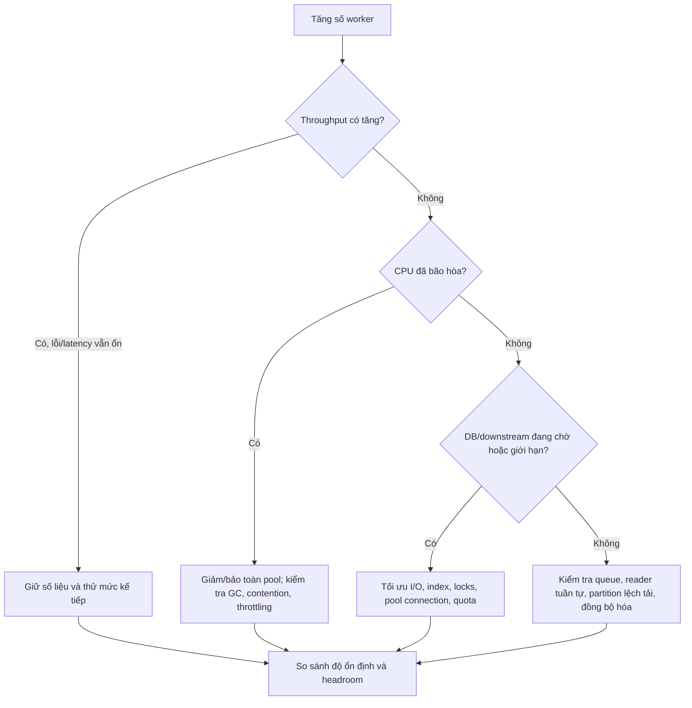

# Chọn pool size theo CPU khi mở rộng Spring Batch

## 1. Vì sao pool size là quyết định về hiệu năng lẫn độ an toàn?

Một Spring Batch job xử lý 8 triệu bản ghi đang mất 4 giờ. Bạn bổ sung `TaskExecutor` và tăng số worker từ 1 lên 16 với hy vọng thời gian giảm 16 lần. Kết quả có thể ngược lại: CPU bị tranh chấp, JVM dành nhiều thời gian chuyển ngữ cảnh, connection pool cạn, database tăng lock wait, còn job mất 5 giờ.

Nguyên nhân là **pool size điều khiển số tác vụ có thể chạy đồng thời, không tạo thêm CPU hay băng thông I/O**. Tối ưu cấu hình phải xuất phát từ **số CPU thực sự có thể sử dụng**, tỷ lệ thời gian worker phải chờ và giới hạn của các hệ thống liên quan.

Trong module `SPRING_BATCH_SCALING_OPERATIONS`, cùng một nguyên lý áp dụng cho **multi-threaded step**, **parallel steps**, **local partitioning** và **remote workers**, nhưng mỗi mô hình có cách dùng executor và phạm vi tài nguyên khác nhau.

Sau bài học, bạn sẽ biết:

- Phân biệt CPU vật lý, logical CPU, vCPU, CPU quota của container và tài nguyên CPU đang chia sẻ với workload khác.
- Ước lượng **pool size khởi điểm** cho tác vụ CPU-bound và I/O-bound, sau đó hiệu chỉnh bằng số liệu.
- Cấu hình `ThreadPoolTaskExecutor`, `gridSize`, chunk size và hàng đợi có giới hạn trong Spring Batch.
- Đọc CPU utilization, throttling, throughput, queue wait, DB pool, lock wait để tìm điểm bão hòa.
- Duy trì thread safety, retry/restart và idempotency khi tăng mức song song.

> **Nguyên tắc cốt lõi:** không tồn tại một giá trị pool size tốt nhất cho mọi job. Công thức là **điểm xuất phát để thử nghiệm**; cấu hình production phải được đo trên cùng workload và cùng giới hạn tài nguyên.

## 2. Đếm đúng số CPU mà job có thể dùng

Đầu tiên, xác định CPU **hiệu dụng** thay vì chỉ nhìn số core của máy chủ.

| Khái niệm | Ý nghĩa | Lưu ý cho Spring Batch |
| --- | --- | --- |
| **Physical core** | Lõi xử lý vật lý | Có thể phục vụ nhiều hardware thread, nhưng thông lượng không luôn tăng tuyến tính |
| **Logical CPU / vCPU** | Đơn vị CPU mà OS/VM cung cấp cho tiến trình | Dùng làm mốc ban đầu; vCPU không nhất thiết tương đương một physical core độc quyền |
| **CPU quota** | Giới hạn CPU-time của container trong một chu kỳ | Pod có thể thấy nhiều CPU nhưng chỉ được sử dụng trung bình 2 CPU; vượt quota gây throttling |
| **CPU request / shares** | Ưu tiên hoặc phần chia tài nguyên khi cạnh tranh | Không đồng nghĩa với giới hạn CPU cứng hay số core được bảo đảm tuyệt đối |
| **CPU affinity / cpuset** | Tập logical CPU mà tiến trình được phép chạy | Có thể giới hạn thấp hơn số CPU host báo |
| **CPU còn trống thực tế** | Năng lực chưa bị các job khác, ứng dụng hoặc sidecar sử dụng | Phải đo trong khung giờ batch chạy, kể cả khi job song song khác đang hoạt động |

Ví dụ: máy host 32 vCPU, Kubernetes pod được giới hạn **4 CPU**, một ứng dụng batch có 16 worker CPU-bound. Dù host còn nhiều CPU, container thường chỉ có năng lực khoảng 4 CPU-time; 16 worker không thể cùng thực hiện 16 CPU-time hữu ích. Scheduler có thể luân phiên chúng và CFS quota có thể throttle container.

Với Java hiện đại, `Runtime.getRuntime().availableProcessors()` thường có khả năng nhận biết giới hạn container, nhưng kết quả còn phụ thuộc JDK, cấu hình cgroup và JVM options. Hãy **quan sát cả giá trị JVM báo và quota/limit thực tế**; không coi giá trị trả về là bảo đảm thông lượng.

```java
int visibleProcessors = Runtime.getRuntime().availableProcessors();
System.out.println("JVM visible processors = " + visibleProcessors);
```

Trong môi trường Linux/cgroup v2, `cpu.max` thường cho biết quota và period. Ví dụ `200000 100000` nghĩa là giới hạn trung bình **2 CPU**; `max 100000` nghĩa là không áp quota kiểu này. Đây chỉ là một nguồn thông tin; cũng cần kiểm tra cpuset, cấu hình JVM và mức sử dụng CPU thực tế. Trên Kubernetes, hãy đọc tài nguyên `requests/limits` của container mà job đang chạy.

**Ngân sách CPU của job** còn phụ thuộc các thành phần nằm trong cùng process: GC, `JobRepository`, scheduler, web server (nếu có), telemetry, và nhiều job khởi chạy cùng JVM. Nếu giới hạn container là 4 CPU, dành cả 4 thread cho một công đoạn CPU-bound có thể phù hợp khi job gần như độc chiếm process; nếu còn nhiều nhiệm vụ nền, nên thử 2–3 thread rồi đo.

## 3. Phân loại workload: CPU-bound hay I/O-bound?

Không chọn pool size theo tên framework hoặc số lượng bản ghi; cần biết worker dành thời gian ở đâu.

| Workload | CPU đang làm gì? | Thời gian chờ | Hướng chọn pool khởi điểm |
| --- | --- | --- | --- |
| **CPU-bound** | Mã hóa, nén, tính toán, parsing phức tạp, xử lý ảnh, áp quy tắc nặng | Ít | Gần số CPU hiệu dụng, trừ phần dành cho tiến trình khác |
| **I/O-bound** | Đọc/ghi SQL, S3, filesystem, HTTP có thời gian phản hồi lớn | Nhiều | Có thể lớn hơn số CPU, nhưng bị giới hạn bởi connection/bandwidth/rate limit |
| **Mixed** | Deserialize + xử lý nghiệp vụ + SQL commit | Vừa | Đo tỷ lệ CPU/wait theo từng pha; thử tăng dần |
| **External bottleneck** | Chủ yếu chờ DB lock, connection hoặc downstream quota | Cao nhưng không tạo throughput | Tăng thread có thể làm tệ hơn; sửa nút thắt trước |

### Cách đo nhanh

Đối với mỗi worker/chunk, thu thập hoặc lấy mẫu:

1. **Thời gian xử lý có dùng CPU**: CPU time của thread hoặc profiler, thời gian trong `ItemProcessor` và các đoạn tính toán.
2. **Thời gian chờ**: query latency, wait lấy connection, HTTP latency, lock wait, file I/O, thời gian job/task xếp hàng.
3. **Throughput cuối**: items hoàn thành và commit **thành công** mỗi giây, không chỉ số lần `process()` được gọi.

Lưu ý: `Thread.sleep()`, chờ socket hoặc chờ connection không nhất thiết hiện thành trạng thái `BLOCKED` của JVM. Quan sát thread states chỉ là một tín hiệu; cần kết hợp tracing, DB metrics và profiler. Ngược lại, CPU utilization cao chưa chắc processor là nút thắt: GC, serialization, tranh chấp lock hoặc logging cũng có thể tiêu CPU.

## 4. Tính pool size khởi điểm

### 4.1. Với CPU-bound: bắt đầu gần số CPU hiệu dụng

Một quy tắc thực hành:

\[
P_{\text{start}} \approx N_{\text{CPU hiệu dụng}}
\]

Trong đó `P` là số worker CPU-bound **đồng thời** và `N` là CPU-time khả dụng sau khi cân nhắc các tiến trình/job khác. Nếu job chạy trên pod giới hạn 4 CPU và gần như độc chiếm JVM, thử `P = 2, 3, 4`; chỉ tăng lên `6, 8` nếu benchmark chứng minh có nhiều thời gian chờ hoặc điểm nghẽn khác. SMT/hyper-threading có thể giúp một số workload nhưng **không cho tốc độ gấp đôi** so với physical cores.

Tại sao quá nhiều thread có thể chậm? Số CPU không đổi, nhưng tăng context switching, cạnh tranh cache, cấp phát bộ nhớ, contention trong JVM và chu kỳ GC; với container còn có throttling.

### 4.2. Với tác vụ chờ I/O: dùng tỷ lệ thời gian chờ/làm việc

Một heuristic thường dùng khi phần xử lý có thể thực sự overlap:

\[
P_{\text{start}} \approx N_{\text{CPU}}\times U_{\text{target}}
\times\left(1+\frac{W}{C}\right)
\]

Trong đó:

- `N_CPU`: CPU hiệu dụng dành cho nhóm worker đang xét.
- `U_target`: mức sử dụng CPU mục tiêu, ví dụ 0,75–0,85 tùy headroom cần giữ.
- `W`: thời gian worker **chờ** mỗi item/tác vụ.
- `C`: thời gian worker **tính toán dùng CPU** trên cùng đơn vị công việc.

Ví dụ: pod có 4 CPU, mục tiêu `U_target = 0,8`, một worker dùng CPU 25 ms và chờ I/O 75 ms. Khi đó:

\[
P_{\text{start}} \approx 4\times0{,}8\times(1+75/25)
=12{,}8
\]

Có thể bắt đầu thử quanh **12–13 worker**, **chỉ khi** database, connection pool, upstream và bộ nhớ cho phép. Con số 13 **không** là mức khuyến nghị bắt buộc; nếu connection pool chỉ cấp 6 kết nối cho công đoạn đó, latency tăng theo tải hoặc downstream giới hạn 5 request đồng thời, cần chọn thấp hơn.

Công thức trên cũng có giới hạn: phân phối latency không đều, blocking có tương quan, garbage collection, transaction giữ lock và cơ chế queue/batching có thể khiến kết quả đo chênh xa ước lượng. Với workload hỗn hợp, hãy dùng nó để xác định **vùng giá trị cần benchmark**.

### 4.3. Số worker hiệu dụng bị chặn bởi nhiều ngân sách

```text
CPU budget      ─┐
DB connections  ─┤
Heap / memory   ─┼──> số worker an toàn và có ích
Downstream rate ─┤
File / network  ─┤
Transaction lock┘
```

Ví dụ thực tế:

- Một worker giữ 1 DB connection trong lúc chunk transaction mở. 8 worker có thể cần khoảng 8 connection cho công việc, cộng thêm kết nối của metadata, bước khác và hệ thống phụ trợ. Một số flow dùng **hơn một connection**; phải đo trong runtime.
- Mỗi worker giữ chunk 500 item, mỗi item/object graph chiếm trung bình 20 KiB trong một pha. Riêng dữ liệu chunk của 8 worker đã có thể gần **80 MiB** (`8 × 500 × 20 KiB`), chưa tính buffer reader, page, writer, metadata và GC overhead.
- Nếu service đích chỉ cho 100 request/giây, tăng 4 lên 20 worker có thể tạo thêm timeout/429 thay vì tăng throughput hữu ích.

## 5. Đừng nhầm pool size với gridSize, chunk size và số Job

| Cấu hình | Điều nó chi phối | Điều nó **không** bảo đảm |
| --- | --- | --- |
| `corePoolSize` | Số thread nền mà executor có thể duy trì, tùy tình huống và cấu hình | CPU hoặc số partition bằng với số thread |
| `maxPoolSize` | Giới hạn thread của executor | Tự tăng tới max trong mọi cấu hình queue |
| `queueCapacity` | Số tác vụ được chờ trong hàng đợi | Có thêm throughput hoặc memory miễn phí |
| `gridSize` (partitioning) | Gợi ý số partition ban đầu mà `Partitioner` tạo | Tạo cùng số thread hay cùng số node |
| `chunk(size)` | Kích thước mục tiêu của mỗi transaction chunk | Quyết định số worker đồng thời |
| `pageSize` / `fetchSize` | Mức lấy dữ liệu từ nguồn theo reader | Quyết định song song hóa |
| Số `JobExecution` đồng thời | Số job cùng chia tài nguyên ứng dụng/hạ tầng | Mỗi job được CPU/DB pool riêng nếu thực tế dùng chung |

**Chi tiết đặc biệt quan trọng với `ThreadPoolTaskExecutor`:** theo cách hoạt động của `ThreadPoolExecutor`, tác vụ mới thường được đưa vào queue sau khi đạt `corePoolSize`, và chỉ tạo thêm thread vượt core khi queue đã đầy (trừ cấu hình queue đặc biệt). Nếu queue không giới hạn, `maxPoolSize` có thể **hầu như không phát huy tác dụng**. Với batch cần concurrency dự đoán được, cách dễ kiểm soát là đặt **`corePoolSize = maxPoolSize`**, dùng bounded queue và theo dõi task rejection.

Ví dụ `gridSize = 16`, pool cố định `4`: một manager có thể có 16 worker `StepExecution` nhưng chỉ **tối đa khoảng 4 tác vụ worker** cùng chạy trên executor này, các tác vụ còn lại chờ. Nếu bạn có **ba job cùng dùng pool 4**, cả ba chia sẻ 4 thread chứ không tự có 12 thread riêng.

## 6. Cấu hình ThreadPoolTaskExecutor cho local partitioning

Ví dụ dưới dùng Spring Batch 5.x (như 5.2) và Spring Framework. Giả sử ứng dụng đã có `JobRepository`, một bean `cpuWorkerStep` và một bean `cpuPartitioner` với cách chia đầu vào **không chồng lấn**. Đoạn mã tập trung vào việc quản lý pool vì đó là mục tiêu bài học.

```java
import org.springframework.batch.core.Step;
import org.springframework.batch.core.partition.support.Partitioner;
import org.springframework.batch.core.repository.JobRepository;
import org.springframework.batch.core.step.builder.StepBuilder;
import org.springframework.beans.factory.annotation.Qualifier;
import org.springframework.beans.factory.annotation.Value;
import org.springframework.context.annotation.Bean;
import org.springframework.context.annotation.Configuration;
import org.springframework.core.task.TaskExecutor;
import org.springframework.scheduling.concurrent.ThreadPoolTaskExecutor;

@Configuration
public class CpuTuningConfiguration {

    @Bean("cpuPartitionExecutor")
    public ThreadPoolTaskExecutor cpuPartitionExecutor(
            @Value("${batch.tuning.pool-size:4}") int poolSize) {
        if (poolSize < 1) {
            throw new IllegalArgumentException("pool-size must be positive");
        }
        ThreadPoolTaskExecutor executor = new ThreadPoolTaskExecutor();
        executor.setCorePoolSize(poolSize);
        executor.setMaxPoolSize(poolSize);
        executor.setQueueCapacity(32); // bounded backlog; phải quan sát rejection
        executor.setThreadNamePrefix("batch-cpu-");
        executor.initialize();
        return executor;
    }

    @Bean
    public Step cpuManagerStep(
            JobRepository repository,
            @Qualifier("cpuPartitioner") Partitioner partitioner,
            @Qualifier("cpuWorkerStep") Step workerStep,
            @Qualifier("cpuPartitionExecutor") TaskExecutor executor) {
        return new StepBuilder("cpu.manager", repository)
                .partitioner("cpu.worker", partitioner)
                .step(workerStep)
                .gridSize(16)
                .taskExecutor(executor)
                .build();
    }
}
```

Trong `application.yml`:

```yaml
batch:
  tuning:
    pool-size: 4
```

**Giải thích các con số:**

- `pool-size: 4` là cấu hình khởi điểm **giả sử** job có ngân sách khoảng 4 CPU. Nó không nên được copy nguyên vào mọi môi trường.
- `gridSize(16)` cho phép tạo những partition nhỏ hơn để phân phối công việc và giảm lệch tải; **không chạy 16 thread** nếu pool chỉ 4.
- `queueCapacity(32)` giữ backlog có giới hạn. Nếu nhiều job/manager cùng nộp tác vụ hoặc giá trị grid rất lớn, executor có thể từ chối tác vụ khi 4 thread bận và queue đầy; Spring sẽ báo lỗi thay vì tạo queue vô hạn. Cần giới hạn cả số job đồng thời và số partition được dispatch; không xử lý lỗi bằng retry mù quáng.
- Worker step và `Partitioner` phải tự bảo đảm tính độc lập vùng dữ liệu. Pool đúng kích thước không cứu được một reader singleton có state dùng chung.

Để chọn pool theo môi trường, đặt giá trị khác nhau qua cấu hình deployment hoặc benchmark. Ví dụ pod 2 CPU bắt đầu `2`, pod 4 CPU thử `2, 3, 4`. Đừng tự động lấy `availableProcessors() * 4` rồi áp vào tất cả job: tỷ lệ chờ và giới hạn downstream có thể khác hẳn.

### Multi-threaded step và parallel steps

- **Multi-threaded step:** executor có thể phục vụ nhiều chunk của **cùng StepExecution**. Phải kiểm tra reader/processor/writer/listener có state, checkpoint và thứ tự đọc. Ngay cả `@StepScope` cũng không nhất thiết tạo instance riêng cho từng thread vì scope theo StepExecution.
- **Parallel steps (split flows):** executor quản lý các flow/Step chạy song song; mỗi flow có thể tự có executor riêng. Tổng số thread chạy CPU-bound across các flow vẫn chia sẻ **cùng ngân sách CPU của pod/JVM**.
- **Local partitioning:** `TaskExecutorPartitionHandler` điều phối nhiều worker `StepExecution` trong một JVM. `gridSize` quyết định số phần việc, pool quyết định mức chạy đồng thời.
- **Remote partitioning:** CPU của **manager** và CPU của **worker nodes** là hai ngân sách khác nhau. Pool manager không đại diện cho năng lực CPU của toàn cluster; phải giới hạn concurrency riêng ở worker và xét DB/downstream dùng chung.

## 7. Thiết kế thử nghiệm để tìm pool size tốt nhất

Việc chọn pool size nên dựa trên thí nghiệm có kiểm soát. Giữ **bộ dữ liệu, độ phức tạp, CPU quota, DB instance, index, transaction policy và concurrency của workload khác** tương đối ổn định giữa các lần đo.

Quy trình:

1. **Baseline:** chạy với một worker, thu throughput, thời gian job, CPU, GC, DB latency, connection wait, lock wait và dữ liệu đối soát.
2. **Phân loại nút thắt:** dùng profiler, tracing, metric hệ điều hành/container và DB để ước tính phần tính toán so với phần chờ.
3. **Chọn dải thử:** CPU-bound thường `1, 2, 3, 4, 6, 8` khi có khoảng 4 CPU; I/O-bound có thể thử rộng hơn nhưng phải áp giới hạn DB/downstream.
4. **Chạy đủ lâu:** benchmark trên tập dữ liệu đủ lớn, tránh đưa kết luận từ vài chunk đầu (warm-up JVM, cache hoặc connection pool chưa ổn định). Có thể lặp mỗi cấu hình để ước lượng dao động.
5. **So sánh cả throughput và tính đúng đắn:** đo item commit/giây, job duration, p95/p99 latency, retry, rollback và đối soát số bản ghi/khóa nghiệp vụ.
6. **Chọn điểm trước bão hòa:** ưu tiên mức throughput ổn định với headroom cho DB, GC và workload khác, thay vì giá trị cực đại không bền vững trong một lượt benchmark.

### Ví dụ kết quả benchmark giả định

Giả sử một job thiên về **CPU-bound**, chạy trong container 4 CPU và dùng chung một database khỏe. Số liệu **chỉ để minh họa cách ra quyết định**, không phải kết quả đo hay khuyến nghị phổ quát:

| Pool size | CPU trung bình | Throughput (item/s) | Job duration tương đối | Gợi ý |
| ---: | ---: | ---: | ---: | --- |
| 1 | 26% | 850 | 100% | Baseline, còn CPU trống |
| 2 | 51% | 1.640 | 52% | Tăng gần tuyến tính |
| 3 | 75% | 2.320 | 37% | Hiệu quả tốt |
| 4 | 92% | 2.760 | 31% | Có thể là lựa chọn tốt |
| 6 | 100% | 2.730 | 31% | Không tăng throughput, ít headroom |
| 8 | 100% | 2.490 | 34% | Contention/GC/throttling cần kiểm tra |

Trong tình huống này, **pool 3 hoặc 4** đáng xem xét; chọn 3 nếu pod còn trách nhiệm khác hoặc có spike, chọn 4 nếu số đo tail latency/GC/retry vẫn tốt và CPU gần như dành riêng cho job. Không kết luận “pool 4 là tối ưu” cho một workload I/O-bound.

### Đọc biểu đồ qua các chỉ số



Đừng chỉ xem **CPU utilization**; nó là mức CPU được dùng trong phạm vi chỉ số đang đo. Nếu container bị throttling, CPU có thể hiển thị 100% quota trong khi worker phải chờ. Nếu CPU thấp nhưng throughput không tăng, thủ phạm thường nằm ở I/O, queue, lock hoặc bước tuần tự.

## 8. Công cụ và chỉ số quan sát

| Nhóm | Metric/điểm quan sát | Câu hỏi điều tra |
| --- | --- | --- |
| **CPU/container** | CPU usage so với quota, `nr_throttled`, throttled time, run queue | Worker có đủ CPU-time không? |
| **JVM** | Thread count, GC pause/heap occupancy, allocation rate, CPU profile | Tăng pool có làm GC/contention nặng hơn không? |
| **Executor** | Active thread count, pool size, queue size, completed task count, rejected task | Có worker chờ queue hay bị từ chối nộp task không? |
| **Spring Batch** | `readCount`, `writeCount`, `commitCount`, `rollbackCount`, `skipCount`, thời gian mỗi `StepExecution`/partition | Throughput commit thành công là bao nhiêu, có partition chậm bất thường không? |
| **Database** | Active/idle connections, connection acquisition latency, SQL p95, lock wait, deadlock, IOPS | DB có nghẽn trước CPU không? |
| **Downstream** | RPS, p95/p99 latency, 429/503, timeout, retries | Concurrency đã vượt hạn mức hoặc khả năng xử lý chưa? |
| **Kết quả nghiệp vụ** | Số ID kỳ vọng, số bản ghi thực ghi, duplicate/conflict count | Tăng pool có làm sai hoặc trùng kết quả không? |

Ví dụ truy vấn metadata để so thời gian từng partition trong một lần thực thi (schema/tên bảng có thể khác theo cài đặt):

```sql
SELECT step_name, status, read_count, write_count,
       commit_count, rollback_count, start_time, end_time
FROM BATCH_STEP_EXECUTION
WHERE job_execution_id = :jobExecutionId
ORDER BY start_time, step_name;
```

Cùng `JobExecutionId` có thể xuất hiện manager step và nhiều worker `StepExecution`. Một partition xử lý 90% dữ liệu trong khi các partition khác rảnh là dấu hiệu **data skew**; tăng pool thường không giải quyết việc một partition cuối cùng giữ toàn job.

Nếu dùng Spring Boot Actuator/Micrometer, có thể instrument executor, JVM và datasource; tên metric cụ thể phụ thuộc dependency, phiên bản và cách bind. Không mặc định mọi metric đều được bật sẵn. Khi log/tạo span, gắn `jobName`, `jobExecutionId`, `stepName`, `partitionId`, không lạm dụng ID từng item làm label gây cardinality quá cao.

## 9. Những giới hạn thường đến trước CPU

### Database pool và transaction

Nếu 8 worker cùng chạy chunk, số connection cần thiết không tự động bằng 8 trong mọi kiến trúc. Mỗi worker có thể cần kết nối để đọc, ghi, transaction, và framework còn có truy cập metadata. Dự trù **số connection tối đa thực tế** và giữ headroom cho `JobRepository`, các Step khác và ứng dụng đồng trú.

Giả sử Hikari pool 10 connection, 8 worker giữ 8 connection suốt một chunk; chỉ còn 2 cho metadata và workload khác. Tăng lên 16 worker có thể làm task chờ connection, commit kéo dài và lock tồn tại lâu hơn. Khi đó phải đo và tối ưu SQL/transaction, hoặc giới hạn concurrency trước khi tăng thread.

### Chunk size và bộ nhớ

Pool size và chunk size cùng tác động đến bộ nhớ, transaction duration và rollback cost:

- Chunk lớn có thể giảm overhead commit nhưng tăng lock duration, dữ liệu giữ trong heap và công việc phải chạy lại sau rollback.
- Chunk nhỏ giảm mức rollback nhưng tăng số commit và metadata/transaction overhead.
- Reader paging/cursor có buffer và thread-safety riêng; mỗi worker partition nên có state độc lập, thường sử dụng `@StepScope` cho reader gắn với `ExecutionContext`.

Nếu pool lớn mà mỗi worker giữ nhiều đối tượng, GC có thể chiếm CPU; lúc này giảm chunk size hoặc giảm pool có thể cải thiện throughput. Hãy đo allocation/heap thay vì đoán.

### Queue dài không làm job hoàn thành nhanh hơn

Queue là **cơ chế đệm**, không phải tài nguyên thực thi. Khi số task chờ lớn, thời gian chờ trước khi worker bắt đầu có thể tăng; một `maxPoolSize` cao với queue vô hạn không giúp nâng concurrency. Bounded queue làm giới hạn rõ ràng, nhưng cần quy hoạch số job/partition được nộp để tránh rejection.

### Retry và restart khi scale

- Worker chạy nhanh và đồng thời hơn có thể tạo thêm deadlock, timeout, rate limit; retry không được dùng để che dấu một nút thắt kéo dài.
- Mỗi chunk commit độc lập. Với partitioning, một partition có thể `FAILED` khi các partition khác đã `COMPLETED`. Restart cùng `JobInstance` dựa vào `JobRepository` và `ExecutionContext` ổn định; không tự hoàn tác toàn job.
- Reader/processor/writer/listener phải an toàn theo cách chạy. `@StepScope` không đồng nghĩa mỗi thread có một instance trong multi-threaded step.
- Writer cần chống ghi trùng theo business key, ví dụ unique constraint/UPSERT/idempotency key. Tăng pool không thay thế được dữ liệu phân vùng không giao nhau hoặc tính idempotent.

## 10. Lỗi cấu hình hay gặp

| Triệu chứng | Khả năng nguyên nhân | Hướng kiểm tra/sửa |
| --- | --- | --- |
| CPU 100%, throughput giảm khi tăng thread | CPU-bound đã bão hòa; context switch, GC hoặc throttling | Giảm pool, profiler CPU/GC, xem quota và throttling |
| CPU thấp, thread nhiều mà job vẫn chậm | DB/HTTP wait, lock, queue hoặc reader tuần tự | Đo wait/latency, connection acquisition, SQL và active executor |
| `maxPoolSize = 32` nhưng chỉ chạy 4 thread | `corePoolSize = 4`, queue lớn/chưa đầy | Hiểu chính sách tăng thread của `ThreadPoolExecutor`; thử core=max nếu cần concurrency cố định |
| `gridSize = 32` nhưng chỉ có 8 worker đồng thời | Pool executor giới hạn 8 | Phân biệt partition count với concurrency |
| Task rejected khi nhiều job cùng chạy | Bounded queue đầy hoặc executor đang shutdown | Hạn chế task/job đồng thời; quan sát queue/rejection; không retry vô hạn |
| Nhiều connection timeout/DB lock | Worker cạnh tranh DB hoặc transaction quá dài | Tối ưu query/index, giảm pool/chunk, xét DB connection budget |
| Một partition chạy rất lâu so với phần còn lại | Phân vùng lệch dữ liệu hoặc một key/file quá nặng | Chia đều theo **khối lượng công việc thật**, chia thành nhiều partition nhỏ |
| Dữ liệu ghi trùng khi retry/restart | Writer không idempotent, partition overlap | Ràng buộc unique, stable business ID, kiểm thử fault injection |
| Bổ sung remote node nhưng CPU manager gần như không đổi | CPU nằm ở worker remote; manager chỉ điều phối | Quan sát CPU từng node, broker và DB chung |

## 11. Bài tập thực hành

**Bài 1 — Chọn điểm khởi đầu CPU-bound.** Một job có quota 6 vCPU, processor dùng CPU gần như toàn bộ thời gian, không gọi API. Ứng dụng còn chạy một job báo cáo nhỏ. Hãy đề xuất dải pool size đầu tiên để benchmark, giải thích vì sao `12` thread không tự tạo tốc độ gấp đôi so với `6`.

**Bài 2 — Tính với I/O.** Một job có 4 CPU, mục tiêu CPU 0,75. Một worker cần 15 ms CPU và chờ DB khoảng 45 ms. Tính pool theo heuristic `N × U × (1 + W/C)`. Nếu DB chỉ còn 8 connection đủ an toàn cho job, bạn sẽ thử bao nhiêu worker đầu tiên? Vì sao không chọn luôn giá trị toán học?

**Bài 3 — Tìm nút thắt.** Khi tăng pool 4 → 8, throughput chỉ tăng 2%; CPU giữ ở 58%, connection acquisition p95 tăng 200 ms → 1.500 ms. Phân tích metric để chọn giữa tăng CPU, mở rộng pool thread, tối ưu DB hay giảm concurrency. Nêu cách xác nhận thay đổi bằng benchmark có kiểm soát.

**Bài 4 — Partitioning và restart.** Manager có `gridSize = 24`, executor 6 thread. Một partition lỗi, 23 partition hoàn tất. Giải thích số worker chạy đồng thời, metadata nào cần duy trì để restart đúng `JobInstance` và vì sao writer phải xử lý được việc cùng business ID được đưa đến lần nữa.

## 12. Checklist khi quyết định pool size

- [ ] Ghi rõ số **CPU hiệu dụng**, quota/cpuset, các job cùng chia sẻ ngân sách CPU.
- [ ] Phân loại CPU-bound, I/O-bound, mixed bằng profiler và số liệu wait thực tế.
- [ ] Chọn **dải thử**, không cố định một con số “theo công thức” rồi triển khai toàn bộ môi trường.
- [ ] Kiểm tra `corePoolSize`, `maxPoolSize`, `queueCapacity`, task rejection và số job nộp vào executor.
- [ ] Phân biệt `gridSize`, pool size, chunk size và concurrency ở từng Step/flow/node.
- [ ] Tính cả connection DB, heap, transaction duration, downstream rate limit và metadata.
- [ ] Đo throughput commit thành công, tail latency, CPU throttling, GC, queue/lock wait.
- [ ] Đối soát dữ liệu sau benchmark và thử lỗi/retry/restart để chứng minh tính đúng đắn.
- [ ] Chốt pool size có headroom và ghi lại **điều kiện benchmark** để lần tuning sau có thể so sánh.

## 13. Ghi nhớ

Đối với **CPU-bound**, pool worker thường bắt đầu gần **CPU hiệu dụng**. Với **I/O-bound**, có thể cần nhiều worker hơn CPU để tận dụng thời gian chờ, nhưng mức song song hữu ích vẫn bị chặn bởi database, bộ nhớ, network, lock và downstream. Trong Spring Batch, `gridSize` định nghĩa mức chia việc, `TaskExecutor` giới hạn concurrency, còn chunk/transaction và thiết kế dữ liệu quyết định overhead và khả năng restart. **Pool tốt nhất là pool giúp tăng throughput ổn định mà vẫn giữ kết quả đúng và tài nguyên trong giới hạn**.

**Tài liệu tham khảo:**

- [Spring Batch Reference — Scaling and Parallel Processing](https://docs.spring.io/spring-batch/reference/scalability.html)
- [Spring Framework — `ThreadPoolTaskExecutor` API](https://docs.spring.io/spring-framework/docs/current/javadoc-api/org/springframework/scheduling/concurrent/ThreadPoolTaskExecutor.html)
- [Java Platform — `ThreadPoolExecutor` API](https://docs.oracle.com/en/java/javase/17/docs/api/java.base/java/util/concurrent/ThreadPoolExecutor.html)
- [Kubernetes — Resource Management for Pods and Containers](https://kubernetes.io/docs/concepts/configuration/manage-resources-containers/)
