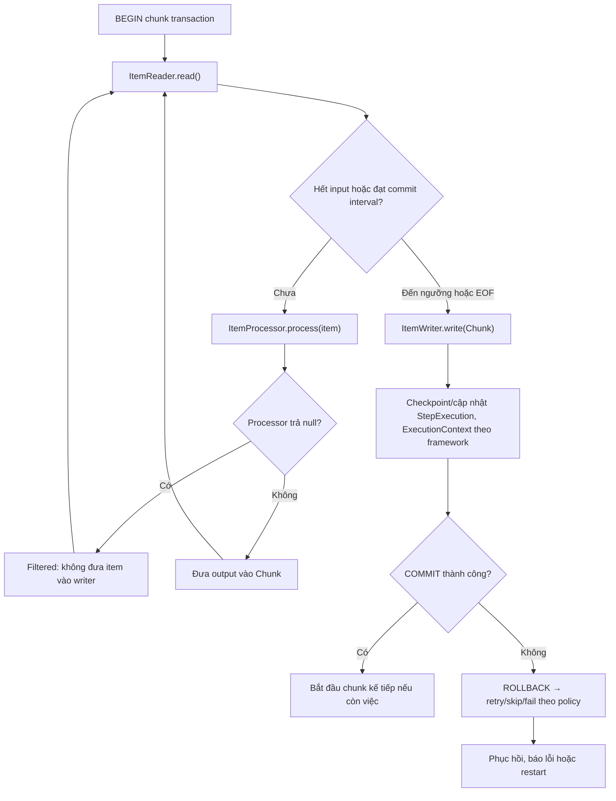
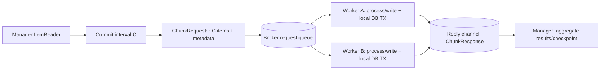
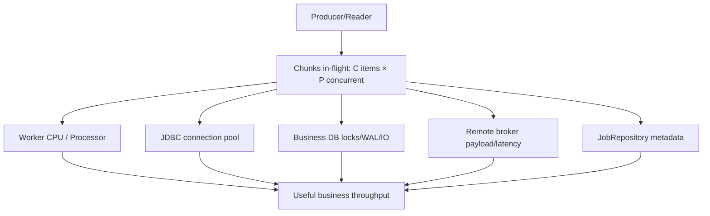

# Điều chỉnh chunk size trong Spring Batch: cân bằng throughput, transaction và khả năng phục hồi

## 1. Tại sao chunk size là tham số hiệu năng quan trọng?

Một job Spring Batch cần nhập 20 triệu dòng từ PostgreSQL, chuẩn hóa rồi ghi vào bảng đích. Với `chunkSize=10`, job tốn nhiều thời gian bắt đầu/commit transaction. Đội vận hành đổi thành `chunkSize=10_000` và thấy throughput tăng lúc đầu, nhưng mỗi khi có dữ liệu lỗi, cả chunk phải rollback; bộ nhớ tăng, lock giữ lâu và restart sau sự cố khó dự đoán. Thêm worker chưa chắc chữa được tình trạng này.

**Chunk size** (thường được gọi là **commit interval**) là số lượng item mà một chunk-oriented `Step` dự kiến thu thập qua các lần đọc để xử lý/ghi **trong một ranh giới transaction**, trước khi bắt đầu chunk kế tiếp. Nó quyết định sự đánh đổi giữa:

- Chi phí transaction và checkpoint so với số item được xử lý.
- Dung lượng dữ liệu/đối tượng được giữ trong bộ nhớ của một chunk.
- Thời gian giữ connection, lock và độ lớn transaction/WAL/redo.
- Độ trễ trước khi tiến độ được commit bền, rủi ro rollback/retry.
- Thời gian phục hồi khi crash, và mức concurrency khi nhiều worker/partition cùng chạy.

Không có một giá trị chunk size “tối ưu cho mọi job”. Giá trị phù hợp phụ thuộc reader, processor, writer, database, dữ liệu, SLA và cách scale.

Bài thuộc chương **Tối ưu cấu hình** của module `SPRING_BATCH_SCALING_OPERATIONS`. Module tập trung mở rộng Spring Batch cho workload dữ liệu lớn qua **multi-threaded step, parallel steps, partitioning và xử lý phân tán**, cùng việc đo bottleneck, đảm bảo thread safety, retry/restart và vận hành theo tài nguyên thực tế. Vì vậy, điều chỉnh chunk size phải xét **đúng dữ liệu và restart** bên cạnh tốc độ xử lý.

### Mục tiêu học tập

Sau bài này, bạn có thể:

1. Giải thích `chunk(n, transactionManager)` thực hiện các bước read/process/write/commit như thế nào.
2. Phân biệt **configured chunk size**, số item đọc, số item qua processor, số item ghi và số transaction thực tế.
3. Phân tích chi phí cố định mỗi chunk và nguy cơ chunk quá nhỏ/quá lớn.
4. Chọn khoảng thử nghiệm ban đầu dựa trên memory, transaction latency, error rate và concurrency.
5. Cấu hình Spring Batch 5.2, thử nhiều kích thước với workload nhất quán, đọc metadata/metrics để ra quyết định.
6. Hiểu tác động lên fault tolerance, JDBC batching, JMS/remote chunking, partitioning và checkpoint/restart.
7. Xây quy trình tuning an toàn có thể triển khai, giám sát và rollback cấu hình.

> **Phạm vi phiên bản:** ví dụ chính dùng **Spring Batch 5.2.x**, Spring Boot 3.x, Spring Framework 6.x và Java 17+, với PostgreSQL làm ví dụ DB. Các nguyên lý dùng được cho nhiều RDBMS, nhưng chi phí commit, statement limits và driver batching phụ thuộc hệ thống. Các giá trị số liệu trong bài chỉ là **giả định để tính toán**; phải benchmark bằng tải thực tế.

## 2. Chunk-oriented processing hoạt động ra sao?

Trong Spring Batch, `ItemReader` đọc từng item, `ItemProcessor` tùy chọn biến đổi/lọc, rồi `ItemWriter` nhận một `Chunk` để ghi. Step quản lý việc bắt đầu và commit transaction qua `PlatformTransactionManager` đã được cấu hình.

### 2.1. Dòng chảy thông thường



Sơ đồ minh họa **đường thông thường**, không mô tả từng callback hay thứ tự nội bộ của fault-tolerant step. Spring Batch có thể thực hiện một số callback/checkpoint trong transaction và có semantics riêng khi rollback; không dựa vào sơ đồ để viết transaction coordinator mới.

Với cấu hình:

```java
new StepBuilder("importOrdersStep", jobRepository)
        .<RawOrder, NormalizedOrder>chunk(100, transactionManager)
        .reader(reader)
        .processor(processor)
        .writer(writer)
        .build();
```

`chunk(100, transactionManager)` có nghĩa step sử dụng **commit interval 100** và transaction manager đã chỉ định. Trong một chunk thông thường, framework thu thập tối đa khoảng 100 item đầu vào để xử lý và chuyển kết quả không bị lọc tới writer. Sau khi writer hoàn tất, transaction được commit theo hợp đồng của step.

### 2.2. “Chunk size = 100” không có nghĩa writer luôn ghi 100 hàng DB

| Đại lượng | Ý nghĩa | Ví dụ |
| --- | --- | --- |
| **Configured commit interval** | Ngưỡng cấu hình trong `chunk(100, ...)` | 100 |
| **Read count** | Số item thành công từ reader được Batch ghi nhận | 100 |
| **Filter count** | Processor trả `null`, loại khỏi writer | 15 |
| **Writer item count** | Số item output còn lại được chuyển cho writer theo chunk | Khoảng 85 |
| **SQL affected rows** | Số dòng DB thực sự insert/update/delete | Có thể là 0, 85 hoặc nhiều hơn |
| **Business effects** | Tác động nghiệp vụ đã commit (ví dụ khoản thanh toán duy nhất) | Phải đối soát riêng |

Nếu processor lọc 15 item, writer có thể nhận 85 output items dù chunk size là 100. Nếu writer dùng `UPSERT`, một item có thể sửa nhiều bảng hoặc là no-op do idempotency. Nếu reader hết dữ liệu ở cuối step, chunk cuối có thể nhỏ hơn 100. Trong fault-tolerant mode, skip/retry/rollback có thể tạo thêm các lần writer invocation và transaction.

**Không suy `WRITE_COUNT = số rows affected`, cũng không lấy `COMMIT_COUNT = ceil(READ_COUNT/chunkSize)` như một đồng nhất thức tuyệt đối.** Transaction rỗng, chunk cuối, lỗi, retry, skip, restart và các bước metadata đều có thể khiến counter thực tế khác mô hình lý tưởng.

### 2.3. Ví dụ số chunk trong điều kiện lý tưởng

Giả sử có `N=1_000_000` item, không filter/skip/retry, không lỗi, reader và writer xử lý theo chuẩn:

\[
n_{\mathrm{chunks}} \approx \left\lceil \frac{N}{C} \right\rceil
\]

Trong đó `C` là commit interval. Với `C=100` có khoảng 10.000 chunks; với `C=1.000` khoảng 1.000 chunks.

**Đây là phép tính số chunk nghiệp vụ lý tưởng**, không phải dự báo chính xác `BATCH_STEP_EXECUTION.COMMIT_COUNT`. Đừng tối ưu chỉ để giảm một con số trong metadata mà chưa đo latency, rollback hay memory.

## 3. Chi phí giao dịch: vì sao chunk quá nhỏ thường chậm?

Mỗi chunk không chỉ làm việc trên item; nó còn có những phần chi phí cố định:

- Bắt đầu/kết thúc transaction, commit log và có thể fsync WAL/redo.
- Chuẩn bị/call writer, round-trip database/network hoặc ghi file.
- Cập nhật `StepExecution`, `ExecutionContext` và các callback liên quan.
- Chi phí locking, tracing/logging, instrumentation.

Mô hình đơn giản cho một worker:

\[
T(C) \approx
T_{\mathrm{fixed}}
+ C\,T_{\mathrm{perItem}}
+ T_{\mathrm{variable}}(C)
\]

`T_fixed` là chi phí cố định mỗi chunk; `T_perItem` là chi phí item trung bình; `T_variable(C)` chứa ảnh hưởng phi tuyến của batching, DB locks, GC, buffer, compression và các yếu tố khác.

Thông lượng lý tưởng của một worker nếu bỏ qua phần phi tuyến:

\[
R(C) \approx \frac{C}{T_{\mathrm{fixed}} + C T_{\mathrm{perItem}}}
\]

Khi `C` tăng từ 1 lên 100, chi phí cố định được chia cho nhiều item, nên throughput có thể tăng rõ. Tuy nhiên lợi ích này **giảm dần**, và đến một ngưỡng phần phi tuyến sẽ chi phối.

### 3.1. Bảng tính minh họa

Giả sử **hoàn toàn giả định**:

- Mỗi lần commit và metadata/writer-call có chi phí cố định **8 ms**.
- Chi phí xử lý một item trung bình **0,2 ms**.
- Không có DB lock contention, retries, network variance hay memory pressure.

| Chunk size | Fixed + per-item time/chunk | Thông lượng lý tưởng một worker |
| ---: | ---: | ---: |
| 1 | 8,2 ms | ≈ 122 item/s |
| 10 | 10 ms | ≈ 1.000 item/s |
| 50 | 18 ms | ≈ 2.778 item/s |
| 100 | 28 ms | ≈ 3.571 item/s |
| 500 | 108 ms | ≈ 4.630 item/s |
| 1.000 | 208 ms | ≈ 4.808 item/s |

Tăng từ 100 lên 500 có thể cải thiện đáng kể trong mô hình này; tăng tiếp lên 1.000 cho lợi ích nhỏ hơn. **Không lấy các số trên làm dự báo production:** nhiều JDBC writers và database có batching/transaction costs không tuyến tính, và reader/processor có thể chạy phần lớn công việc bên ngoài DB.

### 3.2. Chunk size 1 có khi vẫn đúng

`chunk(1, ...)` cho mỗi item một transaction tương đối nhỏ. Nó có thể hợp lý khi:

- Mỗi operation rất nặng, có side effect riêng phải phản hồi nhanh.
- Thời gian giữ lock cần tối thiểu.
- Ranh giới nghiệp vụ yêu cầu commit từng item.
- Tần suất lỗi cao, rollback một chunk lớn quá tốn kém.
- Workload nhỏ hoặc latency quan trọng hơn throughput.

Vấn đề không phải chunk size 1 luôn sai, mà là **hiểu và chấp nhận chi phí transaction** tương ứng.

## 4. Chunk quá lớn: memory, DB lock và thời gian rollback

Một chunk lớn giảm số commit nhưng **tăng lượng công việc dở dang trong một transaction**.

### 4.1. Bộ nhớ theo item và concurrency

Trong một chunk, framework có thể giữ references tới input, outputs của processor, chunk metadata và những buffers do reader/writer riêng giữ. Ước lượng:

\[
M_{\mathrm{chunk}} \approx C \times S_{\mathrm{retained}} +
M_{\mathrm{framework}} + M_{\mathrm{writer}}
\]

Trong đó `S_retained` là **kích thước object graph thực sự còn sống trên heap mỗi item**, không phải chỉ số byte của một record trên disk. Nếu mỗi item cùng output giữ ~8 KiB object sống, `C=5_000` có thể tạo ~39 MiB retained memory **chỉ cho dữ liệu một chunk**, chưa kể buffers, thread, Hibernate session và JVM overhead.

Với nhiều worker chunks đang chạy cùng lúc:

\[
M_{\mathrm{inflight}} \approx
P\times C\times S_{\mathrm{retained}}
\]

`P` là số chunk **thực sự đồng thời** trên toàn tiến trình (không nhất thiết bằng `gridSize`). Nếu `P=8` và mỗi chunk cần 39 MiB, riêng tập item có thể chiếm khoảng 312 MiB heap. Thêm JMS serialization copies hoặc JPA persistence context, memory còn cao hơn.

### 4.2. Transaction và lock giữ lâu

Một chunk lớn có thể:

- Giữ row locks lâu hơn, khiến web/API transactions hoặc worker khác chờ.
- Tạo WAL/redo lớn, flush bursts, replication lag.
- Tăng áp lực MVCC/vacuum đối với PostgreSQL hoặc undo đối với DB khác.
- Tăng nguy cơ chạm `statement_timeout`, `lock_timeout`, giới hạn transaction size hoặc message payload.
- Làm thời gian failover/recovery dài hơn vì nhiều công việc chưa có commit xác nhận.

**Tăng chunk size không đồng nghĩa JDBC driver tự batch SQL hiệu quả hơn.** Nếu writer gọi 1.000 lệnh SQL tuần tự, vẫn có thể có nhiều round-trip; cần đánh giá `JdbcBatchItemWriter`/`JdbcTemplate.batchUpdate`, prepared statement reuse và driver settings.

### 4.3. Rollback tốn bao nhiêu?

Nếu một lỗi xảy ra gần cuối chunk, mọi DB writes **tham gia cùng transaction** của chunk sẽ rollback. Với `C=1_000`, 999 item đã xử lý có thể phải xử lý lại; với `C=50`, phần việc dở dang tối đa thường nhỏ hơn.

Mô hình sơ bộ khi xác suất lỗi trên mỗi item là `p` và các lỗi độc lập:

\[
P(\text{chunk có ít nhất một lỗi}) = 1-(1-p)^C
\]

Ví dụ `p=0{,}001` (0,1%), `C=100` thì xác suất chunk chứa ít nhất một lỗi ≈ 9,5%; `C=1.000` ≈ 63,2%. Đây chỉ là mô hình thống kê **rất lý tưởng**, không phải xác suất một transaction chắc chắn rollback: retry/skip policies, lỗi transient và correlation giữa records thay đổi kết quả thực.

**Không dùng chunk size như biện pháp chính để xử lý lỗi dữ liệu.** Cần data validation, skip/retry policy phù hợp, idempotency và khả năng xác định poison records.

### 4.4. Chunk lớn có thể làm tối ưu giả

Một benchmark chỉ ghi nhận **item/s khi không lỗi** thường thưởng cho chunk lớn. Production có retry, lock contention, broker redelivery và crash; **throughput hữu ích** còn phải trừ downtime/recovery và số item phải replay.

Một cấu hình nhanh hơn 20% lúc bình thường nhưng làm mỗi lỗi kéo dài thêm 10 phút có thể kém hơn khi xét SLA cả ngày. Hãy đo **thời gian hoàn tất job, latency p95/p99 của chunk và tốc độ phục hồi**.

## 5. Cấu hình chunk size trong Spring Batch 5.2

### 5.1. Java configuration cơ bản

```java
// ImportStepConfig.java
package example.batch.tuning;

import org.springframework.batch.core.Step;
import org.springframework.batch.core.repository.JobRepository;
import org.springframework.batch.core.step.builder.StepBuilder;
import org.springframework.batch.item.ItemProcessor;
import org.springframework.batch.item.ItemReader;
import org.springframework.batch.item.ItemWriter;
import org.springframework.beans.factory.annotation.Qualifier;
import org.springframework.beans.factory.annotation.Value;
import org.springframework.context.annotation.Bean;
import org.springframework.context.annotation.Configuration;
import org.springframework.transaction.PlatformTransactionManager;

@Configuration
public class ImportStepConfig {

    @Bean
    public Step importOrdersStep(
            JobRepository jobRepository,
            @Qualifier("businessTransactionManager")
            PlatformTransactionManager businessTransactionManager,
            @Qualifier("rawOrderReader")
            ItemReader<RawOrder> reader,
            @Qualifier("normalizeOrderProcessor")
            ItemProcessor<RawOrder, NormalizedOrder> processor,
            @Qualifier("normalizedOrderWriter")
            ItemWriter<NormalizedOrder> writer,
            @Value("${app.batch.import.chunk-size:100}") int chunkSize) {

        if (chunkSize < 1) {
            throw new IllegalArgumentException("chunk-size must be >= 1");
        }

        return new StepBuilder("importOrdersStep", jobRepository)
                .<RawOrder, NormalizedOrder>chunk(
                        chunkSize, businessTransactionManager)
                .reader(reader)
                .processor(processor)
                .writer(writer)
                .build();
    }
}
```

`RawOrder` và `NormalizedOrder` là DTO ứng dụng; các bean reader/processor/writer và `businessTransactionManager` phải được cung cấp riêng. Ví dụ thể hiện **API cấu hình commit interval**; nó không tự cho biết các component dùng chung `DataSource`, có đủ thread safety hay đã hỗ trợ restart. Để thử nghiệm:

```yaml
app:
  batch:
    import:
      chunk-size: 100
```

Có thể override từ môi trường/container bằng hệ thống property binding tương ứng. **Không đổi chunk-size nóng giữa một JobExecution đang chạy** rồi kỳ vọng các transaction đang xử lý đổi theo: `Step` và policies được cấu hình ở startup/bean creation. Nếu cần tuning động theo tình trạng hệ thống, phải thiết kế completion/admission policy riêng và kiểm thử consistency.

### 5.2. Commit interval không phải một Spring Boot global property mặc định

`spring.batch.job.enabled`, `spring.batch.jdbc.initialize-schema` hoặc các cấu hình Batch auto-run khác **không phải** `chunkSize` của mọi step. Trong Spring Batch, commit interval thuộc **định nghĩa từng chunk-oriented Step**; app có thể có nhiều steps với giá trị khác nhau.

Không suy từ việc sửa `app.batch.import.chunk-size` rằng mọi Step đã đổi; chỉ Step nào inject property này mới bị ảnh hưởng. Cần có startup log/metric hiển thị `jobName, stepName, effectiveChunkSize` và config version.

### 5.3. XML configuration tương đương

Nếu ứng dụng còn dùng XML:

```xml
<step id="importOrdersStep">
  <tasklet transaction-manager="businessTransactionManager">
    <chunk reader="rawOrderReader"
           processor="normalizeOrderProcessor"
           writer="normalizedOrderWriter"
           commit-interval="100"/>
  </tasklet>
</step>
```

Ví dụ XML minh họa thuộc tính `commit-interval`, còn bean/namespace/repository thực tế phải được khai báo theo cấu hình dự án. **Không cấu hình cùng một step vừa bằng XML vừa bằng Java mà không biết bean nào được job sử dụng.**

### 5.4. Có thể dùng `CompletionPolicy` thay vì số cố định

Spring Batch hỗ trợ cấu hình `chunk(CompletionPolicy, transactionManager)` để định nghĩa khi nào chunk kết thúc theo một policy được hỗ trợ.

```java
import org.springframework.batch.repeat.CompletionPolicy;
import org.springframework.batch.repeat.policy.SimpleCompletionPolicy;

@Bean
public CompletionPolicy fixedHundredItemsPolicy() {
    return new SimpleCompletionPolicy(100);
}

// Khi dựng Step:
// .<RawOrder, NormalizedOrder>chunk(
//       fixedHundredItemsPolicy(), businessTransactionManager)
```

Policy có thể được tùy biến cho một số trường hợp, nhưng cần hiểu **transaction boundary, repeat callbacks, thread safety và restart** trước khi áp dụng. Không tự lấy `System.currentTimeMillis()` rồi quyết định commit ngay giữa một `ItemWriter` đang ghi; completion policy phải phối hợp đúng với vòng lặp chunk của framework.

**Không mặc định dùng completion policy “adaptive” sẽ nhanh hơn**: khi kích thước chunk thay đổi liên tục, benchmark, checkpoint và memory budget khó lý luận hơn. Thường nên bắt đầu bằng một giá trị cố định có thể đo và tái lập.

## 6. Tác động với từng loại reader/processor/writer

Chunk size không tồn tại độc lập. Một chuỗi xử lý có thể bị nghẽn ở **reader, CPU processor, writer SQL, external service hoặc transaction manager**; tăng `C` chỉ có tác dụng nếu nó giảm chi phí đang chi phối.

### 6.1. Reader từ file/stream

`FlatFileItemReader` thường đọc theo từng record. Chunk lớn giảm số checkpoint nhưng **không tự làm thao tác đọc file nhanh hơn theo cùng tỷ lệ**. Với file rất lớn, còn phải xem:

- Buffered I/O và encoding/CSV parsing.
- Tính ổn định của file/manifest khi restart.
- `saveState(true)` và khả năng đọc lại vị trí checkpoint.
- Công việc processor/validator sau khi đọc.

Nếu file bị sửa giữa các lần restart, tăng hay giảm chunk size **không sửa được** việc checkpoint trỏ sai record. Cần immutable input hoặc một cơ chế checkpoint riêng tương thích dữ liệu thay đổi.

### 6.2. `JdbcCursorItemReader`

Cursor reader dùng một result set/connection theo thiết kế của nó. Cần phân biệt:

- **Chunk size:** bao nhiêu item được step xử lý trước commit.
- **JDBC fetch size:** gợi ý driver lấy bao nhiêu rows từ database trong một lần fetch.
- **Driver cursor behavior:** phụ thuộc driver/auto-commit/session; ví dụ PostgreSQL cần cấu hình phù hợp để server-side cursor thực sự có tác dụng.

Không mặc định `fetchSize=chunkSize` là tối ưu. `fetchSize` ảnh hưởng I/O đọc và buffering; `chunkSize` ảnh hưởng commit boundary. Nếu reader và writer cùng dùng JDBC resource/transaction nhưng connection/cursor có chính sách riêng, phải kiểm chứng fetch/commit/holdability khi tuning.

### 6.3. `JdbcPagingItemReader`

`pageSize` xác định số rows lấy trong mỗi **page** của reader, khác `chunkSize`:

```text
pageSize  = 500  -> DB reader lấy dữ liệu theo từng trang
chunkSize = 100  -> step commit sau khoảng 100 items
```

Một page có thể được xử lý qua nhiều chunks. Ngược lại, nếu `pageSize=50`, một chunk 200 items có thể lấy qua nhiều pages. Việc đặt chúng bằng nhau có thể **đơn giản hóa benchmark** trong một số workload nhưng **không phải yêu cầu correctness hay tối ưu tự động**.

Với paging, `sortKeys` cần unique/deterministic để restart đúng. Input dataset/order phải ổn định theo hợp đồng; nếu query phân trang trên tập dữ liệu thay đổi và chỉ dùng offset, chunk size không ngăn được duplicate/missing rows.

### 6.4. JPA/Hibernate writer

Nếu writer ghi qua một persistence context chứa entity và quan hệ liên kết, chunk lớn có thể tăng:

- Số managed entities nằm trong first-level cache.
- Chi phí dirty checking, flush và GC.
- SQL batching/constraint checking cùng transaction.
- Rủi ro `OutOfMemoryError` khi entity graph lớn.

Đánh giá `flush()/clear()` ở ranh giới transaction phù hợp và semantics của `JpaItemWriter`, `hibernate.jdbc.batch_size` và ID generation. **Không gọi `EntityManager.clear()` tùy tiện giữa writer khi còn entity chưa flush** và không cho rằng Hibernate batch size bằng Spring Batch chunk size.

### 6.5. Writer gửi HTTP hoặc gọi dịch vụ ngoài

Nếu một item gọi REST API hoặc gửi email, transaction DB không thể rollback side effect của HTTP. Tăng chunk size làm **cửa sổ nhiều external operations đã xảy ra nhưng step chưa commit metadata** lớn hơn.

Ví dụ worker gọi API 500 lần rồi mất kết nối trước checkpoint: restart có thể gửi lại nhiều lệnh. Phải dùng **stable business idempotency key**, kiểm tra outcome khi timeout, transactional outbox hoặc reconciliation. Đừng đổi chunk size để cố “đạt exactly once”; đó không phải tính năng của commit interval.

### 6.6. JDBC batch writer

Một `ItemWriter` có thể dùng JDBC batch API để giảm round-trip:

```sql
-- Schema đích minh họa: khóa định danh có cả tenant.
CREATE TABLE normalized_order (
    tenant_id BIGINT NOT NULL,
    order_id BIGINT NOT NULL,
    normalized_status VARCHAR(80) NOT NULL,
    PRIMARY KEY (tenant_id, order_id)
);
```

```java
// DTO output ứng dụng, định nghĩa trong NormalizedOrder.java.
public record NormalizedOrder(
        long orderId, long tenantId, String normalizedStatus) {}

// Ví dụ @Bean đặt trong @Configuration; JdbcTemplate đã được
// cấu hình trên DataSource ghi cùng transaction manager của Step.
@Bean("normalizedOrderWriter")
public ItemWriter<NormalizedOrder> normalizedOrderWriter(
        @Qualifier("businessJdbcTemplate") JdbcTemplate jdbc) {
    return chunk -> {
        List<Object[]> args = new ArrayList<>(chunk.size());
        for (NormalizedOrder o : chunk.getItems()) {
            args.add(new Object[] {
                    o.tenantId(), o.orderId(), o.normalizedStatus()
            });
        }
        if (!args.isEmpty()) {
            jdbc.batchUpdate("""
                INSERT INTO normalized_order
                    (tenant_id, order_id, normalized_status)
                VALUES (?, ?, ?)
                ON CONFLICT (tenant_id, order_id)
                DO UPDATE SET
                    normalized_status = EXCLUDED.normalized_status
                """, args);
        }
    };
}
```

Các import cho fragment: `java.util.ArrayList`, `java.util.List`, `org.springframework.batch.item.ItemWriter`, `org.springframework.jdbc.core.JdbcTemplate`, `org.springframework.context.annotation.Bean` và `org.springframework.beans.factory.annotation.Qualifier`. Đây là **ví dụ ghi giá trị trạng thái theo kiểu idempotent overwrite** với khóa `(tenant_id,order_id)`; chỉ an toàn khi nguồn snapshot và status được xác định nhất quán. Nếu có nhiều event trạng thái cạnh tranh cùng khóa, cần version/sequence guard để ngăn update cũ ghi đè update mới; cùng operation ID nhưng payload khác cần phát hiện và audit. Nếu nghiệp vụ là `balance = balance + delta`, mẫu `UPSERT overwrite` này **không giải quyết idempotency**: phải dùng operation ledger/unique key trong cùng transaction.

**Hai lớp batching khác nhau:**

- Spring Batch `chunkSize=100`: ranh giới số item trong một transaction của step.
- JDBC `batchUpdate(...)`: cách writer đóng gói nhiều SQL parameter sets để gửi driver/database.

Khi benchmarking, đo riêng **writer invocation latency**, **JDBC batch round trips** và **DB commit latency**; không suy một API sẽ quyết định cả hai lớp.

## 7. Chunk size và fault tolerance: retry, skip, rollback

`faultTolerant()` cho phép Step áp dụng retry/skip policy. Các policy này **thay đổi số lần xử lý thực tế** và có thể biến chunk lớn thành chi phí rollback lớn hơn dự kiến.

### 7.1. Ví dụ cấu hình có giới hạn

```java
import org.springframework.dao.TransientDataAccessException;

return new StepBuilder("importOrdersStep", jobRepository)
        .<RawOrder, NormalizedOrder>chunk(100, businessTransactionManager)
        .reader(reader)
        .processor(processor)
        .writer(writer)
        .faultTolerant()
        .retry(TransientDataAccessException.class)
        .retryLimit(3)
        .skip(InvalidOrderException.class)
        .skipLimit(20)
        .build();
```

`InvalidOrderException` là một exception nghiệp vụ của ứng dụng; đoạn code minh họa cấu hình, giả định đã có reader/processor/writer. **Không được cho rằng mọi SQLException thuộc nhóm transient đều retry an toàn ở mọi transaction boundary**, đặc biệt khi commit outcome chưa rõ.

Giới hạn quan trọng:

- **Retry:** có thể gọi lại processor/writer hoặc thực hiện lại một phần công việc theo contract, không bảo đảm mọi callback chỉ chạy một lần.
- **Skip:** bỏ qua item lỗi theo policy, có thể làm `WRITE_COUNT` khác `READ_COUNT`.
- **Rollback:** writer error thông thường khiến chunk transaction rollback; `noRollback(...)` là lựa chọn chuyên biệt, không được bật rộng để che lỗi.
- **Transactional reader:** JMS/queue có thể trả lại message khi rollback; `readerIsTransactionalQueue()` thay đổi buffering behavior và chỉ phù hợp khi nguồn đọc thực sự có transaction semantics.
- **Remote worker:** request/reply ACK và worker business transaction là các mốc khác nhau, không tự gộp với manager transaction.

### 7.2. Chunk lớn làm retry lặp nhiều công việc

Giả sử chunk chứa 500 items và processor cho mỗi item phải làm một phép tính CPU 3 ms. Nếu writer phát sinh deadlock tại cuối chunk rồi transaction rollback, framework có thể phải thực hiện lại phần tính toán theo cấu hình. Chỉ riêng processor đã khoảng 1,5 giây cho mỗi attempt, chưa kể DB.

Điều này càng đáng chú ý với processor tốn HTTP calls hay xử lý file nặng. Không dùng **side effect bên ngoài transaction** trong processor mà không có idempotency; nếu phép tính thuần túy, có thể đánh giá caching theo contract và memory.

### 7.3. Transaction timeout và deadlock

Chunk size nên nằm trong ngân sách:

\[
T_{\mathrm{chunk,p99}} < T_{\mathrm{transactionTimeout}}
\]

Nhưng đây là **mục tiêu tuning**, không phải bảo đảm toán học; còn cần budget cho lock wait, DB failover/network jitter và resource contention. Nếu 99th percentile chunk latency sát transaction timeout, burst hoặc cold cache rất dễ làm retry/fail tăng đột biến.

Một transaction quá dài không chỉ ảnh hưởng step của bạn mà có thể giữ locks khiến **các ứng dụng online** hoặc các partitions khác cùng chờ. Đo `lock wait`, `deadlocks`, `WAL volume` và `rollback time` theo chunk size.

### 7.4. Lỗi commit outcome unknown không thể “retry SQL là xong”

Khi connection đứt đúng lúc `commit()`, application có thể không biết DB đã commit hay chưa. Với transaction manager và `JobRepository` ở **hai DataSources**, commit nghiệp vụ có thể tồn tại trong khi checkpoint chưa được lưu; restart sẽ đọc lại.

Chunk càng lớn, **số item có outcome cần đối soát** càng nhiều. Writer cần idempotent per logical operation; external API phải có idempotency key hay reconciliation. Không kết luận “chunk rollback” chỉ vì manager báo `FAILED`.

### 7.5. Không thay policy chỉ để benchmark đẹp

Một benchmark loại bỏ hết validation/skip/retry và chạy dữ liệu sạch sẽ thiên vị chunk lớn. Nếu production có 0,1% item bẩn hoặc DB thường phát sinh deadlock khi cao tải, hãy **tái tạo tỷ lệ lỗi đại diện** trong staging. Kết quả cần bao gồm số skips được chấp nhận và không âm thầm bỏ qua business operations.

## 8. Chunk size, `JobRepository` và khả năng restart

Spring Batch cập nhật `StepExecution`, các counters và `ExecutionContext` thông qua `JobRepository` ở các mốc checkpoint/transaction theo cơ chế framework. Với reader có trạng thái, checkpoint cho phép restart một `JobInstance` thất bại mà không phải mặc định quay lại bản ghi đầu tiên.

Chunk size ảnh hưởng **khoảng cách giữa các checkpoint**, nhưng checkpoint không tự bảo đảm exactly-once business effect.

### 8.1. Ví dụ restart sau một sự cố

```text
Input snapshot: 10.000 records, immutable
Configured chunkSize: 100

T1  Đọc/xử lý/ghi records 1..100; COMMIT thành công.
T2  Đọc/xử lý/ghi records 101..200; COMMIT thành công.
T3  Đang xử lý records 201..300; process chết trước COMMIT.
T4  JobExecution có thể thất bại hoặc còn STARTED do crash.
T5  Sau recovery và restart cùng JobInstance, reader khôi phục
    từ checkpoint đã lưu bền theo contract.
```

Nếu checkpoint hợp lệ đã đến record 200, work-in-progress của chunk 201..300 có thể phải làm lại. **Không được suy rằng cả trăm record đều chưa có business effects**: nếu writer gọi API ngoài transaction hoặc DB nghiệp vụ nằm ở transaction khác với checkpoint, một số side effects có thể đã hoàn thành.

### 8.2. Chunk size nhỏ giảm replay window nhưng tăng checkpoint overhead

Với `C=10`, sau một crash, thường có ít item nằm trong transaction đang dở hơn `C=1000`. Đổi lại, framework cần commit và cập nhật metadata thường xuyên hơn.

Điều này tạo một ranh giới tuning:

| Chunk nhỏ | Chunk lớn |
| --- | --- |
| Checkpoint thường xuyên hơn | Checkpoint ít thường xuyên hơn |
| Mỗi rollback có ít items in-flight | Mỗi rollback có nhiều items in-flight |
| Chi phí per-transaction cao | Chi phí per-transaction phân bổ tốt |
| Latency commit một chunk thường thấp | Latency commit một chunk có thể cao |
| Memory mỗi chunk nhỏ hơn | Memory mỗi chunk lớn hơn |
| Có thể tạo áp lực lên metadata DB | Có thể tạo áp lực lên business DB/locks/WAL |

**Giới hạn quan trọng:** không phải mỗi lần writer trả về đều có một checkpoint bền tách biệt. Khi metadata và business DB ở các resources/transaction managers khác nhau, thứ tự và tính bền của chúng cần được kiểm chứng theo kiến trúc, đặc biệt khi failover.

### 8.3. Không đổi input snapshot khi đổi chunk size

Một reader checkpoint theo số item/row position chỉ đúng với **cùng tập input và thứ tự item**. Nếu bạn đồng thời đổi:

- Chunk size từ 100 lên 500.
- SQL filter `WHERE processed=false` thành điều kiện khác.
- Sort keys, file CSV, manifest hoặc partition bounds.

thì một restart bất thường có thể bị quy nhầm cho chunk size dù nguyên nhân là **thay đổi input/reader contract**.

Quy trình thử nghiệm phải giữ dataset cố định và **ghi lại version của reader query, sort keys, serializer, partitioner** cùng giá trị commit interval.

### 8.4. Có thể đổi chunk size khi restart cùng JobInstance không?

**Không có lệnh cấm tuyệt đối** đổi commit interval giữa các attempts; đối với nhiều readers/writers có checkpoint ổn định, việc thay số item mỗi chunk có thể hoạt động. Nhưng nó **không tự chứng minh restart đúng**.

Trước khi chấp nhận thay đổi:

1. Xác nhận `ExecutionContext` đã được persist và deserialize đúng.
2. Đảm bảo input snapshot và ordering không đổi.
3. Xác minh writer idempotent nếu checkpoint và business commit có thể lệch.
4. Kiểm tra retry/skip, file/JPA/JMS buffer và per-chunk aggregate logic có phụ thuộc độ lớn chunk không.
5. Thử restart từ checkpoint thực tế trong staging có metadata cũ.

Nếu business logic tính checksum/tổng tiền **theo từng chunk** hoặc giao mỗi chunk là một operation ID mà consumer coi như định danh nghiệp vụ, đổi chunk size có thể thay **nhóm item**, làm thay đổi semantics. Hãy gắn idempotency với **logical business operation**, không chỉ chunk boundary.

### 8.5. JobInstance, JobExecution và “tạo job mới cho nhanh”

`JobInstance` xác định bởi job name và identifying `JobParameters`. Restart hợp lệ thường tạo **JobExecution mới** cho JobInstance đã thất bại, không tạo một logical run khác.

Không thêm `runTimestamp=now()` làm identifying parameter mỗi khi thay chunk size chỉ để tránh lỗi `JobExecutionAlreadyRunningException`. Việc ấy có thể biến restart thành chạy lại từ đầu và nhân đôi side effects.

Nếu một `JobExecution` cũ còn `STARTED` sau machine crash, cần kiểm tra process cũ đã dừng/fenced và thực hiện recovery theo runbook; **đừng sửa status trong `BATCH_JOB_EXECUTION` bằng SQL tùy tiện**.

## 9. Điều chỉnh chunk size khi mở rộng song song

### 9.1. Multi-threaded step

`.taskExecutor(executor)` trên một step có thể làm các chunks được xử lý bởi nhiều threads. Lúc đó, hai tham số khác nhau:

- `chunkSize C`: số item dự kiến được xử lý trong một transaction/chunk.
- `concurrency P`: số chunks có thể **đồng thời** chạy (bị giới hạn bởi repeat/executor/resource pools).

Một bước có `C=1000` và `P=8` có thể giữ nhiều nghìn items in-flight. Bộ nhớ, DB connections và số giao dịch active tăng theo cả hai chiều. **Tăng C và P cùng lúc** sẽ che khuất nguyên nhân cải thiện hoặc suy giảm.

```java
return new StepBuilder("multiThreadStep", jobRepository)
        .<RawOrder, NormalizedOrder>chunk(100, businessTransactionManager)
        .reader(reader)
        .processor(processor)
        .writer(writer)
        .taskExecutor(batchTaskExecutor)
        .build();
```

**Cảnh báo thread safety:** nhiều `ItemReader`/`ItemWriter` có state không an toàn khi cùng `StepExecution` được dùng đồng thời. `@StepScope` cung cấp instance theo step execution, **không phải một instance cho từng thread**. Kiểm tra reader, writer, `ExecutionContext` và ordering; nếu cần strict per-key ordering, đừng mở parallel chunk execution trong cùng bucket mà không có resequencing/commit protocol.

Trong Spring Batch 5.2, `throttleLimit` ở multi-threaded step đã bị **deprecated từ 5.0**; nếu cần giới hạn riêng cho repeat concurrency, tài liệu hướng tới custom `RepeatOperations` với bounded executor. Đừng suy số chunks in-flight chỉ bằng `maxPoolSize` của `ThreadPoolTaskExecutor`.

### 9.2. Local partitioning

Với partitioning, mỗi partition thường chạy một worker `StepExecution` riêng. Mỗi worker step có **chunk size riêng**, còn `gridSize` mô tả phạm vi giao partition:

```text
Logical partitions  : 16
Concurrent workers  : 4
Chunk size/worker   : 250

Manager giao 16 partitions, 4 worker tasks có thể chạy đồng thời.
Mỗi worker tự commit từng nhóm khoảng 250 items thuộc scope của mình.
```

Không có công thức `chunkSize = totalItems / gridSize` bắt buộc. Nếu 16 partitions chứa các lượng dữ liệu không đều, mỗi worker vẫn có nhiều chunks; một partition lớn có thể quyết định thời gian hoàn tất job.

**Không dùng đổi chunk size để chữa partition overlap.** Worker reader phải lọc đúng `ExecutionContext` range/file/tenant, input order ổn định. Một partition được chạy lại sau crash có thể replay chunk cuối; writer phải chịu được.

### 9.3. Parallel steps/flows

Hai steps song song có thể có `chunkSize` khác nhau:

```text
Flow A - JDBC import    : chunkSize=500, chủ yếu DB I/O
Flow B - API enrichment : chunkSize=20, gọi downstream chậm
```

Chọn riêng theo bottleneck của từng step. Nhưng tổng concurrency của cả hai flows dùng chung DB/CPU/network phải tính vào **resource budget**. Hai steps mỗi bên commit 500 items/chunk không có nghĩa hai transaction có thể rollback toàn bộ job như một transaction duy nhất.

### 9.4. Remote partitioning

Manager giao partition context tới worker process. Worker `Step` tự đọc và commit theo `chunkSize` tại worker. Đổi chunk size của manager không tự đổi commit interval của worker process; bạn phải thống nhất version/config của worker deployment.

Các worker có thể chạy trên máy cấu hình khác nhau, nhưng dùng nhiều chunk sizes trong cùng một JobInstance cần được thiết kế và giám sát theo hợp đồng: checkpoint, idempotency, retry policy và thống kê per-worker không nên bị ngầm phụ thuộc một con số chung chưa được kiểm chứng.

### 9.5. Remote chunking

Trong **remote chunking**, manager đọc item, đóng gói `ChunkRequest<T>` và gửi qua middleware; worker xử lý chunk được giao rồi gửi `ChunkResponse`. Vì vậy commit interval của **manager chunk step** thường ảnh hưởng trực tiếp tới **số items được serialize trong mỗi request**.



Ảnh hưởng khi thay `C`:

| Thay đổi | Lợi ích có thể có | Rủi ro |
| --- | --- | --- |
| `C` nhỏ | Message gọn, một worker giữ ít items, replay nhỏ | Nhiều request/reply, broker overhead, manager throughput bottleneck |
| `C` lớn | Ít messages hơn, amortize serialization/broker overhead | Payload lớn, giới hạn message size, worker memory, timeout/reply wait, retry nguyên request |
| `C` lớn + nhiều consumers | Tăng throughput nếu worker CPU là bottleneck | DB cùng bị quá tải, reply/out-of-order/duplicate requests khi redelivery |

Ước lượng message payload:

\[
M_{\mathrm{request}} \approx
C \times S_{\mathrm{serializedItem}}
+ M_{\mathrm{headers/contribution}}
\]

`S_serializedItem` phải được **đo sau serialization** (JSON/Java serialization/Avro...), không lấy kích thước Java reference. Một item 500 bytes với `C=5000` đã khoảng 2,5 MB trước overhead/compression; có thể vượt broker max message size hoặc làm consumer chậm đáng kể.

**Một ACK từ broker không đồng nghĩa worker DB commit.** Worker có thể commit business DB rồi crash trước ACK/reply; request bị redeliver và cần idempotent writer. Chunk lớn làm số items trong một request retry lớn hơn, nên phải đo **duplicate attempts và logical committed operations** chứ không chỉ broker delivery rate.

Ngoài ra, `JMS request queue`, `JMS reply queue`, worker listener concurrency và `ThreadPoolTaskExecutor.queueCapacity` là **những buffers khác nhau**. Tăng chunk size không tự tăng broker throughput nếu manager reading, message serialization hoặc database là nút thắt.

## 10. Điều chỉnh đồng thời chunk size và các resource pools

Một job có thể bị giới hạn bởi **resource có năng lực thấp nhất**:



Đặt `P` là số chunks thực sự đồng thời, `C` là chunk size. Công thức `P×C` chỉ mô tả **số items có thể in-flight ở mức gần đúng**, không phải số DB connections. Một chunk giữ một connection suốt transaction trong một số implementation, nhưng reader/writer có thể dùng thêm connections, nhả kết nối giữa chừng hoặc dùng remote API.

### 10.1. Connection budget

Giả sử 6 worker processes, mỗi process chạy tối đa 8 chunks đồng thời:

\[
P_{\mathrm{total}} \leq 6\times 8 = 48
\]

Nếu mỗi chunk đang ghi cần một business JDBC connection, DB phải chịu **xấp xỉ 48 concurrent transactions** từ Batch, chưa tính online API, repository, dashboard và replication. HikariCP `maximumPoolSize` trên mỗi worker phải được chọn có chủ đích; cộng tất cả pools không được vượt khả năng DB một cách thiếu kiểm soát.

Tăng `C` đồng thời giữ `P=48` làm thời gian giữ connection mỗi transaction tăng. Nếu database đang có lock wait, throughput có thể **giảm** mặc dù commits/s thấp hơn.

### 10.2. Executor queue không phải chunk size

`ThreadPoolTaskExecutor` có `corePoolSize`, `maxPoolSize`, `queueCapacity`; queue chứa **tasks chờ**, không phải mặc định số items của một chunk. Với executor thông thường, khi đủ core threads, task mới được enqueue trước khi pool tăng tới max, nên một queue quá lớn có thể khiến `maxPoolSize` ít được sử dụng.

Đừng cố đạt throughput bằng cách đồng thời:

```text
chunkSize         100   -> 10.000
maxPoolSize       8     -> 64
executorQueue     100   -> 100.000
HikariMaxPool     16    -> 128
```

Thao tác như vậy làm tăng **memory, contention và thời gian phục hồi** mà không xác định bottleneck nào được giải quyết. Mỗi lần thử nên giữ những yếu tố khác gần như cố định.

### 10.3. DB batch size và chunk size có thể khác nhau

| Tham số | Quy định | Ví dụ |
| --- | --- | --- |
| Spring Batch `chunkSize` | Số item trong chunk transaction | 200 |
| JDBC `fetchSize` | Gợi ý số rows trong lần fetch reader | 500 |
| JDBC `batchUpdate` batch size | Nhóm SQL parameter sets do writer gửi | 100–200 |
| Hibernate `hibernate.jdbc.batch_size` | Số statements ORM gom để batch | 50 |
| Kafka/JMS listener prefetch | Số records/messages đã nhận trước ACK | Theo client/broker |
| Hikari `maximumPoolSize` | Trần connections trong một pool | 16 |
| `gridSize` | Gợi ý/khối lượng phân chia partition | 32 |

Giá trị trên chỉ để phân biệt khái niệm, **không phải cấu hình được đề xuất đồng loạt**. Một writer có thể nhận Chunk 200 item nhưng chia hai lần JDBC batch 100 statements **trong cùng DB transaction**; không có nghĩa step commit hai lần.

### 10.4. Hệ thống I/O-bound và CPU-bound cần cách đo khác

Với processor CPU-bound, chi phí fixed transaction có thể chiếm phần nhỏ; tăng chunk size từ 200 lên 2000 ít cải thiện nếu mỗi item phải xử lý 20 ms CPU. Cần profiling CPU/GC và cân concurrency theo core.

Với writer I/O-bound, amortize network/commit overhead có thể quan trọng, nhưng nếu DB hoặc broker đang bão hòa thì tăng chunk size kéo dài transaction, làm p99 latency tệ hơn.

Với step gọi API ngoài DB, chunk lớn không giảm số HTTP calls nếu writer/processor vẫn gọi **một lần mỗi item**. Giải pháp có thể là downstream bulk API có transaction/idempotency riêng, chứ không chỉ tăng commit interval.

## 11. Đo hiệu năng: chọn metric trước khi chọn chunk size

Một thử nghiệm có thể báo “nhanh hơn” theo `WRITE_COUNT / elapsed` nhưng thực tế phát sinh nhiều duplicate attempts hoặc làm online transactions chậm. Cần đo **tốc độ nghiệp vụ hữu ích, transaction latency, bộ nhớ và lỗi** cùng lúc.

### 11.1. Bốn nhóm số liệu

| Nhóm | Metric | Dùng để trả lời |
| --- | --- | --- |
| **Batch progress** | `READ_COUNT`, `WRITE_COUNT`, `FILTER_COUNT`, `COMMIT_COUNT`, `ROLLBACK_COUNT`, skip counts | Framework xử lý bao nhiêu item/chunk, có rollback/skip không? |
| **Business correctness** | Unique operation IDs committed, missing IDs, duplicate-suppressed count | Số logical operations đã có hiệu ứng đúng và đủ chưa? |
| **Latency/resources** | p50/p95/p99 chunk duration, reader/writer latency, heap/GC, CPU, connection wait | C đang làm transaction hoặc heap quá tải ở đâu? |
| **Downstream** | DB lock wait, deadlock, WAL/redo, disk I/O, broker payload/reply latency, API rate limits | Bottleneck thực sự nằm ngoài Step không? |

**Đặc biệt:** `ItemWriteListener.afterWrite` không phải chứng từ transaction đã commit; callback có thể xảy ra trước khi transaction hoàn tất, và lỗi sau đó vẫn rollback. Nếu cần đếm **committed business operations**, dùng DB ledger/audit nhất quán với business write. `ChunkListener.afterChunk` hữu ích để đo thời gian chunk thành công vì gọi sau chunk transaction, nhưng không tự chứng minh một external side effect exactly once.

### 11.2. Đọc metadata StepExecution (PostgreSQL)

```sql
SELECT STEP_NAME,
       STATUS,
       READ_COUNT,
       WRITE_COUNT,
       FILTER_COUNT,
       READ_SKIP_COUNT,
       PROCESS_SKIP_COUNT,
       WRITE_SKIP_COUNT,
       COMMIT_COUNT,
       ROLLBACK_COUNT,
       START_TIME,
       END_TIME,
       ROUND(
         WRITE_COUNT::numeric /
         NULLIF(EXTRACT(
             EPOCH FROM (END_TIME - START_TIME)), 0), 2
       ) AS written_items_per_second
FROM BATCH_STEP_EXECUTION
WHERE JOB_EXECUTION_ID = :jobExecutionId
ORDER BY STEP_NAME, STEP_EXECUTION_ID;
```

Query dùng các cột metadata mặc định của JDBC `JobRepository` Spring Batch 5.2. Với một step **đang chạy**, `END_TIME` thường `NULL` nên cột throughput từ SQL sẽ `NULL`; muốn quan sát online, tính qua một time window từ metrics hoặc dùng `COALESCE(END_TIME, CURRENT_TIMESTAMP)` có chú thích.

**Không suy rằng `COMMIT_COUNT` bằng đúng số `ItemWriter.write` calls** hoặc `ceil(READ_COUNT/C)`. Trong fault-tolerant step, rollback/retry và checkpoint có thể thay đổi counter. Với parallel steps, tổng thời lượng các `StepExecution` **không bằng** wall-clock của job do thời gian chạy chồng lấp.

### 11.3. Đo duration của chunk với listener

Một listener nhỏ đo wall-clock từ `beforeChunk` tới `afterChunk`/`afterChunkError`. Đây là metric **tổng hợp thời gian chunk**, không bóc riêng thời gian JDBC commit.

```java
// ChunkLatencyListener.java
package example.batch.tuning;

import io.micrometer.core.instrument.MeterRegistry;
import io.micrometer.core.instrument.Timer;
import java.util.concurrent.TimeUnit;
import org.springframework.batch.core.ChunkListener;
import org.springframework.batch.core.scope.context.ChunkContext;

public final class ChunkLatencyListener implements ChunkListener {
    private final ThreadLocal<Long> startedAt = new ThreadLocal<>();
    private final Timer completed;
    private final Timer failed;

    public ChunkLatencyListener(MeterRegistry registry, String stepName) {
        this.completed = Timer.builder("batch.chunk.duration")
                .tag("step", stepName)
                .tag("outcome", "success")
                .register(registry);
        this.failed = Timer.builder("batch.chunk.duration")
                .tag("step", stepName)
                .tag("outcome", "error")
                .register(registry);
    }

    @Override
    public void beforeChunk(ChunkContext context) {
        startedAt.set(System.nanoTime());
    }

    @Override
    public void afterChunk(ChunkContext context) {
        record(completed);
    }

    @Override
    public void afterChunkError(ChunkContext context) {
        record(failed);
    }

    private void record(Timer timer) {
        Long start = startedAt.get();
        try {
            if (start != null) {
                timer.record(System.nanoTime() - start,
                        TimeUnit.NANOSECONDS);
            }
        } finally {
            startedAt.remove();
        }
    }
}
```

Gắn listener bằng `.listener(new ChunkLatencyListener(registry, "importOrdersStep"))` khi cấu hình step, hoặc tạo bean riêng. `ThreadLocal` chỉ lưu timestamp của chunk hiện tại và được dọn ở success/error; nó không chứa input items. Với cùng listener được dùng ở nhiều concurrent threads, timing vẫn độc lập theo thread; kiểm tra đặc điểm listener/callback của Step version đang triển khai.

Trong môi trường Micrometer, để xem p95/p99 cần cấu hình **histogram/SLO buckets hoặc percentile publication phù hợp** ở MeterRegistry/backend. Một timer chỉ có `count` và `totalTime` không tự tạo mọi phân vị. Giữ tags theo `step/job/outcome`; tránh gắn `itemId` vào metrics vì cardinality quá cao.

### 11.4. Đo khoảng thời gian khác nhau

| Thời gian | Có thể đo bằng | Ý nghĩa khi tuning |
| --- | --- | --- |
| `T_read` | Reader instrumentation / JDBC trace | Nguồn đọc có chậm hoặc paging/fetch không hợp? |
| `T_process` | Processor timer | CPU/validation/external API có là bottleneck? |
| `T_write` | Writer/JdbcTemplate instrumentation | SQL batching, lock, network round trips |
| `T_commit` | Transaction/JDBC driver/DB metrics và tracing | WAL/fsync/replication/lock ở commit |
| `T_checkpoint` | JobRepository DAO/transaction metrics | Metadata DB có bị nghẽn? |
| `T_queue` | Executor/broker pending + start timestamp | Task chờ quá lâu trước khi chunk bắt đầu? |
| `T_recovery` | Failure injection + restart log | Một sự cố phải replay/đối soát bao nhiêu việc? |

Không cộng các phép đo chồng nhau một cách máy móc: timer của writer có thể đã bao gồm JDBC wait; timer chunk bao gồm writer + checkpoint. Khi phân tích, chọn parent/child spans hoặc đo ranh giới sao cho không double-count.

## 12. Một quy trình benchmark có thể tái lập

Điều chỉnh chunk size như một **thí nghiệm có biến kiểm soát**, không như thao tác chỉnh một property theo cảm tính.

### 12.1. Chốt baseline

Thu thập trước khi sửa:

- `C_baseline` hiện tại và version code/config.
- Số items, phân phối kích thước item, tỷ lệ filter/skip, lỗi thường gặp.
- Số worker threads/partitions, JDBC pool, DB connection limit, broker config.
- Query plans, index, commit/lock latency, WAL/GC/heap.
- Thời gian job hoàn tất và hiệu ứng lên workload online.
- Cách checkpoint/restart và business idempotency đã được kiểm thử.

Nếu không biết bottleneck là **CPU, DB commit, disk, API hay broker**, việc tăng chunk size có thể làm một chỉ số tốt lên nhưng các chỉ số quan trọng khác xấu đi.

### 12.2. Chọn tập kích thước thử

Một tập ứng viên **minh họa**:

```text
10 -> 50 -> 100 -> 250 -> 500 -> 1000
```

Không nhất thiết chạy tới 1000: nếu p95 latency, heap, transaction timeout hoặc broker payload đã vượt guardrail ở 250, dừng tăng. Với item có kích thước rất lớn hoặc API nhạy latency, tập ứng viên có thể nhỏ hơn; với DB bulk-import chuyên biệt, chunk lớn hơn có thể đáng thử **sau khi đã đo memory/DB constraints**.

### 12.3. Cố định điều kiện benchmark

Trong **môi trường staging biệt lập**:

1. Chuẩn bị cùng một **immutable input snapshot** cho mọi lần chạy.
2. Dùng target data/operation IDs riêng cho mỗi attempt thí nghiệm để không bị dedup của run trước làm lệch số liệu.
3. Giữ số workers, `gridSize`, executor pool, JDBC pool, writer SQL, fetch/page size, schema/index và retry policy cố định khi chỉ muốn đo ảnh hưởng `C`.
4. Nếu dữ liệu test lớn, đo cả giai đoạn warm cache/cold cache một cách có kiểm soát; không so một run cold cache với một run warm cache rồi quy cho `C`.
5. Chạy nhiều lần cho mỗi ứng viên, có thứ tự thử nghiệm không thiên vị theo thời gian (ví dụ đảo thứ tự), báo median/variance.
6. Kiểm tra **tập logical operation IDs đã commit**, skip reasons và rows affected trước khi công bố kết quả.
7. Thực hiện test có lỗi/crash riêng để đo retry/recovery, không chỉ happy path.

Nếu thay `chunkSize` bằng một identifying `JobParameter` giữa benchmark runs, đó là cách cô lập JobInstance **trong test** khi có chủ đích, không phải khuyến nghị cho recovery production. Trong production, chọn identifying params theo nghiệp vụ và giữ đúng identity khi restart.

### 12.4. Bảng kết quả giả định

Đây là **số liệu mô phỏng**, không phải benchmark đã chạy trên hệ thống của người học:

| Chunk size | Unique items/s | Chunk p95 | Peak heap | Rollback/retry impact | Đánh giá |
| ---: | ---: | ---: | ---: | --- | --- |
| 20 | 1.600 | 35 ms | 350 MiB | Replay nhỏ, nhiều commits | Fixed overhead cao |
| 100 | 3.800 | 95 ms | 410 MiB | Chấp nhận được | Cân bằng tốt |
| 300 | 4.600 | 280 ms | 580 MiB | Replay/locks cần theo dõi | Ứng viên mạnh |
| 800 | 4.700 | 2,1 s | 1.100 MiB | Retry/GC tăng rõ | Lợi ích throughput thấp |

Nếu mục tiêu là throughput với heap budget dưới 750 MiB và chunk p95 dưới 500 ms, **300** là một ứng viên đáng thử sâu hơn trong ví dụ. Nhưng cần đo p99, DB lock wait, time to recover và tác động lên online traffic; **100** có thể tốt hơn nếu tail latency và rollback là ưu tiên cao.

### 12.5. Chọn “điểm gối” thay vì cực đại throughput

Khi đường throughput tăng nhanh ở kích thước nhỏ rồi **phẳng dần**, hãy ưu tiên giá trị nhỏ hơn gần **knee point** nếu:

- Phần cải thiện thêm chỉ vài phần trăm.
- Heap/GC/lock wait tăng nhanh.
- P99 chunk latency gần transaction timeout.
- Retry hoặc crash khiến phải xử lý lại quá nhiều item.
- Broker bắt đầu có large-message warnings/reply timeout.

Quy tắc là một **đánh đổi có đo đạc**, không có ngưỡng chung như “chunk 100 luôn tối ưu”.

### 12.6. Một bảng kết quả benchmark nên ghi những gì?

```text
experimentId      : chunk-tune-2026-11-26
springBatchVersion: 5.2.x
job/step           : importOrders/importOrdersStep
gitRevision        : <revision ứng dụng>
inputSnapshotId    : fixed-manifest-v7
targetDatasetId    : run-C300-03
chunkSize          : 300
reader/page/fetch  : JdbcPaging / 500 / 500
writer             : JdbcTemplate.batchUpdate
workerConcurrency  : 8
businessPoolSize   : 12
dbVersion          : PostgreSQL <version>
read/write/skip    : ...
uniqueCommitted    : ...
throughputUseful   : ...
chunkP50/P95/P99   : ...
rollbackCount      : ...
dbLockWait/GC      : ...
recoverySeconds    : ...
```

Những trường trên là **mẫu manifest thí nghiệm**; phần `<revision>`/`<version>` là placeholder văn bản để điền, không phải thuộc tính runtime của Spring Batch. Ghi đủ ngữ cảnh giúp team tái lập khi hardware, schema, data distribution hay code thay đổi.

## 13. Kiểm thử correctness và failure injection sau khi đổi chunk size

Một giá trị `C` chỉ được chấp nhận nếu **tốc độ tăng mà dữ liệu vẫn đúng**, kể cả khi step bị rollback hoặc job restart. Kiểm thử cần tách:

- **Unit test:** reader/processor/writer giữ hợp đồng với chunk nhỏ, lớn, rỗng và dữ liệu lỗi.
- **Integration test:** transaction thật trên PostgreSQL, `JobRepository` JDBC, restart từ checkpoint.
- **Failure-injection test:** worker/process/network/DB crash đúng các thời điểm commit và reply.
- **Load test:** kích thước item lớn, phân phối skew, concurrency và downstream bị giới hạn.

### 13.1. Bảng trường hợp bắt buộc

| Tình huống | Thử với C nhỏ/vừa/lớn | Tiêu chí đạt |
| --- | --- | --- |
| Input rỗng | `C=10/100/1000` | Job kết thúc hợp lệ, không tạo business rows giả |
| Input ít hơn một chunk | `N=7, C=100` | Writer nhận các item hợp lệ, không đợi đủ 100 |
| Input không chia hết | `N=251, C=100` | Chunk cuối xử lý 51 item, đủ 251 IDs |
| Processor filter nhiều | 40% item trả `null` | Writer nhận ít output hơn input, counters hợp lý |
| Writer lỗi ở cuối chunk | Failure ở item cuối | Toàn transaction rollback nếu DB writes dùng cùng TX |
| Lỗi tạm thời | Deadlock/serialization exception có kiểm soát | Retry bounded, không double business effect |
| Lỗi cố định | Payload thiếu trường hoặc sai domain | Skip/fail theo policy; có audit |
| DB chậm | Giảm throughput hoặc gây lock wait | C không đẩy p99 vượt timeout/SLA |
| Memory-heavy items | Tạo item với object graph/LOB lớn | Không OOM, heap/GC nằm trong budget |
| Restart sau crash | Kill process trước commit | Checkpoint/replay đúng, không mất item |
| Crash sau business commit | Làm hỏng đường cập nhật metadata/reply | Writer idempotent, manager/repository reconcile được |
| Partition skew | Một partition nặng vượt trội | C không che vấn đề phân bố công việc |
| Remote chunk payload lớn | Serialize chunk chứa item lớn | Không vượt broker limit và reply timeout |
| Hai worker xử lý cùng operation do redelivery | Worker A/B cạnh tranh cùng logical key | Unique constraint/ledger chặn double effect |
| API downstream timeout | HTTP thành công nhưng worker không nhận response | Stable idempotency key và check outcome |

### 13.2. Kiểm thử transaction rollback thật trên PostgreSQL

Giả sử writer `normalizedOrderWriter` ở mục 6 dùng `JdbcTemplate.batchUpdate` trong một chunk transaction và table `normalized_order.normalized_status` có ràng buộc không cho giá trị sai. Test phải chứng minh:

```text
1. Seed DB test sạch.
2. Reader tạo 100 NormalizedOrder.
3. Item #100 cố tình vi phạm constraint.
4. Worker Step (chunkSize=100) chạy và fail/rollback
   theo retry/skip policy đã xác định.
5. Query DB bằng connection khác sau khi transaction đóng.
6. Không có row của item 1..99 được commit từ attempt lỗi,
   trừ khi bạn chủ ý dùng partial commit ở tài nguyên khác.
```

Ví dụ JUnit assertion **dạng fragment** sau khi test fixture đã chạy worker step:

```java
// Sau khi chạy worker step lỗi trong integration test:
Integer committed = jdbc.queryForObject("""
        SELECT COUNT(*)
        FROM normalized_order
        WHERE tenant_id = ? AND order_id BETWEEN ? AND ?
        """, Integer.class, 7L, 1L, 100L);

assertEquals(0, committed);
assertEquals(BatchStatus.FAILED, stepExecution.getStatus());
```

Các biến `jdbc` và `stepExecution` được cung cấp bởi test fixture; tài khoản/ID range từ 1 đến 100 phải được **cô lập và làm sạch trước bài test**, không được chứa row của những lần chạy trước. Không dùng test chỉ gọi `ItemWriter.write(...)` **ngoài transaction của Step** rồi kết luận Spring Batch rollback nguyên chunk: phải có `JobRepository`, `PlatformTransactionManager` và flow thực tế.

Nếu Step có `.faultTolerant().skip(...)` cho loại lỗi đó, framework có thể rollback để phân lập item rồi tiếp tục và cuối cùng `COMPLETED` với skip count; **không ép test mặc định phải FAILED**. Chọn exception **không skippable** hoặc tắt skip cho bài kiểm tra rollback này.

### 13.3. Test restart với các commit interval khác nhau

Một kịch bản:

```text
Immutable input: 1..1.000, logical operation ID = record ID
Attempt 1: chunkSize=100
  Commit records 1..400, crash ở chunk 401..500.

Restart cùng JobInstance: chunkSize=250
  Reader khôi phục checkpoint đã persist;
  writer dùng unique operation ID để xử lý idempotent;
  đối soát cuối: đúng 1.000 unique business operations.
```

Đây là **kịch bản kiểm thử khả năng thay cấu hình qua restart**, không khuyến nghị đổi chunk size mặc định trong lúc xử lý sự cố. Nếu dùng `JdbcPagingItemReader`, thay pageSize/sort/filter cùng lúc sẽ làm phép thử mất ý nghĩa; giữ nguyên reader contract.

Phải xác nhận thêm `JobExecution` mới được tạo cho **đúng JobInstance**, không chỉ thấy “job đã hoàn tất” ở một instance khác do scheduler thêm identifying parameter mới.

### 13.4. Test crash sau commit nhưng trước checkpoint/reply

Trường hợp khó:

```text
Worker commit 500 business rows.
Manager/JobRepository chưa persist/nhận đầy đủ kết quả.
Process hoặc network lỗi.
Job restart, có thể đưa lại cùng 500 logical operations.
```

Nếu marker đã tồn tại, writer phải không tạo side effect lần hai. Nếu metadata checkpoint đã vượt qua nhưng business DB **mất WAL trong failover async**, chỉ replay những chunk “chưa acknowledged” có thể **bỏ sót** operation; phải có manifest-to-ledger reconciliation.

**Chunk size là biên giao dịch, không phải ranh giới xác nhận xuyên database/broker/HTTP.** Tăng hay giảm C không tự đóng cửa sổ bất định này.

## 14. Những tình huống thực tế và cách chọn ứng viên

| Workload | Chi phí lớn nhất | Thử nghiệm hợp lý đầu tiên | Lưu ý |
| --- | --- | --- | --- |
| Đọc CSV, ghi vài cột JDBC | DB commit/network | Thử 50, 100, 250, 500 | DB batchUpdate, immutable file, commit latency |
| ETL CPU nặng trên từng item | CPU processor | Giữ C vừa, đo worker concurrency | Tăng C ít tác dụng nếu CPU áp đảo |
| Ghi JPA entities với graph lớn | Persistence context/flush/memory | Thử C nhỏ đến vừa, đo heap/GC | Cực lớn có thể OOM |
| Gọi REST API cho từng item | API rate/timeout | Thử C nhỏ, bảo đảm idempotency | Chunk DB không rollback REST |
| PostgreSQL row updates trên hot keys | Lock contention | Giảm C/thời gian transaction nếu cần | Cần đúng index/partition keys |
| Bulk import theo append-only | SQL batching/WAL | Thử C vừa/lớn có giới hạn | Phải đo WAL, disk và restart |
| Remote chunking trên JMS | Message overhead + worker processing | Thử C phù hợp payload/latency budget | Không vượt broker max size; retry lớn tốn |
| Multi-threaded step | Memory/DB pool + thread safety | Giữ C ổn định, thử P riêng | `@StepScope` không bảo đảm thread safety |
| Local partitioning | Partition skew + metadata | Chọn C theo worker, grid độc lập | Mỗi partition có nhiều chunks |
| DB hay failover/restart | Replay và commit outcome unknown | Ưu tiên C nhỏ/vừa sau benchmark | Idempotency và reconciliation vẫn cần |

### 14.1. Case study A — Đọc/ghi DB nhiều, commit quá nhiều

Hệ thống có 2 triệu items, `C=10`, mỗi worker có `COMMIT_COUNT` rất lớn, DB commit latency cao và writer mỗi lần gửi tối đa 10 rows. Phương án:

1. Xác minh DB commit/JobRepository overhead là bottleneck, không phải SELECT scan.
2. Thử `C=50,100,250`, giữ nguyên `P` và datasource pool.
3. Đo time/item, p99 chunk latency, lock wait và `rollbackCount`.
4. Nếu writer vẫn gửi từng SQL lẻ, bổ sung JDBC batching và **đo riêng hiệu ứng của thay đổi code**.
5. Chọn C ở điểm gối trước khi lock wait tăng.

Không kết luận “100 luôn tốt” từ case này; workloads trên bảng có hot-key contention có thể đạt knee ở giá trị nhỏ hơn.

### 14.2. Case study B — Chunk size 1000 nhanh nhưng job thường OOM

Một item DTO giữ object graph 300 KiB, có 8 chunks đồng thời. Tính riêng payload retained:

\[
8 \times 1\,000 \times 300\,\mathrm{KiB}
\approx 2{,}29\,\mathrm{GiB}
\]

Trong khi heap JVM chỉ 3 GiB, chưa tính persistence context, reader cache, writer buffers và framework. Cần:

- Giảm C hoặc concurrent chunks P, không chỉ tăng heap ngay.
- Giảm object retention, stream/transform dữ liệu thay vì giữ đồ thị lớn.
- Kiểm tra JPA flush/clear và parser buffering.
- Thử `C=100/200` với cùng input, đo p99 GC và throughput.

Ngay cả khi tăng heap giúp job không OOM, thời gian full GC và restart sau crash vẫn có thể tệ.

### 14.3. Case study C — Chunk size lớn làm remote worker timeout

Manager gom 2000 items, serialize thành một request 5 MB, worker xử lý 8 giây trước khi trả reply. Middleware có message size/reply timeout thấp hơn. Trước khi tăng workers, nên:

1. Đo serialized payload thực tế và broker limit.
2. Đo thời gian chờ queue, thời gian process và reply round trip.
3. Thử C=100/250/500, tăng consumer concurrency **riêng** nếu worker CPU là bottleneck.
4. Đảm bảo durable request/reply và bounded redelivery.
5. Dùng stable business IDs để chống duplicate khi request bị redeliver.

Giảm C có thể làm message size và replay window phù hợp hơn, dù số messages tăng.

### 14.4. Case study D — Thêm partition không cải thiện throughput

Một job có `gridSize=32`, mỗi partition worker dùng `C=500`, nhưng business DB chỉ có 16 connections dành cho Batch. Nếu 32 partitions cùng thực thi, nhiều worker chờ connection và giữ thread; tăng C lên 1000 khiến transaction dài hơn và contention nặng hơn.

Điều chỉnh đúng có thể là **giảm concurrency về sức chịu DB, chia partition tránh hot rows, tối ưu index/SQL**. Sau khi bottleneck DB giảm mới benchmark chunk size. Không phải mọi vấn đề scale đều do C quá nhỏ.

## 15. Ra quyết định và triển khai thay đổi an toàn

### 15.1. Một policy chọn C có guardrails

```text
Đầu vào:
  immutableInput / snapshotVersion
  dataset size, item size distribution, error rate
  concurrency P, DB/broker limits
  job deadline, transaction timeout, recovery SLA

Với mỗi candidate C:
  chạy load test ổn định + failure-injection test
  thu useful throughput, chunk p95/p99, heap/GC,
      DB locks, rollback/retry, missing/duplicate operations
  loại nếu vi phạm correctness hoặc guardrail

Trong candidates còn lại:
  chọn knee point có throughput hữu ích cao,
      headroom cho tail latency và recovery
  ghi config version + evidence
```

Guardrails phải được tổ chức định nghĩa bằng **SLO cụ thể**. Ví dụ minh họa:

- Zero missing/duplicate committed logical operations ngoài skip hợp lệ.
- `T_chunk,p99` nhỏ đáng kể hơn transaction/reply timeout.
- JVM heap/GC và broker message payload dưới ngân sách dự phòng.
- DB lock wait, deadlock rate và online API latency không vượt ngưỡng.
- Restart/failover recovery vẫn hoàn tất trong RTO được chấp nhận.

Nếu không có candidate nào vượt cả correctness và throughput SLO, **đừng chọn C lớn nhất để “cố đạt tốc độ”**. Cần thay đổi writer/reader, partitioning, downstream capacity hoặc thỏa thuận SLA.

### 15.2. Rollout theo từng bước

1. Dùng property cấu hình riêng cho **đúng Step**, ví dụ `app.batch.import.chunk-size`.
2. Ghi version ứng dụng, schema, reader query, dataset/manifest, C và P khi bắt đầu job.
3. Áp dụng trước trên **staging và canary workflow** với target/test tenant độc lập.
4. Theo dõi unique items/s, chunk p99, rollback, DB locks, connection wait, heap/GC, message size.
5. Chỉ mở rộng rollout khi các guardrails được xác nhận.
6. Nếu chỉ số xấu, quay lại **giá trị C trước đó ở lần JobExecution/triển khai được điều phối**, không cố thay cấu hình giữa transaction đang chạy.
7. Kiểm chứng restart từ metadata có thật trước khi dùng cấu hình mới cho những JobInstance chưa hoàn tất.

Một biến thể production an toàn là tách **config version theo run** để biết chính xác step được tạo với C nào. Nếu audit lưu `effectiveChunkSize` vào `ExecutionContext` hoặc bảng vận hành, tránh làm thay đổi các key checkpoint mà reader/partitioner dùng để restart.

### 15.3. Khi nào phải dừng thí nghiệm?

Dừng ngay nếu:

- Có dấu hiệu **mất dữ liệu, duplicate business effects hoặc xử lý ngoài scope**.
- `OptimisticLockingFailureException`/deadlock/retry tăng và owner chưa được xác minh.
- Heap tăng không được giải phóng, GC pause hoặc OOM risk.
- Transaction timeout tăng liên tục, database lag/lock làm ảnh hưởng ứng dụng online.
- Broker reject oversized message hoặc reply timeout lặp lại.
- Job crash nhưng không thể restart đúng snapshot/checkpoint.

Thử nghiệm hiệu năng không được đổi lấy một dữ liệu đầu ra không thể chứng minh tính đúng.

## 16. Chẩn đoán khi đổi chunk size mà job không nhanh hơn

| Triệu chứng | Nguyên nhân có thể | Cách kiểm tra / hành động |
| --- | --- | --- |
| Tăng C nhưng throughput gần như không đổi | CPU processor hoặc API per-item áp đảo | Profiling `T_process`/API; tăng C không giảm số operations |
| Tăng C khiến pool threads chờ nhiều hơn | DB connection/lock giữ lâu hơn | Hikari pending, DB lock wait, p95 transaction duration |
| `COMMIT_COUNT` giảm nhưng elapsed tăng | Transaction lớn, flush/WAL/GC tăng | Đo DB commit latency, heap, WAL, rollback |
| `WRITE_COUNT` thấp hơn `READ_COUNT` | Processor filter, skip, writer semantics | Xem `FILTER_COUNT`, skip counts và business audit |
| Chunk 500 nhưng writer nhận 350 items | Filtered items hoặc chunk cuối | Đo item counts theo phase, không mặc định writer size=C |
| DB `ROLLBACK_COUNT` tăng khi C lớn | Hot rows, deadlock, transient errors, poison item | Giảm transaction duration, xem SQL/index/retry policy |
| Có OOM hoặc GC pause dài | Chunk giữ nhiều objects/JPA persistence context | Heap profiling, giảm C/P, kiểm tra flush/clear |
| Remote worker timeout chỉ khi C lớn | Request payload lớn, worker xử lý lâu | Serialized bytes, broker limits, reply p95/p99 |
| `fetchSize` tăng nhưng C không đổi | Đang đổi buffering reader chứ không đổi commit interval | Đo fetch/page size riêng với C |
| Thêm workers nhưng job chậm hơn | DB/broker/metadata bottleneck, contention | Giữ C cố định, giảm P rồi đo lại |
| Tăng C, retry phải xử lý lại nhiều hơn | Mỗi rollback ảnh hưởng nhiều items | Fault-injection và rollback time; cân C nhỏ hơn |
| Tuning qua restart làm mất/bỏ item | Reader snapshot/order/partition context đã đổi | Kiểm tra `ExecutionContext`, identifying params, source manifest |
| Cải thiện `items/s` nhưng số operations duy nhất không tăng | Worker đang xử lý lại duplicates hoặc skip nhiều | Ledger/manifest reconciliation; tính useful throughput |
| CPU thấp nhưng queue executor tăng | Core pool thấp, task bị queue trước khi mở rộng max | Kiểm tra core/max/queueCapacity, repeat throttling |
| Job `COMPLETED` nhưng dữ liệu thiếu | Writer bug/skip/RPO mismatch hoặc thiếu scope | So source IDs với ledger, không chỉ xem status |

### 16.1. Quy trình tìm bottleneck trước khi chỉnh C

1. **Chốt đúng step:** xác định bean `Step` thực sự được Job gọi, C hiệu lực và transaction manager.
2. **Xem các số của Batch:** read/write/filter/commit/rollback/skip và per-step elapsed.
3. **Đo thành phần:** reader, processor, writer, transaction commit, JobRepository, broker.
4. **Xem downstream:** DB CPU/disk/WAL, locks, JDBC pool, API latency và quotas.
5. **Ước lượng in-flight:** `P×C×S_retained`, memory/GC và connection budget.
6. **Kiểm tra retry/restart:** có nhiều attempt cho cùng logical operation không?
7. **Chỉ chọn một biến để đổi:** C trước hoặc P trước, không cùng lúc.
8. **Đo lại correctness + useful throughput:** rollback/recovery và online workload vẫn an toàn.

## 17. Những anti-pattern khi tuning chunk size

### 17.1. “Chunk càng lớn càng nhanh”

**Sai:** sau một mức, fixed overhead đã nhỏ so với per-item work; memory, lock wait, WAL và rollback lớn hơn lợi ích. Chọn knee point theo benchmark có lỗi thay vì con số lớn nhất.

### 17.2. “Chunk size bằng JDBC fetch size”

**Sai:** `chunkSize` đặt transaction commit interval; `fetchSize` đặt gợi ý số rows driver lấy; `pageSize` của paging reader lại là khái niệm khác. Chúng **có thể bằng nhau** trong một cấu hình nhưng không nhất thiết.

### 17.3. “Dùng chunk 10.000 để giảm số SQL calls”

**Không chắc:** nếu writer gọi 10.000 lệnh SQL từng cái, Spring Batch chỉ gom một transaction lớn; cần JDBC batching/driver optimization để giảm các network calls. Đo `batchUpdate` và DB round-trips.

### 17.4. “Giảm C sẽ tự chữa duplicate”

**Sai:** giảm C thường làm cửa sổ replay nhỏ hơn, nhưng khi business DB commit và metadata/reply mất, vẫn có thể xử lý lại. Cần stable operation IDs và idempotent writer.

### 17.5. “Cứ tăng C rồi tăng thêm workers khi chậm”

**Sai:** tăng C×P cùng lúc có thể làm memory/DB connections/locks tăng nhiều lần. Trước tiên đo bottleneck và giới hạn của pool, thay từng biến.

### 17.6. “Khi writer lỗi, catch exception rồi return success”

**Sai:** framework có thể commit metadata/chunk dù dữ liệu chưa được ghi đầy đủ. Không swallow transaction/DB errors mà không có skip/retry/audit contract. Nếu skip, phải có chính sách lỗi nghiệp vụ rõ ràng.

### 17.7. “Processor gọi HTTP thì transaction rollback cũng rollback API”

**Sai:** local JDBC transaction không làm HTTP gửi trước đó bị hủy. Chunk lớn làm rủi ro external side effect chưa acknowledged tăng. Dùng idempotency/outbox/reconciliation.

### 17.8. “Chỉ kiểm tra `COMMIT_COUNT` để chọn C”

**Sai:** ít commits hơn có thể đi kèm throughput thấp hơn, p99 transaction cao hơn, DB locks lâu hơn hoặc lỗi nhiều hơn. Đo useful operations/s và correctness.

### 17.9. “Đổi C rồi benchmark trên dữ liệu khác”

**Sai:** data distribution, payload size, DB cache và số lượng filter/skip thay đổi có thể chi phối kết quả. Giữ input snapshot/index/parallelism cố định hoặc thiết kế thí nghiệm nhiều biến có phân tích riêng.

### 17.10. “Tăng C để chữa partition skew”

**Sai:** một partition có account quá nóng vẫn có thời gian xử lý lớn dù worker commit ít lần hơn. Cần xem partition key, workload cost, assignment và hot rows.

### 17.11. “Tắt retry/skip và validation để tăng benchmark”

**Sai:** benchmark không còn đại diện production. Có thể nhanh hơn nhưng fail ở lần đầu tiên gặp poison data/deadlock hoặc bỏ qua dữ liệu sai. Giữ error policy và test fault windows.

### 17.12. “Thay chunk size giữa restart chắc chắn an toàn”

**Sai nếu không kiểm chứng:** checkpoint, reader sort/partition context, per-chunk aggregates và external effects có thể phụ thuộc plan cũ. Giữ JobInstance/input ổn định và test restart từ metadata thực.

### 17.13. “Một con số C áp cho tất cả steps”

**Sai:** một step JDBC bulk insert và một step gọi API có transaction/error economics khác nhau. Tuning per-step với metrics riêng; đừng áp global constant thiếu ngữ cảnh.

### 17.14. “Queue executor lớn thì chunk lớn không cần giới hạn”

**Sai:** executor queue chứa tasks chờ, còn chunk giữ input/output và transaction khi đang chạy. Queue lớn có thể làm memory, latency hoặc failover worse; không tạo durability.

## 18. Checklist điều chỉnh chunk size trước production

- [ ] Đã xác định rõ `Step`, `ItemReader`, `ItemProcessor`, `ItemWriter`, `PlatformTransactionManager` và `JobRepository` thực tế.
- [ ] Hiểu `chunkSize` là **commit interval**, không đồng nhất với writer item count, SQL affected rows, JDBC fetch/page size.
- [ ] Có immutable input manifest/snapshot và identifying `JobParameters` ổn định cho restart.
- [ ] Baseline ghi đủ read/write/filter/skip/commit/rollback counts, thời gian job và unique business operations.
- [ ] Đã đo p95/p99 chunk duration, DB commit/lock wait, CPU, heap/GC, JDBC pool và metadata DB.
- [ ] Hiểu chi phí per-chunk cố định so với chi phí per-item; không chọn C chỉ từ một benchmark sạch.
- [ ] Chunk size đủ nhỏ để memory per-worker × concurrent chunks trong budget có headroom.
- [ ] Transaction duration không làm `lock_timeout`/`statement_timeout` hoặc online API latency vi phạm SLA.
- [ ] Writer JDBC dùng batching hiệu quả nếu bottleneck là SQL round-trips; không mặc định commit interval tự giảm lệnh SQL.
- [ ] Với JPA, đã kiểm tra persistence context, flush/clear và Hibernate batch settings.
- [ ] Với HTTP/external side effects, có idempotency key/outbox/reconciliation; không dựa vào JDBC rollback.
- [ ] Retry, skip và rollback policy vẫn đúng sau khi thay C, có audit poison data và bounded retries.
- [ ] Với multi-threaded step, reader/writer thread-safe; đã kiểm tra repeat throttling và tổng `P×C`.
- [ ] Với partitioning, chunk size của worker tách biệt với `gridSize` và partition scope.
- [ ] Với remote chunking, serialized `ChunkRequest` nằm trong message size budget; có durable reply/redelivery policy.
- [ ] Đã thử Input rỗng, chunk cuối không đầy, filtered items, retry/skip và writer failure gần cuối chunk.
- [ ] Đã thử crash **trước commit**, **sau business commit** và restart từ checkpoint thật.
- [ ] Metadata `JobRepository` và business DB dùng transaction managers phù hợp; khác DataSource thì có idempotency/reconciliation.
- [ ] Có so sánh manifest-to-ledger phát hiện cả **duplicate** lẫn **missing** operations sau DB failover/RPO mismatch.
- [ ] Load test giữ input/source, concurrency, writer SQL, schema/index và môi trường nhất quán giữa ứng viên C.
- [ ] Có thử nhiều lần, báo median/variance và chọn knee point theo SLO/guardrails, không chỉ maximum items/s.
- [ ] Có config version/canary/monitoring, runbook revert và phương án restart đúng JobInstance khi xảy ra lỗi.

## 19. Tổng kết

**Điều chỉnh chunk size** là tối ưu ranh giới giao dịch, không phải phép tăng tốc độc lập với kiến trúc. Chunk nhỏ giảm lượng công việc chưa commit và dễ rollback/retry nhưng tốn nhiều lần transaction/checkpoint; chunk lớn amortize fixed overhead nhưng tăng memory, lock duration, payload và số item phải đối soát sau lỗi.

Trong Spring Batch 5.2, điểm bắt đầu là **`new StepBuilder(...).chunk(C, transactionManager)`**. Từ đó, đo cách Step thực sự đọc, lọc, xử lý, ghi và commit; phân biệt commit interval với `fetchSize/pageSize` và JDBC batching. Với multi-threaded step, parallel flows, partitioning hay remote chunking, kết hợp `C` với **số worker, DB connections, broker capacity, metadata throughput và restart contract**.

Giá trị tốt nhất không phải C lớn nhất đạt throughput cao nhất trong một lần chạy sạch, mà là C giúp đạt **useful business throughput cao, tail latency và tài nguyên trong giới hạn, recovery dự đoán được và dữ liệu vẫn đúng** sau retry, crash hoặc failover.

### Tài liệu tham khảo chính thức

- [Spring Batch 5.2 — The Commit Interval](https://docs.spring.io/spring-batch/reference/5.2/step/chunk-oriented-processing/commit-interval.html) — `commit-interval` và API `chunk(n, transactionManager)`.
- [Spring Batch 5.2 — Chunk-oriented Processing](https://docs.spring.io/spring-batch/reference/5.2/step/chunk-oriented-processing.html) — chu trình read/process/write và transaction boundary.
- [Spring Batch 5.2 — Configuring a Step](https://docs.spring.io/spring-batch/reference/5.2/step/chunk-oriented-processing/configuring.html) — step components, commit interval và transaction manager.
- [Spring Batch 5.2 — Configuring Skip Logic](https://docs.spring.io/spring-batch/reference/5.2/step/chunk-oriented-processing/configuring-skip.html) — skip policy/limits.
- [Spring Batch 5.2 — Configuring Retry Logic](https://docs.spring.io/spring-batch/reference/5.2/step/chunk-oriented-processing/retry-logic.html) — retry và lỗi tạm thời.
- [Spring Batch 5.2 — Controlling Rollback](https://docs.spring.io/spring-batch/reference/5.2/step/chunk-oriented-processing/controlling-rollback.html) — writer rollback, transactional reader.
- [Spring Batch 5.2 — Scaling and Parallel Processing](https://docs.spring.io/spring-batch/reference/5.2/scalability.html) — multi-threaded step, partitioning, remote chunking.
- [Spring Batch 5.2 — Meta-Data Schema](https://docs.spring.io/spring-batch/reference/5.2/schema-appendix.html) — `BATCH_STEP_EXECUTION` counters và contexts.
- [Spring Batch 5.2 — Job Restart](https://docs.spring.io/spring-batch/reference/5.2/job/configuring.html) — restartability và JobInstance.
- [Spring Batch 5.2 — ChunkListener API](https://docs.spring.io/spring-batch/docs/5.2.3/api/org/springframework/batch/core/ChunkListener.html) — chunk callbacks.
- [Spring Framework — Programmatic Transaction Management](https://docs.spring.io/spring-framework/reference/data-access/transaction/programmatic.html) — `PlatformTransactionManager` và transaction scope.
- [Spring Framework — JDBC Batch Operations](https://docs.spring.io/spring-framework/reference/data-access/jdbc/advanced.html) — `JdbcTemplate.batchUpdate` và batching.
