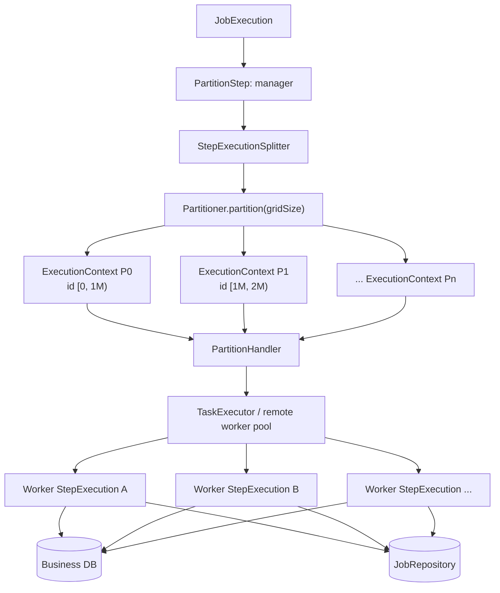
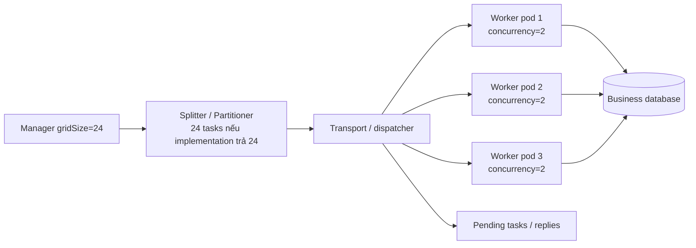

# Điều chỉnh gridSize trong Spring Batch: Chia partition đúng trước khi tăng số worker

> **Chương:** Tối ưu cấu hình  
> **Phạm vi:** Tuning `gridSize` khi mở rộng Spring Batch với local/remote partitioning, đa luồng và workload dữ liệu lớn. Ví dụ dựa trên **Spring Batch 5.2.x**, **Java 17**, JDBC `JobRepository`, PostgreSQL và `TaskExecutorPartitionHandler`.  
> **Mục tiêu:** Phân biệt `gridSize` với thread pool và chunk size; thiết kế partition không trùng/thiếu dữ liệu; chọn số partitions qua benchmark; hiểu overhead, restart, skew, thread safety, transaction và cách kiểm chứng hiệu quả trên môi trường vận hành.

## 1. Tình huống: Tăng gridSize từ 8 lên 64 nhưng job chậm hơn

Một job nhập 8 triệu bản ghi từ PostgreSQL sang kho dữ liệu, chia thành partitions theo dải khóa `event_id`. Manager dùng 8 worker threads. Người vận hành cho rằng `gridSize=64` đồng nghĩa 64 workers nên đổi cấu hình mà không tăng số threads/DB connections.

Kết quả giả định:

| gridSize cấu hình | Threads tối đa của executor | Số partitions thực | Thời gian job | Triệu chứng |
| ---: | ---: | ---: | ---: | --- |
| 4 | 8 | 4 | 1.600 giây | Chỉ khoảng 4 partition tasks có thể chạy |
| 8 | 8 | 8 | 1.000 giây | Sử dụng tốt 8 threads |
| 16 | 8 | 16 | 910 giây | Các partition nhỏ hơn giúp cân bằng tải |
| 32 | 8 | 32 | 990 giây | Overhead metadata, connection và khởi tạo tăng |
| 64 | 8 | 64 | 1.180 giây | Nhiều tasks/StepExecutions, không tăng concurrency |

Các số trên **chỉ để minh họa**, không phải benchmark đã thực hiện. Điểm đáng chú ý là **gridSize=64 vẫn chỉ có tối đa 8 worker threads trong ví dụ**; phần việc còn lại chờ trong executor/handler theo cơ chế và cấu hình thực tế.

Vì sao 16 có thể nhanh hơn 8? Nếu một số dải khóa có nhiều rows hoặc processing cost cao, phân chia thành nhiều tác vụ nhỏ hơn có thể giảm **straggler**. Vì sao 64 chậm hơn 16? Chi phí tạo StepExecution, mở reader, lập connection, ghi JobRepository, staging file, dispatch và scheduling có thể tăng vượt lợi ích cân bằng.

**Kết luận mở đầu:** `gridSize` phải được tuning cùng **cách `Partitioner` chia dữ liệu**, **concurrency thực**, **tài nguyên downstream** và **quy tắc restart**. Không tăng nó chỉ vì CPU có nhiều core.

## 2. Định nghĩa gridSize trong kiến trúc partitioning

Spring Batch partitioning sử dụng các thành phần:

- **Manager `PartitionStep`**: Điều phối một lần chia công việc.
- **`StepExecutionSplitter`**: Tạo hoặc tái sử dụng các worker `StepExecution`.
- **`Partitioner`**: Trả về map tên partition và `ExecutionContext` chứa phạm vi dữ liệu.
- **`PartitionHandler`**: Thực thi worker steps qua thread pool hoặc hạ tầng remote.
- **Worker `Step`**: Thực hiện chunk/tasklet với reader/writer và transaction của chính partition.
- **`JobRepository`**: Lưu trạng thái, execution contexts và checkpoint.



Sơ đồ khái niệm: trong triển khai thực, `PartitionHandler` nhận các `StepExecution` từ `StepExecutionSplitter` và gọi worker `Step`; không phải mỗi `ExecutionContext` được trực tiếp “gửi” từ `Partitioner` tới handler như một protocol mạng cố định.

### Chữ ký gốc

```java
public interface Partitioner {
    Map<String, ExecutionContext> partition(int gridSize);
}
```

`gridSize` là một **tham số gợi ý** về mức chia việc khi tạo partitions. `Partitioner` có trách nhiệm quyết định **số entry thực và phạm vi mỗi entry**. Một custom `Partitioner` có thể trả 50 file partitions dù `gridSize=8`.

Theo [Spring Batch 5.2 — Scaling and Parallel Processing](https://docs.spring.io/spring-batch/reference/5.2/scalability.html) và [PartitionStepBuilder Javadoc](https://docs.spring.io/spring-batch/docs/5.2.6/api/org/springframework/batch/core/step/builder/PartitionStepBuilder.html), không nên coi tham số này là giới hạn cứng trên số luồng hay số partitions trong **mọi** custom implementation.

## 3. Phân biệt bốn biến: gridSize, partitions, threads, chunkSize

| Thuộc tính | Thực chất | Cấu hình tại đâu? | Tác động |
| --- | --- | --- | --- |
| `gridSize` | Requested partition granularity / hint | `PartitionStepBuilder.gridSize(...)` hoặc `PartitionHandler.setGridSize(...)` | Ảnh hưởng partitioning/splitter tùy implementation |
| **Actual partition count `P`** | Số `StepExecution` con được tạo/khôi phục | Kết quả `Partitioner`/splitter và metadata | Số tasks, contexts, overhead |
| **Max concurrency `C`** | Số worker executions có thể xử lý đồng thời | Local `TaskExecutor` hoặc remote worker capacity, DB pools | Mức song song thực |
| **`chunkSize K`** | Số item mục tiêu mỗi chunk transaction | Worker `StepBuilder.chunk(K, txManager)` | Tần suất commit/checkpoint và latency |

Ví dụ với **100 file**, Partitioner “một file/một partition” luôn trả 100 entries:

```text
gridSize hint              = 8
actual partitions P        = 100
executor threads C         = 8
chunkSize K                = 200 items

=> Có thể có 8 partitions thực thi đồng thời,
   ~92 partitions còn chờ (tùy handler/queue).
   Mỗi partition dùng nhiều chunk transactions,
   không phải một partition = một transaction.
```

Ngược lại, nếu `Partitioner` tạo 8 dải khóa cho `gridSize=8`, có 8 worker StepExecutions; không tự suy từng partition chỉ xử lý 200 rows vì `chunkSize=200`.

### gridSize không phải throttleLimit

`throttleLimit` (đã deprecated từ Spring Batch 5.0 cho multi-threaded step) điều chỉnh một khía cạnh khác của repeat execution. `gridSize` thuộc **partitioning**, không nên dùng để thay cơ chế giới hạn executor queue, database connections hoặc remote dispatch. Việc `gridSize` ảnh hưởng số lượng requests/tác vụ trong một partition execution **không tạo backpressure toàn hệ thống một cách đầy đủ**.

## 4. Quy luật hiệu năng: Nhiều partitions có thể giúp hoặc gây hại

Dùng các ký hiệu:

- `N`: tổng khối lượng công việc (items, bytes hoặc weighted cost).
- `P`: số partitions thực.
- `C`: số worker executions chạy đồng thời.
- `K`: chunk size.
- `h`: overhead trung bình của một partition: metadata, reader init, connection, dispatch.
- `w_i`: thời gian hữu ích xử lý partition `i`.

Với workload cân bằng, một ước lượng rất thô:

\[
T_{\text{job}} \approx
T_{\text{manager}}
+\left\lceil \frac{P}{C} \right\rceil
\left(\frac{T_{\text{useful,serial}}}{P}+h\right)
+T_{\text{finalize}}.
\]

**Đây là mô hình minh họa**, không phải công thức vận hành chính xác: tasks không chia thành các “waves” đều nhau, DB contention có thể làm tốc độ từng worker thay đổi và worker chậm nhất có thể quyết định thời gian hoàn tất.

Khi `P < C`, không sử dụng hết khả năng concurrency (nếu mỗi partition chỉ thực thi ở một worker). Khi `P` cao hơn `C` một mức vừa phải, các tasks nhỏ có thể cân bằng skew tốt hơn. Nhưng `P` quá lớn gây:

- Nhiều `StepExecution`/`ExecutionContext` trong `JobRepository`.
- Nhiều lần mở file/cursor/connection, nhiều SQL khởi tạo.
- Extra tail chunks (chunk cuối ngắn), commit/metadata overhead.
- Manager/handler quản lý nhiều `Future`/messages.
- Executor queue dài, pressure lên heap/GC.
- Nhiều remote requests/replies và chi phí broker.
- Khó debug vì hàng nghìn partition names/traces.

**Không mặc định “P càng lớn càng nhanh”.** Tìm điểm cân bằng dựa trên test và constraints.

## 5. Khi nào gridSize có đúng bằng số partitions?

Tùy implementation:

| `Partitioner` | `gridSize=8` | Actual partitions có thể | Lý do |
| --- | --- | --- | --- |
| `SimplePartitioner` | 8 | 8 | Tạo đúng 8 `ExecutionContext` rỗng |
| Custom range partitioner chia đúng 8 dải | 8 | 8 | Tôn trọng hint |
| Range partitioner giới hạn theo số IDs | 8 | 3 | Nguồn chỉ có 3 IDs trong mô hình ví dụ |
| File-per-partition trên manifest 120 file | 8 | 120 | Một entry cho mỗi file, bỏ qua hint |
| Custom partitioner gom files thành 8 nhóm | 8 | 8 | Group theo byte weight |
| Restart một JobInstance | 16 ở config mới | Có thể giữ layout cũ | Splitter/JobRepository giữ partition identity/checkpoints |

`SimplePartitioner` tạo `partition0` ... `partitionN` và những contexts rỗng. Nó **không tự chia input dataset** chỉ vì tên partition đã có. Worker phải có thông tin phạm vi; nếu mọi partition cùng đọc cả bảng, gridSize tăng chỉ làm **đọc/ghi trùng dữ liệu**.

### Nhìn số thực, không suy từ property

Trong integration test hoặc observability, đếm số worker `StepExecution` thuộc manager/job tương ứng. Đối với manager đã có aggregator, **không cộng manager vào số worker leaves** khi thống kê item throughput.

## 6. Những câu hỏi cần trả lời trước khi tuning

1. Workload chủ yếu **CPU-bound, I/O-bound, DB-bound hay remote-service-bound**?
2. Đầu vào có thể chia **không giao nhau** theo ID range, file, tenant hay business key?
3. Số file/row/bytes và **độ lệch kích thước/chi phí xử lý** có lớn không?
4. Mỗi partition mất bao lâu để start, mở reader, truy vấn DB và ghi checkpoint?
5. Executor có bao nhiêu active threads và queue dài bao nhiêu?
6. DB connection pool dành bao nhiêu cho workers và JobRepository? Mỗi worker dùng **mấy kết nối đồng thời**?
7. Writer có contention trên cùng bảng/hot business key không?
8. Khi tăng gridSize, tổng rollbackCount, deadlock, retry attempts thay đổi ra sao?
9. Job cần graceful stop trước deadline? Partition/chunk tối đa mất bao lâu?
10. Khi restart, có thể giữ **cùng input snapshot và partition map** không?
11. Remote worker có giới hạn prefetch/in-flight requests và broker redelivery policy nào?
12. SLO ưu tiên **thời gian hoàn tất**, **business goodput**, **chi phí worker** hay **tác động lên DB chung**?

Nếu còn thiếu câu trả lời ở correctness/restart, tuning gridSize chỉ làm tăng xác suất lỗi nhanh hơn.

## 7. Điều chỉnh gridSize cho local partitioning

Ví dụ Spring Batch 5.2 với manager và worker Step riêng:

```java
package com.example.batch.tuning;

import org.springframework.batch.core.Step;
import org.springframework.batch.core.partition.support.Partitioner;
import org.springframework.batch.core.repository.JobRepository;
import org.springframework.batch.core.step.builder.StepBuilder;
import org.springframework.beans.factory.annotation.Qualifier;
import org.springframework.beans.factory.annotation.Value;
import org.springframework.context.annotation.Bean;
import org.springframework.context.annotation.Configuration;
import org.springframework.scheduling.concurrent.ThreadPoolTaskExecutor;

@Configuration(proxyBeanMethods = false)
public class PartitionManagerConfiguration {

    @Bean("partitionExecutor")
    ThreadPoolTaskExecutor partitionExecutor() {
        ThreadPoolTaskExecutor executor = new ThreadPoolTaskExecutor();
        executor.setCorePoolSize(8);
        executor.setMaxPoolSize(8);
        executor.setQueueCapacity(128);
        executor.setThreadNamePrefix("partition-");
        return executor;
    }

    @Bean("importManager")
    Step importManager(
            JobRepository jobRepository,
            @Qualifier("rangePartitioner") Partitioner partitioner,
            @Qualifier("importWorker") Step worker,
            @Qualifier("partitionExecutor")
                    ThreadPoolTaskExecutor executor,
            @Value("${batch.import.grid-size:16}") int gridSize) {

        if (gridSize <= 0) {
            throw new IllegalArgumentException(
                    "batch.import.grid-size must be > 0");
        }

        return new StepBuilder("importManager", jobRepository)
                .partitioner("importWorker", partitioner)
                .step(worker)
                .gridSize(gridSize)
                .taskExecutor(executor)
                .build();
    }
}
```

**Đây là cấu hình minh họa, không phải ứng dụng hoàn chỉnh.** Cần `@Bean("rangePartitioner")`, `@Bean("importWorker")`, datasource, transaction manager, reader, writer và Job. Khi đưa vào chạy thực tế, metadata input snapshot phải ổn định.

```yaml
# application.yml (ví dụ)
batch:
  import:
    grid-size: 16
```

Với Spring Framework property injection, `@Value("${batch.import.grid-size:16}")` đọc giá trị cấu hình; mặc định 16 chỉ là ví dụ, **không phải giá trị Spring Batch khuyến nghị**.

### Vì sao maxPoolSize=8 không tạo 16 threads?

`gridSize=16` có thể tạo 16 partitions, nhưng `ThreadPoolTaskExecutor` ở trên có **8 core/max threads**. Tại một thời điểm chỉ tối đa 8 executor threads xử lý tasks; những partitions còn lại chờ được nhận qua queue/handler.

Khi `queueCapacity` đủ lớn, `ThreadPoolTaskExecutor` cũng có thể ưu tiên queue trước khi tăng beyond core. Đặt core và max đều 8 để ví dụ có mức concurrency rõ; production phải tuning pool/queue/rejection policy theo nguồn lực.

### Nếu dùng PartitionHandler tường minh

```java
TaskExecutorPartitionHandler handler =
        new TaskExecutorPartitionHandler();
handler.setStep(importWorker);
handler.setTaskExecutor(partitionExecutor);
handler.setGridSize(16);
```

Khi builder dùng `.partitionHandler(handler)`, **không giả định `.gridSize(...)`/`.taskExecutor(...)` ở builder tự override một handler do bạn cung cấp**. Kiểm soát cấu hình trực tiếp ở handler/splitter và kiểm tra Javadoc của phiên bản đang dùng.

## 8. Partitioner theo dải khóa: Không được chồng hoặc bỏ sót IDs

Với bảng `source_event` dùng ID số, một cách phân chia rõ ràng là **half-open intervals**:

```text
P0: [1, 1001)      → IDs 1..1000
P1: [1001, 2001)   → IDs 1001..2000
P2: [2001, 3001)   → IDs 2001..3000
```

Truy vấn worker:

```sql
SELECT event_id, payload
FROM source_event
WHERE event_id >= :start_inclusive
  AND event_id < :end_exclusive
ORDER BY event_id;
```

Không dùng hai dải đều inclusive ở biên 1000, ví dụ `[1,1000]` và `[1000,2000]`: ID=1000 bị cả hai xử lý.

### Thuật toán chia đều chiều dài range

Chỉ dùng khi input là **một snapshot với khoảng ID biết trước**; việc chia khoảng ID đều nhau **không đồng nghĩa chia đều số records hoặc chi phí**.

```java
package com.example.batch.tuning;

import java.util.LinkedHashMap;
import java.util.Map;

import org.springframework.batch.core.partition.support.Partitioner;
import org.springframework.batch.item.ExecutionContext;

public final class IdRangePartitioner implements Partitioner {

    private final long minInclusive;
    private final long maxExclusive;

    public IdRangePartitioner(long minInclusive, long maxExclusive) {
        if (maxExclusive <= minInclusive) {
            throw new IllegalArgumentException(
                    "Non-empty ID span required for this example");
        }
        this.minInclusive = minInclusive;
        this.maxExclusive = maxExclusive;
    }

    @Override
    public Map<String, ExecutionContext> partition(int gridSize) {
        if (gridSize <= 0) {
            throw new IllegalArgumentException("gridSize must be > 0");
        }

        // Fail fast nếu khoảng quá lớn gây overflow.
        long width = Math.subtractExact(
                maxExclusive, minInclusive);
        int count = (int) Math.min((long) gridSize, width);
        long base = width / count;
        long extra = width % count;

        Map<String, ExecutionContext> map =
                new LinkedHashMap<>();
        long start = minInclusive;

        for (int index = 0; index < count; index++) {
            long span = base + (index < extra ? 1 : 0);
            long end = Math.addExact(start, span);

            ExecutionContext context = new ExecutionContext();
            context.putLong("startInclusive", start);
            context.putLong("endExclusive", end);

            map.put("range-" + String.format(
                    java.util.Locale.ROOT, "%05d", index),
                    context);
            start = end;
        }

        if (start != maxExclusive) {
            throw new IllegalStateException("Range coverage mismatch");
        }
        return map;
    }
}
```

Công thức chia: với `W = maxExclusive - minInclusive`, `P = min(gridSize, W)`, mỗi partition lấy `⌊W/P⌋` ID slots và `W mod P` partitions đầu nhận thêm một slot.

**Điều kiện/giới hạn:**

- `W` phải > 0 và fit trong `long`; có kiểm tra overflow bằng `Math.subtractExact`.
- `gridSize` phải > 0; với range chỉ dài 3 IDs, `gridSize=8` cho **3 partitions**, không sinh 5 partitions rỗng.
- Input rỗng cần **một nhánh no-op/job policy riêng**; không đổi silently thành “không có gì được xử lý” nếu dữ liệu đáng lẽ phải tồn tại.
- `Math.addExact` phát hiện overflow ở phép cộng ranh giới.
- Khoảng ID chứa nhiều **gaps** có thể cho partition không có rows; hiệu năng sẽ lệch.
- Tên `range-00000` là ổn định **chỉ nếu min/max/gridSize và dataset snapshot giữ nguyên**. Khi restart JobInstance, thay gridSize có thể làm `range-00001` ứng với dải dữ liệu **khác** — không an toàn.
- Nếu dữ liệu được thêm/bớt sau khi freeze snapshot, query theo range vẫn có thể đọc tập dữ liệu khác. Cần immutable snapshot, watermark hoặc version filter, không chỉ range boundaries.

## 9. Step-scoped reader lấy ranh giới từ ExecutionContext

Worker Step đọc đúng dải khóa được phân công, không tự query cả bảng:

```java
package com.example.batch.tuning;

import javax.sql.DataSource;
import org.springframework.batch.core.configuration.annotation.StepScope;
import org.springframework.batch.item.database.JdbcCursorItemReader;
import org.springframework.beans.factory.annotation.Value;
import org.springframework.context.annotation.Bean;
import org.springframework.context.annotation.Configuration;

@Configuration(proxyBeanMethods = false)
public class RangeReaderConfiguration {

    public record SourceEvent(long id, String payload) {}

    @Bean("rangeReader")
    @StepScope
    JdbcCursorItemReader<SourceEvent> rangeReader(
            DataSource dataSource,
            @Value("#{stepExecutionContext['startInclusive']}")
                    Long start,
            @Value("#{stepExecutionContext['endExclusive']}")
                    Long end) {

        JdbcCursorItemReader<SourceEvent> reader =
                new JdbcCursorItemReader<>();
        reader.setName("rangeReader");
        reader.setDataSource(dataSource);
        reader.setSql("""
            SELECT event_id, payload
            FROM source_event
            WHERE event_id >= ? AND event_id < ?
            ORDER BY event_id
            """);
        reader.setPreparedStatementSetter(ps -> {
            ps.setLong(1, start);
            ps.setLong(2, end);
        });
        reader.setRowMapper((rs, rowNum) ->
                new SourceEvent(
                    rs.getLong("event_id"),
                    rs.getString("payload")));
        return reader;
    }
}
```

Reader ở đây là `ItemStream`, có checkpoint theo `StepExecution`. Với local partitioning, mỗi worker `StepExecution` có step-scoped reader riêng. Nhưng:

- `@StepScope` **không** tạo một instance per thread trong một **multi-threaded chunk step không partitioning**.
- `JdbcCursorItemReader`/cursor cần cấu hình driver/fetch size/connection phù hợp workload lớn, không giữ cả triệu records trong memory.
- `ORDER BY event_id` giúp có read order ổn định trong snapshot; nếu bảng có duplicate IDs, phải xác định composite ordering/key.
- Vì `start`/`end` là `Long` do SpEL binding, test phải kiểm tra chúng không null và hợp lệ trước khi reader mở.
- Snapshot cần version/watermark được cố định ở JobParameters/manifest để restart không đọc records mới được thêm sau đó.
- Không assume reader/transaction của Step có cùng physical JDBC connection trong mọi setup. Thiết kế isolation/restart và datasource theo implementation thực tế.

## 10. Worker chunk size và gridSize tác động ở hai lớp khác nhau

Skeleton worker Spring Batch 5.2:

```java
@Bean("importWorker")
Step importWorker(
        JobRepository repository,
        PlatformTransactionManager transactionManager,
        @Qualifier("rangeReader")
                JdbcCursorItemReader<RangeReaderConfiguration.SourceEvent> reader,
        @Qualifier("eventWriter")
                ItemWriter<RangeReaderConfiguration.SourceEvent> writer) {

    return new StepBuilder("importWorker", repository)
            .<RangeReaderConfiguration.SourceEvent,
              RangeReaderConfiguration.SourceEvent>
                    chunk(200, transactionManager)
            .reader(reader)
            .writer(writer)
            .build();
}
```

`ItemWriter` phải được ứng dụng cung cấp, thread-safe theo scope cần thiết và bảo đảm replay/idempotency. `JobRepository`/transaction manager cần khai báo trong cấu hình Batch.

Giả sử có 80.000 items, chia 8 partitions đều nhau, `chunkSize=200`:

```text
P=8 partitions
~10.000 items/partition
~50 data chunks/partition
~400 data chunks cho toàn công việc
```

Nếu tăng `gridSize` lên 16, vẫn 80.000 items:

```text
P=16 partitions
~5.000 items/partition
~25 data chunks/partition
~400 data chunks cho toàn công việc
```

Số liệu chỉ là **ước lượng số chunks chứa item**: commitCount thực của Spring Batch có thể thêm empty/final iterations, retries, recovery writes và tasklet transactions. Tăng partitions cũng tạo thêm **partial final chunks** nếu số item không chia hết, nên số transaction có thể tăng.

**Không kết luận `commitCount = ceil(writeCount/chunkSize)`** hay `gridSize=16` làm số commit tăng đúng gấp đôi. `gridSize` thay **quy mô mỗi StepExecution**; `chunkSize` thay **mức gom item trong transaction**.


## 11. Tuning gridSize theo file: Một file hay nhiều file mỗi partition?

Với file workload, `gridSize` cần được xét cùng **manifest bất biến** và kích thước/tính chất của file, không chỉ số lượng file.

### Một file trên một partition

Một custom Partitioner có thể tạo một entry cho mỗi file từ manifest:

```java
package com.example.batch.tuning;

import java.util.Comparator;
import java.util.HashSet;
import java.util.LinkedHashMap;
import java.util.List;
import java.util.Map;
import java.util.Set;

import org.springframework.batch.core.partition.support.Partitioner;
import org.springframework.batch.item.ExecutionContext;

public final class OneFilePerPartitioner implements Partitioner {

    public record FileInfo(long fileId, String uri, String version) {}

    private final List<FileInfo> publishedFiles;

    public OneFilePerPartitioner(List<FileInfo> publishedFiles) {
        this.publishedFiles = List.copyOf(publishedFiles);
    }

    @Override
    public Map<String, ExecutionContext> partition(int gridSize) {
        Map<String, ExecutionContext> partitions =
                new LinkedHashMap<>();
        Set<Long> seen = new HashSet<>();

        for (FileInfo file : publishedFiles.stream()
                .sorted(Comparator.comparingLong(FileInfo::fileId))
                .toList()) {

            if (!seen.add(file.fileId())) {
                throw new IllegalStateException(
                        "Duplicate file ID: " + file.fileId());
            }

            ExecutionContext context = new ExecutionContext();
            context.putLong("fileId", file.fileId());
            context.putString("uri", file.uri());
            context.putString("version", file.version());

            partitions.put("file-" + file.fileId(), context);
        }

        // Số partitions = số files, có thể KHÁC gridSize.
        return partitions;
    }
}
```

Ở đây `gridSize` **được cố ý bỏ qua**. Với 12.000 files, builder vẫn có thể tạo 12.000 worker `StepExecution` mặc dù `gridSize=8`, gây overhead lớn. Đoạn code minh họa data partition correctness, **không phải lời khuyên dùng per-file StepExecution cho hàng triệu files**.

**Một file/version phải gắn với một manifest identity duy nhất.** Nếu nhiều JobInstances hoặc remote workers có thể nhận cùng file, cần atomic claim/idempotent writer, bởi `Partitioner` không phải distributed lock.

### N file trong một partition theo manifest

Nếu có 200.000 files nhỏ:

- Có thể tạo **P nhóm ổn định**, mỗi nhóm gồm nhiều file IDs.
- `ExecutionContext` chỉ chứa `manifestGroupId`; một bảng immutable manifest lưu thứ tự file/version của nhóm.
- Reader sử dụng snapshot đã publish, checkpoint cả group/file index và line offset nếu cần.
- Worker claim file trước khi xử lý, không để hai groups cùng cấp một `fileId`.
- Phải giữ mapping `groupId → file IDs` và group names ổn định khi restart.

**Không nhét hàng chục nghìn path/URI vào `ExecutionContext`** vì context được persist trong JobRepository, làm tăng kích thước metadata và chi phí serialization.

### Chọn nhóm theo tổng bytes/estimated cost

Nếu file sizes lệch mạnh, nhóm theo **số lượng file** có thể tạo straggler. Có thể tính estimated work weight:

\[
w_f \approx \alpha \cdot \text{bytes}(f)
+\beta \cdot \text{records}(f)
+\gamma \cdot \text{remoteCalls}(f).
\]

Các hệ số được lấy từ benchmark và pipeline semantics, không suy theo công thức vật lý cố định.

Một chiến lược “largest processing time first” minh họa:

1. Sort files giảm dần theo estimated weight, tie-break theo stable file ID.
2. Tạo `P` groups, ban đầu weight=0.
3. Gán file tiếp theo vào group có total weight nhỏ nhất, tie-break theo group ID.
4. Persist group mapping cùng manifest ID.
5. Test không file ID nào xuất hiện ở hai groups, tổng groups phủ đúng toàn input.

Vì groups có thể thay đổi khi `P` thay đổi, **không rebuild mapping cũ của một JobInstance đang restart**.

## 12. Data skew: Khi partitions đều dải ID nhưng không đều tải

Giả sử ID space có 10 triệu slots, chia 8 dải đều. Nhưng 80% records thực tế nằm trong 10% dải ID cuối vì nguồn dùng ID tăng dần và dữ liệu được lọc theo ngày.

```text
range-0  [0, 1.25M)    100K records
range-1  [1.25, 2.5M)  120K records
range-2  [2.5, 3.75M)  130K records
...
range-7  [8.75, 10M)   4.5M records  ← straggler
```

Tăng `gridSize` từ 8 lên 16 có thể giúp tách một số dải lớn, nhưng nếu phân bố dữ liệu/processing cost cực lệch, vẫn có thể còn worker chậm nhất quyết định tổng thời gian.

Các cách giảm skew:

| Chiến lược | Lợi ích | Điều kiện/rủi ro |
| --- | --- | --- |
| Equal ID width | Dễ tính, hỗ trợ index range | Không cân bằng số rows khi sparse/skew |
| Equal row count boundaries | Ít lệch số records | Cần snapshot/count/quantile, query planning |
| Equal estimated cost | Cân bằng CPU/IO tốt hơn nếu weight đúng | Ước lượng cost có thể sai |
| Hash partition by key | Có thể phân tán IDs/tenant | SQL index/query, per-key ordering, restart map |
| Immutable file group balancing | Hữu ích với file sizes lệch | Persist mapping, stable group IDs |
| Dynamic queue / work claiming | Workers kéo work khi rảnh | Ownership, leases, fencing, metadata queue |
| Split one giant file into ranges | Tránh một file chi phối | Record boundaries, checksum, offset restart |

### GridSize không sửa được partitioner sai

Nếu custom Partitioner luôn trả 4 partitions cố định, chỉnh builder `gridSize(64)` **không làm sinh 64 dải mới**. Tương tự, nếu dải dữ liệu trùng nhau, tăng số partition còn làm lỗi ghi trùng xảy ra nhanh hơn.

**Đầu tiên** phải kiểm chứng `Partitioner` nhận `gridSize` và dùng nó ra sao, sau đó đo actual partitions và phân bố work.

### Đo straggler đúng

Các chỉ số:

\[
\mathrm{skewRatio} =
\frac{\max(\mathrm{partitionDuration})}
{\operatorname{median}(\mathrm{partitionDuration})}
\]

và

\[
\mathrm{workSkew} =
\frac{\max(\mathrm{estimatedWorkPerPartition})}
{\operatorname{median}(\mathrm{estimatedWorkPerPartition})}.
\]

Chỉ có ý nghĩa khi ít nhất một partition thực hiện công việc và median > 0; không tính một duration NULL hoặc 0 của step chưa chạy thành completed partition. Chỉ số thứ hai giúp phân biệt **phân công lệch tải** và **một partition chậm bất thường vì DB locks**.

## 13. Tính ngân sách concurrency từ thread pool và datasource

`gridSize` nên được điều chỉnh sau khi xác định số worker executions **thực tế có thể chạy cùng lúc**.

Giả sử:

```text
Node CPU                16 vCPU
Partition executor      max 12 threads
Business DB pool        max 24 connections
Connections reserved    8 cho endpoints khác/JobRepository
Estimated connections   2 mỗi worker (cursor + write TX)

Capacity theo DB        floor((24 - 8) / 2) = 8 workers
=> C thực tế an toàn có thể <= 8,
   dù executor configured 12.
```

Đây là **budget minh họa**, không phải quy tắc mặc định mỗi worker luôn dùng hai connections. Một `JdbcCursorItemReader` có thể dùng connection riêng với transaction theo cấu hình/driver; writer, metadata repository hoặc nested transactions có thể làm thay đổi số connections.

Một kiểm tra gần đúng:

\[
C \cdot k_{\mathrm{conn/worker}}
+ C_{\mathrm{reserved}}
\le C_{\mathrm{pool}}
\]

Dùng số liệu thực để chọn `k`, tính cả **peak concurrency** và sharing nhiều jobs.

### Nếu DB pool bị cạn

Tăng `gridSize`:

- không làm DB cung cấp thêm connections;
- có thể tạo thêm tasks đang chờ, giữ memory và timeouts;
- khiến retries/deadlocks/latency tăng nếu DB vốn đang gần saturation;
- giảm throughput dù số StepExecutions thực tế lớn hơn.

Đo `HikariCP active/idle/pending`, connection acquisition latency, DB active sessions, lock wait, transaction duration, query p95 và business goodput.

### Đừng “match gridSize với số cores” một cách máy móc

- **CPU-bound:** concurrency gần số cores hữu hiệu có thể hợp lý; gridSize đôi khi chọn cao hơn để cân bằng skew.
- **I/O-bound:** có thể hữu ích khi nhiều partitions chờ I/O, nhưng vẫn bị giới hạn bởi DB pool, network và downstream quotas.
- **Hot row/serialized DB work:** thêm workers thường tăng contention.
- **Remote API rate-limited:** gridSize cao không vượt được contract rate limit; cần throttle, backpressure và retry policy đúng.

## 14. Executor queue và task rejection khi partitions quá nhiều

`TaskExecutorPartitionHandler` giao worker steps cho một `TaskExecutor`. Nếu custom Partitioner tạo 500 partitions nhưng pool chỉ có 8 threads và queue bounded 128, có thể xảy ra **`TaskRejectedException`** khi handler cố submit quá nhiều tasks trong lúc queue đầy, tùy implementation.

```text
P partitions               = 500
active executor threads    = 8
available task queue slots = 128
handler submits many tasks
→ Có thể vượt bounded capacity → rejection/failure
```

Không suy rằng “P=500, C=8” **chắc chắn có thể chạy qua 63 waves**: phải xem handler submit model, executor rejection policy và điều kiện chờ tasks của implementation thực.

Biện pháp:

- Giữ số partitions phù hợp overhead/capacity.
- Group nhiều files nhỏ vào một partition có lifecycle rõ.
- Nếu cần queue động nhiều triệu files, dùng durable work claiming với bounded workers thay vì tạo một `StepExecution` cho mỗi file.
- Với remote handler, có dispatch/in-flight limit, backpressure và ACK/reply monitoring.
- Không dùng `CallerRunsPolicy` chỉ để “tránh exception” mà chưa xem tác động: nó có thể làm manager thread chạy worker tasks, thay đổi performance và deadline.

### TaskExecutor queue không thay database queue

Một worker có thể chiếm thread nhưng chờ DB connection/lock rất lâu. Dù executor queue ngắn, business throughput vẫn giảm. Theo dõi **hai hàng đợi**: tasks chưa chạy và workers đang chạy nhưng chờ downstream.

## 15. Restart: Điều chỉnh gridSize giữa các lần chạy có thể làm checkpoint sai

Giả sử input snapshot cố định có IDs `[0, 1000)`.

Lượt chạy đầu:

```text
gridSize=4

range-00000: [0, 250)
range-00001: [250, 500)  ← đã xử lý tới ID=420
range-00002: [500, 750)
range-00003: [750, 1000)
```

Sau crash, người vận hành đổi `gridSize=8`:

```text
gridSize=8

range-00000: [0, 125)
range-00001: [125, 250)  ← tên cũ, dữ liệu mới!
...
```

Nếu không có cơ chế đảm bảo giữ partition metadata cũ, `range-00001` có thể gắn với một `ExecutionContext`/checkpoint của **dải [250, 500)** rồi được ứng dụng hiểu như **[125, 250)**. Nguy cơ bỏ sót hoặc ghi trùng.

Spring Batch có `StepExecutionSplitter` và `JobRepository` để **khôi phục executions cần restart**; Javadoc `AbstractPartitionHandler.setGridSize` lưu ý splitter có thể **bỏ qua grid size khi restart** để giữ input partitions. Vì vậy:

1. **Không hứa** thay gridSize sau crash sẽ được áp dụng để repartition phần việc còn lại.
2. **Không cố tạo lại map khác** cho cùng JobInstance mà không có kế hoạch di trú checkpoint.
3. Lưu manifest ID, min/max, gridSize, partition names/mapping trong metadata/audit được version hóa.
4. Khi restart, xác minh các worker `ExecutionContext` đang dùng đúng **range/file version ban đầu**.
5. Chỉ thay chiến lược partitioning trên **JobInstance mới hoặc workflow có migration/reconciliation rõ**, không sửa thô `BATCH_STEP_EXECUTION_CONTEXT`.
6. Với writer idempotent, replay có thể an toàn nhưng **không làm sai mapping trở thành đúng**: có thể bỏ mất những source events chưa hề được đọc.

### GridSize cho lần chạy mới khác restart

Nếu business date hôm sau có input snapshot mới và tạo JobInstance mới, có thể thí nghiệm `gridSize=16` thay vì 8. Nhưng khi restart một kỳ đang dở, ưu tiên **đúng checkpoint và identity** hơn một cải thiện runtime chưa kiểm chứng.

### PartitionNameProvider khi recovery

`PartitionNameProvider` giúp trả tên partition khi restart mà không cần tạo lại toàn bộ map ở một số cấu hình. Những names được cung cấp phải nhất quán với Partitioner đã dùng ban đầu. Không dùng provider trả names mới lấy từ directory đang thay đổi; phải dựa trên manifest bất biến.

## 16. Remote partitioning: gridSize, worker replicas và dispatch capacity

Remote partitioning vẫn có manager/splitter/`Partitioner`, nhưng handler phân phát `StepExecution` tới JVM/pods khác thông qua middleware/integration.



Có 3 pods × 2 concurrent executions = **6 slots thực thi**, không phải 24. `gridSize=24` mô tả mức chia việc, còn khả năng xử lý đồng thời cần theo **worker capacity** và transport/backpressure.

Khi tăng gridSize trong remote partitioning:

- Số message dispatch, reply/metadata updates có thể tăng.
- Partition nhỏ hơn có thể cân bằng skew và giảm straggler.
- Worker có thể phải khởi tạo Step/reader nhiều lần hơn.
- Manager chịu chi phí correlation/aggregation và quản lý các partitions.
- Nếu worker pods có queue prefetch lớn, một worker có thể giữ nhiều tasks trong khi pod khác idle, tùy broker policy.
- Lỗi mất ACK/reply có thể tạo duplicate dispatch/recovery; cần idempotent writer và ownership.
- `gridSize` cao không thay đổi giới hạn rate của business DB.

**Đừng thay `gridSize` thành “số replica Kubernetes mong muốn”**. Replica count, worker threads, middleware prefetch và số partitions là các núm điều chỉnh khác nhau.

### Remote chunking không có ý nghĩa gridSize giống partitioning

Trong remote chunking, manager gửi các **chunks** qua middleware và workers xử lý các chunk requests. Nó không dùng `Partitioner.partition(gridSize)` như API chính để tạo worker StepExecutions. Đừng lấy một `gridSize` của remote partition manager rồi áp như parameter chung của remote chunking; đối với remote chunking nên tuning chunk size, manager reader, transport prefetch, worker consumers, timeouts và reply handling.

## 17. Parallel steps và multi-threaded step khác partitioning

| Kỹ thuật mở rộng | Biến điều khiển chính | Vai trò gridSize |
| --- | --- | --- |
| Multi-threaded chunk step | `TaskExecutor`, chunk size, reader/writer thread safety | **Không có** `Partitioner.partition(gridSize)` |
| Parallel flows/steps | Số flow/step độc lập, split `TaskExecutor` | **Không dùng** trừ khi bên trong flow có PartitionStep |
| Local partitioning | Partitioner, gridSize, TaskExecutor và chunk worker | **Có** — hint số partitions |
| Remote partitioning | Partitioner, gridSize, PartitionHandler, remote capacity | **Có** — hint phân chia tasks |
| Remote chunking | Chunk size, broker concurrency, worker listener capacity | **Không dùng theo SPI partitioning** |
| Dynamic file queue custom | Queue/claim concurrency, lease/fencing | Có thể không dùng gridSize |

Có thể kết hợp partitioning với multi-threaded worker chunk step, nhưng khi đó **hai cấp concurrency cùng tồn tại**:

\[
C_{\mathrm{potential}} \approx
C_{\mathrm{partitions}} \times
C_{\mathrm{chunkThreadsPerPartition}}.
\]

Đây chỉ là **upper bound ý tưởng**, không phải số threads thật: thread pools có thể được chia sẻ, scheduler có throttling, DB pool là bottleneck. Khi ghép hai tầng song song, nguy cơ oversubscription, reader state race và metadata contention tăng đáng kể.

Ví dụ 8 partitions × 4 chunk threads/partition có thể tạo tới 32 chunk units cùng hoạt động **nếu** có đủ executor/DB capacity. Không cấu hình như thế chỉ vì một phép nhân cho kết quả cao.

## 18. Transaction, retry và commitCount khi thay gridSize

Một partition có `StepExecution` và `ExecutionContext` riêng, nên:

- Đọc/ghi các chunks trong transaction của worker step.
- Thất bại một partition không tự rollback những partitions khác đã commit.
- Restart có thể chỉ re-execute những partitions chưa hoàn tất theo metadata.
- Chunk rollback/retry/skip làm workload thực lớn hơn raw input count.
- Nếu writer không idempotent, replay có thể tạo double effect dù partition map không overlap.

### Metrics không được đếm đôi manager và worker

`DefaultStepExecutionAggregator` có thể tổng hợp worker counts như `readCount`, `writeCount`, `commitCount` và `rollbackCount` vào manager `StepExecution` bằng phép cộng.

```text
importManager             writeCount=8.000.000  (aggregate)
importWorker:range-00000  writeCount=1.000.000
...
importWorker:range-00007  writeCount=1.000.000

SUM tất cả 9 rows = 16.000.000  ← đếm đôi.
```

Khi tính throughput/rate cho một lần thử gridSize:

- Dùng **manager aggregate sau khi hoàn tất** nếu semantics được kiểm chứng;
- hoặc cộng **chỉ worker leaf StepExecutions**;
- nhưng không cộng cả hai.
- Nếu writer `ON CONFLICT DO NOTHING`, `writeCount` không nhất thiết bằng **số business rows mới**; đo unique applied events riêng.

### Transaction pressure có thể tăng dù input giống nhau

Khi tăng `P`, mỗi partition có thể có final/partial chunk, riêng reader/StepExecution metadata, riêng connection lifecycle. Nếu partitions quá nhỏ, overhead transaction/commit/retry/restart tăng.

Ngược lại, chia workload theo non-overlapping **business keys** có thể giảm deadlock so với ít partitions chứa nhiều hot keys. Do đó cần phân tích **loại contention**, không chỉ nhìn rollback count tổng.

## 19. Checkpoint và graceful stop: Partitions quá lớn hay quá nhỏ đều có giá

Hệ thống phải dừng trước bảo trì 06:00. Với mỗi partition:

- **Quá lớn:** Một worker có thể kéo dài, nhưng nếu chunk nhỏ và reader checkpoint đúng thì vẫn dừng giữa các chunks; tuy nhiên phải xử lý một giant file/range có backlog lớn vào kỳ tiếp theo.
- **Quá nhỏ:** Có nhiều tasks/contexts, dẫn tới nhiều khởi tạo và metadata updates; khi stop có thể còn nhiều queued/remote tasks chưa bắt đầu.
- **Chunk quá lớn:** Thời gian đến điểm dừng an toàn có thể dài dù gridSize cao.
- **External I/O timeout không bounded:** Partition ngắn về số item vẫn có thể treo lâu.

**Phân biệt:** `gridSize` quyết định mức chia việc; **stop latency** còn phụ thuộc chunk duration, timeout, transaction/DB lock, remote replies và cancellation policy. Không kỳ vọng tăng `gridSize` tự làm `JobOperator.stop(...)` tức thì.

### Kịch bản cần test

```text
window 01:00–06:00
softStopAt 05:54
hardDeadline 06:00

gridSize=8, 16, 32
worker concurrency=8, chunkSize=200

Test:
  1) gửi stop khi tất cả workers đang có in-flight chunks;
  2) xác minh StepExecution/JobExecution đạt STOPPED;
  3) kiểm tra checkpoint và output không thiếu/trùng;
  4) restart cùng manifest và partition mapping;
  5) đo stop latency vs gridSize/queue depth.
```

Đừng đổi gridSize giữa các bước restart của cùng test JobInstance nếu đang kiểm thử chính sách recovery ổn định.


## 20. Quy trình benchmark gridSize có kiểm soát

Mục tiêu tuning không phải tìm một giá trị “nhanh nhất một lần”, mà tìm cấu hình **đạt correctness, deadline và resource budgets một cách lặp lại**.

### Bước 1 — Chốt workload và baseline

Lưu một manifest/snapshot bất biến:

```text
jobName          = importEvents
snapshotId       = events-2026-11-25-v1
inputRecords     = 8.000.000
inputBytes       = 18 GiB
schemaVersion    = v12
invalidRecords   = 0 theo fixture
workerStrategy   = local-partitioning
readerOrdering   = event_id ASC within partition
targetSemantics  = idempotent UPSERT/event ledger
```

Benchmark phải có correct output và dữ liệu nguồn cố định. Nếu mỗi lần test lại ghi output vào bảng cũ rồi `ON CONFLICT DO NOTHING`, lượt chạy sau có thể nhanh/chậm rất khác vì **không thực sự ghi mới**. Hãy reset output test theo snapshot hoặc dùng isolated target namespace.

### Bước 2 — Cố định những biến khác

Khi chỉ tuning gridSize:

- Cố định `chunkSize`, worker `TaskExecutor` và queue policy.
- Cố định JDBC fetch size/batch size, schema/index/query plan.
- Cố định JobParameters mang business snapshot, nhưng tạo **run namespace hợp lệ cho mỗi fresh benchmark** trên môi trường test.
- Cố định DB class, connection pools, isolation level và phần workload online nền nếu có.
- Cố định worker pod/CPU/memory, Java/GC và versions của Spring Batch/JDBC driver.
- Đảm bảo không chạy đồng thời benchmark khác làm nhiễu DB.

**Chỉ thay một biến chính mỗi thí nghiệm** để tránh giải thích sai nguyên nhân. Sau khi chọn gridSize, có thể mở vòng tối ưu khác cho pool/chunk size nhưng cần đánh giá tương tác giữa các knobs.

### Bước 3 — Chọn candidate values dựa trên C thực

Với `C=8` worker executions, một tập thử ban đầu có thể:

```text
P candidates (requested gridSize):
    4, 8, 16, 24, 32, 64

Không phải khuyến nghị chung.
Đo actualPartitionCount cho mỗi candidate.
```

Quy tắc gợi ý thường hữu ích cho data skew là thử `P≈C`, `P≈2C` và `P≈4C`, **không coi 2–4× là giá trị tối ưu đã chứng minh**. Nếu custom Partitioner bỏ qua gridSize, toàn bộ vòng thay property mà `P` không đổi sẽ **không có ý nghĩa**.

### Bước 4 — Lặp cùng phương pháp

- Chạy warm-up theo protocol để giảm cold-start anomaly.
- Lặp mỗi candidate 3–5 lần tối thiểu ở vòng khám phá; khi quyết định production nên tăng số lần và ước lượng độ biến động.
- Luân phiên/randomize thứ tự candidates để tránh DB cache và nền tải tăng dần theo thời gian.
- Đừng trộn **fresh runs** với **restarted runs** vào cùng biểu đồ.
- Thu thập cả những runs FAILED/STOPPED vào reliability report, nhưng đánh dấu không hợp lệ cho baseline “completed workload” nếu chưa có protocol riêng.
- Không âm thầm loại các lần chạy chậm ngoài ý muốn mà không có lý do thực nghiệm.

### Bước 5 — So sánh nhiều chiều

Mỗi candidate nên lưu:

| Nhóm | Chỉ số |
| --- | --- |
| Correctness | Eligible IDs, duplicate effects, payload conflicts, reconciliation mismatch |
| Performance | End-to-end elapsed, business goodput, p95/p99 chunk latency |
| Partitioning | Requested gridSize, actual partitions, max/median partition duration, skew ratio |
| Concurrency | Active threads, pending executor queue, remote in-flight messages |
| DB | Active/pending connections, lock waits/deadlocks, DB CPU/IO, query latency |
| Batch | read/write/skip/commit/rollback counts, failed partitions, restart attempts |
| Runtime | JVM CPU, GC pause, heap, network bytes, object/file throughput |
| Control | Stop latency, deadline misses, JobRepository write/lock contention |
| Cost | Worker-seconds, DB consumption, events/s/core hoặc money/million events |

### Bước 6 — Quyết định theo guardrails

Chọn cấu hình đáp ứng:

1. **Không mất, trùng hoặc làm sai dữ liệu**.
2. Không vượt DB, memory, file handle hoặc broker constraints.
3. Đạt business deadline/SLO trong các run đại diện.
4. Có restart/stop behavior được test.
5. Có performance tăng có ý nghĩa so với baseline, và overhead chấp nhận được.

Nếu `gridSize=16` và 32 có throughput gần tương đương nhưng 32 dùng gấp đôi StepExecutions, ưu tiên **phương án đơn giản hơn** trừ khi 32 giảm rõ tail latency/skew/stop latency.

## 21. Bảng kết quả và cách đọc đúng

Giả sử trên một workload giống nhau, mỗi cấu hình đã được thử nhiều lần và bảng này hiển thị **median của các run hợp lệ**:

| Requested gridSize | Actual P | Workers C | Median job elapsed | Business goodput | Max/median partition duration | DB lock wait |
| ---: | ---: | ---: | ---: | ---: | ---: | --- |
| 4 | 4 | 8 | 1.600 s | 5.000 events/s | 1,3× | Thấp |
| 8 | 8 | 8 | 1.000 s | 8.000 events/s | 1,5× | Vừa |
| 16 | 16 | 8 | 910 s | 8.791 events/s | 1,15× | Vừa |
| 32 | 32 | 8 | 990 s | 8.081 events/s | 1,1× | Cao |
| 64 | 64 | 8 | 1.180 s | 6.780 events/s | 1,05× | Cao |

Các con số `goodput` được minh họa theo 8.000.000 business events / elapsed và làm tròn. Đây **không phải benchmark thực**. Nếu writer no-op, số events mới áp dụng có thể khác inputRecords, khi đó bảng phải tính từ actual business effects.

Nhận xét:

- `P=4`: Chỉ có bốn partitions để xử lý, tám executor slots không thể tự nhân đôi một partition thành hai StepExecutions.
- `P=8`: Dùng đủ slots, giảm elapsed rõ.
- `P=16`: Có nhiều tasks hơn slots, tốt hơn khi dải xử lý lệch tải.
- `P=32`: Skew ratio giảm nhưng overhead/DB contention tăng, tổng elapsed xấu hơn.
- `P=64`: Work granularity quá nhỏ có thể tạo chi phí điều phối cao hơn lợi ích cân bằng.

**Không kết luận “P=16 luôn tối ưu”.** Nếu input hôm sau tăng 10×, file distribution đổi hoặc DB được nâng cấp, điểm tối ưu có thể khác.

### Speedup so với cấu hình tham chiếu

Nếu chọn `P=8` làm baseline với `T_8=1000s`:

\[
\mathrm{speedup}_{16\text{ vs }8} =
\frac{1000}{910}\approx1.10.
\]

Đây là **speedup khoảng 1,10 lần** (thời gian giảm 9% từ 1.000 xuống 910 giây), không phải throughput tăng gấp 2 vì partitions tăng gấp 2. Có thể so business goodput tương ứng, nhưng phải giữ denominator/numerator semantics nhất quán.

### Đọc theo tail chứ không chỉ median

Một gridSize có median tốt nhưng p95 job duration tệ vì file skew hoặc DB deadlock có thể không đáp ứng cửa sổ vận hành. Với vài lần benchmark, p95 của các runs rất nhiễu; cần nhiều samples hơn hoặc đo kết hợp max partition, p99 chunk và locking evidence.

## 22. Xác minh actual partitions và thời gian bằng JobRepository

Khi dùng JDBC JobRepository với tên bảng mặc định, `BATCH_STEP_EXECUTION` lưu mỗi worker `StepExecution`, counts, status và timestamps.

Truy vấn **read-only** PostgreSQL:

```sql
SELECT
    STEP_EXECUTION_ID,
    JOB_EXECUTION_ID,
    STEP_NAME,
    STATUS,
    READ_COUNT,
    WRITE_COUNT,
    COMMIT_COUNT,
    ROLLBACK_COUNT,
    START_TIME,
    END_TIME,
    EXTRACT(EPOCH FROM (END_TIME - START_TIME))
        AS elapsed_seconds
FROM BATCH_STEP_EXECUTION
WHERE JOB_EXECUTION_ID = :job_execution_id
  AND STEP_NAME LIKE 'importWorker:%'
ORDER BY STEP_NAME, STEP_EXECUTION_ID;
```

Câu `LIKE` là **quy ước tên ví dụ**: với `.partitioner("importWorker", ...)`, tên worker có thể là `importWorker:range-00000`. Khi ứng dụng dùng tên khác, lọc theo topology thực, không cố dùng `LIKE` cho mọi job.

Tổng hợp các worker leaves:

```sql
WITH worker AS (
    SELECT
        STEP_EXECUTION_ID,
        STEP_NAME,
        STATUS,
        READ_COUNT,
        WRITE_COUNT,
        COMMIT_COUNT,
        ROLLBACK_COUNT,
        EXTRACT(EPOCH FROM (END_TIME - START_TIME))
            AS elapsed_seconds
    FROM BATCH_STEP_EXECUTION
    WHERE JOB_EXECUTION_ID = :job_execution_id
      AND STEP_NAME LIKE 'importWorker:%'
)
SELECT
    COUNT(*) AS actual_partition_executions,
    COUNT(*) FILTER (WHERE STATUS='COMPLETED')
        AS completed_partition_executions,
    SUM(READ_COUNT) AS read_items,
    SUM(WRITE_COUNT) AS written_items,
    SUM(COMMIT_COUNT) AS total_commit_count,
    SUM(ROLLBACK_COUNT) AS total_rollback_count,
    MAX(elapsed_seconds) AS slowest_partition_seconds,
    percentile_cont(0.5) WITHIN GROUP
        (ORDER BY elapsed_seconds)
        FILTER (WHERE STATUS='COMPLETED')
        AS median_completed_partition_seconds
FROM worker;
```

**Diễn giải đúng:**

- `COUNT(*)` đếm **StepExecution rows**, không nhất thiết unique partition names nếu có attempts/restarts nhiều hơn một. Theo `JOB_EXECUTION_ID` hiện tại, mỗi worker execution có row riêng; muốn tổng xuyên restarts phải định nghĩa và xử lý duplicate/replay.
- `START_TIME/END_TIME` của đang chạy có thể NULL; không tự điền bằng 0.
- `percentile_cont` qua completed partitions không đưa unfinished workers vào median; khi job chưa terminal, không dùng kết quả này làm full-run baseline.
- `manager StepExecution` đã aggregate counts có thể làm double count nếu cộng cả manager và worker.
- `COMMIT_COUNT`/`ROLLBACK_COUNT` thuộc transactions step, không bằng số item lỗi/DB transactions toàn hệ thống.
- `WRITE_COUNT` không nhất thiết bằng newly inserted business rows khi dùng idempotent no-op writer.
- Query chỉ tham khảo schema prefix mặc định; nếu cấu hình prefix/custom schema phải điều chỉnh.
- Dùng bind parameters và quyền read-only; **không UPDATE status/ExecutionContext/Version** để sửa dashboard.

### Theo dõi live khi đang chạy

Có thể dùng `JobExplorer` lấy `JobExecution`/`StepExecution` snapshot; dữ liệu trong repository được persist theo lifecycle, không hứa real-time tuyệt đối. Đừng poll metadata 10 lần/giây từ hàng chục dashboard instances trong lúc chính JobRepository đang là bottleneck.

## 23. Micrometer, Executor và DB metrics trong một dashboard

Theo [Spring Batch 5.2 — Monitoring and Metrics](https://docs.spring.io/spring-batch/reference/5.2/monitoring-and-metrics.html), framework cung cấp các timers với prefix `spring.batch` như:

| Metric | Loại | Đo |
| --- | --- | --- |
| `spring.batch.job` | Timer | Job duration |
| `spring.batch.job.active` | Long-task timer | Job đang hoạt động |
| `spring.batch.step` | Timer | Step duration |
| `spring.batch.step.active` | Long-task timer | Step đang hoạt động |
| `spring.batch.item.read` | Timer | Thời gian đọc item |
| `spring.batch.item.process` | Timer | Thời gian process |
| `spring.batch.chunk.write` | Timer | Thời gian writer của chunk |

Những metrics này **không tự cung cấp mọi số liệu** về actual partition count, executor queue depth, skew ratio, newly applied business events, DB deadlock hoặc remote redelivery. Cần instrument thêm và/hoặc lấy từ JobRepository, Actuator, HikariCP, DB/broker exporters.

### Gợi ý dashboard

```text
Job / cohort
  inputSnapshotId, gridSizeRequested, actualPartitions
  workerMode, configuredThreads, activeThreads
  elapsed, businessGoodput, status, reconciliation

Partition health
  completed / total partitions
  median / max / p95 step duration
  rows / bytes per partition
  failed / retrying / stale workers

Contention / backpressure
  executor active / queued tasks
  Hikari active / idle / pending connections
  DB lock waits / deadlocks
  remote broker in-flight / redelivery / reply latency

Correctness
  distinct business events applied
  duplicate no-op count
  payload conflicts / missing events
  checkpoint/restart status
```

**Metric label cardinality:** Không gắn `stepExecutionId`, `partitionName` với hàng trăm nghìn giá trị, `fileId` hoặc `eventId` làm Prometheus labels mặc định. Dùng labels thấp cardinality như jobName, workerRole, status; lưu chi tiết từng partition trong structured logs/JobRepository/reporting DB.

### p95 không được lấy trung bình của p95 từng worker

Hai workers có 50 và 50.000 chunk samples, `avg(p95_workerA,p95_workerB)` **không phải p95 toàn cluster**. Nếu cần aggregate percentile, cấu hình histogram buckets tương thích và cộng buckets trước khi gọi `histogram_quantile`; không giả định Timer Spring Batch mặc định luôn xuất ra histogram buckets khi chưa bật export/distribution.

## 24. Regression thresholds khi điều chỉnh gridSize

Việc tuning thay đổi chính bản thân partitioning granularity. Vì vậy phải có **hai loại benchmark**:

- **Within-config regression:** Cùng requested/actual gridSize, worker pool và input class; phát hiện code hoặc hạ tầng chậm đi.
- **Between-config experiment:** Thử thay gridSize trên cùng snapshot/điều kiện; so throughput/latency/cost và correctness.

Không lấy rolling baseline của `gridSize=8` rồi gộp mọi run `gridSize=64` vào cùng cohort và kết luận một regression hay optimization mà không ghi biến cấu hình.

Một policy minh họa:

```yaml
tuningPolicy:
  baselineScenario: "events-8M-local-partition"
  workerConcurrency: 8
  chunkSize: 200
  requestedGridSizes: [4, 8, 16, 24, 32, 64]
  minHealthyRunsPerCandidate: 5
  guardrails:
    businessMismatchCount: 0
    duplicateBusinessEffectCount: 0
    rollbackPressureMax: 0.03
    deadlineSeconds: 1200
    databasePoolPendingMax: 4
  releaseDecision:
    requireCorrectness: true
    requireRestartTest: true
    preferLowerMetadataCostWhenGoodputSimilar: true
```

Đây là **schema policy minh họa**, không phải file cấu hình Spring Batch đã hỗ trợ sẵn. Các ngưỡng 3%, 1.200s, 4 pending connections chỉ là giả định; production phải chọn theo SLO/resources.

### Thứ tự đánh giá

1. Correctness: no missing/duplicate, payload/sequence đúng.
2. Stability: không có JobRepository errors, thread starvation, memory pressure hay failed partition.
3. Deadline: elapsed và stop/restart behavior đạt yêu cầu.
4. Performance: business goodput/latency tăng có ý nghĩa, không chỉ noise.
5. Cost: overhead metadata, connections, CPU và broker ở mức hợp lý.

Khi chỉ có một run nhanh, chưa có đủ evidence để sửa production config. Khi thiếu samples, verdict nên là **INSUFFICIENT_DATA**, không tự PASS.

## 25. Unit test Partitioner: Coverage, no overlap và determinism

Một test `gridSize` quan trọng hơn benchmark đầu tiên: **đảm bảo mọi partition được chia đúng**, đặc biệt tại ranh giới min/max.

```java
package com.example.batch.tuning;

import static org.junit.jupiter.api.Assertions.*;

import java.util.Comparator;
import java.util.List;

import org.junit.jupiter.api.Test;
import org.springframework.batch.item.ExecutionContext;

class IdRangePartitionerTest {

    @Test
    void coversSpanWithoutGapsOrOverlap() {
        for (int requested : new int[]{1, 2, 3, 8, 64, 2_000}) {
            var partitioner = new IdRangePartitioner(1L, 1_002L);
            var partitions = partitioner.partition(requested);

            // Các contexts phải được sắp theo range, không theo map hash.
            List<ExecutionContext> ranges =
                    partitions.values().stream()
                    .sorted(Comparator.comparingLong(
                        c -> c.getLong("startInclusive")))
                    .toList();

            long cursor = 1L;
            for (ExecutionContext range : ranges) {
                long start = range.getLong("startInclusive");
                long end = range.getLong("endExclusive");

                assertEquals(cursor, start);
                assertTrue(end > start);
                cursor = end;
            }
            assertEquals(1_002L, cursor);
            assertEquals(
                Math.min(requested, 1_001),
                partitions.size());
        }
    }

    @Test
    void sameInputsCreateSameNamesAndRanges() {
        var partitioner = new IdRangePartitioner(100L, 1_100L);
        var first = partitioner.partition(8);
        var second = partitioner.partition(8);

        assertEquals(first.keySet(), second.keySet());
        for (String key : first.keySet()) {
            assertEquals(
                first.get(key).getLong("startInclusive"),
                second.get(key).getLong("startInclusive"));
            assertEquals(
                first.get(key).getLong("endExclusive"),
                second.get(key).getLong("endExclusive"));
        }
    }

    @Test
    void rejectsInvalidGridSize() {
        var partitioner = new IdRangePartitioner(1L, 100L);
        assertThrows(IllegalArgumentException.class,
            () -> partitioner.partition(0));
    }
}
```

**Kiểm tra thêm trong hệ thống thật:**

- `gridSize` lớn hơn số IDs trong nguồn.
- IDs sparse, non-contiguous, dùng min âm hoặc long near overflow.
- Đầu vào rỗng, một row, và dữ liệu có ID `Long.MAX_VALUE` (exclusive boundary cần chiến lược riêng).
- File/ID partitions phải phủ chính xác **business-eligible input**, không chỉ vùng số học.
- Nếu partitioning theo hash, test negative IDs, seed/version và rule khi tăng shard count.
- Nếu có rename/restart, mapping của một JobInstance phải không đổi.
- Hai SQL queries của ranges khác nhau không được cùng đọc một business event.

### Test phạm vi dữ liệu thật

Sau khi `partitioner.partition(16)` trả context:

1. Chạy SQL read-only count/ID list cho mỗi range trên **cùng immutable snapshot**.
2. Ghép multiset IDs từ mọi partitions.
3. So với multiset ID đủ điều kiện của nguồn.
4. Assert không event ID nào xuất hiện hai lần hoặc thiếu.
5. Với sink idempotent, chạy end-to-end và đối soát business effects.

Không chỉ kiểm tra số partitions bằng 16 rồi coi đã đúng. Một Partitioner có thể trả 16 contexts **đều chứa cùng range**.

## 26. Benchmark integration test: Không để hạ tầng test che bottleneck

Tài liệu `spring-batch-test` có `@SpringBatchTest` và `JobLauncherTestUtils` cho integration testing.

Một checklist cho mỗi grid candidate:

```text
Given immutable source snapshot S
And correct target database reset for fresh run
And fixed worker executor C=8, chunkSize=200
And fixed DB connection pool + benchmark host

When launch new controlled benchmark JobInstance with gridSize=P

Then:
  JobExecution is COMPLETED
  source eligible IDs == sink business IDs
  distinct business effects == expected
  no wrong payload/version
  actual worker StepExecution count == partitioner result
  all worker partitions terminal
  total elapsed/goodput/resource telemetry captured
  no metadata double counting
```

**Điều kiện cần cho test concurrency:**

- Executor thực sự chạy song song, không dùng `SyncTaskExecutor` ngoài ý muốn.
- DB pool đủ để có nhiều active connections khi đo throughput, nếu không test chỉ đo chờ pool.
- Dùng PostgreSQL schema/isolation tương tự production, không giả định H2 giống PostgreSQL.
- Test setup data đã được **COMMIT** trước khi worker threads chạy; transaction của JUnit test thread không tự truyền sang workers.
- Jobs có identifying parameters rõ; mỗi fresh benchmark trên môi trường test dùng run namespace hợp lệ và output cô lập.
- Nếu JobLauncher async, poll tới terminal status và quality reconciliation trước khi đo elapsed.
- Có giới hạn timeout cho mỗi run, shutdown executors và cleanup file handles.
- Không chạy stress test với production data sink có side effects thật.

Đối với **remote** test, cần có broker/worker replicas thật trong test environment; unit test gọi Partitioner không thể đo network dispatch, prefetch, ACK/reply hay lease failures.

## 27. Troubleshooting khi chỉnh gridSize không có tác dụng

| Triệu chứng | Nguyên nhân có thể | Kiểm tra/khắc phục |
| --- | --- | --- |
| Tăng gridSize nhưng actual partitions không đổi | Custom Partitioner bỏ qua hint hoặc restart dùng layout cũ | Đọc logic Partitioner, StepExecution names, snapshot/version |
| Tăng gridSize nhưng max threads không đổi | Executor pool vẫn giới hạn | Đo active threads, pool size |
| Pool nhiều threads nhưng CPU thấp | Đang chờ DB/HTTP/file I/O | Hikari pending, DB waits, network, profiler |
| Càng nhiều partitions càng chậm | Init/metadata/dispatch overhead | Đo partition startup, JobRepository load, số contexts |
| Tăng gridSize bị TaskRejectedException | Queue bounded quá nhỏ so với submissions | Sửa số partitions hoặc dispatch model, không tăng queue vô hạn |
| Một worker vẫn làm phần lớn công việc | Data/file skew, hot key | Chia theo rows/bytes/estimated cost, đo critical path |
| DB rollback/deadlock tăng | Contention, hot rows, update order | Giảm concurrency, sửa lock order/query/index |
| JobRepository pool exhausted | Quá nhiều StepExecutions/checkpoints | Hạ P hoặc group work; tối ưu DB pool/schema |
| Output gấp đôi input | Ranges overlap hoặc manager/worker metric double count | Đối soát business IDs, kiểm tra SQL partition bounds |
| Output thiếu IDs | Gaps/unstable manifest, reader restart | Kiểm tra coverage và checkpoint theo snapshot |
| Restart sau đổi gridSize đọc sai dải | Partition name/context mismatch | Giữ layout cũ, không sửa metadata thô |
| Remote job bị queue backlog | Worker capacity thấp hơn dispatch, ACK trễ | Hạn chế in-flight, cân bằng prefetch, tăng worker capacity khi DB cho phép |
| `writeCount` tăng, business rows không tăng | Duplicate no-op, upsert, replay | Đo newly applied business effects |
| Median tốt nhưng deadline miss | Tail partition/worker chậm | Đo max/p95 partition duration và stop latency |
| Phân chia thành rất nhiều file partitions | File-per-partition bỏ qua gridSize | Group immutable manifest hoặc durable dynamic queue |
| Thay gridSize làm reader không thread-safe | Worker step đang dùng shared mutable reader | Dùng `@StepScope`/per-partition reader đúng scope |
| Memory tăng mạnh khi gridSize cao | Queue/context/log/connection overhead | Heap/GC profile và bounded tasks |

### Quy trình điều tra 7 bước

1. **Xác nhận phiên bản cấu hình đã thực sự được deploy**; log requested `gridSize`, `JobExecutionId`, manifest ID và pool configuration.
2. **Đếm actual worker partitions** qua `JobExplorer`/JDBC metadata; không suy từ YAML.
3. **Đo max active workers** và queue; nếu `P` thay đổi nhưng `C` không thay, đừng chờ nhân đôi concurrency.
4. **Đo số work items/bytes/estimated cost per partition** để xác định skew.
5. **Kiểm tra DB/broker/JobRepository bottleneck** và retry/rollback/metadata overhead.
6. **Đối soát correctness và restart behavior** trước khi đánh giá tối ưu.
7. **Chạy lại cùng snapshot theo candidate matrix**, giữ pinned baseline và quyết định bằng median/tail cùng guardrails.

Không sửa JobRepository metadata, không tự đổi range mapping trong cùng JobInstance đang restart và không tăng retryLimit vô hạn để che contention.

## 28. Bài thực hành và thí nghiệm có hướng dẫn

**Bài A — Phân biệt bốn biến.** Có `gridSize=24`, Partitioner trả 30 contexts, executor max 8 threads và worker `chunk(200)`. Ghi rõ `P`, `C`, `K` và giải thích số tasks đang chờ có thể lớn nhưng concurrency vẫn tối đa 8.

**Bài B — SimplePartitioner.** Dùng `SimplePartitioner.partition(8)`, kiểm tra tám `ExecutionContext` và tên partition. Giải thích vì sao các contexts rỗng **chưa chia dataset**.

**Bài C — Custom Partitioner bỏ qua hint.** Với 100 files/manifest, tạo một file/partition, thử `gridSize` 4/8/16. `P` có thay không? Đo StepExecutions và executor concurrency.

**Bài D — Half-open ranges.** Dùng `IdRangePartitioner(1,1002)` với `gridSize` 1/2/3/8/64/2000. Dùng oracle không overlap/gap và phủ đủ `[1,1002)`.

**Bài E — Sparse IDs.** Source IDs là `1,2,3,1000000`. Chia đều ID range 8 partitions; xác định partitions rỗng và so với phân chia theo actual row quantiles.

**Bài F — One-row input.** `gridSize=16` nhưng chỉ có một ID hợp lệ. Test Partitioner trả một range nếu implementation giới hạn theo width, và worker xử lý đúng một event.

**Bài G — Input rỗng.** Chọn policy cho snapshot không có dữ liệu: no-op JobInstance, một Step no-op hay lỗi cấu hình. Không để empty partitions che source ingestion thất bại.

**Bài H — ID boundary overflow.** Test `Math.subtractExact`, long negative min, maxExclusive gần `Long.MAX_VALUE`. Không phát hành range bị overflow/gap.

**Bài I — StepScope late binding.** Hai partitions có `startInclusive/endExclusive` riêng. Mở hai `JdbcCursorItemReader` theo `StepExecution` độc lập; kiểm tra chúng không cùng query toàn bảng.

**Bài J — Kiểm soát threads.** Cố định `gridSize=16`, chạy executor 2/4/8 threads, ghi active threads, queue và thời gian. Không nhầm thay pool với thay P.

**Bài K — Chunk size riêng.** Cố định `P=16`, `C=8`, chạy chunk 50/200/500; đo p95 chunk duration, commitCount, DB lock wait và stop latency.

**Bài L — Partition granularity.** Cố định `C=8`, thử P=4/8/16/24/32/64 trên cùng snapshot; ghi elapsed, business goodput, metadata overhead và kết quả đối soát.

**Bài M — File skew.** 16 files, một file lớn bằng tổng 15 files còn lại. So một file/partition, grouping theo file count và grouping theo weighted bytes.

**Bài N — Grouped manifest restart.** Đóng băng 200.000 file IDs trong manifest groups. Kill worker giữa group, restart và kiểm tra file/line checkpoint, không thay group mapping.

**Bài O — DB pool saturation.** Executor 12 threads, DB pool 16 connections, mỗi worker có cursor + writer connection. Đo pending/lock waits; giảm concurrency hoặc đổi architecture để cải thiện.

**Bài P — Queue rejection.** Custom Partitioner trả 500 tasks; executor có 8 threads/queue 128. Kiểm tra behavior khi submit vượt capacity và xây phương án bounded dispatch/grouping.

**Bài Q — Remote partitioning.** Manager tạo 24 partitions, 3 worker pods × 2 slots. Đo in-flight/queued requests và giải thích vì sao `gridSize=24` không tạo 24 workers.

**Bài R — Remote chunking contrast.** Tạo pipeline remote chunking, chỉ thay chunk size/consumer concurrency; giải thích tại sao `gridSize` của PartitionStep không phải knob chính.

**Bài S — Restart đổi gridSize.** Lượt đầu `gridSize=4`, tạo checkpoint ở `range-00001`; thử đổi property lên 8 trước restart. Kiểm tra actual persisted mapping và chứng minh không được diễn giải tên cũ thành range mới.

**Bài T — Data quality regression.** Tạo partition overlap ở boundary và làm output trùng event ID. Guardrail quality phải FAIL dù elapsed giảm.

**Bài U — Rollback/deadlock.** Tạo hot account rows và chạy P=8/16/32. Đo rollbackCount, SQLSTATE, lock wait và business goodput. Thử partition theo business key để giảm contention.

**Bài V — Manager double count.** Đọc `DefaultStepExecutionAggregator` manager counters và 8 worker counters. Chứng minh `SUM(all rows)` không phải true total.

**Bài W — SQL metadata dashboard.** Dùng query phần 22 lấy actual partitions, max/median duration và counts. So với executor metrics và ghi rõ JobExecution ID.

**Bài X — Graceful stop.** Với P=8/16/32, gửi `JobOperator.stop(...)` khi workers đang commit chunks; đo STOPPING→STOPPED và restart đúng snapshot.

**Bài Y — Benchmark và baseline.** Lặp mỗi P candidate nhiều lần, luân phiên thứ tự, ghi source version và result statuses; tính median/mức biến động, không lấy best run làm chuẩn.

**Bài Z — Capacity decision.** Có cấu hình P=16 nhanh hơn P=32 8% và dùng ít metadata hơn, nhưng P=32 giảm max partition duration ở input cực skew. Chọn theo SLO cụ thể và bằng chứng đo, không có đáp án cứng.

### Đầu ra tối thiểu của một thí nghiệm

Mỗi bài có tính năng tuning nên ghi:

- `snapshotId` và `JobInstance/JobExecution ID`;
- requested gridSize, actual partitions, actual max concurrency;
- source/target eligible event counts và mismatch;
- job duration, goodput và partition durations;
- DB/CPU/memory/broker/JobRepository saturation;
- fail/stop/restart status và các exceptions;
- kết luận về nguyên nhân và next experiment.

**Một thí nghiệm nhanh hơn nhưng ghi sai dữ liệu là thất bại, không phải tối ưu thành công.**

## 29. Checklist production trước khi đổi gridSize

- [ ] Đã biết custom `Partitioner` thực sự dùng hay bỏ qua `gridSize`.
- [ ] Đã đo **actual P** và **max concurrent C**, không suy P=C.
- [ ] Đã phân biệt `gridSize`, worker thread pool, chunk size và throttle/broker concurrency.
- [ ] Input snapshot/manifest bất biến, partition mapping lưu và version hóa.
- [ ] Partition names và `ExecutionContext` ổn định xuyên restart.
- [ ] SQL ranges có half-open boundaries, không gap/overlap và coverage được test.
- [ ] File grouping không cấp cùng file/version cho hai partitions.
- [ ] Readers/writers đúng scope, không shared mutable cursor sai thread safety.
- [ ] DB pool/JobRepository pool và per-worker connection demand được đo.
- [ ] Executor queue capacity/rejection policy tương thích với actual P.
- [ ] Metadata overhead/StepExecution count không vượt capacity.
- [ ] Đã đo file/row/CPU cost skew, đặc biệt max partition duration.
- [ ] Business writer idempotent để chịu retries/restarts/redelivery.
- [ ] `gridSize` không được đổi vô kiểm soát khi restart JobInstance cũ.
- [ ] Remote partitions có dispatch/in-flight/ACK và worker ownership strategy.
- [ ] Dashboard không double-count manager aggregate và workers.
- [ ] Có baseline fresh runs so cùng snapshot/DB/worker pool/chunk size.
- [ ] Có guardrails correctness trước khi quyết định throughput.
- [ ] Có SLO cho runtime, stop latency và deadline.
- [ ] Đã test fail/stop/restart với cấu hình gridSize được chọn.
- [ ] Có rollback config và audit việc thay property để vận hành an toàn.
- [ ] Không sửa trực tiếp bảng Batch metadata để ép repartition.

## 30. Tài liệu tham khảo chính thức

- [Spring Batch 5.2 — Scaling and Parallel Processing / Partitioning](https://docs.spring.io/spring-batch/reference/5.2/scalability.html)
- [Spring Batch 5.2.6 — PartitionStepBuilder Javadoc](https://docs.spring.io/spring-batch/docs/5.2.6/api/org/springframework/batch/core/step/builder/PartitionStepBuilder.html)
- [Spring Batch 5.2.6 — Partitioner Javadoc](https://docs.spring.io/spring-batch/docs/5.2.6/api/org/springframework/batch/core/partition/support/Partitioner.html)
- [Spring Batch 5.2.x — SimplePartitioner Javadoc](https://docs.spring.io/spring-batch/docs/5.2.x-SNAPSHOT/api/org/springframework/batch/core/partition/support/SimplePartitioner.html)
- [Spring Batch 5.2.6 — TaskExecutorPartitionHandler Javadoc](https://docs.spring.io/spring-batch/docs/5.2.6/api/org/springframework/batch/core/partition/support/TaskExecutorPartitionHandler.html)
- [Spring Batch 5.2.6 — AbstractPartitionHandler Javadoc](https://docs.spring.io/spring-batch/docs/5.2.6/api/org/springframework/batch/core/partition/support/AbstractPartitionHandler.html)
- [Spring Batch 5.2.6 — DefaultStepExecutionAggregator Javadoc](https://docs.spring.io/spring-batch/docs/5.2.6/api/org/springframework/batch/core/partition/support/DefaultStepExecutionAggregator.html)
- [Spring Batch 5.2 — Late Binding of Job and Step Attributes](https://docs.spring.io/spring-batch/reference/5.2/step/late-binding.html)
- [Spring Batch 5.2 — Configuring a Step for Restart](https://docs.spring.io/spring-batch/reference/5.2/step/chunk-oriented-processing/restart.html)
- [Spring Batch 5.2 — Chunk-Oriented Processing](https://docs.spring.io/spring-batch/reference/5.2/step/chunk-oriented-processing.html)
- [Spring Batch 5.2 — Monitoring and Metrics](https://docs.spring.io/spring-batch/reference/5.2/monitoring-and-metrics.html)
- [Spring Batch 5.2 — Spring Batch Integration (Remote Partitioning)](https://docs.spring.io/spring-batch/reference/5.2/spring-batch-integration.html)
- [Spring Batch 5.2 — Spring Batch Test](https://docs.spring.io/spring-batch/reference/5.2/testing.html)
- [Spring Framework — Task Execution and Scheduling](https://docs.spring.io/spring-framework/reference/integration/scheduling.html)
- [Spring Framework — Transaction Management](https://docs.spring.io/spring-framework/reference/data-access/transaction.html)
- [PostgreSQL — SELECT and row locking](https://www.postgresql.org/docs/current/sql-select.html)
- [PostgreSQL — Ordered-set aggregate percentile_cont](https://www.postgresql.org/docs/current/functions-aggregate.html)
- [Micrometer — Timers and Histograms](https://docs.micrometer.io/micrometer/reference/concepts/timers.html)

> **Phạm vi và giới hạn:** Bài hướng tới **Spring Batch 5.2.x** và PostgreSQL. Một số snippets Java là các mảnh cấu hình để tích hợp — cần cung cấp `Job`, `@Bean rangePartitioner` lấy snapshot đúng, worker writer, DataSource, transaction manager, schema và integration tests của ứng dụng. `gridSize` có thể mang ngữ nghĩa khác ở custom splitter/partitioner hoặc remote implementation; phải kiểm tra API/config đang dùng. Mọi bảng hiệu năng và ngưỡng trong bài đều **là ví dụ minh họa**, không phải số liệu benchmark đã đo. Spring Batch 6 có thể thay đổi builders, package hoặc runtime behavior; đối chiếu Javadoc trước khi nâng cấp.

**Ghi nhớ:** **Điều chỉnh `gridSize` là điều chỉnh độ hạt chia việc của `PartitionStep`, không phải trực tiếp “tăng số luồng”.** Số partitions thực do `Partitioner`/splitter và trạng thái restart quyết định; mức xử lý đồng thời do executor/remote worker/DB pool giới hạn. Chọn `P` đủ để phân phối tải và tránh straggler, nhưng không quá lớn gây overhead metadata/dispatch. Quan trọng nhất là **partition không chồng, nguồn bất biến, checkpoint ổn định, writer idempotent và benchmark đúng workload**. Chỉ thay `gridSize` sau khi đo actual P/C, business goodput, contention, stop/restart và correctness — không dựa vào một con số cấu hình riêng lẻ.
