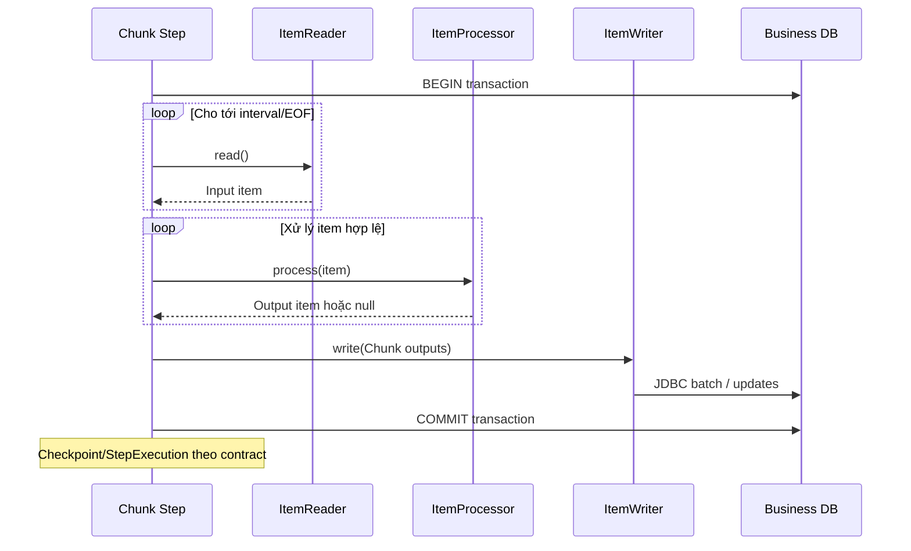
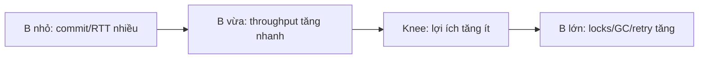
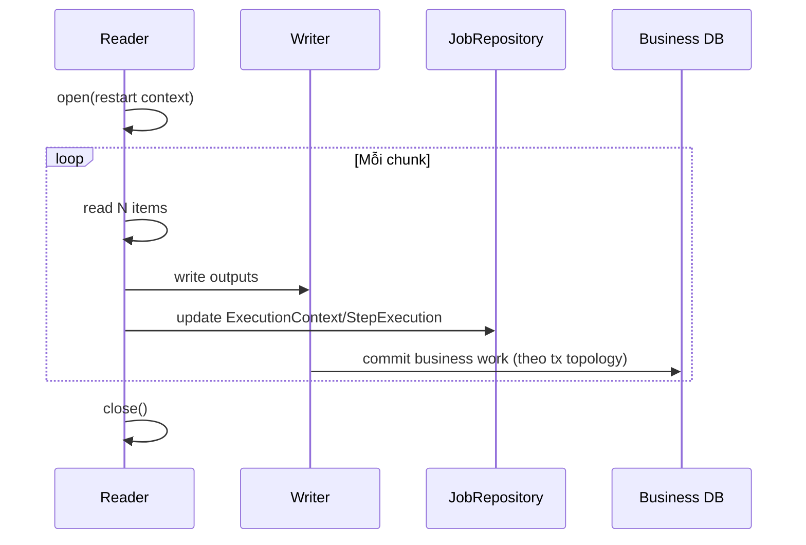
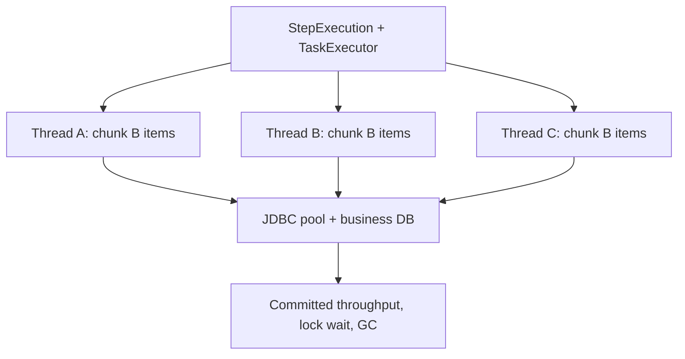
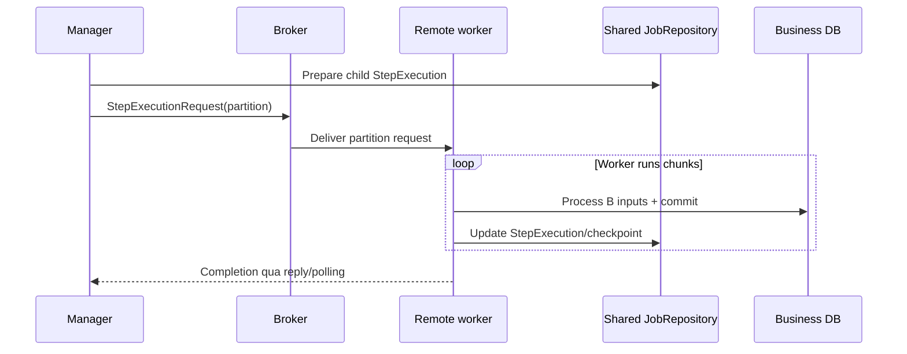
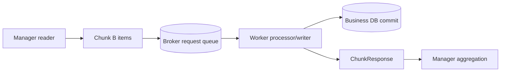

# Điều chỉnh commit interval trong Spring Batch: tối ưu giao dịch mà không đánh đổi tính đúng

Một job nhập hai triệu hóa đơn dùng `chunk(10, transactionManager)`. Mỗi lần commit khá nhanh nhưng database phải thực hiện rất nhiều transaction nhỏ, ghi metadata/checkpoint và round-trip. Đổi sang `chunk(200)` có thể cải thiện throughput rõ rệt. Tuy nhiên, nếu tăng lên `chunk(5000)`, một transaction kéo dài, row locks và vùng nhớ giữ nhiều items hơn; khi gặp deadlock ở cuối chunk, chi phí rollback/retry tăng mạnh. Với multi-threaded step hoặc 16 partitions chạy đồng thời, rủi ro còn nhân theo số chunk đang active.

Bài **“Điều chỉnh commit interval”** thuộc chương **Tối ưu cấu hình** của module `SPRING_BATCH_SCALING_OPERATIONS`. Mục tiêu là lựa chọn và triển khai **commit interval** phù hợp cho Spring Batch xử lý dữ liệu lớn, biết đo điểm nghẽn, bảo đảm reader/writer thread-safe, retry/restart đúng, và điều chỉnh cấu hình theo tài nguyên thực tế khi dùng multi-threaded step, parallel steps, partitioning hoặc remote processing.

Các ví dụ dùng **Java 17+, Spring Batch 5.2.x, Spring Framework 6.x, JDBC/PostgreSQL và Micrometer**. Những con số trong bảng, công thức dự báo và ngưỡng giới hạn là **minh họa**, không phải số đo đã chạy ở hệ thống cụ thể. Các code snippets cần ghép vào ứng dụng đã cấu hình `JobRepository`, `PlatformTransactionManager`, `DataSource` và Job lifecycle.

## 1. Commit interval là gì?

Spring Batch thường xử lý theo mô hình **chunk-oriented processing**:

```java
return new StepBuilder("importInvoices", jobRepository)
        .<Invoice, NormalizedInvoice>chunk(200, transactionManager)
        .reader(invoiceReader)
        .processor(invoiceProcessor)
        .writer(invoiceWriter)
        .build();
```

Với `chunk(200, transactionManager)`, chính sách count-based thông thường đọc **tối đa khoảng 200 items vào một chunk** rồi xử lý/ghi chúng và commit transaction. Ranh giới chunk còn phụ thuộc EOF, lỗi, retry/skip và completion policy; đây **không phải lời hứa writer luôn nhận đúng 200 output rows**.

Tài liệu Spring Batch 5.2 mô tả cơ chế: **số item đã đọc** tăng đến commit interval, `ItemWriter` được gọi với các items hợp lệ sau processor, rồi transaction commit. `ItemProcessor` trả `null` sẽ filter item nên writer có thể nhận **ít output hơn input**.



Trong đường xử lý không lỗi, `N` items nguồn và interval `B` tạo số chunk/commit danh nghĩa cỡ `ceil(N/B)`. **Metadata Spring Batch còn có các transactions nội bộ**, và các trường hợp skip/retry/rollback/EOF có thể khiến `StepExecution.commitCount` khác con số đơn giản này.

## 2. Vì sao commit interval ảnh hưởng throughput?

Mỗi chunk thường phải chịu những chi phí không hoàn toàn tỷ lệ với số item:

- Bắt đầu và kết thúc transaction, commit hoặc rollback.
- Flush WAL/fsync theo cấu hình database, network RTT.
- `ItemStream.update`/lưu `ExecutionContext` và `StepExecution` checkpoint.
- Gọi writer và thiết lập JDBC batch statement.
- Giải phóng hoặc giữ connection/row locks trong transaction.
- Tạo và thu hồi buffers, DTOs, cached prepared statements.

Nếu interval quá nhỏ, những chi phí cố định lặp lại nhiều lần. Nếu quá lớn, **thời gian transaction, memory, lock waits và recovery work** lại tăng. Mục tiêu không phải chọn B lớn nhất, mà là **throughput business đã commit đúng cao nhất trong phạm vi SLA và tài nguyên**.

## 3. Một mô hình chi phí để đặt giả thuyết

Đặt:

- `N`: số input items phải xử lý.
- `B`: commit interval (items/chunk).
- `c_item`: chi phí trung bình đọc, xử lý và ghi một item.
- `c_tx`: overhead trung bình mỗi chunk/transaction.
- `T_extra(B)`: phần overhead phụ thuộc B: GC, DB lock contention, retries...

```text
K(B) ≈ ceil(N / B)

T(B) ≈ T_startup + N × c_item + K(B) × c_tx + T_extra(B)
```

Đây là mô hình **gợi ý xu hướng, không phải phương trình đo chính xác**. Trong hệ thống thực, `c_tx` còn phụ thuộc database checkpoint/WAL, `c_item` phụ thuộc data skew và concurrency; `T_extra` có thể tăng đột biến khi một transaction vượt lock timeout hoặc heap budget.

**Ví dụ danh nghĩa với 2.000.000 input items:**

| Commit interval B | Số chunk ước lượng `ceil(N/B)` | Nhận xét |
| ---: | ---: | --- |
| 1 | 2.000.000 | Rất nhiều transaction; có thể cần nếu mỗi operation có isolation riêng |
| 10 | 200.000 | Overhead commit cao |
| 50 | 40.000 | Bắt đầu amortize overhead |
| 200 | 10.000 | Thường là một candidate đáng thử |
| 500 | 4.000 | Cần đo memory/locks/rollback |
| 2.000 | 1.000 | Transaction dài, cần kiểm contention và recovery |
| 5.000 | 400 | Không tự kết luận nhanh nhất |

Đây là **số chunk mô hình**, không phải `commitCount` đo thực và không phải benchmark. Một hệ thống có writer batch cực nhanh có thể chọn B khác hẳn một hệ thống gọi HTTP mỗi item.

## 4. Commit interval không phải những tham số nào?

| Tham số | Tác động chính | Khác commit interval như thế nào? |
| --- | --- | --- |
| `chunk(B, txManager)` | Bước gom item/transaction boundary | **Biến chính ở bài này** |
| `JdbcCursorItemReader.fetchSize` | Gợi ý số rows JDBC driver lấy mỗi lượt | Không quyết định commit |
| `JdbcPagingItemReader.pageSize` | Số rows một page query | Không quyết định transaction output |
| `JdbcBatchItemWriter` batching | Cách JDBC gửi nhiều updates | Một chunk có thể tạo nhiều SQL messages |
| `hibernate.jdbc.batch_size` | ORM statement batching | Không thay thế Batch commit interval |
| `gridSize` | Hint chia partition | Không phải số active workers hoặc B |
| Executor pool size | Số thread xử lý | Thay concurrency, không đổi B |
| Broker consumer prefetch | Số messages chưa ACK có thể nhận | Không quyết định commit DB |
| API batch request size | Số items một HTTP bulk call | Khác transaction boundary DB |
| Retry/skip limit | Số lần xử lý lỗi có điều kiện | Có thể làm tăng attempts/rollbacks |

Ví dụ `fetchSize=1000`, `pageSize=500` và `chunk(200)` có thể cùng xuất hiện. **Không ép chúng bằng nhau một cách máy móc**. Mỗi cấu hình giải quyết một tầng nghẽn riêng; benchmark một biến trước để biết nguyên nhân cải thiện.

## 5. Commit interval là ranh giới transaction, không phải toàn bộ job

Một job có thể gồm nhiều steps, mỗi step có B riêng:


Không có một B duy nhất cho mọi step:

- Import CSV bulk insert có thể hưởng lợi từ B lớn hơn.
- Step có item object graph rất lớn cần B thấp để giới hạn heap.
- Step gọi API bên ngoài có rate limit và side effect không transaction-safe cần thiết kế lại I/O/idempotency; B lớn có thể giữ transaction lâu vô ích.
- Step update cùng DB rows với job khác có thể cần B vừa/nhỏ để giảm lock hold time.

**Parallel steps** có thể chạy đồng thời và tranh cùng database/pool, dù mỗi step tự có B khác nhau. Tuning phải quan sát tổng tài nguyên, không chỉ duration của step riêng lẻ.

## 6. Những điều kiện phải đúng trước khi tuning

Trước khi thay interval, cần xác minh:

1. **Nguồn dữ liệu có identity/snapshot ổn định.** Restart không thay đổi tập input đang đọc.
2. **Reader/processor/writer có transaction semantics rõ ràng.** External API/file không tự rollback theo DB.
3. **Writer có idempotency hoặc business reconciliation.** Nếu crash sau business commit trước checkpoint, replay không nhân đôi effects.
4. **JobRepository và transaction manager đã cấu hình đúng** cho DB đang ghi; nếu khác datasource, phải hiểu atomicity gap.
5. **Metrics sẵn sàng:** `StepExecution` read/write/filter/skip/commit/rollback, chunk duration, DB locks/WAL, JVM heap/GC.
6. **Benchmark fixture đồng nhất:** cùng input snapshot, schema, indexes, worker concurrency, pool sizes, error policy.

Không chọn B bằng cách chỉ tăng cho tới khi database bắt đầu timeout trên production; phải đo trên môi trường đại diện và có rollback plan.

## 7. Những chỉ số xác định commit interval hiệu quả

| Nhóm | Metric | Điều cần phân tích |
| --- | --- | --- |
| Business | Unique committed items/s; end-to-end job duration | Kết quả có tăng **và đúng** không? |
| Batch | `readCount`/`writeCount`/`filterCount`; `commitCount`, `rollbackCount` | Có filter, skip, retry làm lệch số liệu? |
| Chunk | p50/p95/p99 chunk wall duration; chunk count | Chunk lớn có tăng tail latency quá budget? |
| DB | Transactions/s, WAL/fsync, lock wait, deadlocks | Commit overhead hay contention đang chi phối? |
| JDBC | Pool active/pending/acquire time | Chunk transaction giữ connections quá lâu? |
| JVM | Heap/GC pause/allocation/CPU throttling | Buffer và DTOs có làm memory vượt budget? |
| HTTP | Rate, 429/503, request p95, retry | B làm tăng concurrency/request burst? |
| Broker | Ready/unacked/payload bytes, reply lag | Remote chunks có gây backlog/large messages? |
| Restart | Replay items, recovery duration, duplicate effects | Chọn B có tăng blast radius? |

**Committed items/s không nhất thiết bằng `writeCount / duration` nếu các items được filter, output một item tạo nhiều rows hoặc external effects chưa xác nhận.** Định nghĩa đơn vị nghiệp vụ như invoice, payment operation hoặc account trước khi tạo dashboard.

## 8. Khi nào tăng B có ích và khi nào phải dừng?

Tăng B thường hữu ích khi:

- Overhead begin/commit/metadata chiếm tỷ lệ lớn.
- SQL batch updates có fixed round-trip cost cao.
- Thời gian một chunk còn ngắn, lock waits thấp, heap có headroom.
- Dữ liệu ít transient failures nên rollback amplification nhỏ.

Dừng hoặc giảm B nếu:

- `chunk p95/p99` vượt transaction/worker timeout budget.
- Heap/cgroup memory hoặc GC pause tăng nhanh theo B.
- DB lock waits/deadlocks tăng, pool pending kéo dài.
- WAL/checkpoint/replication lag, temp files hoặc index contention bão hòa.
- Retry/skip khiến nhiều items phải replay; recovery SLA xấu đi.
- Remote chunk payload quá lớn cho broker/serializer/prefetch.

**B tối ưu là một vùng giá trị trên trade-off curve**, thường không phải một con số tuyệt đối và có thể thay đổi khi worker count/chunk payload thay đổi.

## 9. Chọn các commit intervals để thử

Một ma trận sơ bộ cho item nhỏ/vừa:

```text
B = [1, 10, 25, 50, 100, 200, 500, 1000, 2000]
```

Nếu mỗi item giải nén thành object graph 500 KiB, bắt đầu với `[1, 5, 10, 25, 50]`. Nếu writer bulk insert lớn và bộ nhớ dư, có thể thử B lớn hơn **sau khi chứng minh headroom**. Không có nghĩa candidate 2.000 bắt buộc nên chạy nếu biết nó sẽ vượt giới hạn.

Đi theo hai vòng:

1. **Vòng 1 — Khoanh vùng:** từ B nhỏ tới B vừa/lớn, giữ các biến khác cố định.
2. **Vòng 2 — Tinh chỉnh:** thử thêm B giữa những candidates có lợi ích gần plateau, ví dụ `[150, 250, 350, 500]`.

Mỗi candidate nên có **warmup** và nhiều measurement runs, đảo thứ tự candidates để giảm bias do OS/DB cache hoặc checkpoint của PostgreSQL. Đừng chỉ lấy lần nhanh nhất; dùng median và phân phối cùng khoảng sai lệch.

## 10. Cấu hình commit interval qua application property

Một cấu hình **Spring Batch 5.2, Java 17**:

```java
import org.springframework.batch.core.Step;
import org.springframework.batch.core.ChunkListener;
import org.springframework.batch.core.StepExecutionListener;
import org.springframework.batch.core.repository.JobRepository;
import org.springframework.batch.core.step.builder.StepBuilder;
import org.springframework.batch.item.ItemProcessor;
import org.springframework.batch.item.ItemReader;
import org.springframework.batch.item.ItemWriter;
import org.springframework.beans.factory.annotation.Value;
import org.springframework.context.annotation.Bean;
import org.springframework.context.annotation.Configuration;
import org.springframework.transaction.PlatformTransactionManager;

@Configuration
public class InvoiceStepConfiguration {

    @Bean
    Step importInvoices(
            JobRepository jobRepository,
            PlatformTransactionManager transactionManager,
            ItemReader<Invoice> invoiceReader,
            ItemProcessor<Invoice, NormalizedInvoice> invoiceProcessor,
            ItemWriter<NormalizedInvoice> invoiceWriter,
            ChunkListener chunkTimingListener,
            StepExecutionListener stepSummaryListener,
            @Value("${batch.tuning.commit-interval:200}") int commitInterval) {

        if (commitInterval < 1) {
            throw new IllegalArgumentException(
                    "commit interval must be >= 1");
        }

        return new StepBuilder("importInvoices", jobRepository)
                .<Invoice, NormalizedInvoice>chunk(
                        commitInterval, transactionManager)
                .reader(invoiceReader)
                .processor(invoiceProcessor)
                .writer(invoiceWriter)
                .listener(chunkTimingListener)
                .listener(stepSummaryListener)
                .build();
    }
}
```

Trong `application.yml`:

```yaml
batch:
  tuning:
    commit-interval: 200
```

Các thành phần `Invoice`, `NormalizedInvoice`, reader/processor/writer và listeners sẽ xuất hiện ở phần sau. Nếu ứng dụng có **nhiều `ChunkListener` hoặc `StepExecutionListener` beans**, cần dùng `@Qualifier` thay vì chỉ inject interface và chờ Spring tự chọn.

**Điểm quan trọng:** bean `Step` được xây khi ứng dụng khởi động, nên đây là **property theo deployment/process** chứ không tự đổi B giữa các chunks đang chạy. Để benchmark B khác, khởi tạo cấu hình/`Step` mới hoặc xây Job có tham số hóa B một cách kiểm soát; đừng sửa field mutable trên singleton step trong lúc job đang chạy.

### 10.1. Đặt commit interval theo JobParameters được không?

Có thể thiết kế step-scoped `CompletionPolicy`, bean creation theo run hoặc custom `Step` construction để đọc identifying JobParameter, nhưng phải chứng minh framework nhận đúng giá trị **trước khi step bắt đầu**. Đừng đánh tráo `@Value("#{jobParameters['commitInterval']}")` vào một singleton bean `Step` không nằm trong job scope rồi tin nó tự hoạt động.

Với production, cách dễ kiểm soát thường là **version cấu hình cùng deployment**, lưu B thực trong job audit/launch metadata và **không thay đổi B tùy tiện khi restart cùng JobInstance** trước khi test lại checkpoint/retry semantics.

## 11. Tạo input snapshot có thứ tự ổn định

Schema PostgreSQL thử nghiệm:

```sql
CREATE TABLE tuning_invoice (
    invoice_id    BIGINT PRIMARY KEY,
    snapshot_id   VARCHAR(100) NOT NULL,
    amount        NUMERIC(18,2) NOT NULL,
    created_at    TIMESTAMPTZ NOT NULL DEFAULT CURRENT_TIMESTAMP
);

CREATE INDEX tuning_invoice_snapshot_pk_idx
    ON tuning_invoice(snapshot_id, invoice_id);

CREATE TABLE tuning_output (
    run_id             VARCHAR(100) NOT NULL,
    invoice_id         BIGINT NOT NULL,
    normalized_amount  NUMERIC(18,2) NOT NULL,
    PRIMARY KEY (run_id, invoice_id)
);

-- Dữ liệu giả lập để phục vụ benchmark trong DB test riêng.
INSERT INTO tuning_invoice(invoice_id, snapshot_id, amount)
SELECT n, 'S42', (n % 10000)::numeric / 100
FROM generate_series(1, 2000000) AS g(n);

ANALYZE tuning_invoice;
```

`snapshot_id=S42` là **input bất biến theo thiết kế benchmark**; không được cập nhật `tuning_invoice` trong khi run/restart. Tạo schema/input một lần, nhưng reset **output** về trạng thái tương đương ngoài khoảng đo cho mỗi candidate. **Không chạy các lệnh tạo bảng, generate_series hoặc TRUNCATE trên database production**.

### 11.1. Đối soát input/output theo business keys

Sau khi `JobExecution` hoàn thành hợp lệ:

```sql
SELECT COUNT(*) AS input_rows
FROM tuning_invoice
WHERE snapshot_id = 'S42';

SELECT COUNT(*) AS output_rows,
       COUNT(DISTINCT invoice_id) AS unique_invoice_ids,
       SUM(normalized_amount) AS amount_sum
FROM tuning_output
WHERE run_id = :runId;

-- Không dùng riêng COUNT/SUM làm bằng chứng đầy đủ.
SELECT src.invoice_id
FROM tuning_invoice src
LEFT JOIN tuning_output dst
       ON dst.invoice_id = src.invoice_id
      AND dst.run_id = :runId
WHERE src.snapshot_id = 'S42'
  AND dst.invoice_id IS NULL
LIMIT 100;
```

Kiểm cả **missing IDs**, duplicate committed side effects (nếu writer có external API), giá trị business và format tiền. `PRIMARY KEY(run_id, invoice_id)` chặn trùng row trong DB, nhưng không đảm bảo các trigger/external calls đều idempotent.

## 12. Reader ổn định: giữ fetchSize khác commit interval

Một `JdbcCursorItemReader` đọc theo snapshot và sort key duy nhất:

```java
import javax.sql.DataSource;

import org.springframework.batch.core.configuration.annotation.StepScope;
import org.springframework.batch.item.database.JdbcCursorItemReader;
import org.springframework.batch.item.database.builder.JdbcCursorItemReaderBuilder;
import org.springframework.beans.factory.annotation.Value;
import org.springframework.context.annotation.Bean;

@Bean
@StepScope
JdbcCursorItemReader<Invoice> invoiceReader(
        DataSource dataSource,
        @Value("#{jobParameters['snapshotId']}") String snapshotId) {

    return new JdbcCursorItemReaderBuilder<Invoice>()
            .name("tuningInvoiceReader")
            .dataSource(dataSource)
            .sql("""
                SELECT invoice_id, amount
                FROM tuning_invoice
                WHERE snapshot_id = ?
                ORDER BY invoice_id
                """)
            .preparedStatementSetter(ps ->
                    ps.setString(1, snapshotId))
            .rowMapper((rs, row) -> new Invoice(
                    rs.getLong("invoice_id"),
                    rs.getBigDecimal("amount")))
            .fetchSize(1000)
            .saveState(true)
            .build();
}
```

Ví dụ cố định `fetchSize=1000` cho **mọi candidate B**. `fetchSize` là JDBC driver hint: với PostgreSQL JDBC, actual cursor fetching phụ thuộc autocommit/cursor/driver behavior; không assume chính xác 1.000 rows trên mỗi round-trip. `@StepScope` giúp bean gắn với một `StepExecution`, **không tự làm reader thread-safe** khi dùng cùng step trên nhiều chunk threads.

### 12.1. Tại sao snapshot và thứ tự quyết định restart?

Reader có thể lưu vị trí/checkpoint trong `ExecutionContext`. Nếu input bị insert/delete hoặc query không có stable order, vị trí row sau restart có thể không còn trỏ tới cùng record. Một job xử lý 95% trước crash rồi đọc lại nguồn đã đổi có thể **skip/duplicate** dù commit interval B không đổi. Dùng immutable input snapshot, keyset/range partitioning và semantics reader restart rõ ràng.

## 13. Processor và writer deterministic

DTO Java 17:

```java
import java.math.BigDecimal;

public record Invoice(long invoiceId, BigDecimal amount) {}

public record NormalizedInvoice(
        String runId, long invoiceId, BigDecimal normalizedAmount) {}
```

Processor:

```java
import java.math.BigDecimal;
import java.math.RoundingMode;

import org.springframework.batch.core.configuration.annotation.StepScope;
import org.springframework.batch.item.ItemProcessor;
import org.springframework.beans.factory.annotation.Value;
import org.springframework.context.annotation.Bean;

@Bean
@StepScope
ItemProcessor<Invoice, NormalizedInvoice> invoiceProcessor(
        @Value("#{jobParameters['runId']}") String runId) {

    BigDecimal factor = new BigDecimal("1.10");
    return invoice -> new NormalizedInvoice(
            runId,
            invoice.invoiceId(),
            invoice.amount()
                    .multiply(factor)
                    .setScale(2, RoundingMode.HALF_EVEN));
}
```

Writer `JdbcBatchItemWriter`:

```java
import javax.sql.DataSource;

import org.springframework.batch.item.database.JdbcBatchItemWriter;
import org.springframework.batch.item.database.builder.JdbcBatchItemWriterBuilder;
import org.springframework.context.annotation.Bean;
import org.springframework.jdbc.core.namedparam.MapSqlParameterSource;

@Bean
JdbcBatchItemWriter<NormalizedInvoice> invoiceWriter(
        DataSource dataSource) {
    return new JdbcBatchItemWriterBuilder<NormalizedInvoice>()
            .dataSource(dataSource)
            .sql("""
                INSERT INTO tuning_output(
                    run_id, invoice_id, normalized_amount)
                VALUES (:runId, :invoiceId, :normalizedAmount)
                ON CONFLICT (run_id, invoice_id)
                DO UPDATE SET normalized_amount =
                    EXCLUDED.normalized_amount
                """)
            .itemSqlParameterSourceProvider(row ->
                    new MapSqlParameterSource()
                            .addValue("runId", row.runId())
                            .addValue("invoiceId", row.invoiceId())
                            .addValue("normalizedAmount",
                                    row.normalizedAmount()))
            .build();
}
```

Với cùng một input và `runId`, kết quả tính toán phải nhất quán. Tuy nhiên `ON CONFLICT DO UPDATE` không làm mọi side effect idempotent: triggers, audit writes hoặc emails từ writer vẫn có thể chạy nhiều lần. Nếu benchmark **upsert vào target đã có rows** và candidate khác **insert vào target rỗng**, phép so không công bằng.

**Transaction manager:** `PlatformTransactionManager` của step phải thực sự quản lý connection được `JdbcBatchItemWriter` dùng để bảo đảm chunk DB writes nằm trong transaction mong muốn. Nếu `JobRepository` và target database dùng các transaction managers khác nhau, **checkpoint có thể không atomic với output**; cần kiểm cửa sổ crash, replay và idempotency.

## 14. Cách chạy nhiều candidates mà không lẫn JobInstance

Với fresh benchmark runs:

```text
snapshotId = S42 (input cố định)
runId = B50-R1    -> B=50,  fresh JobInstance
runId = B200-R1   -> B=200, fresh JobInstance
runId = B500-R1   -> B=500, fresh JobInstance

Failure/restart test của B200-R1:
  restart đúng failed JobInstance với identifying parameters cũ,
  không sinh B200-R2 để gọi là restart.
```

Ghi B thực, code git SHA, JDK/driver version, input checksum và config runtime vào báo cáo. Khi **khởi chạy mới** sau một run `COMPLETED`, phải phân biệt identifying `JobParameters` để tạo JobInstance hợp lệ. Khi **restart**, giữ identifying parameters, snapshot, partition identity và cấu hình B theo policy đã test.

Nếu `runId` mới tạo thêm dữ liệu target mà không reset fixture, đừng coi mọi `runId` cùng dùng một target table đang tăng kích thước là các bài thử hoàn toàn tương đương: indexes/cache/locks có thể đổi theo thời gian.

## 15. Đo chunk duration bằng ChunkListener

Trong Spring Batch 5.2:

- `beforeChunk` được gọi **sau khi transaction bắt đầu**, trước khi đọc chunk.
- `afterChunk` được gọi **sau chunk hoàn tất thành công, ngoài transaction**.
- `afterChunkError` là callback khi chunk lỗi/rollback; không đồng nghĩa một business transaction đã được đối soát.

Do đó, khoảng `beforeChunk → afterChunk` là **chunk wall duration**, bao gồm read/process/write và commit path liên quan. Đây không phải “thời gian SQL COMMIT” thuần túy.

```java
import java.util.concurrent.TimeUnit;

import io.micrometer.core.instrument.Counter;
import io.micrometer.core.instrument.MeterRegistry;
import io.micrometer.core.instrument.Timer;
import org.springframework.batch.core.ChunkListener;
import org.springframework.batch.core.scope.context.ChunkContext;
import org.springframework.stereotype.Component;

@Component
public class ChunkTimingListener implements ChunkListener {

    private final Timer successfulChunkTimer;
    private final Counter chunkErrorCounter;
    private final ThreadLocal<Long> startNanos = new ThreadLocal<>();

    public ChunkTimingListener(MeterRegistry registry) {
        successfulChunkTimer = Timer.builder("batch.tuning.chunk.wall")
                .tag("step", "importInvoices")
                .publishPercentileHistogram()
                .register(registry);

        chunkErrorCounter = Counter.builder("batch.tuning.chunk.error")
                .tag("step", "importInvoices")
                .register(registry);
    }

    @Override
    public void beforeChunk(ChunkContext context) {
        startNanos.set(System.nanoTime());
    }

    @Override
    public void afterChunk(ChunkContext context) {
        Long start = startNanos.get();
        try {
            if (start != null) {
                successfulChunkTimer.record(
                        System.nanoTime() - start,
                        TimeUnit.NANOSECONDS);
            }
        } finally {
            startNanos.remove();
        }
    }

    @Override
    public void afterChunkError(ChunkContext context) {
        chunkErrorCounter.increment();
        startNanos.remove();
    }
}
```

Ví dụ giả định callbacks cho một chunk nằm trong cùng worker thread theo topology đã test. `ThreadLocal.remove()` trong cả hai đường giúp tránh giữ state khi thread pool tái sử dụng thread. Không gắn `jobExecutionId`, `invoiceId` hoặc UUID vào metric labels vì cardinality sẽ bùng nổ; các identity đó thuộc logs/traces.

**Metric semantics:** `batch.tuning.chunk.wall` chỉ ghi **chunk callback success**, không đo độc lập SQL commit latency hay rollback cost. Đối với lỗi, thu riêng failed attempt duration, DB metrics và `StepExecution.rollbackCount`. Một listener ném exception cũng có thể làm step fail, vì vậy code metrics nên nhẹ, không thực hiện HTTP/DB blocking trong callback.

### 15.1. Vì sao p99 chunk tăng khi B tăng?

Vì chunk chứa nhiều items hơn, tổng duration/chunk thường tăng dù **đơn vị thời gian mỗi item giảm**. So `p99 chunk duration` với transaction/timeout/GC budget, và so `committed items/s` để đánh giá throughput. Không so riêng p95 chunk ở B=50 và B=500 rồi nói B=500 chậm hơn nếu tổng thời gian job giảm mạnh — cần **hai chiều mục tiêu**.

## 16. Tóm tắt StepExecution khi hoàn tất

Một `StepExecutionListener` giúp lưu những thông số khác biệt do interval:

```java
import org.springframework.batch.core.ExitStatus;
import org.springframework.batch.core.StepExecution;
import org.springframework.batch.core.StepExecutionListener;
import org.springframework.stereotype.Component;

@Component
public class StepSummaryListener implements StepExecutionListener {

    @Override
    public ExitStatus afterStep(StepExecution step) {
        System.out.printf(
                "step=%s status=%s read=%d write=%d filter=%d "
                        + "readSkip=%d processSkip=%d writeSkip=%d "
                        + "commits=%d rollbacks=%d%n",
                step.getStepName(),
                step.getStatus(),
                step.getReadCount(),
                step.getWriteCount(),
                step.getFilterCount(),
                step.getReadSkipCount(),
                step.getProcessSkipCount(),
                step.getWriteSkipCount(),
                step.getCommitCount(),
                step.getRollbackCount());

        return step.getExitStatus();
    }
}
```

Một `StepExecution` `COMPLETED` với `writeCount=N` **chưa đủ** nếu writer gọi API/DB khác ngoài transaction; phải đối soát business keys/số tiền/side effects. `commitCount` là batch counter, không bằng tổng database commits của cả ứng dụng, vì JobRepository và các readers/writers có transactions khác.

### 16.1. Dùng readCount, writeCount, filterCount đúng ngữ nghĩa

Trong luồng xử lý bình thường:

```text
input reads             = 1.000
processor filters null  =   250
writer output items     =   750
commit interval         =   100 reads/chunk
number of nominal chunks≈    10
```

Không suy “B=100 nghĩa có 100 output rows/commit” trong ví dụ. Skip, retry, commit/rollback callbacks có thể làm số đếm thực khác các phép tính đơn giản; một item writer có thể ghi nhiều bảng/rows từ một output DTO.

## 17. Đo đúng database bottleneck

Một số chỉ số PostgreSQL dành cho môi trường test cách ly:

```sql
SELECT datname, xact_commit, xact_rollback,
       blks_read, blks_hit, deadlocks
FROM pg_stat_database
WHERE datname = current_database();

SELECT pid, state, wait_event_type, wait_event,
       xact_start, query_start
FROM pg_stat_activity
WHERE datname = current_database();
```

Với bản PostgreSQL/permissions phù hợp, dùng thêm `pg_stat_wal`, `pg_stat_statements` và dashboard `pg_locks` để kiểm:

- Transaction count/WAL bytes và checkpoint/write overhead.
- p95/p99 SQL update, row lock wait/deadlocks.
- Connection acquisition time và số connections đang mở.
- Server CPU/I/O và replication lag nếu có.

**Đo delta trong cùng khoảng thời gian**; `xact_commit` là counter **toàn database**, không phải “đúng số chunk commits của step”. Những counters có thể reset hoặc lẫn workload ngoài, vì vậy nên chạy ở DB test cách ly khi benchmark.

### 17.1. Đừng tối ưu riêng số commit rồi bỏ qua locks

Giả sử B=200 giảm 80% số chunk so với B=40, nhưng `pg_stat_activity` cho thấy nhiều transactions giữ locks 20 giây và block service khác. Giảm số commits **không đương nhiên** giảm tổng chi phí vận hành. Một cấu hình nhanh cho batch độc lập có thể **tệ cho toàn hệ thống** khi nó làm ứng dụng giao dịch trực tuyến chậm đi.

## 18. JVM, heap và GC phải đo cùng transaction time

Với mỗi chunk, framework và ứng dụng có thể giữ:

- Input `Chunk` DTOs.
- Output sau `ItemProcessor`, bản sao/temporary data.
- JDBC batch parameter arrays.
- Serialization buffers khi remote chunking.
- Retry buffer/rollback state và `ExecutionContext`.

Mô hình dự báo memory:

```text
M_active ≈ active_chunks × B × decoded_item_bytes × copy_factor
M_peak   ≈ JVM_baseline + M_active + reader_writer_buffers
         + other_in_flight + native/GC/headroom
```

Ví dụ decoded item graph trung bình 96 KiB, `B=500`, 8 active chunks và hệ số 2,5 cho intermediate copies:

```text
8 × 500 × 96 KiB × 2.5
= 960.000 KiB
≈ 937,5 MiB payload in-flight
```

Đây là **dự báo** chứ không phải heap measurement. Native/direct memory, thread stacks, TLS buffers và file cache thuộc container memory nhưng không nằm toàn bộ trong heap. Nếu tăng B từ 200 lên 500 và cũng tăng workers từ 4 lên 8, không thể quy kết memory peak tăng do riêng B.

### 18.1. Các lệnh chẩn đoán JVM/cgroup

```bash
# Thực hiện trên JVM benchmark có quyền attach và JDK.
PID=12345
jcmd "$PID" GC.heap_info
jcmd "$PID" VM.flags
jcmd "$PID" Thread.print

# Cgroup v2 nếu đúng mount namespace:
cat /sys/fs/cgroup/memory.current
cat /sys/fs/cgroup/memory.events
cat /sys/fs/cgroup/cpu.stat
```

`jcmd GC.heap_info` là snapshot, không tự cho peak; cần metrics liên tục, GC logs/JFR hoặc cgroup `memory.peak` nếu platform hỗ trợ. Không đo một Pod vừa restart rồi coi số heap hiện tại là memory peak trước `OOMKilled`.

## 19. Lập benchmark công bằng với commit interval là biến duy nhất

Giữ nguyên:

| Yếu tố | Cố định như thế nào? |
| --- | --- |
| Input snapshot | Cùng `snapshotId`, checksum, số records, data skew |
| Business transformations | Cùng processor, validation, output contract |
| Source/target DB | Cùng schema, indexes, isolation, volume, DB version |
| Reader | Cùng `fetchSize/pageSize`, SQL order và reader type |
| Writer | Cùng JDBC batch/upsert SQL, driver flags |
| Runtime | Cùng Java version, heap/GC, CPU quota, memory limits |
| Concurrency | **Một worker/step thread** trong vòng chọn B nền |
| Resource pools | Cùng JDBC/HTTP max pools, timeouts |
| Error handling | Cùng retry/skip policy; baseline không inject lỗi ngẫu nhiên |
| Metrics | Cùng instrumentation/log level/scrape interval |
| Warmup | Cùng quy tắc loại hoặc báo riêng cold-start time |

**Mỗi lần đo** phải đưa target về trạng thái tương đương (reset schema/partition trong lab) **ngoài thời gian timed section**. Nếu candidate B=10 chỉ insert mới nhưng B=1000 chạy upsert rows đã tồn tại, benchmark không còn một biến.

### 19.1. Đảo thứ tự candidates

Ví dụ:

```text
Round 0: Warmup, không tính vào steady-state
Round 1: B=200 -> B=50 -> B=500 -> B=1000
Round 2: B=500 -> B=1000 -> B=200 -> B=50
Round 3: B=50  -> B=500 -> B=1000 -> B=200
Round 4: B=1000-> B=200 -> B=50  -> B=500
```

Randomized/balanced order giúp giảm ảnh hưởng DB cache, autovacuum, JVM JIT và biến thiên load ngoài. Lưu seed/order/version và các raw runs. Không **chọn min duration** làm đáp án nếu một run bất thường nhanh/thiếu output.

## 20. Pseudo-code harness cho nhiều runs

```text
for B in candidate_commit_intervals_using_balanced_order():
    reset_target_fixture_outside_timed_window()
    assert_immutable_input_snapshot()
    runId = new_identifying_run_id(B)

    start_timer()
    execution = launch_new_job_instance(
        snapshotId="S42",
        runId=runId,
        commitIntervalConfig=B
    )
    await_final_job_status_with_timeout(execution)
    elapsed = stop_timer()

    results = read_StepExecution_and_Micrometer_metrics(execution)
    business = reconcile_expected_ids_and_output(runId)

    persist_raw_run_record(
        B, elapsed, status, results, business, jvm, db, env
    )

    if status != COMPLETED or not business.correct:
        mark_run_INVALID_and_investigate()

compare_median_and_tail_for_valid_runs_only()
validate_finalists_with_failure_and_restart_tests()
```

Đây là **pseudo-code** chứ không phải script có sẵn. Với `JobParameters`, mỗi **fresh benchmark run** dùng `runId` mới để tạo JobInstance mới; còn test restart **giữ lại identity cũ**. Nếu harness thất bại ở bước reset fixture hoặc không có metrics, đừng tiếp tục đo rồi cho rằng các candidates tương đương.

## 21. Bảng kết quả giả định: tối ưu B không chỉ nhìn duration

Giả sử 2.000.000 invoices, PostgreSQL `JdbcBatchItemWriter`, một JVM/step thread, cùng input và target reset giữa runs:

| Commit interval | Job time (s) | Committed items/s | Nominal chunks | Chunk p95 (ms) | Heap peak (MiB) |
| ---: | ---: | ---: | ---: | ---: | ---: |
| 10 | 850 | 2.353 | 200.000 | 12 | 360 |
| 50 | 420 | 4.762 | 40.000 | 18 | 410 |
| 100 | 320 | 6.250 | 20.000 | 30 | 470 |
| 200 | 260 | 7.692 | 10.000 | 53 | 560 |
| 500 | 235 | 8.511 | 4.000 | 119 | 730 |
| 1.000 | 241 | 8.299 | 2.000 | 258 | 1.030 |
| 2.000 | 282 | 7.092 | 1.000 | 560 | 1.540 |

**Tất cả số liệu là ví dụ giả định để luyện phân tích, chưa chạy benchmark thật.** `Committed items/s` được tính từ số item đầu ra đã xác minh và elapsed time, không từ số request gửi đi. `Nominal chunks` là phép chia toán học trong luồng không lỗi; `commitCount` thực phải được đọc từ `StepExecution`.

```text
N = 2,000,000 items
B=50:  N / 420s ≈ 4,762 items/s
B=200: N / 260s ≈ 7,692 items/s
B=500: N / 235s ≈ 8,511 items/s

Speedup B=500 so với B=50 = 420 / 235 ≈ 1.79x
Throughput tăng B=200 -> B=500 ≈ 10.6%
Tăng B=500 -> B=1000 làm job chậm hơn 235s -> 241s
```

**Không suy nguyên nhân chỉ từ bảng:** B=1000 có thể chậm vì GC, lock duration, WAL, JDBC driver batching hoặc input skew. Cần DB/JVM metrics đúng cửa sổ để xác định.

### 21.1. Nếu có giới hạn vận hành?

Giả sử yêu cầu:

```text
Business correctness: PASS
Job status: COMPLETED
Chunk p95 <= 150 ms
Peak heap <= 800 MiB
Rollback/restart drill: PASS
```

Trong bảng giả định, **B=500** nhanh nhất và còn nằm trong hai giới hạn định lượng. Tuy nhiên headroom heap chỉ còn 70MiB so với ngưỡng 800MiB; nếu payload production có outliers hoặc concurrency tăng, **B=200** có thể là lựa chọn ít rủi ro hơn. Chỉ quyết định sau khi xem p99/variability, cgroup memory và recovery test.

## 22. Điểm lợi ích chững lại: “knee point”



Không có công thức chung “B=1000 là tối ưu”. Chọn vùng gần knee rồi làm thêm các thí nghiệm:

- Đo median throughput và sai số qua nhiều runs.
- Đo p95/p99 chunk duration, rollback/retry, recovery time.
- So **CPU/DB I/O/heap trên mỗi 1 triệu business items đã commit**.
- Thử data payload outliers và workload production mixed.
- Chạy lại với số active workers/partitions dự kiến production.

Nếu B=300 và B=500 có chênh lệch nhỏ hơn dao động giữa các runs, **đừng tuyên bố B=500 thắng chắc**. Chọn cấu hình có memory/locks/restart headroom tốt hơn và giữ raw results để ra quyết định.

## 23. Chi phí rollback có thể tăng theo commit interval

Khi một item lỗi ở gần cuối chunk:

```text
B=10:
  work trong chunk nhỏ, phạm vi rollback tương đối nhỏ

B=1000:
  có thể đã read/process gần 1000 items trước lỗi
  transaction rollback làm một lượng công việc lớn phải retry
```

Điều này **không có nghĩa framework luôn đọc lại đúng B items**. Retry/skip buffer, transactional readers, stateful retry, writer batching, commit metadata và chính sách rollback ảnh hưởng chính xác số lần gọi.

Một cách đặt giả thuyết về lỗi độc lập với xác suất `p`/item:

```text
P(ít nhất một lỗi trong chunk B items) = 1 - (1-p)^B

p = 0,001  (0,1% mỗi item)
B=100   -> xấp xỉ 9,5% chunk có >=1 lỗi
B=1000  -> xấp xỉ 63,2% chunk có >=1 lỗi
```

Đây chỉ là **mô hình xác suất lỗi item độc lập**, không phải dự báo số rollback chính xác cho Spring Batch. Nhưng nó nhắc rằng B lớn tạo **failure locality** kém nếu input nhiều lỗi.

### 23.1. Khi có skip/retry, số chunk thực không còn đơn giản

Ví dụ `faultTolerant().retry(TransientDataAccessException.class).retryLimit(3)` có thể tạo các lần gọi lại processor/writer trong các transaction khác; một item được skip sau failures có thể ảnh hưởng `writeCount`/`skipCount`. Không lấy `ceil(readCount/B)` làm mốc nghiệm thu cứng trong một step fault-tolerant mà chưa xem actual semantics.

Đo cả:

- `StepExecution.rollbackCount` và `commitCount`.
- Số lần writer/processor invocation thực.
- DB transaction rollback count và deadlock logs.
- Actual business rows/effects sau khi retry.
- Replay items và recovery time sau worker crash.

## 24. Timeout budget và độ dài transaction

Nếu B tăng từ 100 lên 2000, một chunk có thể mất 0,2s → 8s hoặc lâu hơn, tùy data. Khi đó cần xét:

| Giới hạn | Rủi ro nếu B quá lớn |
| --- | --- |
| Database `statement_timeout` | SQL batch bị hủy dù item nào cũng hợp lệ |
| `lock_timeout` | Gặp nhiều row locks lâu hơn, rollback liên tục |
| Transaction timeout của Spring | Transaction rollback sau deadline |
| JDBC socket/read timeout | Driver mất connection trong lúc server còn xử lý |
| Kubernetes terminationGracePeriod | Pod bị kill khi chunk chưa commit |
| Broker consumer ACK deadline | Worker chưa ACK, broker đóng connection/redeliver |
| Manager reply wait timeout | Manager tưởng chunk thất lạc dù worker còn chạy |

**Không tăng timeout vô điều kiện chỉ để giúp B lớn chạy qua**. Tăng B cần chứng minh đủ headroom và không làm upstream latency SLA hay restart thời gian recovery xấu hơn. Timeout do lock contention phải xử lý cạnh tranh/SQL/index trước, không chỉ nới con số.

### 24.1. Graceful shutdown khi chunk dài

Spring Batch `stop` thường được kiểm ở **ranh giới xử lý**, không đảm bảo có thể rollback/thoát tức thì trong mọi database I/O. Pod receiving SIGTERM cần thời gian để transaction hiện tại hoàn thành hoặc rollback an toàn. Nếu max chunk duration là 90s nhưng termination grace chỉ 30s, xác suất bị kill giữa chunk tăng. Vẫn phải bảo đảm restart/idempotency vì không có shutdown nào bảo vệ hoàn toàn khỏi `SIGKILL` hoặc node outage.

## 25. Commit interval với retry/restart và checkpoint

`ItemStream` có vòng đời `open(ExecutionContext)`, `update(ExecutionContext)`, `close()`, giúp reader/writer lưu state để restart. Chunk commit thường là thời điểm framework cập nhật checkpoint theo transaction semantics.



Sơ đồ là **khái quát**, không áp đặt thứ tự của hai commits trong mọi transaction configuration. Nếu business DB và JobRepository dùng **cùng transaction manager/transaction context** phù hợp, atomicity có thể mạnh hơn. Nếu chúng thuộc hai hệ thống khác, có cửa sổ:

```text
business output đã commit
JVM crash trước khi checkpoint/metadata phản ánh đủ
restart đọc lại items
=> writer có thể được gọi lại cho cùng business keys
```

**Chọn B nhỏ chỉ thu hẹp phạm vi công việc trong mỗi chunk; nó không loại bỏ cửa sổ dual-write.** Dùng idempotent writes, outbox hoặc reconciliation theo business identity. Với external API không tham gia DB transaction, điều này đặc biệt quan trọng.

### 25.1. Có đổi commit interval khi restart được không?

Đổi B trên cùng `JobInstance` **không tự động bị framework cấm trong mọi trường hợp**, nhưng có thể ảnh hưởng:

- Reader checkpoint gắn với item position/state.
- Custom `ExecutionContext` hoặc writer state phụ thuộc số items/chunk.
- Retry/skip semantics và lô side effects còn pending.
- Remote chunking message correlation, pending requests/replies.
- Partition identity/named ranges và global concurrency.

Khuyến nghị **giữ B cố định giữa lần chạy bị lỗi và lần restart** trừ khi đã thử cụ thể với reader/writer/transaction topology đang dùng. Nếu muốn thay B giữa production runs, lưu config version và tạo run mới cho workload mới sau khi old run hoàn tất/reconciled.

## 26. Reader thực sự transactional hay không?

`ItemReader` có thể là:

- **File/cursor reader:** đọc stateful, lưu checkpoint, file/DB cursor không nhất thiết rollback theo chunk DB transaction.
- **Transactional message queue reader:** message có thể được trả lại khi transaction rollback, tùy adapter và broker transaction configuration.
- **Paging reader:** query nhiều pages; khi tập data bị thay đổi trong lúc đọc, offset paging có thể **skip/repeat**.

Với PostgreSQL/JDBC, việc reader query xảy ra trong cùng process không có nghĩa nó chia sẻ đúng `Connection` và transaction với writer. `JdbcCursorItemReader` thường dùng connection riêng cho cursor và có các cờ behavior liên quan shared extended connection; cần đọc config/driver semantics thực. Không quảng cáo “DB transaction rollback là source cursor tự quay lại” nếu chưa kiểm integration.

**Một lỗi điển hình khi tuning:** reader phân trang với `WHERE processed=false` và OFFSET, writer cập nhật `processed=true`. Tập kết quả co lại làm offset nhảy qua records; đổi B có thể khiến lỗi xuất hiện với tỷ lệ khác nhau. Phải sửa reader/snapshot/query trước, không coi B nào “ít lỗi hơn” là tối ưu.

## 27. Multi-threaded Step: B và concurrency cùng tác động memory/locks

Trong Spring Batch 5.2, có thể thêm `TaskExecutor` cho chunk-oriented step:

```java
return new StepBuilder("parallelChunkStep", jobRepository)
        .<Invoice, NormalizedInvoice>chunk(
                commitInterval, transactionManager)
        .reader(threadSafeReader)
        .processor(threadSafeProcessor)
        .writer(threadSafeWriter)
        .taskExecutor(batchTaskExecutor)
        .build();
```

Tên `threadSafeReader/Processor/Writer` là **giả định đã kiểm chứng**, không phải các beans tự sinh. **Không đưa `JdbcCursorItemReader` stateful của mục 12 dùng chung nhiều chunk threads** chỉ vì nó có `@StepScope`. Scope đó theo `StepExecution`, không tạo reader instance trên từng thread; reader shared cần thread-safety, ordering và restart correctness rõ ràng.



Với tối đa `C` chunks active, working set tăng gần với `B×C×payload`. Nếu database chỉ có 12 connections dành cho batch và executor chạy 32 chunks cùng lúc, nhiều threads sẽ **chờ pool**; tăng B có thể giữ connections lâu, khiến pool pending cao và throughput giảm.

### 27.1. Executor queue phải bounded

```java
import java.util.concurrent.ThreadPoolExecutor;
import org.springframework.scheduling.concurrent.ThreadPoolTaskExecutor;

@Bean
ThreadPoolTaskExecutor batchTaskExecutor() {
    ThreadPoolTaskExecutor executor = new ThreadPoolTaskExecutor();
    executor.setCorePoolSize(4);
    executor.setMaxPoolSize(8);
    executor.setQueueCapacity(16);
    executor.setRejectedExecutionHandler(
            new ThreadPoolExecutor.AbortPolicy());
    executor.setThreadNamePrefix("batch-chunk-");
    return executor;
}
```

**Bounded queue chỉ tránh giữ vô hạn tasks trong JVM**, không tự đảm bảo Batch không fail khi `TaskRejectedException` xảy ra. Phải chạy overload/restart test với chính cách Spring Batch submit chunks ở phiên bản đang dùng; đừng nuốt rejection rồi đánh dấu work hoàn tất. `throttleLimit` của multi-threaded step đã deprecated từ Spring Batch 5.0; số active chunks còn phụ thuộc repeat operations và step internals, **không tự bằng maxPoolSize**.

### 27.2. Một test reader thread-safe là bắt buộc

Với 8 threads, validate **set tất cả business IDs** sau run, không chỉ `readCount`. Reader race có thể đọc thiếu/trùng dù commit interval nào cũng “nhanh”. Nếu cần restartable và ordered processing, partitioning với reader riêng/partition thường dễ reasoning hơn shared cursor.

## 28. Local partitioning: mỗi partition có B của worker step

Trong local partitioning:

- Manager tạo partitions/`ExecutionContext`.
- Mỗi child `StepExecution` chạy worker step, có reader/writer/commit interval riêng theo step config.
- `gridSize` gợi ý cách chia partitions; active concurrency phụ thuộc `PartitionHandler` và `TaskExecutor`.
- Mỗi partition có checkpoint và trạng thái độc lập.

```text
16 logical partitions
4 active partition threads
B = 200 reads/chunk per partition

=> nhiều nhất danh nghĩa 4 chunk transactions active
   (tùy transaction/step internals)
=> không phải 16 × 200 items chắc chắn giữ trong heap
```

Điều chỉnh B khi partitioned:

1. Giữ **partition ranges, names, snapshot và số workers cố định**, chỉ đổi B cho baseline.
2. Xem **per-partition read/write/commitCount/rollbackCount/duration**.
3. Kiểm partition skew: một partition có items nặng có thể quyết định toàn job duration.
4. Xem DB locks/connection use từ **tất cả partitions**, không chỉ một worker.
5. Thử restart child `StepExecution` chưa hoàn tất, giữ partition identity và checkpoint.

**Đừng dùng tăng B để che partition skew.** Nếu partition01 xử lý 10 triệu rows và các partition khác chỉ 10.000, cần sửa partitioner/snapshot work distribution; tăng B không làm phân phối công việc công bằng.

## 29. Remote partitioning: transaction boundary nằm ở worker

Với remote partitioning, manager gửi `StepExecutionRequest` để worker chạy **worker `Step`**. Một request thường tương ứng **logical partition**, không tương ứng một chunk.



Điều chỉnh commit interval ở **worker step** ảnh hưởng số chunk transactions và memory của **mỗi worker JVM**, không phải kích thước `StepExecutionRequest` (request chỉ chứa IDs/metadata references). Nếu một worker có thể chạy 4 partitions đồng thời, resource budget phải tính **4×B×payload** cho worker ấy.

### 29.1. Các phép thử bắt buộc khi worker crash

- Worker bị kill **trước commit**: uncommitted transaction rollback; restart không bỏ sót input.
- Worker bị kill **sau commit trước reply/ACK**: broker có thể redeliver; writer idempotent.
- Child `StepExecution` còn `STARTED` mồ côi: không reassign ngay chỉ dựa trên timeout; phải xác minh owner/fencing/metadata recovery.
- Restart `JobInstance` với partition names/ranges/snapshot **không đổi**; completed partitions không bị chạy lại ngoài policy có chủ ý.

Tăng B có thể khiến một chunk đang chạy lâu hơn timeout manager; **timeout không chứng minh worker chết**. Khi đo, ghi separate queue wait, worker last-progress age, DB transaction time và manager completion detection lag.

## 30. Remote chunking: commit interval còn quyết định message payload size

Trong remote chunking, manager dùng reader, gom chunks rồi gửi `ChunkRequest` chứa items tới worker. Khi tăng B:

- Số request/chunk message có thể giảm.
- Mỗi request giữ **nhiều items hơn**, serialization bytes/CPU tăng.
- Broker/consumer prefetch có thể giữ nhiều payloads chưa ACK.
- Worker processing/transaction time, reply latency và retry blast radius tăng.
- Manager cần giới hạn **pending request window** để không tạo backlog RAM vô hạn.



Ví dụ serialized input trung bình **16 KiB/item**:

```text
B=100  => khoảng 1,56 MiB mỗi ChunkRequest payload
B=500  => khoảng 7,81 MiB mỗi ChunkRequest payload
B=2000 => khoảng 31,25 MiB mỗi ChunkRequest payload
```

Các giá trị chưa tính headers, encoding, Java object graph/buffer copies. Với 8 consumers, prefetch=4, `B=2000` có thể khiến cửa sổ serialized in-flight danh nghĩa khoảng `8×4×31,25 MiB≈1.000 MiB`, chưa tính worker heap. Broker có thể từ chối message quá lớn trước khi writer chạy.

### 30.1. Lưu ý tính đúng xuyên manager/worker

Manager reader checkpoint và worker business commit **không mặc định là một transaction phân tán**. Nếu worker commit rồi crash trước reply, request có thể xử lý lại; nếu manager restart, input có thể được gửi lại dưới message ID mới. B lớn làm **một lần replay** chứa nhiều items hơn nhưng không thay yêu cầu idempotency. Monitor **ChunkRequest/ChunkResponse correlation**, pending requests/replies và broker redelivery cùng unique business outcomes.

`RemoteChunkingManagerStepBuilder.throttleLimit(long)` trong Spring Batch Integration 5.2 giới hạn pending chunk-processing requests; nó **không là commit interval** và không bảo đảm broker queue chỉ có đúng từng ấy messages từ mọi producers. Đừng tăng B rồi vô tình tăng `throttleLimit`, broker prefetch và worker concurrency cùng lúc trong một benchmark một biến.

## 31. Parallel steps dùng chung DB: công thức B riêng có thể sai

Giả sử:

```text
Flow A: import rows, commitInterval=500
Flow B: enrich rows, commitInterval=200
Flow C: aggregate rows, commitInterval=100

Cả 3 flows cùng chạy với TaskExecutor
=> tất cả cùng tranh JDBC pool, WAL, CPU/locks
```

Một step đã tối ưu trong isolated benchmark có thể chậm hơn khi ba steps chạy song song. Khi đo end-to-end job:

- Đo DB `xact_commit/xact_rollback` và lock waits của **toàn cụm**.
- Đảm bảo thứ tự nghiệp vụ/data dependencies cho parallel flows đã được thiết kế đúng.
- Theo dõi per-step throughput, slowest flow và tổng JobExecution duration.
- Không dùng B khác chỉ để tránh race do hai flows sửa cùng business row; sửa transaction/ownership strategy.

**B của Step A không điều khiển transaction boundary Step B** và không có “global commit interval” cho một Job nhiều steps.

## 32. B, concurrency và connection pool: cùng một ngân sách

Một budget đơn giản để bắt đầu:

```text
Peak active DB chunk transactions
    <= total active chunk/partition concurrency
    <= available JDBC connections for batch workload

Total JDBC demand across replicas
    ≈ workers × maxActivePartitionsPerWorker ×
      connectionsPerActiveTransaction
```

Đây là mô hình **định hướng**, không thay đo runtime: reader có thể dùng connection riêng, writer có thể mở nhiều connections, JobRepository cũng dùng pool. Không set Hikari `maximumPoolSize` ở mỗi JVM bằng toàn `max_connections` của DB.

Ví dụ 6 JVM, mỗi JVM 4 partitions, 1 writer connection mỗi transaction:

```text
Potential writer connections ≈ 6 × 4 × 1 = 24
Ngoài ra: reader cursors, JobRepository, metrics/admin connections
```

Nếu DB server chỉ có 30 connections khả dụng cho tất cả workloads, B lớn và 24 active transactions có thể làm DB pool và row locks bão hòa. Giải pháp có thể là **giảm concurrency, tối ưu SQL/index hoặc phân chia work keys**, không đơn giản tăng maxPoolSize.

### 32.1. Backpressure để tránh xếp chunks vô hạn

Khi writer DB xử lý chậm, manager/reader không nên enqueue hàng triệu chunks trong JVM. Dùng **bounded executor queue, pending request window, broker prefetch hữu hạn** và durable work intent. Khi queue đầy, block có timeout hoặc reject có kiểm soát để step/restart đúng; **không ACK upstream hoặc đánh dấu work hoàn thành khi chưa có durable handoff**.

## 33. HTTP và side effects ngoài DB: tăng B không tự giảm số API calls

Một `ItemProcessor` gọi một HTTP request **cho mỗi item**:

```text
B=100  => tối đa 100 per-item HTTP calls trong một chunk
B=1000 => tối đa 1000 per-item HTTP calls trong một chunk
```

Nếu API vẫn là một call/item, tăng B **không giảm 10 lần request count**. Nó có thể giữ DB transaction/Java chunk objects lâu hơn khi 429/503 hoặc network timeout. Nếu downstream hỗ trợ **bulk API**, việc gom nhiều items vào một HTTP call là **thay đổi thuật toán batching riêng**, phải benchmark độc lập với commit interval.

### 33.1. Khi HTTP POST timeout sau commit

```text
worker: POST /charge(opKey=invoice-123)
partner: áp dụng charge thành công
network: response bị mất
worker: retry chunk hoặc restart
```

DB transaction rollback không đảo ngược charge đã được đối tác thực hiện. Giữ **idempotency key cố định qua attempts/job restart**, xác minh outcome tại đối tác hoặc dùng outbox/compensation được business phê duyệt. Không hứa exactly-once chỉ bằng cách đặt B=1 hay B=1000.

## 34. Commit interval theo số lượng so với completion policy tùy chỉnh

`chunk(200, transactionManager)` là chính sách **count-based** phổ biến. Spring Batch cũng có `CompletionPolicy` để kết thúc chunk theo điều kiện khác, ví dụ khoảng thời gian, điều kiện resource hoặc composite policies.

| Mô hình | Ưu điểm | Rủi ro cần test |
| --- | --- | --- |
| B cố định | Dễ đo commitCount và memory nominal; dễ giải thích | Item size/skew tạo duration rất khác |
| Time-driven completion | Hạn chế chunk chạy quá lâu trong điều kiện bình thường | Số item/chunk dao động; timeout không cắt được SQL đang block |
| Size-aware/custom policy | Có thể giảm số items khi payload lớn | Complexity, restart context, concurrency state |
| Adaptive tuning giữa JobInstances | Chọn B khác theo workload quan sát | Cần versioning, benchmark lại và rollback plan |
| Dynamic B giữa các chunk đang chạy | Có thể phản ứng với điều kiện runtime | Khó đảm bảo metric semantics/retry/identity; không nên làm tùy tiện |

**Không hiểu time-based policy là transaction timeout cưỡng bức**: nó thường quyết định **khi nào chunk hoàn thành** ở các điểm framework kiểm điều kiện, không thể dừng một DB query đang block giữa chừng. Trước khi dùng custom policy, cần test EOF, skip/retry, rollback, interruption và restart state.

Với một batch ổn định, **B cố định** và per-step tuning đo được thường vận hành dễ hơn auto-tuning liên tục. Nếu thật sự cần adaptive chunking, thực hiện sau khi hệ thống có metric/guardrail và integration tests đủ sâu.

## 35. Ma trận hai biến B × concurrency

Sau khi đã chọn vùng B hợp lý ở **single-thread**, benchmark tiếp với số active chunk/partition workers theo production:

| Commit interval / Workers | 1 | 2 | 4 | 8 |
| ---: | ---: | ---: | ---: | ---: |
| 100 | 6.2k | 11.0k | 15.0k | 15.3k |
| 200 | 7.7k | 12.8k | 16.0k | 15.1k |
| 500 | 8.5k | 13.3k | 15.4k | 13.7k |

**Số liệu giả định; đơn vị committed items/s**, không phải benchmark thật. Trong bảng này:

- Ở 1 worker, B=500 đạt throughput cao nhất.
- Ở 4 workers, B=200 đạt throughput cao hơn B=500.
- Ở 8 workers, contention có thể khiến thông lượng giảm; tăng workers không đồng nghĩa scale tuyến tính.

Giải thích có thể là DB WAL/locks, JDBC pool, CPU throttling hoặc memory pressure; cần metrics để chứng minh chứ không chỉ nhìn bảng. **Giữ B cố định khi thay workers và giữ workers cố định khi thay B trong từng vòng**, sau đó mới phân tích interaction.

### 35.1. Parallel speedup không thay cho correctness

```text
speedup(W) = throughput(W) / throughput(1)
parallel_efficiency = speedup(W) / W
```

Một cấu hình B=200, W=4 có thể có efficiency không hoàn hảo nhưng vẫn đạt SLA với ít DB lock waits. Nếu B=500, W=8 tạo **duplicate business effects** khi restart, nó **không được chọn** dù throughput happy path cao hơn.

## 36. Thiết lập tiêu chí chọn cấu hình

Một candidate chỉ được xem là **hợp lệ** nếu:

```text
Eligible(B, W) =
    input_snapshot_stable
    AND output_business_correct
    AND job_status_valid
    AND restart_and_redelivery_tests_pass
    AND peak_memory_with_headroom <= approved_budget
    AND p99_chunk_duration <= transaction_timeout_budget
    AND DB_lock_wait <= shared_service_SLO
    AND max_active_DB_connections <= pool_and_server_budget
    AND broker_payload_and_pending_window_within_limits
```

Trong tập `Eligible`, chọn **committed throughput/cost** tốt, có biến động nhỏ và đủ headroom khi item payload lớn hơn bình thường hoặc worker phải retry. Không chọn B nhanh nhất nếu nó vi phạm correctness, memory hoặc DB service-level objectives.

### 36.1. Một phiếu quyết định ví dụ

| Câu hỏi | Bằng chứng cần lưu |
| --- | --- |
| Vì sao đổi B cũ? | Overhead commit từ profiling/DB counters |
| Tại sao chọn B mới? | Median runs, throughput và tail latency |
| Đã kiểm worker concurrency chưa? | B×W matrix, DB/Hikari/GC charts |
| Input có đại diện production? | Snapshot, payload size distribution, skew |
| Khi rollback thì sao? | Retry/skip/rollback/failure-injection reports |
| Restart có an toàn? | JobInstance identity, checkpoint, business reconciliation |
| Cần tăng timeout? | p99/p99.9 chunk vs existing timeout + headroom |
| Có rollback plan? | Config version cũ, điều kiện canary và cách restore |

Lưu raw runs/logs với `git SHA`, `JDK/driver`, DB version, `snapshotId`, `runId`, B, worker count, và timestamp. Không dùng một ảnh đồ thị không có run identity để làm quyết định production.

## 37. Quan sát commit interval bằng Micrometer và Prometheus

Spring Batch 5.2 có các timer dưới `spring.batch.` cho job, step, item read/process và chunk write. Timer `batch.tuning.chunk.wall` do ứng dụng ở mục 15 bổ sung để đo chunk đến sau commit.

Một số metrics hữu ích để đặt cùng dashboard:

| Metric / nguồn | Ý nghĩa |
| --- | --- |
| `spring.batch.step` / framework | Step duration |
| `spring.batch.chunk.write` / framework | Thời gian writer xử lý chunk |
| `batch.tuning.chunk.wall` / app | Chunk end-to-end callback duration |
| `StepExecution.commitCount` | Batch commit counters |
| `StepExecution.rollbackCount` | Batch rollback counters |
| Hikari active/pending/acquire | JDBC connection pressure |
| PostgreSQL `xact_commit`/locks/WAL | Database transaction overhead |
| JVM GC/cgroup memory | Heap/native overhead |
| Broker ready/unacked/reply age | Remote backlog và reply lag |
| Business committed items/s | Đầu ra thực của công việc |

Nếu Micrometer Prometheus registry xuất timer histogram từ `batch.tuning.chunk.wall`, PromQL minh họa:

```promql
histogram_quantile(
  0.95,
  sum by (le) (
    rate(batch_tuning_chunk_wall_seconds_bucket{
      step="importInvoices"
    }[5m])
  )
)
```

Đây là **query cho metric ứng dụng giả định**, cần kiểm tên/time series tại `/actuator/prometheus`. Histogram cần đủ samples; B lớn làm số chunks giảm, p99 dựa trên 50 chunks có thể không đáng tin. **Không average các p95 riêng từ từng JVM**; nếu dùng classic histograms, aggregate buckets trước rồi tính quantile.

### 37.1. Cảnh báo phải nêu cả progress lẫn thời gian

Một chunk dài 30s có thể hợp lệ nếu B rất lớn và DB không chậm; một chunk chỉ 3s có thể nguy hiểm khi transaction timeout=3,5s. Đặt alert theo **SLA/timeout budget**, ví dụ:

```text
WARN:
  chunk p95 > 70% transaction budget trong nhiều cửa sổ
  hoặc Hikari pending > 0 kéo dài
  hoặc rollback rate tăng sau deployment

CRITICAL:
  committed throughput giảm dù in-flight tăng
  hoặc OOM/DB lock timeout/retry storm
  hoặc business output mismatch
```

Ngưỡng là **minh họa**, phải hiệu chỉnh theo payload và production traffic. Không dùng metric `JobExecution=COMPLETED` một mình để tuyên bố side effects ngoài transaction đúng.

## 38. Staged rollout: thay B phải có canary và đường lùi

Quy trình an toàn:

1. **Chốt cấu hình trước deploy:** B cũ/mới, code version, worker count, transaction manager, reader/writer schema.
2. **Canary trên workload độc lập hoặc partition nhóm riêng có ownership rõ**, không cho hai versions cùng ghi một business snapshot nếu không có idempotency.
3. **So đầu ra và hiệu năng:** throughput committed, job/step duration, chunk p95/p99, memory, DB locks/WAL, rollback/skip và broker lag.
4. **Điều kiện rollback có thể đo:** cgroup memory vượt budget, DB lock waits gây ảnh hưởng ứng dụng khác, step failure/rollback tăng bất thường, output mismatch.
5. **Rollback bằng config/deployment version**, không chỉnh field B của Step bean đang chạy.
6. **Xử lý executions đang chạy** theo lifecycle; không redeploy/cancel tùy tiện rồi tạo JobInstance mới cho cùng input khi chưa reconcile.

### 38.1. Mức thay đổi an toàn

Từ B=50 đến B=100 có thể là thay đổi ít rủi ro hơn B=50 đến B=5000, nhưng **không có quy tắc “tăng tối đa gấp đôi” áp dụng mọi job**. Nếu payload rất lớn hoặc API side effects nhạy cảm, ngay cả B=50→100 cũng phải được đo lại. Nếu B cũ quá nhỏ và data đơn giản, thay đổi lớn vẫn có thể hợp lý sau khi benchmark/failure injection đạt.

## 39. Runbook: sau tăng commit interval, job chậm hoặc nhiều rollback

**Tình huống:** deployment mới đổi `B=100` sang `B=1000` trên một partitioned job 8 workers. Job bắt đầu xử lý nhanh nhưng 10 phút sau `chunk p99` tăng, DB lock waits và rollbackCount tăng, worker connections gần đầy.

### Bước 1 — Đóng băng thêm thay đổi cấu hình

Ghi phiên bản code/deployment, B cũ/mới, input snapshot, identifying `JobParameters`, `JobExecutionId`, số active workers/partitions, chunk size thực, DB schema/driver và thời gian issue. Không tăng đồng thời worker replicas hoặc timeout vì sẽ khó xác định nguyên nhân.

### Bước 2 — Xác định throughput nghiệp vụ đã commit

So **verified business items/s** và end-to-end JobExecution ETA trước/sau, không dựa trên request count, `readCount` hoặc message ACK/s một cách riêng lẻ. Nếu output có missing/duplicate IDs, đây là **correctness incident**, không còn là một tuning task thuần hiệu năng.

### Bước 3 — Chia nhỏ latency theo tầng

| Tín hiệu | Hướng điều tra |
| --- | --- |
| Chunk wall tăng, `spring.batch.chunk.write` không tăng | Reader/processor, commit, locks hoặc GC |
| Writer duration tăng, DB lock waits tăng | Indexes, lock ordering, transaction dài |
| Hikari pending tăng | Connection hold time cao hoặc pool thiếu capacity |
| Heap/GC tăng theo B×workers | DTO retention, chunk buffer, serialization |
| Broker unacked/reply lag tăng | Remote chunk payload dài, worker processing/ACK chậm |
| RollbackCount tăng sau B mới | Deadlock/timeout và retry amplification |
| Không có output mới, CPU thấp | Threads chờ DB/API/broker hoặc deadlock |
| Tốc độ đọc cao nhưng output thiếu | Reader/filter/skip correctness, không phải tối ưu |

### Bước 4 — Giảm tải an toàn ở ranh giới hợp lệ

Giảm new dispatch/admissions, concurrency hoặc broker prefetch theo runbook nếu downstream đã bão hòa. **Không ACK upstream trước khi work durable/committed**, không xóa pending requests và không cắt worker transaction mù quáng. Nếu cần stop job, sử dụng lifecycle Spring Batch/graceful shutdown thích hợp, vẫn chuẩn bị restart cho crash.

### Bước 5 — Chọn rollback config

Nếu B mới làm vi phạm SLA, dùng deployment/config version cũ **cho executions mới**. Với execution đang `STARTED`, không thay B “hot” trên singleton Step. Nếu job đã `FAILED/STOPPED`, đánh giá restart cùng `JobInstance` và giữ reader/partition checkpoint hợp lệ. Khi execution mồ côi `STARTED`, cần xác minh owner cũ không còn ghi trước metadata recovery.

### Bước 6 — Đối soát đầu ra rồi mới kết luận

Kiểm set business IDs, checksum/số tiền nếu có, `StepExecution` statuses/rollback/skip, broker stale replies và external API outcome. **Queue empty hoặc status COMPLETED không chứng minh không có duplicate payment**. Chỉ đóng incident khi business output đúng và job/worker đã ổn định với B được chấp nhận.

## 40. Failure injection: 20 ca kiểm thử sau khi đổi B

Các bài thử dưới đây cần chạy ở **môi trường cách ly**, với input snapshot ổn định, target DB reset an toàn, broker/worker topology đủ giống production. Không cố ý gây OOM/DB deadlock/pod kill trên production.

| # | Tình huống | Điều phải quan sát | Tiêu chí đạt |
| --- | --- | --- | --- |
| 1 | Baseline B=1/10/100/500 | CommitCount/throughput/DB WAL | Output giống nhau |
| 2 | B lớn và item payload p99 | Heap/cgroup, GC, chunk p99 | Không vượt memory budget |
| 3 | Reader EOF giữa chunk | Writer payload size, final commit | Không bỏ item cuối |
| 4 | Processor filter 20% items | Read/Filter/Write counters | Output unique keys đúng |
| 5 | Validation error được skip | Skip counts, rollback | Business-approved skip only |
| 6 | DB deadlock ở cuối chunk | Retry/rollback duration | Không thiếu/trùng DB rows |
| 7 | DB statement timeout tại B lớn | BatchStatus và exception | Fail/retry hữu hạn |
| 8 | DB transaction bị rollback trước commit | Checkpoint/reader state | Restart không mất work |
| 9 | Process kill ngay sau business commit | JobRepository vs business store | Idempotent replay |
| 10 | `JobExecution` restart cùng params | StepExecution/ExecutionContext | Không đổi snapshot/loss |
| 11 | Thay B khi restart trong lab | Reader/writer state differences | Không thay trên production nếu chưa PASS |
| 12 | Multi-threaded step 8 threads | Thread-safety, output ordering | Không race/missing IDs |
| 13 | DB connection pool chạm max | Queue/pool wait, throughput | Không storm/deadlock |
| 14 | 16 partitions với data skew | Per-partition duration, tail | Đủ outcome và quản lý skew |
| 15 | Remote partition worker crash | Child StepExecution, broker | Restart partition hợp lệ |
| 16 | Remote chunk worker commit-before-ACK | Broker redelivery, business dedupe | Không duplicate effects |
| 17 | Manager mất reply | Pending requests, correlation | Không reassign chồng mù quáng |
| 18 | Remote chunk message quá lớn | Payload size, broker limits | Fail có kiểm soát, không OOM |
| 19 | HTTP 429/503 và backoff | Transaction hold time, retry budget | Rate limit và SLA được tôn trọng |
| 20 | Long-run nhiều JobInstances | Memory/FD/DB pool, metric cardinality | Không leak/queue growth |

### 40.1. Mẫu báo cáo thử nghiệm

| Run | B | Active workers | Elapsed | P95 chunk | Peak cgroup memory | Rollbacks | Restart PASS | Business PASS |
| --- | ---: | ---: | --- | --- | --- | --- | --- | --- |
| R1 | 100 | 1 | Đo | Đo | Đo | Đo | PASS/FAIL | PASS/FAIL |
| R2 | 200 | 1 | Đo | Đo | Đo | Đo | PASS/FAIL | PASS/FAIL |
| R3 | 500 | 1 | Đo | Đo | Đo | Đo | PASS/FAIL | PASS/FAIL |
| R4 | 200 | 4 | Đo | Đo | Đo | Đo | PASS/FAIL | PASS/FAIL |
| R5 | 500 | 4 | Đo | Đo | Đo | Đo | PASS/FAIL | PASS/FAIL |

Đây là **template cần điền số đo thật**, không phải kết quả đã chạy. Lưu raw logs/metrics, dữ liệu đúng đầu vào và ngưỡng acceptance trước khi so candidates.

## 41. Những sai lầm thường gặp khi điều chỉnh commit interval

| Sai lầm | Vấn đề | Giải pháp |
| --- | --- | --- |
| “B càng lớn càng nhanh” | Heap/lock/retry tăng | Tìm knee point bằng benchmark |
| “Commit interval bằng số rows output/commit” | Processor có thể filter/skip | Phân biệt read/write/filter counters |
| “`fetchSize == chunk size` là bắt buộc” | JDBC fetch khác transaction boundary | Tune riêng từng tham số |
| “B lớn làm JDBC chỉ gọi DB một lần” | Driver/SQL batching behavior khác | Đo actual JDBC/DB operations |
| “`commitCount == ceil(readCount/B)` mọi lúc” | Retry/skip/EOF/metadata transactions | Đo StepExecution và DB counters |
| “Chạy B=50 trên target rỗng, B=500 trên target đã ghi” | Không còn comparable workload | Reset fixture ngoài timed window |
| “Một run nhanh nhất là đủ” | JIT/cache/load noise | Warmup, repeats, randomized order |
| “Chỉ đo `ItemWriter.write`” | Bỏ reader/processor/commit overhead | Chunk wall + DB metrics |
| “`@StepScope` tự thread-safe” | Bean được share trong cùng StepExecution | Reader partition riêng/guard |
| “B tối ưu 1 thread cũng tối ưu 16 threads” | B×concurrency tăng resource cost | Chạy matrix B×W |
| “Tăng B giải quyết partition skew” | Workload phân phối mất cân bằng | Sửa partition plan/snapshot |
| “B lớn không liên quan broker message size” | Remote chunking gửi payload lớn | Đo serialize bytes/prefetch |
| “Queue ready=0 là business committed” | Unacked/reply/rollback có thể còn | Reconcile metadata + output |
| “Thêm worker để chữa DB lock waits” | Tăng contention | Giảm concurrency/SQL locking |
| “B=1 cho exactly-once external API” | DB transaction không bao gồm API | Idempotency/reconciliation |
| “Checkpoint luôn atomic với DB khác” | Dual-write failure window | Transaction topology + idempotency |
| “B có thể đổi giữa chunk khi job đang chạy” | Dễ sai runtime state/metadata | Versioned config, test từng run |
| “Restart bằng JobParameters mới giống restart” | Tạo JobInstance khác | Restart đúng identity |
| “Kéo timeout lên vô hạn sẽ chữa B lớn” | Che bottleneck và chậm failover | Giữ timeout budget, giảm B/locks |
| “`COMPLETED` chứng minh không double charge” | External side effects ngoài tx | Check downstream operation ledger |
| “Tăng heap sửa mọi thứ” | Chỉ trì hoãn OOM/DB contention | Giới hạn B/concurrency, giảm retention |
| “Tuning xong không cần rollback plan” | Chậm/oom trong workload khác | Canary, guardrails, versioned rollback |

## 42. Câu hỏi tự kiểm tra

**Câu 1.** `chunk(200, transactionManager)` quyết định điều gì trong step count-based?

**Đáp án:** Chính sách gom **tối đa khoảng 200 input items được đọc cho mỗi chunk** theo commit interval, rồi writer xử lý output hợp lệ và transaction commit; EOF/fault tolerance có thể làm chunk khác 200.

**Câu 2.** Có 2 triệu items, B=200. Trong luồng bình thường không lỗi, số chunk danh nghĩa?

**Đáp án:** `ceil(2.000.000/200)=10.000` chunks. `StepExecution.commitCount` thực phải kiểm lại, không coi 10.000 là bất biến trong mọi tình huống.

**Câu 3.** Nếu processor filter 25% của 1.000 inputs và B=100, mỗi writer call nhất thiết nhận 100 outputs không?

**Đáp án:** Không. Trong tình huống phân phối đều, output trung bình chỉ khoảng 75/chunk, nhưng thực tế có thể khác; dùng `readCount`, `filterCount` và `writeCount`.

**Câu 4.** `fetchSize=1000` và `chunkSize=200` có bắt buộc đổi `fetchSize` thành 200?

**Đáp án:** Không. `fetchSize` là hint driver đọc dữ liệu, B là commit interval. Khi benchmark B một biến, nên giữ fetchSize cố định.

**Câu 5.** B tăng 50→500, số chunk ước lượng giảm gấp 10. Throughput có chắc tăng 10 lần?

**Đáp án:** Không. Item CPU/I/O cost không đổi; DB/GC/locks/retry và writer batching có thể bù hết lợi ích commit overhead.

**Câu 6.** B=500 hoàn thành nhanh nhất nhưng p99 chunk vượt transaction timeout. Có nên chọn B=500?

**Đáp án:** Không nếu vi phạm timeout/recovery budget; cần chọn trong tập candidate đạt SLA và correctness, có thể giảm B hoặc sửa bottleneck.

**Câu 7.** B lớn làm rollback impact thế nào khi writer lỗi ở gần cuối chunk?

**Đáp án:** Nhiều work đã thực hiện trong transaction hơn có thể phải rollback/replay; chi phí và số invocations phụ thuộc retry/skip/buffering, không luôn chính xác B items.

**Câu 8.** Vì sao có thể OOM khi B=500 và 8 active chunk threads dù single-thread ổn?

**Đáp án:** Working set item buffers tăng xấp xỉ `B×activeChunks×itemSize×copyFactor`; cộng thêm JVM baseline, native buffers và GC headroom.

**Câu 9.** `@StepScope` có tạo reader khác nhau cho mỗi thread trong multi-threaded step không?

**Đáp án:** Không, scope theo `StepExecution`. Reader stateful chia sẻ có thể gây race; dùng reader thread-safe thật hoặc phân vùng độc lập.

**Câu 10.** Đổi commit interval trên remote partitioning manager có làm `StepExecutionRequest` chứa B items không?

**Đáp án:** Không theo mô hình remote partitioning chuẩn. Request đại diện một partition/child StepExecution; B là cấu hình chunk ở worker step.

**Câu 11.** Vì sao B=2000 trên remote chunking có thể gây lỗi dù JDBC writer chịu được 2000 items?

**Đáp án:** `ChunkRequest` serialized payload, broker message size, prefetch, manager pending window, GC và reply timeout có thể không chịu được.

**Câu 12.** Giả sử B=500, 8 chunks active, mỗi item graph 96KiB và copy factor 2.5. Payload working set danh nghĩa?

**Đáp án:** `8×500×96KiB×2.5≈937,5MiB`, chưa tính JVM/native/GC/reader buffers.

**Câu 13.** Nếu `JobRepository` và business DB khác transaction manager, có thể xảy ra tình huống nào?

**Đáp án:** Business output commit nhưng checkpoint chưa bền vững; restart có thể reprocess. Cần idempotency/reconciliation hoặc transaction architecture phù hợp.

**Câu 14.** Worker đã gửi payment thành công, client timeout và chunk rollback. Chọn B=1 có loại double payment không?

**Đáp án:** Không. Payment API không tự rollback theo DB; dùng stable idempotency key và kiểm kết quả từ đối tác.

**Câu 15.** Tại sao không đổi B từ 200 sang 2000 giữa một lần restart mà không thử?

**Đáp án:** Reader/writer state, checkpoint/retry, custom ExecutionContext và remote pending chunks có thể giả định ranh giới khác; giữ B cho cùng JobInstance hoặc test behavior cụ thể.

**Câu 16.** Khi tăng worker từ 4 lên 8, `commitCount` tăng nhanh nhưng business items/s giảm. Cần đo gì?

**Đáp án:** DB lock waits/WAL, JDBC pool pending, chunk p95, CPU throttling, rollback/retry và actual committed output; có thể DB đã bão hòa vì concurrency.

**Câu 17.** Một benchmark candidate B=1000 hoàn thành sớm vì reader bỏ sót 15% input. Có thể đưa vào bảng so sánh không?

**Đáp án:** Không. Run không đạt output correctness phải đánh dấu **INVALID**; cần sửa reader/snapshot/restart trước khi so performance.

**Câu 18.** Có nên chọn B lớn nhất khi nó chỉ nhanh hơn 2% nhưng dùng thêm 400MiB heap và tăng retry time?

**Đáp án:** Không mặc định. Nếu chênh lệch tương đương noise benchmark hoặc giảm vận hành headroom, ưu tiên B nhỏ hơn và chứng minh hiệu quả tổng thể.

## 43. Checklist tuning commit interval cho production

- [ ] Mục tiêu tuning là **commit interval của step**, không nhầm với JDBC fetch size, page size hoặc worker count.
- [ ] Có bản ghi B hiện tại, Step/Job name, transaction manager và kết quả baseline.
- [ ] Input immutable snapshot và sort/reader restart identity được kiểm chứng.
- [ ] Phân biệt `readCount`, `writeCount`, `filterCount`, skip/rollback counts.
- [ ] Có metric committed business items/s, không chỉ request/s hoặc message ACKs.
- [ ] Cố định `fetchSize/pageSize`, writer SQL, DB indexes và pool sizes trong vòng thử B.
- [ ] Cố định JVM/heap/CPU, worker/thread/partition concurrency trong vòng benchmark một biến.
- [ ] Các candidates có warmup, repeat runs và randomized/balanced order.
- [ ] Target fixture reset ngoài khoảng timed measurement; output được đối soát sau mỗi run.
- [ ] Đã đo p50/p95/p99 chunk wall duration, DB WAL/fsync, locks và JDBC pool wait.
- [ ] Đã đo JVM heap/GC/cgroup memory, tính tới active chunks × B × payload bytes.
- [ ] Có khả năng giải thích vùng knee/plateau từ dữ liệu, không chọn B lớn nhất theo cảm tính.
- [ ] Đã thử B×workers cho multi-threaded step/partitioning/remote workload dự kiến.
- [ ] Reader/processor/writer shared state có thread safety và ordering/restart tests.
- [ ] Remote chunking có kiểm broker serialized payload, prefetch, pending requests/replies.
- [ ] Có retry/skip/deadlock tests với transaction manager, database/broker thật nếu cần.
- [ ] Thử crash trước commit, sau commit trước ACK/reply, worker/manager restart.
- [ ] Không có missing business keys hoặc duplicate external side effects sau retry/restart.
- [ ] Thử graceful shutdown/timeout budget với chunk duration p99, không tăng timeout vô hạn.
- [ ] B mới được lưu với config version; không thay mutable singleton Step giữa run.
- [ ] Có canary, SLO cảnh báo, rollback config và runbook xử lý `STARTED` mồ côi.
- [ ] Mọi số liệu giả định được tách khỏi số đo thực; có raw run evidence để review.

## 44. Tài liệu tham khảo

- [Spring Batch 5.2 — Chunk-oriented Processing](https://docs.spring.io/spring-batch/reference/5.2/step/chunk-oriented-processing.html): cơ chế đọc item, viết chunk và commit.
- [Spring Batch 5.2 — The Commit Interval](https://docs.spring.io/spring-batch/reference/5.2/step/chunk-oriented-processing/commit-interval.html): tại sao commit theo nhóm; Java API `chunk(int, transactionManager)`.
- [Spring Batch 5.2 — Configuring a Step](https://docs.spring.io/spring-batch/reference/5.2/step/chunk-oriented-processing/configuring.html): `JobRepository`, transaction manager và lưu ý khi dùng DB khác nhau.
- [Spring Batch 5.2 — StepBuilder API](https://docs.spring.io/spring-batch/docs/5.2.x/api/org/springframework/batch/core/step/builder/StepBuilder.html): các overload cấu hình chunk và transaction manager.
- [Spring Batch 5.2 — SimpleStepBuilder API](https://docs.spring.io/spring-batch/docs/5.2.x/api/org/springframework/batch/core/step/builder/SimpleStepBuilder.html): commit interval, `CompletionPolicy` và `ItemReader`.
- [Spring Batch 5.2 — Intercepting Step Execution](https://docs.spring.io/spring-batch/reference/5.2/step/chunk-oriented-processing/intercepting-execution.html): callback `ChunkListener` và `StepExecutionListener`.
- [Spring Batch 5.2 — ItemStream](https://docs.spring.io/spring-batch/reference/5.2/readers-and-writers/item-stream.html): `open/update/close`, `ExecutionContext` và checkpoint.
- [Spring Batch 5.2 — Retry Logic](https://docs.spring.io/spring-batch/reference/5.2/step/chunk-oriented-processing/retry-logic.html): retry trong chunk, lỗi transient và transaction impact.
- [Spring Batch 5.2 — Scaling and Parallel Processing](https://docs.spring.io/spring-batch/reference/5.2/scalability.html): multi-threaded steps, partitioning và remote processing.
- [Spring Batch 5.2 — Monitoring and Metrics](https://docs.spring.io/spring-batch/reference/5.2/monitoring-and-metrics.html): framework metric names và timers.
- [Spring Framework 6.2 — ThreadPoolTaskExecutor](https://docs.spring.io/spring-framework/docs/6.2.x/javadoc-api/org/springframework/scheduling/concurrent/ThreadPoolTaskExecutor.html): core/max/queueCapacity, thread pool.
- [Micrometer — Timers](https://docs.micrometer.io/micrometer/reference/concepts/timers.html): latency histogram và recording.
- [Prometheus — Histograms and Summaries](https://prometheus.io/docs/practices/histograms/): tính p95/p99 và aggregate buckets.
- [PostgreSQL — Monitoring Statistics](https://www.postgresql.org/docs/current/monitoring-stats.html): transaction counters, DB wait, WAL/locks metrics.
- [PostgreSQL — Explicit Locking](https://www.postgresql.org/docs/current/explicit-locking.html): row locks/deadlocks và impact của transactions dài.
- [RabbitMQ — Consumer Prefetch](https://www.rabbitmq.com/docs/consumer-prefetch): giới hạn deliveries đang unacked khi xử lý chunks qua broker.
- [RabbitMQ — Consumer Acknowledgements and Publisher Confirms](https://www.rabbitmq.com/docs/confirms): ACK/redelivery và commit-before-ACK failure window.

**Ghi nhớ:** **Điều chỉnh commit interval** là tối ưu **số lần commit và lượng công việc trong một transaction**, không phải đơn giản tăng số item vào writer. Hãy đo từ single-thread với input snapshot cố định, giữ các thông số khác không đổi, tìm **vùng knee**, rồi kiểm lại B trong topology nhiều threads/partitions/remote workers. Chỉ đưa B mới vào production khi **committed throughput cải thiện, memory/locks/GC/timeout có headroom, retry/restart đúng và business output không thiếu hoặc ghi trùng**. Nếu chỉ có một con số thời gian chạy nhanh hơn mà không có checkpoint/idempotency/failure tests, đó chưa phải cấu hình an toàn.
