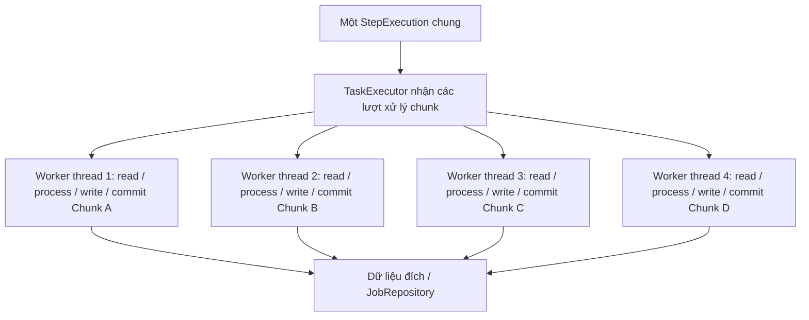
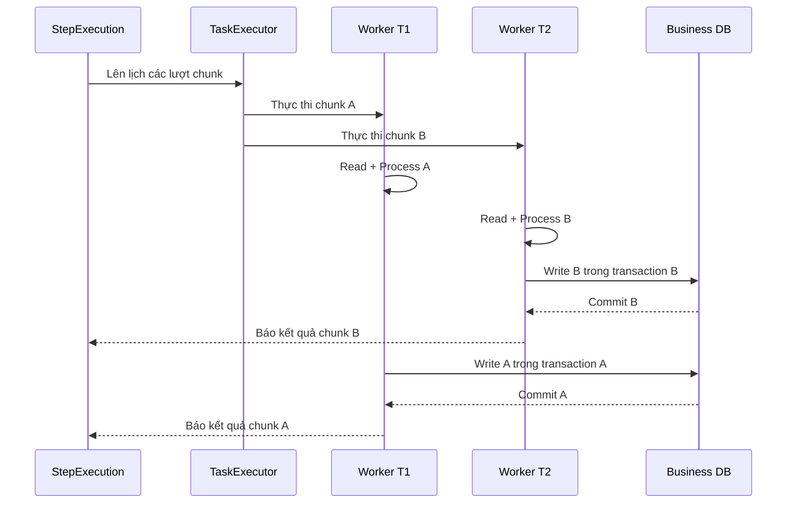

# Chunk được xử lý đồng thời như thế nào trong Multi-threaded Step của Spring Batch?

## 1. Bài toán: một Step cần xử lý hàng triệu bản ghi

Trong module **SPRING_BATCH_SCALING_OPERATIONS**, mục tiêu không dừng ở việc cấu hình nhiều thread. Ta cần hiểu chính xác Spring Batch phân phối công việc, transaction và trạng thái ra sao để tăng throughput mà vẫn giữ được dữ liệu đúng, retry/restart được và không làm nghẽn database.

Giả sử job ban đêm đọc 2 triệu đơn hàng. Mỗi đơn hàng phải tính lại một giá trị nghiệp vụ rồi ghi vào database. Một chunk chứa 100 đơn hàng; một lần ghi chunk mất đáng kể thời gian chờ database. Với step tuần tự, chunk tiếp theo chỉ bắt đầu sau khi chunk hiện tại hoàn thành. **Multi-threaded Step** cho phép nhiều chunk được thực thi đồng thời trong các thread thuộc cùng một process.

Ví dụ một cấu hình:

- `chunkSize = 100`: mỗi chunk có tối đa 100 item đầu vào trước khi đi đến commit; chunk cuối có thể ít hơn.
- `TaskExecutor` có bốn worker thread.
- Các thread cùng thực hiện **một định nghĩa Step và một `StepExecution`**.
- Mỗi chunk có ranh giới transaction xử lý/ghi riêng, nhưng các item và tài nguyên chia sẻ phải đáp ứng yêu cầu thread safety.

Trong bài này ta sẽ trả lời: ai lấy item từ reader, lúc nào processor/writer chạy, vì sao chunk có thể hoàn tất sai thứ tự, một transaction thuộc thread nào, nguy cơ race nằm ở đâu và cách đo xem việc tăng concurrency có thực sự hữu ích không.

## 2. Trước hết: Chunk-oriented processing tuần tự hoạt động ra sao?

Một chunk-oriented Step điển hình có ba thành phần:

1. **`ItemReader`:** gọi `read()` nhiều lần để lấy item cho tới khi đủ kích thước chunk hoặc hết dữ liệu.
2. **`ItemProcessor`:** xử lý từng item; processor có thể biến đổi item, lọc bằng cách trả `null` hoặc báo lỗi.
3. **`ItemWriter`:** nhận `Chunk<? extends T>` và ghi tập item đã xử lý.

Khái quát cho một chunk có 3 item:

```text
Begin transaction
  reader.read() -> item 1
  reader.read() -> item 2
  reader.read() -> item 3
  processor.process(item 1)
  processor.process(item 2)
  processor.process(item 3)
  writer.write([result 1, result 2, result 3])
  lưu trạng thái/checkpoint theo cấu hình
Commit transaction
```

Đây là thứ tự logic điển hình của vòng xử lý một chunk; chi tiết transaction/checkpoint phụ thuộc `PlatformTransactionManager`, loại reader/writer và cấu hình Step. **Một chunk không đồng nghĩa một database transaction bao trùm mọi hệ thống ngoài**. Gọi API, gửi email hay ghi tới dịch vụ khác không tự động rollback cùng transaction JDBC.

Với Step **tuần tự**, các chunk lần lượt hoàn tất:

```text
Main thread:
  Chunk A: read -> process -> write -> commit
  Chunk B: read -> process -> write -> commit
  Chunk C: read -> process -> write -> commit
```

Nếu thời gian chủ yếu là chờ I/O và các thành phần có thể chạy đồng thời an toàn, cách này có thể chưa tận dụng hết tài nguyên.

## 3. Khi bật TaskExecutor: toàn bộ vòng xử lý chunk được phân phối

Trong Spring Batch, cấu hình `taskExecutor(...)` cho một chunk-oriented Step cho phép framework chạy **các lượt xử lý chunk** trên những thread của `TaskExecutor`.

Điều quan trọng là **đơn vị có thể chạy đồng thời là lượt xử lý chunk**. Đây không phải mặc nhiên là pipeline ba thread cố định theo kiểu “thread A chỉ read, thread B chỉ process, thread C chỉ write”. Tùy thiết kế và xử lý lỗi, mỗi lượt thực hiện các hoạt động read/process/write/commit của chunk trong luồng công việc của nó.



**Khác biệt cần nhớ:**

- Có **một `StepExecution`** cho multi-threaded Step này; các thread cùng tham gia vào lần thực thi đó.
- `ItemReader`, `ItemProcessor`, `ItemWriter` có thể là **cùng instance bean** được nhiều thread sử dụng. Spring không tự nhân bản chúng thành một instance mỗi thread.
- Nếu reader có cursor, bộ đếm, buffer hoặc resource mutable, nó cần cơ chế bảo vệ rõ ràng.
- Các chunk hoàn thành **không bắt buộc theo thứ tự đầu vào**. Chunk bắt đầu sau có thể commit trước chunk bắt đầu trước.
- Một transaction manager phổ biến gắn transaction context với thread đang làm việc; các transaction chunk thường độc lập trên các thread khác nhau. Không được dựa vào ThreadLocal do main thread đặt rồi giả định worker thread nhận nguyên vẹn.

### Timeline minh họa

Giả sử mỗi chunk có 3 item và ba worker thread. Các thread tranh quyền gọi `reader.read()` trên cùng nguồn dữ liệu; một reader an toàn có thể phân phối mỗi item đúng một lần, nhưng việc từng thread nhận item nào còn phụ thuộc lịch thực thi.

| Thời điểm | Thread 1 | Thread 2 | Thread 3 |
|---|---|---|---|
| T0 | Bắt đầu chunk A, đọc item | Bắt đầu chunk B, đọc item | Bắt đầu chunk C, đọc item |
| T1 | Đủ item, chạy processor | Đủ item, chạy processor | Đủ item, chạy processor |
| T2 | Chờ DB lock khi writer ghi | Writer ghi nhanh | Processor gọi dịch vụ chậm |
| T3 | Vẫn chờ DB | **Commit chunk B** | Chờ dịch vụ |
| T4 | **Commit chunk A** | Bắt đầu chunk D | Chờ dịch vụ |
| T5 | Kết thúc lượt D | — | **Commit chunk C** |

Bảng chỉ minh họa khả năng xen kẽ; thời điểm thực phụ thuộc executor, reader, processor, writer, database và transaction configuration. Nếu nguồn đầu vào là ID 1–9, **không nên suy luận** rằng A luôn nhận 1–3, B nhận 4–6, C nhận 7–9. Việc gọi `read()` có thể xen kẽ, ngay cả khi bản thân thao tác đọc được đồng bộ.

Như vậy **“chunk đồng thời” không có nghĩa “ghi kết quả đúng thứ tự item ban đầu”**.

## 4. Ranh giới transaction của các chunk đồng thời

Một mô hình làm việc tổng quát:



Lưu ý: trong các cấu hình transaction chuẩn, transaction có thể bắt đầu trước khi read/process chứ không phải chỉ khi writer chạy. Sơ đồ lược bỏ lệnh begin/rollback để nhấn mạnh hai transaction có thể hoạt động song song và commit khác thứ tự.

Từ đây suy ra ba hệ quả:

**Một chunk rollback không kéo lùi chunk khác đã commit.** Nếu thread T1 lỗi và transaction chunk A rollback, chunk B của T2 có thể đã commit. Khi bước tổng thể `FAILED`, dữ liệu đích có thể ở trạng thái **hoàn thành một phần**; restart cần tính đến dữ liệu đã ghi.

**Một `StepExecution` có các bộ đếm tổng hợp.** `readCount`, `writeCount`, `commitCount`, `rollbackCount` phản ánh cả step, không phải mỗi thread một execution. Các thống kê tổng hợp và checkpoint trong môi trường đồng thời cần được diễn giải thận trọng: bộ đếm có thể cập nhật ở các thời điểm khác nhau và không tự cho biết item cụ thể nào đã commit.

**Transaction JDBC không tự bao phủ side effect bên ngoài.** Worker T1 có thể gọi API thành công rồi rollback transaction DB. Khi retry, API có thể được gọi lại; cần idempotency key hoặc transactional outbox nếu đó là thao tác có tác động nghiệp vụ.

## 5. Cấu hình Multi-threaded Step với Spring Batch 5.x

Ví dụ sau minh họa Java 17 + Spring Batch 5.x. Giả sử có bảng `business.orders`:

```sql
CREATE TABLE business.orders (
    id BIGINT PRIMARY KEY,
    batch_id BIGINT NOT NULL,
    amount NUMERIC(18, 2) NOT NULL,
    processed_amount NUMERIC(18, 2)
);
CREATE INDEX idx_orders_batch_id_id
    ON business.orders (batch_id, id);
```

Nghiệp vụ: đọc đơn hàng của một `batchId`, tính `processed_amount = amount * 1.10`, sau đó cập nhật giá trị theo `id`. Đây là **phép gán xác định từ dữ liệu đầu vào không đổi**, nên có thể lặp lại nếu cùng batch phải xử lý từ đầu. Trong hệ thống thật, phép tính và chính sách làm tròn cần theo yêu cầu nghiệp vụ.

### 5.1. ThreadPoolTaskExecutor giới hạn concurrency

```java
import org.springframework.context.annotation.Bean;
import org.springframework.context.annotation.Configuration;
import org.springframework.scheduling.concurrent.ThreadPoolTaskExecutor;

@Configuration
class ConcurrentChunkConfig {

    @Bean("chunkWorkerExecutor")
    ThreadPoolTaskExecutor chunkWorkerExecutor() {
        ThreadPoolTaskExecutor executor = new ThreadPoolTaskExecutor();
        executor.setCorePoolSize(4);
        executor.setMaxPoolSize(4);
        executor.setQueueCapacity(8);
        executor.setThreadNamePrefix("batch-chunk-");
        executor.initialize();
        return executor;
    }
}
```

`corePoolSize = 4` và `maxPoolSize = 4` đặt trần số worker thread của pool trong ví dụ. `queueCapacity` quản lý tác vụ chờ; nó **không tạo thêm throughput** nếu DB hoặc dịch vụ đích đã nghẽn. Cấu hình này chỉ là giá trị khởi đầu để thử nghiệm; cần đo throughput, lock wait, connection pool và CPU trước khi tăng.

### 5.2. Reader: dùng Step Scope và đồng bộ hóa read()

Một `JdbcCursorItemReader` thông thường có trạng thái con trỏ và **không nên để nhiều thread gọi `read()` cùng lúc**. Ví dụ dùng `SynchronizedItemStreamReader` để tuần tự hóa lời gọi `read()` tới reader đích. Dữ liệu đọc từ một cursor vẫn tuần tự; các chunk sau khi có item vẫn có thể process/write song song.

Trong cùng class cấu hình trên, thêm các bean sau:

```java
import java.math.BigDecimal;

import javax.sql.DataSource;

import org.springframework.batch.core.configuration.annotation.StepScope;
import org.springframework.batch.item.database.JdbcCursorItemReader;
import org.springframework.batch.item.database.builder.JdbcCursorItemReaderBuilder;
import org.springframework.batch.item.support.SynchronizedItemStreamReader;
import org.springframework.batch.item.support.builder.SynchronizedItemStreamReaderBuilder;
import org.springframework.beans.factory.annotation.Value;
import org.springframework.context.annotation.Bean;

// Khai báo bên trong ConcurrentChunkConfig.
record OrderRow(long id, BigDecimal amount) {}

@Bean
@StepScope
JdbcCursorItemReader<OrderRow> orderCursor(
        DataSource dataSource,
        @Value("#{jobParameters['batchId']}") Long batchId) {

    return new JdbcCursorItemReaderBuilder<OrderRow>()
            .name("orderCursor")
            .dataSource(dataSource)
            .sql("""
                SELECT id, amount
                  FROM business.orders
                 WHERE batch_id = ?
                 ORDER BY id
                """)
            .preparedStatementSetter(ps -> ps.setLong(1, batchId))
            .rowMapper((rs, rowNum) -> new OrderRow(
                    rs.getLong("id"), rs.getBigDecimal("amount")))
            .saveState(false)
            .build();
}

@Bean
@StepScope
SynchronizedItemStreamReader<OrderRow> orderReader(
        JdbcCursorItemReader<OrderRow> orderCursor) {

    return new SynchronizedItemStreamReaderBuilder<OrderRow>()
            .delegate(orderCursor)
            .build();
}
```

**Giải thích các lựa chọn:**

- `@StepScope` tạo bean theo một `StepExecution` và cho phép lấy `batchId` khi step bắt đầu. Tuy nhiên **các thread trong cùng StepExecution vẫn chia sẻ cùng reader đích**. Vì vậy Step Scope **không thay thế** đồng bộ hóa.
- `SynchronizedItemStreamReader` bảo vệ phương thức `read()` của delegate khỏi các lời gọi đồng thời. Nó không làm cho mọi thao tác nghiệp vụ của reader trở thành song song, và có thể khiến read trở thành điểm nghẽn.
- `saveState(false)` được chọn **có chủ ý cho ví dụ**. Khi reader có trạng thái và nhiều chunk được đọc/commit không theo thứ tự, checkpoint dạng vị trí con trỏ có thể không biểu thị chính xác một prefix dữ liệu đã commit. Tắt trạng thái reader đồng nghĩa restart của step thất bại **đọc lại từ đầu**; ví dụ writer phải chịu được việc ghi lại cùng ID.
- Nếu reader cần restart đúng vị trí để tránh quét lại dữ liệu lớn, hãy đánh giá chiến lược phân vùng độc lập, đánh dấu công việc bền vững bằng khóa nghiệp vụ hoặc mô hình xử lý tuần tự. **Chỉ thêm synchronized wrapper không giải quyết hoàn toàn bài toán restart.**
- `JdbcCursorItemReader` có một cursor được nhiều thread đọc luân phiên. Tính khả dụng cần kiểm tra với JDBC driver, connection management và môi trường thực tế; nếu không đáp ứng, chọn reader/thiết kế khác thay vì ép chia sẻ tài nguyên không an toàn.

Câu query cần đọc **tập dữ liệu ổn định**. Không thêm điều kiện `WHERE processed_amount IS NULL` nếu writer đồng thời thay đổi `processed_amount` và lần restart còn dựa vào vị trí đọc; điều đó có thể làm tập kết quả dịch chuyển.

### 5.3. Processor stateless và writer có hiệu ứng lặp lại an toàn

```java
import java.math.BigDecimal;
import java.math.RoundingMode;

import javax.sql.DataSource;

import org.springframework.batch.item.ItemProcessor;
import org.springframework.batch.item.database.JdbcBatchItemWriter;
import org.springframework.batch.item.database.builder.JdbcBatchItemWriterBuilder;
import org.springframework.context.annotation.Bean;

// Khai báo bên trong ConcurrentChunkConfig.
record ProcessedOrder(long id, BigDecimal processedAmount) {}

@Bean
ItemProcessor<OrderRow, ProcessedOrder> orderProcessor() {
    return item -> new ProcessedOrder(
            item.id(),
            item.amount()
                    .multiply(new BigDecimal("1.10"))
                    .setScale(2, RoundingMode.HALF_UP));
}

@Bean
JdbcBatchItemWriter<ProcessedOrder> orderWriter(DataSource dataSource) {
    return new JdbcBatchItemWriterBuilder<ProcessedOrder>()
            .dataSource(dataSource)
            .sql("""
                UPDATE business.orders
                   SET processed_amount = ?
                 WHERE id = ?
                """)
            .itemPreparedStatementSetter((item, ps) -> {
                ps.setBigDecimal(1, item.processedAmount());
                ps.setLong(2, item.id());
            })
            .assertUpdates(true)
            .build();
}
```

Processor không giữ biến mutable giữa các item; mỗi lời gọi dùng dữ liệu cục bộ, vì thế phù hợp để được gọi đồng thời. Writer JDBC ở ví dụ sử dụng `DataSource`/pool và tham số SQL theo từng lời gọi, không giữ một cursor ghi chung. Cần kiểm chứng thực tế về khả năng dùng chung của **implementation writer** được chọn và không tự thêm các field mutable như `currentItem` hoặc `currentBatch` trong singleton.

Về tính lặp lại an toàn: cập nhật một giá trị được tính xác định theo `id` không làm cộng dồn mỗi lần replay, khác với:

```sql
-- Không idempotent nếu chunk được chạy lại:
UPDATE business.orders
SET processed_amount = processed_amount + ?
WHERE id = ?;
```

Khi job liên quan đến giao dịch tài chính, gửi email hoặc publish event, phải có business key, unique constraint, idempotency key hoặc outbox tương ứng. Không thể suy ra toàn bộ bước xử lý an toàn với replay chỉ vì một câu `UPDATE` trong ví dụ là idempotent.

### 5.4. Gắn executor vào chunk Step

```java
import org.springframework.batch.core.Step;
import org.springframework.batch.core.repository.JobRepository;
import org.springframework.batch.core.step.builder.StepBuilder;
import org.springframework.batch.item.ItemProcessor;
import org.springframework.batch.item.database.JdbcBatchItemWriter;
import org.springframework.batch.item.support.SynchronizedItemStreamReader;
import org.springframework.beans.factory.annotation.Qualifier;
import org.springframework.context.annotation.Bean;
import org.springframework.scheduling.concurrent.ThreadPoolTaskExecutor;
import org.springframework.transaction.PlatformTransactionManager;

// Khai báo bên trong ConcurrentChunkConfig.
@Bean
Step concurrentOrderStep(
        JobRepository jobRepository,
        PlatformTransactionManager transactionManager,
        SynchronizedItemStreamReader<OrderRow> orderReader,
        ItemProcessor<OrderRow, ProcessedOrder> orderProcessor,
        JdbcBatchItemWriter<ProcessedOrder> orderWriter,
        @Qualifier("chunkWorkerExecutor") ThreadPoolTaskExecutor executor) {

    return new StepBuilder("concurrentOrderStep", jobRepository)
            .<OrderRow, ProcessedOrder>chunk(100, transactionManager)
            .reader(orderReader)
            .processor(orderProcessor)
            .writer(orderWriter)
            .taskExecutor(executor)
            .build();
}
```

Các đoạn mã chia theo mục đích để dễ đọc: đặt `record` và các phương thức `@Bean` trong class `@Configuration` tương ứng, rồi khai báo `Job` chạy `concurrentOrderStep`; cấu hình `DataSource`, `JobRepository` và `PlatformTransactionManager` phải được cung cấp cho ứng dụng. Khi có nhiều datasource, dùng `@Qualifier`/config chuyên biệt để writer và transaction manager đúng business DB, còn repository trỏ metadata DB đã chọn.

Ở các phiên bản Spring Batch 5, API `throttleLimit` trước đây đã được đánh dấu deprecated. Nên chủ động giới hạn executor, kiểm tra cơ chế queue/task scheduling và phiên bản Batch cụ thể; nếu cần điều khiển số tác vụ đang bay một cách chặt chẽ hơn, cân nhắc cấu hình `RepeatOperations` thích hợp thay vì chỉ dựa vào một giá trị throttling đã deprecated.

**Giới hạn quan trọng của ví dụ:** đây là minh họa cơ chế và các lựa chọn an toàn, không phải lời hứa rằng một cursor chia sẻ sẽ tạo hiệu năng cao. Reader chỉ có một con trỏ và `read()` bị tuần tự hóa; cách này có ý nghĩa nhất khi processor/writer tốn thời gian đủ lớn để chồng lấp công việc trên các thread. Cần chạy integration test trên cùng driver và database dự kiến triển khai.

## 6. Chunk có thể đọc xen kẽ: một ví dụ dễ nhầm

Với input `1, 2, 3, 4, 5, 6` và `chunk(3)`, giả sử một reader được đồng bộ hóa theo **từng lời gọi read()**:

```text
Thread A: read() -> 1
Thread B: read() -> 2
Thread A: read() -> 3
Thread B: read() -> 4
Thread A: read() -> 5
Thread A: đủ chunk [1, 3, 5], bắt đầu process
Thread B: read() -> 6
Thread B: đủ chunk [2, 4, 6], bắt đầu process
```

Dù reader phát item theo thứ tự 1, 2, 3, 4, 5, 6, **chunk A và B không nhất thiết chứa các dải liên tiếp**. Đồng bộ `read()` đảm bảo một lời gọi không phá trạng thái của lời gọi khác; nó **không khóa toàn bộ ba lượt read của một chunk**.

Điều này ảnh hưởng đến:

- **Bảo toàn thứ tự:** nếu phải xuất dữ liệu chính xác theo thứ tự ban đầu, multi-threaded Step thường không phù hợp khi không có bước sắp xếp/hợp nhất lại.
- **Quan hệ phụ thuộc:** không được dựa vào “item N đã ghi trước khi xử lý N+1”.
- **Lock contention:** hai chunk có thể cập nhật những bản ghi khác nhau nhưng gây tranh chấp qua khóa bảng, index, tài nguyên ngoài hoặc trigger.
- **Tính đúng đắn của checkpoint:** một vị trí đọc tiến về sau không có nghĩa tất cả item trước đó đã được commit.

Nếu nghiệp vụ yêu cầu mỗi worker sở hữu **một tập item ổn định**, hãy đánh giá partitioning theo dải ID/file/shard. Mỗi partition nhận `ExecutionContext` riêng và thường có reader riêng, giúp xây dựng chiến lược restart và tuning rõ ràng hơn.

## 7. Thread safety: component nào được chia sẻ?

Một Step chạy nhiều thread có thể gọi đồng thời vào **cùng một bean**. Đánh giá từng thành phần như sau:

| Thành phần | Trạng thái thường gặp | Cách xử lý |
|---|---|---|
| `ItemReader` cursor/file | Current row, cursor, file position | Thường không thread-safe; cân nhắc `SynchronizedItemStreamReader` hoặc thay kiến trúc |
| `ItemReader` stateless / thread-safe queue | Offset atomic, queue được đồng bộ | Có thể dùng đồng thời nhưng phải giải quyết mất item/restart và transaction |
| `ItemProcessor` thuần hàm | Không giữ mutable field | Thường phù hợp cho concurrency |
| `ItemProcessor` có cache/bộ đếm mutable | `HashMap`, `ArrayList`, counter | Dùng cấu trúc đồng thời hoặc thiết kế lại; kiểm tra tính đúng đắn của phép gộp |
| `ItemWriter` cập nhật DB qua pool | State trong request và transaction | Có thể phù hợp nếu implementation hỗ trợ dùng chung, không giữ buffer mutable giữa thread |
| `ItemWriter` ghi vào cùng một file | File handle, vị trí ghi | Cần serialize/phối hợp ghi; cân nhắc một writer riêng hoặc partition theo file |
| Listener | Bộ đếm, bộ tích lũy, context mutable | Có thể được gọi trong nhiều thread; tránh race và giả định thứ tự |
| `ExecutionContext`/`StepExecution` | Trạng thái restart và số liệu của **một step** | Không lưu/checkpoint theo kiểu tự cập nhật một shared cursor không được kiểm soát |
| `@StepScope` | Bean đích theo `StepExecution` | **Không tạo một instance mỗi worker thread**; không tự giải quyết race |

Ví dụ processor không an toàn:

```java
class UnsafeProcessor
        implements ItemProcessor<OrderRow, ProcessedOrder> {

    private long processedCount = 0; // Nhiều thread cùng cập nhật.

    @Override
    public ProcessedOrder process(OrderRow item) {
        processedCount++; // Race: có thể mất lần tăng.
        return new ProcessedOrder(item.id(), item.amount());
    }
}
```

Nếu chỉ cần metric, dùng công cụ metrics có cấu trúc phù hợp hoặc counter an toàn luồng; không dùng field mutable ở processor singleton để làm nguồn dữ liệu phục hồi. `AtomicLong` giải quyết race của phép tăng nhưng **không** tự xử lý rollback, đếm lại khi retry hoặc đồng bộ với `JobRepository`.

### Tại sao @StepScope chưa đủ?

Trong multi-threaded Step, các worker thread cùng dùng **một `StepExecution`**. Vì thế bean được đánh dấu `@StepScope` vẫn có **một instance đích trong execution đó** và có thể bị nhiều thread truy cập.

Ngược lại, **partitioning** tạo **mỗi partition một `StepExecution`**. Khi dùng `@StepScope` với partitioning, reader có thể có instance riêng theo partition. Đây là sự khác nhau về mô hình cô lập, không phải khác biệt nhỏ về cú pháp.

## 8. Tài nguyên ngoài và giới hạn đồng thời

Giả sử executor có 8 thread, mỗi chunk dùng một JDBC connection để write. Nếu pool chỉ có 4 connection, nhiều chunk có thể phải đợi nhau; tăng thread từ 8 lên 16 không giải quyết được nút thắt DB. Nếu writer giữ transaction quá lâu hoặc update vào cùng vùng index, lock wait có thể còn tăng.

Một **ngân sách concurrency** hữu ích:

```text
active_chunk_threads <= executor concurrency
DB writer connections  <= connection pool limit
throughput thực tế      = min(read capacity, process capacity,
                              write/commit capacity, external-service capacity)
```

Đây là quan hệ định tính: số connection thực tế còn phụ thuộc transaction, reader, datasource khác và nhiệm vụ nền. Khi dùng cursor kết nối dài hạn, phải tính cả connection do reader giữ.

Trong workload CPU-bound, số worker quá nhiều so với CPU core có thể làm context switching tăng. Trong workload I/O-bound, concurrency có thể che giấu thời gian chờ nhưng tạo áp lực lên connection pool, database locks và rate limit của dịch vụ đích.

### Kích thước chunk tương tác với concurrency

| Chunk size | Lợi ích tiềm năng | Chi phí/rủi ro |
|---|---|---|
| Nhỏ, ví dụ 10 | Transaction ngắn, dễ rollback, giữ lock ít thời gian hơn | Commit nhiều lần, chi phí overhead cao |
| Trung bình, ví dụ 100–500 | Cân bằng số lần commit và lượng dữ liệu mỗi chunk | Cần đo với workload thật |
| Rất lớn, ví dụ 5.000 | Giảm số commit trong một số trường hợp | Giữ lock lâu, memory tăng, rollback mất nhiều công việc hơn |

Không có “chunk size tối ưu” cho mọi hệ thống. Chọn dựa vào thời gian xử lý item, số statement mỗi transaction, batch size JDBC, giới hạn memory, lock và tần suất lỗi.

### Không coi queue capacity là số chunk đang xử lý

`ThreadPoolTaskExecutor` phân biệt **tác vụ đang chạy** và **tác vụ đang chờ trong queue**. Nếu worker bận và queue dài, memory và độ trễ có thể tăng trong khi throughput không đổi. Cấu hình pool/queue và chính sách từ chối cần được kiểm tra như một phần của flow control. Không nên tự giả định `queueCapacity=8` luôn đồng nghĩa cùng lúc chỉ có tám chunk “in-flight” trên toàn bộ step.

## 9. Retry, rollback và restart khi chunk chạy đồng thời

Giả sử có ba chunk đang xử lý:

- Chunk A đã commit thành công 100 item.
- Chunk B thất bại vì timeout DB, đang rollback hoặc retry.
- Chunk C đã hoàn tất ghi xuống DB, nhưng cập nhật metadata/tiến độ chưa chắc đã được ghi bền vững.

Nếu một lỗi khiến Step thất bại, các chunk khác có thể đã commit. Khi restart, Spring Batch phải dựa vào metadata/checkpoint và chính sách step; **không thể suy ra chỉ cần đọc tiếp từ “item cuối cùng đã read”**. Vì nhiều chunk có thể commit không theo thứ tự, một cursor position duy nhất không biểu diễn chính xác tập item đã commit.

### Retry trong JVM còn sống

Các retry policy áp dụng khi framework nhận được exception, ví dụ deadlock hoặc lỗi dịch vụ tạm thời. Retry có thể làm cùng item/chunk được xử lý lại, tùy exception và cấu hình transaction. Vì vậy processor/writer cần xem xét:

- **Idempotency:** gán giá trị xác định theo business key, upsert hợp lệ, unique constraint.
- **Transaction:** rollback có bao phủ tác động DB thật không?
- **Side effects:** email, message và API ngoài có idempotency key/outbox không?
- **Không phụ thuộc thứ tự:** logic có chạy đúng nếu chunk C hoàn thành trước B không?

Đừng áp dụng skip để bỏ qua lỗi nghiệp vụ nghiêm trọng chỉ nhằm làm job đạt `COMPLETED`; cần định nghĩa rõ lỗi nào được retry, lỗi nào được skip và giới hạn mỗi loại.

### Crash của process

Nếu JVM bị `SIGKILL` hoặc `OOMKilled`, code xử lý lỗi thông thường có thể không chạy và metadata có thể còn `STARTED`. Khi đó cần quy trình failover để xác định execution đã dừng thực sự, kiểm tra các chunk đã commit và giải quyết trạng thái metadata trước khi restart. Việc `TaskExecutor` có nhiều thread không giúp job tự khôi phục một process đã chết.

Trong ví dụ `saveState(false)`, reader sẽ đọc lại tập dữ liệu từ đầu khi step được chạy lại. Nếu writer cập nhật `processed_amount` bằng phép gán xác định và không có side effect ngoài DB, việc replay cùng item có thể an toàn. Nhưng điều đó **đổi chi phí restart lấy sự đơn giản của checkpoint**: với hàng trăm triệu bản ghi, quét lại từ đầu có thể quá tốn kém.

Muốn restart theo phạm vi dữ liệu tốt hơn, có thể sử dụng **partitioning có dải ID ổn định** và các `StepExecution` độc lập. Mỗi partition có checkpoint riêng, giúp chỉ làm lại phần chưa hoàn tất khi điều phối và nguồn dữ liệu được thiết kế đúng.

## 10. So sánh Multi-threaded Step với Parallel Steps và Partitioning

| Tiêu chí | Multi-threaded Step | Parallel Steps | Partitioned Step |
|---|---|---|---|
| Đơn vị chạy đồng thời | Các lượt xử lý chunk trong **một** Step | Nhiều Step khác nhau trong flow | Nhiều `StepExecution` của cùng logic worker Step |
| `StepExecution` | **Chung** cho các thread | Riêng theo Step | Riêng theo partition |
| Phân chia dữ liệu | Reader/nguồn đọc chung phải phối hợp an toàn | Mỗi Step tự phụ trách dữ liệu/chức năng | `Partitioner` cung cấp nguồn/dải ID/context cho từng partition |
| `@StepScope` | Một target theo step, các thread vẫn có thể chia sẻ | Tách target giữa step executions | Tách target giữa partition executions |
| Restart | Đòi hỏi chú ý checkpoint và chunk hoàn thành sai thứ tự | Theo từng Step | Có thể quản lý theo từng partition ổn định |
| Mức thay đổi kiến trúc | Ít thay đổi nếu đã có step | Tách luồng nghiệp vụ | Phải thiết kế partitioner và phạm vi dữ liệu |
| Phân tán sang JVM khác | Không phải mục tiêu của cách này | Không mặc nhiên | Có thể kết hợp **remote partitioning** |

**Multi-threaded Step phù hợp** khi logic per-item độc lập, xử lý/ghi có thể thực hiện đồng thời, không yêu cầu thứ tự và các thành phần chia sẻ đã được chứng minh an toàn. Nếu cần đọc nhiều tệp hoặc dải dữ liệu độc lập với restart rõ ràng, **partitioning** thường dễ kiểm soát hơn. Nếu muốn chạy những công đoạn nghiệp vụ khác nhau cùng lúc, dùng **parallel steps/split flow**.

Không chọn kiến trúc chỉ vì nó có nhiều thread. Quyết định nên dựa trên bottleneck thực, tài nguyên DB, yêu cầu thứ tự, độ khó restart và rủi ro side effect.

## 11. Đo hiệu quả: concurrency có thật sự tăng throughput?

Trước khi bật executor, hãy đo baseline của Step tuần tự trên tập dữ liệu đại diện. Sau đó chỉ thay đổi **một biến chính mỗi lần** (số thread, chunk size hoặc pool size) để có thể diễn giải nguyên nhân.

### Các metric nên thu thập

| Nhóm metric | Chỉ số | Ý nghĩa |
|---|---|---|
| Step | `readCount`, `writeCount`, `commitCount`, `rollbackCount` | Kiểm tra tiến độ, độ hoàn tất, rollback |
| Throughput | Item/giây, chunk/giây | So sánh trước/sau tuning |
| Latency | Thời gian read, process, write, commit mỗi chunk | Xác định tầng đang nghẽn |
| Executor | Active thread, queue depth, rejected tasks | Phát hiện thread/queue quá tải |
| HikariCP | Active/idle/pending connections, acquisition latency | Xem DB pool có chặn concurrency |
| Database | CPU, I/O, lock wait, deadlock, transaction latency | Phát hiện concurrency tạo contention |
| JVM | CPU, GC, heap, allocation | Phát hiện memory pressure và context switching |
| Nghiệp vụ | Số business key duy nhất và kết quả đúng | Đảm bảo throughput không đánh đổi tính đúng đắn |

Ví dụ log theo chunk:

```text
jobExecutionId=507 stepExecutionId=811 step=concurrentOrderStep
thread=batch-chunk-2 chunkItems=100
readMs=20 processMs=180 writeMs=75 commitMs=35
```

Đây là ví dụ cấu trúc log/telemetry; việc gắn `chunkItems` và thời gian chi tiết cần instrumentation phù hợp, chẳng hạn listener/metrics và correlation context. Đừng tin rằng tất cả thread kế thừa MDC từ main thread: `TaskExecutor` có thể cần `TaskDecorator` hoặc cách truyền context rõ ràng để log đúng định danh job.

### Dấu hiệu cấu hình có vấn đề

- Tăng thread nhưng item/giây gần như không đổi: reader đồng bộ hóa hoặc DB đã nghẽn.
- Tăng thread khiến item/giây giảm: lock contention, CPU context switching, GC hoặc DB pool saturation.
- `rollbackCount`, deadlock tăng: tranh chấp DB, transaction giữ lock lâu, retry gây vòng lặp.
- CPU thấp, queue task lớn, pending DB connections cao: bottleneck I/O/pool, không phải thiếu CPU.
- Output đầy đủ nhưng thứ tự sai: không được dựa vào completion order; kiến trúc không đáp ứng yêu cầu thứ tự.
- Restart làm thiếu/trùng output: reader/checkpoint/side effect chưa an toàn dưới concurrency.

## 12. Kiểm thử có ý nghĩa trước khi triển khai

Các test cần chứng minh **tính đúng đắn dưới lịch thread không đoán trước**, không chỉ chứng minh có nhiều thread xuất hiện trong log.

1. **Đủ và duy nhất:** tạo dữ liệu có ID ổn định; chạy với 1, 2, 4, 8 thread. So sánh số business key duy nhất và kết quả từng ID với baseline tuần tự.
2. **Không dựa vào thứ tự:** thêm độ trễ ngẫu nhiên trong processor ở môi trường test; xác nhận logic vẫn đúng khi chunk hoàn thành đảo thứ tự.
3. **Reader chia sẻ:** dùng nguồn đọc lớn có thể kiểm đếm; phát hiện mất, trùng hoặc đọc sai item khi nhiều thread gọi `read()`.
4. **Rollback/retry:** cố ý gây lỗi tạm thời ở một chunk trong lúc chunk khác hoàn thành; sau recovery kiểm tra không thiếu và không phát sinh side effect lặp.
5. **Process crash và restart:** dừng JVM tại các điểm khác nhau giữa xử lý/commit; so sánh output, checkpoint và metadata. Với `saveState(false)`, xác minh replay từ đầu an toàn.
6. **Backpressure:** làm writer chậm, giới hạn connection pool; xác nhận queue, memory và timeout được kiểm soát.
7. **Saturation:** đo throughput, latency p95/p99 và lock wait khi tăng thread; chốt giá trị tối ưu theo SLA thực tế.

Thử nghiệm nên dùng database/driver gần production vì thread scheduling, cursor, transaction và locking có thể khác đáng kể giữa H2/in-memory và PostgreSQL/Oracle thực tế.

## 13. Những hiểu lầm cần tránh

**“Có bốn thread thì mỗi thread tự đọc một phần tư dữ liệu.”** Không đúng trong multi-threaded Step mặc định. Các thread có thể truy cập chung reader; Spring không tự tạo dải dữ liệu độc lập. Muốn chia tập item rõ ràng, cân nhắc partitioning.

**“Mỗi chunk chạy ở thread khác nên có StepExecution riêng.”** Không đúng. Các chunk đồng thời thuộc cùng `StepExecution`; transaction là ranh giới khác với execution metadata.

**“Dùng @StepScope là reader tự thread-safe.”** Không đúng. Scope theo `StepExecution`, không theo worker thread; cần đồng bộ/thiết kế thread-safe nếu cùng instance bị truy cập đồng thời.

**“Synchronized reader nghĩa là cả chunk tuần tự.”** Không đúng. Wrapper chỉ đồng bộ lời gọi đọc; processor, writer và transaction của chunk vẫn có thể chạy đồng thời.

**“Commit A trước B theo thứ tự read.”** Không có bảo đảm này. Không dựa trên thứ tự hoàn thành cho logic cần thứ tự nghiệp vụ.

**“Đã lưu offset reader thì restart không bao giờ lặp/mất item.”** Không đúng khi các chunk commit đảo thứ tự. Checkpoint một vị trí không mô tả hoàn chỉnh tập item đã commit; phải thiết kế replay hoặc dùng mô hình dễ checkpoint hơn.

**“Càng nhiều thread càng nhanh.”** Không đúng khi reader, DB pool, CPU, lock hoặc dịch vụ ngoài giới hạn throughput.

## 14. Checklist trước khi bật Multi-threaded Step

- [ ] Đã đo bottleneck Step tuần tự và xác nhận concurrency có thể giải quyết không?
- [ ] Biết rõ đây là **một StepExecution** dùng chung bởi nhiều thread chưa?
- [ ] Reader có state/cursor có được đồng bộ hóa hoặc thay bằng cơ chế thread-safe chưa?
- [ ] Processor, writer, listener và các singleton chia sẻ đã được kiểm tra race chưa?
- [ ] Đã loại bỏ giả định thứ tự item, thứ tự chunk và thứ tự commit chưa?
- [ ] Chunk transaction và side effect ngoài DB có retry/idempotency phù hợp chưa?
- [ ] Reader checkpoint có đúng khi commit đảo thứ tự không? Nếu tắt state, replay từ đầu có an toàn không?
- [ ] Executor, queue, database pool và giới hạn tài nguyên downstream đã được đo/tuning chưa?
- [ ] Đã kiểm thử với nhiều thread, rollback, crash/restart và dữ liệu lớn chưa?
- [ ] Đã xác định khi nào chuyển sang partitioning để cô lập dữ liệu và restart rõ hơn chưa?

## 15. Kết luận

**Chunk được xử lý đồng thời** khi Spring Batch dùng `TaskExecutor` để cho nhiều lượt đọc, xử lý, ghi và commit chunk chạy trên các worker thread. Các lượt chunk có transaction riêng và có thể hoàn tất sai thứ tự, nhưng vẫn thuộc **cùng một `StepExecution`** và có thể chia sẻ cùng reader/processor/writer.

Chìa khóa triển khai an toàn là hiểu ranh giới chia sẻ: bảo vệ reader có trạng thái, thiết kế processor/writer không race, không dựa vào thứ tự commit, chọn checkpoint/replay đúng và giới hạn concurrency theo tài nguyên thực. Multi-threaded Step hữu ích khi có công việc per-item độc lập đủ lớn để xử lý song song; khi cần mỗi luồng sở hữu dữ liệu và checkpoint riêng, partitioning có thể là kiến trúc phù hợp hơn. Mọi quyết định scaling cần được kiểm chứng bằng throughput **và** kết quả dữ liệu sau retry/restart.
