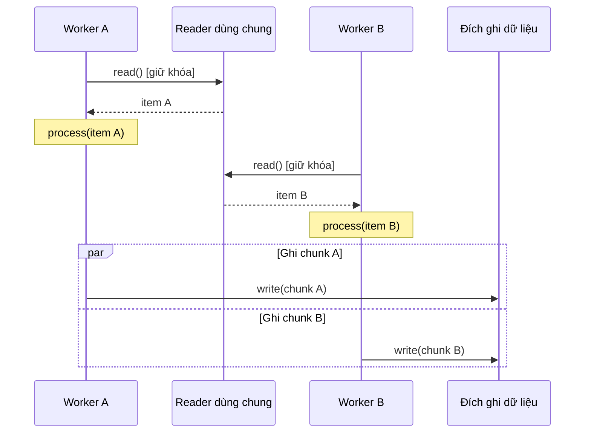

# Reader vẫn đọc tuần tự trong mô hình cơ bản

## 1. Mục tiêu bài học

Trong chương **Step nhiều luồng** của Spring Batch, một cách tăng thông lượng là cho nhiều luồng xử lý các chunk trên cùng một step bằng `TaskExecutor`. Tuy nhiên, việc có nhiều luồng không tự động khiến nguồn dữ liệu có thể được đọc song song. Nhiều reader giữ con trỏ hoặc trạng thái đọc dùng chung; để dùng chúng an toàn, thao tác `read()` thường phải được tuần tự hóa.

Sau bài này, bạn có thể:

- Phân biệt **đọc tuần tự** với **xử lý chunk đồng thời** trong một multi-threaded step.
- Giải thích vì sao một reader có trạng thái thường cần được bảo vệ khi nhiều luồng cùng sử dụng.
- Cấu hình `SynchronizedItemStreamReader` và xác định giới hạn của giải pháp này.
- Đo điểm nghẽn ở reader trước khi quyết định chuyển sang partitioning hoặc kiến trúc phân tán.

> **Điểm chính xác cần nhớ:** Câu “reader vẫn đọc tuần tự” mô tả mô hình **có chủ đích đồng bộ hóa thao tác đọc**, không phải bảo đảm mặc định của Spring Batch. Nếu thêm `taskExecutor(...)` mà chia sẻ một reader không an toàn giữa các luồng, các lời gọi `read()` có thể xảy ra đồng thời và gây lỗi hoặc sai dữ liệu.

## 2. Từ step một luồng đến step nhiều luồng

### 2.1. Step một luồng

Trong mô hình chunk-oriented cơ bản, một luồng thực hiện lần lượt các lần `read()`, `process()` và `write()`:

```text
Luồng chính
  |-- read item 1
  |-- process item 1
  |-- read item 2
  |-- process item 2
  |-- ...
  |-- write(chunk 1)
  |-- commit
  |-- read / process / write(chunk 2)
```

Mỗi chunk được xử lý tuần tự. Reader giữ trạng thái vị trí đọc (ví dụ dòng hiện tại của tệp hoặc con trỏ truy vấn), nên một luồng dễ quản lý trạng thái đó hơn.

### 2.2. Step nhiều luồng với `TaskExecutor`

Khi cấu hình `TaskExecutor` cho step, Spring Batch có thể phân phối **công việc xử lý các chunk** cho nhiều worker. Mỗi worker thực hiện chu trình đọc, xử lý, ghi của chunk được giao. Vì các worker cùng gọi reader của step, **không được mặc định rằng `read()` chỉ chạy trên một luồng**.

Nếu reader chia sẻ có thể đọc an toàn khi nhiều lời gọi đến cùng lúc, các thao tác đọc có thể chồng lấn. Ngược lại, nếu dùng một reader có trạng thái không thread-safe, phải có cơ chế đảm bảo không hai luồng cùng thao tác vào trạng thái đọc.

Khi bọc reader bằng một lớp đồng bộ, luồng nào đang gọi `read()` sẽ giữ khóa; các luồng khác phải chờ đến khi lời gọi đó kết thúc. Sau khi lấy được item, mỗi luồng vẫn có thể `process()` và `write()` đồng thời với các luồng khác, miễn các thành phần ấy được thiết kế an toàn.



Sơ đồ chỉ minh họa việc khóa quanh từng lời gọi `read()`; trong thực tế một worker đọc nhiều item để tạo một chunk, và thời điểm commit của các chunk không nhất thiết theo thứ tự item được đọc.

### 2.3. “Đọc tuần tự” không đồng nghĩa “cả step tuần tự”

| Hoạt động | Với reader được đồng bộ | Ý nghĩa |
| --- | --- | --- |
| `read()` trên **cùng một reader** | Mỗi lần chỉ một luồng vào `read()` | Tránh hai luồng cùng làm thay đổi con trỏ đọc |
| `process()` | Có thể chạy trên nhiều luồng | Cần processor không giữ trạng thái chia sẻ không an toàn |
| `write()` | Có thể chạy trên nhiều luồng | Writer và tài nguyên đích phải chịu được ghi đồng thời |
| Commit của các chunk | Có thể hoàn tất khác thứ tự đọc | Không giả định thứ tự đầu ra giống thứ tự đầu vào |
| Reader **riêng cho mỗi partition** | Các partition có thể đọc song song | Đây là kiến trúc khác với một reader chia sẻ của step |

## 3. Vì sao reader có trạng thái thường phải được bảo vệ?

Giả sử reader đang đọc tệp CSV và lưu vị trí dòng hiện tại:

```text
currentLine = 41
Worker A: nhìn thấy currentLine = 41
Worker B: nhìn thấy currentLine = 41
Worker A: lấy dòng 42, cập nhật vị trí
Worker B: cũng dùng vị trí cũ hoặc cập nhật chồng lên A
```

Đây là ví dụ về **race condition**. Tùy cách reader được triển khai, hậu quả có thể là đọc trùng, bỏ sót, thay đổi trạng thái sai hoặc ném exception. Mô tả này là một kịch bản có thể xảy ra, không có nghĩa mọi reader đều dùng cùng cơ chế đếm dòng.

Một số reader dựa trên cursor, file stream hay state cho việc restart không được thiết kế để nhiều luồng cùng gọi. Một số reader không có trạng thái hoặc có cơ chế điều phối riêng có thể thread-safe. Do đó, phải xem hợp đồng thread safety của **reader cụ thể**, thay vì dựa vào tên interface `ItemReader`.

Ba câu hỏi cần trả lời trước khi dùng một reader trong multi-threaded step:

1. `read()` có thay đổi trạng thái chung, dùng cursor hoặc stream dùng chung không?
2. Nếu hai luồng gọi `read()` đồng thời, chúng có chắc chắn nhận **hai item riêng biệt** không?
3. `open()`, `update()`, `close()` và checkpoint khi restart có còn đúng nếu nhiều chunk đang xử lý dở không?

**Quan trọng:** Khóa `read()` giúp điều phối việc lấy item nhưng **không tự chứng minh tính chính xác của restart** hoặc an toàn của toàn bộ vòng đời `ItemStream`.

## 4. Mẫu cấu hình: đồng bộ hóa `read()`, xử lý chunk bằng nhiều luồng

Ví dụ sau dùng kiểu cấu hình Java của **Spring Batch 5.x**. Giả sử hệ thống có bảng nguồn `trade_input(id, amount)`, bảng kết quả `trade_result(id, adjusted_amount)`, một `DataSource` và một `JobRepository` đã được cấu hình.

```java
import java.math.BigDecimal;
import javax.sql.DataSource;

import org.springframework.batch.core.Step;
import org.springframework.batch.core.repository.JobRepository;
import org.springframework.batch.core.step.builder.StepBuilder;
import org.springframework.batch.item.ItemProcessor;
import org.springframework.batch.item.database.JdbcBatchItemWriter;
import org.springframework.batch.item.database.JdbcCursorItemReader;
import org.springframework.batch.item.database.builder.JdbcBatchItemWriterBuilder;
import org.springframework.batch.item.database.builder.JdbcCursorItemReaderBuilder;
import org.springframework.batch.item.support.SynchronizedItemStreamReader;
import org.springframework.batch.item.support.builder.SynchronizedItemStreamReaderBuilder;
import org.springframework.context.annotation.Bean;
import org.springframework.context.annotation.Configuration;
import org.springframework.core.task.TaskExecutor;
import org.springframework.jdbc.core.namedparam.MapSqlParameterSource;
import org.springframework.scheduling.concurrent.ThreadPoolTaskExecutor;
import org.springframework.transaction.PlatformTransactionManager;

@Configuration
class TradeStepConfiguration {

    record Trade(long id, BigDecimal amount) {}
    record Result(long id, BigDecimal adjustedAmount) {}

    @Bean
    JdbcCursorItemReader<Trade> tradeDelegateReader(DataSource dataSource) {
        return new JdbcCursorItemReaderBuilder<Trade>()
            .name("tradeDelegateReader")
            .dataSource(dataSource)
            .sql("SELECT id, amount FROM trade_input ORDER BY id")
            .rowMapper((rs, rowNum) ->
                new Trade(rs.getLong("id"), rs.getBigDecimal("amount")))
            .build();
    }

    @Bean
    SynchronizedItemStreamReader<Trade> tradeReader(
            JdbcCursorItemReader<Trade> tradeDelegateReader) {
        return new SynchronizedItemStreamReaderBuilder<Trade>()
            .delegate(tradeDelegateReader)
            .build();
    }

    @Bean
    ItemProcessor<Trade, Result> tradeProcessor() {
        // Không giữ dữ liệu mutable dùng chung giữa các worker.
        return item -> new Result(
            item.id(), item.amount().multiply(new BigDecimal("1.05")));
    }

    @Bean
    JdbcBatchItemWriter<Result> tradeWriter(DataSource dataSource) {
        return new JdbcBatchItemWriterBuilder<Result>()
            .dataSource(dataSource)
            .sql("""
                INSERT INTO trade_result (id, adjusted_amount)
                VALUES (:id, :adjustedAmount)
                """)
            .itemSqlParameterSourceProvider(item ->
                new MapSqlParameterSource()
                    .addValue("id", item.id())
                    .addValue("adjustedAmount", item.adjustedAmount()))
            .build();
    }

    @Bean
    TaskExecutor tradeTaskExecutor() {
        ThreadPoolTaskExecutor executor = new ThreadPoolTaskExecutor();
        executor.setCorePoolSize(4);
        executor.setMaxPoolSize(4);
        executor.setQueueCapacity(8);
        executor.setThreadNamePrefix("trade-chunk-");
        executor.initialize();
        return executor;
    }

    @Bean
    Step tradeStep(
            JobRepository jobRepository,
            PlatformTransactionManager transactionManager,
            SynchronizedItemStreamReader<Trade> tradeReader,
            ItemProcessor<Trade, Result> tradeProcessor,
            JdbcBatchItemWriter<Result> tradeWriter,
            TaskExecutor tradeTaskExecutor) {
        return new StepBuilder("tradeStep", jobRepository)
            .<Trade, Result>chunk(100, transactionManager)
            .reader(tradeReader)
            .processor(tradeProcessor)
            .writer(tradeWriter)
            .taskExecutor(tradeTaskExecutor)
            .build();
    }
}
```

Trong cấu hình này:

- `tradeDelegateReader` là reader có trạng thái. `tradeReader` bọc delegate và tuần tự hóa **lời gọi `read()`**.
- Pool có tối đa bốn worker hoạt động; giá trị `queueCapacity(8)` là sức chứa hàng đợi, **không phải số chunk chạy đồng thời**.
- Processor không thay đổi trạng thái chia sẻ; `JdbcBatchItemWriter` được cấu hình một lần và dùng giao dịch của từng chunk. Các ghi vào bảng đích vẫn phải tuân thủ ràng buộc khóa, chỉ mục và tính idempotent.
- `chunk(100, ...)` nghĩa là step thường gom tối đa 100 item/chunk trước khi ghi, không có nghĩa reader lấy 100 item trong một lệnh nguyên tử.

Ví dụ tập trung vào đồng bộ reader và concurrency của step; trước khi đưa vào production, phải kiểm thử kỹ khả năng restart, cấu hình pool kết nối, chính sách ghi trùng và hành vi khi lỗi. Đoạn mã khai báo một `Step` để dùng trong `Job` tương ứng.

**Không nhầm với `@StepScope`:** Tạo bean step-scoped không tự tạo một instance reader độc lập cho từng worker thread của **cùng** step. Nếu mục tiêu là mỗi đơn vị công việc có reader riêng, cân nhắc partitioning và step-scoped reader theo từng partition.

## 5. Nút thắt hiệu năng: khi `read()` trở thành đoạn tuần tự

Đọc tuần tự vẫn có thể tăng tốc đáng kể khi xử lý và ghi tốn phần lớn thời gian. Ví dụ mỗi item cần gọi logic tính toán CPU nặng, còn việc lấy item từ nguồn rất nhanh: nhiều worker có thể xử lý item đã đọc trong lúc một worker khác lấy item kế tiếp.

Ngược lại, nếu đọc dữ liệu từ mạng hoặc từ một câu truy vấn chậm chiếm đa số thời gian, các worker sẽ thường xuyên đợi khóa reader, và thêm luồng khó cải thiện throughput.

Có thể dùng **định luật Amdahl** làm trực giác gần đúng:

\[
S(N) \leq \frac{1}{f + \frac{1-f}{N}}
\]

Trong đó `f` là phần thời gian không thể song song hóa (ví dụ nút thắt đọc tuần tự), `N` là số worker lý tưởng và `S(N)` là mức tăng tốc tối đa tương đối so với một luồng.

Nếu phần tuần tự chiếm 30% tổng thời gian và dùng bốn worker, giới hạn lý thuyết là:

\[
S(4) \leq \frac{1}{0.30 + 0.70/4} \approx 2.11
\]

Đây chỉ là minh họa: hệ thống thực còn mất thời gian tranh khóa, xếp lịch, transaction, connection pool, I/O và tác động dữ liệu không đồng đều giữa các chunk.

### Những chỉ số nên đo

| Chỉ số | Dấu hiệu cần quan sát | Hướng điều tra |
| --- | --- | --- |
| Throughput (item/s, chunk/s) | Không tăng khi nâng từ 2 lên 4/8 worker | Reader, writer, tài nguyên ngoài hoặc giới hạn pool |
| Thời gian `read()` và thời gian chờ khóa | Worker thường xuyên đứng chờ trước khi có item | Reader đang là điểm nghẽn |
| Thời gian `process()` | CPU cao, nhiều công việc độc lập | Đa luồng có thể hữu ích nếu đủ CPU |
| Thời gian `write()` và commit | Lock wait, deadlock, transaction lâu | Kiểm tra DB, chỉ mục, thứ tự khóa, kích thước chunk |
| Connection pool | Nhiều thread chờ lấy connection | Điều chỉnh đồng thời theo số kết nối thực có |
| Bộ nhớ và GC | Queue/chunk lớn gây tăng heap | Giới hạn worker, chunk size và backlog |
| Số item đọc/ghi/skip/retry | Sai khác bất thường | Kiểm tra xử lý lỗi, trùng dữ liệu và trạng thái restart |

Quy trình đo thực dụng: chạy baseline một luồng trên tập dữ liệu đại diện; giữ nguyên dữ liệu và cấu hình chung rồi thử 2, 4 worker; so sánh throughput, số bản ghi duy nhất và thời gian đọc/xử lý/ghi. Dừng tăng luồng khi thông lượng không còn cải thiện hoặc rủi ro vận hành tăng đáng kể.

## 6. Thread safety, retry và restart: ba vấn đề khác nhau

**Thread safety của `read()`:** `SynchronizedItemStreamReader` bảo vệ các lần gọi `read()` vào cùng delegate. Nó không biến mọi collaborator, processor hay writer thành thread-safe. Tránh lưu các bộ đếm, map mutable hoặc bộ nhớ đệm chia sẻ không đồng bộ trong processor và listener.

**Đúng một lần về mặt nghiệp vụ:** Nhiều luồng có thể xử lý chunk, retry hoặc hoàn tất không theo thứ tự. Đừng dựa vào thứ tự item để suy ra thứ tự commit. Với bảng đích, nên dùng khóa nghiệp vụ/unique constraint, transaction và cách ghi có thể lặp an toàn như upsert nếu nghiệp vụ cho phép. Nếu processor có tác dụng phụ ngoài transaction (gọi API, gửi thông báo), cần thiết kế cơ chế chống trùng riêng.

**Restart sau lỗi:** Một reader dùng chung có thể đã tiến xa hơn vị trí commit của một chunk đang xử lý. Đồng bộ hóa riêng `read()` **không bảo đảm** checkpoint trong `ExecutionContext` phản ánh chính xác tất cả item đã commit. Tài liệu về `SynchronizedItemStreamReader` cũng cảnh báo rằng restart có thể không an toàn nếu việc đọc lại và xử lý lại item là vấn đề. Việc tắt lưu trạng thái reader cũng **không tự** tạo ra khả năng resume chính xác; khi chạy lại có thể cần xử lý trùng theo khóa nghiệp vụ.

Nên thực hành ít nhất các kiểm tra sau trước production:

1. Chạy nhiều worker trên tập có ID duy nhất, so sánh **số ID đầu ra phân biệt** với dữ liệu đầu vào.
2. Cố ý tạo lỗi giữa lúc nhiều chunk đang chạy; thực hiện restart và xác minh không mất, không ghi trùng theo ngữ nghĩa nghiệp vụ.
3. Thử retry/skip ở processor và writer; xác nhận tác dụng phụ vẫn idempotent.
4. Theo dõi thời gian chờ DB connection, lock/deadlock và sức chứa CPU/memory khi tăng worker.

Nếu yêu cầu restart chính xác hoặc phạm vi dữ liệu cần chia độc lập, một reader riêng cho từng partition có thể phù hợp hơn một cursor chung được khóa.

## 7. Khi nào cần chuyển khỏi mô hình một reader dùng chung?

| Điều kiện của workload | Phương án đáng cân nhắc |
| --- | --- |
| Đọc nhanh, xử lý CPU/tính toán nặng, thành phần còn lại thread-safe | Multi-threaded step với reader được bảo vệ |
| Reader có trạng thái, dữ liệu không chia được, yêu cầu thứ tự nghiêm ngặt | Step một luồng hoặc thiết kế lại luồng dữ liệu |
| Có thể chia dữ liệu theo ID range, ngày hoặc shard; cần checkpoint độc lập | **Partitioning**: mỗi partition có reader và trạng thái riêng |
| Các pha xử lý độc lập theo nhánh, không tranh cùng reader | **Parallel steps** |
| Cần phân phối trên nhiều máy, mỗi đơn vị xử lý có ranh giới rõ | Remote partitioning hoặc mô hình phân tán phù hợp |

Ví dụ bảng chứa 10 triệu giao dịch có ID liên tục: thay vì cho tám worker tranh một `JdbcCursorItemReader`, có thể chia tám khoảng ID và tạo reader theo khoảng cho từng partition. Khi đó, mỗi partition sở hữu truy vấn và checkpoint của riêng mình. Việc chia khoảng phải bao phủ đủ dữ liệu và tránh giao nhau; với dữ liệu thay đổi khi job chạy, cần xem xét snapshot hoặc điều kiện lọc nhất quán.

## 8. Lỗi hiểu nhầm thường gặp

| Nhận định | Điều chỉnh đúng |
| --- | --- |
| “Thêm `taskExecutor` thì `read()` vẫn chạy mặc định trên một luồng.” | **Sai.** Các worker có thể gọi reader chung đồng thời; phải kiểm tra khả năng thread-safe của reader. |
| “`SynchronizedItemStreamReader` biến toàn bộ step thành tuần tự.” | **Sai.** Chỉ các lời gọi `read()` vào delegate được tuần tự hóa; xử lý và ghi vẫn có thể đồng thời. |
| “Reader đã synchronized thì restart chắc chắn đúng.” | **Sai.** Checkpoint/commit có thể chênh nhau giữa các chunk đang chạy; cần kiểm thử và thiết kế recovery. |
| “Tám worker nhanh gấp tám lần.” | **Không được bảo đảm.** Tốc độ bị chặn bởi phần tuần tự và tài nguyên thực. |
| “`@StepScope` cấp reader riêng cho mỗi thread.” | **Không đúng trong cùng một step execution.** Phân chia step execution bằng partitioning nếu cần reader độc lập theo partition. |
| “Xử lý đa luồng thì thứ tự đầu ra vẫn theo thứ tự nguồn.” | **Không được bảo đảm.** Chunk có thể hoàn tất và commit theo thứ tự khác. |

## 9. Câu hỏi tự kiểm tra

1. Trong một multi-threaded step sử dụng `TaskExecutor`, vì sao một `FlatFileItemReader` chia sẻ có thể gặp race condition?
2. Khi bọc reader bằng `SynchronizedItemStreamReader`, thao tác nào bắt buộc tuần tự, thao tác nào vẫn có thể chạy đồng thời?
3. Vì sao việc đồng bộ hóa `read()` chưa đủ để kết luận một job có thể restart an toàn?
4. Nếu throughput gần như không đổi khi tăng worker từ hai lên tám, bạn sẽ đo những chỉ số nào trước?
5. Khi dữ liệu có thể phân vùng theo dải ID, partitioning giải quyết điểm nghẽn đọc và quản lý checkpoint như thế nào?

**Ghi nhớ:** Trong cách triển khai multi-threaded step với **một reader dùng chung được đồng bộ hóa**, Spring Batch tuần tự hóa việc *lấy từng item* nhưng vẫn có thể xử lý và ghi các chunk trên nhiều luồng. Tốc độ thực tế phụ thuộc tỷ trọng công việc tuần tự, khả năng thread-safe của các thành phần và giới hạn tài nguyên. Khi reader hoặc cơ chế restart trở thành nút thắt, hãy cân nhắc partitioning với các reader độc lập.
