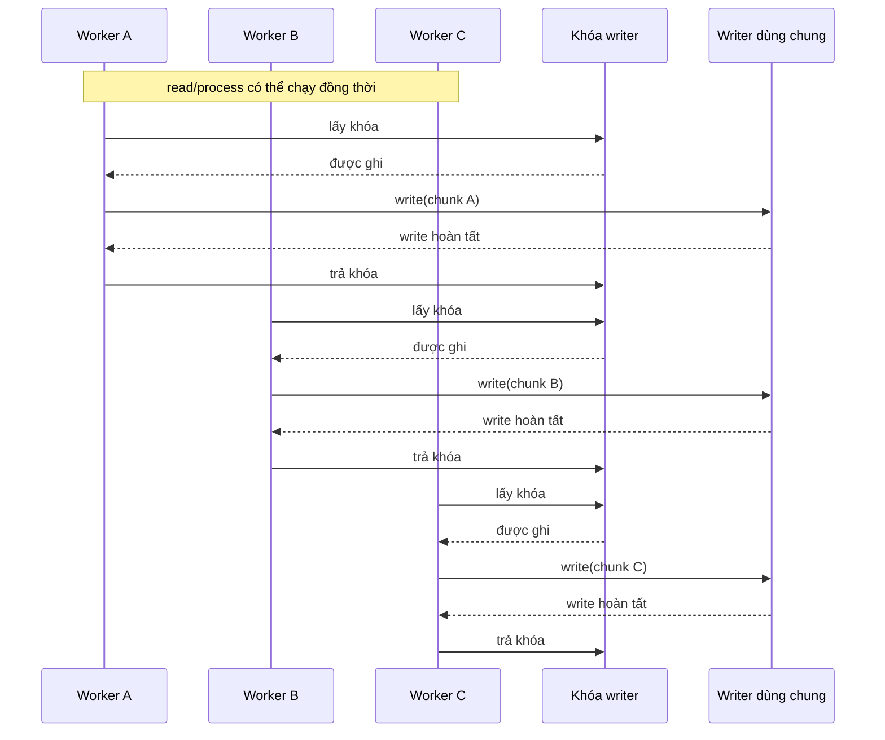

# Writer tuần tự và giới hạn thông lượng

## 1. Bài toán trong step nhiều luồng

Khi xử lý hàng triệu giao dịch bằng Spring Batch, ta thường thêm nhiều worker để giảm thời gian chạy một step: một worker đọc một nhóm item, xử lý chúng rồi ghi thành một chunk; các worker khác cũng thực hiện các chunk của mình. Tuy nhiên, **tăng số worker không đồng nghĩa tăng tương ứng tốc độ ghi dữ liệu**. Nếu mọi worker phải đợi một writer dùng chung hoặc cùng tranh chấp một tài nguyên đầu ra, đoạn ghi tuần tự có thể trở thành nút thắt quyết định thông lượng của toàn step.

Trong chương **Step nhiều luồng** của module **SPRING_BATCH_SCALING_OPERATIONS**, bài này tập trung vào trường hợp **writer phải ghi tuần tự** và cách đánh giá xem nên tiếp tục tối ưu multi-threaded step, tách partition hay đổi kiến trúc xử lý dữ liệu lớn. Các nguyên tắc quan trọng cũng áp dụng cho parallel steps và xử lý phân tán: đo nút thắt thực tế, bảo đảm thread safety, quản lý transaction, retry/restart và điều chỉnh mức đồng thời theo tài nguyên sẵn có.

Sau bài học, bạn có thể:

- Giải thích vì sao việc dùng `TaskExecutor` **không mặc định tuần tự hóa** `ItemWriter.write()`.
- Phân biệt writer có trạng thái cần khóa với writer đủ an toàn để ghi từ nhiều luồng.
- Nhận diện điểm nghẽn tại writer, hàng đợi khóa, database connection, transaction và tài nguyên đích.
- Ước lượng giới hạn throughput khi phần ghi là đoạn tuần tự bắt buộc.
- Cấu hình writer được đồng bộ hóa khi thực sự cần thiết và hiểu rõ giới hạn của nó.
- Lựa chọn giữa multi-threaded step, partitioning, parallel steps hoặc kiến trúc ghi phân tán.

> **Lưu ý quan trọng:** “Writer tuần tự” là một **ràng buộc của thiết kế hoặc tài nguyên**, không phải một quy tắc mặc định của Spring Batch. Khi step sử dụng `TaskExecutor`, các worker có thể gọi `write()` trên cùng một bean writer **đồng thời**. Muốn ghi tuần tự, ứng dụng phải có cơ chế đồng bộ phù hợp; muốn ghi đồng thời an toàn, writer và đích ghi phải hỗ trợ điều đó.

## 2. Từ chunk một luồng đến nhiều chunk chạy đồng thời

### 2.1. Chu trình chunk

Với một step chunk-oriented, chu trình thông thường là:

```text
read()  ->  process()  ->  ...  ->  write(chunk)  ->  commit
```

Mỗi chunk có phạm vi transaction của nó. Trong step một luồng, các thao tác này được thực hiện theo thứ tự. Khi cấu hình `TaskExecutor` cho step, các worker có thể thực hiện **nhiều chu trình chunk cùng lúc**:

```text
Worker A: [read][process][write A][commit A]
Worker B:      [read][process][write B][commit B]
Worker C:           [read][process][write C][commit C]
                         Thời gian  -------->
```

Mô hình trên chỉ mô tả khả năng đồng thời. Trong thực tế, reader, processor, writer, listener, resource pool và dữ liệu đích phải được kiểm tra khả năng chia sẻ giữa các worker.

### 2.2. Một bean writer chung không tự có một hàng đợi tuần tự

Xét cấu hình:

```java
new StepBuilder("importStep", jobRepository)
    .<InputRow, OutputRow>chunk(200, transactionManager)
    .reader(reader)
    .processor(processor)
    .writer(writer)
    .taskExecutor(chunkTaskExecutor)
    .build();
```

`writer` ở đây có thể là **một bean được chia sẻ** bởi tất cả worker. Việc cùng tham chiếu bean đó không khiến Spring Batch đặt khóa quanh `write()`. Nếu writer sử dụng một biến mutable, một buffer hoặc stream đầu ra dùng chung mà không bảo vệ, các lần ghi chồng lấn có thể gây mất dữ liệu, ghi trùng, sai thứ tự hoặc exception.

Ngược lại, **không phải mọi writer đều cần đồng bộ hóa**. Chẳng hạn, `JdbcBatchItemWriter` được thiết kế để có thể sử dụng từ nhiều luồng sau khi cấu hình xong; mỗi giao dịch sẽ dùng tài nguyên JDBC theo ngữ cảnh của nó. Việc tự ý thêm một khóa toàn cục quanh writer loại này có thể làm giảm throughput mà không mang lại lợi ích thực tế.

| Kiểu ghi | Có thể gọi `write()` đồng thời? | Việc cần kiểm tra |
| --- | --- | --- |
| Writer không giữ trạng thái, đích hỗ trợ transaction đồng thời | Thường có thể, nếu triển khai xác nhận thread-safe | Pool kết nối, tranh chấp khóa, chỉ mục, batch size |
| Writer giữ buffer/con trỏ/stream chung, không thread-safe | Không nên gọi đồng thời khi chưa có bảo vệ | Khóa, thứ tự ghi, lifecycle và checkpoint |
| Writer có khóa quanh `write()` | Các lời gọi `write()` được tuần tự hóa | Thời gian chờ khóa, độ trễ writer, commit bên ngoài khóa |
| Mỗi partition có writer riêng và phạm vi đầu ra độc lập | Có thể ghi song song giữa các partition | Phân vùng dữ liệu, tài nguyên đích, restart từng partition |
| Các writer độc lập nhưng cùng ghi vào một bảng có khóa nóng | Có thể bị tuần tự hóa **ở database** | Lock wait, index, transaction, connection pool |

## 3. Writer tuần tự hóa tạo ra nút thắt như thế nào?

Giả sử có bốn worker xử lý bốn chunk. Nếu writer giữ khóa độc quyền quanh mỗi lần `write()` thì tại một thời điểm chỉ một worker được gọi delegate writer:



Trong thời gian worker A ghi, B và C có thể đã xử lý xong nhưng phải đợi. Thêm worker làm tăng số yêu cầu đợi khóa; **đoạn ghi độc quyền không tự nhanh hơn**.

Cần phân biệt ba mức “tuần tự”:

1. **Tuần tự trong Java:** Ứng dụng dùng `synchronized`/`Lock` quanh `write()`, cho phép một thread tại một thời điểm vào đoạn mã đó.
2. **Tuần tự ở tài nguyên đích:** Writer có thể thread-safe nhưng các giao dịch vẫn phải chờ khóa một dòng/bảng, một endpoint giới hạn tốc độ, một stream đầu ra hoặc một tài nguyên chỉ cho phép một thao tác ghi.
3. **Tuần tự theo yêu cầu nghiệp vụ:** Có hệ thống buộc phải giữ thứ tự xuất bản theo sequence; đây là ràng buộc nghiệp vụ cần thiết kế riêng, không thể suy ra từ việc gọi `write()` được đồng bộ.

**Khóa quanh `write()` không đồng nghĩa tuần tự hóa transaction hoặc commit.** Trong chunk-oriented step, transaction thường mở trước khi gọi writer và commit sau khi phương thức `write()` trả về. Worker A có thể trả khóa writer nhưng vẫn chưa commit; worker B có thể vào `write()` khi transaction A còn đang mở. Vì vậy thứ tự gọi `write()`, thứ tự commit và thứ tự dữ liệu cuối cùng có thể khác nhau.

## 4. Giới hạn throughput khi một writer phải giữ khóa

Đặt:

- `C`: số item trung bình trong một chunk.
- `T_w`: thời gian trung bình một chunk **giữ khóa độc quyền** tại writer, tính bằng giây.
- `N`: số worker có thể xử lý chunk đồng thời.

Nếu mọi chunk đều phải qua cùng một đoạn ghi độc quyền, thì giới hạn lý tưởng của thông lượng phần ghi là:

\[
R_{\text{chunk}} \lesssim \frac{1}{T_w},
\qquad
R_{\text{item}} \lesssim \frac{C}{T_w}
\]

Ví dụ có `C = 200` item/chunk và thời gian giữ khóa trung bình `T_w = 0,15` giây/chunk:

\[
R_{\text{chunk}} \lesssim 6{,}67\text{ chunk/s},
\qquad
R_{\text{item}} \lesssim 1\,333\text{ item/s}.
\]

Đây là **trần thông lượng lý tưởng từ riêng writer** nếu chunk luôn đầy và thời gian giữ khóa ổn định. Thông lượng thực tế còn bị hạn chế bởi reader, processor, transaction, network, database, queue, thread scheduling, contention và rollback. Nếu các chunk có kích thước thay đổi, hãy dùng số item thực ghi và thời gian đo được.

Khi `T_w` là giới hạn chính, tăng `N` từ 4 lên 8 sẽ không nâng trần `1 / T_w`. Đôi khi throughput còn giảm vì số thread tranh khóa, context switching, bộ nhớ đệm và kết nối tăng.

### Ví dụ đo thử mang tính minh họa

| Worker | Item/s đo được | Thời gian chờ khóa writer (mức tương đối) | Nhận xét |
| ---: | ---: | --- | --- |
| 1 | 620 | Gần như không có | CPU xử lý và writer đều có việc |
| 2 | 1.090 | Thấp | Tăng hiệu quả do xử lý chồng lấn |
| 4 | 1.270 | Trung bình | Tiến gần trần của writer |
| 8 | 1.255 | Cao | Thêm worker không giúp tăng ghi |

Các số trên **chỉ là dữ liệu giả lập để học cách đọc kết quả**, không phải benchmark chính thức của Spring Batch. Trước khi tối ưu, cần chạy thử trên dữ liệu và môi trường tương đương production.

## 5. Ví dụ Java: chỉ tuần tự hóa writer khi thật sự cần

Một cách thể hiện rõ ràng cơ chế khóa là tạo decorator cho `ItemWriter`. Ví dụ dưới đây sử dụng giao diện `ItemWriter.write(Chunk<? extends T>)` của Spring Batch 5.x:

```java
import java.util.Objects;
import org.springframework.batch.item.Chunk;
import org.springframework.batch.item.ItemWriter;

public final class SerializedItemWriter<T> implements ItemWriter<T> {

    private final ItemWriter<T> delegate;
    private final Object writeLock = new Object();

    public SerializedItemWriter(ItemWriter<T> delegate) {
        this.delegate = Objects.requireNonNull(delegate);
    }

    @Override
    public void write(Chunk<? extends T> chunk) throws Exception {
        synchronized (writeLock) {
            delegate.write(chunk);
        }
    }
}
```

Mọi worker phải sử dụng **cùng một instance `SerializedItemWriter`** thì chúng mới tranh cùng khóa. Tạo một wrapper và một khóa **riêng cho từng worker** không tuần tự hóa việc truy cập một tài nguyên chia sẻ.

Đoạn decorator này bảo vệ **duy nhất `write()`**. Nếu delegate còn triển khai `ItemStream` với `open()`, `update()` và `close()`, cần bố trí cơ chế quản lý lifecycle và checkpoint chính xác, ví dụ một decorator triển khai `ItemStreamWriter` phù hợp và đăng ký đúng các stream với step. Không tự cho rằng khóa `write()` đã bảo vệ mọi trạng thái của writer.

### Gắn decorator vào multi-threaded step

Đoạn cấu hình dưới đây thể hiện cách dùng. Các bean `sourceReader` và `businessProcessor` được giả định đã cấu hình ở nơi khác; **reader phải được xác nhận thread-safe hoặc được bảo vệ đúng cách**, processor không chia sẻ trạng thái mutable thiếu đồng bộ:

```java
import javax.sql.DataSource;
import java.math.BigDecimal;

import org.springframework.batch.core.Step;
import org.springframework.batch.core.repository.JobRepository;
import org.springframework.batch.core.step.builder.StepBuilder;
import org.springframework.batch.item.ItemReader;
import org.springframework.batch.item.ItemProcessor;
import org.springframework.batch.item.ItemWriter;
import org.springframework.batch.item.database.JdbcBatchItemWriter;
import org.springframework.batch.item.database.builder.JdbcBatchItemWriterBuilder;
import org.springframework.beans.factory.annotation.Qualifier;
import org.springframework.context.annotation.Bean;
import org.springframework.context.annotation.Configuration;
import org.springframework.core.task.TaskExecutor;
import org.springframework.jdbc.core.namedparam.MapSqlParameterSource;
import org.springframework.scheduling.concurrent.ThreadPoolTaskExecutor;
import org.springframework.transaction.PlatformTransactionManager;

@Configuration
class ImportStepConfiguration {

    record InputRow(long id, BigDecimal amount) {}
    record OutputRow(long id, BigDecimal adjustedAmount) {}

    @Bean
    JdbcBatchItemWriter<OutputRow> jdbcOutputWriter(DataSource dataSource) {
        return new JdbcBatchItemWriterBuilder<OutputRow>()
            .dataSource(dataSource)
            .sql("""
                INSERT INTO processed_record (source_id, adjusted_amount)
                VALUES (:id, :adjustedAmount)
                """)
            .itemSqlParameterSourceProvider(item ->
                new MapSqlParameterSource()
                    .addValue("id", item.id())
                    .addValue("adjustedAmount", item.adjustedAmount()))
            .build();
    }

    @Bean
    ItemWriter<OutputRow> exclusiveWriter(
            JdbcBatchItemWriter<OutputRow> jdbcOutputWriter) {
        // CHỈ dùng decorator này nếu có yêu cầu ghi tuần tự thực tế.
        // JdbcBatchItemWriter vốn có thể chạy đồng thời sau khi cấu hình.
        return new SerializedItemWriter<>(jdbcOutputWriter);
    }

    @Bean
    TaskExecutor chunkTaskExecutor() {
        ThreadPoolTaskExecutor executor = new ThreadPoolTaskExecutor();
        executor.setCorePoolSize(4);
        executor.setMaxPoolSize(4);
        executor.setQueueCapacity(8);
        executor.setThreadNamePrefix("chunk-");
        executor.initialize();
        return executor;
    }

    @Bean
    Step importStep(
            JobRepository jobRepository,
            PlatformTransactionManager transactionManager,
            @Qualifier("sourceReader") ItemReader<InputRow> sourceReader,
            @Qualifier("businessProcessor")
                ItemProcessor<InputRow, OutputRow> businessProcessor,
            @Qualifier("exclusiveWriter") ItemWriter<OutputRow> writer,
            @Qualifier("chunkTaskExecutor") TaskExecutor taskExecutor) {

        return new StepBuilder("importStep", jobRepository)
            .<InputRow, OutputRow>chunk(200, transactionManager)
            .reader(sourceReader)
            .processor(businessProcessor)
            .writer(writer)
            .taskExecutor(taskExecutor)
            .build();
    }
}
```

Trong ví dụ:

- Một pool có thể thực thi đồng thời tối đa bốn worker, tùy khối lượng công việc và bộ điều phối; hàng đợi kích thước 8 **không phải** tám thread.
- Mọi chunk dùng một `exclusiveWriter` singleton, nên các lần gọi `write()` đến delegate bị khóa tuần tự.
- `JdbcBatchItemWriter` ở đây chỉ làm **đích minh họa cho decorator**: với writer này thường có thể bỏ decorator để cho phép ghi đồng thời sau khi xác nhận khả năng chịu tải của database. Bọc nó bằng khóa là quyết định có thể **làm chậm** step.
- Cần có unique key cho `processed_record.source_id` và chiến lược ghi lặp an toàn theo nghiệp vụ. Câu `INSERT` đơn giản không bảo đảm restart an toàn nếu một giao dịch hoặc tác dụng phụ được lặp lại.
- Việc truyền writer dưới dạng `ItemWriter` không làm Spring Batch tự quản lý lifecycle của một delegate `ItemStream` bị giấu bên trong adapter. Khi tích hợp writer có state, cần xử lý riêng vấn đề này.

Một phương án khác, nếu công việc cần một đầu ra tuần tự theo nghiệp vụ, là thiết kế **một thành phần nhận kết quả theo thứ tự đã xác định** sau các bước xử lý song song. Phương án này cần queue bền vững, backpressure, theo dõi offset và cơ chế khôi phục; chỉ thêm khóa Java chưa đủ để bảo đảm thứ tự commit hay thứ tự xử lý lại.

## 6. Vì sao synchronized writer chưa giải quyết hết vấn đề?

### 6.1. Thread safety khác với throughput

Đặt khóa có thể loại bỏ race condition bên trong một writer không thread-safe. Nhưng nếu thời gian ghi độc quyền chiếm phần lớn chi phí của chunk, khóa khiến các worker khác phải chờ. Việc bảo vệ tính đúng đắn có thể **cần thiết**, song phải nhận ra điểm nghẽn do nó tạo ra.

### 6.2. Khóa trong JVM khác với transaction của database

`synchronized` chỉ bảo vệ code chạy qua **cùng một Java monitor** trong một JVM. Nó không bao phủ một cluster, không thay thế transaction database, không phát hiện ghi trùng nghiệp vụ và không duy trì thứ tự commit.

Ngay cả khi mỗi worker lần lượt gọi `delegate.write(chunk)`, transaction của các worker vẫn có thể chồng lấn. Nếu cần điều phối nhiều tiến trình hoặc xử lý đúng một lần theo nghiệp vụ, cần giải pháp dựa trên dữ liệu và cơ chế commit/idempotency phù hợp.

### 6.3. Reader cũng phải an toàn

Step dùng `TaskExecutor` có thể khiến các worker đồng thời gọi `read()` trên một reader chung. Nếu reader có cursor hoặc trạng thái không thread-safe, chỉ bảo vệ writer **không đủ**. Có thể cần đồng bộ reader, sử dụng reader được thiết kế cho concurrent access hoặc chuyển sang partitioning với reader riêng.

Đồng bộ hóa reader và writer đồng thời có thể tạo **hai đoạn tuần tự**, làm lợi ích của multi-threading giảm mạnh. Ngoài ra, bảo vệ lời gọi `read()` hoặc `write()` không tự bảo đảm checkpoint/restart chính xác trong mọi tình huống.

### 6.4. Tranh chấp database vẫn tồn tại khi writer an toàn

Writer có thể thread-safe mà throughput thấp do:

- Pool kết nối thiếu connection cho số worker thực tế.
- Giao dịch giữ row lock/index lock lâu, nhiều worker ghi chung một khóa nóng.
- Batch size không hợp lý, round-trip hoặc flush quá nhiều.
- I/O storage, WAL/redo log, replication hay giới hạn ghi của database đã bão hòa.
- Công việc ghi vào một dịch vụ bên ngoài có rate limit hoặc tail latency cao.

Do đó, **thời gian `write()` dài** chưa đủ để kết luận phải khóa writer: cần tách thời gian chờ khóa ứng dụng khỏi thời gian JDBC/network/DB và thời gian commit.

## 7. Đo nút thắt tại writer

Để đánh giá writer, nên đo trên tập dữ liệu đại diện và theo dõi tối thiểu các nhóm chỉ số sau:

| Nhóm | Chỉ số | Câu hỏi trả lời |
| --- | --- | --- |
| Throughput | Item/s, chunk/s, tổng thời gian job | Tăng worker có giúp hoàn thành job nhanh hơn? |
| Writer | Thời gian chờ lấy khóa, thời gian trong `write()`, kích thước chunk thực tế | Điểm nghẽn nằm ở khóa ứng dụng hay ở thao tác ghi? |
| Transaction | Commit time, rollback count, deadlock, lock wait | Đích ghi có trở thành nút thắt sau khi `write()` trả về? |
| Executor | Active threads, số task đang xếp hàng, thời gian chờ | Worker có thực sự chạy song song hay chỉ tăng backlog? |
| Kết nối | Connection pool active/idle/pending | Có worker chờ connection quá lâu? |
| CPU và bộ nhớ | CPU, heap, GC pauses | Có quá nhiều worker hoặc chunk đang giữ dữ liệu? |
| Độ đúng | Distinct business keys, số bản ghi đã commit, duplicate/skip/retry | Tăng tốc có làm thay đổi kết quả nghiệp vụ? |

Nên tách khoảng đo `lockWait` và `lockedWrite`. Ví dụ:

```java
long beforeLock = System.nanoTime();
synchronized (writeLock) {
    long afterLock = System.nanoTime();
    try {
        delegate.write(chunk);
    } finally {
        long afterWrite = System.nanoTime();
        long lockWaitNanos = afterLock - beforeLock;
        long writeNanos = afterWrite - afterLock;
        // Ghi hai duration vào metrics/timer của ứng dụng.
    }
}
```

Đoạn mã là **minh họa ý tưởng instrumentation**, không phải decorator hoàn chỉnh: hai duration mới chỉ được tính trong biến cục bộ, cần gửi vào công cụ metrics thread-safe để theo dõi. Khoảng `lockWaitNanos` có thể bao gồm cả thời gian thread được hệ điều hành lập lịch trước khi vào monitor. Với `synchronized`, việc đợi lấy monitor không ném `InterruptedException`.

Cần đặc biệt lưu ý: đo `write()` chưa bao gồm toàn bộ thời gian transaction/commit nếu commit diễn ra ở bên ngoài lời gọi writer. Muốn kết luận database là nút thắt, bổ sung metric từ transaction manager, connection pool và hệ quản trị CSDL.

### Thực nghiệm nhỏ, thay từng biến

1. Chạy baseline **một worker**, giữ lại cùng loại dữ liệu, cấu hình reader, chunk size và thông số database.
2. Tăng số worker lần lượt lên **2, 4, 8**, đo thời gian job, item/s, waiting/locked write và lỗi.
3. Thử cấu hình **có/không có khóa writer** khi writer được tài liệu và kiểm thử xác nhận thread-safe; không tháo khóa với writer chưa an toàn.
4. Kiểm tra có cùng kết quả số record duy nhất ở đích và cùng chính sách retry/skip hay không.
5. Dừng mở rộng concurrency nếu throughput gần như không tăng, còn thời gian chờ khóa, row lock hoặc connection tăng.

So sánh cần có nhiều lần chạy và dữ liệu tương đương để giảm tác động từ cache, warm-up, độ lệch phân bố record và tải database nền.

## 8. Chọn cách xử lý theo loại nút thắt

| Tình huống | Hướng thiết kế phù hợp |
| --- | --- |
| `process()` tốn CPU, writer thread-safe và database còn dư công suất | Multi-threaded step, cân đối số worker với CPU |
| Writer chỉ có một tài nguyên không thread-safe, dữ liệu nhỏ vừa | Đồng bộ writer và đo giới hạn; đơn giản nhưng có trần throughput |
| Writer ghi một tệp chung, muốn mở rộng I/O | Partition thành nhiều file đầu ra riêng, sau đó merge có kiểm soát |
| Có thể chia nguồn theo dải ID, ngày, tenant hoặc shard | Partitioning: reader/writer và `StepExecution` riêng cho mỗi partition |
| Nhiều phần xử lý độc lập, có đầu ra độc lập | Parallel steps, không buộc chúng tranh writer chung |
| Cần nhiều máy/worker và đích có thể scale | Remote partitioning hoặc remote chunking phù hợp, quản lý delivery/ack/retry |
| Đích ghi chỉ có một điểm tuần tự tuyệt đối | Tối ưu batch, protocol, queue/backpressure; nhiều worker không phá được giới hạn này |

**Partitioning không tự loại bỏ mọi điểm nghẽn ghi.** Nếu 16 partition vẫn cùng cập nhật một dòng tổng hợp hoặc cùng ghi vào một phân vùng database có lock nóng, mọi worker vẫn có thể bị chặn ở tài nguyên đích. Chỉ nên mở rộng mức song song sau khi kiểm tra dữ liệu và đích ghi có thể phân tán tải.

### Chọn chunk size đúng cách

Chunk quá nhỏ thường gây nhiều lần gọi `write()`, commit và round-trip; chunk lớn hơn có thể cải thiện hiệu quả ghi theo batch. Nhưng chunk quá lớn cũng tăng thời gian giữ tài nguyên, bộ nhớ, công việc phải rollback và độ trễ giữa các checkpoint. Nên đo nhiều mức chunk size, ví dụ 100, 200, 500, với dữ liệu đại diện. Không có một con số tối ưu cho mọi database hoặc workload.

### Backpressure và giới hạn worker

Khi writer chậm hơn processor, tăng số worker chỉ làm số chunk “sẵn sàng để ghi” tăng và áp lực bộ nhớ/queue cao hơn. Giới hạn worker, queue và số connection theo khả năng xử lý thực tế của đích ghi; nếu dùng kiến trúc bất đồng bộ, phải có backpressure để nguồn không đẩy dữ liệu nhanh hơn khả năng tiêu thụ.

## 9. Retry, restart và thứ tự dữ liệu

### 9.1. Retry không có nghĩa writer chỉ chạy một lần

Khi writer ném lỗi, transaction có thể rollback và Spring Batch có thể retry theo chính sách fault tolerance của step. Một chunk hoặc các item trong chunk có thể được đưa vào xử lý lại. Vì vậy:

- Ghi vào database nên có khóa nghiệp vụ và transaction nhất quán.
- Gửi HTTP request, message hoặc gọi dịch vụ bên ngoài cần idempotency key hay cơ chế chống trùng.
- Không dựa vào biến đếm trong writer làm nguồn duy nhất cho “đã ghi thành công”.
- Các tác dụng phụ ngoài transaction có thể tồn tại dù transaction database bị rollback.

### 9.2. Không suy thứ tự ghi từ thứ tự đọc

Trong multi-threaded step, chunk A có thể đọc trước nhưng xử lý lâu hơn chunk B. Kể cả `write()` được đồng bộ, chunk B có thể lấy khóa trước A. Khi thêm transaction commit, thứ tự commit lại còn phụ thuộc hoạt động của database.

Nếu nghiệp vụ cần thứ tự toàn cục, hãy định nghĩa thứ tự bằng sequence/bản ghi nguồn, thiết kế một bước gom/sắp xếp/ghi theo thứ tự và đánh giá mức throughput bị giới hạn bởi yêu cầu đó. **`synchronized` không phải công cụ bảo đảm đúng thứ tự nghiệp vụ**.

### 9.3. Restart cần checkpoint nhất quán

Một writer được khóa chỉ làm từng lời gọi `write()` đi qua vùng găng; nó không đồng bộ toàn bộ trạng thái reader, writer, checkpoint và commit của nhiều chunk. Với writer triển khai `ItemStream`, phải bảo đảm vòng đời `open/update/close` được quản lý đúng. Với nhiều chunk đang chạy, checkpoint và restart có thể phức tạp, đặc biệt khi thứ tự xử lý/commit không cố định.

Khi cần khả năng tiếp tục công việc theo từng vùng dữ liệu, partitioning với `ExecutionContext`/`StepExecution` riêng cho mỗi partition thường dễ quan sát và phục hồi hơn. Dù chọn mô hình nào, hãy **thử lỗi có chủ đích**, restart cùng `JobInstance` và đối chiếu tập business key đầu ra với đầu vào.

## 10. Bài thực hành và tự kiểm tra

**Tình huống:** Job cần xử lý 2 triệu hóa đơn. Processor tính toán nhiều quy tắc giá; writer hiện ghi vào một tệp CSV duy nhất, sử dụng một buffer dùng chung. Nhóm thử tăng từ 2 lên 8 worker nhưng thời gian job giảm rất ít.

Thực hiện:

1. Đo thời gian `read/process/write/commit`; bổ sung metric thời gian chờ khóa writer, CPU và kích thước hàng đợi.
2. Xác định writer CSV có an toàn khi bị gọi đồng thời không; dùng cơ chế đồng bộ nếu buộc phải chia sẻ một writer.
3. So sánh throughput khi có 1, 2, 4, 8 worker và xác nhận không trùng/thiếu ID hóa đơn.
4. Thiết kế phương án chia dữ liệu thành bốn partition và xuất bốn tệp riêng, sau đó ghép theo quy tắc xác định; giải thích cách kiểm tra checkpoint và restart.
5. Thử tạo lỗi giữa lúc ghi, restart và kiểm tra có bị ghi trùng hoặc tạo tệp chưa hoàn chỉnh không.

**Câu hỏi tự kiểm tra:**

- Khi thêm `TaskExecutor`, các lời gọi `ItemWriter.write()` có mặc định được tuần tự hóa không?
- Nếu writer buộc giữ khóa 150 ms/chunk, chunk có 200 item, mức thông lượng lý tưởng tối đa từ riêng writer xấp xỉ bao nhiêu item/s?
- Vì sao khóa quanh `write()` không bảo đảm thứ tự commit?
- Vì sao `JdbcBatchItemWriter` thread-safe vẫn có thể ghi chậm khi tăng worker?
- Khi nào nên giữ writer tuần tự và khi nào nên chuyển sang partitioning?

**Ghi nhớ:** Writer tuần tự là một đoạn công việc không thể tăng tốc chỉ bằng cách thêm thread. Đồng bộ hóa có thể cần để bảo vệ một writer không thread-safe, nhưng nó tạo trần thông lượng và không tự giải quyết commit, thứ tự, retry/restart. Hãy đo cả thời gian chờ khóa và sức chịu tải của đích, sau đó chọn mức đồng thời và kiến trúc phù hợp với tài nguyên thực tế.
