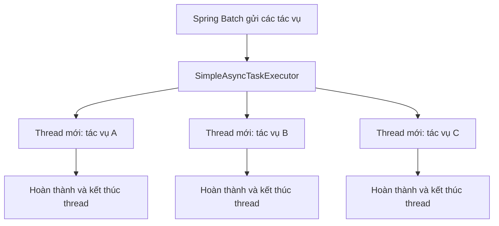
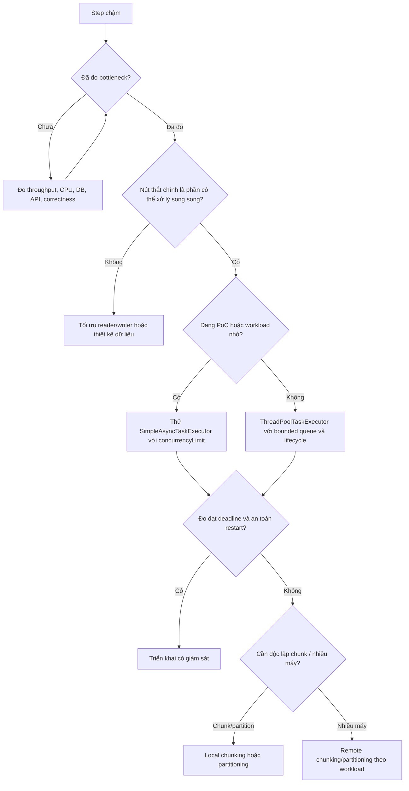

# SimpleAsyncTaskExecutor và lựa chọn thực tế

## 1. Bối cảnh: từ một luồng sang xử lý đồng thời

Trong module **SPRING_BATCH_SCALING_OPERATIONS**, mục tiêu mở rộng Spring Batch cho dữ liệu lớn là tăng throughput **cùng với** việc kiểm soát tài nguyên, thread safety, transaction, retry/restart và khả năng vận hành. Khi một step chạy chậm vì xử lý nhiều bản ghi độc lập, lựa chọn đơn giản nhất để thử concurrency thường là gắn một `TaskExecutor` vào step.

`SimpleAsyncTaskExecutor` là một implementation của giao diện `org.springframework.core.task.TaskExecutor` thuộc Spring Framework. Các ví dụ của Spring Batch thường dùng nó để giới thiệu cách bật xử lý song song vì cấu hình ít. Nhưng đây là một **executor tạo thread mới cho từng tác vụ**; nó **không phải thread pool** và **không tái sử dụng thread**. Mặc định nó còn **không giới hạn số tác vụ chạy đồng thời** ở cấp executor nếu không cấu hình `setConcurrencyLimit(...)`.

Vì vậy câu hỏi quan trọng không chỉ là “thêm `.taskExecutor(...)` như thế nào?”, mà còn là **khi nào dùng SimpleAsyncTaskExecutor để thử nghiệm và khi nào cần executor có pool, hàng đợi, giới hạn và điều khiển vòng đời rõ ràng**.

### Mục tiêu sau bài học

- Hiểu hành vi tạo luồng của `SimpleAsyncTaskExecutor`, `setConcurrencyLimit` và virtual threads.
- Cấu hình một step có `TaskExecutor` đúng cách và hiểu sự khác biệt **Spring Batch 5.x so với 6.x**.
- Chọn `SimpleAsyncTaskExecutor`, `ThreadPoolTaskExecutor` hoặc kiến trúc scaling khác dựa trên workload thực tế.
- Đánh giá thread safety, transaction, restart, chống ghi trùng, đo hiệu năng và giới hạn tài nguyên.

## 2. SimpleAsyncTaskExecutor hoạt động ra sao?

Giả sử Spring Batch yêu cầu executor chạy các tác vụ A, B, C. Với `SimpleAsyncTaskExecutor`, mỗi tác vụ được giao cho một thread mới; thread không được giữ lại trong pool để phục vụ tác vụ tiếp theo:



Với **platform threads** thông thường, tạo/hủy luồng liên tục làm tăng chi phí quản lý, stack memory và công việc của hệ điều hành, đặc biệt nếu tác vụ ngắn và được gửi rất nhiều. Nếu mặc định không giới hạn concurrency, một nguồn tác vụ tăng đột biến có thể làm JVM hoặc dịch vụ phụ thuộc quá tải.

### Những thuộc tính đáng biết

| API/đặc tính | Ý nghĩa | Hệ quả vận hành |
| --- | --- | --- |
| `new SimpleAsyncTaskExecutor("batch-")` | Tạo executor với prefix tên thread | Dễ lọc thread dump/log, **không tự tạo pool** |
| Mặc định không giới hạn concurrency | Executor không tự áp trần số tác vụ song song | Cần giới hạn tải từ executor hoặc cơ chế điều phối khác |
| `setConcurrencyLimit(4)` | Cho phép tối đa 4 tác vụ đồng thời qua executor | Khi đủ slot, mặc định luồng submit chờ có slot, không phải xếp vào một thread pool |
| `setVirtualThreads(true)` | Dùng virtual threads khi runtime/framework hỗ trợ | Vẫn tạo virtual thread mới theo tác vụ, không giải quyết giới hạn DB/API |
| `setTaskTerminationTimeout(...)` | Hỗ trợ chờ task hoàn tất khi gọi `close()`, tùy phiên bản Framework | Có overhead theo dõi task; không tương đương lifecycle đầy đủ của pooled executor |
| `setTaskDecorator(...)` | Gắn logic bọc tác vụ (context, metrics…) | Không tự truyền transaction giữa các thread |

**Phân biệt hai ý:** `setConcurrencyLimit(4)` giới hạn số task **đang thực thi**, nhưng không làm executor tái sử dụng 4 thread. Khác với `ThreadPoolTaskExecutor`, task mới sau khi một task cũ kết thúc vẫn tạo thread mới (hoặc virtual thread mới nếu được bật).

Một số phiên bản Spring Framework cho phép cấu hình từ chối submission khi chạm concurrency limit qua `setRejectTasksWhenLimitReached(true)`. Với cài đặt mặc định của `SimpleAsyncTaskExecutor`, cơ chế hạn chế thường **chờ slot**; không giả định executor luôn dùng chính sách reject hoặc một bounded queue như thread pool.

## 3. Điểm khác biệt lớn: Spring Batch 5.x và 6.x

Vì Java API và cơ chế concurrency đã thay đổi, cần xác định phiên bản Spring Batch của dự án **trước khi suy luận transaction và thread safety**.

| Chủ đề | Spring Batch 5.x (chunk-oriented step truyền thống) | Spring Batch 6.x (mô hình concurrency mới) |
| --- | --- | --- |
| Khi gắn `taskExecutor` | Có thể thực thi **các chunk** trên nhiều worker thread | `ItemProcessor` được thực thi trên các worker thread, trong khi đọc/ghi tuần tự ở luồng điều phối |
| `ItemReader` | Có thể được gọi bởi nhiều thread; reader stateful cần kiểm tra thread safety | Reader của step chuẩn được gọi tuần tự, thường không cần đồng bộ vì concurrency của processor |
| `ItemWriter` | Có thể phải chịu concurrent calls theo chunk; phải kiểm tra implementation | Writer của step chuẩn được gọi tuần tự theo thiết kế mới |
| `ItemProcessor` | Có thể bị gọi đồng thời; phải thread-safe | Vẫn có thể bị gọi đồng thời; phải thread-safe |
| Transaction | Chunk transaction gắn với luồng thực thi chunk | Transaction của đọc/ghi không tự lan sang worker thread chạy processor |
| `throttleLimit` | Tồn tại nhưng **deprecated từ 5.0**, không dùng làm hướng phát triển mới | Không dùng API cũ này làm cách kiểm soát concurrency |
| Nếu cần nhiều chunk đọc/xử lý/ghi hoàn toàn độc lập | Cần kiểm tra reader/writer và checkpoint, hoặc dùng partitioning | Cân nhắc **local chunking** hoặc partitioning thay vì kỳ vọng `taskExecutor` tự song song hóa writer |

**Vì sao khác biệt này quan trọng?** Nếu processor của bạn gọi database bên trong `@Transactional(propagation = MANDATORY)`, khi chạy ở Spring Batch 6.x nó có thể lỗi do worker thread **không có transaction của chunk**. Nếu processor cần transaction riêng, thiết kế rõ ràng bằng `TransactionTemplate` hoặc `@Transactional` qua Spring proxy với propagation phù hợp; không giả định transaction của step tự chạy xuyên thread.

Ngược lại, đừng lấy kết luận “reader/writer được gọi tuần tự trong Batch 6” rồi áp vào code **Batch 5.x**; với phiên bản cũ, chia sẻ một reader dùng cursor không thread-safe có thể gây đọc trùng, bỏ sót hoặc checkpoint sai.

**Quy tắc về phiên bản:** các ví dụ ở mục 4 sử dụng cú pháp Spring Batch **6.x** theo tài liệu hiện hành. Mục 4.3 chỉ rõ cách sửa builder cho dự án **5.x**. Đoạn mã lược bỏ import, mô hình dữ liệu và khai báo infrastructure để tập trung vào lựa chọn executor.

## 4. Cấu hình ví dụ với Spring Batch

Giả sử step nhập hóa đơn đọc `InvoiceRow`, biến đổi thành `InvoiceRecord`, sau đó ghi database. `ItemProcessor` được thiết kế **stateless**: không cập nhật field dùng chung, không dùng session/connection phụ thuộc vào thread khác.

### 4.1. Dùng SimpleAsyncTaskExecutor để thử concurrency

```java
@Configuration
class InvoiceBatchConfig {

    @Bean("invoiceDemoExecutor")
    TaskExecutor invoiceDemoExecutor() {
        SimpleAsyncTaskExecutor executor =
                new SimpleAsyncTaskExecutor("invoice-demo-");
        executor.setConcurrencyLimit(4);  // Không để mặc định unlimited
        return executor;
    }

    @Bean
    Step importInvoices(
            JobRepository jobRepository,
            PlatformTransactionManager transactionManager,
            ItemReader<InvoiceRow> reader,
            ItemProcessor<InvoiceRow, InvoiceRecord> processor,
            ItemWriter<InvoiceRecord> writer,
            @Qualifier("invoiceDemoExecutor") TaskExecutor executor) {

        return new StepBuilder("importInvoices", jobRepository)
                .<InvoiceRow, InvoiceRecord>chunk(100)
                .transactionManager(transactionManager)
                .reader(reader)
                .processor(processor)
                .writer(writer)
                .taskExecutor(executor)
                .build();
    }
}
```

**Đọc đúng ý nghĩa:** `chunk(100)` xác định số lượng item tối đa trong chunk; **không phải 100 thread**. `setConcurrencyLimit(4)` là giới hạn tác vụ chạy song song ở `SimpleAsyncTaskExecutor`; nó **không** đổi `chunkSize`, không bảo đảm tăng tốc 4 lần và không biến step thành bốn `StepExecution`.

Trong Spring Batch 6.x, thiết kế concurrency ở `ItemProcessor` cần xem xét cả lượng item được chuẩn bị trong hàng đợi nội bộ. Hành vi mà executor có thể chạy đồng thời không đồng nghĩa toàn bộ đọc và ghi trong một chunk được nhân bản lên nhiều thread.

### 4.2. Processor không chứa trạng thái chia sẻ

```java
@Bean
ItemProcessor<InvoiceRow, InvoiceRecord> invoiceProcessor() {
    return row -> {
        // Ví dụ minh họa: chỉ đọc đầu vào và tạo object kết quả mới.
        BigDecimal net = row.amount().subtract(row.discount());
        return new InvoiceRecord(row.id(), net);
    };
}
```

Processor dạng này dễ phân tích hơn processor có `int processedCount` hoặc `HashMap` mutable được cập nhật sau mỗi `process()`. Nếu cần metrics, dùng bộ đếm thread-safe; nếu cần state để restart, dùng cơ chế checkpoint có semantics rõ ràng, không tự ghi vị trí xử lý cao nhất trong một map dùng chung.

### 4.3. Nếu dự án dùng Spring Batch 5.x

Trong Spring Batch 5.x, builder nhận transaction manager ngay ở lời gọi `chunk`:

```java
return new StepBuilder("importInvoices", jobRepository)
        .<InvoiceRow, InvoiceRecord>chunk(100, transactionManager)
        .reader(reader)
        .processor(processor)
        .writer(writer)
        .taskExecutor(executor)
        .build();
```

Quan trọng hơn khác biệt cú pháp: ở 5.x, nhiều chunk có thể xử lý/commit không theo thứ tự. Reader/writer stateful cần an toàn đồng thời; `SynchronizedItemStreamReader` có thể giúp serialize `read()` trong một số tình huống nhưng **không tự bảo đảm restart đúng**, nhất là khi commit của các chunk xảy ra không theo thứ tự.

`throttleLimit(int)` từng được dùng để hạn chế số task ở step cũ (giới hạn mặc định truyền thống là 4), nhưng API này **deprecated từ Batch 5.0**, dự kiến loại bỏ trong Batch 6. Khi điều chỉnh số luồng, cần tính cả giới hạn ở cấp Spring Batch, executor, queue và connection pool; không dùng `throttleLimit` làm khuyến nghị chung cho phiên bản mới.

## 5. Lựa chọn thực tế: ThreadPoolTaskExecutor có giới hạn

Với job chạy nhiều lần, nhiều chunk/tác vụ và tải production, `ThreadPoolTaskExecutor` thường phù hợp hơn: **tái sử dụng thread**, có `corePoolSize`/`maxPoolSize`, `queueCapacity`, chính sách khi overload, tên thread và vòng đời bean do Spring quản lý.

Ví dụ một pool cố định có **4 thread**, hàng đợi tối đa **16 task đang chờ**:

```java
@Bean("invoiceWorkerPool")
ThreadPoolTaskExecutor invoiceWorkerPool() {
    ThreadPoolTaskExecutor executor = new ThreadPoolTaskExecutor();
    executor.setThreadNamePrefix("invoice-worker-");
    executor.setCorePoolSize(4);
    executor.setMaxPoolSize(4);
    executor.setQueueCapacity(16);
    executor.setWaitForTasksToCompleteOnShutdown(true);
    executor.setAwaitTerminationSeconds(60);
    // Spring quản lý initialize()/shutdown() cho @Bean này.
    return executor;
}
```

Trong cấu hình step, thay `@Qualifier("invoiceDemoExecutor")` bằng `@Qualifier("invoiceWorkerPool")` để truyền pool vào `.taskExecutor(executor)`. Đừng đăng ký cả hai executor vào cùng một step nếu không có chủ đích về điều phối.

**Ý nghĩa các tham số:**

- `corePoolSize = maxPoolSize = 4`: thread pool cố định 4 worker, giúp tránh việc tăng thread không giới hạn.
- `queueCapacity = 16`: giới hạn task chờ trong executor; **khác** `chunkSize = 100`, vốn là số item trong chunk.
- Khi cả worker và queue đã đầy, `ThreadPoolTaskExecutor` có thể **reject task** theo chính sách mặc định. Đây là tình huống cần xử lý/đo và đặt tải phù hợp với cơ chế submit của Spring Batch.
- `setWaitForTasksToCompleteOnShutdown(true)` và `setAwaitTerminationSeconds(60)` là lựa chọn về lifecycle; vẫn cần đồng bộ với stop/restart semantics của job và thời gian hoàn tất transaction thực tế.

**Hàng đợi lớn không luôn tốt:** queue càng dài, công việc càng dồn trong bộ nhớ, tăng thời gian chờ và che giấu một downstream bị nghẽn. Với `corePoolSize < maxPoolSize` và queue lớn, pool có thể ưu tiên đưa task vào queue trước khi tăng thêm thread tới `maxPoolSize`; vì vậy đặt `maxPoolSize = 16` nhưng giữ core 2/queue rất lớn **không bảo đảm sẽ có 16 thread**.

Đôi khi người ta cấu hình `CallerRunsPolicy` để producer tự chạy task khi bão hòa, tạo một dạng backpressure. Tuy nhiên điều này có thể **đổi thread thực thi** và ảnh hưởng đến giả định về transaction/context; chỉ áp dụng khi đã hiểu call path và kiểm thử đầy đủ. Không coi đây là cách sửa chung cho mọi `TaskRejectedException`.

### Bảng lựa chọn executor

| Tiêu chí | SimpleAsyncTaskExecutor | ThreadPoolTaskExecutor | Virtual threads qua SimpleAsyncTaskExecutor |
| --- | --- | --- | --- |
| Cơ chế | Thread mới mỗi task | Reuse thread trong pool | Virtual thread mới mỗi task |
| Giới hạn mặc định | Unlimited ở cấp executor | Do cấu hình pool/queue và policy | Unlimited nếu không cấu hình limit |
| Chi phí tạo platform thread | Có thể cao khi task ngắn, rất nhiều | Giảm nhờ thread reuse | Chi phí tạo nhẹ hơn platform thread nhưng vẫn có overhead |
| Backpressure | `setConcurrencyLimit`; mặc định chờ slot | Pool + bounded queue + rejection policy | Vẫn cần concurrency limit/rate limit |
| Lifecycle | Quản lý kết thúc hạn chế; có `close()`/termination timeout ở Framework hỗ trợ | Tích hợp lifecycle Spring rõ hơn | Không thay thế lifecycle/pool quản trị |
| Phù hợp | Demo, PoC, tải thấp hoặc cấu hình đơn giản có giới hạn | Batch production cần quản lý tài nguyên, quan sát tải | Nhiều tác vụ I/O blocking phù hợp sau khi benchmark |

**Không có lựa chọn thắng trong mọi workload.** Nếu processor mất thời gian CPU, số thread cao hơn số core sẵn có hiếm khi tạo tăng tốc tuyến tính. Nếu bottleneck nằm ở reader/writer tuần tự (đặc biệt Spring Batch 6.x), đổi executor cũng không làm phần đó chạy song song.

## 6. Virtual threads: nhẹ hơn nhưng không phải phép màu

Từ **Spring Framework 6.1 trên Java 21+**, `SimpleAsyncTaskExecutor` có lựa chọn virtual thread:

```java
@Bean("invoiceVirtualExecutor")
TaskExecutor invoiceVirtualExecutor() {
    SimpleAsyncTaskExecutor executor =
            new SimpleAsyncTaskExecutor("invoice-vt-");
    executor.setVirtualThreads(true);
    executor.setConcurrencyLimit(32); // Giới hạn theo tài nguyên downstream
    return executor;
}
```

Virtual threads hữu ích khi processor thực hiện **nhiều tác vụ blocking I/O** có thể chạy đồng thời (chẳng hạn HTTP calls) và các thư viện hỗ trợ tốt. Chúng **không** tăng số CPU core, không mở rộng database connection pool, không loại bỏ lock contention hay bảo đảm thread safety. Việc dùng `synchronized` hoặc native code ở một số thư viện có thể ảnh hưởng khả năng nhả carrier thread; hãy đo trên runtime thực tế.

Nếu processor có một external API giới hạn 20 request/s thì tạo 1.000 virtual threads không làm API chấp nhận 1.000 request/s. Cần giới hạn concurrency, rate limit, backoff và timeout. Virtual threads cũng không làm `@Transactional` ở luồng đọc/ghi tự truyền sang processor ở luồng khác.

## 7. Thread safety, transaction và restart

### 7.1. Component nào có thể bị gọi đồng thời?

| Thành phần | Với Spring Batch 5.x | Với Spring Batch 6.x |
| --- | --- | --- |
| `ItemReader` | Kiểm tra cursor, page state, `read()` đồng thời; có thể cần synchronization | Step chuẩn đọc tuần tự; vẫn phải thiết kế trạng thái và restart đúng |
| `ItemProcessor` | Phải thread-safe nếu có thể chạy song song | **Phải thread-safe** khi executor xử lý processor đồng thời |
| `ItemWriter` | Kiểm tra việc ghi đồng thời, file/connection mutable, transaction | Writer của step chuẩn ghi tuần tự; vẫn cần idempotency và transaction phù hợp |
| `ExecutionContext` | Không dùng làm mutable map đa luồng tùy tiện | Không tự dùng làm cross-thread communication/checkpoint của processor |
| `@StepScope` | Một bean theo `StepExecution`, không phải theo thread | Tương tự: **không tạo bean riêng cho mỗi thread** |

Ví dụ processor **không an toàn**:

```java
class UnsafeProcessor implements ItemProcessor<Input, Output> {
    private int sequence = 0; // Nhiều thread có thể ghi đè nhau

    @Override
    public Output process(Input item) {
        int next = ++sequence;
        return new Output(item.id(), next);
    }
}
```

Có thể thay `int` bằng `AtomicInteger` nếu chỉ cần bộ đếm thống kê. Nếu `sequence` thực sự là số thứ tự nghiệp vụ phải tăng đúng theo thứ tự nguồn, chỉ thay bằng atomic **vẫn không đáp ứng yêu cầu ordering**; cần thiết kế lại dữ liệu/transaction/partitioning.

### 7.2. Transaction không tự đi theo thread

Spring transactions dựa trên ngữ cảnh gắn với thread. Đặc biệt với Spring Batch 6.x, `ItemProcessor` chạy trong worker thread **không đương nhiên tham gia chunk transaction** ở luồng điều phối. Nếu processor có side effect (ghi database, gọi API thanh toán), lỗi xảy ra sau đó khi writer commit có thể khiến side effect không rollback cùng chunk.

Hướng xử lý:

1. Ưu tiên để processor **biến đổi dữ liệu thuần**, chỉ writer thực hiện thay đổi nghiệp vụ trong transaction được quản lý.
2. Nếu processor phải truy cập dữ liệu transactional, dùng transaction riêng có chủ đích, chẳng hạn Spring `TransactionTemplate` hoặc method `@Transactional` được gọi qua proxy, và hiểu consistency/visibility.
3. Nếu cần **toàn bộ xử lý và ghi một chunk** trong cùng transaction ở một worker thread, cân nhắc **local chunking** trong Spring Batch 6.x hoặc partitioning theo vùng dữ liệu.
4. Với các API ngoài database, dùng idempotency key và chính sách retry/compensation phù hợp; rollback DB không tự hoàn tác HTTP request đã thành công.

### 7.3. Retry và restart dưới concurrency

- Một worker thất bại không có nghĩa những tác vụ khác chưa hoàn tất; cần đánh giá trạng thái sau lỗi, dữ liệu đã ghi và luật restart theo implementation/version.
- Spring Batch có `JobRepository` để quản lý `JobExecution`/`StepExecution`, nhưng **không bảo đảm exactly-once** cho mọi side effect ngoài transaction.
- Với Batch 5.x, vì chunk có thể commit không theo thứ tự, lưu một `lastProcessedId` toàn cục rồi bỏ qua tất cả ID trước đó khi restart có thể làm **mất dữ liệu**.
- Với Batch 6.x, đọc/ghi tuần tự làm một số vấn đề thread-safety đơn giản hơn, nhưng processor vẫn có thể gọi I/O ngoài transaction và phải retry an toàn.
- `saveState(false)` hoặc `SynchronizedItemStreamReader` không tự giải quyết toàn bộ bài toán checkpoint, deduplication và khôi phục.

Đối với dữ liệu tài chính hoặc tính cước, cần thử crash giữa xử lý, giữa ghi và sau khi ghi nhưng trước khi metadata được cập nhật; kiểm tra số bản ghi duy nhất ở sink sau restart.

## 8. Giới hạn tài nguyên và chiến lược đo thực tế

Một lựa chọn executor chỉ có giá trị nếu đã đo đúng **nút thắt**. Thông lượng:

```text
throughput = số item hoàn thành đúng / thời gian chạy (giây)
speedup    = thời gian chạy 1 thread / thời gian chạy N thread
```

Ví dụ **giả định** nhập 200.000 hóa đơn với cùng dữ liệu và cấu hình hạ tầng:

| Concurrency mục tiêu | Thời gian | Throughput xấp xỉ | Speedup |
| ---: | ---: | ---: | ---: |
| 1 | 400 giây | 500 item/s | 1,00× |
| 2 | 235 giây | 851 item/s | 1,70× |
| 4 | 145 giây | 1.379 item/s | 2,76× |
| 8 | 142 giây | 1.408 item/s | 2,82× |

Số liệu chỉ để **minh họa cách đọc benchmark**, không phải kết quả đo thật của Spring Batch. Từ 4 lên 8 concurrent tasks chỉ tiết kiệm khoảng 3 giây, nên một cấu hình 4 có thể phù hợp hơn về CPU, connection và độ ổn định.

### Những nút thắt thường gặp

| Triệu chứng | Chẩn đoán có thể | Quyết định |
| --- | --- | --- |
| Platform thread count cao, CPU dành nhiều cho scheduling | Executor tạo quá nhiều thread ngắn hạn | Dùng pool hoặc giới hạn concurrency |
| CPU gần bão hòa, tăng thread không nhanh thêm | Processor CPU-bound | Tối ưu thuật toán, giữ concurrency gần khả năng CPU |
| CPU thấp nhưng nhiều thread chờ DB | Pool connection hoặc SQL là nút thắt | Tối ưu query/index, pool, lock trước khi tăng thread |
| API trả 429 hoặc timeout tăng | Rate limit quá tải | Giới hạn concurrency, backoff và retry policy |
| Spring Batch 6 CPU rảnh nhưng reader/writer chiếm thời gian | Pipeline tuần tự ở đọc/ghi | Tối ưu I/O hoặc cân nhắc local chunking/partitioning |
| GC và heap tăng khi nâng queue/chunk | Quá nhiều item/task chờ | Giảm queue/chunk size, theo dõi allocation |
| `TaskRejectedException` khi full queue | Pool/queue đạt giới hạn, producer gửi nhanh | Giảm tốc submit, đổi policy có kiểm thử hoặc điều chỉnh kiến trúc |

**Lưu ý về pool DB:** so sánh connection pool size với concurrency của toàn ứng dụng, gồm Batch, các job chạy đồng thời, repository, writers và traffic khác. Không đơn giản đặt số DB connections đúng bằng số worker thread vì mỗi task có thể cần nhiều kết nối hoặc writer có bottleneck ở luồng khác.

### Quy trình benchmark

1. Chạy **baseline single-threaded** với input đại diện; đo thời gian tổng, số item duy nhất, `readCount`/`writeCount`, skips/retries, CPU, RAM, GC, DB latency và pool usage.
2. Chỉ thay đổi **một biến mỗi lượt**: executor, số concurrent tasks hoặc chunk size; chạy nhiều lần để giảm sai số do cache và warm-up.
3. Đặt giới hạn: CPU/heap tối đa, kích thước queue, số DB connections, API rate limit, thời hạn job.
4. Thử scale 2–4–8 và kiểm tra **correctness**, không chỉ thời gian. Ghi thread dump/metrics nếu có wait, lock hoặc rejection.
5. Thử interruption/restart; so số ID đầu vào và số output duy nhất, dữ liệu skip và kết quả nghiệp vụ.
6. Chọn cấu hình đạt deadline với dư địa tài nguyên; tránh tối ưu một số thread đơn lẻ mà không xét workload đồng thời khác.

## 9. Chọn SimpleAsyncTaskExecutor hay kiến trúc khác?



| Tình huống | Hướng chọn ban đầu |
| --- | --- |
| Demo cách bật `TaskExecutor` hoặc thử tải thấp | `SimpleAsyncTaskExecutor`, **đặt `concurrencyLimit`** |
| Production chạy nhiều job, cần ổn định tài nguyên | `ThreadPoolTaskExecutor` với pool/queue/lifecycle và monitoring |
| Rất nhiều công việc blocking I/O nhỏ, JDK 21+, thư viện phù hợp | Thử `SimpleAsyncTaskExecutor` với virtual threads và giới hạn downstream |
| Processor cần CPU nhưng reader/writer đủ nhanh | Multi-threaded step với executor bounded |
| Spring Batch 6.x cần xử lý **cả chunk** trên worker thread | Local chunking / partitioning |
| Nhiều step độc lập với nhau | Parallel steps |
| Dữ liệu chia được theo khoảng ID, cần checkpoint riêng | Local/remote partitioning |
| Bước phải chạy trên node/máy khác | Remote step hoặc remote partitioning/chunking phù hợp phiên bản |

Đổi `SimpleAsyncTaskExecutor` sang pool giúp kiểm soát thread, **không** tự biến một step thành distributed processing và **không** tự làm stateful reader an toàn. Lựa chọn kiến trúc phải dựa trên độ độc lập của dữ liệu, ranh giới transaction và điểm nghẽn thực.

## 10. Tình huống thực hành: xử lý 2 triệu giao dịch

Giả sử mỗi tối cần xử lý 2 triệu giao dịch, trong đó processor kiểm tra vài quy tắc và gọi một dịch vụ thông tin khách hàng. Job tuần tự mất 4 giờ, nhưng cửa sổ chỉ còn 2 giờ.

- **Bước 1 — Đo:** CPU ứng dụng trung bình 25%, thread thường chờ HTTP, DB writer chưa bão hòa. Kiểm tra API backend có giới hạn concurrency/rate limit.
- **Bước 2 — PoC:** dùng `SimpleAsyncTaskExecutor` với `concurrencyLimit(4)` trên input giống production; đo số request đồng thời, response time và số giao dịch đầu ra duy nhất.
- **Bước 3 — Vận hành:** dùng `ThreadPoolTaskExecutor` với 4 worker và bounded queue để giảm thread churn, đồng thời có chiến lược khi queue đầy.
- **Bước 4 — Correctness:** processor không ghi database, writer xử lý idempotent theo transaction ID; thử HTTP timeout và restart sau khi writer commit.
- **Bước 5 — Kiến trúc:** nếu throughput vẫn bị khóa bởi reader/writer tuần tự ở Spring Batch 6.x, cân nhắc phân vùng theo ID/tháng hoặc local chunking, chứ không chỉ tăng pool size.

Kết quả cần ghi lại gồm thời gian hoàn thành, `writeCount`, số ID duy nhất trong database, error/retry rate, API latency, DB lock wait, CPU/GC và cách khôi phục sau lỗi.

## 11. Lỗi hiểu nhầm thường gặp

| Nhầm lẫn | Thực tế |
| --- | --- |
| “`SimpleAsyncTaskExecutor` là pool 4 thread nếu set limit 4.” | Nó vẫn tạo thread mới cho từng tác vụ, nhưng giới hạn 4 tác vụ thực thi đồng thời. |
| “Mặc định executor này chỉ chạy tối đa 4 thread.” | `SimpleAsyncTaskExecutor` mặc định **không giới hạn concurrency**; Batch 5.x có throttle limit riêng và đã deprecated. |
| “8 thread chắc chắn nhanh gấp 8.” | Có overhead và nút thắt CPU/DB/network/reader/writer. |
| “Bật virtual threads làm database xử lý nhanh hơn.” | Chúng không tăng connection pool, IOPS hoặc thông lượng database. |
| “`@StepScope` cho một bean riêng mỗi thread.” | Scope gắn với `StepExecution`, không phải thread. |
| “Reader và writer luôn phải thread-safe khi gắn executor.” | Phải **xác định phiên bản**: Batch 5.x và 6.x có concurrency model khác nhau. |
| “Transaction tự đi qua worker thread.” | Spring transaction gắn với thread; cần thiết kế ranh giới rõ ràng. |
| “Đã có `JobRepository` thì chắc chắn không ghi trùng.” | Side effect ngoài transaction, retry và crash có thể tạo xử lý trùng. |
| “Cứ tăng queueCapacity sẽ hết lỗi.” | Có thể che giấu bottleneck, tăng RAM và thời gian chờ. |

## 12. Câu hỏi tự kiểm tra

**Câu 1.** `SimpleAsyncTaskExecutor` đặt `concurrencyLimit(4)` có luôn chỉ dùng bốn thread sống xuyên suốt job không?

*Đáp án:* Không. Nó không có thread pool; số task chạy đồng thời bị giới hạn ở 4, còn thread thường được tạo mới khi nhận task.

**Câu 2.** Trong Spring Batch 6.x, một `ItemProcessor` dùng `@Transactional(MANDATORY)` và được chạy qua executor có thể lỗi gì?

*Đáp án:* Vì chunk transaction không tự truyền sang worker thread, processor có thể không có transaction hiện tại và phát sinh lỗi. Cần cân nhắc transaction riêng qua proxy/`TransactionTemplate` hoặc chuyển side effect vào writer/local chunking.

**Câu 3.** Vì sao một reader cursor dùng chung cần kiểm tra kỹ hơn ở Batch 5.x so với step chuẩn ở Batch 6.x?

*Đáp án:* Batch 5.x có thể chạy nhiều chunk đồng thời và gọi reader từ nhiều thread; Batch 6.x đọc tuần tự ở luồng điều phối còn processor chạy song song.

**Câu 4.** Job tăng thread 4 lên 8 mà throughput gần như giữ nguyên, DB pool đã đầy. Việc nên làm?

*Đáp án:* Đo SQL/connection/lock, tối ưu downstream hoặc giảm concurrency. Tăng thread tiếp có thể chỉ tăng chờ và lỗi.

**Câu 5.** Khi nào nên chọn `ThreadPoolTaskExecutor` thay `SimpleAsyncTaskExecutor`?

*Đáp án:* Khi cần reuse platform threads cho workload lớn/lặp nhiều, đặt pool và queue rõ ràng, kiểm soát saturation, shutdown và giám sát production.

## Tài liệu tham khảo

- [Spring Batch 6.1 — Scaling and Parallel Processing](https://docs.spring.io/spring-batch/reference/scalability.html): mô hình multi-threaded step mới, processor/transaction và các lựa chọn scaling.
- [Spring Batch 5.2 — Scaling and Parallel Processing](https://docs.spring.io/spring-batch/reference/5.2/scalability.html): multi-threaded chunk execution ở phiên bản cũ, throttle limit và thread safety.
- [Spring Batch 6 — What's New](https://docs.spring.io/spring-batch/reference/6.0/whatsnew.html): đổi mới mô hình producer–consumer và local chunking.
- [Spring Framework — SimpleAsyncTaskExecutor API](https://docs.spring.io/spring-framework/docs/6.2.12/javadoc-api/org/springframework/core/task/SimpleAsyncTaskExecutor.html): cách tạo thread, concurrency limit, virtual threads và lifecycle.
- [Spring Framework — Task Execution and Scheduling](https://docs.spring.io/spring-framework/reference/integration/scheduling.html): `TaskExecutor`, `ThreadPoolTaskExecutor` và tham số pool/queue.

**Điểm cần nhớ:** `SimpleAsyncTaskExecutor` giúp bật concurrency với rất ít cấu hình, nhưng không reuse thread và mặc định không có trần concurrency ở cấp executor. Với workload Spring Batch lớn, chọn executor sau khi đã biết phiên bản Batch, phần nào thực sự chạy song song, giới hạn CPU/DB/API, tính đúng dữ liệu và nhu cầu restart. Cấu hình nhanh nhất trên một benchmark chỉ đáng dùng khi hệ thống còn có thể vận hành an toàn.
