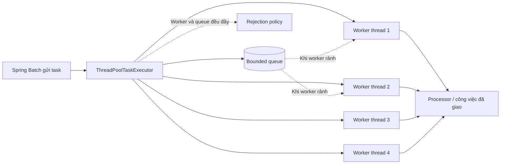
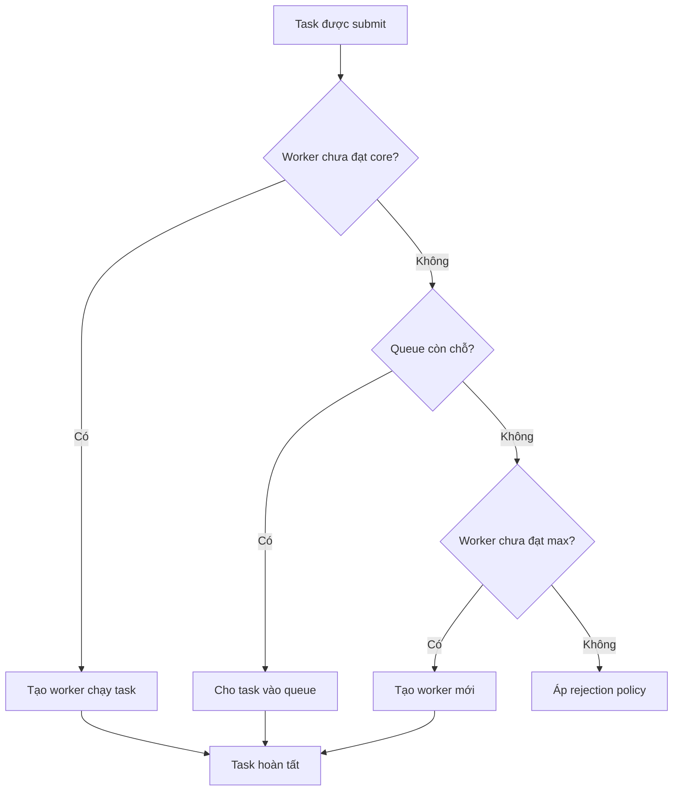

# ThreadPoolTaskExecutor cho tải ổn định

## 1. Vì sao cần một thread pool có giới hạn?

Trong Spring Batch, một job nhập dữ liệu lớn có thể đọc hàng triệu bản ghi, biến đổi dữ liệu và ghi vào cơ sở dữ liệu hoặc hệ thống bên ngoài. Nếu phần xử lý từng bản ghi có thể chạy đồng thời, `TaskExecutor` giúp khai thác nhiều CPU hoặc che bớt thời gian chờ I/O. Nhưng **tăng số thread không đồng nghĩa tăng throughput tuyến tính**: đọc/ghi, connection pool, lock, network và API phụ thuộc đều có giới hạn.

`ThreadPoolTaskExecutor` là implementation của Spring Framework dựa trên `java.util.concurrent.ThreadPoolExecutor`. Nó **tái sử dụng các worker thread** và cho phép xác định kích thước pool, hàng đợi tác vụ đang chờ, cách phản ứng khi bão hòa và hành vi đóng ứng dụng. Với workload Spring Batch chạy lặp lại hoặc liên tục, đây thường là lựa chọn thực tế hơn `SimpleAsyncTaskExecutor` vốn có thể tạo thread mới cho mỗi tác vụ.

Bài này thuộc chương **Step nhiều luồng** của module `SPRING_BATCH_SCALING_OPERATIONS`. Mục tiêu không chỉ là cấu hình pool chạy được, mà là **giữ tốc độ xử lý ổn định dưới tải**, bảo đảm thread safety, retry/restart đúng, và lựa chọn kiến trúc theo tài nguyên có thật.

Sau khi học, bạn có thể:

1. Giải thích chính xác vai trò `corePoolSize`, `maxPoolSize`, `queueCapacity` và rejection policy.
2. Tạo `ThreadPoolTaskExecutor` có giới hạn và gắn vào Spring Batch step.
3. Phân biệt ý nghĩa concurrency của **Spring Batch 5.x và 6.x**.
4. Đo bottleneck, cảnh báo bão hòa pool và lựa chọn tham số có căn cứ.
5. Giữ dữ liệu chính xác khi có task thất bại, timeout, retry hoặc job restart.

## 2. ThreadPoolTaskExecutor vận hành như thế nào?

Mỗi khi ứng dụng gửi một `Runnable`/`Callable` phù hợp tới executor, pool quyết định **chạy ngay, đưa vào queue, mở thêm worker hoặc từ chối task**. Số task thực sự chạy đồng thời không thể vượt số thread đang được pool cấp cho chúng. Queue chỉ là nơi **chờ**, không làm tác vụ đang chờ chạy song song.



Với một cấu hình pool cố định **4 thread, queue 64 task**, tối đa bốn task có thể đang chạy bởi pool và tối đa 64 task đang chờ tại một thời điểm (không tính những task đã hoàn tất hoặc cơ chế điều phối khác ở phía Spring Batch). Nếu không thread nào kịp hoàn thành mà tiếp tục submit task thứ 69 trở đi, khả năng bị từ chối phụ thuộc vào chính sách executor. Đừng hiểu queue 64 là 64 thread bổ sung.

### 2.1. Các tham số cốt lõi

| Thuộc tính | Ý nghĩa | Hệ quả nếu đặt sai |
| --- | --- | --- |
| `corePoolSize` | Số worker cốt lõi mà executor có thể tạo để chạy task | Quá nhỏ làm task phải chờ; quá lớn tốn tài nguyên |
| `maxPoolSize` | Trần worker thread của pool | Không phải số thread sẽ đạt được trong mọi tình huống |
| `queueCapacity` | Số task tối đa được xếp hàng khi worker đang bận | Queue quá lớn tăng latency và heap, che giấu downstream chậm |
| `keepAliveSeconds` | Thời gian thread trên mức core có thể rảnh trước khi được thu hồi | Ảnh hưởng mức dao động tài nguyên của pool co giãn |
| `allowCoreThreadTimeOut` | Cho phép core thread hết hạn nếu được bật | Tiết kiệm tài nguyên khi nhàn rỗi, nhưng có chi phí tạo lại thread |
| `threadNamePrefix` | Prefix của worker thread | Giúp đọc thread dump và phân biệt batch với luồng web |
| `RejectedExecutionHandler` | Quyết định khi không còn worker/queue để nhận task | Mặc định có thể làm step thất bại với lỗi reject; cần chính sách có chủ đích |
| Shutdown/await termination | Cách container dừng executor và chờ tác vụ | Không đồng nghĩa bảo đảm hoàn thành job hoặc commit transaction |

**Một bẫy về giá trị mặc định:** `ThreadPoolTaskExecutor` mặc định có `corePoolSize = 1`, `maxPoolSize` rất lớn và `queueCapacity` rất lớn. Khi queue hầu như không thể đầy, executor thường giữ một worker chính và đưa task khác vào hàng đợi; vì thế **chỉ đặt `maxPoolSize(16)` mà không cấu hình core/queue không tạo ra 16 thread xử lý**.

### 2.2. Thứ tự ưu tiên worker hay queue

Với queue dương (`LinkedBlockingQueue`), hành vi cơ bản của `ThreadPoolExecutor` là:

1. Nếu số worker đang hoạt động chưa tới `corePoolSize`, tạo worker để nhận task.
2. Khi core đã đạt, thử **đưa task vào queue**.
3. Nếu queue đầy và số worker còn dưới `maxPoolSize`, tạo thêm worker.
4. Nếu cả pool đã đạt max và queue đầy, áp dụng `RejectedExecutionHandler`.

Với `queueCapacity = 0`, Spring sử dụng cách chuyển giao trực tiếp tương tự `SynchronousQueue`, không chứa task chờ; pool có thể tăng worker tới max nhanh hơn. Điều này dễ tăng spike tài nguyên và rejection nếu tải vượt trần.

Ví dụ minh họa:

| Cấu hình | Hành vi khi 20 task đến cùng lúc và chưa task nào xong |
| --- | --- |
| `core=2, max=8, queue=100` | Khoảng 2 task chạy, 18 chờ; pool chưa cần tăng lên 8 |
| `core=2, max=8, queue=2` | Có thể có 8 task chạy, 2 chờ; phần vượt capacity bị reject |
| `core=4, max=4, queue=16` | 4 task chạy, 16 chờ; giữ số worker ổn định |
| `core=4, max=4, queue=0` | 4 task chạy; task khác bị reject khi worker đều bận |

Số liệu trong bảng giả định không có tác vụ hoàn tất trước khi submit xong và không có sự can thiệp của cơ chế throttle khác. Trong thực tế, tốc độ submit, thời gian task và giới hạn nội bộ của Spring Batch ảnh hưởng số task quan sát được.

## 3. Phân biệt Spring Batch 5.x và 6.x trước khi cấu hình

Đây là khác biệt kỹ thuật quan trọng để tránh cấu hình đúng pool nhưng hiểu sai phần việc chạy song song.

| Tiêu chí | Spring Batch 5.x | Spring Batch 6.x |
| --- | --- | --- |
| `taskExecutor(...)` trong chunk step | Có thể chạy **các chunk** trên những worker thread khác nhau | Xử lý `ItemProcessor` trên worker threads; đọc và ghi item **tuần tự** trên luồng điều phối |
| `ItemReader` | Có thể bị truy cập đồng thời trong cùng step; cần kiểm tra reader stateful | Trong mô hình multi-threaded step chuẩn, reader được gọi tuần tự |
| `ItemWriter` | Có thể nhận concurrent writes của các chunk; cần kiểm tra implementation | Trong mô hình multi-threaded step chuẩn, writer được gọi tuần tự |
| `ItemProcessor` | Nhiều thread có thể gọi đồng thời | Nhiều thread có thể gọi đồng thời |
| Chunk transaction | Chunk chạy trong thread xử lý chunk | Worker thread của processor **không tự thừa hưởng** chunk transaction |
| Giới hạn concurrency cũ | Có `throttleLimit` (mặc định truyền thống 4), đã **deprecated từ 5.0** | Dùng executor đúng API mới; không dựa vào `throttleLimit` cũ |
| Nếu cần cả chunk xử lý trên thread khác | Các chunk đã có thể chạy đồng thời theo mô hình 5.x | Cân nhắc **local chunking** hoặc partitioning |

Trong Spring Batch 6.x, nếu 90% thời gian nằm ở **writer tuần tự**, đặt executor 32 thread cũng khó tăng throughput đáng kể. Pool chỉ giúp phần việc thực sự được phân phối sang worker thread. Nếu processor gọi một API blocking độc lập cho mỗi item, chạy nhiều processor cùng lúc có thể cải thiện tổng thời gian.

> **Lưu ý về API:** các ví dụ Java chính bên dưới nhắm tới **Spring Batch 6.x**. Với 5.x, `chunk` và một số cơ chế throttle khác; xem mục 5.3. Đừng áp một ví dụ của phiên bản này vào phiên bản kia mà không đối chiếu dependency và API.

## 4. Cấu hình pool ổn định với giới hạn rõ ràng

Giả sử một job đọc `InvoiceRow`, processor chuyển thành `InvoiceRecord` rồi ghi kết quả qua `ItemWriter`. Ta bắt đầu với **pool cố định 4 thread**, **queue 128 task** và **chunk 50 item**. Đây là các con số giả định để minh họa phương pháp; production phải benchmark trước khi chọn.

### 4.1. Khai báo ThreadPoolTaskExecutor thành Spring bean

```java
@Configuration
class InvoiceExecutorConfig {

    @Bean("invoiceBatchExecutor")
    ThreadPoolTaskExecutor invoiceBatchExecutor() {
        ThreadPoolTaskExecutor pool = new ThreadPoolTaskExecutor();
        pool.setThreadNamePrefix("invoice-batch-");
        pool.setCorePoolSize(4);
        pool.setMaxPoolSize(4);
        pool.setQueueCapacity(128);
        pool.setKeepAliveSeconds(60);
        pool.setAwaitTerminationSeconds(60);
        return pool;  // Spring quản lý initialization và destruction
    }
}
```

Đây là một **pool cố định** vì `corePoolSize` bằng `maxPoolSize`. Pool tái sử dụng thread giữa nhiều task và không mặc nhiên tạo thêm worker khi queue dài. `setKeepAliveSeconds` chủ yếu có ý nghĩa với thread vượt core hoặc khi bật timeout core; trong cấu hình core=max này nó không làm số worker tăng/giảm theo tải.

Khi được đăng ký dưới dạng Spring bean như trên, `ThreadPoolTaskExecutor` được Spring khởi tạo theo lifecycle bean; không cần gọi `initialize()` bên trong method `@Bean`. Nếu tự tạo executor bên ngoài container, phải tự chịu trách nhiệm initialize/shutdown đúng cách.

`setAwaitTerminationSeconds(60)` cho Spring khoảng thời gian chờ pool kết thúc khi shutdown theo lifecycle đang áp dụng; đây **không phải** cam kết mọi job sẽ hoàn thành trong 60 giây. Cần phối hợp với chính sách graceful shutdown, tín hiệu dừng Batch job, timeout transaction và thời gian mà nền tảng (ví dụ Kubernetes) cho phép pod kết thúc.

### 4.2. Gắn executor vào chunk step của Spring Batch 6.x

```java
@Configuration
class InvoiceJobConfig {

    @Bean
    Step importInvoices(
            JobRepository jobRepository,
            PlatformTransactionManager transactionManager,
            ItemReader<InvoiceRow> reader,
            ItemProcessor<InvoiceRow, InvoiceRecord> processor,
            ItemWriter<InvoiceRecord> writer,
            @Qualifier("invoiceBatchExecutor") ThreadPoolTaskExecutor pool) {

        return new StepBuilder("importInvoices", jobRepository)
                .<InvoiceRow, InvoiceRecord>chunk(50)
                .transactionManager(transactionManager)
                .reader(reader)
                .processor(processor)
                .writer(writer)
                .taskExecutor(pool)
                .build();
    }
}
```

Ở đây:

- `chunk(50)` là kích thước chunk, **không phải số thread**.
- `taskExecutor(pool)` trao quyền thực thi đồng thời theo mô hình của Spring Batch 6.x. `ThreadPoolTaskExecutor` triển khai `AsyncTaskExecutor` phù hợp với builder.
- `processor` phải thread-safe: không chia sẻ counter mutable, bộ đệm hoặc một `EntityManager` không dùng được đồng thời.
- Reader/writer trong mô hình step chuẩn 6.x được gọi tuần tự, nhưng vẫn cần transaction, retry và logic restart đúng.
- Một step này vẫn tương ứng với **một `StepExecution`**; thêm pool không tự sinh partition hay distributed worker.

Dù đã cố định 4 worker và có queue 128, một đợt submit quá lớn vẫn có thể vượt capacity. Spring có thể ném `TaskRejectedException`. Vì vậy cấu hình trên là **ví dụ nền để benchmark**, cần thử tải cực đại, kiểm tra chính sách khi queue đầy và giám sát rejection trước khi triển khai.

### 4.3. Nếu dùng Spring Batch 5.x

Ở Spring Batch 5.x, cùng executor có thể gắn vào step nhưng builder nhận transaction manager trong `chunk`:

```java
return new StepBuilder("importInvoices", jobRepository)
        .<InvoiceRow, InvoiceRecord>chunk(50, transactionManager)
        .reader(reader)
        .processor(processor)
        .writer(writer)
        .taskExecutor(pool)
        .build();
```

Cần kiểm tra thêm tính an toàn đa luồng của **reader, processor và writer**, vì các chunk có thể thực thi/commit không theo thứ tự. `@StepScope` không tạo bean riêng cho mỗi worker thread: scope gắn với `StepExecution`.

Trong Batch 5.x, `throttleLimit` từng giới hạn số concurrent chunk tasks (giới hạn mặc định truyền thống là 4), nhưng API **deprecated từ v5.0** và không nên xem là hướng thiết kế cho bản mới. Khi pool có 8 worker mà step vẫn chỉ dùng khoảng 4 concurrent chunks, phải kiểm tra cả **throttle của Batch 5.x** và pool. Tài liệu 5.2 gợi ý dùng custom `RepeatOperations` trên bounded executor khi cần thay thế cơ chế giới hạn cũ; không tùy tiện gọi API deprecated trong code mới.

## 5. Chọn fixed pool hay elastic pool?

Không phải mọi workload đều cần cùng một cấu hình.

### 5.1. Fixed pool: thiên về ổn định

```java
pool.setCorePoolSize(4);
pool.setMaxPoolSize(4);
pool.setQueueCapacity(128);
```

Lựa chọn này thường dễ quản trị cho batch lâu dài: tối đa 4 task thực thi trong pool tại một thời điểm, giới hạn số kết nối/CPU đồng thời và giảm bất ngờ khi tải tăng. Nếu có 3 job cùng khởi chạy **và mỗi job dùng pool riêng 4 thread**, tổng tải có thể là 12 worker; nếu cả ba cùng dùng **một pool bean**, trần của pool chung vẫn là 4 và các job có thể phải chờ nhau. Cần tính quy mô ở cấp **toàn ứng dụng**, không chỉ một step.

### 5.2. Elastic pool: hấp thụ đột biến có giới hạn

```java
pool.setCorePoolSize(2);
pool.setMaxPoolSize(8);
pool.setQueueCapacity(16);
pool.setKeepAliveSeconds(60);
```

Pool này có thể tăng lên 8 thread **sau khi queue 16 đầy**, rồi thu hẹp phần thread vượt core khi nhàn rỗi. Nếu queue đặt quá lớn, số worker có thể rất lâu vẫn chỉ ở mức 2 dù `maxPoolSize=8`. Nếu API hoặc DB chỉ chịu 4 tác vụ đồng thời, cấu hình tăng lên 8 lại làm tăng timeout, lock và retry.

### 5.3. Queue 0 để chuyển giao trực tiếp

```java
pool.setCorePoolSize(2);
pool.setMaxPoolSize(8);
pool.setQueueCapacity(0);
```

Với queue bằng 0, task không được giữ trong backlog nội bộ; executor có thể tăng thread nhanh tới max rồi reject nếu mọi worker đều bận. Phù hợp khi có cơ chế điều tiết submit/rate limit riêng, nhưng **rất dễ tạo burst** nếu sử dụng thiếu kiểm soát.

**Quyết định thực tế:** bắt đầu từ fixed pool và bounded queue dễ đo, chỉ dùng elastic pool khi có dữ liệu thực tế cho thấy tải tăng theo đợt và tài nguyên downstream đủ sức hấp thụ.

## 6. Khi queue đầy: backpressure và rejection policy

Một thread pool **không tự khiến tải vô hạn biến mất**. Khi tốc độ gửi task lớn hơn tốc độ hoàn thành trong thời gian đủ dài, queue sẽ đầy. Hành vi mặc định của underlying `ThreadPoolExecutor` là `AbortPolicy`; lớp Spring có thể báo lỗi `TaskRejectedException`. Đó là tín hiệu hệ thống **quá tải hoặc cấu hình không phù hợp**, không nên cố che giấu bằng queue vô hạn.

Các lựa chọn:

| Chính sách | Hành vi | Rủi ro/điều kiện |
| --- | --- | --- |
| `AbortPolicy` (mặc định) | Từ chối task khi đầy | Job có thể thất bại; dễ phát hiện overload, cần restart plan |
| `CallerRunsPolicy` | Thread gọi `execute` có thể trực tiếp chạy task | Giảm tốc producer nhưng **thay đổi thread thực thi**; cần xét transaction/context của Spring Batch |
| `DiscardPolicy` | Loại bỏ task khi đầy | **Không phù hợp** cho batch dữ liệu cần đầy đủ vì có thể mất tác vụ |
| `DiscardOldestPolicy` | Loại task cũ để nhường task mới | **Không phù hợp** nếu cần bảo đảm mọi item được xử lý |
| Điều tiết từ upstream | Giảm tốc submit, chia workload, hạn chế số job đồng thời | Cần metric backlog và cấu hình capacity theo throughput |

Không tự cấu hình `CallerRunsPolicy` chỉ để hết `TaskRejectedException`. Trong một số luồng Spring Batch, task sẽ chạy trên thread điều phối; các giả định về transaction, MDC, timing và executor accounting có thể thay đổi. Cần kiểm thử trên **đúng phiên bản Batch** và thiết kế policy như một quyết định kiến trúc.

Khi rejection xảy ra trong lúc tạo task, không mặc định cơ chế fault-tolerant `retry(...)` của processor/writer sẽ xử lý được. **Retry lỗi nghiệp vụ trong chunk khác với retry lỗi submit vào executor.** Đọc exception root cause, giữ metadata phục vụ restart và xử lý tải gốc.

### Sơ đồ bão hòa



Sơ đồ phản ánh hành vi nền tảng của pool dùng queue; trong thực tế còn có race condition giữa submit/worker completion và chính sách shutdown.

## 7. Transaction, thread safety và restart

### 7.1. Processor nên độc lập với trạng thái dùng chung

Ví dụ một processor thuần:

```java
@Bean
ItemProcessor<InvoiceRow, InvoiceRecord> invoiceProcessor() {
    return row -> {
        BigDecimal amount = row.amount().subtract(row.discount());
        return new InvoiceRecord(row.id(), amount);
    };
}
```

Nếu processor giữ một field `int processed = 0` rồi gọi `processed++` từ nhiều thread, số đếm có thể bị sai. `AtomicLong` có thể phù hợp cho **metrics**, nhưng không thay thế thứ tự nghiệp vụ, khóa transaction hoặc checkpoint để restart.

Không giữ `EntityManager`/`Session` hoặc một connection mutable dùng chung giữa worker threads. Nếu processor cần truy cập database hoặc HTTP, kiểm tra pool client, timeout, retry và idempotency theo từng item.

### 7.2. Batch 6.x: transaction không tự sang worker thread

Spring transactions gắn với thread. Trong multi-threaded step mới, `ItemProcessor` chạy trên worker thread, **không tự tham gia chunk transaction** ở luồng đọc/ghi. Một processor dùng `@Transactional(propagation = MANDATORY)` có thể lỗi nếu thread đó không có transaction.

Nguyên tắc:

1. Để processor **xử lý thuần** khi có thể, chuyển side effect database sang writer.
2. Nếu processor cần transaction riêng để đọc dữ liệu, dùng `TransactionTemplate` hoặc `@Transactional` qua Spring proxy với propagation có chủ đích; hiểu rằng transaction này độc lập với chunk transaction.
3. Với API bên ngoài, đặt idempotency key, timeout và retry/backoff; rollback DB không tự hoàn tác request HTTP đã gửi.
4. Nếu **cả chunk** phải chạy và commit độc lập trên worker thread trong Batch 6.x, cân nhắc **local chunking** hoặc **partitioning**, và kiểm tra semantics retry/skip riêng của lựa chọn đó.

### 7.3. Batch 5.x: reader/writer có thể không thread-safe

Một reader giữ cursor/offset hoặc một writer ghi vào file chung có thể không chịu được concurrent calls từ nhiều chunk. Có thể đồng bộ `read()` trong một số trường hợp bằng decorator như `SynchronizedItemStreamReader`, nhưng đồng bộ thao tác đọc **không tự đảm bảo restart đúng** khi chunk commit không theo thứ tự.

Ví dụ lỗi thiết kế: chunk chứa ID 201–300 commit trước chunk 101–200; nếu lưu `lastProcessedId=300` rồi bỏ qua ID thấp hơn khi restart, các item 101–200 chưa commit có thể bị mất.

### 7.4. Khi job thất bại

Kể cả pool có 4 thread, một task fail không có nghĩa mọi task khác đều rollback cùng lúc. Đã có chunk commit hoặc side effect ngoài transaction thì restart phải chịu được việc xử lý lại. Hãy thiết kế writer **idempotent** bằng unique key/upsert hoặc đánh dấu trạng thái nghiệp vụ, kiểm thử timeout sau khi ghi nhưng trước xác nhận, và đối soát dữ liệu thực tế.

`JobRepository` ghi lại metadata `StepExecution`, nhưng **không bảo đảm exactly-once cho mọi side effect**. Tăng concurrency làm tăng xác suất gặp race condition, timeout và vấn đề restart nếu thiết kế chưa đúng.

## 8. Theo dõi pool bằng metric thay vì nhìn số thread trên cấu hình

Một pool có `maxPoolSize=8` nhưng thực tế `activeCount=2` trong thời gian dài có thể đang bị chặn bởi queue lớn, bởi số task Spring Batch submit, hoặc bởi phần việc tuần tự. Muốn chọn cấu hình cần đo:

| Nhóm | Metric gợi ý | Cách đọc |
| --- | --- | --- |
| Pool | `poolSize`, `activeCount` | Worker được tạo và đang xử lý bao nhiêu |
| Queue | `queueSize`, `remainingCapacity` (nếu queue có giới hạn) | Task dồn hàng có kéo dài không |
| Saturation | Số lần `TaskRejectedException`, thời gian chờ queue | Có vượt khả năng tiếp nhận của executor không |
| Batch | Job duration, `readCount`, `writeCount`, `commitCount`, skip/retry count | Tốc độ và tính đúng của dữ liệu |
| JVM | CPU, heap, GC pause, thread count | Pool có gây áp lực tài nguyên không |
| DB | Connection pool active/pending, query latency, lock wait, deadlock | Downstream có bị nghẽn không |
| API | P95/P99 latency, 429, timeout, error rate | Có vi phạm rate limit hoặc overload không |

`ThreadPoolTaskExecutor` cung cấp các phép đo tức thời như `getPoolSize()` và `getActiveCount()` (các API queue phụ thuộc phiên bản). Có thể thu thập bằng Micrometer/Spring Boot Actuator hoặc hệ thống metric của ứng dụng. Một mẫu quan sát đơn giản khi giám sát không để lộ dữ liệu nghiệp vụ:

```java
@Component
class BatchPoolProbe {

    private final ThreadPoolTaskExecutor executor;

    BatchPoolProbe(
            @Qualifier("invoiceBatchExecutor") ThreadPoolTaskExecutor executor) {
        this.executor = executor;
    }

    @Scheduled(fixedDelayString = "10000")
    void reportPool() {
        int active = executor.getActiveCount();
        int size = executor.getPoolSize();
        int queue = executor.getThreadPoolExecutor().getQueue().size();
        // Chuyển ba giá trị thành metric/gauge của hệ thống giám sát.
        // Tránh log mỗi 10 giây trong production nếu không cần.
    }
}
```

Để ví dụ chạy, ứng dụng phải bật scheduling (`@EnableScheduling`); trong production thường ưu tiên metrics exporter hơn một nhiệm vụ logging tự viết. Không dùng số `queueSize` đơn lẻ để kết luận có bottleneck: cần xem **xu hướng theo thời gian**, active threads, thời gian chờ và throughput.

## 9. Benchmark và chọn kích thước pool

Thông lượng cơ bản:

```text
throughput (items/s) = số item xử lý thành công / thời gian chạy thực tế
speedup (N threads) = thời gian baseline / thời gian với N threads
```

Giả sử cùng job xử lý 1.200.000 hóa đơn, cùng input và hạ tầng. Kết quả dưới đây là **số liệu minh họa**, không phải benchmark chính thức của Spring Batch:

| Pool size | Thời gian | Throughput xấp xỉ | Speedup |
| ---: | ---: | ---: | ---: |
| 1 | 2.400 s | 500 item/s | 1,00× |
| 2 | 1.350 s | 889 item/s | 1,78× |
| 4 | 780 s | 1.538 item/s | 3,08× |
| 8 | 750 s | 1.600 item/s | 3,20× |
| 16 | 900 s | 1.333 item/s | 2,67× |

Từ 4 lên 8 thread chỉ tăng throughput một ít; 16 thread còn chậm hơn, có thể do DB lock, connection pool, GC hoặc contention. Nếu mục tiêu là hoàn thành dưới 15 phút, cấu hình **4 thread** đã đạt yêu cầu và thường dùng ít tài nguyên hơn so với 8 hoặc 16 trong ví dụ.

### 9.1. Quy trình chọn tham số

1. **Đo baseline** trên cùng tập dữ liệu: single-threaded, chunk size, tổng thời gian, bản ghi duy nhất, số retry/skip, CPU/DB/API và memory.
2. **Xác định phần song song hóa thực sự** theo phiên bản Batch: ở 6.x chủ yếu processor; ở 5.x nhiều chunk có thể chạy đồng thời.
3. **Chọn trần ban đầu nhỏ:** ví dụ 2–4 thread, queue giới hạn; so đồng thời DB connection pool với các job/ứng dụng khác.
4. **Tăng từng bước:** thử 2, 4, 8 và ghi `activeCount`, queue, rejection, latency, throughput, job duration, CPU/GC, DB lock wait.
5. **Thay đổi một biến mỗi lượt:** nếu muốn thử `queueCapacity` hoặc `chunkSize`, thực hiện lượt benchmark riêng.
6. **Kiểm tra correctness:** số ID duy nhất đầu ra, retry/skip, dữ liệu sau restart; throughput cao mà thiếu bản ghi thì không đạt.
7. **Chọn điểm ổn định:** có headroom cho đợt tải cao, job chạy song song và hạ tầng có giới hạn tài nguyên, chứ không chạy theo số thread tối đa.

### 9.2. Pool, chunk và downstream có những giới hạn khác nhau

Giả sử `chunkSize=50`, pool 4 thread, DB pool 10 connections, external API tối đa 120 requests/s. `chunkSize` là số item mỗi chunk; **không** được tính thành số worker. Nếu API xử lý được 120 req/s thì tăng executor từ 4 lên 32 thread cũng không giúp throughput hợp lệ vượt 120 req/s khi mọi item đều gọi API đó.

Với nhiều job đồng thời, tổng concurrency phải cộng từ **các executor khác nhau**; nếu cùng một executor thì các job chia sẻ pool nhưng có thể tranh nhau capacity. Nên cân nhắc quota/budget riêng cho workload quan trọng để một job import không chiếm toàn bộ thread mà job đối soát cần.

## 10. Tình huống thực tế: đồng bộ 3 triệu hóa đơn mỗi đêm

Một công ty cần nhập 3 triệu hóa đơn trong 90 phút. Bản chạy tuần tự cần 210 phút. Profiling cho thấy processor gọi dịch vụ kiểm tra dữ liệu và chờ network phần lớn thời gian; writer chiếm 15% thời gian; database còn headroom.

Kế hoạch:

1. Xác định version: nếu dùng Batch 6.x, processor có thể chạy trên worker threads nhưng writer vẫn tuần tự. Nếu dùng 5.x, phải đánh giá reader/writer thread safety khi chunk chạy song song.
2. Dùng `ThreadPoolTaskExecutor` cố định 4 thread và bounded queue 128 để benchmark; đo số API calls đồng thời và rate limit.
3. Tăng lên 8 thread khi API và DB còn headroom; kiểm tra P95 latency, `TaskRejectedException`, DB lock, RAM/GC.
4. Đảm bảo mỗi hóa đơn có business key duy nhất và writer hỗ trợ upsert; thử kill job sau khi ghi nhưng trước khi cập nhật metadata.
5. Giữ `ThreadPoolTaskExecutor` là Spring bean để lifecycle rõ ràng; phối hợp graceful shutdown với thời hạn dừng của scheduler/Kubernetes.
6. Nếu throughput bị giới hạn bởi reader/writer tuần tự trong Batch 6.x, đánh giá **local chunking hoặc partitioning theo ID range**; không tiếp tục tăng pool mà không có thêm phép đo.

Với bài toán dữ liệu tài chính, quyết định chấp nhận được là kết quả **đúng, có thể khôi phục, hoàn thành trước deadline**, không đơn thuần “càng nhiều thread càng tốt”.

## 11. Những lỗi cấu hình phổ biến

| Nhầm lẫn | Cách hiểu đúng |
| --- | --- |
| “`maxPoolSize(16)` nghĩa là có 16 worker ngay lập tức.” | Pool ưu tiên core workers và queue; nếu queue chưa đầy, có thể không mở tới max. |
| “Queue càng lớn thì job càng nhanh.” | Queue chỉ chứa việc chờ, làm tăng memory/latency và che dấu quá tải. |
| “`ThreadPoolTaskExecutor` mặc định là pool 8 thread.” | Mặc định thường core 1 với queue rất lớn; phải cấu hình rõ. |
| “`chunk(100)` tạo 100 thread.” | Chunk size là số item trong một chunk, độc lập với pool size. |
| “Thêm executor sẽ song song hóa reader, processor, writer trong mọi phiên bản.” | Semantics của Spring Batch 5.x và 6.x khác nhau. |
| “`CallerRunsPolicy` luôn an toàn khi overload.” | Nó có thể chuyển task về thread submit; cần kiểm tra context/transaction. |
| “`TaskRejectedException` là lỗi item, cứ retry mãi.” | Đây thường là dấu hiệu pool/queue quá tải; retry vô hạn chỉ làm hệ thống căng hơn. |
| “`@StepScope` tự tạo bean mới mỗi worker thread.” | Scope gắn với step execution; không bảo đảm một bean mỗi thread. |
| “Đã có `JobRepository` thì không thể ghi trùng.” | Side effect và crash có thể gây replay; cần idempotency. |
| “Virtual threads không cần giới hạn tải.” | Virtual threads giảm chi phí thread chứ không tăng IOPS, API quota hay connection pool. |

## 12. Bài tập tự kiểm tra

**Câu 1.** Pool có `core=2`, `max=8`, `queue=100`. Tại sao sau khi submit 30 task nặng bạn chỉ thấy hai worker bận?

*Đáp án:* Sau khi có hai core workers, executor ưu tiên xếp task vào queue khi queue còn chỗ, nên chưa cần tạo thêm thread đến max.

**Câu 2.** Khi chạy `core=max=4`, `queue=64`, queue thường xuyên đầy và có `TaskRejectedException`. Bước đầu nên làm gì?

*Đáp án:* Đo tốc độ submit/complete, active count, thời gian queue, bottleneck của processor/DB/API, số job chạy đồng thời và semantics submit của Batch. Chỉ tăng pool/queue khi downstream còn headroom; nếu không, hạn chế tốc độ submit hoặc đổi kiến trúc.

**Câu 3.** Trong Batch 6.x, processor có method `@Transactional(MANDATORY)`, nhưng khi thêm task executor lại báo không có transaction. Vì sao?

*Đáp án:* Chunk transaction ở luồng điều phối không tự truyền sang worker thread. Nếu processor cần transaction, phải mở một transaction riêng có chủ đích hoặc chuyển side effect sang writer.

**Câu 4.** Pool 4 thread chạy trong ba job độc lập; mỗi job có bean pool riêng cùng cấu hình. Tổng số worker tối đa là bao nhiêu?

*Đáp án:* Có thể lên tới 12 worker cho ba pool; còn nếu ba job chia sẻ cùng một bean pool thì trần của **pool chung** vẫn là 4.

**Câu 5.** Tại sao tăng pool từ 8 lên 16 làm job chạy chậm hơn dù CPU ứng dụng không quá cao?

*Đáp án:* Có thể nghẽn DB connection pool, lock wait, API quota, queue, synchronization hoặc writer tuần tự. Cần đo các thành phần chứ không suy ra nguyên nhân chỉ từ CPU.

## 13. Checklist vận hành

- [ ] Đã xác định Spring Batch 5.x/6.x và phần code nào được chạy song song.
- [ ] `corePoolSize`, `maxPoolSize`, `queueCapacity`, thread prefix và shutdown được cấu hình rõ.
- [ ] Pool được quản lý bằng Spring bean, có metrics về active worker/queue/rejection.
- [ ] Biết điều gì xảy ra khi queue đầy, tránh các chính sách âm thầm đánh rơi task.
- [ ] Reader/processor/writer đáp ứng thread safety đúng mô hình phiên bản.
- [ ] Transaction ở processor/writer được hiểu rõ; side effect có idempotency key.
- [ ] Kiểm thử retry, restart, shutdown và gián đoạn giữa commit và metadata update.
- [ ] Đã benchmark CPU, DB pool, API quota, GC, throughput và tính đúng dữ liệu ở tải đại diện.
- [ ] Tổng concurrency của các job/executor nằm trong ngân sách tài nguyên.
- [ ] Có ngưỡng cảnh báo và runbook khi pool bão hòa hoặc job vượt thời hạn xử lý.

## Tài liệu tham khảo

- [Spring Batch Reference — Scaling and Parallel Processing (6.x)](https://docs.spring.io/spring-batch/reference/scalability.html): cách multi-threaded step vận hành, lưu ý giao dịch và local chunking.
- [Spring Batch Reference — Scaling and Parallel Processing (5.2)](https://docs.spring.io/spring-batch/reference/5.2/scalability.html): chunk-based concurrency, throttle và những lưu ý thread safety phiên bản 5.x.
- [Spring Framework Reference — Task Execution and Scheduling](https://docs.spring.io/spring-framework/reference/integration/scheduling.html): cấu hình `TaskExecutor` và `ThreadPoolTaskExecutor`.
- [Spring Framework API — ThreadPoolTaskExecutor](https://docs.spring.io/spring-framework/docs/current/javadoc-api/org/springframework/scheduling/concurrent/ThreadPoolTaskExecutor.html): core/max, queue, rejection và lifecycle.
- [Spring Batch 6 API — ChunkOrientedStepBuilder](https://docs.spring.io/spring-batch/reference/api/org/springframework/batch/core/step/builder/ChunkOrientedStepBuilder.html): API `chunk`, `transactionManager` và `taskExecutor`.

**Ghi nhớ:** `ThreadPoolTaskExecutor` tạo điều kiện để Spring Batch sử dụng một ngân sách thread **có giới hạn, đo được và tái sử dụng được**. Cấu hình ổn định nhất không phải số worker cao nhất, mà là cấu hình hoàn thành job trong cửa sổ vận hành, giữ đúng dữ liệu và vẫn phục hồi được khi hệ thống gặp lỗi.
