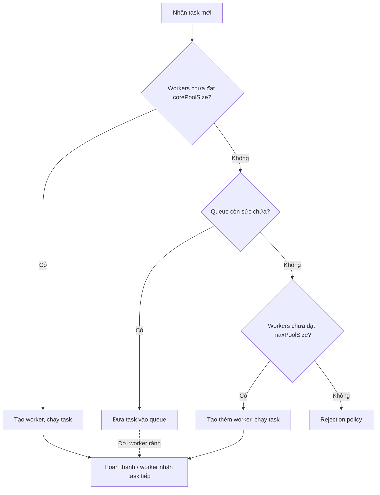

# Giới hạn concurrency bằng pool size

## 1. Vì sao phải đặt trần số tác vụ chạy đồng thời?

Trong hệ thống **SPRING_BATCH_SCALING_OPERATIONS**, tăng số luồng là một cách cải thiện throughput khi xử lý dữ liệu lớn. Tuy nhiên, một job Spring Batch có thể cùng lúc cạnh tranh CPU, bộ nhớ, kết nối database, giới hạn API và tài nguyên của những job khác. Nếu cứ tạo thêm luồng khi tốc độ xử lý giảm, hệ thống có thể chuyển từ “chậm” thành **quá tải**: pool kết nối cạn, lock wait tăng, request timeout, retry dồn dập, job khó restart.

**Concurrency** ở đây là số công việc đang thực thi **đồng thời tại một thời điểm**, không phải tổng số item/chunk đã đọc, số thread từng được tạo, `chunkSize` hay số item nằm trong hàng đợi. `ThreadPoolTaskExecutor` là cách phổ biến để đặt giới hạn concurrency ở **cấp executor**.

Ví dụ: pool có 4 worker, 16 ô chờ. Khi 20 task đến cùng lúc, giả sử chưa task nào hoàn thành thì 4 task đang chạy và 16 task đang chờ. Chỉ có **4 task đang chiếm worker của pool**. Nếu thêm task khác, executor phải áp chính sách bão hòa.

> **Điểm mấu chốt:** `maxPoolSize` là giới hạn số **worker threads do pool quản lý**; không phải giới hạn tuyệt đối mọi request của ứng dụng. Caller thread, các pool khác, nhiều JVM/pod, tài nguyên downstream và giới hạn riêng của Spring Batch vẫn phải được tính.

### Kết quả cần đạt

Sau bài này, bạn có thể đọc cấu hình `corePoolSize`/`maxPoolSize`/`queueCapacity`; dự báo khi nào executor mở thêm thread hoặc từ chối task; cấu hình pool cố định có giới hạn; hiểu sự khác nhau giữa Spring Batch 5.x và 6.x; chọn concurrency từ phép đo; và kiểm tra tính đúng của retry/restart sau khi tăng tải.

## 2. Bốn khái niệm không được nhầm lẫn

| Thuật ngữ | Ví dụ | Ý nghĩa |
| --- | --- | --- |
| `chunkSize` | `chunk(100)` | Số item tối đa được gom trong một chunk; **không** phải số luồng |
| Pool concurrency | `core=max=4` | Tối đa bốn worker của **pool đó** đồng thời thực thi task |
| Queue capacity | `queueCapacity=16` | Tối đa 16 task chờ khi chưa được worker nhận, không phải 16 task đang chạy |
| Tổng application concurrency | 3 job, mỗi job pool 4 | Có thể tới 12 worker nếu ba pool độc lập, hoặc 4 tổng nếu chia sẻ cùng pool 4 |

Với Spring Batch, còn cần phân biệt **task được giao cho executor**: ở Spring Batch 5.x, một multi-threaded chunk step truyền thống có thể xử lý các chunk trên những thread khác nhau. Ở mô hình multi-threaded step của Spring Batch 6.x, `ItemProcessor` chạy đồng thời trên worker threads, còn `ItemReader` và `ItemWriter` của step chuẩn được gọi tuần tự ở thread điều phối.

Do đó, “pool 8” trong Batch 6.x **không có nghĩa 8 writer cùng ghi database**. Nếu writer là nút thắt, số thread processor tăng lên cũng khó giúp throughput vượt trần của writer. Cần cân nhắc local chunking hoặc partitioning khi muốn phân phối toàn bộ phần đọc/xử lý/ghi.

## 3. Quy tắc xử lý task của ThreadPoolTaskExecutor

`ThreadPoolTaskExecutor` bọc cơ chế `ThreadPoolExecutor` của Java. Với `queueCapacity > 0`, nó sử dụng hàng đợi có sức chứa hữu hạn hoặc rất lớn tùy cách cấu hình. Một task mới thường đi qua các nhánh:

1. Khi số worker chưa đạt `corePoolSize`, pool tạo worker để xử lý task.
2. Khi đã có đủ core workers, pool thử **đưa task vào queue**.
3. Nếu queue đầy và số worker nhỏ hơn `maxPoolSize`, pool tạo thêm worker.
4. Nếu queue đầy và số worker đã đạt max, pool áp dụng `RejectedExecutionHandler`.



**Hệ quả rất dễ bỏ sót:** nếu đặt `corePoolSize=2`, `maxPoolSize=16` và `queueCapacity=1000`, khi gửi 30 task nặng cùng lúc, pool có thể chỉ tạo khoảng 2 worker rồi xếp 28 task chờ. `maxPoolSize=16` **chưa được dùng**, vì queue chưa đầy.

### 3.1. Ví dụ các cách giới hạn concurrency

Giả sử tất cả task đều chậm, không task nào hoàn tất trong lúc nộp 20 task, executor không bị giới hạn thêm bởi Spring Batch:

| Core | Max | Queue | Trạng thái lý thuyết sau 20 task |
| ---: | ---: | ---: | --- |
| 2 | 2 | 18 | 2 đang chạy, 18 chờ |
| 2 | 8 | 2 | 8 đang chạy, 2 chờ, 10 bị reject theo mặc định |
| 2 | 8 | 100 | 2 đang chạy, 18 chờ, chưa tăng tới 8 |
| 4 | 4 | 16 | 4 đang chạy, 16 chờ |
| 4 | 4 | 0 | 4 đang chạy, 16 bị reject khi tất cả worker bận |

Bảng là **mô phỏng trạng thái lý thuyết**, không phải một bảo đảm về thứ tự thời gian ở hệ thống đang chạy. Giới hạn khác của Step, tốc độ submit và việc worker hoàn thành sớm có thể thay đổi quan sát thực tế.

Với `queueCapacity=0`, executor dùng cơ chế chuyển giao trực tiếp (`SynchronousQueue`), không có backlog nội bộ để giữ task. Điều này cho phép tăng worker lên max nhanh hơn, nhưng cũng dễ phát sinh rejection nếu bên gửi không có backpressure.

### 3.2. Ba bộ tham số quan trọng

| Tham số | Ý nghĩa | Lưu ý |
| --- | --- | --- |
| `corePoolSize` | Số worker cốt lõi được tạo khi có task | Không phải lúc khởi động bean sẽ luôn có sẵn đủ thread |
| `maxPoolSize` | Trần worker threads của pool | Không bắt buộc pool sẽ đạt trần này |
| `queueCapacity` | Số task chưa chạy có thể xếp chờ | Queue dài tăng latency và bộ nhớ, không làm tăng concurrency |

`ThreadPoolTaskExecutor` mặc định có core nhỏ và queue rất lớn; chỉ đổi `maxPoolSize` mà không xem lại core/queue có thể khiến ứng dụng tiếp tục xử lý gần như tuần tự. Vì vậy **cấu hình giới hạn concurrency phải bao gồm cả ba tham số**, không chỉ một.

## 4. Cấu hình pool cố định để kiểm soát tải

Một chiến lược dễ bắt đầu cho batch production là **fixed pool**: `corePoolSize = maxPoolSize`. Nó giúp biết tối đa bao nhiêu task có thể chiếm worker của executor, rồi đo xem giới hạn đó có hợp với CPU, connection pool và API rate limit hay không.

### 4.1. Ví dụ Java với Spring Boot/Spring Framework

```java
@Configuration
class BatchConcurrencyConfig {

    @Bean("invoiceProcessorPool")
    ThreadPoolTaskExecutor invoiceProcessorPool() {
        ThreadPoolTaskExecutor executor = new ThreadPoolTaskExecutor();

        executor.setThreadNamePrefix("invoice-batch-");
        executor.setCorePoolSize(4);
        executor.setMaxPoolSize(4);
        executor.setQueueCapacity(16);

        // Khi quá tải, báo lỗi rõ thay vì âm thầm bỏ task.
        executor.setRejectedExecutionHandler(
                new ThreadPoolExecutor.AbortPolicy());

        // Cần phối hợp với lifecycle của job và thời gian dừng pod.
        executor.setWaitForTasksToCompleteOnShutdown(true);
        executor.setAwaitTerminationSeconds(60);

        return executor;
    }
}
```

Spring quản lý `initialize()`/shutdown của `ThreadPoolTaskExecutor` khi bean tham gia lifecycle application context. Không cần tạo mới executor **cho từng item**: làm vậy sẽ mất lợi ích tái sử dụng worker, tốn tài nguyên và khó theo dõi pool nào đang được dùng.

Cấu hình minh họa giới hạn:

- Tối đa **4 worker threads** thực thi task trong pool.
- Tối đa **16 task chờ** tại queue của pool.
- Nếu cả worker và queue đều đầy, task nộp thêm có thể bị từ chối. `ThreadPoolTaskExecutor` thường chuyển việc từ chối thành `TaskRejectedException` theo hợp đồng Spring.
- `setWaitForTasksToCompleteOnShutdown(true)` chỉ giúp điều phối khi ứng dụng dừng; không phải bảo đảm rằng Spring Batch job sẽ commit thành công trước khi container bị kill.

### 4.2. Gắn pool vào Spring Batch 6.x

Ví dụ khai báo bước xử lý dữ liệu theo API Spring Batch 6.x. Các bean `reader`, `processor` và `writer` phải được định nghĩa theo nghiệp vụ riêng:

```java
@Bean
Step importInvoices(
        JobRepository jobRepository,
        PlatformTransactionManager transactionManager,
        ItemReader<InvoiceRow> reader,
        ItemProcessor<InvoiceRow, InvoiceRecord> processor,
        ItemWriter<InvoiceRecord> writer,
        @Qualifier("invoiceProcessorPool") TaskExecutor taskExecutor) {

    return new StepBuilder("importInvoices", jobRepository)
            .<InvoiceRow, InvoiceRecord>chunk(100)
            .transactionManager(transactionManager)
            .reader(reader)
            .processor(processor)
            .writer(writer)
            .taskExecutor(taskExecutor)
            .build();
}
```

Trong multi-threaded step chuẩn của Spring Batch 6.x, **processor** có thể chạy đồng thời trên pool, trong khi đọc và ghi vẫn tuần tự. Vì thế pool size 4 giới hạn số worker của **executor này**, còn số item đang được đọc/ghi và kích thước chunk có ý nghĩa riêng. Không suy luận rằng writer có bốn transaction ghi đồng thời chỉ từ cấu hình trên.

Với processor chạy trên worker thread, Spring transaction ở luồng đọc/ghi **không tự truyền** sang worker thread. Nếu processor dựa vào `@Transactional(propagation = MANDATORY)`, nó có thể lỗi do không có transaction đang hoạt động; cần thiết kế transaction riêng hoặc chuyển side effect vào writer.

### 4.3. Nếu dự án đang dùng Spring Batch 5.x

Cú pháp builder khác:

```java
return new StepBuilder("importInvoices", jobRepository)
        .<InvoiceRow, InvoiceRecord>chunk(100, transactionManager)
        .reader(reader)
        .processor(processor)
        .writer(writer)
        .taskExecutor(taskExecutor)
        .build();
```

Với Batch 5.x, nhiều chunk có thể được thực thi và commit đồng thời trên các worker thread. Do đó phải kiểm tra thread safety của **reader, processor, writer** và cách lưu trạng thái restart.

Một giới hạn nữa của Batch 5.x là **`throttleLimit`** trong cơ chế lặp chunk cũ (giới hạn mặc định truyền thống là 4). API này **deprecated từ Spring Batch 5.0**, không nên dựa vào nó cho code mới. Khi pool có 8 workers nhưng chỉ quan sát 4 chunk chạy đồng thời, phải kiểm tra cả throttle limit của phiên bản 5.x và các giới hạn khác trong hệ thống. Tài liệu Batch 5.2 trình bày cách dùng `RepeatOperations` tùy biến trên bounded executor cho trường hợp cần điều chỉnh sâu.

> **Không coi `poolSize=N` là lời hứa step luôn sử dụng đủ N worker.** Step phải thực sự submit đủ công việc độc lập và không bị phần tuần tự, throttle hay downstream giới hạn trước.

## 5. Pool size giới hạn cái gì, và không giới hạn cái gì?

### 5.1. Giới hạn nội bộ của một executor

Nếu `core=max=4`, một `ThreadPoolTaskExecutor` không cấp quá bốn worker threads cho các task do **chính nó** quản lý. `activeCount` cho biết số worker đang thực thi tại thời điểm quan sát; `poolSize` cho biết số worker của pool đã được tạo.

Tuy nhiên, nếu áp `CallerRunsPolicy` khi queue đầy, **thread gọi `execute(...)` có thể tự chạy task**, khiến công việc nghiệp vụ được thực thi bên ngoài bốn worker của pool. Vì vậy tổng số luồng làm nghiệp vụ có thể **lớn hơn `maxPoolSize`**, dù pool vẫn không vượt quá trần của nó. Nếu yêu cầu nghiêm ngặt “không quá bốn request đồng thời tới API”, hãy dùng thêm semaphore, rate limiter hoặc cơ chế quota ở đúng ranh giới gọi API.

### 5.2. Nhiều executor trong cùng một ứng dụng

Ba job chạy cùng lúc có thể cấu hình:

- Job A có pool 4, job B có pool 4, job C có pool 4: tổng cộng **có thể lên tới 12 worker** do ba pool độc lập tạo ra.
- Ba job chia sẻ **một pool 4**: tổng worker của pool chung vẫn tối đa 4, nhưng job chạy dài có thể chiếm hết worker khiến job khác phải chờ.

Nếu muốn áp trần toàn ứng dụng, có thể chia sẻ một executor được quản lý tập trung hoặc dùng thêm cơ chế admission control. Một pool chung dễ đặt ngân sách tài nguyên, nhưng cần xem xét **fairness**: một job nhiều task ngắn có thể chiếm queue, làm job quan trọng chậm trễ.

### 5.3. Nhiều pod hoặc JVM

Nếu cùng một ứng dụng chạy 6 pod, mỗi pod có pool 4 thì có thể tồn tại **24 worker threads** trên toàn cụm (6 × 4). Không thể lấy `maxPoolSize=4` trong một pod để kết luận toàn cluster chỉ có 4 request đồng thời.

Giới hạn toàn hệ thống cần dựa trên nguồn cấp tải và các tầng dùng chung: DB max connections, số partition của Kafka, broker consumers, API quota hoặc distributed rate limiter. Khi autoscaling tăng số pod, budget concurrency cũng tăng trừ khi có cơ chế kiểm soát ở cấp cụm.

### 5.4. Nút thắt downstream

Giả sử pool 16 workers nhưng API chỉ cho 5 request đồng thời. Dù executor có khả năng gọi 16 request, API có thể trả 429, từ chối connection hoặc tăng latency. Trong trường hợp đó, trần phù hợp ở **cửa gọi API** có thể là 5 hoặc thấp hơn để giữ headroom; tăng pool không tăng throughput hợp lệ.

Một cách nhìn thực hành:

```text
Effective concurrency <= task có sẵn để chạy
Effective concurrency <= giới hạn thực thi của executor / step
Throughput thực tế <= năng lực của nút thắt reader, processor, writer và downstream
```

Đây là **quan hệ định tính** để thiết kế, không phải công thức tính chính xác throughput. Một pool giới hạn luồng chỉ kiểm soát được một tầng trong pipeline.

## 6. Fixed pool, elastic pool và queue: chọn cách nào?

| Chiến lược | Ví dụ | Lợi ích | Đổi lại |
| --- | --- | --- | --- |
| Fixed pool | `core=4, max=4, queue=16` | Trần worker dễ hiểu, ổn định cho batch định kỳ | Nếu tải đến đột ngột, task phải đợi hoặc bị từ chối |
| Elastic pool | `core=2, max=8, queue=16` | Có thể hấp thụ đợt tải tăng | Chỉ mở thêm thread khi queue đầy; nguy cơ gây spike |
| Direct handoff | `core=2, max=8, queue=0` | Không giữ task chờ trong queue | Dễ reject hoặc bùng số worker khi nhiều task đến đồng thời |
| Queue cực lớn | `core=2, max=8, queue=100000` | Giảm reject ở đợt submit ngắn | Che giấu backlog, tăng bộ nhớ và thời gian chờ; có thể chỉ chạy 2 threads |

Với workload Spring Batch có cửa sổ chạy rõ ràng và tài nguyên downstream ổn định, **fixed pool + bounded queue** thường là điểm xuất phát dễ quan sát. Chỉ đổi sang elastic pool khi có dữ liệu cho thấy worker bổ sung được sử dụng hiệu quả và không làm vượt giới hạn chung.

Không chọn `queueCapacity` tùy tiện bằng tổng số item. Hàng đợi chứa **task**, không nhất thiết chứa từng item giống nhau giữa các phiên bản Batch; ngoài ra Spring Batch có thể có vùng đệm riêng. Cần quan sát heap, latency và số lượng task thực sự đang chờ để đặt queue hợp lý.

## 7. Khi đầy pool: rejection và backpressure

Tốc độ submit vượt tốc độ xử lý trong thời gian đủ dài sẽ khiến queue đầy. Đây là **trạng thái tải cao cần được quản lý**, không chỉ một ngoại lệ kỹ thuật.

| Chính sách | Hành vi khi queue và pool đều đầy | Phù hợp với batch dữ liệu cần đầy đủ? |
| --- | --- | --- |
| `AbortPolicy` | Từ chối task, báo lỗi | Có thể dùng nếu chấp nhận job thất bại có kiểm soát và restart đúng |
| `CallerRunsPolicy` | Thread submit tự chạy task | Có thể tạo backpressure, nhưng phải kiểm thử thread/transaction/call path |
| `DiscardPolicy` | Bỏ task | **Không nên dùng**: nguy cơ mất việc âm thầm |
| `DiscardOldestPolicy` | Bỏ task chờ lâu nhất | **Không nên dùng** khi mọi item đều phải xử lý |
| Điều tiết đầu vào | Dừng/giảm submit hoặc hạn chế số job chạy | Hữu ích khi đã có cơ chế kiểm soát work admission |

**`CallerRunsPolicy` cần đặc biệt thận trọng trong Batch:** task có thể chạy trong thread gọi executor, ảnh hưởng đến ngữ cảnh transaction, tracking và lượng concurrency thực tế. Chính sách này không tương đương một hàng đợi có giới hạn cứng end-to-end.

**`TaskRejectedException` không phải lỗi dữ liệu của `ItemProcessor`.** Nó có thể xảy ra ngay khi nộp task, trước khi retry/skip của chunk có cơ hội xử lý. Đừng thiết kế retry vô hạn cho lỗi reject: sẽ tiếp tục đẩy tải vào executor đang bão hòa. Phân loại lỗi theo tầng, ghi nhận metadata của job và điều chỉnh capacity/admission hoặc restart sau khi xử lý nút thắt.

### Khi nào queue có ích?

Queue nhỏ có thể hấp thụ một **burst ngắn** khi hệ thống vẫn xử lý nhanh hơn tốc độ đến trung bình. Nhưng nếu mức submit liên tục luôn lớn hơn tốc độ hoàn thành, không queue hữu hạn nào có thể bảo vệ hệ thống mãi mãi. Cần giảm sản lượng đầu vào, tăng năng lực xử lý thực tế hoặc thay đổi kiến trúc.

## 8. Tính concurrency từ nhu cầu nghiệp vụ

Đặt pool size bằng “số CPU × 2” mà không đo đạc thường thiếu chính xác. Hãy bắt đầu từ **SLA**, thời gian xử lý mỗi task, phần tuần tự của pipeline và quota phụ thuộc.

### 8.1. Workload CPU-bound

Nếu processor thực hiện phép biến đổi CPU nặng, thử pool gần số CPU core **thực sự được cấp** cho container, rồi đo hiệu quả. Tăng quá số core có thể chỉ làm context switching tăng; khi chạy chung ứng dụng web, scheduler và nhiều job, cần dành headroom.

### 8.2. Workload I/O-bound

Nếu processor chủ yếu chờ HTTP hoặc database, nhiều worker có thể che thời gian chờ. Một quy tắc ước lượng từ **Little's law** trong trạng thái tương đối ổn định:

```text
Concurrency cần thiết xấp xỉ throughput mục tiêu × thời gian xử lý trung bình mỗi tác vụ
Ví dụ: 100 item/s × 0,06 giây xử lý chờ I/O ≈ 6 tác vụ đồng thời
```

Đây là **ước lượng ban đầu** khi mỗi item tương ứng một tác vụ xử lý độc lập, không phải công thức đảm bảo. Latency P95/P99, retries, burst, bottleneck reader/writer và hệ thống đích có thể khiến nhu cầu khác xa giá trị trung bình.

Nếu API chỉ cho phép 5 request đồng thời trong khi công thức cần 6, cần tối ưu API, giảm thời gian chờ, cache/batch call hoặc điều chỉnh mục tiêu; tăng pool lên 20 sẽ không làm quota đó biến mất.

### 8.3. Chọn theo bottleneck thực

| Quan sát khi benchmark | Kết luận cần kiểm tra | Phản ứng phù hợp |
| --- | --- | --- |
| CPU gần 100%, activeCount đạt max | Processor CPU-bound hoặc contention CPU | Không tăng pool vô hạn; tối ưu thuật toán hoặc phân bổ CPU |
| CPU thấp, activeCount đạt max, thread chờ HTTP | Nhiều I/O blocking | Thử tăng pool có giới hạn nếu downstream còn quota |
| Queue luôn dài nhưng writer tuần tự ở Batch 6.x | Bottleneck writer | Tối ưu batch write, local chunking hoặc partitioning |
| DB connection pending và lock wait tăng | DB bão hòa | Giảm concurrency, tối ưu SQL/index, kiểm tra pool |
| Queue rất ngắn, activeCount luôn thấp | Không đủ việc được submit hoặc còn throttle | Kiểm tra stage thực sự chạy song song và giới hạn của Batch |
| Lỗi `TaskRejectedException` tăng | Pool/queue bị bão hòa | Điều tiết submit, giám sát và thiết kế restart |
| Thêm workers nhưng throughput giảm | Overhead, lock, GC, API throttling | So sánh metrics và quay về mức concurrency hiệu quả |

## 9. Benchmark mẫu: tìm điểm hiệu quả

Giả sử cùng một job xử lý **240.000 item** trên cùng hạ tầng và dữ liệu tương đương. Các số sau **chỉ là minh họa**, không phải kết quả benchmark chính thức:

| Pool size | Thời gian | Throughput xấp xỉ | Speedup so với 1 worker |
| ---: | ---: | ---: | ---: |
| 1 | 960 giây | 250 item/s | 1,00× |
| 2 | 525 giây | 457 item/s | 1,83× |
| 4 | 298 giây | 805 item/s | 3,22× |
| 8 | 280 giây | 857 item/s | 3,43× |
| 16 | 330 giây | 727 item/s | 2,91× |

Tăng pool từ 4 lên 8 chỉ giảm 18 giây; tăng 16 lại chậm hơn. Nếu yêu cầu chỉ là hoàn thành trong **5 phút**, pool 4 đáp ứng 298 giây và có thể dùng ít CPU, DB connections hơn pool 8. Nhưng phải kiểm tra độ biến động giữa nhiều lượt đo và độ đúng dữ liệu trước khi quyết định.

### Quy trình đo có thể lặp lại

1. **Baseline** bằng một worker: ghi thời gian, `readCount`, `writeCount`, `filterCount`, `skipCount`, số item đích duy nhất, CPU, RAM/GC, DB và API latency.
2. **Giữ nguyên input/logic** giữa các lần benchmark; nếu DB cache hoặc dữ liệu biến đổi, ghi rõ ảnh hưởng.
3. **Thay một biến mỗi lần**: pool 2, 4, 8; giữ queue, chunk, transaction và các giới hạn khác ổn định khi đo tác động pool.
4. Ghi `activeCount`, `poolSize`, queue depth, rejected tasks, p95 latency, connection usage và lock wait.
5. Thử cả **nhiều job cùng chạy**, vì một pool đúng cho job đơn lẻ có thể quá tải khi scheduler kích hoạt hai job đồng thời.
6. Test lỗi giữa commit, retry/restart, timeout và shutdown; đối soát số item **duy nhất** sau khi chạy lại.
7. Chọn mức chạy ổn định với dư địa tài nguyên, không chỉ tốc độ cao nhất trong một lần đo.

## 10. Monitoring: kiểm tra pool có thật sự đạt giới hạn?

`ThreadPoolTaskExecutor` cung cấp thông tin runtime qua các API như `getPoolSize()`, `getActiveCount()` và underlying `ThreadPoolExecutor`. Có thể xuất thành gauge Micrometer/Actuator hoặc hệ thống metric tương đương.

```java
@Component
class BatchPoolMetrics {

    private final ThreadPoolTaskExecutor pool;

    BatchPoolMetrics(
            @Qualifier("invoiceProcessorPool") ThreadPoolTaskExecutor pool) {
        this.pool = pool;
    }

    PoolSnapshot snapshot() {
        ThreadPoolExecutor delegate = pool.getThreadPoolExecutor();

        return new PoolSnapshot(
                pool.getPoolSize(),
                pool.getActiveCount(),
                delegate.getQueue().size(),
                delegate.getQueue().remainingCapacity());
    }

    record PoolSnapshot(int poolSize, int activeCount,
                        int queueDepth, int queueFree) {}
}
```

Đo theo thời gian có ý nghĩa hơn xem snapshot duy nhất. Khi `activeCount == poolSize == maxPoolSize` trong thời gian dài và queue thường xuyên gần đầy, executor có dấu hiệu bão hòa. Tuy nhiên nếu đang dùng pool co giãn, `activeCount == poolSize == corePoolSize` **không** chứng minh đã đạt max; cần xem queue và policy tăng worker.

Có thể đặt cảnh báo theo các chỉ dấu:

- Tỉ lệ active/max cao **kéo dài**, queue depth liên tục tăng.
- Có `TaskRejectedException` hoặc số lượng task reject khác 0.
- Job duration vượt SLA, retry/skip bất thường, `writeCount` không khớp kết quả nghiệp vụ.
- DB pool pending, API rate limiting, thread count hoặc GC tăng theo số job.
- Shutdown không hoàn tất, job restart không khôi phục chính xác.

Tránh dùng queue length làm tín hiệu duy nhất: queue 0 với `SynchronousQueue` không có backlog nhưng vẫn có thể reject rất nhiều task.

## 11. Thread safety, transaction và restart khi giới hạn pool

Giới hạn concurrency giảm áp lực, nhưng **không làm một component không thread-safe trở nên thread-safe**. Với Spring Batch 5.x, các chunk có thể cùng đọc/ghi nên reader có cursor, writer file hoặc collection mutable cần được kiểm tra. Với Spring Batch 6.x, processor là điểm cần thread safety trực tiếp khi xử lý song song.

Ví dụ processor gây race condition:

```java
class UnsafeProcessor implements ItemProcessor<InputRow, OutputRow> {

    private int nextSequence = 0;

    @Override
    public OutputRow process(InputRow input) {
        int sequence = ++nextSequence; // Không atomic giữa nhiều threads
        return new OutputRow(input.id(), sequence);
    }
}
```

Thay `int` bằng `AtomicInteger` chỉ giải quyết **tranh chấp cập nhật bộ đếm**, không tự tạo thứ tự nghiệp vụ đúng hoặc checkpoint restart ổn định. Tốt nhất processor stateless hoặc có trạng thái tách biệt và đồng bộ rõ ràng.

Một số nguyên tắc khi lỗi:

- **Không dựa vào thứ tự hoàn thành task** để suy luận thứ tự commit. Với Batch 5.x, chunk chứa ID lớn có thể commit trước chunk ID nhỏ; checkpoint kiểu `lastProcessedId` có thể làm mất item khi restart.
- **Đặt transaction boundary đúng.** Trong Batch 6.x, processor chạy ở worker thread không tự tham gia chunk transaction; nếu ghi side effect ngoài writer, cần quyết định transaction riêng và idempotency.
- **Đừng trộn retry lỗi nghiệp vụ với retry executor saturation.** Task reject xảy ra khi submit, khác lỗi data validation khi processor chạy.
- **Thiết kế writer idempotent** với unique key/upsert hay trạng thái nghiệp vụ. `JobRepository` hỗ trợ metadata restart nhưng không tự bảo đảm exactly-once cho thao tác HTTP/file ngoài transaction.
- **Kiểm thử shutdown và restart** khi queue còn task, task đang chạy, và một số chunk đã commit. Việc executor chờ task ở shutdown không tương đương việc toàn bộ step được commit/đánh dấu `COMPLETED`.

## 12. Tình huống thực tế: xử lý 1,8 triệu hóa đơn

Một batch phải xử lý **1.800.000 hóa đơn trong 60 phút**, tức throughput mục tiêu tối thiểu **500 item/giây**. Processor gọi một API kiểm tra dữ liệu, thời gian đáp ứng trung bình khoảng **20 ms/item**; writer ghi vào PostgreSQL.

1. Ước lượng sơ bộ cần khoảng **10 processor tasks đồng thời** (500 × 0,02 = 10), nếu mọi item phải đi qua API và không có nút thắt khác.
2. Nhưng hệ thống đích chỉ cho **8 request đồng thời**. Đặt pool 10 hoặc 16 mà không giới hạn API có thể làm tăng 429/timeout. Cần xin quota, batch call, cache hoặc giảm latency để đáp ứng mục tiêu.
3. Triển khai bản PoC với pool `core=max=4`, queue 16. Đo throughput, p95 API latency, queue depth và correctness.
4. Thử pool 6 rồi 8 sau khi có đủ quota/điều tiết. Theo dõi DB connections, writer latency và lock wait; nếu writer là nút thắt, tăng processor threads không còn tác dụng.
5. Nếu chạy **4 pod**, mỗi pod pool 8 có thể tạo tối đa 32 processor workers trên cụm; phải tính giới hạn API **cho toàn hệ thống**, không chỉ mỗi pod.
6. Thử giết một pod sau khi writer commit nhưng trước khi job xác nhận; sau restart, đối chiếu **1.800.000 ID đầu ra duy nhất**, không chỉ số message/task được giao.

Nếu không thể đáp ứng 500 item/s với quota API hiện có, phương án đúng là điều chỉnh hợp đồng với downstream hoặc kiến trúc xử lý, thay vì tiếp tục tăng pool và làm số lần retry tăng vô hạn.

## 13. Các nhầm lẫn phổ biến

| Nhận định | Đánh giá |
| --- | --- |
| “`maxPoolSize=16` tức luôn có 16 worker đang chạy.” | Sai; pool chỉ tăng khi có đủ task, queue và core/max cho phép. |
| “`core=2, max=16, queue=1000` chắc chắn chạy 16 task cùng lúc.” | Sai; task có thể chờ ở queue khi mới có 2 worker. |
| “`queueCapacity=100` là 100 threads nữa.” | Sai; 100 task chỉ **chờ**, không thực thi. |
| “`chunk(100)` nghĩa là 100 concurrent items.” | Sai; chunk size khác pool size, concurrency phụ thuộc phiên bản và executor. |
| “`CallerRunsPolicy` vẫn giữ tổng concurrency dưới max.” | Sai; thread submit có thể chạy task ngoài pool. |
| “Mỗi pod pool 4 thì toàn hệ thống chỉ có 4 request đồng thời.” | Sai khi triển khai nhiều pod/pool. |
| “Giảm maxPoolSize là đủ để đảm bảo không vượt rate limit API.” | Chưa đủ nếu có nhiều pool/pod và retry; dùng quota ở đúng ranh giới API. |
| “Thread pool bảo đảm restart và exactly-once.” | Sai; vẫn cần checkpoint, transaction và idempotent writer. |
| “Queue không đầy thì hệ thống không nghẽn.” | Sai; queue 0 có thể reject, reader/writer hoặc downstream có thể đã bão hòa. |

## 14. Tự kiểm tra

**Câu 1.** Pool `core=2`, `max=8`, `queue=20`, có 12 task chậm đến ngay. Bao nhiêu worker có thể được tạo trước khi queue đầy?

*Gợi ý trả lời:* Thông thường pool tạo 2 core workers, còn 10 task vào queue; chưa cần tăng đến 8 vì queue vẫn còn chỗ.

**Câu 2.** Pool `core=max=4` nhưng có ba instance độc lập. Toàn hệ thống có thể xử lý tối đa bao nhiêu task bằng các pool đó?

*Gợi ý trả lời:* Tối đa 12 worker tasks nếu ba instance đều có tải; vẫn phải tính task chạy ngoài pool và các giới hạn downstream.

**Câu 3.** Ở Spring Batch 5.x, pool có 12 worker nhưng step chỉ dùng 4 chunk đồng thời. Bạn cần kiểm tra gì ngoài pool?

*Gợi ý trả lời:* `throttleLimit` của mô hình 5.x (mặc định truyền thống 4), khả năng submit, reader/writer và các resource pool khác. API throttle đã deprecated từ 5.0.

**Câu 4.** Khi nào queue 0 hợp lý?

*Gợi ý trả lời:* Khi có cơ chế điều tiết đầu vào rõ ràng, muốn tránh backlog trong pool, chấp nhận xử lý rejection đúng và có đủ khả năng scale tới max.

**Câu 5.** Pool 8 worker cho API quota 5 concurrent requests đã là giới hạn tối ưu chưa?

*Gợi ý trả lời:* Chưa. Cần chặn concurrency tại điểm gọi API, đồng thời xem tất cả pool/pod và phân tích thời gian chờ, rate limit, mục tiêu throughput.

## 15. Checklist trước khi vận hành

- [ ] Xác định phiên bản Spring Batch và phần việc thực sự được chạy đồng thời.
- [ ] Cấu hình rõ `corePoolSize`, `maxPoolSize`, `queueCapacity`, thread prefix và chính sách rejection.
- [ ] Ước lượng tổng concurrency của các job, executor, JVM/pod và upstream API.
- [ ] Có giới hạn ở tài nguyên phụ thuộc: DB connections, API concurrent/rate limit, broker và file handles.
- [ ] Metrics có active workers, queue depth, rejected tasks, throughput, p95 latency, CPU/GC, DB pool.
- [ ] Có backpressure hoặc chính sách khi executor bão hòa; không âm thầm bỏ task.
- [ ] Processor/reader/writer thread-safe theo đúng phiên bản Batch.
- [ ] Có transaction và checkpoint rõ ràng; thử retry/restart khi commit dở dang.
- [ ] Đối soát số item duy nhất, không chỉ `readCount` và `writeCount`.
- [ ] Chọn mức pool hoàn thành SLA với headroom; thử tải đồng thời của nhiều job và pod.

## Tài liệu tham khảo

- [Spring Batch Reference — Scaling and Parallel Processing (6.x)](https://docs.spring.io/spring-batch/reference/scalability.html): multi-threaded step, giới hạn tài nguyên và local chunking.
- [Spring Batch Reference — Scaling and Parallel Processing (5.2)](https://docs.spring.io/spring-batch/reference/5.2/scalability.html): chunk concurrency, throttle limit và lưu ý thread safety.
- [Spring Framework Reference — Task Execution and Scheduling](https://docs.spring.io/spring-framework/reference/integration/scheduling.html): `TaskExecutor` và cấu hình pool/queue.
- [Spring Framework API — ThreadPoolTaskExecutor](https://docs.spring.io/spring-framework/docs/current/javadoc-api/org/springframework/scheduling/concurrent/ThreadPoolTaskExecutor.html): tham số pool, queue, saturation, metric và lifecycle.
- [Java Platform — ThreadPoolExecutor](https://docs.oracle.com/en/java/javase/21/docs/api/java.base/java/util/concurrent/ThreadPoolExecutor.html): quy tắc core/queue/max và rejected execution.
- [Spring Batch 5.2 API — TaskExecutorRepeatTemplate](https://docs.spring.io/spring-batch/docs/5.2.x/api/org/springframework/batch/repeat/support/TaskExecutorRepeatTemplate.html): ý nghĩa giới hạn throttle của phiên bản 5.x.

**Ghi nhớ:** giới hạn concurrency bằng pool size là cách đặt **ngân sách worker rõ ràng**, nhưng phải xét queue, rejection, giới hạn của Spring Batch và tổng tải của các instance. Một cấu hình tốt là cấu hình đạt throughput cần thiết trong giới hạn tài nguyên, xử lý đúng khi quá tải và khôi phục chính xác sau lỗi.
