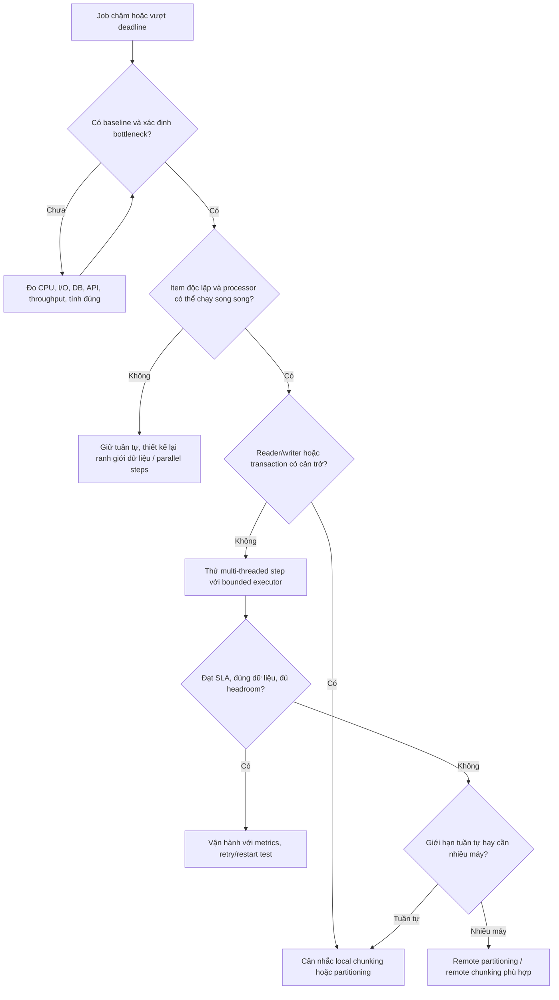

# Đánh giá multi-threaded step cho workload

## 1. Bài toán: có nên thêm nhiều thread vào một step?

Một job Spring Batch xử lý vài triệu bản ghi mỗi ngày có thể chạy vượt cửa sổ vận hành. Thêm `TaskExecutor` cho một step là một cách tăng concurrency trong cùng JVM, nhưng **không phải bước tối ưu đầu tiên cho mọi job chậm**. Nếu phần đọc/ghi dữ liệu mới là nút thắt, hoặc nghiệp vụ phải giữ thứ tự, việc tăng thread có thể làm hệ thống chậm hơn, ghi sai hoặc khiến restart khó kiểm soát.

Trong module **SPRING_BATCH_SCALING_OPERATIONS**, việc chọn giữa multi-threaded step, parallel steps, local/remote chunking và partitioning phải dựa trên **số liệu đo được**, tài nguyên CPU/I/O/DB thực tế, tính độc lập của item, thread safety và khả năng retry/restart.

**Mục tiêu:** sau bài này, bạn có thể trả lời các câu hỏi:

1. Workload có thật sự chứa phần việc đủ lớn để chạy song song không?
2. Spring Batch đang dùng **5.x hay 6.x** và phần nào của step thực sự được song song hóa?
3. Các `ItemReader`, `ItemProcessor`, `ItemWriter`, transaction và hệ thống đích có chịu được concurrency không?
4. Tốc độ tăng có xứng đáng với CPU, RAM, DB connections, lock và rủi ro restart không?
5. Khi nào multi-threaded step không còn phù hợp và nên chuyển sang partitioning hoặc kiến trúc phân tán?

## 2. Trước tiên: phân biệt cơ chế Spring Batch theo phiên bản

Cùng một lời gọi `taskExecutor(...)` nhưng **mô hình thực thi đã thay đổi trong Spring Batch 6.x**:

| Khía cạnh | Spring Batch 5.x | Spring Batch 6.x |
| --- | --- | --- |
| Công việc đưa vào worker threads | **Các chunk** có thể đọc, xử lý, ghi và commit đồng thời | **ItemProcessor** có thể chạy đồng thời; reader và writer của multi-threaded step chuẩn chạy tuần tự |
| Thread safety | Kiểm tra cả reader, processor, writer và trạng thái chunk dùng chung | Processor phải thread-safe; reader/writer chạy tuần tự trong mô hình này nhưng vẫn cần restart đúng |
| Thứ tự hoàn thành | Các chunk có thể commit không theo thứ tự | Các processor có thể hoàn thành không theo thứ tự; không dùng thứ tự hoàn thành để suy ra thứ tự nghiệp vụ |
| Chunk transaction | Chunk được xử lý trong thread chạy chunk | Transaction ở luồng điều phối **không tự lan sang** worker thread của processor |
| Giới hạn concurrency | Cơ chế `throttleLimit` truyền thống (mặc định 4), đã deprecated từ 5.0 | Kiểm soát bằng executor và cơ chế phù hợp với mô hình mới |
| Nếu cần song song hóa toàn bộ chunk | Bản thân multi-threaded step đã có chunk concurrency | Xem **local chunking** hoặc **partitioning** |

**Hệ quả quan trọng:** ở Spring Batch 6.x, nếu `ItemWriter` chiếm 80% thời gian và đã chạm trần database, gắn pool 16 thread cho processor không thể biến writer thành 16 writer chạy song song. Ngược lại, nếu processor gọi API blocking và các item độc lập, tăng concurrency có thể giúp giảm thời gian chờ tổng thể.

`@StepScope` tạo đối tượng gắn với `StepExecution`, **không phải mỗi thread một bean**. Vì vậy không thể dựa vào `@StepScope` để chứng minh một processor có field mutable là thread-safe.

> **Giới hạn áp dụng:** Khi dùng Spring Batch 5.x, cần đánh giá reader/writer stateful đặc biệt nghiêm ngặt. Khi dùng 6.x, không được áp trực tiếp giả định “mỗi chunk ở một thread” từ các ví dụ 5.x.

## 3. Phân tích workload trước khi thay code

Một phép đo hiệu năng đúng cần tách ba loại thời gian:

- **Thời gian công việc:** CPU biến đổi dữ liệu, chuẩn hóa, tính toán, mã hóa, kiểm tra nghiệp vụ.
- **Thời gian chờ:** database query/write, HTTP, file I/O, broker, lock, connection pool.
- **Thời gian điều phối:** tạo task/thread, queue, GC, transaction begin/commit, metadata và retry.

Với `ItemReader` → `ItemProcessor` → `ItemWriter`, các câu hỏi giúp tìm nút thắt:

| Phép quan sát | Cần đo | Gợi ý chẩn đoán |
| --- | --- | --- |
| Reader | Item/s, query duration, đọc trang/cursor, connection waits | Reader tuần tự hoặc SQL chậm có thể giới hạn toàn step |
| Processor | CPU/item, thời gian chờ HTTP, P95/P99 latency, lỗi API | Nếu độc lập và chiếm phần lớn thời gian, concurrency có thể hữu ích |
| Writer | Batch write latency, commit time, lock wait, deadlocks | DB đã nghẽn thì thêm thread thường làm cạnh tranh tăng |
| JVM | CPU/core, heap, GC pauses, active thread, task queue | Quá nhiều worker có thể làm GC hoặc scheduling chiếm thời gian |
| Hạ tầng | CPU quota container, DB connection pool, API rate limit | Không được coi số core hoặc kết nối trên máy host là ngân sách riêng cho job |
| Batch metadata | `readCount`, `writeCount`, `filterCount`, `skipCount`, retry, duration | Phải đối chiếu với dữ liệu đích duy nhất, không chỉ số liệu step |

### 3.1. Throughput, latency và deadline

```text
throughput (items/s) = số item xử lý thành công / thời gian hoàn tất (giây)

throughput mục tiêu = số item cần xử lý / cửa sổ thời gian cho phép
```

Ví dụ: cần xử lý **1.200.000 item trong 30 phút**, throughput mục tiêu là:

```text
1.200.000 / (30 × 60) ≈ 667 item/giây
```

Nếu bản single-threaded chỉ đạt 300 item/s, phải tìm phương án tăng ít nhất khoảng 2,23 lần. Nhưng 667 item/s không phải bằng chứng rằng cần đúng ba thread: mức tăng phụ thuộc việc serial/parallel chồng lấp ra sao, transaction overhead và các giới hạn downstream.

**Độ trễ một item có thể tăng trong khi throughput tổng tăng.** Khi so sánh, báo cáo cả throughput tổng, P95 latency và hàng đợi tác vụ; chỉ dùng tổng thời gian chạy sẽ che giấu tình trạng API hoặc DB bị quá tải.

### 3.2. Ước lượng trần lý thuyết trong Spring Batch 6.x

Nếu reader cấp tối đa `R_read` item/s, writer ghi tối đa `R_write` item/s, và processor tốn trung bình `t_process` giây/item với `N` worker tasks đồng thời, một ước lượng đơn giản cho pipeline ổn định là:

```text
Throughput tối đa lý thuyết ≲ min(R_read, N / t_process, R_write)
```

Ví dụ:

| Thành phần | Năng lực đo được |
| --- | ---: |
| Reader tuần tự | 1.800 item/s |
| Processor | Trung bình 20 ms/item, 4 worker ≈ 200 item/s |
| Writer tuần tự | 650 item/s |

Với 4 worker, processor có thể là nút thắt gần **200 item/s**. Tăng lên 16 worker khiến năng lực processor lý thuyết tăng lên ~800 item/s, nhưng pipeline vẫn bị writer chặn ở **650 item/s**. Các con số bỏ qua overhead, variability và retry; hãy dùng như **ước lượng định hướng**, không thay benchmark.

Nếu bottleneck nằm ở writer/reader tuần tự trong Batch 6.x, cân nhắc **local chunking**, **local partitioning** hoặc tối ưu SQL/batch write; thêm worker cho processor không giải quyết nút thắt tuần tự đó.

## 4. Điều kiện để multi-threaded step phù hợp

Có thể dùng bảng “đèn xanh/đỏ” sau để đánh giá trước khi viết cấu hình:

| Tiêu chí | Tín hiệu phù hợp | Tín hiệu phải dừng và thiết kế lại |
| --- | --- | --- |
| Độc lập giữa các item | Mỗi item có thể xử lý riêng, không cần kết quả item trước | Phụ thuộc thứ tự, tính số dư liên tiếp hoặc cần sequence toàn cục |
| Tỉ trọng xử lý | Processor CPU-bound hoặc I/O-bound chiếm phần đáng kể | Phần tăng tốc được rất nhỏ so với đọc/ghi |
| Thread safety | Processor stateless, clients thread-safe | Shared mutable map/counter/cursor/session |
| Dữ liệu đích | Unique key, upsert hoặc idempotency rõ ràng | Retry có thể phát sinh thanh toán/ghi nhận trùng |
| Transaction | Biết rõ side effect nằm ở processor hay writer | Processor mặc định phụ thuộc chunk transaction ở thread khác |
| Downstream | DB/API còn headroom khi tăng concurrency | Pool DB đầy, 429/rate limit, lock wait cao |
| Restart | Có cách tái chạy an toàn khi hoàn tất không theo thứ tự | Checkpoint dùng một `lastProcessedId` không phản ánh item chưa commit |
| Vận hành | Có benchmark, metric và load test | Chỉ dựa vào số thread/CPU để kết luận |

**Ví dụ không phù hợp ngay:** xử lý biến động số dư tài khoản theo đúng thứ tự thời gian. Nếu item sau phụ thuộc số dư do item trước tạo ra, việc chạy song song tùy ý có thể cho kết quả sai. Có thể thiết kế **phân vùng theo tài khoản**, trong từng tài khoản vẫn xử lý tuần tự, còn các tài khoản khác nhau song song. Đây là vấn đề phân vùng dữ liệu, không chỉ là cấu hình thread pool.

## 5. Cấu hình một phép thử có giới hạn

Bắt đầu từ **baseline một luồng**, sau đó chạy phép thử với pool có giới hạn. Các ví dụ dưới đây lược bỏ import và mô hình `InvoiceRow`/`InvoiceRecord`. Đối với Spring Batch 6.x, cấu hình step theo API:

### 5.1. Thread pool có giới hạn

```java
@Bean("batchProcessorPool")
ThreadPoolTaskExecutor batchProcessorPool() {
    ThreadPoolTaskExecutor executor = new ThreadPoolTaskExecutor();
    executor.setThreadNamePrefix("batch-processor-");
    executor.setCorePoolSize(4);
    executor.setMaxPoolSize(4);
    executor.setQueueCapacity(32);
    // Chính sách khi bão hòa cần được kiểm thử cùng step.
    return executor;
}
```

Pool này tái sử dụng tối đa bốn worker, có tối đa 32 task chờ trong queue. **Queue không làm tăng số task đang thực thi**. Nếu cả pool và queue đều đầy, task có thể bị từ chối; việc từ chối khi submit cần được phân biệt với một lỗi nghiệp vụ trong `ItemProcessor`.

### 5.2. Step Spring Batch 6.x

```java
@Bean
Step processInvoices(
        JobRepository jobRepository,
        PlatformTransactionManager transactionManager,
        ItemReader<InvoiceRow> reader,
        ItemProcessor<InvoiceRow, InvoiceRecord> processor,
        ItemWriter<InvoiceRecord> writer,
        @Qualifier("batchProcessorPool") TaskExecutor taskExecutor) {

    return new StepBuilder("processInvoices", jobRepository)
            .<InvoiceRow, InvoiceRecord>chunk(100)
            .transactionManager(transactionManager)
            .reader(reader)
            .processor(processor)
            .writer(writer)
            .taskExecutor(taskExecutor)
            .build();
}
```

**Cần hiểu đúng:** nhiều lời gọi `process(...)` có thể thực thi đồng thời; reader và writer của step chuẩn Batch 6.x vẫn chạy tuần tự. `chunk(100)` là kích thước chunk, **không phải số thread**.

Mẫu processor dễ kiểm soát là **stateless**:

```java
@Bean
ItemProcessor<InvoiceRow, InvoiceRecord> invoiceProcessor() {
    return row -> {
        BigDecimal total = row.amount().subtract(row.discount());
        return new InvoiceRecord(row.id(), total);
    };
}
```

Các giá trị chỉ nằm trong biến cục bộ; logic không lưu vào field dùng chung, connection, `EntityManager` hoặc `HashMap` mutable. Nếu bắt buộc có cache/shared state, phải kiểm chứng thư viện hỗ trợ concurrent access và ý nghĩa nghiệp vụ của cập nhật đồng thời.

### 5.3. Điều chỉnh cú pháp và lưu ý cho Spring Batch 5.x

Spring Batch 5.x dùng `chunk` với transaction manager:

```java
return new StepBuilder("processInvoices", jobRepository)
        .<InvoiceRow, InvoiceRecord>chunk(100, transactionManager)
        .reader(reader)
        .processor(processor)
        .writer(writer)
        .taskExecutor(taskExecutor)
        .build();
```

Trong 5.x, **các chunk** có thể chạy đồng thời nên reader/writer cũng cần kiểm tra khả năng truy cập đa luồng. Reader giữ cursor/file offset có thể đọc trùng hoặc thiếu dữ liệu nếu nhiều thread cùng thay đổi state. `SynchronizedItemStreamReader` có thể bảo vệ thao tác `read()` khi được dùng đúng, nhưng **không tự bảo đảm restart đúng** nếu chunk commit khác thứ tự.

Phiên bản 5.x cũng có cơ chế `throttleLimit` truyền thống với giá trị mặc định 4; API đã **deprecated từ 5.0**. Pool có 8 thread chưa chắc step sử dụng đủ 8 concurrent chunks nếu còn giới hạn này. Không sao chép cấu hình `throttleLimit` cũ sang Spring Batch 6.x.

> Đây là **mã minh họa để benchmark**. Khi chạy thật cần khai báo `Job`, reader/processor/writer theo data source, transaction manager và cấu hình Spring Boot phù hợp. Chọn một cơ chế concurrency cho lượt thử nghiệm để tránh benchmark nhiều phương án bị lẫn tài nguyên.

## 6. Tính đúng dữ liệu là tiêu chí bắt buộc

Một job nhanh hơn nhưng **mất item, ghi trùng hoặc sai thứ tự** là một thất bại, bất kể throughput tăng bao nhiêu.

### 6.1. Race condition và shared mutable state

Ví dụ processor không an toàn:

```java
class UnsafeProcessor implements ItemProcessor<InvoiceRow, InvoiceRecord> {
    private int sequence = 0; // Shared mutable field

    @Override
    public InvoiceRecord process(InvoiceRow row) {
        return new InvoiceRecord(row.id(), ++sequence);
    }
}
```

Nhiều thread cùng tăng `sequence` có thể gây mất cập nhật. Thay bằng `AtomicInteger` chỉ sửa **atomicity của bộ đếm**, nhưng không bảo đảm số thứ tự theo thứ tự input. Nếu sequence là ràng buộc nghiệp vụ, cần cấp phát số ở database hoặc chiến lược xử lý tuần tự/phân vùng có kiểm soát.

### 6.2. Transaction không tự lan truyền sang worker thread

Spring transaction dùng context gắn với thread. Trong multi-threaded step **6.x**, processor chạy trên worker thread **không tự tham gia chunk transaction** của luồng điều phối. Vì vậy:

- `@Transactional(propagation = MANDATORY)` trên processor có thể thất bại vì thread không có transaction hiện tại.
- Nếu processor gửi HTTP request hoặc ghi sang hệ thống ngoài DB, rollback của writer không tự đảo ngược side effect đó.
- Ưu tiên processor xử lý dữ liệu thuần, writer thực hiện ghi trong transaction; nếu processor cần transaction riêng, cấu hình có chủ đích bằng `TransactionTemplate` hoặc method `@Transactional` qua Spring proxy và kiểm soát consistency.

### 6.3. Idempotency, retry và checkpoint

Với Batch 5.x, các chunk có thể commit không theo thứ tự; chunk ID 201–300 có thể hoàn thành trước ID 101–200. Lưu `lastProcessedId=300` rồi bỏ qua toàn bộ ID ≤ 300 khi restart sẽ làm mất 101–200 nếu chunk đó chưa commit.

Những điều kiện cần kiểm tra:

1. **Khóa nghiệp vụ duy nhất** ở sink, ví dụ `invoiceId` cùng `sourceVersion` nếu cần; dùng unique constraint/upsert phù hợp.
2. **Retry có điều kiện**: lỗi tạm thời khác lỗi dữ liệu vĩnh viễn. Với lỗi API, đặt timeout/backoff và giới hạn concurrency; không retry mù khi tác động phụ có thể đã thành công.
3. **Checkpoint đúng ngữ nghĩa**: trạng thái phải phản ánh đơn vị đã commit, không suy ra từ item ID lớn nhất từng được đọc/xử lý.
4. **Restart test**: ngắt job sau khi một số chunk hoàn thành và một số chunk đang chạy; chạy lại rồi so số bản ghi **duy nhất** và kết quả nghiệp vụ.
5. **JobRepository** lưu trạng thái Batch nhưng không bảo đảm “exactly once” cho mọi HTTP/file/external side effect.

Không dùng `saveState(false)` hay đồng bộ `read()` như câu trả lời chung cho mọi vấn đề restart. Cách đúng phụ thuộc đặc điểm reader, phạm vi transaction và semantics nguồn/đích.

## 7. Đánh giá giới hạn tài nguyên và backpressure

Pool 4 thread giúp đặt trần các worker **của một executor**, nhưng không tự đặt trần đồng thời của toàn bộ ứng dụng:

| Phạm vi | Ví dụ | Điều cần chú ý |
| --- | --- | --- |
| Một pool | `core=max=4` | Tối đa 4 pool workers, nhưng `CallerRunsPolicy` có thể khiến thread submit tự xử lý thêm task |
| Nhiều pool | 3 job, mỗi job pool 4 | Có thể lên tới 12 worker trong cùng JVM |
| Nhiều pod | 5 pod, mỗi pod pool 4 | Có thể có 20 workers trên cụm nếu đều có tải |
| Database | Pool JDBC 12 connections | Bị chia sẻ với writer, reader, JobRepository và các job khác |
| API | 300 request/s hoặc 8 concurrent requests | Cần limit/rate control ở **cấp API**, không chỉ pool của một pod |

Một bounded queue hấp thụ burst ngắn. Nếu tác vụ đến liên tục nhanh hơn tốc độ xử lý, queue sẽ đầy. Với `ThreadPoolTaskExecutor`, mặc định có thể phát sinh `TaskRejectedException`. Cần lựa chọn hành vi overload có thể quan sát:

- **Giảm tốc submit** hoặc số job chạy đồng thời, nếu upstream có thể chờ.
- **Giới hạn concurrency và rate** tại downstream quan trọng, ví dụ HTTP client hoặc DB pool.
- **Giảm pool size** nếu tăng thread làm tăng deadlocks/429/GC.
- Không chọn `DiscardPolicy` hoặc `DiscardOldestPolicy` cho việc xử lý bắt buộc đầy đủ.
- Chỉ dùng `CallerRunsPolicy` khi đã kiểm thử vì task có thể chạy trong thread submit và thay đổi giả định transaction/context.

**Pool size là một cơ chế đặt ngân sách**, không phải một phép bảo đảm thành công của step; phải đo queue depth, rejected task, CPU, DB waiting, latency và correctness cùng lúc.

## 8. Benchmark có kiểm soát: một bộ số liệu minh họa

Giả sử có **600.000 hóa đơn**, cùng nguồn dữ liệu, cùng logic, cùng cấu hình hạ tầng. Bảng dưới đây là **số liệu giả định phục vụ học cách phân tích**, không phải benchmark chính thức:

| Số worker | Thời gian | Throughput xấp xỉ | Speedup |
| ---: | ---: | ---: | ---: |
| 1 | 2.400 s | 250 item/s | 1,00× |
| 2 | 1.320 s | 455 item/s | 1,82× |
| 4 | 780 s | 769 item/s | 3,08× |
| 8 | 720 s | 833 item/s | 3,33× |
| 16 | 850 s | 706 item/s | 2,82× |

Tăng 4 → 8 worker chỉ tiết kiệm **60 giây**. Tăng tới 16 lại chậm hơn, có thể do contention hoặc downstream bão hòa. Nếu SLA là **15 phút**, pool 4 đã đáp ứng; chọn 8 cần có lý do cụ thể (dư địa deadline, độ biến động giữa lần chạy, chi phí tài nguyên, các job khác).

### 8.1. Lập quy trình so sánh công bằng

1. Chạy **single-threaded baseline** với dữ liệu đại diện; ghi thời gian, số item đúng, CPU/heap/GC, transaction, DB/API latency.
2. Thử từng mức pool 2–4–8 với **cùng input, chunk size, version, cấu hình DB và API**; tách các phép đo về queue/chunk size sang vòng sau.
3. Mỗi mức chạy lặp lại đủ lượt để thấy biến động do cache, JVM warm-up, dữ liệu và hạ tầng; ghi median hoặc khoảng kết quả, không chọn duy nhất một lượt nhanh nhất.
4. Ghi `activeCount`, `poolSize`, queue depth, rejection, throughput, error/retry count, DB pending connections, lock waits, P95 API latency.
5. Đối chiếu `readCount`, `writeCount`, `filterCount`, `skipCount` và tập ID đầu ra **duy nhất**. Các counter tự thân chưa đủ để phát hiện toàn bộ lỗi nghiệp vụ.
6. Chạy lại khi **hai job cùng khởi chạy**, không chỉ một job trong môi trường trống; kiểm tra quota tài nguyên dùng chung.
7. Cố tình ngắt giữa chừng và restart; đánh giá có ghi trùng/mất, thời gian hồi phục và ảnh hưởng của task đang xử lý.

### 8.2. Một metric nhìn được ngay

```java
void observePool(ThreadPoolTaskExecutor pool) {
    int workers = pool.getPoolSize();
    int busy = pool.getActiveCount();
    int waiting = pool.getThreadPoolExecutor().getQueue().size();

    // Export workers, busy, waiting thành metrics theo thời gian.
    // Kết hợp duration, successful items, retry và DB/API latency.
}
```

Khi `busy≈workers` liên tục và queue tăng, có dấu hiệu backlog. Nhưng chỉ nhìn `queueSize` vẫn chưa đủ: queue 0 có thể reject task, còn queue dài có thể xuất hiện khi reader submit burst ngắn. Quan sát **xu hướng** và các nút thắt kèm theo.

## 9. Quy tắc lựa chọn kiến trúc sau benchmark



| Tình huống | Lựa chọn thường nên thử |
| --- | --- |
| Dữ liệu vừa, xử lý phải giữ thứ tự tuyệt đối | Single-threaded step hoặc thiết kế phân vùng giữ thứ tự |
| Nhiều item độc lập, processor nặng, hạ tầng còn dư | Multi-threaded step |
| Batch 6.x bị nghẽn reader/writer tuần tự, cần tách toàn bộ chunk | Local chunking hoặc partitioning |
| Các bước nghiệp vụ khác nhau, độc lập | Parallel steps qua split/flow |
| Dataset chia theo ID/date/tenant, muốn checkpoint riêng | Local partitioning với `StepExecution` cho từng partition |
| Phải sử dụng CPU/RAM của nhiều node, có broker/vận hành phù hợp | Remote partitioning hoặc remote chunking |
| Cần chuyển toàn bộ một step sang worker node (version hỗ trợ) | Remote step execution |

**Tăng số thread và chia dữ liệu là hai việc khác nhau.** Một multi-threaded step vẫn chỉ có một `StepExecution` cho step đó; partitioning tạo các `StepExecution` riêng cho từng phần. Khi cần checkpoint độc lập hoặc tránh một reader mutable dùng chung, partitioning thường dễ kiểm soát hơn.

## 10. Tình huống thực tế: 1,2 triệu bản ghi trong 30 phút

Một công ty cần chuẩn hóa **1.200.000 giao dịch trong 30 phút**. Baseline 300 item/s nên cần tăng lên khoảng 667 item/s. Processor gọi API kiểm tra thông tin khách hàng; reader và writer dùng PostgreSQL.

**Khảo sát ban đầu:**

- Reader đạt 1.500 item/s khi đo riêng.
- Processor mất trung bình 15 ms/item, phần lớn chờ mạng; dự kiến mỗi worker phục vụ khoảng 67 item/s nếu không có contention.
- Writer đạt 900 item/s trong điều kiện không cạnh tranh.
- API phía sau giới hạn **500 request/s cho toàn bộ khách hàng ứng dụng**.

Nếu mỗi item gọi đúng một API, dù đặt pool 16 hay 32 thì **API quota 500 request/s thấp hơn SLA 667 item/s**. Kết luận đúng không phải “tăng pool tiếp”, mà cần thay đổi thiết kế: xin thêm quota, dùng batch API, cache dữ liệu hợp lệ, giảm số request/item hoặc thương lượng lại deadline.

**Nếu API quota được nâng hợp lệ**, bước tiếp theo là chọn pool ban đầu 8–12 processor tasks, chạy benchmark P95 latency, rate limit, DB lock wait và kết quả sau restart. Sau đó chọn mức đáp ứng SLA với headroom, không lấy 12 làm con số đúng tuyệt đối.

Trước production, thử ngắt job ngay sau khi một số giao dịch đã ghi vào DB; kiểm tra unique key và upsert giúp restart không tạo thêm dòng trùng. Nếu workload phải tính số dư theo thứ tự, phân vùng theo tài khoản hoặc xử lý tuần tự trong từng nhóm, không cho các thread xử lý giao dịch cùng tài khoản ngẫu nhiên.

## 11. Lỗi đánh giá thường gặp

| Nhận định | Điều cần sửa |
| --- | --- |
| “CPU chưa đầy thì tăng thread là chắc chắn nhanh hơn.” | Có thể đang nghẽn DB, API, lock hoặc phần tuần tự của pipeline. |
| “Có 8 worker thì cả reader/processor/writer đều có 8 bản sao.” | Sai cho multi-threaded step chuẩn Batch 6.x. |
| “Một pool 4 nghĩa cả cụm có tối đa 4 tác vụ.” | Mỗi pool/pod có ngân sách riêng; còn các job và client khác. |
| “`chunk(100)` tức chạy song song 100 item.” | Chunk size là số item trong một chunk, không phải số worker. |
| “`@StepScope` tạo một processor cho mỗi thread.” | Scope theo step execution, vẫn có thể chia sẻ state. |
| “Writer đã ghi 600.000 item thì chắc chắn có 600.000 ID duy nhất.” | Cần đối chiếu dữ liệu đích, skip/retry và định danh nghiệp vụ. |
| “Tăng concurrency không ảnh hưởng transaction.” | Transaction gắn với thread, đặc biệt quan trọng ở Batch 6.x. |
| “Thread-safe đồng nghĩa restart-safe.” | Tính an toàn truy cập đồng thời khác tính đúng của checkpoint/replay. |
| “Một benchmark nhanh nhất là đủ chọn pool.” | Cần nhiều lượt, tải đồng thời, lỗi và headroom tài nguyên. |
| “Executor tự bảo đảm exactly-once.” | Cần idempotency/unique key, transaction và khôi phục thích hợp. |

## 12. Checklist quyết định trước khi rollout

- [ ] Đã xác nhận Spring Batch 5.x/6.x và đúng semantics của `taskExecutor(...)`.
- [ ] Có baseline single-threaded với dữ liệu đại diện và deadline cụ thể.
- [ ] Đã phân tích thời gian đọc, xử lý, ghi, commit, API/DB waiting.
- [ ] Các item có thể chạy độc lập; yêu cầu ordering/transaction được viết rõ.
- [ ] Processor thread-safe; reader/writer đúng yêu cầu version và không chia sẻ state nguy hiểm.
- [ ] Có pool/queue bounded, chính sách rejection và giám sát saturation.
- [ ] Concurrency tính trên toàn bộ job, pool, pod, DB và API quota.
- [ ] Kết quả được đối chiếu theo khóa nghiệp vụ duy nhất, không chỉ metric throughput.
- [ ] Có retry/backoff phù hợp; job đã được thử crash/restart và idempotency.
- [ ] Đã thử tải nhiều lần, có số đo P95/P99, CPU, RAM/GC, DB locks và throughput.
- [ ] Có kế hoạch chuyển sang local chunking/partitioning nếu reader/writer là nút thắt.
- [ ] Cấu hình cuối đạt SLA cùng với headroom và khả năng vận hành ổn định.

## Tài liệu tham khảo

- [Spring Batch — Scaling and Parallel Processing (6.x)](https://docs.spring.io/spring-batch/reference/scalability.html): multi-threaded step mới, transaction của processor, local chunking và partitioning.
- [Spring Batch — Scaling and Parallel Processing (5.2)](https://docs.spring.io/spring-batch/reference/5.2/scalability.html): các chunk chạy song song, `throttleLimit` và giới hạn thread safety.
- [Spring Batch — Item Reader and Writer Implementations (5.2)](https://docs.spring.io/spring-batch/reference/5.2/readers-and-writers/item-reader-writer-implementations.html): reader stateful, `SynchronizedItemStreamReader`.
- [Spring Framework — Task Execution and Scheduling](https://docs.spring.io/spring-framework/reference/integration/scheduling.html): `TaskExecutor` và quản lý pool.
- [Spring Framework — ThreadPoolTaskExecutor API](https://docs.spring.io/spring-framework/docs/current/javadoc-api/org/springframework/scheduling/concurrent/ThreadPoolTaskExecutor.html): concurrency/queue và metric runtime.

**Điểm cần nhớ:** việc đánh giá multi-threaded step phải bắt đầu bằng phép đo và tính đúng dữ liệu. Multi-threaded step phù hợp khi phần việc thực sự chạy song song, item đủ độc lập và downstream còn headroom. Nếu đã chạm giới hạn reader/writer hoặc cần checkpoint độc lập, nên chuyển sang cơ chế chia dữ liệu phù hợp thay vì chỉ tiếp tục tăng thread.
